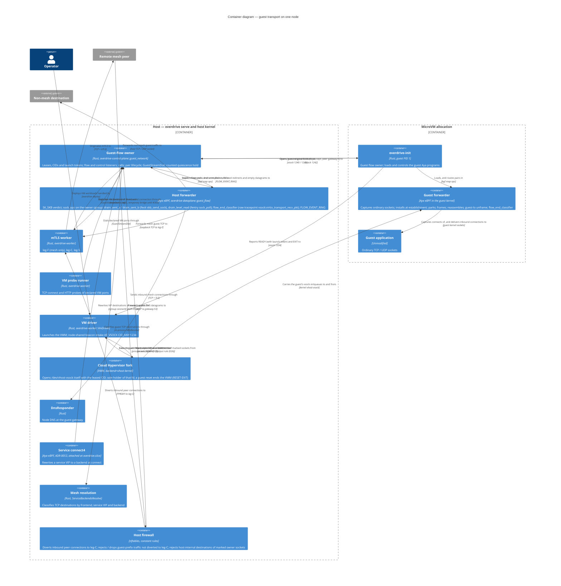

# Feature delta — netns-density-295

**Feature ID:** `netns-density-295`
**GitHub issue:** [GH #295](https://github.com/overdrive-sh/overdrive/issues/295)

**Problem.** A VM workload is attached to the node through the guest's
virtio-vsock device over the kernel vhost-vsock backend of the vendored Cloud
Hypervisor fork, with every guest flow forwarded by Aya programs in the guest
and host kernels. This replaces the per-VM network namespace, TAP device and
shared bridge attachment, whose port ceiling stopped the 16,384-attachment
density target natively (`EXFULL` at the bridge's 1,024 port slots,
`net/bridge/br_private.h:28-29`, `net/bridge/br_if.c:418 @ v7.0`;
`deliver/native-e18-bridge-capacity-falsification.md`). ADR-0145 records the
decision.

**Wave state.** The DESIGN of 2026-10-11 is applied (§ *Wave: DESIGN / [REF]
vsock Attachment Replacement DESIGN*, *Status*). DISTILL re-derives the
scenario set for the changed contract; that re-derivation is pending.

The bridge / TAP attachment design is superseded by ADR-0145; its code stays in
the tree until DELIVER deletes it, as listed under *Bridge-era code for DELIVER
to delete*.

## Wave: DESIGN / [REF] vsock Attachment Replacement DESIGN

### Status

- The DESIGN of 2026-10-11 applies the user's rulings of 2026-10-11 — INB-1
  (with the temporary leg-S bridge), END-STATE, UDP-EMPTY with D15-R4, R2-END,
  R2-DRAIN, CID-NOCLAIM, RESET-EXIT, UDP-SEQ, QHOLD and NO-SURVIVE — and the
  KERNEL-7.0 ruling of 2026-10-10. Every other decision keeps its own approval
  date (§ *Approval record*).
- The user's rulings of 2026-10-13 are applied: LEGB-DIAL (same-node mesh
  leg-B marks and source-binds its dial to a guest-prefix peer; no route
  covers the guest prefix except the gateway `/32`), GW-LOCAL (the guest
  gateway is the one host-local address of the prefix), PROBE-NOSAMPLE (a VM
  probe dial is exempt from the allocation's flow quota; a `Capacity` or
  `Quiesced` refusal records no sample), PROBE-RUN-COUNT (the probe runner
  numbers each written run and records the observed streak in the row, the
  row merges by run number, and `ServiceLifecycle` applies the threshold
  when it reads the row, acting once per crossing, with D-1: a failed
  liveness stop is retried on the next probe row still past the threshold
  and never twice on one row), and PROBE-NOSAMPLE-EVENT (every probe run
  that writes no row emits one `probe.not_sampled` event).
- Open validation items are listed and classified in § *Validation plan*.
- DISTILL re-derives the scenario set for the changed contract. DELIVER
  remains stopped; `roadmap.json` is not edited by this DESIGN (§ *Roadmap
  impact*).
- Quint: specs/quint/guest-flow-owner — 303 checks, all matched expect (176 hold, 127 expected violations), 286 ci = true, 141 evaluator runs (117 TLC, 45 Apalache), 110 named runs; cargo xtask quint verify-evidence passes (recorded 2026-10-13).
- Quint: specs/quint/probe-count — 33 checks, all matched expect (19 hold, 14 expected violations), 33 ci = true, 15 evaluator runs (18 TLC), 9 named runs on the main instance plus 6 hazard runs; main instance `probe_streak` (PROBE-RUN-COUNT as approved); hazard `streak_bugReconstruct` (the consumer reconstructs the streak from run sequences) violates `NoEarlyTerminate`, `streak_bugNoActOnce` violates `NoReactOnSameRow`, `streak_bugOncePerStreak` and `streak_bugOnceEver` violate `NoMissedTerminate` (D-1 option (a) is load-bearing), `streak_bugNoSampleFail` violates `MissingSampleInert`, `streak_bugLwwObservedAt` violates `StoreHoldsLatest`; cargo xtask quint verify-evidence passes (recorded 2026-10-13).

### [REF] Approval record

One table of every current decision id. A decision this design removed is not
listed here; § *Changed assumptions* names each once. Details the architect
pinned to make an approved ruling implementable (the `GuestStreamDial`
signature, `NoSession`, the leaked-hold fail-stop, the lost-count reset, the
dial constants) are recorded under the ruling they elaborate and carry its
date.

| Decision ids | Approved | Ruling |
|---|---|---|
| D1–D7, D9–D11, D13, D14, D16, D17, D18, D18a, D19, D20, D21 | 2026-10-05 | User approval of the decision index as proposed. Later rulings that restate a row are dated in that row of § *Decision index* |
| D8-PEER | 2026-10-05 (as part of D8); restated under INB-1 2026-10-11 | Host-opened guest connections present the guest gateway (ADR-0174) |
| D12 (#310), D15 (#308–#311), D19 restart scope (#312), S2Z (#93), G-MECH, G-CRASH | 2026-10-05 | User rulings on the replacement charter |
| D15-R1 | 2026-10-05 (acknowledged); restated under INB-1 2026-10-11 | Pre-activation host-local dials are refused at once (§ *D15 re-derivation*) |
| D16 next-fit (M-9), D20 remote-side `SO_LINGER{1,0}` (H-5) | 2026-10-06 | Corrections inside approved decisions, confirmed by the user |
| D8a, D15-R3 = (b), D24 (with D24-REFUSE), D24a, D25 (with D15-R2), D25-BIND, D26, U-1, U-2, U-5 (with assumption K-A4), SLOT-ABORT, KVER | 2026-10-06 | User rulings and approvals of 2026-10-06 |
| APPLIANCE (assumption A-31) | 2026-10-07 | Environment faults are narrowed to the appliance threat model |
| D8-PREFIX-CFG, D8-PREFIX-VIP, D19-LINKS | 2026-10-08 | User decisions of 2026-10-08 |
| ATTR-TOKEN, ATTR-LIVE-CLAIM, TCPACCEPT-END, CELL-RECREATE, D26-PINS | 2026-10-09 | Approved under the user's directive of 2026-10-09 ("if design needs changing, then you remediate, and then proceed to DISTILL") |
| QPROJ-1 to QPROJ-7, U-QP-1, U-QP-2 | 2026-10-09 | User approval of the conformance projection (§ *Conformance observation surface and action map*) |
| DG-1 to DG-16, as current in § *DISTILL design-gap closure* | 2026-10-09 | Approved under user delegation |
| DG-2-R2, DG-4-CTOR, DG-CONST, DG-5-A, DG-5-B, DG-5-C, DG-5-E, DG-5-F, DG-5-Q | 2026-10-10 | Approved by the user (delegated: "choose the correct solution; surface only if it breaks functionality") |
| KERNEL-7.0 | 2026-10-10 | The pinned kernel is Linux 7.0; user ruling recorded in `CLAUDE.md` § "Vendored components" |
| UDP-EMPTY, D15-R4 | 2026-10-11 | User ruling "D15 empty UDP datagrams (finding 2, V-29)" |
| END-STATE | 2026-10-11 | User ruling "End-state guest networking": the guest is NIC-less and vsock-only; #303 adapts to it |
| INB-1 (per-kind dial, `GuestStreamDial`, `NoSession`, the temporary leg-S bridge) | 2026-10-11 | User rulings "Finding 1" and "Finding 1 amended", recorded on [#303](https://github.com/overdrive-sh/overdrive/issues/303#issuecomment-6113302506) |
| R2-END, R2-DRAIN, CID-NOCLAIM, RESET-EXIT, UDP-SEQ, QHOLD, NO-SURVIVE | 2026-10-11 | User ruling "Items 2–6 approved" |
| LEGB-DIAL | 2026-10-13 | User ruling "Leg-B dial contract replaces PREFIX-ROUTE-LO / INB-1-READ" |
| GW-LOCAL | 2026-10-13 | User approval of ADR-0152 as written |
| PROBE-NOSAMPLE | 2026-10-13 | User approval of ADR-0187 decisions 1–3; how a sample is counted moved to PROBE-RUN-COUNT |
| PROBE-RUN-COUNT | 2026-10-13 | User ruling "Probe threshold counting (round-2 H-A)", and the user ruling of 2026-10-13 "Probe streak at source" (each row carries `same_status_runs`, counted by the probe runner; `ServiceLifecycle` applies the threshold at read time, keeps no streak, and acts once per crossing by the run sequence at which it last acted; a probe-runner restart resets the streak and is accepted). The run-sequence numbering, the run-sequence merge, the `SameStatusRuns` newtype, the act-once condition and the `ServiceLifecycleView` field are architect elaborations recorded under these rulings |
| PROBE-RUN-COUNT D-1 | 2026-10-13 | User decision "D-1 liveness stop retry", option (a): a failed liveness stop is retried on the next probe row that is still past the failure threshold (so at most once per probe run, bounded by the probe interval); a re-read of the same row never stops twice |
| PROBE-NOSAMPLE-EVENT | 2026-10-13 | User ruling "Probe threshold counting (round-2 H-A)" ("each no-row case … emits an event"); recorded in its own ADR (ADR-0192). The event's name, fields, reasons and level are architect elaborations recorded under this ruling |

Issue numbers #93, #303 and #308–#312 are open GitHub issues whose scope
matches their use here.

### Charter and inputs

- **Trigger.** The E18 density run hit the shared bridge's port ceiling
  natively: `EXFULL` at `set_link_master`, commit `9460d899`; Linux 7.0 allows
  1,024 ports per bridge (`net/bridge/br_private.h:28-29`,
  `net/bridge/br_if.c:418 @ v7.0`)
  (`deliver/native-e18-bridge-capacity-falsification.md`).
- **User selection (binding).** Shared-memory virtio queues + virtio-vsock +
  Aya Rust eBPF forwarding in the kernel; the Rust control plane manages
  sockets, maps, activation and lifecycle. Forbidden: a userspace payload
  relay, with one exception — the leg-S kTLS↔vsock relay for VM backends,
  temporary, deleted when #303 lands (INB-1, approved 2026-10-11); kernel
  patches or a forked or patched kernel; TAP-based attachment; C eBPF. Native
  validation on qualified metal. A VMM fork is not a kernel fork: D13 rules
  the vendored Cloud Hypervisor fork in, and RESET-EXIT is a change to it.
- **Kernel.** Linux 7.0 is the pinned appliance kernel (KERNEL-7.0,
  2026-10-10). Every kernel claim in this design is read in `vendors/linux`
  at tag `v7.0` and cited `path:line @ v7.0`. Every spike of this design ran
  on Linux 7.0.
- **Inputs.** The user rulings in § *Approval record*; the spike findings
  under `docs/feature/netns-density-295/spike/` cited per fact below; the
  Quint specification `specs/quint/guest-flow-owner/` (§ *Formal protocol
  model*).

### Evidence classification

#### Proven facts (with measured boundary)

Native runs: qualified metal (AMD EPYC 8024P, no nesting), stock Ubuntu
`7.0.0-29-generic` host and guest; rows that name Lima also ran on
`7.0.0-34` aarch64. Linux 7.0 is the pinned kernel (KERNEL-7.0), so every row
ran on the pinned kernel line. **None ran through `overdrive serve` +
`overdrive deploy`.** Fact numbers are stable identifiers; numbers not listed
supported mechanisms this design does not contain.

| # | Fact | Evidence | Boundary — what it does NOT show |
|---|---|---|---|
| P-1 | Aya SK_SKB + SockHash forwards TCP between host `AF_INET` and host `AF_VSOCK` STREAM over kernel vhost-vsock queues; backpressure; 16,384 owners | `spike/aya-vsock-proxy-findings.md`, `42f5d368` | Synthetic virtqueue driver in a private host-role VM |
| P-3 | Stock vsock SEQPACKET nonblocking send can emit a partial message, return `EAGAIN`, and re-emit the whole message. Reproduced without BPF | `spike/kernel-vs-aya-benchmark.md`, increment-l | Host-side effect on the sockmap path: P-53 |
| P-4 | STREAM host→guest + SEQPACKET guest→host on one CID: six cohorts, 384 windows, populations 1–16,384, references drained to 0 | benchmark `b63b1507d`, review APPROVED | Synthetic endpoints; cutoff losses kept as losses |
| P-5 | Empty datagrams survive as an 8-byte carrier; 0 / 1 / 64 / 1,431 / 59,000 B byte-exact; malformed frames fail closed with counters | `spike/aya-zero-udp-findings.md`, `3ee2a6ef` | Host-local delivery on `lo` only |
| P-6 | Corrected Aya at 16,384 UDP owners, 59,000 B: 0.883 GiB/s; 4.52 core-s/GiB; SUnreclaim +2.794 GiB; 16,466 kernel tasks | benchmark | Synthetic endpoints; not a production teardown bound |
| P-10 | SK_SKB cannot redirect into vsock with `BPF_F_INGRESS`: `bpf_sk_redirect_map` and `bpf_sk_redirect_hash` return `SK_DROP` for an ingress redirect to a vsock socket (`net/core/sock_map.c:656-657`, `:1262-1263 @ v7.0`); every redirect targets a socket's egress | proxy findings and review | — |
| P-12 | Stock CH v53.0 has no kernel vhost-vsock backend: `--vsock` always builds the userspace `VsockUnixBackend`, stream-only, ≤1,023 connections per VMM | source check; the fork's base diff on v53.0 `9ed824d6d` | — |
| P-14 | **The CH fork boots an unmodified guest on kernel vhost-vsock.** Guest CID = configured CID; `vhost-<pid>` kernel worker; CH holds `/dev/vhost-vsock` and no vsock Unix socket; seccomp on | `spike/ch-vhost-vsock-findings.md` P2 | Spike harness, not the VM driver; no uid drop, launch hook, launch seccomp filter or Landlock rules |
| P-15 | Fork data path: STREAM and SEQPACKET byte-exact both ways; **0 payload bytes** through CH syscalls (vs 8,413,773 on the Unix backend for the same 4 MiB) | same, P3–P4 | 1 vCPU, 512 MiB, ≤2 VMs |
| P-16 | Fork isolation and CID lifecycle: two VMs isolated; guest→guest refused; duplicate CID exits non-zero (`Failed to assign guest CID … EADDRINUSE`) with the first VM unaffected; CID reusable immediately after poweroff, `kill -9`, reboot and hot-unplug (20/20) | same, P5, P7, P9 | — |
| P-17 | Guest bind to a foreign CID (own+100, 2, 1) fails `EADDRNOTAVAIL`; the host sees the assigned CID for every accepted connection | same, P6 | Socket API only; the packet level is P-48 |
| P-18 | Fork refuses snapshot with a typed error; while paused, host connects time out | same, P10 | Migration refusal not exercised |
| P-19 | **Unmodified guest programs work in a NIC-less guest** (`curl` to host and Internet, `sshd`/`ssh -tt`/`scp`, `getent`, `dig`, busybox `nslookup`), carried by guest-kernel and host-kernel Aya over the fork | `spike/guest-vsock-capture-findings.md` (increments g, h) | One VM; spike owners, not `overdrive-init` or `serve` |
| P-20 | D15 identity holds: workload address on a guest dummy device and in `getsockname`; bind to it works; `getpeername` / `recvfrom` return the original peer; inbound `sshd` logged the host's real client address | same, G-D15, G-V4a | Inbound clients were host-local |
| P-21 | Only control I/O crosses either owner: 12 socket calls per side, sizes {8, 16}, across 64 MiB TCP, 8 MiB scp, DNS and 59,000 B UDP | same, G-KP (`strace -f -yy`) | The temporary leg-S relay (INB-1) is a payload relay by design and is not covered |
| P-22 | Early data is never lost under the out-of-band ordering: 10,000/10,000 each for egress write+FIN (serial and ×8), egress server-first, egress no-FIN, inbound server-first, inbound client-first, first UDP datagram (unconnected); 2,000/2,000 connected UDP; Recv-Q 0 everywhere at quiescence | same, G-V3 (increment h) | — |
| P-23 | **K1 as first stated is false.** In-band `Paired`: 18/100 egress server-first failed (64 B banner stranded in guest vsock), 1/100 inbound failed. Late install without re-arm: 0/100. Late install after client write+FIN: 0/100 (`sock_map` requires `ESTABLISHED`). UDP late install: 0/30 | same, G-K1 controls | — |
| P-24 | Kernel facts (v7.0 source, reproduced): TCP has a payload-free re-arm (`SO_RCVLOWAT` → `tcp_data_ready`); UDP and vsock deliver one skb per `data_ready` with no re-arm; a child installed before `accept()` ignores `data_ready`; a FIN-only skb redirected to egress disables TX with `EPIPE`; guest virtio-vsock splits host data into ≤4 KiB skbs; `FIONREAD` on a psock TCP socket reports the psock queue | same, discoveries table | — |
| P-25 | The drain signal works: verdict-forwarded bytes = `TCP_INFO.bytes_received` − FIN, plus `fexit(skb_send_sock)` sent count; 120,008 half-closes, 0 truncations. Counters must be exact (LRU eviction stalled 1 of 10,000 in increment g) | same, G-V2b, increment g/h | A single `fexit` counter loses increments to recursion misses (P-55); R2-DRAIN uses two programs and a level backstop |
| P-26 | General UDP to a host-local destination: sizes 0, 1, 1,431, 4,096, 4,097, 59,000 B, connected and unconnected, reply source = original destination | same, G-V5b | Destination was on the host; off-host: P-29, P-50 |
| P-27 | Host owner killed: in-flight `ECONNRESET`, new connects reset, DNS fails, recovery after restart. Guest owner killed: hooks gone, new TCP/UDP `ENETUNREACH`, nothing reaches the host — but in-flight applications saw a **clean EOF** | same, G-FC1, G-FC2 | Spike owners were ordinary processes; in production the guest owner is PID 1 and its death ends the VM (RESET-EXIT) |
| P-28 | Host programs ran in the physical host kernel, confined to owned maps, a `lo` TCX program (no-op unless a tuple is registered), the `fexit` counter and `sock_ops` on a cgroup holding only the owner; the host was restored after every run | same, § Host footprint | The `lo` TCX program is not part of this design (UDP-EMPTY) |
| P-29 | **V-11: off-host guest UDP works.** Sizes 0, 1, 1,431, 4,096, 4,097, 59,000 B, connected and unconnected, reply source = original destination; first-datagram stresses 1,000 + 500 + 300 empty + 200 × 4,097 B + 50 × 59,000 B untraced, all OK; real Internet DNS (`dig @1.1.1.1`) OK; only {8, 16}-byte socket I/O in both owners | `spike/v11-vip-v14-findings.md`, increments e–f | Non-empty datagrams were stripped by the verdict alone, as in this design; empty ones went through an egress TC program this design does not have (empties: P-50). No second machine: destinations were a netns behind veth (MTU 1,500) and TEST-NET / 1.1.1.1 through the physical NIC (wire captures, no echo); NIC without UDP segmentation offload; one VM |
| P-30 | Tuple-gated unframe on egress TC alone loses every datagram above the egress MTU (fragmentation precedes TC egress). Verdict-only strip works for non-empty datagrams; a zero-length redirect disables the psock's TX for the rest of the association | same, E-a / E-a2 / E-b / E-bn | — |
| P-32 | **VIP:** the ADR-0053 `connect4` program on the owner's cgroup rewrites guest TCP and UDP to a VIP; the guest sees the VIP in `getpeername` / `recvfrom`; 300/300 stress each; no map entry → unreachable | same, E-vip-* | The program was attached to the owner's own cgroup; inheritance from an ancestor (`overdrive.slice`) was not tested (A-19) |
| P-35 | **UDP slot recycling hazard** in the guest mechanism: a slot released before `Paired` returned to the pool with frames parked, was re-associated to the departed application's destination, and later first datagrams on it failed (12/200 with pairing delayed 300 ms; 200/200 without delay). No cross-destination leak observed | same, increment f | Triggered only when pairing is slower than an application's lifetime |
| P-36 | Without guest `net.ipv4.fwmark_reflect=1`, the guest's reset toward a transparent client address is not routed back, and a refusal takes the connect timeout (~3 s); with it, ~1 ms. A blocking owner `connect()` stalls unrelated flows (5 s) | same, increments c, e | — |
| P-37 | **V-22 (K-A2, K-B1).** A dead VM's established host-side vsock connections are reset before its CID is reused (4,000/4,000: `ERR` + `ECONNRESET` before reuse; `EOF` / `EPIPE` after; no byte of the new VM ever read on them; a bystander VM untouched). A connection the guest closed before the host accepted it reads its data, then EOF (4,000/4,000 each, with and without data). **Falsified: a connection still in a host accept queue when the VMM dies is marked reset, yet `accept()` returns it with the new VM's CID as peer and its first read returns the dead VM's buffered bytes** (4,000/4,000); a queued connection with no buffered bytes reads `ECONNRESET` at once (4,000/4,000). While a stale entry on a 4-tuple is unaccepted or unclosed, the new VM's connect from that tuple is refused `ECONNRESET` (500/500); once closed, it connects (500/500). `ss --vsock` keeps showing reset sockets `ESTAB` | `spike/findings-v22.md`; `spike-scratch/netns-density-295-v22/increment-f` | CH fork `41a619d19` opening the device itself; release at VMM exit. Whether an accept-time poll is race-free was not measured (not used: ATTR-TOKEN) |
| P-38 | **V-24 (K-A4).** The host's close of V_h (abort, quiescence, control-session loss, close after reconnect, owner SIGKILL) ends V_g, accepted or still queued in the guest: after the 16-byte request is read, V_g reads EOF, reports `POLLRDHUP` (already set at accept for a queued V_g) and its first write fails `EPIPE`; C is reset; 0 guest connections remain 1 s later; 18,930/18,930 flows on each of two boots. No byte reached C — but only because the host wrote nothing after the request (H-1): bytes the host sends after the request and before its close reach C (3,200/3,200). Single-flow close-to-reset 0.24–0.59 ms; under a 1,000-flow burst p99 up to 112 ms (guest scheduling). U-5 discards held (1,000/1,000 each way) | `spike/findings-v24.md`; `spike-scratch/netns-density-295-v24/` | The guest owner was a userspace model — the production sockmap route V_g → C over an ended V_g is DELIVER step 5's Tier-3 check |
| P-39 | **V-25, the facts CID-NOCLAIM keeps.** A vhost-vsock CID stays held while any reference to the device instance that set it is open (`EADDRINUSE`, 1,000/1,000 for a `dup`, a fork child, an exec-inherited descriptor, an `SCM_RIGHTS` copy) and is free at the last close; it is free ≤ 0.06 ms after the VMM is reaped (poweroff and SIGKILL, 20/20 each); while another process keeps a copy, the CID stays held after VMM exit | `spike/findings-v25.md`; `spike-scratch/netns-density-295-v25/` | Ran as root; the descriptor-handoff prototype it also measured is not part of this design |
| P-41 | **V-5(c) (K-B3, U-2).** After a host-only abort a connected guest UDP socket re-associates on its next datagram (200/200 per variant, exactly 200 associations, none while idle). With the slot's cells cleared, a refused association starts no association until the application sends again (1 per refused send; without clearing 3,348–3,805). **Recreated** cells deliver nothing of the old frames (exactly one association per repetition, 10/10); **emptied** cells do not — frames in the cell's sender-side queue or psock backlog refill it and start 3–8 associations per repetition (0/10 with exactly one). Ending an association with the reassembly cell's output cut first: 0 unstripped late replies in 2,200 cycles. Readiness dispatch by raw descriptor with recreated cells caused 7–8 spurious associations per 200 cycles; by per-registration identity, 0 | `spike/findings-v5c.md`; `spike-scratch/netns-density-295-v5c/` (increments c, e clean; b invalid) | A Rust stand-in for `overdrive-init`; the residue location inferred from the refill pattern, not read from the kernel |
| P-42 | **V-13 (H-5, G-CRASH).** `SO_LINGER{1,0}` resets every far end the **dying** owner holds — guest application (outbound non-mesh and mesh, inbound), non-mesh remote, mesh remote, inbound external client — 110/110 per cell, kTLS TX 20/20. Far ends the **surviving** owner holds observed EOF in 98, 103, 4, 4 and 49 of 110 trials: the survivor sees the dead owner's flow vsock end (`EPOLLRDHUP` only; `EPOLLHUP` never, 79/79) before control-session loss in 415 of 415 deaths; the later reset reaches the sender as `EPIPE` | `spike/findings-v13.md`; `spike-scratch/netns-density-295-v13/` | Single-threaded stand-in owners; one VM; remotes in a netns on the same host. A guest-owner death with the VM still running is not a production state: the guest owner is PID 1, and its death ends the VM (RESET-EXIT); survivor-held far ends are reset through R2-END (P-52) |
| P-47 | **V-21 (B-1).** A marked-socket output rule rejects every locally delivered destination before a byte leaves: 0 of 20 marked dials reached a service (TCP `ECONNREFUSED` in 0.1–0.7 ms; UDP `connect()` succeeds, first `send()` `EPERM`); `gateway:53` and off-host reachable; unmarked unaffected; an address added after the check rejected; no bypass by v4-mapped IPv6, `SO_BINDTODEVICE` or a 59,000 B datagram. Holes the rule's construction must close: a `ct state established,related accept` before it lets a marked UDP socket on a reused source port through; separate delete and add transactions leak (559–1,446 connects); `reject with tcp reset` passes UDP and `drop` hangs TCP; `SO_BROADCAST` lets broadcast and multicast past `fib daddr type local` (closed by `!= unicast`); marks with extra bits escape an exact-value match | `spike/findings-v21.md`; `spike-scratch/netns-density-295-v21/` | Lima and metal; netns stand-in for the root namespace; userspace sends, not the forwarder's redirect |
| P-48 | **V-10 (K-A1).** A guest forging its vsock `src_cid` cannot make the host deliver a connection or datagram attributed to another CID: the host `vhost_vsock_handle_tx_kick` `kfree_skb`s any packet whose header `src_cid` ≠ the device's host-set `guest_cid` before it reaches any `AF_VSOCK` socket. Control (`forge_cid=0`) accepts 2 with peer CID 3271; forging a sibling CID (3272) and the host CID (2) each yield `accepts=0`, `connect()` `ETIMEDOUT`, no host response; STREAM, SEQPACKET and mid-stream forging all fail. ATTR-TOKEN / ATTR-LIVE-CLAIM stay the defence for CID reuse across launches (K-A2′, V-22), which this item does not touch | `spike/findings-v10.md`; `spike-scratch/netns-density-295-v10/` | x86_64 metal, fork CH v53.0.0 `backend=vhost-kernel`; forge via a `kretprobe` override of `virtio_transport_get_local_cid()`, method-independent (the host checks received header bytes) |
| P-49 | **V-28: leg-S and VM probes over an owner-opened vsock flow.** A leg-S stand-in (real kTLS 1.3 on leg-C, `splice` or copy into a host-opened vsock STREAM to a real microVM) is byte-exact both ways in all six configurations. Half-close in every ordering is byte-exact, 0 bad and 0 hang over 2,016 stress flows. With the plain vsock socket API a guest application reset arrives as clean EOF (192/192 truncation): an established-state `RST` runs `virtio_transport_do_close`, which sets `SOCK_DONE` and `peer_shutdown` but no `sk_err` (`net/vmw_vsock/virtio_transport_common.c:1244-1252`, `:1463-1464 @ v7.0`); with a classifier on `vsock:virtio_transport_recv_pkt` on host and guest, resets cross both ways (192/192 each). A `TcpAccept` peer of gateway:0 makes the guest application see the gateway with a port the guest kernel picks (40/40 distinct). TCP-connect and HTTP probes over the flow answer as a direct probe does in every state, including a listener that never accepts (healthy while its backlog has room, then `T:110` at the guest's 1.5 s connect timeout); a dead VMM gives `ENODEV` at vsock connect in 0.04 ms. Cost: connection setup +0.55 ms; client→guest throughput −34 % (1 MiB) and −37 % (64 MiB), guest→client −2 % and −12 %; at 64 KiB −47 % up and −69 % down | `spike/findings-v28-legs-vsock.md`; `spike-scratch/netns-density-295-v28-legs-vsock/` | A stand-in relay, not the production leg-S (no rustls handshake); the baseline is loopback plaintext TCP, not the route to the VM address; throughput measured with the classifier off; the classifier was the perf-attached form (raw form: P-52); 5/192 dials refused `R:104` in one abort scenario, not investigated; the client's upload byte counter in the death runs is unverified |
| P-50 | **V-29: owner-sent empty datagrams.** With the host verdict stripping every frame, dropping a declared-length-0 frame with a ringbuf notice and the owner sending `send(fd, NULL, 0)`: every empty is emitted exactly once as a real zero-length datagram (3,000/3,000 on the wire; about 98,000 across 35 phases, none duplicated) with no psock interaction (0 send errors, 0 data datagrams lost). Empties are reordered: ungated, 31–70 % overtake their predecessor at no load and 98.8 % under a 5 Mbit throttle, by up to 2,423 positions; non-empty order is unaffected. A full notice ring is observable: 1,000 empties into a 4,096-byte ring gave 102 records + 898 counted drops, and compensating by count restored the number, not the positions. A zero-length `SK_PASS` into a psock makes `recv` return `-EFAULT` until the socket leaves the map (`net/core/skmsg.c:444-445 @ v7.0`); a zero-length redirect sends nothing (`net/core/skbuff.c:3314`, `:3336-3338 @ v7.0`) and the psock then clears TX (`net/core/skmsg.c:718,731-732 @ v7.0`). A redirected skb of ≥ 32,768 B without `bpf_skb_pull_data` leaves as 2–4 datagrams (30/30); with it, one byte-exact datagram (65/65, 1 KiB to 65,507 B). `udp_bpf` overrides no `sendmsg` (`net/ipv4/udp_bpf.c:128-135 @ v7.0`) | `spike/findings-v29-udp-empty.md`; `spike-scratch/netns-density-295-v29-udp-empty/increment-d` | Destination a netns behind a veth, no second machine; no concurrent associations, IPv6 or `UDP_SEGMENT`; the stale-epoch notice path was not exercised |
| P-51 | **V-30: guest reset.** The stock fork reboots a reset guest in place: 0 VMM exits in 29 reset trials across 7 reset kinds (PID-1 exit, `sysrq-c`, `reboot`, `reboot -f`, `sysrq-b`, triple fault, panic then triple fault) — same pid, CID and launch token; a crashing PID 1 loops (9 reboots in 15 s), never ending the VMM. The fork's reset dispatch calls `vm_reboot` (`vendors/cloud-hypervisor` `vmm/src/lib.rs:2088-2093`) and the fork has no option to exit on reset. With the VMM the only holder of its device, host flows into the old incarnation are reset (`ECONNRESET` 22–45 ms after the reset request) and the CID is free at once (32/32): the device's last close unhashes the CID and resets every connected socket whose peer CID has no device (`drivers/vhost/vsock.c:753-768`, `:721-750 @ v7.0`). A second holder of the device descriptor keeps host flows `ESTABLISHED` to the dead guest (observed 7–8 s, `send` succeeds) and the CID held until it closes. The fork grants `/dev/vhost-vsock` through one Landlock rule for `backend=vhost-kernel` (`vmm/src/vm_config.rs:908-910`) and opens and sets the CID itself (`virtio-devices/src/vsock/vhost_kernel.rs:209-214`) | `spike/findings-v30-guest-reset.md`; `spike-scratch/netns-density-295-v30-guest-reset/` | Fork `41a619d19`; the reset-exit fork change is a source reading, not built or run (A-37); `--landlock` in the device-opening mode not run; busybox initramfs guest, not the production rootfs or driver; the orphan sweep inferred from the differential and the source, not traced; 4–5 runs per cell |
| P-52 | **V-31: kernel-classified flow end, no deadline.** Clean half-close: 0 truncated, stuck or misclassified in 174,000 loopback trials and 15,000/15,000 in a microVM. Host destination `RST`: 0 clean EOF after a reset in 12,000 trials (5,931 resets) with the A6 TCP-source end check, 6/12,000 without it. Guest, host and `serve`-side owner kills: 0 violations in 6,400 held + 24,000 busy microVM trials per owner, every far end reset; the guest receives `0x3` and aborts when the `serve`-side owner dies. Control-session loss: 5,021/5,021 paired flows finished clean. Forced recursion misses at 30 % of calls: one cumulative counter alone completes 1,936/3,000 flows, cumulative + level backstop 3,000/3,000 (also at 70 % and 90 %); real misses over 77M `fexit` calls: 96,000 flows, 0 stuck; 5 GiB flows across a 32-bit wrap 6/6 exact. A perf-attached tracepoint program stranded flows in 7 of 1,173 reps; the raw tracepoint in 0 of 1,312: `trace_call_bpf`, the perf path (`kernel/events/core.c:11329`), skips a program when `bpf_prog_active` is already held (`kernel/trace/bpf_trace.c:115-127`), and a raw tracepoint is not gated on other programs (`:1568 @ v7.0`) but is still skipped, and counted in its `recursion_misses`, on the same program's recursion on one CPU (`kernel/trace/bpf_trace.c:2080-2083 @ v7.0`); such a skip is an A4 unannounced-end abort, measured by V-31-MV. Kernel facts: `shutdown(SHUT_WR)` sends `SHUTDOWN` with flags `0x2` (`net/vmw_vsock/virtio_transport_common.c:1084-1097`); close sends `0x3`, or `RST` when the peer already shut both directions (`:1288-1295`); the tracepoint fires before the socket lookup (`:1622`, `:1639`); the cumulative sent quantities are TCP `write_seq` (`net/ipv4/tcp.c:1390`) and vsock `tx_cnt` (`virtio_transport_common.c:504 @ v7.0`) | `spike/findings-v31-r2-halfclose.md`; `spike-scratch/netns-density-295-v31-r2-halfclose/` | Every microVM run used the perf-attached build; the raw form is proven on loopback only (A-34); the holder of `bpf_prog_active` was not identified; stand-in owners; no kTLS, UDP, IPv6 or hostile-guest over-credit |
| P-53 | **V-32: guest UDP into SEQPACKET.** Under credit pressure a SEQPACKET send emits a prefix without EOM, returns `-EAGAIN` and the psock backlog resends (406,799 prefixes); the host sockmap verdict with the ADR-0149 length check delivers each datagram once: 0 duplicated, 0 lost in 3,520,000; a `recv()` consumer instead merges records. The guest strparser cell stops on variable-size datagrams with default TCP options (7 of 7 cells, `strp_bad_frame = 2`); `TCP_NODELAY` on the cell's sender: 15 mixed-size cells, 1.5M datagrams, 0 stalls. The prefix rate falls with the host credit window (59,000 B: 99,988 / 17 / 0 per 100,000 at 64 / 128 / 256 KiB). A SEQPACKET send larger than `min(peer_buf_alloc, buf_alloc)` fails `-EMSGSIZE` (`net/vmw_vsock/virtio_transport_common.c:825-831`, `:843-845 @ v7.0`); the psock sends with `MSG_DONTWAIT` (`net/core/skbuff.c:3322 @ v7.0`). Without `pull_data` in the guest P2 verdict 2.4–100 % of datagrams are lost | `spike/findings-v32-udp-seqpacket.md`; `spike-scratch/netns-density-295-v32-udp-seqpacket/` | One association per VM; a TCP sink stands in for the destination; a send split into two skbs without an `-EAGAIN` between them was synthetic only (0 natural in 3.52M); most cells not repeated; IPv6 and aarch64 not run |
| P-54 | **T1: the drain gap exists.** With the target's reader paused, `sent < tcpi_bytes_received − 1` at the first `EPOLLRDHUP` in 8–97 % of TCP-source directions; half-closing at `EPOLLRDHUP` without a drain check passes only 345, 216 and 11 of 10,000 1 MiB flows at 0 / 300 / 3,000 ms pauses (2 kB flows lose 2.6–3.1 %); with the drain gate 10,000/10,000 at every pause. The verdict had always run for the final skb at `EPOLLRDHUP` (forwarded < goal in 0 of every run) | `spike/findings-drain-t1-t6.md`; `spike-scratch/netns-density-295-v27-drain/` | Stand-in single-threaded epoll owners, not the production owner; no kTLS, UDP or IPv6 |
| P-55 | **T2: event-driven drain completion.** Owner stores `goal`, then `armed`, then reads `sent`; whoever wins `cmpxchg(fired, 0, 1)` reports, else the owner waits for one ringbuf record: 194,000 loopback + 38,000 microVM flows, 0 missed, duplicate or early records, 0 truncated, 0 stuck. **One `fexit(skb_send_sock)` counter is not safe:** recursion misses lose increments, 3 of 96,000 flows stuck forever; **two independent programs**, the larger count used: 0 of 96,000 (the counters disagreed in 5 flows, never both short). Each trampoline program skips a call and counts a miss on its own recursion guard (`kernel/bpf/trampoline.c:1150-1154 @ v7.0`) | same | A last-call skip by both programs was not observed (A-35) |
| P-56 | **T3: vsock `shutdown(SHUT_WR)` ordering.** 0 early EOF in 30,000 loopback and 12,000 microVM trials, including 4,201 with credit exhausted and up to 19.6 MB accepted | same | — |
| P-57 | **T4: goal exactness.** For a TCP source the goal `tcpi_bytes_received − 1` equals the forwarded total for FIN-only and FIN-on-data (20,000 flows each, 0 mismatches; wire capture 300/300 of each shape); for a vsock source the survivor's forwarded count equals the peer's final-hop sent. Exceptions: (a) ~5e-5 of guest intake children at the default receive window end with `fwd = goal + 47,616` (receive-queue overlap duplicates; the destination receives corrupt excess bytes), 0 in 180,000 with a 4 MiB intake `SO_RCVBUF`; (b) a flow vsock installed with data already queued strands (32/400 loopback, 64/400 microVM) — installed at `connect()`, 400/400; (c) `SO_RCVLOWAT` 65,536 on flow vsocks: 0 flows complete | same | The overlap mechanism of (a) is an interpretation; the kernel source was not read (A-36) |
| P-58 | **T5: the `SHUTDOWN` flags discriminate an end.** SIGKILL and `close()` → `SHUTDOWN` flags `0x3`, `SHUT_WR` → `0x2`, 0 misclassified (660 microVM trials per side, 900 loopback); the record precedes the `EPOLLRDHUP` wake by 11–287 µs; poll shows `RDHUP` only | same | Ran with the perf-attached tracepoint; the record-before-wake order holds for the raw form only (P-52) |
| P-59 | **T6: failure path.** A TCP target reset mid-drain gives `EPOLLERR` / `EPOLLHUP` and the owner aborts: 100,000 trials, 61,295 aborted role-flows, 0 violations. A target vsock leaving `ESTABLISHED` gives no poll signal beyond `RDHUP` (`net/vmw_vsock/af_vsock.c:1250-1258 @ v7.0`) and later redirects are refused: 81 of 3,000 flows stuck without a kernel notice; with the verdict's redirect-refused record (A3) 0 stuck; an end with no announcement must abort (A4, 25,164 aborts). 54 notices arrived after abort and cell recycle and were discardable by epoch. Also: events keyed on fd numbers caused a spurious early EOF (keys must be flow ids); intake children need a `SO_RCVLOWAT` re-arm after `accept()` and the parking cell at `Paired`; `recursion_misses` is readable from the program fd's fdinfo | same | — |
| P-60 | **V-LEGB-MARK: leg-B mark + source bind for a guest-prefix peer.** With only the gateway `/32` `local` route covering the prefix, a dial with `SO_MARK = 0x1` and `bind(127.0.0.1:0)` reaches an `IP_TRANSPARENT` leg-C stand-in as `peer=127.0.0.1:<eph> local=100.95.0.7:8080`, with no default route (S1) and with one (S2: 0 IPv4 packets on the uplink); a marked dial to a tuple not in `inbound_destinations` is TCP `ECONNREFUSED`, UDP `EPERM` (S3); unmarked or mark-only → `ENETUNREACH`, bind-only → `ENETUNREACH` without a default route, `EINVAL` with one (S4, `route_localnet = 0`); a non-prefix peer gets neither option and routes as before (S5); `SO_BINDTODEVICE=lo` works only together with the bind (S6); the production client installs `32765: fwmark 0x1 lookup 100` ahead of `main` (S7); S8-equivalent: a real Cloud Hypervisor microVM answered through a leg-C stand-in over vsock | [`spike/findings-v33-legb-mark.md`](spike/findings-v33-legb-mark.md); Lima `7.0.0-38-generic` aarch64 and metal `7.0.0-29-generic` x86_64 | No `serve` + `deploy` (V-LEGB-SERVE); leg-C is a stand-in, not production leg-C; plaintext (no CA / mTLS); each probe once per host (no repetition count, concurrency or IPv6) |

#### Assumptions needing focused validation

"Blocks" names the DELIVER work whose acceptance the item gates (§ *Roadmap
impact*). A-8 (a guest cannot forge its `src_cid`) is proven at the packet
level by V-10 (P-48) and at the bind level by P-17, and is not in the table:
the host accepts a guest packet only when its `src_cid` equals the device's
CID and frees it otherwise (`drivers/vhost/vsock.c:551-558 @ v7.0`).
None may be treated as true. Each item's classification (contract-shaping or not) is in § *Validation
plan*.

| # | Assumption | Validation | Blocks |
|---|---|---|---|
| A-9 | Forwarding-owner loss is fail-closed in the production composition | V-8 | DELIVER 10-02 replacement |
| A-11 | The startup probe (loopback vsock) proves module, sockmap, verdict, framing, flow-end classifier and drain-program support; it does not prove the vhost data path | Earned Trust gold test | DELIVER new step 4 |
| A-17 | The fork VM boots and passes data under the production launch identity: uid drop, ADR-0129 hook, ADR-0143 launch filter, CH Landlock with the fork's one rule for `/dev/vhost-vsock`, the VMM opening the device itself (CID-NOCLAIM) | V-1(c) | DELIVER new step 3 |
| A-19 | The ADR-0053 `connect4` program attached at `overdrive.slice` is effective for sockets of `overdrive.slice/control-plane.slice` (ancestor inheritance, `kernel/bpf/cgroup.c:442-447 @ v7.0`; already production behaviour for workload cgroups) | V-15 (inside V-6) | DELIVER new step 11 |
| A-23 | The constant guest-prefix rules (ADR-0172) keep every packet to a guest-prefix address that is not diverted to leg-C from reaching a host socket or leaving the host by another route, for marked, unmarked and remote clients, and stay in place while `serve` is down | V-19 | DELIVER new step 9 |
| A-34 | The raw-tracepoint flow-end classifier and the drain programs of R2-END / R2-DRAIN hold in the integrated production owner in a real microVM; V-31 proved the raw form on loopback only (P-52) | One microVM batch of the integrated owner on the final raw-tracepoint build | DELIVER of the steps that ship R2-END and R2-DRAIN |
| A-35 | A final call of a direction skipped by both `fexit(skb_send_sock)` programs is repaired by the level backstop the owner triggers on a `recursion_misses` rise, seen at its counter read (every flow-event dispatch and every 1 s audit tick); the both-skip case itself was not observed in 96,000 flows (P-55) | A1 both-skip residual note | DELIVER of the step that ships R2-DRAIN |
| A-36 | A 4 MiB `SO_RCVBUF` on the guest TCP intake listener (`GUEST_INTAKE_RCVBUF`) removes the receive-queue overlap duplicates of P-57 (a); the kernel mechanism has not been read in the v7.0 source | T4 (a) kernel-source reading | DELIVER of the guest intake step |
| A-37 | The fork change that routes the guest-reset dispatch to the VMM exit path ends the VMM on a guest PID-1 crash under `panic=1` and on a triple fault, with no guest `EXIT` record; host flows are reset and the driver sees a VMM exit before or after READY and classifies it a failure (V-30 read the source only, P-51) | RESET-EXIT fork build test (ADR-0182) | DELIVER of the fork step |
| A-38 | Boot reclamation kills every VMM the new `serve` process does not supervise before any `assign`, and a reclaimed VMM's vhost-vsock device is released before its cgroup can be removed (Quint K-C5). Source support for the second half, for the task that drops the last reference: `exit_files` (`kernel/exit.c:971`) queues the final `fput` as task work (`fs/file_table.c:528-531`), `exit_task_work` (`kernel/exit.c:976`) runs it, and the task leaves its cgroup only later, in `do_cgroup_task_dead` (`kernel/cgroup/cgroup.c:7072-7083`), called through `cgroup_task_dead` from `finish_task_switch` after the task's last schedule (`kernel/sched/core.c:5193 @ v7.0`); `cgroup_task_exit` (`kernel/exit.c:980`) only runs the subsystems' exit callbacks | V-RECLAIM: Tier-3 `serve`-restart reclamation scenario | DELIVER of the reclamation step |
| A-39 | The production guest strparser cells with `TCP_NODELAY` on their senders carry variable-size datagrams without a parser stop (V-32 measured a spike cell, P-53) | UDP-SEQ variable-size cell validation (`mix` / `mixs` datagrams) | DELIVER of the guest UDP step |

**A-31 — only Overdrive writes the node's kernel objects (APPLIANCE,
approved 2026-10-07).** On the appliance, the nft tables, routes, BPF
programs, maps and links, cgroups, network namespaces and vsock devices this
design relies on are written only by Overdrive. Discharged by the appliance
image configuration (ADR-0068: no SSH, no operator shell, no third-party
daemon, and no network manager that removes routes it did not create), not by
a runtime validation item. A-31 is not in the table above, which lists
assumptions needing focused validation.

### Decision index

Every row is approved by the user on the date shown (§ *Approval record*).
"Open validations" are DELIVER-blocking proof obligations
(§ *Validation plan*), not conditions on the approval. An id missing from this
table is not a current decision (§ *Changed assumptions*).

| ID | Decision (one sentence) | Status | ADR | Open validations |
|---|---|---|---|---|
| D1 | Guest application traffic crosses the VM's virtio-vsock device and is forwarded only by Aya programs in the guest and host kernels; no guest NIC, TAP, bridge or per-VM netdevice | **APPROVED 2026-10-05** | [0145](../../product/architecture/adr-0145-vsock-kernel-forwarded-guest-transport-replaces-shared-bridge.md) (supersedes 0114; supersedes as moot 0126, 0127, 0130, 0142, 0144) | — |
| END-STATE | The guest is NIC-less and vsock-only; in-guest kernel mTLS + kTLS (#303) adapts to it, reaching the host through a guest-local loopback TCP peer held in the guest sockmap and redirected into vsock | **APPROVED 2026-10-11** | [0145](../../product/architecture/adr-0145-vsock-kernel-forwarded-guest-transport-replaces-shared-bridge.md); § *Guest-mTLS boundary (#303)* | — |
| D2 | Every VM's one vsock device uses the fork's `backend=vhost-kernel`; the VMM opens `/dev/vhost-vsock` itself under the fork's one Landlock rule for the device and is the only holder of its descriptor; nothing falls back | **APPROVED 2026-10-05**; device opened by the VMM (CID-NOCLAIM) **APPROVED 2026-10-11** | [0146](../../product/architecture/adr-0146-vm-vsock-device-uses-kernel-vhost-backend-opened-by-the-vmm.md) (supersedes 0128) | V-1(c) |
| D3 | One forwarded socket set per transport flow, never multiplexed; node pair capacity `GUEST_FLOW_MAX_PAIRS = 65,536` (four flows per attachment at the target); per-allocation quota 4,096 as a bulkhead, counting draining (half-closed, not yet completed) flows (R2-DRAIN) | **APPROVED 2026-10-05**; draining flows counted **APPROVED 2026-10-11** | [0147](../../product/architecture/adr-0147-one-kernel-forwarded-pair-per-transport-flow.md) | V-9 (sizing) |
| D4 | Datagram associations use STREAM toward the guest and SEQPACKET from the guest; the guest reassembles; the host never writes on SEQPACKET (a host rule; the guest sender is the strparser cell, UDP-SEQ) | **APPROVED 2026-10-05** | [0148](../../product/architecture/adr-0148-stream-toward-guest-seqpacket-replies-for-datagram-flows.md) | — |
| D5 | Every datagram is framed (4-byte magic + BE `u32` length; empty = header alone; bound 59,000 B) only inside the transport; the frame never reaches an application or a remote peer | **APPROVED 2026-10-05** | [0149](../../product/architecture/adr-0149-length-prefixed-datagram-frame-with-empty-carrier.md) | — |
| UDP-EMPTY | The host verdict strips the frame from every guest→host datagram (no escape rule); a frame declaring length 0 is `SK_DROP`ped with one ringbuf notice `{flow id, cell epoch}`, and the owner sends one zero-length datagram on the association's connected host UDP socket; a notice of another epoch is discarded; no verdict passes or redirects a zero-length skb, and every redirect to a UDP or SEQPACKET target is preceded by `bpf_skb_pull_data`; a lost notice increments the association cell's `empty_lost` and no other loss count; the owner reads it at every flow-event dispatch and at the 1 s audit tick and compensates the live flow of the current epoch by count, never aborting it; a cell's loss counts are reset when the cell is initialised for a new flow | **APPROVED 2026-10-11** | [0165](../../product/architecture/adr-0165-host-verdict-strips-every-guest-datagram-frame-and-the-owner-sends-empty-datagrams.md) | — (V-29 done, P-50) |
| D15-R4 | An empty UDP datagram may be reordered relative to its neighbouring datagrams of the same association; the order of non-empty datagrams is unaffected | **APPROVED 2026-10-11** | [0150](../../product/architecture/adr-0150-guest-kernel-aya-adaptation-controlled-by-overdrive-init.md) (residual D15 set), [0165](../../product/architecture/adr-0165-host-verdict-strips-every-guest-datagram-frame-and-the-owner-sends-empty-datagrams.md) | — |
| UDP-SEQ | Guest UDP keeps SEQPACKET toward the host; the host's length check (`skb.len − 8 == declared` and magic) is normative on every SEQPACKET skb, a short record being a counted credit-pressure prefix and `long`, `lt8`, `badmagic` and the guest's `strp_bad_frame` alerting; every strparser parking-cell sender sets `TCP_NODELAY`; every redirect into SEQPACKET pulls the whole frame; `min(peer_buf_alloc, buf_alloc)` ≥ 59,008 B on both ends of every SEQPACKET leg; a send split into two skbs without an `-EAGAIN` between them is an accepted, unmitigated residual | **APPROVED 2026-10-11** | [0149](../../product/architecture/adr-0149-length-prefixed-datagram-frame-with-empty-carrier.md), [0148](../../product/architecture/adr-0148-stream-toward-guest-seqpacket-replies-for-datagram-flows.md), [0150](../../product/architecture/adr-0150-guest-kernel-aya-adaptation-controlled-by-overdrive-init.md) | UDP-SEQ variable-size cell validation (A-39) |
| D6 | Ordinary guest sockets are captured and paired by guest-kernel Aya programs loaded and controlled by `overdrive-init`, at the size G-MECH approved | **APPROVED 2026-10-05** | [0150](../../product/architecture/adr-0150-guest-kernel-aya-adaptation-controlled-by-overdrive-init.md) | — |
| D7 | One node-scoped guest-flow owner exclusively holds the host forwarder (verdicts, flow-end classifier and drain programs), the control and flow listeners, control sessions, cells and host pair sockets | **APPROVED 2026-10-05** | [0151](../../product/architecture/adr-0151-one-node-guest-flow-owner-holds-forwarder-and-pair-sockets.md) | — |
| INB-1 | There is no host-local delivery to the guest prefix (no `local` route for the prefix, steering, intake listeners or listener mirroring). Exec and process workloads keep the plaintext TCP connect of leg-S and the probe runner; for a VM workload, leg-S and the VM probe runner call `GuestStreamDial::dial(target, purpose)` (the `purpose` argument, `DialPurpose::{Relay, Probe}`, is part of PROBE-NOSAMPLE), which the owner answers for a declared TCP port of an Active VM lease by opening a host-initiated `TcpAccept` vsock flow (peer gateway:0, the CID's live launch token) and returning a `GuestStream` on `Paired`, or a typed `GuestDialError` — `Refused { errno }`, `TimedOut { errno }`, `PairingDeadline`, `NotServing`, `NoSession`, `Quiesced`, `Unreachable { errno }` or the existing typed capacity refusal; `GUEST_DIAL_PAIRING_DEADLINE` > `GUEST_INBOUND_CONNECT_TIMEOUT`; a TCP-connect probe is healthy iff `dial` returns `Ok`, an HTTP probe runs over the stream; leg-S over vsock is a temporary userspace kTLS↔vsock relay, deleted when #303 lands | **APPROVED 2026-10-11** | [0173](../../product/architecture/adr-0173-host-platform-clients-reach-a-vm-port-through-an-owner-opened-vsock-flow.md) (amends 0094, 0120); [0186](../../product/architecture/adr-0186-leg-s-reaches-vm-backends-through-a-temporary-vsock-relay-until-303.md) (the temporary leg-S relay) | A-34 (reset fidelity rests on R2-END) |
| PROBE-NOSAMPLE | The VM probe runner dials with `DialPurpose::Probe` (leg-S with `DialPurpose::Relay`): a probe dial takes a node flow slot but does not count against the allocation's flow quota, and each probe task holds at most one dial in flight, so the in-flight probe dials of an allocation are bounded by the probe count its spec declares. A VM probe attempt whose dial returns `GuestDialError::Capacity` (for a probe dial: node flow slots only) or `GuestDialError::Quiesced` yields no sample: no `ProbeResultRow`, no startup-probe attempt consumed, no threshold advanced, the probe runs again at its next period, and one `probe.not_sampled` event (PROBE-NOSAMPLE-EVENT) per probe per period; every other `GuestDialError` is a probe failure with its `as_str` as detail. How a sample is counted: PROBE-RUN-COUNT | **APPROVED 2026-10-13** | [0187](../../product/architecture/adr-0187-a-vm-probe-refused-by-node-capacity-or-quiescence-records-no-sample.md); linked from [0173](../../product/architecture/adr-0173-host-platform-clients-reach-a-vm-port-through-an-owner-opened-vsock-flow.md) | — |
| D8-PEER | Host-opened guest connections present the guest gateway address, with a port the guest kernel picks, to the guest application; remote clients therefore appear from the gateway | **APPROVED 2026-10-05** (as part of D8); restated under INB-1 **2026-10-11** | [0174](../../product/architecture/adr-0174-host-opened-guest-connections-appear-from-the-guest-gateway.md) | — (V-28 done, P-49) |
| D8-PREFIX-CFG | Startup refuses `GuestPrefixOverlapsNodeAddress` when a node interface address lies inside the guest prefix and `GuestPrefixOverlapsVipRange` when a range of the configured `vip_range` overlaps it (D8-PREFIX-VIP), both in `probe_startup` before any boot effect | **APPROVED 2026-10-08** | [0185](../../product/architecture/adr-0185-the-guest-prefix-holds-no-node-address-and-no-vip.md) | — |
| GW-LOCAL | The guest gateway is the one host-local address of the guest prefix: boot converges one Overdrive-tagged `local <gateway>/32` route on `lo` (keep identical, replace differing, add missing), never removed and with no runtime writer; the rest of the prefix is not host-local. Spike evidence: with the gateway route as the only route in the prefix, an unbound UDP socket connected to `100.95.0.1:53` was answered from `100.95.0.1` while other prefix addresses failed `ENETUNREACH` (Lima `7.0.0-38-generic`; [`spike/findings-prefix-route-lo.md` § "Case 6 — rules restored, route removed, GW-LOCAL kept"](spike/findings-prefix-route-lo.md#case-6--rules-restored-route-removed-gw-local-kept)); and with the ADR-0172 constant rules loaded, a datagram to `100.95.0.1:53` was delivered to a host socket while every other prefix destination was rejected (Lima `7.0.0-38-generic` and metal `7.0.0-29-generic`; [`spike/findings-v33-legb-mark.md`](spike/findings-v33-legb-mark.md) S3) | **APPROVED 2026-10-13** | [0152](../../product/architecture/adr-0152-only-the-guest-gateway-is-host-local-in-the-guest-prefix.md) | — |
| LEGB-DIAL | When the leg-B peer is inside the guest prefix, `HostMtlsEnforcement` sets `SO_MARK = MTLS_TPROXY_MARK` and binds `127.0.0.1:0` before `connect()` (neither otherwise), so a same-node mesh dial to a VM address reaches leg-C through the existing `fwmark 0x1 → table 100` rule and TPROXY with no route covering the prefix except the gateway `/32` and no node default route; `guest_prefix` is a required constructor input (§ *[REF] Component — host mTLS enforcement leg-B dial (LEGB-DIAL)*) | **APPROVED 2026-10-13** | [0190](../../product/architecture/adr-0190-leg-b-marks-and-loopback-binds-same-node-vm-dials.md) | V-LEGB-SERVE (DELIVER) |
| PROBE-RUN-COUNT | Each written `ProbeResultRow` carries the producer's run sequence number `run_seq` (`ProbeRunSeq`, one per written run of an (alloc, role, probe_idx) key; a run that writes no row consumes none) and the observed streak `same_status_runs` (`SameStatusRuns`, the consecutive written runs ending with this one that produced its status, counted by the probe runner); the observation merge keeps the row with the greater `run_seq`; `ServiceLifecycle` keeps no streak and applies each threshold to the latest row at read time (`status == Fail && same_status_runs ≥ failure_threshold`, and the success analogue), and terminates a liveness probe once per crossing by the run sequence at which it last acted (`ServiceLifecycleView::liveness_last_acted_run`); D-1: a failed liveness stop is retried on the next probe row that is still past the threshold, and a re-read of the same row never stops twice (§ *[REF] VM probe runner*) | **APPROVED 2026-10-13** (threshold rule and D-1 approved the same day) | [0191](../../product/architecture/adr-0191-every-probe-run-counts-once-through-a-run-sequence-in-the-probe-row.md) | R5-PROBE-COUNT (DISTILL seeded-sim scenario) |
| PROBE-NOSAMPLE-EVENT | Every probe run that writes no row — a VM probe dial refused `Capacity` or `Quiesced` (PROBE-NOSAMPLE), a prober adapter error, a failed observation write — emits one `probe.not_sampled` event per probe per period at `warn`, naming the probe and the reason; it replaces the bare `probe_tick.error` warn and changes no row, verdict or view (fields: § *[REF] VM probe runner*, *The not-sampled event*) | **APPROVED 2026-10-13** | [0192](../../product/architecture/adr-0192-a-probe-run-that-writes-no-row-emits-one-not-sampled-event.md) | R5-PROBE-COUNT (DISTILL seeded-sim scenario) |
| D8a | Constant nft rules reject (output) or drop (prerouting) every packet to a guest-prefix address that is not diverted to leg-C — the gateway excluded (GW-LOCAL, ADR-0152) — so such a packet neither reaches a host socket nor leaves the host by another route; `managed_guest_ips` is replaced by the constant prefix (ADR-0125 rules 5 and 8) | **APPROVED 2026-10-06**; narrowed to the constant rules under INB-1 **2026-10-11** | [0172](../../product/architecture/adr-0172-constant-rules-refuse-guest-prefix-traffic-not-diverted-to-leg-c.md) | V-19 (A-23) |
| D9 | Guest TCP to a mesh destination is resolved once at pairing and reaches leg-F only through a registered pair; leg-F does not re-resolve and needs no write gate | **APPROVED 2026-10-05** | [0153](../../product/architecture/adr-0153-vsock-flows-terminate-at-the-accepted-mtls-enforcement-boundary.md) (supersedes 0115, 0139) | — |
| D10 | Guest DNS keeps today's nameserver (the guest gateway) and travels as an ordinary datagram association to the node `DnsResponder`, over a host UDP socket connected to `gateway:53`, which reaches the responder because the gateway is host-local (GW-LOCAL, ADR-0152) | **APPROVED 2026-10-05** | [0154](../../product/architecture/adr-0154-guest-dns-reaches-node-responder-as-ordinary-datagram-association.md) | — |
| D11 | 16,384 stays a measurement target and admission placeholder; the vsock attachment introduces no fixed limit below it; CAP-295-A is redefined and re-captured through `serve` + `deploy` | **APPROVED 2026-10-05** | [0155](../../product/architecture/adr-0155-vsock-attachment-density-target-introduces-no-topology-ceiling.md) (supersedes 0117) | V-9 |
| D12 | Inbound UDP service to VMs deferred | **APPROVED 2026-10-05** (#310) | — | — |
| D13 | VMM path = the vendored CH fork (`overdrive-sh/cloud-hypervisor`, branch `overdrive/vhost-kernel-vsock`, `--vsock cid=N,backend=vhost-kernel`), the only VMM Overdrive runs with | **APPROVED 2026-10-05** | [0146](../../product/architecture/adr-0146-vm-vsock-device-uses-kernel-vhost-backend-opened-by-the-vmm.md), [0161](../../product/architecture/adr-0161-vendored-cloud-hypervisor-fork-is-built-pinned-and-provisioned-as-a-checksummed-release.md) | — |
| RESET-EXIT | A guest reset ends the VMM: the fork routes the guest-reset dispatch to the VMM exit path instead of `vm_reboot`; the pinned fork SHA carries the change; the launch token (ATTR-TOKEN) is sound only with it. That a reset is classified as a crash and charges the restart budget is the ruling's purpose (a crash loop must charge the restart budget, `CLAUDE.md`), and the existing classification already gives it: a reset ends the VMM with no guest `EXIT` record, which the VM driver classifies as a failure without reading the VMM's exit status (pre-READY `VmGuestExitUnreported`, post-READY `WorkloadCrashedImmediately`), so no exit-status contract is added | **APPROVED 2026-10-11** | [0182](../../product/architecture/adr-0182-a-guest-reset-ends-the-vmm.md), [0161](../../product/architecture/adr-0161-vendored-cloud-hypervisor-fork-is-built-pinned-and-provisioned-as-a-checksummed-release.md), [0177](../../product/architecture/adr-0177-guest-opened-host-vsock-connections-are-attributed-by-peer-cid-and-launch-token.md) | RESET-EXIT fork build test (A-37) |
| D14 | Non-mesh egress kernel-forwarded directly to its destination; leg-F's cleartext relay removed | **APPROVED 2026-10-05** | [0162](../../product/architecture/adr-0162-non-mesh-guest-egress-is-kernel-forwarded-to-its-destination.md) | — |
| D15 | Today's guest network behaviour wherever the kernel allows it | **APPROVED 2026-10-05** (#308–#311) | 0150, 0173, 0174, 0154 | — |
| D15-R1 | A host-local platform client's dial before activation returns `GuestDialError::NotServing` at once instead of going unanswered (§ *D15 re-derivation*) | **APPROVED 2026-10-05** (acknowledged); restated under INB-1 **2026-10-11** | [0173](../../product/architecture/adr-0173-host-platform-clients-reach-a-vm-port-through-an-owner-opened-vsock-flow.md) | — |
| D15-R2 | Residual D15 differences of D25: the reserved guest port range, the guest pool limits, the 120 s idle expiry of a UDP association | **APPROVED 2026-10-06** (with D25) | [0150](../../product/architecture/adr-0150-guest-kernel-aya-adaptation-controlled-by-overdrive-init.md) | — |
| D15-R3 | A guest TCP connect to an unresponsive non-mesh destination fails as it does today: the host's destination connect is bounded only by the host kernel's SYN retries (`net.ipv4.tcp_syn_retries`, about 2 min by default); the TcpConnect opener holds no pairing deadline of its own | **APPROVED 2026-10-06** as option (b) | [0162](../../product/architecture/adr-0162-non-mesh-guest-egress-is-kernel-forwarded-to-its-destination.md) | V-9 (parked-capacity cost) |
| D16 | A VM's CID is `GUEST_CID_BASE + lease_offset`, computed once in `assign`, never persisted; `assign` is next-fit | **APPROVED 2026-10-05**; next-fit **APPROVED 2026-10-06** | [0156](../../product/architecture/adr-0156-guest-cid-derived-from-admission-lease.md) | — |
| CID-NOCLAIM | No host-kernel CID claim: within one `serve` process lease uniqueness gives CID uniqueness, and boot reclamation runs before any `assign`; the VMM is the only holder of its vhost-vsock descriptor and no Overdrive process keeps a copy, so the device's last close resets every host flow of that guest; the lease is released only after the VMM has exited; a launch whose device cannot be opened fails before READY through the typed VMM-exit start failure | **APPROVED 2026-10-11** | [0146](../../product/architecture/adr-0146-vm-vsock-device-uses-kernel-vhost-backend-opened-by-the-vmm.md), [0156](../../product/architecture/adr-0156-guest-cid-derived-from-admission-lease.md) | V-RECLAIM (A-38); V-30 done (P-51) |
| D17 | The beacon is accepted by one node-shared `AF_VSOCK` listener (`VMADDR_CID_ANY`:1234) and attributed by peer CID together with the launch token its READY carries (ATTR-TOKEN) | **APPROVED 2026-10-05**; launch token and live-launch claim approved under the user's directive of 2026-10-09 | [0157](../../product/architecture/adr-0157-beacon-on-node-shared-vsock-listener-keyed-by-peer-cid.md), [0177](../../product/architecture/adr-0177-guest-opened-host-vsock-connections-are-attributed-by-peer-cid-and-launch-token.md) | — (V-10 done, P-48; V-22 done, P-37) |
| D18 | Out-of-band pairing with install-at-establishment and kernel parking: the opener installs its flow vsock right after `connect()`; guest intake sockets are installed at establishment and parked in kernel loopback TCP cells until `Paired`, then re-armed; the acceptor reads the request before installing its accepted vsock (H-1); admission is one step with flow-table registration and a continuation stops for a closed flow (U-1) | **APPROVED 2026-10-05**; U-1 **APPROVED 2026-10-06** | [0158](../../product/architecture/adr-0158-flows-are-paired-out-of-band-with-install-at-establishment-and-kernel-parking.md) | — |
| D18a | The control session is a dedicated per-VM vsock session to host port 1243, owned by the guest-flow owner, not multiplexed on the beacon; one live session per CID by atomic claim; a control message for an unknown or closed flow is discarded and counted with no reply, SLOT-ABORT excepted (U-5), relying on K-A4 for host-opened flows; a session is claimed only after its opening record names the CID's live launch token | **APPROVED 2026-10-05**; U-5 **confirmed by the user 2026-10-06**; launch token and live-launch claim approved under the user's directive of 2026-10-09 | [0166](../../product/architecture/adr-0166-flow-control-messages-travel-on-a-dedicated-per-vm-control-session.md), [0177](../../product/architecture/adr-0177-guest-opened-host-vsock-connections-are-attributed-by-peer-cid-and-launch-token.md) | — (V-22 done, P-37; V-24 done, P-38) |
| D19 | Guest forwarding kernel objects are unpinned and owned by their process; process exit fails closed and closes guest connections | **APPROVED 2026-10-05** | [0159](../../product/architecture/adr-0159-guest-forwarding-kernel-objects-are-unpinned.md) | V-8 |
| NO-SURVIVE | VMs do not survive a `serve` restart: boot reclamation kills every VM the new process does not supervise; survival across a restart is #312; the guest's control-session reconnect covers only a listener re-bound inside the same `serve` process | **APPROVED 2026-10-11** | [0159](../../product/architecture/adr-0159-guest-forwarding-kernel-objects-are-unpinned.md), [0166](../../product/architecture/adr-0166-flow-control-messages-travel-on-a-dedicated-per-vm-control-session.md) | V-RECLAIM (A-38) |
| D19-LINKS | The forwarder's process-owned links have no runtime audit, damage recovery or gold-test detach injection; while `serve` holds them only an explicit detach removes them, and on the appliance only Overdrive could issue one (A-31) | **APPROVED 2026-10-08** | [0159](../../product/architecture/adr-0159-guest-forwarding-kernel-objects-are-unpinned.md) | — |
| D20 | Stop aborts flows with reset; owner-held sockets whose far end is outside the owner carry `SO_LINGER{1,0}` — application side and remote side (the host's socket toward a non-mesh destination and leg-F's remote socket); restore reopens admission only; how a half-close completes is R2-DRAIN | **APPROVED 2026-10-05**; remote-side extension **APPROVED 2026-10-06** | [0160](../../product/architecture/adr-0160-forwarding-stop-aborts-flows-and-restore-reopens-admission-only.md) | — (V-13 done, P-42) |
| R2-END | A flow's end is classified from the kernel's vsock `SHUTDOWN` flags by a raw-tracepoint program on `vsock:virtio_transport_recv_pkt` on host and guest, one ringbuf record per received `SHUTDOWN` / `RST` of a flow vsock: `0x2` = clean half-close of the peer's direction, `0x3` while any direction is open or `RST` = abort; an end with no record aborts with reset (A4); an unclassified TCP-source EOF is an abort when the TCP state is `CLOSE` with our write side open or the forwarded count is ≥ `tcpi_bytes_received` (A6); no control message announces a half-close | **APPROVED 2026-10-11** | [0180](../../product/architecture/adr-0180-a-flow-end-is-classified-from-the-kernels-vsock-shutdown-flags.md) | A-34 |
| R2-DRAIN | A half-close drain completes on a kernel ringbuf record with no deadline: per (flow, direction) one exact cell in a mmapable array; the owner stores `goal`, then `armed`, then reads `sent`, and the winner of `cmpxchg(fired, 0, 1)` reports, else the owner waits for the record, then shuts down the target's write side; two independent `fexit(skb_send_sock)` programs store cumulative kernel quantities and a `fentry(sock_poll)` backstop covers a last call both skip (A1; two programs because V-31 item 4 measured that configuration — a single cumulative program with the backstop was not measured); records carry the cell epoch (A2); a refused redirect writes a notice and aborts the flow (A3); a lost end, drain or redirect-refused record increments the cell's `ring_lost`, and the owner aborts every flow whose `ring_lost` rose (A7); the owner reads both programs' `recursion_misses` and the loss counts at every flow-event dispatch and at the 1 s audit tick of ADR-0124, so a last send both programs skip, or a lost record, is acted on within one audit period — a counter read, not a drain deadline; the per-allocation flow quota counts draining flows, so a guest withholding credit holds at most its own quota of node flow capacity | **APPROVED 2026-10-11** | [0183](../../product/architecture/adr-0183-a-half-close-drain-completes-on-a-kernel-record-without-a-deadline.md), [0160](../../product/architecture/adr-0160-forwarding-stop-aborts-flows-and-restore-reopens-admission-only.md), [0147](../../product/architecture/adr-0147-one-kernel-forwarded-pair-per-transport-flow.md) | A-34, A-35, A-36 |
| D21 | The fork is built from one pinned SHA (carrying RESET-EXIT), published as a checksummed release per architecture and verified by SHA-256 at provisioning | **APPROVED 2026-10-05** | [0161](../../product/architecture/adr-0161-vendored-cloud-hypervisor-fork-is-built-pinned-and-provisioned-as-a-checksummed-release.md) | — |
| D24 | Guest service-VIP access uses the existing ADR-0053 `connect4` rewrite on the guest-flow owner's always-connected host sockets; the owner runs at `overdrive.slice/control-plane.slice` and refuses to start outside the attach subtree (D24-REFUSE); the guest keeps reporting the VIP | **APPROVED 2026-10-06** | [0164](../../product/architecture/adr-0164-guest-service-vip-access-uses-the-existing-connect4-rewrite-on-owner-sockets.md) | V-15 (A-19) |
| D24a | Guest TCP to a service VIP is mesh-resolved before classification: the resolution adapter keys each service's `(VIP, port)` like its frontend; a TCP destination in the VIP ranges that matches no service is `MeshUnreachable`; `connect4` serves datagram VIP flows only | **APPROVED 2026-10-06** | [0164](../../product/architecture/adr-0164-guest-service-vip-access-uses-the-existing-connect4-rewrite-on-owner-sockets.md), [0153](../../product/architecture/adr-0153-vsock-flows-terminate-at-the-accepted-mtls-enforcement-boundary.md) | V-6 |
| D25 | Guest intake model: reserved guest ports `61000` (TCP intake) and `61001–62024` (1,024 UDP slots) bound without address reuse and reserved from ephemeral use — an application bind fails `EADDRINUSE` only on a port holding an intake of that protocol (D25-BIND); a slot per (application socket, destination); every slot of a released socket released; idle slot release after `GUEST_DATAGRAM_SLOT_IDLE` (120 s); an association ended by `Refused` / `Abort` / pairing deadline discards its parked frames and does not re-associate by itself (U-2); 4,096 guest parking cells; exhaustion → application reset (TCP) / `EPERM` (UDP); a VM spec declaring a listener port in the reserved range is refused at deploy (`ParseError::ListenerPortReserved`; `AggregateError::Validation` at the API ingress) | **APPROVED 2026-10-06**; D25-BIND and U-2 **APPROVED 2026-10-06** | [0150](../../product/architecture/adr-0150-guest-kernel-aya-adaptation-controlled-by-overdrive-init.md) | V-9 |
| CELL-RECREATE | Every end of a guest datagram association (slot release, U-2) discards parked frames by recreating the framing and reassembly cells, in the order: cut the reassembly cell's output → close the legs → recreate the cells → disconnect the slot socket → remove the guest-`lo` unframe tuple; `overdrive-init` dispatches readiness by (slot index, cell generation), never by raw descriptor | Approved under the user's directive of 2026-10-09 (P-41) | [0150](../../product/architecture/adr-0150-guest-kernel-aya-adaptation-controlled-by-overdrive-init.md) | — |
| D26 | Guest flows to host-internal destinations are refused `HostInternal`: `127.0.0.0/8`, `169.254.0.0/16`, and every address whose route type is `local`, `broadcast`, `multicast` or `anycast` (the rule's `fib daddr type != unicast`, D26-PINS), except `gateway:53` and mesh-resolved TCP; checked by the owner and enforced atomically by a marked-socket output rule. A guest-prefix address other than the gateway is `unicast` (it has no entry in the `local` table, `net/ipv4/fib_frontend.c:223-231 @ v7.0`) and is refused by D8a's constant rules, not by D26 | **APPROVED 2026-10-06** | [0167](../../product/architecture/adr-0167-guest-flows-to-host-internal-destinations-are-refused.md) | — (V-21 done, P-47) |
| D26-PINS | The host-internal rules match the owner's dedicated mark bit under its mask, precede every `accept` in their chain, use plain `reject`, match `fib daddr type != unicast` (plus loopback and link-local), are replaced only in one nft transaction; a rejected forwarded datagram ends the association with cause `DestinationUnreachable` | Approved under the user's directive of 2026-10-09 (P-47) | [0167](../../product/architecture/adr-0167-guest-flows-to-host-internal-destinations-are-refused.md) | — |
| ATTR-TOKEN | Every guest-opened host vsock connection (beacon 1234, flows 1240 / 1241, control session 1243) is attributed by its peer CID **and** the per-launch `LaunchToken` its first record carries; the token is drawn from the injected `Entropy` with the lease in `GuestAddressPool::assign`, reaches the guest on the kernel command line, and is compared by the host before any claim, registration completion or pairing; a mismatch closes the connection with no control message and no effect; the token identifies one launch only because a guest reset ends the VMM (RESET-EXIT) | Approved under the user's directive of 2026-10-09 (P-37) | [0177](../../product/architecture/adr-0177-guest-opened-host-vsock-connections-are-attributed-by-peer-cid-and-launch-token.md) | — |
| ATTR-LIVE-CLAIM | A session or beacon claim is taken only in one per-CID serialized step after the first record is read, which requires its token to equal the CID's **live** launch token (owner: the lease Provisioned or Active; driver: launch started and not stopped) and the claim to be free; teardown and `driver.stop` end the live token in the step that closes the session and releases the claim; every flow token comparison uses the live token | Approved under the user's directive of 2026-10-09 | [0177](../../product/architecture/adr-0177-guest-opened-host-vsock-connections-are-attributed-by-peer-cid-and-launch-token.md), [0166](../../product/architecture/adr-0166-flow-control-messages-travel-on-a-dedicated-per-vm-control-session.md), [0157](../../product/architecture/adr-0157-beacon-on-node-shared-vsock-listener-keyed-by-peer-cid.md) | — |
| TCPACCEPT-END | After reading a `TcpAccept` request the guest owner checks its accepted vsock for end of flow (`POLLRDHUP` / EOF) and ends the flow there, connecting nothing and sending nothing, before installing it; a successful request read never proves the flow is live | Approved under the user's directive of 2026-10-09 (P-38) | [0166](../../product/architecture/adr-0166-flow-control-messages-travel-on-a-dedicated-per-vm-control-session.md) | — |
| QHOLD | Forwarding quiescence is a counted, move-only hold: `quiesce()` increments the count and returns a `QuiescenceHold` (the first hold latches admission closed and aborts flows); `restore(hold)` consumes it and reopens admission only when the count reaches zero; a hold dropped without `restore` increments a leaked-hold count, keeps forwarding quiesced, and the recovery supervisor (ADR-0124) fail-stops `serve`; a failed boot write of the shared mTLS nft table (boot step 8) refuses boot | **APPROVED 2026-10-11** | [0169](../../product/architecture/adr-0169-forwarding-quiescence-is-a-counted-move-only-hold.md), [0184](../../product/architecture/adr-0184-a-failed-boot-write-of-the-shared-mtls-table-refuses-boot.md), [0124](../../product/architecture/adr-0124-bounded-shared-network-owner-recovery.md) | — |
| KERNEL-7.0 | The pinned appliance kernel is Linux 7.0; `vendors/linux` at `v7.0` is the source every kernel claim is read in | **APPROVED 2026-10-10** | [0068](../../product/architecture/adr-0068-pinned-appliance-kernel-floor.md) | — |
| QPROJ-1 to QPROJ-7 | The Quint conformance drivers run source-local in each owner's crate and project every compared variable from a pinned public read-only owner accessor or a pinned sim arbiter paired with a Tier-3 scenario; every other variable is classified ghost, model-internal, stimulus or hazard-only (§ *Conformance observation surface and action map*) | **APPROVED 2026-10-09** (with rulings U-QP-1, U-QP-2) | — | — |
| DG-1 to DG-16 | DISTILL design-gap closures (§ *DISTILL design-gap closure*) | Approved under user delegation 2026-10-09; DG-2-R2, DG-4-CTOR, DG-CONST, DG-5-A to DG-5-C, DG-5-E, DG-5-F and DG-5-Q approved 2026-10-10 | — | — |

### D15 re-derivation — pre-activation behaviour and READY

**READY meaning (ADR-0082 §D4) is unchanged.** READY means "guest platform
init, including guest network configuration, completed". Guest network
configuration is: the dummy device with `workload_addr/32`, the fwmark rule and
`net.ipv4.fwmark_reflect=1`, the guest programs loaded and attached (the flow
end classifier among them), and the inbound vsock listener bound. READY waits
for exactly that and nothing on the host; it includes no listener-map seed.
The per-VM control session is not a READY precondition; host activation
requires it (G-V3), and a dial to an Active allocation whose control session
is not live returns `GuestDialError::NoSession`.

**Pre-activation and dial behaviour.** "Today" is the production attachment
this design replaces (per-VM TAP on a shared bridge, leg-S dialling the
workload address over it).

| Situation | Today (bridge / TAP attachment) | This design | Kernel-imposed? |
|---|---|---|---|
| Guest application traffic before activation | None: the application starts at EXEC, after activation | Same | — |
| Remote client to a declared port before activation | Reaches leg-C (rule 4); leg-S's dial to the guest goes unanswered (TAP down) until leg-S's deadline | Reaches leg-C; leg-S's `GuestStreamDial::dial` returns `NotServing` at once (the address is not an Active VM lease); leg-C closes | Outcome for the remote client is the same (failure) |
| Host-local platform client (leg-S, VM probe runner) before activation | Unanswered (TAP down) | `dial` returns `GuestDialError::NotServing` at once; no flow is opened | **No** — a typed refusal instead of a wait. **D15-R1**: accepted by the user 2026-10-05, restated under INB-1 2026-10-11 |
| Dial to an Active VM allocation whose control session is not live | n/a | `dial` returns `NoSession` at once, with no state change; distinct from `NotServing` so that an operator can tell a lost session from an address that is not served | **No** — the owner cannot pair a flow without the session (INB-1) |
| Connect after activation while the guest application is not listening | Refused by the guest kernel (RST) | The guest's own connect to the application is refused by the guest kernel; the guest replies `Refused { errno: ECONNREFUSED }` and `dial` returns it; a probe reports unhealthy, and leg-S ends the remote client's connection as for any refused dial | Preserved; the host keeps no listener state, so there is no mirroring lag |
| Guest application listens but never accepts | The guest kernel completes the handshake while the backlog has room | Same: the guest's connect completes and `dial` returns `Ok`, so a TCP-connect probe is healthy while the backlog has room; once the backlog is full the guest's connect times out at `GUEST_INBOUND_CONNECT_TIMEOUT` and `dial` returns `TimedOut { errno }` (P-49) | Preserved |
| Connect while node forwarding is quiesced | n/a (TAP down: unanswered) | `dial` returns `Quiesced` at once and opens no flow; guest-opened flows are refused by admission | Changed from unanswered to refused; same outcome class |
| Early bytes from a client before pairing completes | Delivered | Guest-opened flows: parked in the kernel and delivered in order (P-22). Host-opened flows: the dialer writes only after `dial` returns the `GuestStream` (H-1); a remote client's bytes wait in leg-C's socket until then | Preserved |
| A peer resets or crashes on an established connection | The other side sees a TCP reset | The end crosses the VM boundary as the vsock `SHUTDOWN` flags, classified by the raw-tracepoint classifier (R2-END): `0x3` while any direction is open, or `RST`, aborts the other side with a reset; `0x2` is a clean half-close, drained without a deadline (R2-DRAIN) (P-49, P-52) | Preserved |
| Outbound guest `connect()` completes before the destination is reached | Yes: leg-F accepted the TPROXYed connection first; destination failure surfaced afterwards as a close | Yes: the guest TCP intake accepts first; destination failure surfaces as a reset after pairing is refused | Preserved (inherited from leg-F) |
| Bound on reaching a non-mesh destination | Kernel SYN retries (`tcp_syn_retries`, about 2 min), then close | Same: the host's destination connect is bounded only by the host kernel's SYN retries; a refusal or ICMP unreachable fails at once, an unresponsive destination after about 2 min; then reset. The flow holds its guest parking cell and quota slot meanwhile (§ *Wire contracts*, parked capacity) | Preserved. **D15-R3 = (b), APPROVED 2026-10-06** |
| Guest TCP / UDP to `127.0.0.0/8`, `169.254.0.0/16`, the host's own addresses, the gateway except port 53 | TCP: reached host services through leg-F's pass-through (no deny list). UDP: dropped by implicit martian handling (loopback) or routed (others) | Refused `HostInternal` (D26) | **No** — a security decision. **D26, APPROVED 2026-10-06** |
| Application binds a port in `61000–62024` on `workload_addr` or `0.0.0.0` | Succeeds | TCP bind on 61,000 and UDP bind on 61,001–62,024 fail `EADDRINUSE` (each holds an intake of that protocol, D25-BIND); a TCP bind on 61,001–62,024 or a UDP bind on 61,000 succeeds; no reserved port is ever handed out as an ephemeral port; a VM spec declaring any port of the range, either protocol, is refused at deploy (`ParseError::ListenerPortReserved`) | **Partly** — some guest ports must hold the intakes; the range is a choice. **D15-R2**, part of D25, APPROVED 2026-10-06; bind scope D25-BIND APPROVED 2026-10-06 |
| More than 1,024 concurrent UDP (socket, destination) pairs, or more than 4,096 outbound TCP flows, in one VM | Unlimited | `EPERM` on the new destination (UDP) / reset (TCP), counted (D25) | **No** — pool sizes. D15-R2, APPROVED 2026-10-06 |
| A guest UDP association idle for 120 s | Unaffected | Ends; the next datagram opens a new association; a late reply to the old one is dropped (D25) | **No** — bounds slot lifetime. D15-R2, APPROVED 2026-10-06 |
| A guest application sends an empty UDP datagram | Delivered in order with its neighbours | Delivered once as a real zero-length datagram the owner sends; it may be reordered relative to neighbouring datagrams of the same association; the order of non-empty datagrams is unaffected (UDP-EMPTY, P-50) | **Partly** — a zero-length skb cannot be redirected (P-30, P-50); exact order would need an egress unframe chain on every root-namespace interface. **D15-R4, APPROVED 2026-10-11** |

### C4 — system context and containers

The diagrams show the VM path. Exec and process workloads keep leg-S's and
the probe runner's plaintext TCP connect to `workload_addr:port`, unchanged
(INB-1).

```mermaid
C4Context
  title System context — VM guest transport over kernel vhost-vsock (#295)
  Person(op, "Operator")
  System(node, "Overdrive node", "overdrive serve")
  System_Ext(peer, "Remote mesh peer", "Another node's agent")
  System_Ext(ext, "Non-mesh destination", "External address")
  System_Boundary(vm, "MicroVM allocation") {
    System(guest, "Guest workload", "Unmodified application; lo + dummy device carrying the workload address; no NIC")
  }
  Rel(op, node, "Deploys workloads through", "overdrive deploy")
  Rel(node, guest, "Launches, and opens host-initiated flows to", "virtio-vsock, kernel vhost")
  Rel(guest, node, "Reports READY and requests outbound flows from", "virtio-vsock")
  Rel(peer, node, "Connects with mTLS to", "TCP + kTLS, leg-C")
  Rel(node, peer, "Originates mTLS to", "TCP + kTLS, leg-F")
  Rel(node, ext, "Forwards non-mesh guest traffic to", "TCP / UDP, kernel-forwarded")
```



Notes on the diagram:

- **Dial path (INB-1).** leg-S and the VM probe runner reach a VM port only
  through the owner's `GuestStreamDial`: the owner opens a host-initiated
  vsock STREAM to the guest's inbound port 1242 with a `TcpAccept` carrying
  peer `gateway:0`, the declared port and the live launch token; the guest
  connects to the application and answers `Paired`, `Refused { errno }` or
  `TimedOut { errno }` on the control session. The dialer holds the host
  vsock of a host-opened flow; it is not installed in the host sockmap.
  leg-S relays kTLS ↔ vsock in userspace; it is deleted when #303 lands.
- **Guest gateway (GW-LOCAL, ADR-0152).** The gateway is the one host-local
  address of the guest prefix (one Overdrive-tagged `local <gateway>/32` route
  on `lo`), and guest DNS reaches the `DnsResponder` through it. No other
  address of the prefix is local, and no other route covers the prefix
  (INB-1); the host firewall refuses guest-prefix traffic that is not diverted
  to leg-C (ADR-0172), the gateway excluded. Spike evidence: with the
  gateway route as the only route in the prefix, an unbound UDP socket
  connected to `100.95.0.1:53` was answered from `100.95.0.1`, and TCP / UDP
  to other prefix addresses failed `ENETUNREACH` (Lima `7.0.0-38-generic`;
  [`spike/findings-prefix-route-lo.md` § "Case 6 — rules restored, route removed, GW-LOCAL kept"](spike/findings-prefix-route-lo.md#case-6--rules-restored-route-removed-gw-local-kept)).
- **Leg-B to a same-node VM address (LEGB-DIAL, [ADR-0190](../../product/architecture/adr-0190-leg-b-marks-and-loopback-binds-same-node-vm-dials.md)).** When the leg-B
  peer is inside `GUEST_NODE_PREFIX`, `HostMtlsEnforcement` sets `SO_MARK =
  MTLS_TPROXY_MARK` and binds `127.0.0.1:0` before `connect()`; for any other
  peer it sets neither. The marked lookup matches the existing `fwmark 0x1 →
  table 100` rule and its `local default dev lo` route; the bound source keeps
  the `RTN_LOCAL` result from choosing the destination as the source
  (`net/ipv4/route.c:2848-2868 @ v7.0`), which is not a host address and fails
  the lookup with `ENETUNREACH` (`net/ipv4/route.c:2729`, `:2766-2769 @
  v7.0`). The dial is delivered on `lo` and assigned to leg-C by the existing
  TPROXY rule for a registered `inbound_destinations` tuple. The node needs no
  default route and no prefix route. Contract and fail-closed table: §
  *[REF] Component — host mTLS enforcement leg-B dial (LEGB-DIAL)*.
- **Reset-exit fork (RESET-EXIT, ADR-0182).** The fork routes the guest-reset
  dispatch to the VMM exit path, so a guest PID-1 crash or reset ends the VMM
  and the driver observes an ordinary VMM exit. The VMM is the only holder of
  its `/dev/vhost-vsock` file (CID-NOCLAIM, ADR-0146), so the file's release
  at VMM exit (`vhost_vsock_dev_release`, `drivers/vhost/vsock.c:753 @ v7.0`)
  runs the orphan sweep (`drivers/vhost/vsock.c:767–768 @ v7.0`), which
  marks every host flow to that guest reset
  (`sk->sk_err = ECONNRESET`, `drivers/vhost/vsock.c:749 @ v7.0`; V-30).
- **Flow ends (R2-END, R2-DRAIN).** `flow_end_classifier` is attached as a
  raw tracepoint on `vsock:virtio_transport_recv_pkt`
  (`include/trace/events/vsock_virtio_transport_common.h:89 @ v7.0`) in both
  kernels; its records, the drain programs' completion records, refused
  redirects and empty-datagram notices share one `FLOW_EVENT_RING` per side.

`docs/product/architecture/c4-diagrams.md` and `brief.md` carry the
system-level view; this section is the feature's own.

### Contract impact matrix

Classes: **Replaced** (subject gone; the replacing ADR supersedes it) ·
**Retained** (holds as written) · **Revalidate** (principle kept;
topology-bound content re-pinned and re-proven) · **Correct** (states
something false; the correction is recorded). "Topology" = bridge, TAP,
guest netdevice, L2, nft-on-bridge or netns.

#### ADRs 0114–0144

| ADR | Subject | Class | Replacement / note |
|---|---|---|---|
| 0114 | Shared bridge + per-VM TAP | **Replaced** | 0145. "Delete netns/veth/`NetSlot`" and "one owner per server" survive in 0145 / 0151 |
| 0115 | TCX classification feeds transparent mTLS | **Replaced** | 0153 + 0162. The `mtls.intercept.install.success` receipt and the kTLS+splice evidence method are reusable |
| 0116 | DNS on the bridge gateway | **Revalidate** | Resolver semantics and bind rule retained; the gateway address is the same, and it is host-local by the gateway `/32` route (0152, GW-LOCAL); guest DNS reaches the responder as a datagram association (0154) |
| 0117 | 16,384 bridge density target | **Replaced** | 0155 |
| 0118 | Address lease replaces `NetSlot`; derived TAP/MAC | **Revalidate** | Lease-as-ownership, release-last (the lease is released only after the VMM has exited) and no adoption retained; derived identity is `workload_addr` + gateway + `GuestCid` + launch token; assignment is next-fit (0156, M-9) |
| 0120 | Node-shared leg-F / leg-C | **Revalidate** | O(1) listeners, generation capability and publish fence retained; leg-F outbound is mesh-only, resolved by registration (0153); its TPROXY outbound accept and cleartext pass-through are deleted (0162); leg-S reaches a VM backend through `GuestStreamDial` and an exec / process backend by plaintext TCP (0173) |
| 0121 | 16,384 admission cap | **Revalidate** | As amended by 0132–0134; the cap stays an admission placeholder and measurement target (0155) |
| 0122 | One guest-network error family | **Revalidate** | Family retained; operations, facts and sources replaced (§ *Typed error taxonomy*) |
| 0123 | Generations minted in the listener owner | **Retained** | The registration takes no generation from callers |
| 0124 | Bounded owner recovery, 5 s fail-stop | **Revalidate** | Cadence, EXEC gate and fail-stop retained; the containment primitive is the counted, move-only `QuiescenceHold` (0169) and a leaked hold is an exhausted recovery (fail-stop); a failed boot write of the shared mTLS table refuses boot (0184); component set 0151; bounds re-measured (V-9) |
| 0125 | Constant nft rules, shared element sets | **Revalidate** | Rules 2–3 and `outbound_sources` removed; rules 1, 4, 6, 7 and `inbound_destinations` retained; `managed_guest_ips` deleted — rules 5 and 8 match the constant guest prefix (the gateway excluded, GW-LOCAL) (0172); the host-internal reject rule added (0167, D26) |
| 0126 | Fixed bridge MAC | **Replaced (moot)** | 0145 |
| 0127 | Inherited TAP queue fd; TAP down until intercept-live | **Replaced** | 0145; the zero-frame invariant carries as G-V3 |
| 0128 | VMM adapter owns the TAP fd | **Replaced** | 0146 |
| 0129 | VMM child inherits stdio + fd 3; `close_range` hook | **Revalidate** | Hook and `no_new_privs` retained; the fd-3 TAP mapping is removed; the fork opens `/dev/vhost-vsock` itself and the launcher hands it no device descriptor (0146) |
| 0130 | uid-0 TAP owner | **Replaced (moot)** | 0145 |
| 0131 | Raise the TAP after intercept-live, before EXEC release | **Revalidate** | Ordering retained exactly; the action is forwarding activation, which also requires the control session (G-V3) |
| 0132 | Linearize admission at assignment | **Retained** | The lease also derives the CID (0156) |
| 0133 | Retiring counts until cleanup | **Retained** | Cleanup body: guest-opened flows, host-opened dial flows, cells, control session; a draining flow keeps its quota slot until its drain completes (0183) |
| 0134 | Placement read-port | **Retained** | — |
| 0135 | Awaited, convergent element release | **Revalidate** | Released elements: inbound nft members and forwarded registrations |
| 0136 | Row-neutral reclaim | **Retained** | Teardown contents change |
| 0137 | Members converge to empty at boot | **Revalidate** | Inbound nft members; the forwarder is empty by construction (0159); boot converges the gateway `local` route (keep identical / replace differing / add missing, never removed) (0152, GW-LOCAL) |
| 0138 | Required serve ports | **Retained** | Port contents change |
| 0139 | R18 intercept-mark guard | **Replaced** | 0153; R18's E14 receipts retained as artifacts |
| 0140 | R19 TPROXY reorder | **Replaced (moot)** | Withdrawn 2026-10-03 |
| 0141 | CleanupPending from the live lease | **Retained** | — |
| 0142 | TAP egress delivers only to the guest MAC | **Replaced** | 0145; the threat class is peer-CID authenticity (P-48, V-10) |
| 0143 | VMM seccomp denies TAP ioctls | **Revalidate** | Launch-filter mechanism and probe stage retained; the deny list contains no `VHOST_*` request and is shown compatible with the fork's own open of `/dev/vhost-vsock` under the production launch (V-1(c)); #302 scope unchanged |
| 0144 | Managed link identity | **Replaced (moot)** | Its principle (no correctness dependence on host configuration, #304) carries into `/dev/vhost-vsock` access and the owner cgroup placement check (`OwnerCgroupPlacement`) |

Counts (30 ADRs; 0119 absent): Replaced 11 (0114, 0115, 0117, 0126, 0127,
0128, 0130, 0139, 0140, 0142, 0144); Retained 7 (0123, 0132, 0133, 0134,
0136, 0138, 0141); Revalidate 12 (0116, 0118, 0120, 0121, 0122, 0124, 0125,
0129, 0131, 0135, 0137, 0143).

#### Outside 0114–0144

| Item | Class | Note |
|---|---|---|
| ADR-0068 (appliance OS, pinned kernel) | **Amended** (dated amendment, KERNEL-7.0, user ruling 2026-10-10) + **Correct** | The pinned kernel is Linux 7.0 (`vendors/linux` at `v7.0`); §5 (the root-namespace interface requirement) is removed. §4 correction: stock Cloud Hypervisor `--vsock` does not use `/dev/vhost-vsock` (P-12); only the fork's `backend=vhost-kernel` does. Kernel floor: host `CONFIG_VHOST_VSOCK`; guest `CONFIG_VIRTIO_VSOCKETS` and `CONFIG_DUMMY`; BPF `sock_ops`, SK_SKB with strparser over vsock sockets, TCX (guest `lo`), `fexit` / `fentry` and raw tracepoints with BTF, ring buffers, mmapable arrays, cgroup socket hooks; the nftables `fib` match in the output path; policy routing; `IP_TRANSPARENT`. No kernel version gate (KVER) |
| ADR-0082 §D4 beacon | **Revalidate** | Message set and READY meaning unchanged. The transport is a node-shared `AF_VSOCK` listener (0157); READY carries `launch=<token>` (0177, ATTR-TOKEN). READY waits on no guest listener state (the guest keeps no listener map) |
| ADR-0094 marked probes | **Amended** by 0173 (dated amendment 2026-10-11); amended by 0187 (PROBE-NOSAMPLE, approved 2026-10-13; not yet implemented) | A VM probe target is dialled through `GuestStreamDial`: a TCP-connect probe is healthy iff `dial` returns `Ok` (the stream is then dropped); an HTTP probe runs over the `GuestStream`; a never-accepting listener is healthy while its backlog has room, as a direct TCP probe is. The probe dials with `DialPurpose::Probe` (exempt from the allocation quota) and a dial refused `Capacity` (node flow slots) or `Quiesced` records no sample; `ServiceLifecycle` applies each threshold to the probe runner's recorded streak at read time ([0191](../../product/architecture/adr-0191-every-probe-run-counts-once-through-a-run-sequence-in-the-probe-row.md), PROBE-RUN-COUNT). Exec / process probes unchanged, except the producer-recorded streak and the read-time threshold (PROBE-RUN-COUNT) |
| ADR-0054 §5 probe row LWW | **Amended** by [0191](../../product/architecture/adr-0191-every-probe-run-counts-once-through-a-run-sequence-in-the-probe-row.md) (dated amendment 2026-10-13, PROBE-RUN-COUNT; not yet implemented) | The probe row carries `run_seq` (`ProbeResultRowV2`) and a written row replaces the stored row only if its `run_seq` is greater; `last_observed_at_unix_ms` no longer decides the merge (§ *[REF] Observation row — ProbeResultRow V2 and the probe run sequence (PROBE-RUN-COUNT)*). Applies to every workload kind |
| ADR-0055 probe counters in the `ServiceLifecycle` View | **Amended** by [0191](../../product/architecture/adr-0191-every-probe-run-counts-once-through-a-run-sequence-in-the-probe-row.md) (dated amendment 2026-10-13, PROBE-RUN-COUNT with D-1; not yet implemented) | The thresholds are applied to the latest row's `same_status_runs` at read time; the four counter maps leave the View and `liveness_last_acted_run` joins it; a failed liveness stop is retried on the next row still past the threshold; a missing row no longer resets readiness (§ *[REF] VM probe runner*) |
| ADR-0080 § D5 / § D8 readiness counter relocation (Stage 2, not yet implemented) | **Amended** by [0191](../../product/architecture/adr-0191-every-probe-run-counts-once-through-a-run-sequence-in-the-probe-row.md) (dated amendment 2026-10-13, PROBE-RUN-COUNT; not yet implemented) | No counter relocates: when § D5 lands, the relocated `compute_backend_healthy` applies the read-time threshold to the latest readiness row's `same_status_runs`, and `BackendDiscoveryBridgeView` gains no field. The owner of readiness → backend membership is unchanged |
| ADR-0097 D2 startup-attempt de-duplication by observed-at | **Amended** by [0191](../../product/architecture/adr-0191-every-probe-run-counts-once-through-a-run-sequence-in-the-probe-row.md) (dated amendment 2026-10-13, PROBE-RUN-COUNT; not yet implemented) | Replaced: the startup attempts are the latest startup row's `same_status_runs`, compared with `max_attempts`; `startup_attempts_per_alloc` and `startup_last_fail_seen_at` are removed. D1 unaffected |
| ADR-0120 leg-S plaintext delivery | **Amended** by 0173 (dated amendment) | For a VM backend leg-S relays kTLS ↔ the `GuestStream` of a `GuestStreamDial` (temporary bridge, deleted with #303); for an exec / process backend it keeps its plaintext TCP connect |
| ADR-0125 rules 5 and 8 | **Amended** by 0172 (dated amendment) | See the 0125 row above |
| ADR-0124 containment | **Amended** by 0169 and 0184 (dated amendment) | See the 0124 row above |
| ADR-0053 cgroup sock-addr delivery | **Retained**, load-bearing for guests | Its `connect4` rewrite applies to the guest-flow owner's connected host sockets, because the owner runs below the `overdrive.slice` attach point; guest VIP access depends on it (D24, ADR-0164; inheritance: a cgroup's effective programs include its ancestors' attached programs, `kernel/bpf/cgroup.c:442-447 @ v7.0`, spike-evidenced by V-15). The owner never needs ADR-0053's `sendmsg4` / `recvmsg4` |
| ADR-0028 control-plane slice | **Retained**, load-bearing | The owner's cgroup `overdrive.slice/control-plane.slice` is both the `sock_ops` attach point (D7) and below the `connect4` attach point (D24) |
| ADR-0072 dial-by-name | **Retained** | Via 0154 |
| ADR-0038 one eBPF pipeline | **Retained** | Guest programs and the host flow-end / drain programs are artifacts of it |
| ADR-0071 / ADR-0072 mesh resolution | **Revalidate** | `MtlsResolve::resolve` signature unchanged; `ServiceBackendsResolve` classification gains the VIP branch and takes the configured VIP ranges at construction (D24a, 0164) |
| ADR-0049 service VIP allocator | **Retained** | Its configured VIP ranges are the one SSOT also handed to the resolution adapter (D24a), to the owner's VIP test (D26) and to the startup prefix-overlap check (D8-PREFIX-VIP) |

**Amendment pointers on the remaining Revalidate ADRs (M-4).** ADR-0068,
0094, 0120, 0124 and 0125 carry dated amendment notes. Each other Revalidate
ADR receives a status-line pointer to the ADR that amends it, added by the
DELIVER step that implements the amending decision:

| Accepted ADR | Pointer |
|---|---|
| 0116 | Gateway host-local through the gateway `/32` route (GW-LOCAL); DNS reached as a datagram association — see 0152, 0154 |
| 0118 | Derived identity and next-fit assignment — see 0156 |
| 0121 | Admission placeholder and measurement target — see 0155 |
| 0122 | Error family operations, facts and sources — see feature delta § *Typed error taxonomy* (the error contract is not an ADR) |
| 0129 | fd-3 TAP mapping removed; the VMM opens its own device — see 0146 |
| 0131 | Action is forwarding activation and requires the control session — see 0166 and G-V3 |
| 0135 | Released elements: inbound members and forwarded registrations — see 0151 |
| 0137 | Boot convergence covers inbound members and the gateway route — see 0152 |
| 0143 | Filter shown compatible with the fork's own `/dev/vhost-vsock` open — see 0146 (V-1(c)) |
| 0082 §D4 | Beacon transport — see 0157; READY carries the launch token — see 0177 |

**ADRs of this feature.**
[0145](../../product/architecture/adr-0145-vsock-kernel-forwarded-guest-transport-replaces-shared-bridge.md) (vsock transport replaces the bridge),
[0146](../../product/architecture/adr-0146-vm-vsock-device-uses-kernel-vhost-backend-opened-by-the-vmm.md) (vhost-kernel device opened by the VMM),
[0147](../../product/architecture/adr-0147-one-kernel-forwarded-pair-per-transport-flow.md) (one pair per flow),
[0148](../../product/architecture/adr-0148-stream-toward-guest-seqpacket-replies-for-datagram-flows.md) (STREAM toward the guest, SEQPACKET replies),
[0149](../../product/architecture/adr-0149-length-prefixed-datagram-frame-with-empty-carrier.md) (datagram frame),
[0150](../../product/architecture/adr-0150-guest-kernel-aya-adaptation-controlled-by-overdrive-init.md) (guest adaptation),
[0151](../../product/architecture/adr-0151-one-node-guest-flow-owner-holds-forwarder-and-pair-sockets.md) (one node owner),
[0152](../../product/architecture/adr-0152-only-the-guest-gateway-is-host-local-in-the-guest-prefix.md) (only the gateway is host-local in the guest prefix; GW-LOCAL),
[0153](../../product/architecture/adr-0153-vsock-flows-terminate-at-the-accepted-mtls-enforcement-boundary.md) (mTLS boundary),
[0154](../../product/architecture/adr-0154-guest-dns-reaches-node-responder-as-ordinary-datagram-association.md) (guest DNS),
[0155](../../product/architecture/adr-0155-vsock-attachment-density-target-introduces-no-topology-ceiling.md) (density target),
[0156](../../product/architecture/adr-0156-guest-cid-derived-from-admission-lease.md) (CID from the lease),
[0157](../../product/architecture/adr-0157-beacon-on-node-shared-vsock-listener-keyed-by-peer-cid.md) (beacon listener),
[0158](../../product/architecture/adr-0158-flows-are-paired-out-of-band-with-install-at-establishment-and-kernel-parking.md) (out-of-band pairing),
[0159](../../product/architecture/adr-0159-guest-forwarding-kernel-objects-are-unpinned.md) (unpinned forwarding objects),
[0160](../../product/architecture/adr-0160-forwarding-stop-aborts-flows-and-restore-reopens-admission-only.md) (stop aborts, restore reopens admission),
[0161](../../product/architecture/adr-0161-vendored-cloud-hypervisor-fork-is-built-pinned-and-provisioned-as-a-checksummed-release.md) (fork provisioning),
[0162](../../product/architecture/adr-0162-non-mesh-guest-egress-is-kernel-forwarded-to-its-destination.md) (non-mesh egress),
[0164](../../product/architecture/adr-0164-guest-service-vip-access-uses-the-existing-connect4-rewrite-on-owner-sockets.md) (service VIP access),
[0165](../../product/architecture/adr-0165-host-verdict-strips-every-guest-datagram-frame-and-the-owner-sends-empty-datagrams.md) (frame removal, empty datagrams),
[0166](../../product/architecture/adr-0166-flow-control-messages-travel-on-a-dedicated-per-vm-control-session.md) (control session),
[0167](../../product/architecture/adr-0167-guest-flows-to-host-internal-destinations-are-refused.md) (host-internal refusal),
[0169](../../product/architecture/adr-0169-forwarding-quiescence-is-a-counted-move-only-hold.md) (counted quiescence hold),
[0172](../../product/architecture/adr-0172-constant-rules-refuse-guest-prefix-traffic-not-diverted-to-leg-c.md) (constant guest-prefix rules),
[0173](../../product/architecture/adr-0173-host-platform-clients-reach-a-vm-port-through-an-owner-opened-vsock-flow.md) (host platform clients dial through the owner),
[0174](../../product/architecture/adr-0174-host-opened-guest-connections-appear-from-the-guest-gateway.md) (host-opened connections appear from the gateway),
[0177](../../product/architecture/adr-0177-guest-opened-host-vsock-connections-are-attributed-by-peer-cid-and-launch-token.md) (peer CID + launch token),
[0180](../../product/architecture/adr-0180-a-flow-end-is-classified-from-the-kernels-vsock-shutdown-flags.md) (flow-end classification),
[0182](../../product/architecture/adr-0182-a-guest-reset-ends-the-vmm.md) (a guest reset ends the VMM),
[0183](../../product/architecture/adr-0183-a-half-close-drain-completes-on-a-kernel-record-without-a-deadline.md) (half-close drain without a deadline),
[0184](../../product/architecture/adr-0184-a-failed-boot-write-of-the-shared-mtls-table-refuses-boot.md) (failed boot table write refuses boot),
[0185](../../product/architecture/adr-0185-the-guest-prefix-holds-no-node-address-and-no-vip.md) (the guest prefix holds no node address and no VIP),
[0186](../../product/architecture/adr-0186-leg-s-reaches-vm-backends-through-a-temporary-vsock-relay-until-303.md) (leg-S reaches VM backends through a temporary vsock relay until #303),
[0187](../../product/architecture/adr-0187-a-vm-probe-refused-by-node-capacity-or-quiescence-records-no-sample.md) (a VM probe refused by node capacity or quiescence records no sample; PROBE-NOSAMPLE),
[0190](../../product/architecture/adr-0190-leg-b-marks-and-loopback-binds-same-node-vm-dials.md) (leg-B marks and source-binds a dial to a guest-prefix peer; LEGB-DIAL),
[0191](../../product/architecture/adr-0191-every-probe-run-counts-once-through-a-run-sequence-in-the-probe-row.md) (the probe runner numbers each written run and records its streak; `ServiceLifecycle` applies the threshold at read time; PROBE-RUN-COUNT with D-1),
[0192](../../product/architecture/adr-0192-a-probe-run-that-writes-no-row-emits-one-not-sampled-event.md) (a probe run that writes no row emits one not-sampled event; PROBE-NOSAMPLE-EVENT).
The process rule for model-checked protocol specifications lives in
`.claude/rules/design.md` § "Concurrent protocols carry a model-checked Quint
specification" and `.claude/rules/testing.md` § "Quint conformance".

#### Evidence and ceilings

- **R18 / R19 (E14(a)–(e))** receipts stay as qualified evidence for the
  bridge/TAP topology. Their conclusions do not transfer; V-8 proves
  fail-closure for the vsock attachment.
- **`NetSlot` (4,096)** stays removed for VMs. **The bridge ceiling
  (~1,023)** does not apply: there is no bridge. **The CH Unix-muxer ceiling
  (1,023 per VMM)** is avoided by D2 / D13 (kernel vhost-vsock, no Unix
  socket backend).

### Roadmap impact (list only — `roadmap.json` not edited)

Phases 01–04 stay frozen. Code built for the bridge or TAP is dead on the
production path; the steps below delete it with its tests (§ *Bridge-era
code for DELIVER to delete*).

| Step | Verdict | Reason |
|---|---|---|
| 05-00 managed-link identity / bridge MAC | **Replace** | No bridge; delete `ensure_bridge`, `GUEST_BRIDGE_MAC`, the managed-link identity reads and their tests |
| 05-01 required serve ports + shared intercept listener | **Retain** | Topology-neutral |
| 05-02 audited launch hook + seccomp | **Revalidate** | Hook retained; filter re-run against the fork under the production launch (V-1(c)) |
| 05-03 CH TAP fd handoff | **Replace** | The fork's vsock device, opened by the VMM with the leased CID (D2, CID-NOCLAIM); provisioning per ADR-0161 |
| 05-04 creation-time CLOEXEC + lint | **Retain** | New socket creation sites join the lint |
| 06-01 egress guest-MAC classifier | **Replace** | Deleted |
| 06-02 owner allocation lifecycle (TAP) | **Replace** | CID registration and control session |
| 06-03 admission pool per server | **Rework** | Lease states kept; derives CID and launch token; drops `bridge` |
| 06-04 TAP activation gate | **Rework** | Same sequencer and EXEC wait; action = forwarding activation; adds the control-session precondition (G-V3) |
| 07-01 awaited convergent element release | **Revalidate** | Inbound members + forwarded registrations |
| 07-02 reclaim action / shim arm | **Rework** | Cleanup body: guest-opened flows, host-opened dial flows, cells, control session, inbound members |
| 07-03 placement read-port, reclaim emission | **Retain** | — |
| 07-04 CleanupPending status | **Retain** | — |
| 08-01 R18 guard + native E14 | **Replace** | Guard deleted with its tests; E14 receipts kept as artifacts; V-8 replaces |
| 08-02 boot member convergence | **Revalidate** | Inbound members; forwarder empty by construction; the gateway route converged at boot (GW-LOCAL) |
| 08-03 member / policy-route / guard audit | **Rework** | Guard removed; forwarder bookkeeping, flow and control listeners and control sessions audited; the forwarder's links are not audited (D19-LINKS); the gateway route is converged at boot and not audited at runtime (APPLIANCE) |
| 08-04 E18 density measurement | **Replace** | V-9 through `serve` + `deploy` |
| 09-01 complete supervisor | **Rework** | Component set replaced; containment by the counted `QuiescenceHold` with leaked-hold fail-stop (QHOLD, ADR-0169); boot step 8 failure refuses boot (ADR-0184) |
| 09-02 serve-lifetime evidence | **Retain** | — |
| 10-01 walking skeleton on metal | **Replace** | The vsock attachment end to end (V-6) |
| 10-02 native fault evidence (TAP deletion) | **Replace** | Faults: owner kill (host and guest), guest PID-1 crash ending the VMM (RESET-EXIT), `serve` crash followed by boot reclamation (NO-SURVIVE), leg-F loss, control-session loss, UDP slot released before `Paired`, ring drop and fexit recursion miss (R2-DRAIN); no link-detach injection (D19-LINKS) |
| 10-03 conformance through required ports | **Revalidate** | Same ports; new owner |
| 10-04 non-regression composition | **Revalidate** | Re-run against the vsock attachment |
| 10-05 attachment-capacity receipts | **Replace** | CAP-295-A redefined (D11) |

New steps (DELIVER owns IDs and order; the numbers are the references
DISTILL's pending markers and § *DISTILL design-gap closure* DG-2 use):

1. **Fork provisioning** (ADR-0161, RESET-EXIT / ADR-0182): `versions.env`,
   `common-system.sh`, `overdrive-dev.yaml`, the fork release workflow, on a
   fork commit whose guest-reset dispatch (`EpollDispatch::Reset` /
   `reset_evt`) goes to the VMM exit path instead of `vm_reboot`; the
   patch sets no particular exit status (§ *VMM backend contract*). The VMM
   opens `/dev/vhost-vsock` itself (`backend=vhost-kernel`, under the fork's
   Landlock rule for the device). The fork change is blocked on its
   validation item (a fork build with the change: guest PID-1 crash under
   `panic=1` and a triple fault each end the VMM, host flows reset, the
   driver sees a pre- or post-READY exit; § *Validation plan*).
2. **Core types and wire codec**: `GuestCid`, `FlowId`, `LaunchToken`, the
   request with its launch token, control open, control messages (`Paired`,
   `Refused { errno }`, `TimedOut { errno }`, `Abort`), the datagram frame,
   the `FlowEvent` record, READY's `launch` field; the core port trait
   `GuestStreamDial` with `GuestStream`, `GuestStreamEnd`,
   `GuestDialError` and `DialPurpose` (PROBE-NOSAMPLE); `QuiescenceHold` (ATTR-TOKEN, INB-1, R2-END, QHOLD).
3. **VMM adapter**: fork launch arguments with the leased CID (no device
   descriptor handoff), the transport token's `launch=` field (no new probe
   stage, DG-1).
4. **Host forwarder** in `overdrive-dataplane` + host programs in
   `overdrive-bpf`: the verdict strips the frame from every guest→host
   datagram; a declared length of 0 is `SK_DROP` + one `EmptyDatagram`
   notice (UDP-EMPTY); the verdict invariants (no `SK_PASS` or redirect of a
   zero-length skb; `bpf_skb_pull_data` before every redirect to a UDP or
   SEQPACKET target; ring drop counters); the normative SEQPACKET length check
   with its `short` / `long` / `lt8` / `badmagic` counters (UDP-SEQ); the
   per-(flow, direction) drain cells in a `BPF_F_MMAPABLE` array,
   `drain_sent_a` / `drain_sent_b` (`fexit(skb_send_sock)`) and
   `drain_level_read` (`fentry(sock_poll)`) (R2-DRAIN, A1–A3); the
   `flow_end_classifier` raw tracepoint (R2-END); `FLOW_EVENT_RING` with its
   per-cell `ring_lost` and global drop counters (A7).
5. **Guest programs** in `overdrive-bpf` + guest adaptation in
   `overdrive-init`: kernel-command-line token with `launch=`, dummy device,
   rule, `fwmark_reflect`, programs, the guest TCP intake listener with
   `GUEST_INTAKE_RCVBUF` (4 MiB), the inbound connect bounded by
   `GUEST_INBOUND_CONNECT_TIMEOUT` answered `Paired` / `Refused { errno }` /
   `TimedOut { errno }`, the control session with its `ControlOpen`, the flow
   owner writing the launch token in every request and checking it on
   `TcpAccept`, the end-of-flow check on V_g after the request read
   (TCPACCEPT-END), UDP slot-release hygiene with recreated cells and the
   end-of-association order (CELL-RECREATE), `TCP_NODELAY` on every
   strparser parking-cell sender and `pull_data` of the whole frame before
   every redirect into SEQPACKET (UDP-SEQ), the guest `flow_end_classifier`
   and drain programs (R2-END, R2-DRAIN); its Tier-3 check that the
   production sockmap route V_g → C over an already ended V_g tears C down
   (P-38 limit).
6. **Beacon relocation** to the node-shared listener (D17), with READY's
   launch token compared with the live launch's in the beacon claim's step
   (ATTR-TOKEN, ATTR-LIVE-CLAIM).
7. **Owner flows**: control session (open read, live-token check and claim in
   one per-CID step; teardown ending the live token), TcpConnect / Datagram
   acceptor (token check after the request read, before any action), the
   `TcpAccept` opener behind `GuestStreamDial` (peer `gateway:0`, the
   declared port and the live launch token from the owner's record; pairing
   deadline `GUEST_DIAL_PAIRING_DEADLINE`), non-blocking connects; flow ends
   classified from `FLOW_EVENT_RING` (R2-END, A4 unannounced-end abort, A6
   TCP-source end check) and the drain completion without a deadline
   (R2-DRAIN, A1–A7, owner rules T1–T6); the per-allocation quota counting
   draining flows; the empty-datagram send on the association's connected
   host UDP socket and ring-drop compensation for the live flow of the
   current epoch (UDP-EMPTY); abort; the owner-death matrix (D3, D18, D20,
   ATTR-TOKEN, ATTR-LIVE-CLAIM); leg-F clearing its remote socket's linger
   only on a clean close of both directions.
8. **mTLS**: mesh registration (D9) and deletion of leg-F's TPROXY outbound
   accept and cleartext pass-through (D14).
9. **Host platform clients dial through the owner** (INB-1, ADR-0173,
   ADR-0174, ADR-0186): the owner's `GuestStreamDial` implementation and its sim
   counterpart; leg-S per kind — a VM backend through the dial with reset
   fidelity (TLS-peer RST → vsock close while open; `GuestStreamEnd::Abort` →
   `SO_LINGER{1,0}` reset of the TLS client; FIN ↔ `0x2` both ways), an exec /
   process backend by plaintext TCP as today; the VM probe runner per kind
   (TCP-connect healthy iff `dial` returns `Ok`; HTTP over the
   `GuestStream`); the `DialPurpose` argument (leg-S `Relay`, probe runner
   `Probe`, the probe dial's quota exemption) and the no-sample outcome
   (PROBE-NOSAMPLE). Probe-run counting (PROBE-RUN-COUNT, every workload
   kind): `ProbeRunSeq`, `SameStatusRuns`, `ProbeResultRowV2` with envelope
   `V2` and its fixtures, the merge by `run_seq` in `LocalObservationStore`
   and `SimObservationStore`, the producer's run numbering and streak, the
   `probe.not_sampled` event, and `ServiceLifecycle`'s read-time threshold
   with the act-once `liveness_last_acted_run` (the three streak fields and
   `startup_last_fail_seen_at` removed; § *[REF] VM probe runner*,
   § *[REF] Observation row — ProbeResultRow V2 and the probe run sequence
   (PROBE-RUN-COUNT)*), including the `write_probe_result` rustdoc restated
   on `run_seq` with its `Err` postcondition. The same change rewrites the
   comment at `crates/overdrive-cli/src/render.rs:372-389`, which states that
   the durable probe row carries no consecutive-failure field and names
   `ServiceLifecycleView::liveness_consecutive_failures` as the only counter
   (both false once V2 lands); the rendered output does not change.
10. **DNS** via datagram association (D10).
11. **Owner cgroup placement** under the `connect4` attach point and guest
    VIP flows end to end (D24), including the resolution adapter's VIP branch
    and its VIP-range input (D24a).
12. **Firewall single cut** (ADR-0125 revalidation, ADR-0172): delete nft
    rules 2–3, the `outbound_sources` set, its element lifecycle and their
    tests; delete `managed_guest_ips`, its element lifecycle and their tests;
    rules 5 and 8 match the constant guest prefix (the gateway excluded,
    GW-LOCAL); keep the
    constant output reject / prerouting drop of guest-prefix traffic not
    diverted to leg-C (R5-43); a failed boot write of
    the shared mTLS table refuses boot, typed, before forwarding opens
    (ADR-0184).
13. **Guest-prefix boot checks**: the `probe_startup` refusals
    `GuestPrefixOverlapsNodeAddress` (D8-PREFIX-CFG) and
    `GuestPrefixOverlapsVipRange` (D8-PREFIX-VIP, ADR-0185); the gateway
    `local /32` route (GW-LOCAL) converged at boot (keep identical / replace
    differing / add missing; never removed; no runtime writer); no route
    covers the rest of the prefix. The leg-B dial of a guest-prefix peer marks
    and source-binds (LEGB-DIAL, [ADR-0190](../../product/architecture/adr-0190-leg-b-marks-and-loopback-binds-same-node-vm-dials.md); `HostMtlsEnforcement::new` takes
    the required `guest_prefix`).
14. **Host-internal deny set** (D26), built per D26-PINS — a masked dedicated
    mark bit, before every `accept` of its chain, plain `reject`, `fib daddr
    type != unicast`, one-transaction replacement, and the datagram projection
    to `DestinationUnreachable` (R5-6, R5-7, R5-48).
15. **Pool next-fit assignment** (M-9) with the launch token drawn from the
    injected `Entropy` (ATTR-TOKEN); the lease released only after the VMM
    has exited; boot reclamation of every VMM the new process does not
    supervise before any `assign` (NO-SURVIVE).

The attachment-cut step of § *DISTILL design-gap closure* (DG-2) groups the
steps that move the VM attachment from TAP to vsock. The R2 owner and
program work of steps 4, 5 and 7 is not dispatched before the R2 microVM
batch on the final raw-tracepoint build has run (§ *Validation plan*). The
amendment pointers of § *Contract impact matrix* are added by the step that
implements the amending decision.

#### Bridge-era code for DELIVER to delete

Inventory of `crates/` and `tests/` at commit `73e643a87`, by `wc -l` and
measured line ranges. Production modules are deleted by DELIVER with their
tests (§ "Deletion discipline", `.claude/rules/development.md`); test bodies
and conformance drivers that defend only removed mechanisms are removed or
reworked by DISTILL in its re-derivation (`.claude/rules/testing.md`: the
acceptance designer owns test bodies). Not on the list, because a kept
mechanism or the exec / process path uses them: the guest-`lo` unframe of
ADR-0150 (`overdrive-init` `UnframeLo`), leg-C TPROXY
(`install_inbound_tproxy`), the `DnsResponder`, the exec / process netns and
veth provisioning in `veth_provisioner.rs`, the launch seccomp filter
(`overdrive-host/src/vmm/launch_seccomp.rs`, ADR-0143 Revalidate), the beacon
intake, and the guest TCP intake listener on port 61000.

**A. Bridge / TAP era — whole files**

| File | Lines |
|---|---|
| `crates/overdrive-bpf/src/programs/guest_tcx.rs` | 154 |
| `crates/overdrive-bpf/src/maps/guest_tcx.rs` | 22 |
| `crates/overdrive-bpf/tests/integration/guest_tcx_classifier_test_run.rs` | 767 |
| `crates/overdrive-dataplane/src/guest_tcx.rs` | 2,877 |
| `crates/overdrive-dataplane/tests/integration/guest_tcx_inventory.rs` | 890 |
| `crates/overdrive-dataplane/tests/integration/guest_tcx_egress_lifecycle.rs` | 180 |
| `crates/overdrive-netlink/tests/integration/bridge_guard_lifecycle.rs` | 125 |
| `crates/overdrive-netlink/tests/integration/managed_link_address.rs` | 237 |
| `crates/overdrive-netlink/tests/integration/scratch_tap.rs` | 74 |
| `crates/overdrive-netlink/tests/integration/tap_debug_msg_mask.rs` | 120 |
| **Subtotal** | **5,446** |

**B. Bridge / TAP era — ranges in files that stay**

| File | Items | Lines |
|---|---|---|
| `crates/overdrive-netlink/src/nft.rs` | `pub mod bridge` (bridge-family guard adapter), 4965–6322 | 1,358 |
| `crates/overdrive-netlink/src/nft.rs` | R18 intercept-mark guard: `observe_intercept_mark_guard`, `converge_intercept_mark_guard`, `mod intercept_mark_guard`, 3067–3302 | 236 |
| `crates/overdrive-netlink/src/client.rs` | `TapLinkState`, `ObservedLinkKind`, `ObservedLinkIdentity`, `PersistentTapIdentity`, `create_persistent_tap`, `set_persistent_tap_owner` (+ non-Linux stubs), 43–248; `ensure_bridge`, `set_link_down`, `set_link_mac`, `set_link_master`, `observe_persistent_tap*`, `observe_link_identity`, 318–423; TAP / link-identity decoders and `nla_u8` / `nla_u32`, 1022–1178 | 469 |
| `crates/overdrive-netlink/src/ethtool.rs` | TAP debug-message-mask reads (`debug_msg_mask`, `debug_msg_masks` and their decoders), 228–521 | 294 |
| `crates/overdrive-control-plane/src/guest_network.rs` | bridge-guard and `TcxAttachPoint` re-exports, 32–35; `GuestNetworkProbeStage`, `GuestNetworkScratchCount`, `GuestNetworkScratchComplement`, `GuestLinkKind`, `GuestBpfMapKind`, `GuestEndpointFact`, 264–367; `GuestNetworkFact` TAP / bridge / TCX / BPF-pin / guard / scratch variants, 371–435 and 451–463; `TapHostAddress`, 465–479; `ScratchCleanupIncomplete`, `StartupProbeCleanup`, 520–528 | 211 |
| `crates/overdrive-control-plane/src/veth_provisioner.rs` | per-VM TAP plan and its converge path (`VmTapPlan`, `derive_vm_tap_plan`, `ObservedVmTap`, `VmTapStep`, `vm_tap_converge_steps`, `provision_vm_tap`, `observe_vm_tap`, `execute_vm_tap_step`, the persistent-TAP helpers), 743–832, 1463–1525, 2175–2211, 2726–2804, 2934–2991, 3325–3336, 3352–3366 | 354 |
| **Subtotal** | | **2,922** |

**C. Mechanisms removed by the 2026-10-11 rulings — whole files**

| File | Mechanism | Lines |
|---|---|---|
| `crates/overdrive-dataplane/src/guest_steering.rs` | guest-prefix steering (the whole module) | 294 |
| `crates/overdrive-dataplane/proptest-regressions/guest_steering.txt` | same | 8 |
| `crates/overdrive-dataplane/tests/integration/vsock_guest_steering.rs` | same | 694 |
| `crates/overdrive-dataplane/tests/integration/vsock_egress_unframe.rs` | host egress unframe | 404 |
| `crates/overdrive-dataplane/tests/integration/vsock_fragment_map.rs` | fragment-tracking map | 426 |
| `crates/overdrive-dataplane/tests/integration/helpers/guest_net.rs` | fixture used only by the three files above | 490 |
| `crates/overdrive-control-plane/src/guest_network/prefix_boot_conformance.rs` | conformance driver of the deleted `prefix_boot.qnt` | 508 |
| `tests/conformance/src/prefix_landing.rs` | conformance driver of the deleted `prefix_landing.qnt` (QPROJ-8) | 1,127 |
| `tests/conformance/tests/vsock_prefix_landing_conformance.rs` | same | 194 |
| `crates/overdrive-host/src/cid_claim.rs` | kernel CID claim host adapter | 64 |
| `crates/overdrive-host/tests/integration/vsock_cid_claim_handoff.rs` | same | 185 |
| `crates/overdrive-sim/src/adapters/guest_cid_claim.rs` | same (its sim adapter) | 163 |
| `crates/overdrive-init/src/guest_flow/quint_flows_half.rs` | conformance driver of the deleted `flows_half_guest` instance (`HalfClose`) | 1,025 |
| `crates/overdrive-init/src/guest_flow/tests/half_close.rs` | the half-close control messages and the drain deadline | 150 |
| **Subtotal** | | **5,732** |

**D. Mechanisms removed by the 2026-10-11 rulings — ranges in files that stay**

| File | Items | Lines |
|---|---|---|
| `crates/overdrive-dataplane/src/guest_flow.rs` | `IntakeListenerKey`, `ParkedIntake`, 38–47; `converge_unframe_interfaces`, `register_intake_listener`, `unregister_intake_listener`, `adopt_intake`, `begin_inbound`, `complete_inbound`, 95–158; `UnframeConvergence`, `UnframeAttachError`, 276–328 | 127 |
| `crates/overdrive-control-plane/src/guest_network.rs` | error variants of the unframe, steering, intake, CID-claim and quiescence-holder mechanisms (`UnframeAttach`, `IntakePortBlockConflict`, `StackedInterface`, `IntakeCapacityReached`, `IntakeSteer`, `GuestCidsHeldElsewhere` and the steering-converge, CID-claim and holder-busy variants), 551–604; `describe_stacking`, 610–619 | 64 |
| `crates/overdrive-control-plane/src/guest_network/flow_owner.rs` | the old flow-end observation, the half-close announcement and the quiescence holder enum, 245–295; `IntakePortBlockConflict`, `InterfaceStacking`, `StackedLinkKind`, 376–441 | 117 |
| `crates/overdrive-control-plane/src/guest_network/prefix_boot_acceptance.rs` | steering boot-order bodies, 163–345; intake-listener bind bodies, 415–497; interface-stacking and boot unframe-attach bodies, 695–877 (the D8-PREFIX-CFG / D8-PREFIX-VIP, D24 and fd-budget bodies stay) | 449 |
| `crates/overdrive-core/src/guest_transport/mod.rs` | the CID-claim port and its types (`ClaimedGuestCid`, `ClaimedVsockDevice`, the claim error and probe-stage enums), 250–353; `GuestTransportAssignment::take_claim`, 236–241; intake steering capacity and host-port constants (`GUEST_INTAKE_STEERING_MAX`, `GUEST_INTAKE_HOST_PORT_BASE`, `GUEST_INTAKE_PORTS_PER_ALLOCATION_MAX`, `guest_intake_host_ports`, `guest_intake_host_port`), 393–421 | 139 |
| `crates/overdrive-core/src/guest_transport/wire.rs` | the `ListenState` and half-close control-message variants, 256–274; `GUEST_UNFRAME_FRAGMENTS_MAX`, 439–441; the drain deadline constant, 452–453 | 24 |
| `crates/overdrive-host/src/vmm.rs` | `claimed_vsock_handoff` (`fd=` descriptor handoff), 369–381 | 13 |
| **Subtotal** | | **933** |

**Total counted: 15,033 lines** (bridge / TAP era 8,368: A + B; mechanisms
removed by the 2026-10-11 rulings 6,665: C + D).

**Scattered sites, changed by the owning step (not counted).**
`ClaimedGuestCid` as the second argument of `Vmm::create` and its callers
(`overdrive-host/src/vmm.rs`, `overdrive-worker/src/vm_driver.rs`,
`overdrive-sim/src/adapters/vmm.rs` and the tests that implement `Vmm`)
becomes the leased CID (step 3); the holder-list quiescence (`StillQuiesced
{ holders }`) at the owner, the supervisor (`overdrive-control-plane/src/lib.rs`)
and `overdrive-sim/src/adapters/guest_network.rs` (09-01 rework);
`outbound_sources` / `managed_guest_ips` in `overdrive-netlink/src/nft.rs`
(`mod shared_ip`), `overdrive-worker/src/mtls_intercept_port.rs`,
`mtls_intercept_worker.rs`, `overdrive-control-plane/src/lib.rs` and
`overdrive-sim/src/adapters/mtls_intercept.rs` (step 12); the R18 guard
read-back field `intercept_mark_guard` in `mtls_intercept_port.rs`,
`mtls_intercept_worker.rs` and `mtls_intercept.rs` (08-01 replace); the
`IntakeListener` / `IntakeChild` / `ParkedChild` handles and the
`converge_steering`, `bind_intake`,
`accept_intake`, `steer`, `register_intake`, `unregister_intake`,
`adopt_intake` and `begin_inbound` effects of the owner seam
`overdrive-control-plane/src/guest_network/flow_io.rs` and its sim
`flow_io/sim.rs` (steps 7, 9); the seam's `converge_prefix_route`, which
today converges the removed `local <prefix>` route and takes a gateway, and
its sim, replaced by `converge_gateway_route(gateway)` (GW-LOCAL) in step 13;
the stale doc comments of
`GUEST_PREFIX_ROUTE_PROTOCOL` (`overdrive-core/src/guest_transport/mod.rs:388-391`)
and `GUEST_NODE_GATEWAY` (`:384-385`), which still describe that `local`
route, are corrected in the same step; `SharedGuestNetworkComponent::IntakeListeners`
and `SharedGuestNetworkFailStopCause::TapQuiescenceUndetermined`
(`overdrive-core/src/guest_network.rs`); the `ListenState` handling in
`overdrive-init/src/guest_flow/{mod.rs, sim.rs}` (step 5).

**Test files that mix bridge-era or removed-mechanism bodies with kept ones
(DISTILL reworks them; not counted).**
`crates/overdrive-control-plane/tests/integration/shared_guest_network_startup.rs`
(1,994), `shared_network_supervisor_recovery.rs` (3,630), the
`shared_network_task_owner_acceptance` module of
`crates/overdrive-control-plane/src/lib.rs` (1879–6353),
`crates/overdrive-cli/tests/integration/vm_walking_skeleton.rs` (4,261),
`guest_stack_mtls_egress.rs` (3,724),
`crates/overdrive-worker/tests/integration/mtls_intercept_install.rs`
(2,337), `shared_intercept_members.rs` (1,001),
`netns_density_shared_owner.rs` (2,200), the `mod tests` of
`crates/overdrive-netlink/src/nft.rs`, the VM-TAP property tests of
`veth_provisioner.rs` (5200–5310), the `overdrive-sim` tests that construct
`VmTapPlan` (`driver_neutral_allocation_replacement.rs` and four spike
tests), `crates/overdrive-control-plane/src/guest_network/flow_io/sim/tests.rs`,
`crates/overdrive-init/src/guest_flow/tests/{session.rs, tcp_connect.rs,
tcp_accept.rs}`, `crates/overdrive-core/tests/acceptance/vsock_wire_codec.rs`
and `vsock_guest_transport_vocabulary.rs`, and `tests/conformance/src/lib.rs`
(the `prefix_landing` module and its TAP helpers).

### [REF] Interface contracts

These pin interface contracts only: public and cross-crate API, wire and
persisted formats, ownership, lifecycle, ordering and the typed error set.
Private structure is the crafter's: helper functions, module layout, map key
encodings, cell pool internals, program decomposition inside a binary.

#### [REF] Core vocabulary — `overdrive-core`

```rust
// overdrive_core::guest_transport

/// First guest CID handed out by admission. Every leased CID is
/// `GUEST_CID_BASE + lease_offset`.
pub const GUEST_CID_BASE: u32 = 0x0100_0000;
/// Number of CIDs in the leased range: one per offset of the /16 prefix.
pub const GUEST_CID_SPAN: u32 = 65_536;

/// Host-unique vsock context identifier of one allocation's VM.
#[derive(Debug, Clone, Copy, PartialEq, Eq, PartialOrd, Ord, Hash)]
pub struct GuestCid(/* private */ u32);
impl GuestCid {
    /// Accepts `GUEST_CID_BASE..GUEST_CID_BASE + GUEST_CID_SPAN` only.
    pub fn new(raw: u32) -> Result<Self, GuestCidError>;
    pub const fn get(self) -> u32;
}
// FromStr (decimal) / Display (decimal) / Serialize / Deserialize matching
// them; proptest roundtrip mandatory.

#[derive(Debug, Clone, PartialEq, Eq, thiserror::Error)]
pub enum GuestCidError {
    #[error("guest CID {raw} is outside the leased range")]
    OutOfRange { raw: u32 },
    #[error("guest CID is not a decimal integer")]
    Unparseable,
}

/// Host listeners bind `VMADDR_CID_ANY` and check the peer CID; guest
/// listeners bind `VMADDR_CID_ANY`. Values use the existing `VsockPort`.
pub const GUEST_FLOW_STREAM_PORT: VsockPort;     // 1240, host listens, SOCK_STREAM
pub const GUEST_FLOW_DATAGRAM_PORT: VsockPort;   // 1241, host listens, SOCK_SEQPACKET
pub const GUEST_INBOUND_PORT: VsockPort;         // 1242, guest listens, SOCK_STREAM
pub const GUEST_FLOW_CONTROL_PORT: VsockPort;    // 1243, host listens, SOCK_STREAM (D18a)
// BEACON_VSOCK_PORT (1234) is unchanged.

/// ATTR-TOKEN (ADR-0177): identifies one launch of one allocation's VM — the
/// lease, its CID and the one VMM that runs on it. 16 bytes drawn from the
/// injected `Entropy` port by `GuestAddressPool::assign`; never all zero
/// (all zero is the invalid encoding). Not a secret: the guest reads it from
/// its kernel command line, and only connections opened by this launch can
/// carry it. Not persisted (the pool persists nothing, ADR-0118). It names
/// one guest boot only because a guest reset ends the VMM (RESET-EXIT,
/// ADR-0182): an in-place reboot would keep the same command line.
#[derive(Debug, Clone, Copy, PartialEq, Eq, Hash)]
pub struct LaunchToken(/* private */ [u8; 16]);
impl LaunchToken {
    /// `Err(LaunchTokenError::Zero)` for sixteen zero bytes.
    pub fn from_bytes(bytes: [u8; 16]) -> Result<Self, LaunchTokenError>;
    /// Draws a token; redraws until non-zero (a zero draw has probability
    /// 2^-128). Called only by the pool.
    pub fn generate(entropy: &dyn Entropy) -> Self;
    pub const fn as_bytes(&self) -> &[u8; 16];
}
// FromStr / Display: exactly 32 lowercase hex characters, case-sensitive
// (machine-generated, never typed; the content-hash rule of `rust.md`
// § Newtypes); Serialize / Deserialize matching them; proptest roundtrip
// mandatory, including rejection of upper case, wrong length and all zero.

#[derive(Debug, Clone, PartialEq, Eq, thiserror::Error)]
pub enum LaunchTokenError {
    #[error("launch token is all zero")]
    Zero,
    #[error("launch token is not 32 lowercase hex characters")]
    Unparseable,
}

/// Allocation → driver handoff. Replaces `GuestNetworkAssignment`.
/// Constructed only by the pool's `assign`.
#[derive(Debug, Clone, PartialEq, Eq)]
pub struct GuestTransportAssignment { /* private: workload_addr, gateway, cid, launch */ }
impl GuestTransportAssignment {
    pub fn new(workload_addr: std::net::Ipv4Addr, gateway: std::net::Ipv4Addr, cid: GuestCid, launch: LaunchToken) -> Self;
    pub fn workload_addr(&self) -> std::net::Ipv4Addr;
    /// The node's guest gateway: the guest's DNS server address, and the
    /// peer address every host-opened flow presents to the guest application
    /// (ADR-0174).
    pub fn gateway(&self) -> std::net::Ipv4Addr;
    /// The leased CID, `GUEST_CID_BASE + lease_offset`.
    pub fn cid(&self) -> GuestCid;
    /// ATTR-TOKEN: this launch's token. The VM driver puts it on the kernel
    /// command line and checks it on READY; the owner checks it on every
    /// guest-opened connection of this CID and writes it into every flow
    /// request it opens to this CID.
    pub fn launch(&self) -> LaunchToken;
}
```

- `AllocationSpec.network: Option<GuestNetworkAssignment>` becomes
  `AllocationSpec.transport: Option<GuestTransportAssignment>`. `None` keeps
  today's meaning (no guest owner composed; sim-driver fixtures only).
  Production `StartAllocation` always sets it.
- `GuestNetworkAssignment`, `VmNetworkAttachment` and `VmConfig.network` are
  deleted.
- `GuestStreamDial` (port trait), `GuestStream`, `GuestStreamEnd`,
  `GuestDialError` and `DialPurpose` are `overdrive-core` items; their signatures and
  behavioural contract are § *Driving port — guest stream dial
  `GuestStreamDial`*.

```rust
// overdrive_core::traits::vmm
/// CID-NOCLAIM: `config` carries no vsock field; the launch's one vsock
/// device is `--vsock cid=<cid>,backend=vhost-kernel`, and the VMM opens
/// `/dev/vhost-vsock` itself. No Overdrive process opens the device or holds
/// a descriptor of it, before or after `create` returns.
async fn create(&self, config: &VmConfig, cid: GuestCid) -> Result<VmProcess>;
// The hardcoded `cid=3` and `VmRunDir::vsock_socket()` / `beacon_socket()`
// are deleted. `VmVsockDevice` does not exist.
```

The VM driver passes `spec.transport.cid()`. A VM start whose spec has no
transport fails with `DriverError::GuestTransportMissing { alloc }`
(non-terminal start failure; it arises only from a composition error, which
placement never issues).

`VmmError` (core): every `TapQueue*` variant is deleted. **No vsock-specific
launch variant is added.** A vsock device the fork cannot set up — the device
cannot be opened, or the kernel refuses the CID (`VHOST_VSOCK_SET_GUEST_CID`
returns `-EADDRINUSE` for a CID the guest→host transport holds,
`drivers/vhost/vsock.c:804-805`, or another device holds, `:807-813 @
v7.0`) — makes CH exit before READY;
the driver projects it through the existing pre-READY VMM-exit start failure,
carrying CH's diagnostic text as context only. No owner branches on that
text: every such start failure retires and releases the lease (ADR-0133), and
placement may retry with a fresh lease.

`VmmProbeError` (core) is unchanged. Overdrive runs only with the vendored
Cloud Hypervisor fork (ADR-0161); no probe stage and no error variant
identifies which Cloud Hypervisor build is installed (DG-1).

`/dev/vhost-vsock` is not probed at startup: the pinned appliance kernel
provides `vhost_vsock` and the image sets the device's mode (ADR-0068). A
launch whose device cannot be opened fails before READY, as above.

**Newtypes (M-5;** `.claude/rules/rust.md` § *Newtypes*). Each has a
validating constructor returning `Result`, `FromStr`, `Display`, and
`Serialize` / `Deserialize` matching them, with a mandatory proptest
roundtrip. No raw primitive carries these concepts in any interface below.

```rust
// overdrive_core::net (new module) unless noted
/// A kernel network interface index; never 0.
pub struct InterfaceIndex(/* private */ std::num::NonZeroU32);
/// A TCP listen port an allocation declares; never 0.
pub struct ListenPort(/* private */ std::num::NonZeroU16);
// Constructors `new` and their error types `ListenPortError` /
// `InterfaceIndexError`: DG-11.
```

Socket addresses and their ports stay `std::net::SocketAddrV4`.

**Guest intake constants (D25).** One SSOT, consumed by `overdrive-init`,
the guest programs (`no_std`) and the deploy validation:

```rust
// overdrive_core::guest_transport
pub const GUEST_TCP_INTAKE_PORT: u16 = 61_000;   // on workload_addr
pub const GUEST_UDP_SLOT_BASE: u16 = 61_001;     // slot n binds GUEST_UDP_SLOT_BASE + n
pub const GUEST_UDP_SLOTS: u16 = 1_024;          // slots 61_001..=62_024
pub const GUEST_TCP_PARK_CELLS: u32 = 4_096;     // = GUEST_FLOW_MAX_PAIRS_PER_ALLOCATION
pub const GUEST_DATAGRAM_SLOT_IDLE: std::time::Duration; // 120 s
/// The guest flow owner's audit tick (DG-5-A): 1 s.
pub const GUEST_OWNER_AUDIT_PERIOD: std::time::Duration;
/// R2-DRAIN owner rule (T4(a)): the `SO_RCVBUF` value `overdrive-init` sets
/// on the guest TCP intake listener (`GUEST_TCP_INTAKE_PORT`) before
/// `listen()`. Every intake child inherits the listener's receive buffer
/// (`sk_clone` copies the listener, `net/core/sock.c:2473-2485 @ v7.0`).
pub const GUEST_INTAKE_RCVBUF: u32 = 4 * 1024 * 1024;
/// The reserved guest port range, inclusive: GUEST_TCP_INTAKE_PORT ..=
/// GUEST_UDP_SLOT_BASE + GUEST_UDP_SLOTS - 1.
pub fn guest_reserved_ports() -> std::ops::RangeInclusive<u16>;
```

The range lies above the guest kernel's default ephemeral range
(32,768–60,999).

`GUEST_INTAKE_RCVBUF` is set with `SO_RCVBUF`, exactly as measured (T4(a):
at the default intake window about 5e-5 of flows carried a receive-queue
overlap that duplicated bytes into the verdict; with the large buffer 0 of
180,000 flows). The kernel caps an `SO_RCVBUF` request at
`net.core.rmem_max` and doubles it (`net/core/sock.c:1373`, `:992 @ v7.0`),
so on a guest at the default `rmem_max` the measured configuration ran with
the capped value; the kernel mechanism of the overlap has not been read in
the source. Both are the T4(a) validation item (§ *Validation plan*).

**Deploy refusal of a reserved port (D25).** A workload spec whose
`[[listener]]` declares a port inside `guest_reserved_ports()`, of either
protocol, is refused at deploy, naming the port and the range. Every
workload is a VM (`WorkloadDriver::Vm` is the only driver), so the check
applies to every spec. It joins the existing listener-validation family at
both ingresses, exactly where `port = 0` is refused today:

```rust
// overdrive_core::aggregate::workload_spec — TOML parser ingress
// (`overdrive deploy <SPEC>`). One variant added beside `ListenerPortZero`:
pub enum ParseError {
    // ... existing variants unchanged ...
    /// A `[[listener]]` declared a port the guest reserves for its intakes
    /// (D25). `first` / `last` are `guest_reserved_ports()`'s bounds.
    #[error("listener port {port} is reserved for the guest transport ({first}..={last}); choose a port outside this range")]
    ListenerPortReserved { port: u16, first: u16, last: u16 },
}
```

At the API ingress (`ServiceV1::from_submit`, the only constructor that
accepts listeners) the same check returns the existing
`AggregateError::Validation { field: "listeners[].port", message }`, with the
`ParseError::ListenerPortReserved` `Display` text as `message`; no
`AggregateError` variant is added (that family carries listener refusals as
`Validation`, as it does for port 0). The check reads
`guest_reserved_ports()`; neither ingress spells the range.

Contracts:

- **`GuestCid::new`.** Edge cases 0, 1, 2 and `u32::MAX` return
  `OutOfRange`.
- **CID derivation (CID-NOCLAIM).** Pure function of the lease offset,
  computed only in the pool, never persisted. Within one `serve` process,
  uniqueness over Admitted + Retiring leases (ADR-0132) gives CID
  uniqueness: a lease is released only after its VMM has been reaped
  (release-last, § *Composition*), and the VMM is the only holder of its
  vhost-vsock device, whose release runs during the VMM's exit, before it
  can be reaped (§ *VMM backend contract*). A VMM left by an earlier `serve`
  process is killed by boot reclamation before the pool's first `assign`
  (NO-SURVIVE); that its device is released before its cgroup can be
  removed is assumption K-C5, open validation item V-RECLAIM. A launch that
  still meets a CID the kernel holds is refused by the kernel
  (`VHOST_VSOCK_SET_GUEST_CID` returns `EADDRINUSE`,
  `drivers/vhost/vsock.c:807-813 @ v7.0`), the fork exits before READY, and
  the existing pre-READY start failure retires the lease.
- **Gateway.** The first host address of the node guest prefix, as today.
  `GuestAddressPool::new(node_prefix, gateway, entropy: Arc<dyn Entropy>)`
  drops `bridge` and `dns` (`dns` = `gateway`) and takes the entropy port as
  a required argument (no default; `OsEntropy` in production, `SimEntropy`
  under test).
- **`GuestAddressPool::assign` (ADR-0156, ATTR-TOKEN ADR-0177).** Signature:
  `pub(crate) fn assign(&self, alloc: AllocationId, listen_ports:
  &[ListenPort]) -> Result<GuestNetworkPlan>`, where `listen_ports` is the
  allocation's declared TCP listener ports (the PORT-295-C TCP projection,
  distinct); the returned plan's `listen_ports()` is that set and is the set
  `GuestStreamDial` admits ports from. The pool reserves nothing for them.
  Order, under one lock acquisition: an Admitted lease for this allocation
  returns its existing plan (same CID, same token); Retiring →
  `LeaseRetiring`; cap → `AdmissionCapReached`; then the next free offset in
  next-fit order from the cursor is Admitted, the cursor advances past it,
  and the plan's `GuestTransportAssignment` carries `cid = GUEST_CID_BASE +
  offset` and a token drawn by `LaunchToken::generate(entropy)` in the same
  lock acquisition. No free offset → `PoolExhausted`. `assign` makes no
  kernel call. A new lease — the next allocation on an offset included —
  draws a new token; the pool does not persist it.
- **`release`.** Returns the lease's offset to the free set. Its caller
  invokes it only after the allocation's VMM has been reaped (release-last).
- **Conformance observation (QPROJ-2).** The pool's public read-only
  `lease_observation()` — leases and cursor — is pinned with its contract
  in § *Owner and provisioner*; § *Conformance observation surface and
  action map* maps it onto the `cid_lease` model.

#### [REF] VMM backend contract — `overdrive-host::CloudHypervisorVmm`

- **Launch argument.** Exactly one `--vsock cid=<cid>,backend=vhost-kernel`.
  No `socket=` field, no `fd=` field, no other vsock device. The VMM opens
  `/dev/vhost-vsock` itself, takes ownership and sets the guest CID on it
  (`virtio-devices/src/vsock/vhost_kernel.rs:208-214` in
  `vendors/cloud-hypervisor` at `41a619d19`), under the fork's Landlock rule
  that grants read-write on the device for `backend=vhost-kernel`
  (`vmm/src/vm_config.rs:908-910` at `41a619d19`). The launcher passes no
  vsock descriptor.
- **The VMM is the only holder (CID-NOCLAIM).** No Overdrive process opens
  `/dev/vhost-vsock` or keeps a copy of the VMM's descriptor (V-30 Q2c: a
  copy held past VMM exit keeps host flows ESTABLISHED to a dead guest). So
  the VMM's exit is the device's last close: `do_exit` queues the file's
  final put as task work in `exit_files` and runs it in `exit_task_work`,
  before `exit_notify` makes the VMM reapable (`kernel/exit.c:971`, `:976`,
  `:988`; `fs/file_table.c:528-531 @ v7.0`). The release unhashes the CID
  and resets every connected host vsock whose remote CID no longer has a
  device (`drivers/vhost/vsock.c:753-768`, sweep `:721-750 @ v7.0`; a
  socket whose own close timeout is already pending ends by that timeout,
  `:743-744`). Measured: V-30 Q2a/Q2d (`ECONNRESET` at VMM exit, CID free
  at once).
- **A guest reset ends the VMM (RESET-EXIT, ADR-0182).** A property of the
  fork pin (§ *VMM fork provisioning contract*): a guest reset — triple
  fault, a reset register write, a PID-1 crash under `panic=1` — ends the
  VMM through its exit path instead of rebooting the guest in place. The
  driver observes it as the existing pre- or post-READY VMM exit; host flows
  of that guest are reset by the release above. The driver does not
  supervise the `vm/rebooting` event (a race, V-30 Q3b).
- **A reset exit is classified by the existing table; no exit-status
  contract.** The driver's classification never reads the VMM process's own
  exit status; the guest's `EXIT <status>` record on the beacon session
  decides (ADR-0082 § D3; `classify_vm_exit`,
  `crates/overdrive-worker/src/vm_driver.rs:2030-2043`). A reset sends no
  record, so:

  | Point of the reset | Guest `EXIT` record | VMM exit status | Classification |
  |---|---|---|---|
  | before READY | none | any (diagnostic only) | start failure `VmGuestExitUnreported { vmm_exit_code, vmm_signal }` (`vm_driver.rs:1980-2005`) → `Failed`, a failure reason (`crates/overdrive-core/src/transition_reason.rs:67`, `:1003`) |
  | after READY | none | not read | `ExitKind::Crashed { exit_code: None, signal }` (`vm_driver.rs:2037-2043`) → `Failed / WorkloadCrashedImmediately` (`crates/overdrive-control-plane/src/worker/exit_observer.rs:609-618`) |
  | guest `poweroff` after READY | `EXIT n` | not read | `n = 0` → `CleanExit`; else `Crashed { exit_code: Some(n) }` (unchanged) |

  Both reset rows are failures, handled as every other VM failure of that
  row: the lifecycle restarts a restartable workload under the restart
  budget (ADR-0082 § D8) or finalises it `Failed` (a Job's pre-READY exit,
  `crates/overdrive-reconcilers/src/workload_lifecycle.rs:1638-1641`). A
  crash loop is therefore visible and spends the budget whatever status the
  fork's exit path returns.
- **Never issued:** snapshot, restore, migration or pause of a VM (P-18).
- **`Vmm::probe` adds no stage (DG-1).** Its stages are today's. The
  installed binary is the checksum-pinned fork (ADR-0161); nothing inspects
  it for the vsock backend.
- **Seccomp and Landlock.** The ADR-0143 launch filter and the fork's own
  filters admit opening `/dev/vhost-vsock` and `VHOST_SET_OWNER`,
  `VHOST_VSOCK_SET_GUEST_CID`, `VHOST_SET_MEM_TABLE`, the vring ioctls and
  `VHOST_VSOCK_SET_RUNNING` on it. The launch under `--landlock` with the
  device opened by the VMM was not exercised by V-30; it is part of the fork
  step's validation (§ *Validation plan*).

#### [REF] VMM fork provisioning contract

`infra/provision/versions.env` replaces `CLOUD_HYPERVISOR_VERSION` with:

| Key | Meaning |
|---|---|
| `CLOUD_HYPERVISOR_FORK_REPO` | `overdrive-sh/cloud-hypervisor` |
| `CLOUD_HYPERVISOR_FORK_REV` | Full 40-hex commit SHA; equals the `vendors/cloud-hypervisor` submodule pointer |
| `CLOUD_HYPERVISOR_FORK_TAG` | Release tag, `v53.0-overdrive.<n>` |
| `CLOUD_HYPERVISOR_SHA256_X86_64` | SHA-256 of the x86_64 static asset |
| `CLOUD_HYPERVISOR_SHA256_AARCH64` | SHA-256 of the aarch64 static asset |

- **What the pinned commit carries.** (a) `--vsock …,backend=vhost-kernel`
  (`41a619d19`, today's submodule pointer). (b) RESET-EXIT (ADR-0182): the
  guest-reset dispatch (`EpollDispatch::Reset`, fed by `reset_evt`) ends the
  VMM through its exit path instead of calling `vm_reboot`; at `41a619d19`
  it calls `vm_reboot` (`vmm/src/lib.rs:2088-2094`), which re-creates the
  guest inside the same VMM process with the same CID and launch token
  (V-30 Q1a/Q1c). (b) is DELIVER work on the fork. Its validation item — a
  fork build with the change; a guest PID-1 crash under `panic=1` and a
  triple fault each end the VMM, reset the host flows and reach the driver
  as a VMM exit — is not contract-shaping (a falsification changes the fork
  patch, not a contract DISTILL pins) and blocks DELIVER of the fork step.
  `CLOUD_HYPERVISOR_FORK_REV` advances to the commit carrying both.
- `infra/provision/common-system.sh` and `infra/lima/overdrive-dev.yaml`
  download `https://github.com/${REPO}/releases/download/${TAG}/<asset>`,
  verify SHA-256 before install, and refuse on mismatch; then refuse unless
  `--help` lists `--landlock` (today's check). The checksum is the identity
  check; nothing probes for the vsock backend or the reset behaviour (DG-1).
- Asset names keep today's `cloud-hypervisor-static` /
  `cloud-hypervisor-static-aarch64`.
- The fork release workflow builds from `CLOUD_HYPERVISOR_FORK_REV` with
  `--locked`.
- A consistency test (xtask-side, no `overdrive-*` dependency) asserts that the
  submodule pointer equals `CLOUD_HYPERVISOR_FORK_REV`.

#### [REF] Wire contracts — flow request, control message, datagram frame, flow event record

One SSOT, consumed by the host owner, the host forwarder's constants,
`overdrive-init` and the guest programs. `overdrive-bpf`'s `no_std` programs
must be able to use the datagram, cell and flow-event constants. The crafter
picks the module that satisfies the crate classes; the values exist exactly
once.

**Flow id.**

```rust
/// Identifies one flow within one VM's control session. The opener allocates
/// it. Top bit = origin: 0 guest-opened, 1 host-opened.
#[derive(Debug, Clone, Copy, PartialEq, Eq, PartialOrd, Ord, Hash)]
pub struct FlowId(/* private */ u32);
#[derive(Debug, Clone, Copy, PartialEq, Eq)]
pub enum FlowOrigin { Guest, Host }
impl FlowId {
    /// `seq` must be < 2^31.
    pub fn new(origin: FlowOrigin, seq: u32) -> Result<Self, FlowWireError>;
    pub const fn origin(self) -> FlowOrigin;
    pub const fn get(self) -> u32;
}
```

Each side allocates ids monotonically within its origin half and skips ids
still live in its flow table; the claim is atomic (`ClaimSet`).

**Flow request** (32 bytes; written once by the opener, first on its flow
vsock connection, never followed by any control byte):

| Offset | Size | Field | Values |
|---|---|---|---|
| 0 | 2 | magic | `b"OF"` |
| 2 | 1 | version | `2` |
| 3 | 1 | kind | `1` TcpConnect (guest→host, STREAM 1240) · `2` DatagramStream (guest→host, STREAM 1240) · `3` DatagramSeqpacket (guest→host, SEQPACKET 1241, one 32-byte record) · `4` TcpAccept (host→guest, STREAM 1242; opened only by `GuestStreamDial`) |
| 4 | 4 | flow id | BE `u32`; origin must be Guest for kinds 1–3, Host for kind 4 |
| 8 | 4 | address | IPv4, network order. Kinds 1–3: original destination. Kind 4: the peer address the guest binds the application connection to — always the guest gateway (`GuestTransportAssignment::gateway`, ADR-0174) |
| 12 | 2 | port | BE. Kinds 1–3: original destination port, never 0. Kind 4: always `0` (the guest kernel picks the source port, V-28 Q3) |
| 14 | 2 | listen port | BE. Kind 4: the declared guest listen port the dial targets (`ListenPort`, non-zero). Kinds 1–3: `0` |
| 16 | 16 | launch token | `LaunchToken` bytes (ATTR-TOKEN): the launch whose `overdrive-init` opened the flow (kinds 1–3), or to which the host addressed it (kind 4). Never all zero |

Kinds 2 and 3 of one association carry the same flow id, address, port and
launch token.

```rust
// overdrive_core::guest_transport::wire
pub const FLOW_REQUEST_LEN: usize = 32;
#[derive(Debug, Clone, Copy, PartialEq, Eq)]
pub enum FlowKind { TcpConnect, DatagramStream, DatagramSeqpacket, TcpAccept }
impl FlowKind { pub const fn as_str(self) -> &'static str; }
#[derive(Debug, Clone, Copy, PartialEq, Eq)]
pub enum FlowRequest {
    TcpConnect { flow: FlowId, destination: std::net::SocketAddrV4, launch: LaunchToken },
    DatagramStream { flow: FlowId, destination: std::net::SocketAddrV4, launch: LaunchToken },
    DatagramSeqpacket { flow: FlowId, destination: std::net::SocketAddrV4, launch: LaunchToken },
    /// `peer`: the address the guest binds its connection to the application
    /// to (port 0 on the wire); the guest gateway for every request.
    TcpAccept { flow: FlowId, peer: std::net::Ipv4Addr, listen_port: ListenPort, launch: LaunchToken },
}
impl FlowRequest {
    pub fn kind(&self) -> FlowKind;
    pub fn flow(&self) -> FlowId;
    pub fn launch(&self) -> LaunchToken;
    pub fn encode(&self) -> [u8; FLOW_REQUEST_LEN];
    pub fn decode(bytes: &[u8; FLOW_REQUEST_LEN]) -> Result<Self, FlowWireError>;
}
```

**Control session open** (24 bytes; written once by `overdrive-init`, first
on the control session, before any control message; ATTR-TOKEN):

| Offset | Size | Field | Values |
|---|---|---|---|
| 0 | 2 | magic | `b"OC"` |
| 2 | 1 | version | `1` |
| 3 | 5 | reserved | all `0` |
| 8 | 16 | launch token | `LaunchToken` bytes of the guest's own launch. Never all zero |

```rust
pub const CONTROL_OPEN_LEN: usize = 24;
#[derive(Debug, Clone, Copy, PartialEq, Eq)]
pub struct ControlOpen { pub launch: LaunchToken }
impl ControlOpen {
    pub fn encode(&self) -> [u8; CONTROL_OPEN_LEN];
    pub fn decode(bytes: &[u8; CONTROL_OPEN_LEN]) -> Result<Self, FlowWireError>;
}
```

**Beacon READY** (ADR-0082 §D4 line wire, `overdrive_core::vm::beacon`):
`READY pid=<pid> port=<port> launch=<LaunchToken Display>` — `BeaconMessage::
Ready { pid, port, launch: LaunchToken }`. A READY line without the field
or with an extra field is `BeaconParseError::FieldCount`; a third field not
shaped `launch=<v>` is `MissingKey`; a token that fails
`LaunchToken::from_str` is `BeaconParseError::InvalidLaunchToken` (DG-7). No
beacon message is added; EXEC, EXIT and SHUTDOWN are unchanged.

**Attribution (ATTR-TOKEN, ATTR-LIVE-CLAIM, ADR-0177).** A guest-opened
host connection (beacon 1234, flows 1240 / 1241, control 1243) belongs to an
allocation only when its peer CID is that allocation's leased CID **and** its
first record carries the CID's **live launch token**: the lease's
`LaunchToken` while the CID is Provisioned or Active (owner), or while the
launch is started and not stopped (VM driver). Teardown and `driver.stop`
end that liveness in the per-CID step that closes the launch's session and
releases its session or beacon claim (`ClaimSet`); a CID with no live launch
matches no token. The host compares the token before a flow's request is
acted on (policy, resolution, matching, install, any control message), and a
session or beacon claim is taken only in the same per-CID step as the
comparison that admits it — a state check at accept closes connections early
but never admits a claim. A mismatch closes the connection: no control
message (its flow id belongs to another launch's id space), no refusal, no
effect on any allocation; counted (`StaleLaunch`). The peer CID alone
attributes nothing: a connection queued by a VM that died is accepted with
the CID's next holder as peer and still delivers its buffered first record
(P-37). A queued connection with no buffered bytes fails its first read and
is closed like any read failure. The guest checks the token of a `TcpAccept`
request against its own and closes a mismatch the same way, so every receiver
of a request applies one rule.

**Control message** (8 bytes; only on the per-VM control session):

| Offset | Size | Field |
|---|---|---|
| 0 | 1 | type: `1` Paired · `2` Refused · `3` Abort · `4` TimedOut |
| 1 | 1 | Refused: refusal code (table below). Otherwise `0` |
| 2 | 2 | Refused with code `11` and TimedOut: the guest kernel's errno, BE, non-zero. Otherwise `0` |
| 4 | 4 | flow id, BE |

Direction: `Paired` / `Refused` from a flow's acceptor to its opener;
`TimedOut` from the guest to the host only, as the reply to a `TcpAccept`;
`Abort` either way. The pairing reply to a `TcpAccept` (a host-opened flow)
is exactly one of `Paired`, `Refused { ApplicationRefused { errno } }` (the
guest's connect to the application failed with `errno`) and
`TimedOut { errno }` (the guest's connect did not complete within
`GUEST_INBOUND_CONNECT_TIMEOUT`; `errno` = `ETIMEDOUT`), or a
host-domain refusal the guest sends before it connects (`Malformed`,
`Unsupported`, `Capacity`). No half-close message exists: a flow's end
crosses the VM boundary as the kernel's vsock SHUTDOWN flags (R2-END,
§ *Driven port — host forwarder*, *Flow event record*).

| Refusal code | `FlowRefusal` | Sent by | Meaning |
|---|---|---|---|
| `1` | `NotActive` | host | CID unknown, Provisioned or Retiring (a CID with no live control session cannot receive any refusal; § *Control session*) |
| `2` | `Policy` | either | Destination excluded: multicast `224.0.0.0/4`, limited broadcast, `0.0.0.0/8`, reserved `240.0.0.0/4`, a UDP destination — requested, or the connected socket's kernel peer after a VIP rewrite — inside the guest prefix other than `gateway:53` (#310). (A TcpAccept to an undeclared port cannot arise: the owner dials only declared ports, § *Driving port — guest stream dial*) |
| `3` | `IntakeUnavailable` | host | Leg-F unavailable, or allocation not intercept-live (mesh flows); DNS responder unavailable |
| `4` | `Capacity` | either | Pair table, per-allocation quota (draining flows included, ADR-0147), or guest parking-cell pool exhausted |
| `5` | `Malformed` | either | Request failed to decode |
| `6` | `Unsupported` | either | Request version not supported |
| `7` | `Quiesced` | host | Node forwarding quiesced (recovery) |
| `8` | `MeshUnreachable` | host | `MtlsResolve` returned `MeshUnreachable` — never cleartext |
| `9` | `ResolveFailed` | host | `MtlsResolve` returned an error — fail closed |
| `10` | `DestinationUnreachable` | host | Non-mesh connect failed (refused, unreachable or timed out) |
| `11` | `ApplicationRefused { errno }` | guest | TcpAccept: the guest's connect to the application failed with `errno` (`ECONNREFUSED` when nothing listens) |
| `12` | `HostInternal` | host | D26: the destination is host-internal — `127.0.0.0/8`, `169.254.0.0/16`, or an address whose route type is `local`, `broadcast`, `multicast` or `anycast` — and is neither `gateway:53` nor a mesh-resolved TCP destination (§ *Per-flow policy*) |

```rust
pub const CONTROL_MESSAGE_LEN: usize = 8;

/// A Linux errno value as a kernel reported it; never 0. Both the host and
/// the guest run Linux 7.0, so one numbering serves both.
#[derive(Debug, Clone, Copy, PartialEq, Eq, Hash)]
pub struct KernelErrno(/* private */ std::num::NonZeroU16);
impl KernelErrno {
    pub fn new(raw: u16) -> Result<Self, FlowWireError>; // 0 → InvalidField { field: ControlErrno }
    pub const fn get(self) -> u16;
    pub const ENODEV: Self;        // 19
    pub const ECONNRESET: Self;    // 104
    pub const ETIMEDOUT: Self;     // 110
    pub const ECONNREFUSED: Self;  // 111
}
// FromStr / Display (decimal) / Serialize / Deserialize matching them;
// proptest roundtrip mandatory.

#[derive(Debug, Clone, Copy, PartialEq, Eq)]
pub enum FlowRefusal {
    NotActive, Policy, IntakeUnavailable, Capacity, Malformed, Unsupported,
    Quiesced, MeshUnreachable, ResolveFailed, DestinationUnreachable,
    ApplicationRefused { errno: KernelErrno }, HostInternal,
}
impl FlowRefusal { pub const fn as_u8(self) -> u8; pub const fn as_str(self) -> &'static str; }
#[derive(Debug, Clone, Copy, PartialEq, Eq)]
pub enum ControlMessage {
    Paired { flow: FlowId },
    Refused { flow: FlowId, refusal: FlowRefusal },
    Abort { flow: FlowId },
    /// Guest → host, TcpAccept only: the guest's connect to the application
    /// did not complete within `GUEST_INBOUND_CONNECT_TIMEOUT`.
    TimedOut { flow: FlowId, errno: KernelErrno },
}
impl ControlMessage {
    pub fn encode(&self) -> [u8; CONTROL_MESSAGE_LEN];
    pub fn decode(bytes: &[u8; CONTROL_MESSAGE_LEN]) -> Result<Self, FlowWireError>;
}

#[derive(Debug, Clone, Copy, PartialEq, Eq)]
pub enum WireField { FlowSeq, Port, ListenPort, ControlDetail, ControlErrno, ControlFlow, LaunchToken, ControlOpenReserved, EventCell, EventDirection, EventReserved }

#[derive(Debug, Clone, PartialEq, Eq, thiserror::Error)]
pub enum FlowWireError {
    #[error("flow request magic {observed:02x?} is not recognised")]
    BadMagic { observed: [u8; 2] },
    #[error("flow request version {version} is not supported")]
    UnsupportedVersion { version: u8 },
    #[error("flow request kind {kind} is not defined")]
    UnknownKind { kind: u8 },
    #[error("flow id origin does not match kind {kind:?}")]
    OriginMismatch { kind: FlowKind },
    #[error("field {field:?} has an invalid value")]
    InvalidField { field: WireField },
    #[error("control message type {ty} is not defined")]
    UnknownControlType { ty: u8 },
    #[error("refusal code {code} is not defined")]
    UnknownRefusal { code: u8 },
    #[error("flow event kind {kind} is not defined")]
    UnknownEventKind { kind: u8 },
}
```

`decode` accepts only canonical encodings, so round-trip equality holds over
every valid value and every accepted byte string; proptest mandatory. A
TcpAccept request with a non-zero port is `InvalidField { field: Port }`; a
TcpConnect or datagram request with port 0 is the same. A `Refused` with code
`11` and errno 0, a `TimedOut` with errno 0, and a non-zero errno field on any
other message are `InvalidField { field: ControlErrno }`; a non-zero detail
byte on a message other than `Refused` is `InvalidField { field:
ControlDetail }`. An all-zero launch token is `InvalidField { field:
LaunchToken }`; a non-zero reserved byte of the control open is
`InvalidField { field: ControlOpenReserved }`; the control open's magic and
version use `BadMagic` and `UnsupportedVersion`. A golden-bytes test pins
each request kind (with its launch token), the control open, each control
message type, each refusal code (code `11` with an errno), the READY line
with its launch field, the kernel command-line token, an empty frame, a
maximum frame and each flow-event kind across the Rust codec, the host
programs and the guest programs.

**Datagram frame** (every datagram of an association, both directions):

| Offset | Size | Field |
|---|---|---|
| 0 | 4 | magic `b"OVD1"` |
| 4 | 4 | logical payload length, BE `u32`, `0..=59_000` |
| 8 | n | payload (absent when n = 0) |

```rust
pub const DATAGRAM_FRAME_MAGIC: [u8; 4] = *b"OVD1";
pub const DATAGRAM_FRAME_HEADER_LEN: usize = 8;
pub const MAX_GUEST_DATAGRAM_PAYLOAD: u32 = 59_000;
/// The largest frame: MAX_GUEST_DATAGRAM_PAYLOAD + DATAGRAM_FRAME_HEADER_LEN.
pub const MAX_GUEST_DATAGRAM_FRAME: u32 = 59_008;
```

The Rust codec of the frame is `DatagramFrame` / `DatagramFrameError` (DG-8).

- **Guest → host: the host verdict strips every frame (UDP-EMPTY, ADR-0165).**
  Each guest→host datagram arrives as one SEQPACKET record on Q_h. The host
  verdict checks every record (UDP-SEQ, the normative length check of
  ADR-0149, V-32): `skb.len < 8` → drop, counted `datagram_lt8`; magic ≠
  `OVD1` → drop, `datagram_bad_magic`; declared length >
  `MAX_GUEST_DATAGRAM_PAYLOAD` → drop, `datagram_oversize`;
  `skb.len − 8 < declared` → drop, `datagram_short` (the expected prefix a
  SEQPACKET send emits under credit pressure before the backlog resends the
  whole record; V-32 1a/1b: 406,799 prefixes dropped, 0 datagrams
  duplicated or lost in 3,520,000); `skb.len − 8 > declared` → drop,
  `datagram_long`. `short` is the credit-pressure signal; `long`, `lt8`,
  `bad_magic` and the guest's `strp_bad_frame` are alerts. A record that
  passes is stripped of its 8 bytes, whatever the payload looks like (no
  escape rule: a payload that parses as a frame is payload), linearised with
  `bpf_skb_pull_data` over its whole length, and redirected to the
  association's host UDP socket H. A record whose declared length is 0 is
  `SK_DROP`ped and written as one `EmptyDatagram` flow event for the
  association's cell; the owner then sends one zero-length datagram on H
  (`send(fd, NULL, 0)`; the UDP sockmap protocol overrides no send path,
  `net/ipv4/udp_bpf.c:128-134 @ v7.0`). An empty datagram may therefore be
  reordered relative to its neighbours of the same association; the order of
  non-empty datagrams is unaffected (D15-R4).
- **Host → guest.** The verdict on H frames every datagram (zero-length
  included: the 8-byte header makes the skb non-empty) and redirects it to
  T_h (STREAM); the guest removes the frame with its TCX program on guest
  `lo` (ADR-0150).
- **Buffer invariant (UDP-SEQ).** On both ends of every SEQPACKET leg,
  `min(peer_buf_alloc, buf_alloc) ≥ MAX_GUEST_DATAGRAM_FRAME`: a larger record
  is refused `-EMSGSIZE` (`virtio_transport_seqpacket_enqueue`,
  `net/vmw_vsock/virtio_transport_common.c:825-846 @ v7.0`), which stops the
  sender's psock for good (V-32: 0 of 300 delivered at a 32 KiB buffer). The
  vsock default buffer (256 KiB, `net/vmw_vsock/af_vsock.c:199`, `:939`,
  inherited by accepted children, `:931 @ v7.0`) satisfies it; neither owner
  sets `SO_VM_SOCKETS_BUFFER_SIZE` below `MAX_GUEST_DATAGRAM_FRAME` on a
  SEQPACKET listener or socket.
- **Residual (UDP-SEQ, accepted, not mitigated).** A guest send split into two
  skbs without an `-EAGAIN` between them (credit returned between iterations
  of the vsock send loop, `net/vmw_vsock/af_vsock.c:2206-2272 @ v7.0`) loses
  one datagram, and when the bytes at the split form a valid frame, delivers a
  datagram the application never sent into the sender's own association.
  Produced only synthetically (V-32 probe 1, item 4; 0 in 3,520,000
  datagrams). A sequence number or checksum in the ADR-0149 header would be
  the mitigation if it ever matters.

**Flow event record** (24 bytes; one per `bpf_ringbuf_output` into the side's
`FLOW_EVENT_RING` — one ring on the host, owned by the forwarder, one in the
guest, owned by `overdrive-init`; written with `BPF_RB_FORCE_WAKEUP`, so each
record wakes the reader, `kernel/bpf/ringbuf.c:581-582 @ v7.0`; native byte
order: the record never leaves the machine that wrote it):

| Offset | Size | Field | Values |
|---|---|---|---|
| 0 | 4 | cell | the flow's slot (`FlowCell`) |
| 4 | 4 | epoch | the cell's epoch when the record was written (`CellEpoch`) |
| 8 | 1 | dir | `0` into the flow vsock (host: `FlowDirection::TowardGuest`) · `1` out of the flow vsock (host: `FromGuest`) |
| 9 | 1 | kind | `1` EndHalfClose · `2` EndAbort · `3` DrainComplete · `4` RedirectRefused · `5` EmptyDatagram |
| 10 | 6 | reserved | all `0` |
| 16 | 8 | sent | DrainComplete: the cell's `sent` that met its goal. Otherwise `0` |

| Kind | Written by | When | `dir` |
|---|---|---|---|
| `EndHalfClose` | `flow_end_classifier` | A `SHUTDOWN` op with flags `0x2` (SEND only) arrives for a registered flow vsock: the peer ended its direction cleanly | `1` |
| `EndAbort` | `flow_end_classifier` | A `RST` op arrives for a registered flow vsock, or a `SHUTDOWN` op with flags `0x3` (RCV\|SEND) while a direction of the flow is still open (both cells' `ended` not set) | `1` |
| `DrainComplete` | `drain_sent_a`, `drain_sent_b`, `drain_level_read` | The program's update leaves `armed = 1` and `sent ≥ goal` and its `cmpxchg(fired, 0, 1)` wins | the cell's |
| `RedirectRefused` | the verdict | `bpf_sk_redirect_hash` returns `SK_DROP` for the cell's route target for the first time (`drops` 0 → 1) | the cell's |
| `EmptyDatagram` | the host verdict | A SEQPACKET record of an association declares length 0 | `1` |

A `SHUTDOWN 0x3` that arrives when both cells of the slot are `ended` (each
side has shut its sending direction) is the clean close of a flow already
half-closed both ways: no record. `EmptyDatagram` is host-only; the guest ring
carries the other four kinds.

```rust
// overdrive_core::guest_transport::wire
pub const FLOW_EVENT_LEN: usize = 24;
/// A flow's slot in a side's drain cell array; cells `2 × slot` (dir 0) and
/// `2 × slot + 1` (dir 1). Below the side's slot count.
#[derive(Debug, Clone, Copy, PartialEq, Eq, PartialOrd, Ord, Hash)]
pub struct FlowCell(/* private */ u32);
/// Incremented each time a slot's cells are initialised for a new flow.
#[derive(Debug, Clone, Copy, PartialEq, Eq, PartialOrd, Ord, Hash)]
pub struct CellEpoch(/* private */ u32);
#[derive(Debug, Clone, Copy, PartialEq, Eq)]
pub enum FlowEventDirection { IntoVsock, OutOfVsock }
#[derive(Debug, Clone, Copy, PartialEq, Eq)]
pub enum FlowEventKind { EndHalfClose, EndAbort, DrainComplete, RedirectRefused, EmptyDatagram }
impl FlowEventKind { pub const fn as_str(self) -> &'static str; }
#[derive(Debug, Clone, Copy, PartialEq, Eq)]
pub struct FlowEvent {
    pub cell: FlowCell,
    pub epoch: CellEpoch,
    pub dir: FlowEventDirection,
    pub kind: FlowEventKind,
    /// Non-zero only for `DrainComplete`.
    pub sent: u64,
}
impl FlowEvent {
    pub fn encode(&self) -> [u8; FLOW_EVENT_LEN];
    pub fn decode(bytes: &[u8; FLOW_EVENT_LEN]) -> Result<Self, FlowWireError>;
}
// FlowCell / CellEpoch: `new(raw: u32)` (FlowCell rejects raw >= the side's
// slot bound with InvalidField { field: EventCell }), `get()`, Display / FromStr
// (decimal); proptest roundtrip mandatory.
```

A record is acted on only when its `cell` names a live flow and its `epoch`
equals that flow's epoch; any other record is discarded and counted
(`guest_flow.event_stale`): it belongs to an earlier flow of a reused slot
(A2). Decode rejects an unknown kind (`UnknownEventKind`), a `dir` other than
0 or 1 (`InvalidField { field: EventDirection }`), a non-zero reserved byte
and a non-zero `sent` on a kind other than `DrainComplete` (`InvalidField {
field: EventReserved }`).

**Deadlines** (one SSOT, `overdrive_core::guest_transport::wire`, public;
consumed by both owners):

```rust
pub const FLOW_REQUEST_DEADLINE: std::time::Duration;  // 2 s — acceptor reading a request; host matching kinds 2 and 3
pub const FLOW_PAIRING_DEADLINE: std::time::Duration;  // 5 s — guest opener of a datagram association waiting for Paired/Refused
/// INB-1: the guest's bound on its connect to the application for a
/// TcpAccept; on expiry it replies `TimedOut`.
pub const GUEST_INBOUND_CONNECT_TIMEOUT: std::time::Duration; // 1.5 s
/// INB-1: the host dial's wait for the pairing reply (Paired, Refused or
/// TimedOut) of a TcpAccept; on expiry the owner closes V_h, sends
/// `Abort { flow }` while the control session is live, and returns
/// `GuestDialError::PairingDeadline`; a late reply is discarded (U-5).
/// Invariant: GUEST_DIAL_PAIRING_DEADLINE > GUEST_INBOUND_CONNECT_TIMEOUT
/// (a compile-time assertion), so a guest that answers within its own bound
/// is always heard (V-28 Q4: 1.5 s guest, 3 s host).
pub const GUEST_DIAL_PAIRING_DEADLINE: std::time::Duration;   // 3 s
pub const CONTROL_RECONNECT_BACKOFF: std::time::Duration; // 250 ms — guest re-opening a lost control session
```

A flow has no drain deadline: a half-close completes on a kernel record
(R2-DRAIN, ADR-0183).

**Bounds per kind (D15-R3 = (b)).**

- **Datagram associations.** The guest opener waits `FLOW_PAIRING_DEADLINE`
  for `Paired` / `Refused`, then aborts (`PairingTimeout`). The host's UDP
  `connect()` sends nothing and completes at once.
- **TcpAccept (host dial).** The host waits `GUEST_DIAL_PAIRING_DEADLINE`
  for the pairing reply; the guest bounds its connect to the application by
  `GUEST_INBOUND_CONNECT_TIMEOUT` and replies `TimedOut` when it expires.
- **TcpConnect.** The guest opener sets **no** pairing deadline: a guest
  `connect()` to a non-mesh destination fails exactly as it does today. The
  host answers every TcpConnect request it has read with `Paired` or
  `Refused`:
  - non-mesh: the host's connect to `dst` is bounded only by the host
    kernel's own SYN retries (`net.ipv4.tcp_syn_retries`, about 2 min by
    default); the owner sets no timeout of its own. Refused or ICMP
    unreachable → `Refused(DestinationUnreachable)` at once; no answer →
    `Refused(DestinationUnreachable)` when the kernel gives up;
  - mesh: the host bounds its loopback connect to leg-F by
    `FLOW_PAIRING_DEADLINE − FLOW_REQUEST_DEADLINE` (3 s), then
    `Refused(IntakeUnavailable)`; leg-F is in the same process, so this
    bound never applies to a remote destination.

  The guest flow ends earlier only by the application closing its socket
  (the guest sends `Abort`), a `Refused` / `Abort`, quiescence, teardown, or
  control-session loss — the same causes that end every other flow.

Every owner `connect()` (host and guest) is non-blocking; its wait never
blocks the owner's event loop, so a destination in SYN retry never delays
another flow.

**Parked capacity under D15-R3.** A TcpConnect waiting on an unresponsive
non-mesh destination holds, for up to the host's SYN-retry time: one
per-allocation quota slot (4,096), one guest parking cell
(`GUEST_TCP_PARK_CELLS` = 4,096) with the application's early bytes, and on
the host the accepted vsock socket and the connecting peer socket (both
inside the fd budget's `4 × GUEST_FLOW_MAX_PAIRS` term). The host has no
parking cells. A VM that opens 4,096 concurrent connects to dead
destinations exhausts its own quota and cells — new outbound TCP from that VM
is reset (`Capacity` / `guest_park_exhausted`) — and affects no other VM:
the per-allocation quota is the bulkhead (ADR-0147). V-9 measures the cost
of held pending connects at density.

#### [REF] Per-kind total orders

G = guest (`overdrive-init` + guest programs); H = host (owner + host
programs). "Install" = SockHash member with a verdict; "route X→Y" = bytes
received on X are redirected to Y's egress. Every flow consumes one quota
slot from its first request until it is removed, half-closed and draining
directions included (ADR-0147, R2-DRAIN). Every install of a TCP flow's vsock
also takes the flow's slot, initialises its two drain cells with a new epoch
and registers the vsock with the side's `flow_end_classifier` (§ *Driven
port — host forwarder*; the guest mirrors it).

**TcpConnect** (guest opens):

1. G kernel: the application's `connect(dst)` is rewritten to the TCP intake
   on `workload_addr` (listener with `SO_RCVBUF` = `GUEST_INTAKE_RCVBUF`);
   `sock_ops` installs the intake child I at `PASSIVE_ESTABLISHED` with route
   I → a free guest parking cell. No free cell → I is not installed and step
   2 refuses the flow locally (`Capacity`; the application sees a reset).
2. G: `accept()` I; re-arm I (`SO_RCVLOWAT`); claim a guest-origin `FlowId`;
   `connect()` V_g to (2, 1240); install V_g at `connect()` with route V_g →
   I (never later: a vsock installed with data already queued strands it,
   T4(b)); write the request. No flow vsock ever carries `SO_RCVLOWAT` > 1
   (T4(c)).
3. H: accept V_h; check the peer CID is Active with a live control session
   (no live session → close V_h, no message, counted `NoControlSession`),
   the node is not quiesced, and quota, and register the flow in the CID's
   flow table — **the check and the registration are one step** relative to
   quiescence, teardown and control-session loss (U-1), so each of those
   finds every admitted flow and aborts it; read the 32-byte request **in
   userspace** within `FLOW_REQUEST_DEADLINE`; compare its launch token with
   the CID's live launch token (ATTR-TOKEN, ATTR-LIVE-CLAIM): a mismatch
   closes V_h, removes the registration and sends nothing (counted
   `StaleLaunch`); only on a match install V_h (no route yet). No byte can
   follow the request on V_h before `Paired`: the application's bytes are
   parked in the guest cell (step 1) — H-1.
4. H: static policy (`Policy`; the static part of D26 → `HostInternal`), then
   `MtlsResolve::resolve(dst)` exactly once. The resolution recognises
   frontends, service VIPs and backends (D24a): `Mesh(b)` → bind D on
   loopback, `register_forwarded_outbound(alloc, D.local, dst, b)`, peer D
   connects to leg-F (unmarked, no linger: same process); `NonMesh` → the
   local-delivery check of D26 (`HostInternal` if `dst` would be delivered
   locally), then peer D, created with `SO_LINGER{1,0}` and the owner egress
   mark, connects to `dst`; `MeshUnreachable` → `Refused(MeshUnreachable)`;
   error → `Refused(ResolveFailed)`. A TCP `dst` inside the VIP ranges is never
   `NonMesh` (D24a), so `connect4` never rewrites a TCP peer D.
5. H: arm D with route D → V_h before `connect()`; `sock_ops` installs D at
   `ACTIVE_ESTABLISHED`. The connect to `dst` is bounded only by the host
   kernel's SYN retries (D15-R3); the connect to leg-F by
   `FLOW_PAIRING_DEADLINE − FLOW_REQUEST_DEADLINE`. Connect failure
   (including a reject by the host-internal firewall rule, or the kernel
   giving up) → `Refused(DestinationUnreachable)`, or
   `Refused(IntakeUnavailable)` for leg-F.
6. H: when the connect completes, **if the flow is already Closed** (aborted
   by quiescence, teardown, session loss or `Abort` while connecting), close D
   and send nothing (U-1); otherwise confirm D installed; route V_h → D; send
   `Paired`.
7. G: route the parking cell → V_g; re-arm the cell.

A destination that speaks first reaches the application from step 5 on
(D → V_h → V_g → I). Application bytes sent from step 1 on wait in the cell
and flow in order after step 7.

**Datagram association** (guest opens):

1. G kernel: the application's `sendto(dst)` is rewritten to the slot's UDP
   intake U on `workload_addr`; U is installed from boot; its verdict frames
   the datagram into the slot's framing cell, whose sender sets
   `TCP_NODELAY` (UDP-SEQ: without it the cell's stream parser mis-cuts
   variable-size frames and the cell stops, V-32 1f).
2. G: on the framing cell's readiness (no read): claim a guest-origin
   `FlowId`; `connect()` T_g (STREAM 1240) and Q_g (SEQPACKET 1241); install
   T_g with route T_g → reassembly cell → U; install Q_g; write
   DatagramStream on T_g and DatagramSeqpacket on Q_g.
3. H: accept both in either order (same CID checks, and the same single
   check-and-register step, as TcpConnect step 3, U-1); read each request in
   userspace before installing either socket; a request whose launch token
   is not the CID's live launch token is closed and unregistered at once,
   takes part in no match and causes no message (ATTR-TOKEN, `StaleLaunch`);
   match the others on (CID, flow) within `FLOW_REQUEST_DEADLINE`, else close
   both and count `UnmatchedDatagram`. Two requests that match on (CID, flow)
   but differ in destination, or are both the same kind, →
   `Refused(Malformed)`, both closed, counted `DatagramRequestMismatch` (L-4).
4. H: static policy and D26; create UDP socket H (`SO_NO_CHECK`; the owner
   egress mark unless `dst` is in the VIP ranges) and `connect()` it to `dst`
   (a service VIP is rewritten to a backend by ADR-0053 `connect4`, D24);
   read H's kernel peer (`getpeername`): a peer inside the guest prefix other
   than `gateway:53` → `Refused(Policy)` (#310); install T_h as a target, H
   with route H → T_h (framed), Q_h with route Q_h → H (every record checked
   and stripped, UDP-SEQ / UDP-EMPTY, § *Wire contracts*), which also takes
   the association's slot and initialises its cells with a new epoch (they
   carry its `EmptyDatagram` notices and their loss counts); send `Paired` —
   unless the flow was closed meanwhile, in which case H closes its sockets
   and sends nothing (U-1). A UDP `connect()` sends nothing, so these checks
   precede every byte.
5. G: route the framing cell → Q_g (one frame per verdict; the verdict pulls
   the whole frame with `bpf_skb_pull_data` before the redirect, UDP-SEQ);
   re-arm.

**UDP slot release** (guest, any time, including before `Paired`; D25): a
slot is released (a) when the application socket that owns it is released —
every slot of that socket, found through `overdrive-init`'s slot-ownership
table keyed by socket cookie — or (b) when its association has carried no
datagram in either direction for `GUEST_DATAGRAM_SLOT_IDLE`. G ends the
association in the end-of-association order below — which closes whichever
of T_g and Q_g exist (the host observes that as the association's end) and
discards every frame parked in the slot's framing and reassembly cells by
**recreating** both cells (CELL-RECREATE; an emptied cell is refilled from
its sender-side queue / psock backlog and starts new associations, P-41) —
and only then returns the slot to the pool. A released slot is never
re-associated; a late `Paired` for its flow finds no slot and is answered
with `Abort` (SLOT-ABORT). The `sock_release` hook only reports the released
socket; if the report cannot be queued, the level-triggered audit finds
slots whose socket cookie no longer exists (socket diagnostics) and releases
them.

**End of an association whose slot is still owned** (U-2): on `Refused`, on
`Abort`, or when G's `FLOW_PAIRING_DEADLINE` expires, G ends the association
in the end-of-association order below (closing T_g and Q_g and recreating
the slot's framing and reassembly cells, which discards every parked frame),
and keeps the slot for its (application socket, destination). The discarded
frames never trigger a new association, and the slot does not re-associate
for the ended association. A datagram the application sends after the end
starts a new association at step 2 (for a connected socket that
re-association is proven, P-41). So a destination that refuses every attempt
costs at most one attempt per pairing round trip, paced by the application's
own sends.

**End-of-association order (CELL-RECREATE; slot release and U-2 alike):**

1. cut the reassembly cell's output to the slot's intake U, so no late
   host→guest frame reaches the application unstripped;
2. close the association's vsock legs (T_g, Q_g);
3. recreate the framing and reassembly cells;
4. disconnect the slot socket;
5. remove the guest-`lo` unframe tuple, last.

Step 3 closes the old cells first — which discards every frame they hold,
whatever happens next — then creates the new ones. **If creating a new cell
fails** (`ENOMEM`, `EMFILE`, a sockmap insert), the slot is quarantined: it
carries no association, is detached from its (application socket,
destination) — so the application's next send to that destination takes a
free slot like any new destination, or is refused `EPERM` when none is free
(D25 exhaustion) — and is not returned to the pool; steps 4 and 5 still run.
The level-triggered audit retries the creation and returns the slot to the
pool once it succeeds; counted `guest_udp_slot_quarantined`. A quarantined
slot never holds frames, so it can neither leak nor re-associate. Under the
order "close legs → remove tuple → disconnect → clear cells" a late reply
reached the application with its frame header (P-41). `overdrive-init`
dispatches every readiness event by its registration's identity — slot index
and the cell generation it was registered for — never by raw descriptor
number: a recreated cell can reuse a descriptor number, and an event of the
old generation must not start an association on the new one (P-41). The
same rule holds for every owner event on both sides: events are keyed on
flow ids and registration tokens, never on descriptor numbers (T1–T6, "Other
facts" 1).

**TcpAccept** (host opens, through `GuestStreamDial::dial(target, purpose)` only;
INB-1, ADR-0173):

1. H: the dial's admission — `target.ip()` is the workload address of an
   Active VM allocation with a live control session, `target.port()` is one
   of its declared TCP listen ports, the node is not quiesced, and quota —
   and the registration of the host-opened flow in the CID's flow table are
   **one step** (U-1); a failed check is the dial's typed result with no
   state change (§ *Driving port — guest stream dial*). Claim a host-origin
   `FlowId`; non-blocking `connect()` V_h to (CID, 1242); when it completes,
   register V_h with the forwarder (`register_dialed_vsock`: a slot, its
   cells, the classifier) — V_h is **not** installed: no verdict runs on it,
   and the dialer reads and writes it; write the request (`peer` = the
   guest gateway, port 0; `listen_port` = `target.port()`; `launch` = the
   CID's live launch token — the CID is Active, so it is the lease's token);
   start `GUEST_DIAL_PAIRING_DEADLINE`. A connect error →
   `GuestDialError::Unreachable { errno }`.
2. G: accept V_g; read the 32-byte request in userspace; a launch token
   other than its own closes V_g with no message (ATTR-TOKEN); then check V_g
   for end of flow — `POLLRDHUP` or EOF on V_g after the request means the
   host has already closed V_h (TCPACCEPT-END, P-38), and the flow ends here:
   no C is created, nothing is sent; only a live V_g is installed (no route
   yet), registered with the guest's classifier. No byte follows the request
   before `Paired`: `dial` returns the stream only at `Paired`, so the
   dialer cannot write earlier — H-1 without a host parking cell. A
   successful request read does not prove the flow is live: a V_g the host
   closed delivers the request, then EOF.
3. G: create C with `SO_LINGER{1,0}`, `IP_TRANSPARENT` bound to the
   request's `peer` with port 0 (the guest kernel picks the port; the
   application sees the client from the gateway, ADR-0174), the platform
   `SO_MARK`; arm C with route C → V_g; non-blocking `connect()` C to
   `workload_addr:listen_port`, bounded by `GUEST_INBOUND_CONNECT_TIMEOUT`;
   `sock_ops` installs C at `ACTIVE_ESTABLISHED`. Connect failure with
   `errno` → `Refused(ApplicationRefused { errno })`; the bound expires →
   close C, `TimedOut { errno: ETIMEDOUT }`.
4. G: if the flow is already Closed (an `Abort` arrived, or the session was
   lost), close C and send nothing (U-1); otherwise route V_g → C; send
   `Paired`.
5. H: `Paired` for an open dial flow → `dial` returns `Ok(GuestStream)`
   owning V_h. `Refused` → `Err(Refused { errno })` for `ApplicationRefused`,
   or the dial error that projects the refusal; `TimedOut` →
   `Err(TimedOut { errno })`; `GUEST_DIAL_PAIRING_DEADLINE` expires →
   `Err(PairingDeadline)` (a running VM only: a VMM exit before the reply
   resets V_h and the dial returns `Err(Unreachable { errno: ECONNRESET })`);
   quiescence, teardown or an observed session loss before the reply →
   `Err(Quiesced)`, `Err(NotServing)`, `Err(NoSession)`. Every `Err` closes
   V_h (the guest reads EOF on a V_g it holds and tears down V_g and C, K-A4)
   and removes the flow. A pairing reply for a flow H has closed is
   discarded (U-5).

From `Paired` on, the bytes of the host-opened flow move between the dialer
and V_h in userspace (leg-S's relay, the probe runner's read); the guest
moves them between V_g and C in the kernel. The guest application's end of
its direction reaches the dialer as the classified end of V_h (§ *Driven
port — host forwarder*, `GuestStreamEnd`).

**Receipt of `Refused` / `Abort`** closes the flow on the receiving side with
reset semantics (D20). The guest opener of a datagram association with no
`Paired` / `Refused` by `FLOW_PAIRING_DEADLINE` aborts and sends `Abort`; a
TcpConnect opener has no pairing deadline (D15-R3, § *Wire contracts*) and
sends `Abort` when its intake child reports an error or a reset before
`Paired`. An EOF on the intake child before `Paired` is a half-close carried
out at `Paired` (§ *Owner and provisioner*, flow end), never an abort.

**A control message for an unknown or closed flow id** (U-5): the receiver —
host or guest, any kind — discards a `Paired`, `Refused`, `TimedOut` or
`Abort` naming a flow id it never opened or has already closed, counts it
(`guest_flow.control_discarded`), and sends no reply. The one exception is
SLOT-ABORT: a late `Paired` for a released guest UDP slot is answered with
`Abort`. This is safe because the side that closes a flow before `Paired`
sends `Abort` while the session is live, session loss aborts every flow on
both sides, and — for a host-opened `TcpAccept` the guest does not yet hold
(V_g still in its accept queue when the host closes V_h, or when the session
is lost) — the host's close of V_h reaches the guest: a V_g accepted after
the close delivers its request, then reads EOF, reports `POLLRDHUP` and fails
its first write `EPIPE`; the guest sees it ended at step 2 (or, if the close
lands after step 2, as terminal readiness on the installed V_g, which the
guest watches from install, DG-5-E) and tears down V_g and C (K-A4, P-38,
V-24). In the second case the guest application may accept a connection for
a client the host already gave up on and sees it reset at once; no byte of
that flow reaches it, because the host writes nothing on V_h after the
request before `Paired` (H-1, P-38).

#### [REF] Control session

- **Open.** `overdrive-init` opens one STREAM to (2, 1243) once its programs
  are attached, before READY, and does not gate READY on it; its first write
  is the 24-byte `ControlOpen` with its own launch token (ATTR-TOKEN). On
  refusal or loss it reconnects every `CONTROL_RECONNECT_BACKOFF` for the
  life of the VM, writing a new `ControlOpen` each time.
- **Accept.** The host closes at once a connection from a CID that is not
  Provisioned or Active (an early close; it admits nothing). It then reads
  the `ControlOpen` in userspace within `FLOW_REQUEST_DEADLINE`: a decode
  failure closes the connection (`ControlMalformed`); a read error, EOF or
  the deadline closes it. The claim is decided in **one per-CID serialized
  step** after the read (ATTR-LIVE-CLAIM): the open's token must equal the
  CID's live launch token — which exists only while the CID is Provisioned
  or Active, so a CID that teardown has moved to Retiring matches no token —
  and the claim must be free (`ClaimSet<GuestCid>`: the check and the claim
  are one operation, the guard releases it when the session ends). A token
  mismatch closes the connection (`StaleLaunch`, ATTR-TOKEN); a held claim
  closes it (`SessionHeld`, L-3). So a connection a dead VM left queued can
  never hold the claim against its CID's next launch, and a connection
  accepted while the CID was Provisioned and read after its teardown —
  which found no session to close — cannot take a claim that would outlive
  the lease (§ *Formal protocol model*, `owner_flows`). The beacon listener
  (D17) uses the same discipline against the driver's live launch.
  Attribution is by kernel-reported peer CID (P-17) together with the launch
  token: the peer CID alone cannot tell a CID's launches apart, because a
  queued connection of a dead launch is accepted with the next launch's CID
  and delivers its buffered bytes (P-37).
- **Claims are free before the CID is leased again.** The claims are keyed
  by CID, and a CID's next lease exists only after `pool.release`, which runs
  after `driver.stop` and `teardown` return and after the VMM has been
  reaped (*Composition*, teardown). `driver.stop` returns only after the
  launch's beacon session is closed and its claim released; `teardown`
  returns `Ok` only after the CID's control session is closed and its claim
  released; each ends its launch's live token in that same step, so no
  connection read afterwards can re-take either claim. So a new launch's
  `ControlOpen` or READY never meets the previous launch's claim, and
  `SessionHeld` arises only from a second concurrent connection of the same
  launch. Teardown does not track or close connections whose first record is
  still unread: each is closed at its read, because its token can no longer
  match.
- **Stale queued connections.** Every host vsock listener of the owner and
  the VM driver accepts continuously and closes a stale connection at its
  first read (a read error, or a token mismatch). While a stale entry is
  neither accepted nor closed, a guest connect from the same 4-tuple is
  refused `ECONNRESET` (P-37); guest local ports are chosen by the guest
  kernel, so this needs a 4-tuple collision, and it lasts until that entry
  is accepted and closed. The guest's control session retries every
  `CONTROL_RECONNECT_BACKOFF`; the beacon connect retries within its
  existing attempt budget; a refused flow connect ends that one flow (the
  application sees a reset). Counted, never misattributed.
- **Flows require a live session and a matching token.** A flow connection
  (1240 / 1241) from a CID without a live session is closed without a control
  message and counted `NoControlSession` (M-7): no refusal could be
  delivered. A flow request whose launch token is not the CID's live launch
  token is closed without a control message and counted `StaleLaunch`
  (ATTR-TOKEN): its flow id is another launch's. A dial to an Active CID
  without a live session is `GuestDialError::NoSession` with no state change.
- **I/O.** After the `ControlOpen`, exactly 8-byte messages, read and written
  in userspace. A message that fails to decode closes the session (counted
  as `ControlMalformed`). Every control-session write is non-blocking and
  never stalls the owner's event loop. The session carries pairing replies
  and aborts only; a flow's half-close never touches it (R2-END).
- **Loss.** When a session ends, each side aborts every flow of that VM
  (DG-5-F): no further pairing reply or `Abort` can be delivered. A pending
  dial ends with its typed error (§ *Driving port — guest stream dial*). The
  host marks the CID's session absent; activation requires it (G-V3). A
  host-opened flow whose V_g still waits in the guest's accept queue is not
  in the guest's table, so the guest's abort does not reach it; the host's
  close of V_h ends it when the guest accepts V_g, on the old or a
  reconnected session: after the request read V_g reads EOF, reports
  `POLLRDHUP` and fails its first write `EPIPE` (K-A4, P-38). No flow's end
  depends on the session: an abort reaches the far owner as the vsock's
  `0x3` SHUTDOWN, classified `EndAbort` (V-31 items 2c and 3).

#### [REF] Driven port — host forwarder `overdrive-dataplane::guest_flow`

```rust
/// The loaded host forwarding programs, maps, drain cells, flow-event ring
/// and links. Not pinned: dropping it detaches every link and frees every
/// map and program.
pub struct GuestFlowForwarder { /* private: aya objects, mapped cell array, ring */ }

/// Opaque handle naming one flow's slot inside the forwarder: its drain
/// cells, its classifier registration and, for an installed flow, its
/// routes and members.
#[derive(Debug, Clone, Copy, PartialEq, Eq, PartialOrd, Ord, Hash)]
pub struct FlowPairKey(/* private */ u32);
impl FlowPairKey { pub fn cell(self) -> FlowCell; }

/// A host vsock socket installed, awaiting its route.
#[must_use] pub struct InstalledVsock { /* private */ }
/// A host peer socket armed for install at ACTIVE_ESTABLISHED.
#[must_use] pub struct ArmedPeer { /* private */ }

/// Node bound on concurrent flows (pair table, slots, fd budget term).
pub const GUEST_FLOW_MAX_PAIRS: u32 = 65_536;
/// Size of one drain cell; the cell array holds `2 × GUEST_FLOW_MAX_PAIRS`.
pub const GUEST_FLOW_CELL_LEN: usize = 64;

/// Host direction of a flow. `TowardGuest` = into the flow vsock (cell
/// `2 × slot`), `FromGuest` = out of the flow vsock (cell `2 × slot + 1`).
#[derive(Debug, Clone, Copy, PartialEq, Eq)]
pub enum FlowDirection { TowardGuest, FromGuest }

/// R2-DRAIN: the result of reading `sent` after `arm`.
#[derive(Debug, Clone, Copy, PartialEq, Eq)]
pub enum DrainRead {
    /// `sent >= goal` and this call won `cmpxchg(fired, 0, 1)`: the direction
    /// is drained; no `DrainComplete` record is written for it.
    Complete,
    /// Either `sent < goal` (`short = true`), or a kernel program won
    /// `fired` (`short = false`; its `DrainComplete` record is or will be in
    /// the ring). The owner waits for the record.
    AwaitRecord { short: bool },
}

/// The userspace-visible fields of one drain cell, read atomically per field.
#[derive(Debug, Clone, Copy, PartialEq, Eq)]
pub struct FlowCellSnapshot {
    pub sent: u64, pub goal: u64, pub fwd: u64, pub epoch: CellEpoch,
    pub armed: bool, pub fired: bool, pub ended: bool,
    pub drops: u32, pub ring_lost: u32, pub empty_lost: u32,
}

/// `recursion_misses` of the two `fexit(skb_send_sock)` programs, read from
/// their program file descriptors' fdinfo.
#[derive(Debug, Clone, Copy, PartialEq, Eq, Default)]
pub struct DrainRecursionMisses { pub sent_a: u64, pub sent_b: u64 }

/// The pinned order of the drain sub-steps of one direction.
#[derive(Debug, Clone, Copy, PartialEq, Eq)]
pub enum DrainStep { StoreGoal, Arm, ReadSent, BackstopPoll, ShutdownWrite }
impl DrainStep { pub const fn as_str(self) -> &'static str; }

impl GuestFlowForwarder {
    /// Loads the verdict, `sock_ops`, `flow_end_classifier` (raw tracepoint,
    /// `tp_btf`, on `vsock:virtio_transport_recv_pkt`), `drain_sent_a` and
    /// `drain_sent_b` (each `fexit(skb_send_sock)`) and `drain_level_read`
    /// (`fentry(sock_poll)`) programs; creates the maps, the drain cell array
    /// (`BPF_ARRAY`, `BPF_F_MMAPABLE`, `2 × GUEST_FLOW_MAX_PAIRS` cells,
    /// mapped into this process) and `FLOW_EVENT_RING`; attaches every program
    /// as a BPF link — `sock_ops` to `owner_cgroup`. Precondition: owner
    /// placement was checked (`GuestNetworkError::OwnerCgroupPlacement`, D24),
    /// so `owner_cgroup` is at or below `overdrive.slice`, never the root
    /// cgroup.
    pub fn load(owner_cgroup: std::os::fd::BorrowedFd<'_>) -> Result<Self, GuestFlowError>;
    /// Earned-Trust probe (§ Earned Trust).
    pub fn probe(&self) -> Result<(), GuestFlowError>;

    // --- outbound TCP (TcpConnect, host acceptor) ---
    /// Precondition: the caller has already read the 32-byte request from
    /// `vsock` in userspace (H-1) and matched its launch token (ATTR-TOKEN).
    /// Installing earlier would hand the request to the verdict, which drops
    /// it on the route miss. Takes a free slot, initialises both its cells
    /// (new epoch; every counter and flag zero) and registers the vsock with
    /// `flow_end_classifier`. `PairCapacity` when no slot is free.
    pub fn install_accepted_vsock(&self, vsock: std::os::fd::BorrowedFd<'_>) -> Result<InstalledVsock, GuestFlowError>;
    /// Must be called before `connect()` on `peer`.
    pub fn arm_peer(&self, vsock: &InstalledVsock, peer: std::os::fd::BorrowedFd<'_>) -> Result<ArmedPeer, GuestFlowError>;
    /// After `connect()` succeeded: verifies `peer` was installed at
    /// establishment (`PeerNotInstalled` otherwise) and routes vsock → peer.
    pub fn complete_outbound(&self, vsock: InstalledVsock, peer: ArmedPeer) -> Result<FlowPairKey, GuestFlowError>;

    // --- host-opened flow (TcpAccept, GuestStreamDial) ---
    /// `vsock`: a connected host vsock STREAM to (CID, `GUEST_INBOUND_PORT`),
    /// before its request is written. Takes a free slot, initialises its
    /// cells and registers the vsock with `flow_end_classifier`. Installs
    /// nothing: the vsock is no SockHash member and no verdict runs on it;
    /// its bytes are read and written by the dialer (INB-1). Only
    /// `EndHalfClose` / `EndAbort` records name this slot.
    pub fn register_dialed_vsock(&self, vsock: std::os::fd::BorrowedFd<'_>) -> Result<FlowPairKey, GuestFlowError>;

    // --- datagram (host acceptor) ---
    /// `host_udp` must be a connected IPv4 UDP socket with `SO_NO_CHECK`;
    /// `stream` and `seqpacket` must have had their requests read already.
    /// Installs `seqpacket` with route → `host_udp` (every record length-
    /// checked and stripped), `host_udp` with route → `stream` (framed) and
    /// `stream` as a target; takes a slot and initialises its cells, which
    /// carry the association's `EmptyDatagram` notices and loss counts.
    pub fn install_datagram(&self, stream: std::os::fd::BorrowedFd<'_>, seqpacket: std::os::fd::BorrowedFd<'_>, host_udp: std::os::fd::BorrowedFd<'_>) -> Result<FlowPairKey, GuestFlowError>;

    // --- end of flow (R2-END, R2-DRAIN; called in this order per direction) ---
    /// Step 1. Stores `goal` into the direction's cell. TCP source: the
    /// source's `tcpi_bytes_received − 1` read at its EOF (FIN counted).
    /// vsock source: the cell's own `fwd` at the classified `EndHalfClose`
    /// (T4: equals the peer's final-hop `sent`).
    pub fn store_goal(&self, key: FlowPairKey, direction: FlowDirection, goal: u64) -> Result<(), GuestFlowError>;
    /// Step 2. Sets `armed = 1`, sequentially consistent with the programs'
    /// read of `armed` after their `sent` update, so the owner's step 3 and
    /// every later program run cannot both miss the goal.
    pub fn arm(&self, key: FlowPairKey, direction: FlowDirection) -> Result<(), GuestFlowError>;
    /// Step 3. Reads `sent`; when `sent >= goal`, attempts
    /// `cmpxchg(fired, 0, 1)`.
    pub fn read_sent(&self, key: FlowPairKey, direction: FlowDirection) -> Result<DrainRead, GuestFlowError>;
    /// Step 4 (conditional). A zero-event `poll(target, 0, 0)` that runs
    /// `drain_level_read` on `target`, the direction's target socket. Called
    /// once after an `AwaitRecord { short: true }` at arm time, and for every
    /// armed, incomplete direction when either value of
    /// `drain_recursion_misses` has risen at the owner's counter read (at
    /// every flow-event dispatch and every audit tick).
    pub fn backstop_poll(&self, key: FlowPairKey, direction: FlowDirection, target: std::os::fd::BorrowedFd<'_>) -> Result<(), GuestFlowError>;
    /// Step 5. `shutdown(SHUT_WR)` on `target`, the direction's target. When
    /// `target` is the flow vsock (`TowardGuest`), first sets the cell's
    /// `ended`. Precondition for an installed flow: the direction's `fired`
    /// is set (completed by `Complete` or a consumed `DrainComplete`). For a
    /// dialed vsock (no drain) it is the dialer's `shutdown(Write)` and has
    /// no precondition.
    pub fn shutdown_write(&self, key: FlowPairKey, direction: FlowDirection, target: std::os::fd::BorrowedFd<'_>) -> Result<(), GuestFlowError>;

    /// Reads one direction's cell (A6 uses `fwd`; A7 uses `ring_lost`,
    /// UDP-EMPTY `empty_lost`; the conformance projection reads every field).
    pub fn cell(&self, key: FlowPairKey, direction: FlowDirection) -> Result<FlowCellSnapshot, GuestFlowError>;
    /// The ring's readiness descriptor, for the owner's event loop.
    pub fn flow_event_fd(&self) -> std::os::fd::BorrowedFd<'_>;
    /// Takes the next record of `FLOW_EVENT_RING`, `None` when empty.
    pub fn next_flow_event(&self) -> Result<Option<FlowEvent>, GuestFlowError>;
    pub fn drain_recursion_misses(&self) -> Result<DrainRecursionMisses, GuestFlowError>;

    /// Removes routes, members, the classifier registration and the arms of
    /// `key` and frees its slot; the next flow on the slot gets a new epoch.
    /// Convergent: absent entries count as removed.
    pub fn remove_pair(&self, key: FlowPairKey) -> Result<(), GuestFlowError>;
    pub fn remove_all(&self) -> Result<(), GuestFlowError>;
    pub fn inventory(&self) -> Result<GuestFlowInventory, GuestFlowError>;
    pub fn counters(&self) -> Result<GuestFlowCounters, GuestFlowError>;
}

#[derive(Debug, Clone, PartialEq, Eq)]
pub struct GuestFlowInventory { pub pairs: u32, pub free_slots: u32, pub links_attached: GuestFlowLinks }
#[derive(Debug, Clone, Copy, PartialEq, Eq)]
pub struct GuestFlowLinks {
    pub verdict: bool, pub sock_ops: bool, pub flow_end_classifier: bool,
    pub drain_sent_a: bool, pub drain_sent_b: bool, pub drain_level_read: bool,
}

#[derive(Debug, Clone, Copy, PartialEq, Eq, Default)]
pub struct GuestFlowCounters {
    pub route_miss: u64, pub redirect_refused: u64, pub fin_only_dropped: u64,
    pub linearize_failed: u64,
    /// UDP-SEQ length check on every SEQPACKET record (§ Wire contracts).
    pub datagram_short: u64, pub datagram_long: u64, pub datagram_lt8: u64,
    pub datagram_bad_magic: u64, pub datagram_oversize: u64,
    /// UDP-EMPTY: declared-length-0 records dropped with a notice.
    pub datagram_empty: u64,
    /// `bpf_ringbuf_output` failures, every kind (the sum the per-cell
    /// `ring_lost` and `empty_lost` counts attribute to their cells).
    pub ring_dropped: u64,
}

#[derive(Debug, Clone, Copy, PartialEq, Eq)]
pub enum GuestFlowProgram { Verdict, SockOps, FlowEndClassifier, DrainSentA, DrainSentB, DrainLevelRead }
#[derive(Debug, Clone, Copy, PartialEq, Eq)]
pub enum GuestFlowMap { Sockets, Routes, Arms, Cells, ClassifierRegistrations, FlowEventRing, Counters }
#[derive(Debug, Clone, Copy, PartialEq, Eq)]
pub enum GuestFlowProbeStage {
    LinksAttached, SockmapVsockInsert, LoopbackStreamRoundTrip, HalfCloseDrain,
    FlowEndClassified, EmptyDatagram, MaxDatagram, FrameShapedPayload,
    OversizeDropped, SeqpacketRecord, Cleanup,
}
#[derive(Debug, Clone, Copy, PartialEq, Eq)]
pub enum GuestFlowSocketKind { VsockStream, VsockSeqpacket, TcpV4Established, TcpV4Unconnected, UdpV4Connected }
#[derive(Debug, Clone, Copy, PartialEq, Eq)]
pub enum GuestFlowProbeObservation {
    BytesDiffer, NothingReceived, TailTruncated, DatagramSplit, OversizeDelivered,
    RecordMissing { kind: FlowEventKind }, RecordUnexpected { kind: FlowEventKind },
    ResidueRemains { pairs: u32 },
}

#[derive(Debug, thiserror::Error)]
pub enum GuestFlowError {
    #[error("loading guest-flow program {program:?} failed")]
    Load { program: GuestFlowProgram, #[source] source: aya::EbpfError },
    #[error("attaching guest-flow program {program:?} failed")]
    Attach { program: GuestFlowProgram, #[source] source: aya::programs::ProgramError },
    #[error("updating guest-flow map {map:?} failed")]
    MapUpdate { map: GuestFlowMap, #[source] source: aya::maps::MapError },
    #[error("deleting from guest-flow map {map:?} failed")]
    MapDelete { map: GuestFlowMap, #[source] source: aya::maps::MapError },
    #[error("reading a socket cookie, socket address or TCP_INFO failed")]
    SocketQuery { #[source] source: std::io::Error },
    #[error("socket is not a {expected:?}")]
    UnsupportedSocket { expected: GuestFlowSocketKind },
    #[error("outbound peer socket was not installed at establishment")]
    PeerNotInstalled,
    #[error("guest-flow pair capacity {capacity} exhausted")]
    PairCapacity { capacity: u32 },
    #[error("flow {key:?} is not live in the forwarder")]
    UnknownFlow { key: FlowPairKey },
    #[error("drain step {step:?} of flow {key:?} direction {direction:?} is out of the pinned order")]
    DrainStepOutOfOrder { key: FlowPairKey, direction: FlowDirection, step: DrainStep },
    #[error("drain step {step:?} failed")]
    DrainIo { step: DrainStep, #[source] source: std::io::Error },
    #[error("reading the flow-event ring failed")]
    FlowEventRing { #[source] source: aya::maps::MapError },
    #[error("a flow-event record failed to decode")]
    FlowEventDecode { #[source] source: FlowWireError },
    #[error("reading program statistics of {program:?} failed")]
    ProgramStats { program: GuestFlowProgram, #[source] source: std::io::Error },
    #[error("guest-flow probe stage {stage:?} failed")]
    Probe { stage: GuestFlowProbeStage, #[source] source: Box<GuestFlowError> },
    #[error("guest-flow probe stage {stage:?} observed {observed:?}")]
    ProbeMismatch { stage: GuestFlowProbeStage, observed: GuestFlowProbeObservation },
    #[error("probe I/O failed at stage {stage:?}")]
    ProbeIo { stage: GuestFlowProbeStage, #[source] source: std::io::Error },
}
```

**Drain cell layout** (`GUEST_FLOW_CELL_LEN` = 64 bytes, native byte order;
shared by the programs in `overdrive-bpf` and the forwarder in
`overdrive-dataplane`; the guest uses the same layout). Userspace and the
programs access every field with atomic operations on the mapped page.

| Offset | Size | Field | Written by | Meaning |
|---|---|---|---|---|
| 0 | 8 | `sent` | the three drain programs (store-max) | Bytes the direction's target accepted from the forwarder since the cell was initialised; never decreases |
| 8 | 8 | `goal` | owner (`store_goal`) | The byte count at which the direction is drained |
| 16 | 8 | `fwd` | the verdict | Bytes the verdict redirected from the direction's source |
| 24 | 4 | `epoch` | forwarder (cell initialisation) | `CellEpoch`; copied into every record of the cell |
| 28 | 4 | `armed` | owner (`arm`) | `1` once the goal is stored |
| 32 | 4 | `fired` | owner or program, `cmpxchg(0, 1)` | `1` once completion is reported; the winner reports |
| 36 | 4 | `ended` | dir 0: `shutdown_write`; dir 1: `flow_end_classifier` on `0x2` | The direction's sending side has ended on the vsock |
| 40 | 4 | `drops` | the verdict | Redirects to the cell's target refused `SK_DROP` (A3) |
| 44 | 4 | `ring_lost` | every producer of an `EndHalfClose`, `EndAbort`, `DrainComplete` or `RedirectRefused` record | Records of these four kinds of this cell that `bpf_ringbuf_output` failed to write (A7) |
| 48 | 4 | `empty_lost` | the host verdict | `EmptyDatagram` notices of this cell that `bpf_ringbuf_output` failed to write (UDP-EMPTY); never counted in `ring_lost` |
| 52 | 12 | private | the programs | Counter bases and 32-bit extension state; the crafter's |

A lost record increments exactly one of the two loss counts, by its kind:
`ring_lost` drives the A7 abort, `empty_lost` the UDP-EMPTY compensation, so
a lost empty-datagram notice never aborts its association. Initialising a
slot for a new flow writes a new epoch and zeroes every other field of both
cells, both loss counts included (a lost count belongs to the live flow of
the current epoch only).

Contracts:

- **Socket kinds.** Every descriptor is checked against its pinned
  `GuestFlowSocketKind` before any map write (`UnsupportedSocket`).
- **No partial pair.** If any `install_*` / `complete_*` /
  `register_dialed_vsock` fails, entries it wrote are removed and its slot
  freed before the error returns.
- **Redirect directions** (P-4, P-10): every redirect targets a socket's
  egress with flags 0; `BPF_F_INGRESS` is never used. No host route targets a
  SEQPACKET socket (the host never writes on SEQPACKET, ADR-0148; the guest's
  framing cell is the SEQPACKET sender). A route miss drops and counts.
- **Verdict invariants (UDP-EMPTY, UDP-SEQ; every UDP and SEQPACKET path,
  host and guest):**
  1. *No zero-length skb is passed or redirected.* A zero-length `SK_PASS`
     into a psock leaves `recv` / `recvmsg` returning `-EFAULT` for good
     (`net/core/skmsg.c:444-445 @ v7.0`; V-29 item 3); a zero-length
     redirect makes the send return 0, which the psock backlog treats as a
     hard error and stops transmitting (`net/core/skbuff.c:3314`,
     `:3336-3338`; `net/core/skmsg.c:718-733 @ v7.0`; V-29 item 1b). FIN-only TCP
     skbs are dropped and counted (`fin_only_dropped`; FIN is the owner's
     `shutdown_write`); a declared-length-0 frame is dropped with an
     `EmptyDatagram` notice (§ *Wire contracts*).
  2. *`bpf_skb_pull_data` over the whole datagram before every redirect to a
     UDP or SEQPACKET target* (the helper, `net/core/filter.c:1907-1918 @
     v7.0`): a paged skb is sent one head or fragment at a time
     (`net/core/skbuff.c:3311-3345 @ v7.0`) and would leave as several
     datagrams or records (V-29 item 4, V-32 probe 1). A failed pull drops
     and counts (`linearize_failed`).
  3. *Every record producer counts its losses.* A failed
     `bpf_ringbuf_output` increments `ring_dropped` and exactly one loss
     count of the cell: `empty_lost` for an `EmptyDatagram`, `ring_lost` for
     every other kind. The ring is the only remaining loss path: ring drops
     were 0 in every run (V-29 item 2, V-31). The owner's responses (A7 abort
     of the flows whose `ring_lost` rose; one empty datagram per lost
     `EmptyDatagram` of the live flow, no abort) and when the owner reads the
     counts are § *Owner and provisioner*.
- **Redirect refused (A3).** `bpf_sk_redirect_hash` refuses a target vsock
  that has left ESTABLISHED (`net/core/sock_map.c:528-534`, `:1259-1261 @
  v7.0`), and such a target polls only `EPOLLRDHUP` — the peer's close sets
  `peer_shutdown` but not `sk_shutdown` (`net/vmw_vsock/virtio_transport_common.c:1443-1452`,
  `:1244-1252`,
  `net/vmw_vsock/af_vsock.c:1250-1259 @ v7.0`) — so no poll reveals it. The
  verdict increments the cell's `drops` and the global `redirect_refused`,
  and on the first refusal of the cell writes one `RedirectRefused` record;
  the owner aborts the flow (T6: 81 of 3,000 flows stuck without it, 0 of
  61,295 aborts with it).
- **Flow-end classifier (R2-END, A5).** `flow_end_classifier` is attached as
  a raw tracepoint (`tp_btf`) to `vsock:virtio_transport_recv_pkt`, never as
  a perf-attached tracepoint: a perf tracepoint program is skipped, counted
  only as a miss, while `bpf_prog_active` is already held on the CPU
  (`trace_call_bpf`, `kernel/trace/bpf_trace.c:115-127 @ v7.0`) — held by a
  running kprobe, perf-tracepoint, kprobe-multi or perf-event-overflow
  program (`:115`, `:2571`, `kernel/events/core.c:10596`) and by `bpf()` map
  syscalls (`bpf_disable_instrumentation`, `kernel/bpf/syscall.c:270`,
  `:317`, `:1862`, `:1974 @ v7.0`; sockmap and sockhash updates return before
  it, `:262-264`). A raw tracepoint is not gated on `bpf_prog_active`
  (`kernel/trace/bpf_trace.c:1568`); it is skipped only on the same
  program's recursion on one CPU (`kernel/trace/bpf_trace.c:2080-2083 @
  v7.0`), counted in the classifier's `recursion_misses`. A record skipped
  that way makes the end an unannounced end, which the owner aborts (A4: safe,
  never a truncation; measured by V-31-MV). A skipped `SHUTDOWN` under the perf form
  would strand a flow that has no deadline (V-31: 7 of 1,173 reps stuck with the perf form, 0 of 1,312 with
  the raw form). The tracepoint fires for every received packet before the
  socket lookup and before the packet's processing wakes the socket
  (`net/vmw_vsock/virtio_transport_common.c:1622`, lookup `:1639 @ v7.0`), so
  a record precedes the `EPOLLRDHUP` it explains (T5: 11–287 µs ahead). Its
  arguments carry the packet's addresses, op and flags
  (`include/trace/events/vsock_virtio_transport_common.h:89-101 @ v7.0`).
  The program looks the packet's (peer CID, peer port, local port) up in the
  registrations made at install or `register_dialed_vsock` and, on a hit,
  writes one record per `SHUTDOWN` or `RST` op (§ *Wire contracts*, *Flow
  event record*): `0x2` = the peer's clean half-close (`EndHalfClose`, and
  the out-of-vsock cell's `ended` is set); `RST` = abort; `0x3` = abort
  unless both cells are `ended`. The kernel sends `0x2` for
  `shutdown(SHUT_WR)` (`net/vmw_vsock/af_vsock.c:1179-1222`,
  `net/vmw_vsock/virtio_transport_common.c:1084-1096 @ v7.0`) and `0x3` for a
  close or a process death (`virtio_transport_common.c:1288-1295 @ v7.0`);
  an established `RST` sets no socket error, so the plain socket API
  reports it as EOF (`:1463-1464`, `:1244-1252 @ v7.0`; V-28 Q2b) — which is
  why the classification exists. An end that arrives with no record is
  abort by the owner's rule A4 (§ *Owner and provisioner*). After the VMM
  exits, the device release resets every host flow of the guest
  (§ *VMM backend contract*); no classifier record is written for that end.
- **Drain programs (R2-DRAIN, A1, ADR-0183).** `drain_sent_a` and
  `drain_sent_b` are two independent `fexit(skb_send_sock)` programs
  (`net/core/skbuff.c:3422 @ v7.0`; the psock backlog sends through it, `net/core/skmsg.c:652 @ v7.0`). On every send to a registered target,
  each reads a cumulative kernel quantity of the target socket — TCP
  `write_seq`, which advances on the send's accept path
  (`net/ipv4/tcp.c:1390 @ v7.0`), or vsock `tx_cnt`
  (`net/vmw_vsock/virtio_transport_common.c:504 @ v7.0`) — converts it to
  bytes since the cell's initialisation, and stores the maximum into
  `sent` (32-bit counters are extended across wrap; V-31: 5 GiB flows
  exact). Because the quantity is cumulative, a call one program misses is
  covered by the next run of either; each program has its own recursion
  guard, and a skipped run is counted in that program's `recursion_misses`
  (`kernel/bpf/trampoline.c:1150-1154`, fdinfo `kernel/bpf/syscall.c:2503
  @ v7.0`). `drain_level_read` is `fentry(sock_poll)`
  (`net/socket.c:1425 @ v7.0`) and performs the same read for a registered
  target; the owner triggers it with `backstop_poll`, and any other poll of
  the socket runs it harmlessly. After its update each program tests
  `armed && sent >= goal` and, if its `cmpxchg(fired, 0, 1)` wins, writes one
  `DrainComplete` record. A program that finds no registration returns at
  once (the hooks fire for every send and every socket poll on the host).
  Evidence: one per-call counter left 3 of 96,000 flows stuck; two
  counters 0 (T2). V-31 item 4 measured the cumulative read with both
  programs loaded, each skipping 30 % of its calls independently: without
  the backstop 1,936 of 3,000 flows completed, with it 3,000 of 3,000 (also
  at 70 % and 90 %); with one program skipping 70 % and the other none, 3,000
  of 3,000 completed without the backstop
  (`spike-scratch/netns-density-295-v31-r2-halfclose/analysis.txt`, runs a2,
  a4, a5–a7). A single cumulative program with the backstop was not
  measured. The design keeps the two programs because they are the measured
  configuration, and the second program covers a single program's skip
  without a backstop poll. When both programs miss a direction's last send,
  the direction completes only after the owner observes the
  `recursion_misses` rise (a skip always raises it) and runs the backstop;
  the owner reads the counts at every flow-event dispatch and at the 1 s
  audit tick (§ *Owner and provisioner*), so the case is acted on within one
  audit period. It was not seen in 96,000 flows; its rate under real load is
  a validation note (§ *Validation plan*).
- **Drain sub-step order (R2-DRAIN).** For a direction of an installed TCP
  flow the owner calls `store_goal`, `arm`, `read_sent`, then `backstop_poll`
  when required, then — after `Complete` or the direction's `DrainComplete`
  record — `shutdown_write`. A call out of this order returns
  `DrainStepOutOfOrder` and changes nothing. Whoever wins `fired` reports
  completion exactly once (T2: 0 missed, duplicate or early records over
  ~232,000 flows). There is no drain deadline: a slow reader is
  backpressure, and a guest that withholds credit holds only flows counted
  against its own quota (ADR-0147, ADR-0183).
- **`sock_ops`** acts only on sockets the owner armed (by socket cookie).
  The owner's cgroup is shared with the whole `serve` process; leg-C's
  transparent children and every other socket of the process are untouched
  because none is armed (M-1).
- **`remove_pair`** stops new redirects for `key` and unregisters it; data
  already in a psock backlog may still move until the sockets close. The
  owner always closes the flow's sockets right after it (D20). A record of
  the removed flow that is still in the ring carries the old epoch and is
  discarded (A2).
- **Lifetime.** Dropping the forwarder or exiting the process detaches every
  link (D19): closing a link's last file descriptor releases the link and
  detaches its program (`bpf_link_release` → `bpf_link_put_direct` →
  `bpf_link_free`, `kernel/bpf/syscall.c:3347-3351`, `:3340-3344`,
  `:3290-3292 @ v7.0`); a legacy `BPF_PROG_ATTACH` cgroup attachment keeps
  the program reference the syscall took (`kernel/bpf/syscall.c:4554`,
  `:4580-4581 @ v7.0`) until an explicit detach and outlives the process,
  which is why every attachment is a link (§ *Architecture enforcement*). While the owner holds the forwarder, no link is audited or
  recovered at runtime (D19-LINKS, ADR-0159): only an explicit detach removes
  a held link, and on the appliance only Overdrive could issue one.
  `inventory().links_attached` serves the startup probe only.
- **Simulation seam.** `GuestFlowForwarder` is a concrete adapter-host type
  with no public port trait. The owner reaches it, the vsock/socket syscalls
  and the control-session I/O through the crate-private seam `GuestFlowIo`
  (DG-3; production `HostGuestFlowIo`, simulation `SimGuestFlowIo`). The
  flow state machine runs under seeded simulation through that seam. The Sim
  forwarder is the named arbiter for the kernel facts the owner does not
  hold — each cell's `sent`, `fired`, loss counts, the ring's contents and
  the drain programs' skips — scripted per test (a skipped `fexit` run, a
  full ring, a refused redirect, a `0x2` / `0x3` / `RST` arrival); the
  Tier-3 pair of those facts is V-31 plus the open microVM batch on the
  raw-tracepoint build (§ *Validation plan*). Kernel effects are Tier-3.

#### [REF] Driving port — guest stream dial `GuestStreamDial`

Decisions: INB-1, ADR-0173, ADR-0174.

A host platform client reaches a TCP port of a VM only through a flow the
guest-flow owner opens over vsock. No workload address of the guest prefix
is host-local (INB-1; only the gateway is, GW-LOCAL, ADR-0152): no host socket listens for one, and a host-local
`connect()` to a workload address is refused by the constant guest-prefix
rules (ADR-0172).
Two production clients exist: leg-S of the inbound mTLS intercept, for a VM
backend (§ *leg-S over vsock*), and the VM probe runner (§ *VM probe
runner*). Each dispatches on the target: an address inside the node guest
prefix goes through this port; any other address keeps today's plaintext TCP
connect, unchanged.

```rust
// overdrive_core::guest_transport::dial

/// INB-1 (ADR-0173): opens a host-initiated TCP connection to a declared
/// listen port of an Active VM allocation, carried by one host-opened vsock
/// flow. Production impl: the guest-flow owner
/// (`overdrive-control-plane::guest_network`); sim impl:
/// `overdrive-sim::SimGuestStreamDial`. A required constructor argument of
/// every consumer (leg-S, the VM probe runner); never defaulted. The
/// `purpose` parameter is PROBE-NOSAMPLE surface (ADR-0187, approved
/// 2026-10-13); the rest of the signature is INB-1
/// (approved 2026-10-11).
#[async_trait::async_trait]
pub trait GuestStreamDial: Send + Sync {
    async fn dial(
        &self,
        target: std::net::SocketAddrV4,
        purpose: DialPurpose,
    ) -> Result<GuestStream, GuestDialError>;
}

/// PROBE-NOSAMPLE (ADR-0187): what a
/// dial is for. It decides only whether the dial counts against the target
/// allocation's flow quota; every other step of `dial` is the same.
#[derive(Debug, Clone, Copy, PartialEq, Eq)]
pub enum DialPurpose {
    /// leg-S relaying a client connection. Takes a node flow slot and counts
    /// against the allocation's flow quota, like every other flow.
    Relay,
    /// The VM probe runner. Takes a node flow slot; does not count against
    /// the allocation's flow quota. Each probe task holds at most one dial
    /// in flight, so the exemption is bounded by the probe count the
    /// allocation's spec declares.
    Probe,
}
impl DialPurpose { pub const fn as_str(self) -> &'static str; }

/// The host end of a paired host-opened flow. Owns the connected host vsock.
/// The socket is not installed in the host sockmap: the holder moves the
/// bytes. Move-only; dropping it closes the flow.
#[must_use]
#[derive(Debug)]
pub struct GuestStream { /* private: target, io: Box<dyn GuestStreamIo> */ }
impl GuestStream {
    /// Constructed by a `GuestStreamDial` implementation only.
    pub fn new(target: std::net::SocketAddrV4, io: Box<dyn GuestStreamIo>) -> Self;
    /// The address `dial` was called with.
    pub fn target(&self) -> std::net::SocketAddrV4;
    pub async fn read(&mut self, buf: &mut [u8]) -> std::io::Result<usize>;
    pub async fn write(&mut self, buf: &[u8]) -> std::io::Result<usize>;
    /// Ends the host→guest direction cleanly: the guest receives a vsock
    /// SHUTDOWN with flags 0x2 and half-closes the application connection.
    pub async fn shutdown_write(&mut self) -> std::io::Result<()>;
    /// The classified end of the guest→host direction, once it has ended.
    pub fn end(&self) -> Option<GuestStreamEnd>;
}

/// The I/O behind a `GuestStream`: the owner's vsock adapter in production,
/// an in-memory pipe in `overdrive-sim`. Same four operations, same
/// contract as the `GuestStream` methods that delegate to it.
#[async_trait::async_trait]
pub trait GuestStreamIo: Send + std::fmt::Debug {
    async fn read(&mut self, buf: &mut [u8]) -> std::io::Result<usize>;
    async fn write(&mut self, buf: &[u8]) -> std::io::Result<usize>;
    async fn shutdown_write(&mut self) -> std::io::Result<()>;
    fn end(&self) -> Option<GuestStreamEnd>;
}

/// R2-END: how the guest ended its direction of the flow.
#[derive(Debug, Clone, Copy, PartialEq, Eq)]
pub enum GuestStreamEnd {
    /// The guest sent a vsock SHUTDOWN with flags 0x2 (SEND only): the guest
    /// application half-closed its connection.
    HalfClose,
    /// The guest sent 0x3 while a direction was open, or a RST; or the flow
    /// ended with no classification record (A4); or the VM ended.
    Abort,
}
impl GuestStreamEnd { pub const fn as_str(self) -> &'static str; }

// `KernelErrno` is the errno newtype of § *Wire contracts* (never 0).

#[derive(Debug, Clone, Copy, PartialEq, Eq, thiserror::Error)]
pub enum GuestDialError {
    /// The guest's connect to the application failed (its `Refused` reply);
    /// `ECONNREFUSED` when nothing listens on the port.
    #[error("the guest refused the connection: errno {errno}")]
    Refused { errno: KernelErrno },
    /// The guest's connect to the application did not complete within
    /// `GUEST_INBOUND_CONNECT_TIMEOUT` (its `TimedOut` reply), e.g. a full
    /// listen backlog.
    #[error("the guest's connect to the application timed out: errno {errno}")]
    TimedOut { errno: KernelErrno },
    /// No pairing reply within `GUEST_DIAL_PAIRING_DEADLINE` from a VM whose
    /// VMM is still running (a VMM exit ends the dial `Unreachable`).
    #[error("no pairing reply from the guest within the pairing deadline")]
    PairingDeadline,
    /// The address is not the workload address of an Active VM allocation,
    /// or the port is not one of its declared TCP listen ports; also the
    /// result of an in-flight dial that the allocation's teardown ended.
    #[error("no Active VM allocation serves this address and port")]
    NotServing,
    /// The allocation is Active but its control session is not live as the
    /// owner observes it, so no pairing reply could be delivered; also the
    /// result of an in-flight dial ended by the session loss the owner
    /// observed.
    #[error("the VM's control session is not live")]
    NoSession,
    /// Node forwarding is quiesced (ADR-0169); also the result of an
    /// in-flight dial that the first quiescence hold ended.
    #[error("node forwarding is quiesced")]
    Quiesced,
    /// The VM or its vsock device is gone while the owner still holds the
    /// session live: the vsock connect failed (`ENODEV` when no device holds
    /// the CID), or the VMM exited with the dial in flight and the device
    /// release reset V_h (`ECONNRESET`), or another connect or I/O error of
    /// V_h before pairing.
    #[error("the VM is unreachable over vsock: errno {errno}")]
    Unreachable { errno: KernelErrno },
    /// The node's flow-slot capacity is exhausted, or, for a
    /// `DialPurpose::Relay` dial, the allocation's flow quota is. A
    /// `DialPurpose::Probe` dial is never refused for the allocation quota
    /// (PROBE-NOSAMPLE).
    #[error("guest flow capacity exhausted")]
    Capacity,
}
impl GuestDialError { pub const fn as_str(&self) -> &'static str; }
```

The two INB-1 deadlines, `GUEST_INBOUND_CONNECT_TIMEOUT` (1.5 s) and
`GUEST_DIAL_PAIRING_DEADLINE` (3 s, compile-time asserted to exceed the
former), are declared in § *Wire contracts*.

`GUEST_DIAL_PAIRING_DEADLINE` is the opener's pairing deadline for every
TcpAccept flow; `FLOW_PAIRING_DEADLINE` keeps bounding datagram
associations. The 1.5 s margin covers the guest's accept, request read and
reply; with the owner's deadline at or below the guest's timeout the owner
abandons dials the guest can still answer (V-28 Q4 used 1.5 s / 3 s; the
Quint hazard `owner-flows-hazard-owner-deadline-shorter` violates
`DialDeadlineAfterGuestReply` and `NoPairedAfterDialEnded`).

**Contract of `dial`:**

- **Preconditions:** none on the caller beyond holding the port. Every
  `target` is accepted; an address outside the guest prefix, the gateway,
  port 0 and an undeclared port are answered `NotServing`, never a panic.
- **Order of decision** (the owner, in the target CID's serialized order,
  M-7): (1) `target.ip()` is not the `workload_addr` of a lease whose CID is
  Active, or `target.port()` is not in that lease's `listen_ports()` (the
  PORT-295-C TCP projection) → `NotServing`; (2) node forwarding quiesced →
  `Quiesced`; (3) the CID's control session not live → `NoSession`; (4) the
  node's flow-slot capacity (`GUEST_FLOW_MAX_PAIRS`) full, or, for
  `DialPurpose::Relay` only, the allocation's flow quota
  (`GUEST_FLOW_MAX_PAIRS_PER_ALLOCATION`) full → `Capacity`. A
  `DialPurpose::Probe` dial takes a node flow slot and no quota slot
  (PROBE-NOSAMPLE); the probe runner's one in-flight dial per
  declared probe bounds probe dials per allocation by its declared probe
  count (at most 3). A
  dial installs no host sockmap pair, but `register_dialed_vsock` takes a
  forwarder slot for V_h's classifier registration and drain cells, whose
  epoch keys its end records (R2-END). Steps 1–4 and the registration of
  the dial slot are one step relative to quiescence, teardown and
  control-session loss (U-1), so each of those finds every registered dial.
  Steps 1–4 return immediately and change nothing: no slot, no socket, no
  quota slot, no message (Quint `owner_flows` `TypedRefusalChangesNothing`
  for steps 1–3). Step 4's `Capacity` — node flow slots for both purposes,
  the allocation quota for `Relay` and its exemption for `Probe` — and the
  release of the slot and quota slot on cancellation and teardown are
  discharged by the seeded-sim scenario R5-53 against the production owner;
  the Quint dial model has no capacity bound.
- **Opening** (after registration): claim a host-origin `FlowId`;
  non-blocking `connect()` of a host vsock STREAM to (CID,
  `GUEST_INBOUND_PORT`); a connect failure → `Unreachable { errno }` (the
  kernel reports `ENODEV` when no device holds the CID,
  `drivers/vhost/vsock.c:290 @ v7.0`) and the slot is removed. On connect,
  write the TcpAccept request: `client` = the lease's guest gateway with
  port 0 (the guest kernel picks the port, ADR-0174, V-28 Q3),
  `listen_port` = `target.port()`, `launch` = the CID's live launch token
  (ATTR-TOKEN). The host vsock is registered with the forwarder's flow-end
  classifier (R2-END) for this flow and is installed in no sockmap.
- **A gone VM.** While the VMM has exited but the owner has not yet
  observed the control session's loss, step 3 passes and the vsock connect
  fails → `Unreachable { errno: ENODEV }`. Once the owner has observed the
  session loss, step 3 answers `NoSession`.
- **Outcome:** the guest's pairing reply on the control session decides it:
  `Paired` → `Ok(GuestStream)`; `Refused { errno }` → `Refused { errno }`;
  `TimedOut { errno }` → `TimedOut { errno }`. No reply by
  `GUEST_DIAL_PAIRING_DEADLINE` after the request was written, from a VM
  whose VMM is still running → `PairingDeadline`. Every error closes the host vsock (the guest sees the
  end of V_g and tears down its half, K-A4) and releases the slot and its
  quota slot (a `Relay` dial's) before the result returns.
- **`Abort` when the owner ends the dial before `Paired`.** When the owner
  ends a host-opened flow before `Paired` — at the pairing deadline, on a
  dropped `dial` future, or on a V_h write or I/O error (`Unreachable {
  errno }`) — and the CID's control session is live, it sends `Abort { flow
  }` on the control session in the same step that closes V_h, as for every
  other flow closed before `Paired` (§ *Per-kind total orders*, U-5) and as when
  the host aborts an open host-opened flow. The guest closes its half of a
  flow it holds and discards an `Abort` for a flow id it does not yet hold
  (U-5; the close of V_h reaches that flow instead). With the session not
  live no `Abort` is sent (session loss already aborts every flow on both
  sides, DG-5-F). No `Abort` is sent when V_h fails with `ECONNRESET` from
  the device-release sweep: the same sweep resets the control session, and
  the owner then observes the session loss (Quint `VmStop`: `toGuestAbort`
  unchanged; the run asserts it is empty). A vsock connect failure
  (`ENODEV`) opens no flow and sends nothing. Quint `owner_flows`
  `HostDialDeadline`, `DialCancel` and `HostAbortAccept`.
- **In-flight aborts:** quiescence, teardown and control-session loss abort
  a registered dial like any flow (DG-5-F), closing V_h and releasing its
  slot and quota slot. The dial reports the cause with the admission result
  of that cause: the first quiescence hold → `Quiesced`; teardown of the
  allocation → `NotServing`; the session loss the owner observed →
  `NoSession`. None of these owner-initiated ends returns `Unreachable`.
  `Unreachable` comes only from V_h itself, which is not owner-initiated: a
  VMM exit resets the host vsock through the device-release orphan sweep
  (`sk_err = ECONNRESET`, `drivers/vhost/vsock.c:746-750 @ v7.0`), before
  the owner has observed the session's loss; the dial returns
  `Unreachable { errno: ECONNRESET }`, never `PairingDeadline`.
- **Late replies:** a `Paired`, `Refused` or `TimedOut` for a dial that has
  already returned — including one the owner ended at the pairing deadline
  or on a dropped future after sending `Abort` — is discarded and counted
  (`guest_flow.control_discarded`, U-5), gets no reply, and never yields a
  stream (`NoPairedAfterDialEnded`; `LatePairedForClosedHostFlowIsDiscarded`,
  `PairingDeadlineFiresOnlyAfterGuestTimeoutAndLateReplyIsDiscarded`).
- **Cancellation:** dropping the `dial` future before it completes aborts
  the dial exactly as a `PairingDeadline` does (vsock closed, `Abort { flow
  }` sent while the session is live, slot and quota slot released, a late
  reply discarded; Quint
  `DroppedDialFutureEndsLikeThePairingDeadline`). No slot outlives its
  future.
- **Concurrency:** dials are independent; none blocks the owner's event
  loop or another dial, and none waits on another CID.

**Contract of `GuestStream`:**

- **Reads.** `Ok(n > 0)`: guest application bytes in order. `Ok(0)`: the
  guest direction ended with `GuestStreamEnd::HalfClose` and every byte
  before it has been read. `Err(ConnectionReset)`: the guest direction
  ended with `Abort`. `Err(ConnectionAborted)`: the owner aborted the flow
  (quiescence, teardown, control-session loss, a lost flow-event record,
  A7). The classification of an end is known when the end is: on reading
  end-of-stream the stream asks the owner, which consumes every record then
  available in the host flow-event ring before answering. The kernel writes
  the record before the wake that reports the end (raw tracepoint, T5,
  V-31), so the record is found if it was written; no record → `Abort`
  (A4).
- **Writes.** `Ok(n)` while the host→guest direction is open, also after
  the guest half-closed its own direction. After `shutdown_write`:
  `Err(BrokenPipe)`. After a guest `Abort`: `Err(ConnectionReset)`. After an
  owner abort: `Err(ConnectionAborted)`.
- **`shutdown_write`.** Sends a vsock SHUTDOWN with flags 0x2
  (`net/vmw_vsock/af_vsock.c:1179-1222`,
  `net/vmw_vsock/virtio_transport_common.c:1084-1097 @ v7.0`); the guest
  owner drains toward the application and half-closes it. A second call
  returns `Ok(())` and sends nothing.
- **`end`.** `None` until the guest direction has ended; then the class,
  fixed for the stream's life. An owner abort reports `Some(Abort)`.
- **Drop.** Closes the host vsock. While either direction is open the close
  sends SHUTDOWN 0x3 (`virtio_transport_common.c:1288-1295 @ v7.0`): the
  guest aborts the application connection with a reset. After both
  directions ended cleanly the guest treats the 0x3 as the end of a
  completed flow, not as an abort. The drop releases the flow's quota slot
  and owner registration.
- **Cancellation.** A `read`, `write` or `shutdown_write` future dropped
  before it completes consumes no byte and changes no state.
- **Owner abort.** Quiescence, teardown, control-session loss and a lost
  flow-event record (A7) abort an open stream: the owner shuts the vsock
  down in both directions (the guest receives 0x3 and aborts), releases the
  quota slot, and every later call returns `Err(ConnectionAborted)`.

**Observable invariants.** Every `Ok(stream)` was preceded by the guest's
`Paired` for that flow id on the session of the CID's current launch, and
the flow holds its node flow slot (`GUEST_FLOW_MAX_PAIRS`) and counts
against the allocation's quota from registration until the stream's drop
or an owner abort — half-closed streams included
(`DrainingFlowHoldsItsSlot`). A dial that returns an error leaves no slot,
socket or quota slot. `GUEST_DIAL_PAIRING_DEADLINE >
GUEST_INBOUND_CONNECT_TIMEOUT` (`DialDeadlineAfterGuestReply`). Every
TcpAccept request a dial writes carries peer gateway:0, the target port and
the live launch token.

**Telemetry.** `guest_dial.failed { alloc?, target, error }`
(`GuestDialError::as_str`); `guest_dial.paired { alloc, cid, target }`.

#### [REF] Owner and provisioner — `overdrive-control-plane::guest_network`

Decisions: D7, D8; gates G-V1 to G-V7.

```rust
pub trait GuestNetworkProvisioner: Send + Sync {
    /// Registers `plan.alloc`'s CID as Provisioned with the lease's launch
    /// token (`plan.assignment().launch()`, ATTR-TOKEN): its control session
    /// is accepted when its `ControlOpen` carries that token; its flow
    /// requests carrying that token are refused `NotActive`; connections
    /// carrying any other token are closed unattributed. Binds nothing.
    async fn provision(&self, plan: &GuestNetworkPlan) -> Result<()>;
    /// The only Provisioned → Active edge. Requires the CID's control session
    /// to be live; then marks the CID Active, after which guest-opened flows
    /// are admitted and `GuestStreamDial::dial` serves the CID's declared
    /// ports. Binds nothing. Idempotent on an Active CID (`Activated`).
    /// `Err(PostconditionMismatch { operation: ForwardingActivate, .. })` when
    /// the CID is unknown or Retiring. Serialized with quiescence by the
    /// existing sequencer, and with this CID's session events and dial
    /// admissions by the per-allocation order (M-7).
    async fn activate(&self, plan: &GuestNetworkPlan) -> Result<ForwardingActivation>;
    /// Marks the CID Retiring, closes its control session, aborts every flow
    /// of the CID — guest-opened flows, datagram associations, in-flight
    /// dials and open `GuestStream`s — and converges on absence. Returns `Ok`
    /// only when no flow or control session of the CID remains; a failure to
    /// abort or remove a flow returns `Err` as today and teardown is retried
    /// by the existing reclaim path, the lease staying Retiring (ADR-0133,
    /// CleanupPending ADR-0141). `pool.release` runs only after `Ok` and after
    /// the VMM has exited.
    async fn teardown(&self, plan: &GuestNetworkPlan) -> Result<()>;
}

pub enum ForwardingActivation {
    Activated,
    /// Node forwarding is quiesced; retry under the EXEC claim (ADR-0131).
    QuiescenceLatched,
    /// The guest's control session is not yet live; retry under the EXEC
    /// claim within the same budget as `QuiescenceLatched`.
    ControlSessionPending,
}

pub trait SharedGuestNetworkOwner: GuestNetworkProvisioner + GuestStreamDial {
    /// Owner placement (D24), forwarder probe, fd budget, and the guest
    /// prefix configuration checks (D8-PREFIX-CFG, D8-PREFIX-VIP): an address
    /// configured on any root-namespace interface inside the guest prefix →
    /// `GuestNetworkError::GuestPrefixOverlapsNodeAddress`; any range of the
    /// configured service VIP range overlapping the guest prefix →
    /// `GuestNetworkError::GuestPrefixOverlapsVipRange` (checked first, so a
    /// node that would fail both names the VIP range). The production owner
    /// is constructed with the configured `VipRange` as a mandatory
    /// parameter — the same `config.vip_range` value the service VIP
    /// allocator and `ServiceBackendsResolve::new` receive; no default.
    /// Runs before any boot effect (*Composition* step 1). Changes nothing.
    async fn probe_startup(&self) -> Result<()>;
    /// Verifies no process-scoped owner object (listener, link, map, socket)
    /// survives from a previous run. It does not inspect the gateway route
    /// (GW-LOCAL), a node-global object `converge_shared` converges (H-4).
    async fn sweep_stale(&self) -> Result<()>;
    /// At boot: loads the forwarder (its programs, maps and flow-event ring,
    /// the flow-end classifier attached as a raw tracepoint, R2-END), binds
    /// the flow and control listeners, then converges the gateway route
    /// (GW-LOCAL): keep an identical Overdrive-tagged `local <gateway>/32
    /// dev lo` route, replace a tagged one whose attributes differ, add a
    /// missing one. No other route covers the guest prefix and no other
    /// address of it is made local. Idempotent: re-running after a crash at
    /// any point reaches the same state. Nothing removes the route. When a
    /// runtime recovery calls it as its repair, it converges only that
    /// recovery's component and never writes the route.
    async fn converge_shared(&self) -> Result<()>;
    /// Non-repairing. Reports damage of the process-owned shared components
    /// and of the shared firewall state. Not audited: the gateway route
    /// (only boot writes it) and the forwarder's links (held by the owner,
    /// D19-LINKS).
    async fn audit_shared(&self) -> std::result::Result<SharedGuestNetworkAudit, SharedGuestNetworkAuditError>;
    /// QHOLD (ADR-0169). Increments the node's quiescence hold count and
    /// returns the new hold. The hold that takes the count from 0 to 1
    /// latches admission `Quiesced` (new flows refused `Quiesced`, dials
    /// answered `GuestDialError::Quiesced`) and aborts every live flow on the
    /// node — guest-opened flows, datagram associations, in-flight dials and
    /// open `GuestStream`s; a later hold only increments the count.
    /// `unconfirmed` reports per-allocation flow-abort failures at return.
    /// Infallible: per-allocation failures are classified, never returned.
    async fn quiesce(&self) -> (QuiescenceHold, ForwardingQuiescence);
    /// QHOLD. Consumes `hold` and decrements the count. At zero: clears the
    /// latch (admission and dials reopen) → `Reopened`. Above zero: changes
    /// nothing else → `StillQuiesced`. Aborted flows are not restored.
    /// The caller (the supervisor) calls it only after its own repair and a
    /// clean audit.
    async fn restore(&self, hold: QuiescenceHold) -> ForwardingRestore;
}

pub struct ForwardingQuiescence { pub unconfirmed: std::collections::BTreeMap<AllocationId, GuestNetworkError> }

/// QHOLD: one outstanding quiescence of node forwarding. Not `Clone`, not
/// constructible outside the owner; consumed only by `restore`.
/// Dropped without a restore, it increments the owner's leaked-hold count
/// (an atomic increment; no I/O, no lock held, nothing awaited) and the hold
/// count stays raised: forwarding stays quiesced until the process ends.
#[must_use]
#[derive(Debug)]
pub struct QuiescenceHold { /* private */ }

#[derive(Debug, Clone, Copy, PartialEq, Eq)]
pub enum ForwardingRestore {
    /// The count reached zero: admission and dials reopened.
    Reopened,
    /// Other holds remain; nothing reopened.
    StillQuiesced,
}
```

Activation returns `QuiescenceLatched` while the hold count is above zero.
The runtime supervisor (RUN-295-B) is the only caller of quiesce and
restore: each component's recovery takes one hold, repairs with
`converge_shared` only while it holds, audits, and restores with its own
hold. No repair — of the firewall (`IpRules` / `IpSets`) included — runs
without a hold. A boolean latch is not used: the first recovery's restore
would reopen forwarding while a second recovery is still repairing.

**Leaked hold → fail-stop (QHOLD).** A hold is leaked when its recovery
returns early without `restore` (a `?` on a repair `Err`) or its recovery
future is dropped; a panic aborts the process in the release profile
(`panic = "abort"`, `Cargo.toml:284`) and leaks nothing. The supervisor reads the owner's
leaked-hold count at every audit tick. A count above zero is an exhausted
recovery: the supervisor takes ADR-0124's typed fail-stop of `serve` at
once, cause `SharedGuestNetworkFailStopCause::LeakedQuiescenceHold` (added
beside `RecoveryDeadlineExceeded`). Forwarding stays quiesced until then;
the supervised restart converges on boot (*Composition*, step 8 included).

- `GuestNetworkPlan` keeps `alloc()` and `node_prefix()`; removes `bridge()`;
  `assignment()` returns `&GuestTransportAssignment`; adds
  `listen_ports(): &[ListenPort]` (the PORT-295-C TCP projection, distinct
  and in ascending order): the ports `dial` serves for the CID.
- **One writer per allocation (M-7).** For each CID the owner applies
  `provision`, `activate`, `teardown`, the quiescence abort, control-session
  open / loss, dial admission and every flow registration in one serialized
  order (a per-CID queue drained by one task; the crafter shapes it). A dial
  is served exactly when `Active ∧ hold count = 0 ∧ session Live ∧ port ∈
  listen_ports()` at its point in that order.
- The owner's concrete constructor is `HostSharedGuestNetworkOwner::new(
  GuestFlowOwnerPorts)` (DG-3): the clock, `Arc<dyn MtlsResolve>`, the mTLS
  worker handle, the configured service VIP range, the node prefix and the
  gateway, each explicit (no defaulting; `.claude/rules/development.md`
  § "Port-trait dependencies"). The VIP range is the same value handed to
  the VIP allocator and to `ServiceBackendsResolve::new` (one SSOT at
  composition).
- **Owner placement (D24).** The owner runs inside the `overdrive serve`
  process, enrolled at `overdrive.slice/control-plane.slice`. `probe_startup`
  refuses with `GuestNetworkError::OwnerCgroupPlacement` unless the owner's
  cgroup is the ADR-0053 `connect4` attach path (`overdrive.slice`) or below
  it. The root cgroup is neither, so this one check also keeps the
  forwarder's `sock_ops` off the root cgroup.
- **Non-blocking owner I/O.** Every owner `connect()` is non-blocking and
  completes on readiness; no owner task blocks on a socket call, so one slow
  destination never delays another flow, a dial or a session event.

**Contract shapes, bounded-change universes:**

| Operation | Universe | Delta |
|---|---|---|
| `provision` | Owner CID table | +1 Provisioned entry |
| `activate` | CID entry | Provisioned → Active; Active unchanged |
| `teardown` | CID entry, its control session, its flows (forwarder entries, sockets, cells, `ForwardedOutbound` guards), its dial slots and streams | `Ok`: all absent. Not in universe: inbound nft members (removed first by `stop_alloc`) |
| `quiesce` | Hold count; admission latch; every flow, dial and stream on the node | count +1. 0 → 1: latch `Quiesced`; all flows, dials and streams aborted. CID table and control sessions unchanged |
| `restore` | Hold count; admission latch | count −1. Reaches 0: latch cleared. Otherwise nothing else |
| `Drop` of an unconsumed `QuiescenceHold` | Leaked-hold count | +1; hold count and latch unchanged |
| `dial` (`GuestStreamDial`) | The target CID's dial slots; a node flow slot; for `DialPurpose::Relay` its quota (a `DialPurpose::Probe` dial takes no quota slot) | Refusal before registration: nothing. Otherwise +1 slot (and +1 quota slot for `Relay`) until `Err` (slot gone) or `Ok` (slot held by the stream until drop / abort) |
| `converge_shared` | At boot: forwarder, flow / control listeners, the gateway route (GW-LOCAL). At runtime (the repair of one recovery): only that recovery's component | Boot: forwarder loaded with the classifier attached; listeners bound; the gateway route as pinned. Runtime: the route unchanged |
| `sweep_stale` | none (observation of process-scoped objects) | — |

**Remote-side linger (H-5).** The host peer D a non-mesh TCP flow connects
toward its destination is created with `SO_LINGER{1,0}`, so the host owner's
exit resets the remote destination instead of sending a clean FIN on a
truncated stream (P-42: 110/110). D toward leg-F carries none: both ends are
in the same process. Linger covers only the far ends the dying owner holds.
When the guest side ends abnormally the host owner survives and holds D: a
guest owner (`overdrive-init`) crash panics the guest kernel before file
teardown, so no SHUTDOWN is sent; the VM ends (RESET-EXIT, ADR-0182) and the
last close of the VMM's vhost-vsock file runs the orphan sweep, which sets
`ECONNRESET` on every host flow vsock of that guest
(`drivers/vhost/vsock.c:721-750`, `:753-768 @ v7.0`). The vsock reports
`EPOLLERR` (`net/vmw_vsock/af_vsock.c:1243-1245 @ v7.0`) and the owner
aborts the flow, resetting D. Leg-F clears its remote socket's linger only on
a clean close of both directions; an error or reset on its loopback leg (the
owner's abort of D) closes the remote socket with linger set (ADR-0160).

**Structural enforcement that the control plane never reads payload.** The
owner holds sockets only as the typed, move-only handles of its seam
`GuestFlowIo` (DG-3). After installation every pair socket is a
`PairSocket`, for which the seam offers only terminal readiness
(`EPOLLRDHUP | EPOLLHUP | EPOLLERR`, never `EPOLLIN` / `EPOLLOUT`),
`shutdown_write`, `clear_linger`, `abort` (close with `SO_LINGER{1,0}`) and
`close`; no method reads or writes it, and the production adapter holds the
descriptor. The enforcement is the seam's signatures: a read or write of a
`PairSocket` does not compile. (The types are crate-private, so a
`trybuild` fixture cannot name them; the DELIVER reviewer checks the
signatures.) The guest seam `GuestOwnerIo` (DG-5) applies the same rule to
`GuestPairSocket`. Cell readiness is observed with `EPOLLIN` interest only on
the guest framing cell trigger, never followed by a read; control sockets and
vsock flow connections are read only for their fixed-length messages. The
host vsock of a host-opened flow leaves the owner as a `GuestStream` after
`Paired`; its payload is moved by the stream's holder (leg-S, the probe
runner), never by the owner.

**Owner flow rules (R2-DRAIN T1–T6, pinned; both owners).** This list is
the single home of the owners' socket rules; ADR-0183 links it and keeps
only the drain mechanism and the rule that the allocation quota counts
draining flows. Evidence: the drain probes T1–T6
(`spike/findings-drain-t1-t6.md`, P-54 to P-59).

- Every flow vsock is installed before payload can queue on it: the opener's
  at `connect()`, the acceptor's right after its request read; never after
  `Paired` (T4(b): a vsock installed with data already queued strands).
- No flow vsock ever has `SO_RCVLOWAT` above 1 (T4(c): drains never complete).
- Intake children (guest) are re-armed after `accept()`, and a parking cell
  at `Paired` (drain probes: bytes arriving before the re-arm stall otherwise,
  `spike/findings-drain-t1-t6.md`).
- Every readiness event and ring record is keyed on a flow-id token, never
  on a descriptor number (a reused descriptor's stale event completed a
  drain early, same findings).
- `EPOLLERR` on any socket of a flow aborts it; `EPOLLHUP` at the target of
  a draining direction aborts it (T6).
- The guest TCP intake listener's `SO_RCVBUF` is `GUEST_INTAKE_RCVBUF`
  (4 MiB, § *Guest adaptation contract*). Measured: at the default window a
  receive-queue overlap duplicated about 5·10⁻⁵ of flows on the intake
  child; with 4 MiB, 0 in 180,000 (T4(a)). The kernel mechanism has not
  been read in the v7.0 source; that reading is a validation item
  (§ *Validation plan*).

**Flow end (owner; mirrored by `overdrive-init`; R2-END ADR-0180, R2-DRAIN
ADR-0183).** A paired TCP flow has two directions. Each direction has a
*source* (the socket the kernel forwarder reads it from) and a *target* (the
socket it is redirected to): on the host, toward the guest = D → V_h and
from the guest = V_h → D; on the guest, toward the application = V_g → I or
C and from the application = I or C → V_g. The owner never moves payload; it
decides when a direction has ended, how, and when its last byte has been
sent. The owner's event dispatch takes one call per input event — a
direction's end-of-stream, a flow-event ring record, an end with no record,
an audit tick — and issues the drain sub-steps as calls on the driven
forwarder port in this pinned order: store goal, arm, read `sent`, backstop
poll, shut the target down for writing.

**Counter reads (A1, A7, UDP-EMPTY).** The kernel raises no event when a
drain program's `recursion_misses` rises (it is readable only from the
program's fdinfo, `kernel/bpf/syscall.c:2503 @ v7.0`), when the ring drops a
record, or when a cell's `ring_lost` / `empty_lost` rises. The owner reads
them (`drain_recursion_misses`, `counters().ring_dropped`, the cells'
counts) at every flow-event record dispatch and at every tick of its audit,
the 1 s audit cadence of ADR-0124 on the host and `GUEST_OWNER_AUDIT_PERIOD`
(1 s) in the guest, and acts on a rise in that dispatch: the A1 backstop
poll, the A7 abort, the UDP-EMPTY compensation. This is a counter read, not
a drain deadline: a direction still completes only on its `DrainComplete`
record or on a backstop read that reaches the goal, and nothing aborts a
direction for taking long. A last send both programs skip, or a record the
ring dropped with no later record behind it, is therefore acted on within
one audit period. That bound is a seeded-sim and Tier-3 claim, not a
model-checked one: the Quint model's time is abstract and checks only that
the weakly fair periodic read happens (`OwnAuditTick`,
`BothSkipAfterArmIsFoundByTheAuditTick`, and the no-periodic-read hazard
strands the direction); the bound is checked in R5-49 by the seeded sim on
`SimClock` / `SimGuestClock` and by R5-49's Tier-3 run.

- **End of a vsock source (R2-END).** The flow-end classifier (raw
  tracepoint on `vsock:virtio_transport_recv_pkt`, which fires before the
  socket lookup, `net/vmw_vsock/virtio_transport_common.c:1622 @ v7.0`)
  writes one `FlowEvent` per received SHUTDOWN or RST for a flow vsock, with
  the cell's epoch. Kind `EndHalfClose` (flags 0x2) → a clean end of the
  peer's direction. Kind `EndAbort` (flags 0x3 while any direction of the
  flow is open, or RST) → abort. A 0x3 received after both directions ended
  cleanly ends a completed flow and is not an abort. The record precedes
  the `EPOLLRDHUP` wake (raw form only, T5, V-31).
- **Unannounced end (A4).** End-of-stream, `RDHUP` or `HUP` on a flow vsock
  with no classification record for it, after the owner has consumed every
  record available in the ring → abort with reset (cause
  `UnannouncedVsockEnd`). A plain vsock socket reports an established RST as
  end-of-stream (`SOCK_DONE`, no `sk_err`,
  `virtio_transport_common.c:1244-1252`, `:1463 @ v7.0`), so end-of-stream
  alone never proves a clean end.
- **End of a TCP source (A6).** `EPOLLRDHUP` on D (host) or on I / C
  (guest) is a clean half-close unless any of these holds, in which case it
  is an abort: the socket's `tcp_state` is `CLOSE` with this side's write
  direction still open; the forwarded count equals `tcpi_bytes_received`
  (no FIN in sequence); the forwarded count exceeds `tcpi_bytes_received`.
- **Outer-leg end before `Paired`.** A TCP source that reads end-of-stream
  before the flow is Paired (an application or client that writes and
  half-closes at once) is recorded in the flow's state when observed (not
  re-derived from a later readiness edge); its bytes and FIN wait in the
  parking cell, and the drain of that direction starts in the dispatch that
  routes the pair at `Paired`. An error or reset before `Paired` aborts the
  flow and sends `Abort`.
- **Drain of a cleanly ended direction (R2-DRAIN).** One exact,
  non-evicting cell per (flow, direction) (§ *Driven port — host
  forwarder*). The goal is: for a TCP source, `tcpi_bytes_received − 1`
  (the FIN is counted: a segment's `end_seq` includes its FIN,
  `net/ipv4/tcp_ipv4.c:2133`, and `tcp_rcv_nxt_update` adds the advance of
  `rcv_nxt` to `bytes_received`, `net/ipv4/tcp_input.c:3936-3941`, which
  `tcp_get_info` reports, `net/ipv4/tcp.c:4342 @ v7.0`); for a vsock source, this side's own forwarded count
  at the classified 0x2 end (T4: equal to the peer's final-hop sent count;
  it does not strand on the 7.0 over-credit drop). In the dispatch that
  observes the end: store `goal`; arm the cell (sequentially consistent);
  read `sent`. If `sent ≥ goal` and the owner wins `fired` (0 → 1), the
  direction is complete in that dispatch. Otherwise the owner waits for the
  cell's `DrainComplete` record (epoch-checked, A2), epolled with the
  flow's other inputs; if the read at arm time was short it also triggers
  the level backstop once (a zero-event `poll(fd, 0, 0)` on the target,
  which runs `drain_level_read`). On a rise of either `drain_sent_*`
  program's `recursion_misses` at a counter read, the owner triggers the
  backstop on the target of every armed, incomplete direction (A1). There is
  no drain deadline: a slow reader is backpressure.
- **Completion.** A completed direction → `shutdown_write` on its target.
  Both directions completed → `remove_pair`, `clear_linger` on the outer
  sockets, close — in the dispatch that completes the second direction
  (DG-5-C).
- **Aborts.** Any of: an `EndAbort` record; an unannounced end (A4); an
  A6 TCP-source abort; `EPOLLERR` on any socket of the flow;
  `EPOLLHUP` at the target of a draining direction; a `RedirectRefused`
  record for the flow's cell (A3: the target left ESTABLISHED and the
  verdict's redirect returned `SK_DROP`); a rise of the flow's cell
  `ring_lost` at a counter read (A7); an
  `Abort` message; control-session loss (DG-5-F); quiescence; teardown. An
  abort: `remove_pair`, disarm the flow's cells, then `abort` every socket
  of the flow (`SO_LINGER{1,0}` on TCP; a vsock close with a direction open
  sends 0x3, which the peer classifies `EndAbort`), and send `Abort` while
  the session is live. Every far end this side holds is reset, never ended
  with a FIN.
- **Records of another epoch** (a cell reused for a newer flow) are
  discarded (A2).
- **Datagram association.** Ends when either side closes its legs (the
  guest closes them when the application socket is released) or on abort;
  it has no half-close.
- **State:** `Requested → Paired → Closed`, with each direction of a Paired
  TCP flow `Open → Draining → Completed`; `Closed` (clean or aborted) is
  terminal.
- **Exposure.** A guest that withholds vsock credit holds its draining
  flows open; the per-allocation quota bounds what it holds (below,
  `GUEST_FLOW_MAX_PAIRS_PER_ALLOCATION`).

**Empty datagrams (UDP-EMPTY, ADR-0165).** The host verdict strips the frame
from every guest→host datagram; a frame whose declared length is 0 is
dropped (`SK_DROP`) with one `FlowEvent { kind: EmptyDatagram }` carrying
the association's cell and epoch. On that record, if the epoch is the
association's current one, the owner sends one zero-length datagram on the
association's connected host UDP socket H (`send(H, NULL, 0)`; `udp_bpf`
replaces no `sendmsg`, `net/ipv4/udp_bpf.c:128-135 @ v7.0`, so the send is
the plain UDP path). A record of another epoch is discarded. A lost notice
raises the cell's `empty_lost`, never `ring_lost`, so it never aborts the
association. `empty_lost` is reset when the cell is initialised for a new
association (new epoch); on a rise of it for the live association of the
current epoch, seen at a counter read, the owner sends that many empty
datagrams. Removing an association does not read the count. No ordering gate, no polling: an empty
datagram may be reordered relative to its neighbours of the same
association (D15-R4); the order of non-empty datagrams is unaffected.

**Telemetry (structured tracing; not persisted).**

| Event | Fields |
|---|---|
| `guest_flow.paired` | `alloc`, `cid`, `kind` |
| `guest_flow.refused` | `alloc?`, `cid`, `kind`, `refusal` (`FlowRefusal::as_str`), `cause?` (`MtlsInterceptInstallError` variant name, or connect `io::ErrorKind`) |
| `guest_flow.closed` | `alloc`, `cid`, `kind`, `cause` (`FlowCloseCause::as_str`) |
| `guest_flow.connection_closed_unattributed` | `cid`, `port` (1240 / 1241 / 1243), `cause` (`NoControlSession`, or `StaleLaunch`: the first record's launch token is not the CID's live launch token, ATTR-TOKEN, ATTR-LIVE-CLAIM) |
| `vm_beacon.connection_closed_unattributed` | `cid`, `cause` (`StaleLaunch`, `NoLiveLaunch`, `SessionHeld`, `Malformed`) — VM driver, ATTR-TOKEN |
| `guest_flow.control_discarded` | `cid`, `message` (`Paired` / `Refused` / `TimedOut` / `Abort`), `flow` (U-5) |
| `guest_flow.event_lost` | `cid`, `flow`, `lost` (rise of the cell's `ring_lost`; A7 abort) |
| `guest_flow.empty_datagram_compensated` | `alloc`, `flow`, `count` |
| `guest_dial.paired` / `guest_dial.failed` | § *Driving port — guest stream dial* |

```rust
pub enum FlowCloseCause {
    /// Both directions ended cleanly and drained.
    PeerEof,
    /// An end classified abort: `EndAbort` (0x3 while open, RST), an A6
    /// TCP-source abort, or `EPOLLERR` / `EPOLLHUP` at a draining target.
    PeerReset,
    Refused, AbortReceived, Quiesced, Teardown, OwnerAbort,
    RequestTimeout, PairingTimeout, UnmatchedDatagram, DatagramRequestMismatch,
    ControlSessionLost, ControlMalformed, NoControlSession, StaleLaunch,
    /// A4: the flow vsock ended with no classification record.
    UnannouncedVsockEnd,
    /// A3: the verdict's redirect to the flow's target was refused.
    RedirectRefused,
    /// A7: a drain or classification record of the flow may have been lost.
    FlowEventLost,
    /// D26-PINS: the host-internal output rule rejected the transmit of a
    /// forwarded datagram (reported on the owner's UDP socket).
    DestinationUnreachable,
    /// A host-opened flow whose `GuestStream` was dropped with a direction
    /// open.
    StreamDropped,
}
impl FlowCloseCause { pub const fn as_str(self) -> &'static str; }
```

**Host fd budget.** `probe_startup` reads `RLIMIT_NOFILE` and refuses with
`GuestNetworkError::FdBudget { required, available }` below
`required = 4 × GUEST_FLOW_MAX_PAIRS + 2 × GUEST_FLOW_MAX_PAIRS (cells) +
16,384 (control sessions) + reserve`, where `reserve` is the existing `serve`
baseline. A host-opened flow holds one descriptor (its vsock) inside the
`4 × GUEST_FLOW_MAX_PAIRS` term. Leg-F's own per-mesh-connection fds and
splice threads, and leg-S's per-connection descriptors, are not in the
formula; V-9 measures them.

**Per-flow policy and the host-internal deny set (owner).** Evaluated in this
order; the first match decides.

1. **Static `Policy`:** `0.0.0.0/8`, `224.0.0.0/4`, `255.255.255.255`,
   `240.0.0.0/4`; for datagrams, a requested destination in the guest prefix
   other than `gateway:53` (#310).
2. **Static `HostInternal` (D26):** `127.0.0.0/8`, `169.254.0.0/16`.
3. **Mesh resolution (TCP only):** `MtlsResolve::resolve(dst)` with the VIP
   branch (D24a). `Mesh(b)` → leg-F (no further check: the owner never
   connects `dst`); `MeshUnreachable` / error → refused.
4. **Local-delivery `HostInternal` (D26):** for every flow the owner
   would connect directly (TCP `NonMesh`; every datagram whose `dst` is not a
   service VIP), `dst` is refused if the host's route type for it is `local`
   — the host's own addresses and the gateway (GW-LOCAL, ADR-0152) — or
   `broadcast`,
   `multicast` or `anycast`, except `gateway:53` (UDP and TCP). The kernel
   rule decides the same set (`fib daddr type != unicast`).
5. **Datagram kernel-peer check:** after `connect()`, a kernel peer inside the
   guest prefix other than `gateway:53` → `Policy` (#310).

A non-mesh TCP connect to another workload address of the guest prefix
passes these checks (the address is not local); the constant guest-prefix
output reject (ADR-0172) refuses it, which projects to
`Refused(DestinationUnreachable)` (F-4).

**Kernel enforcement (D26, D26-PINS, ADR-0167).** Every host socket the
owner connects directly for a guest flow, other than a datagram socket to a
service VIP, carries the owner egress mark. Constant output rules in the
shared firewall table accept a marked packet to `gateway:53`, then reject a
marked packet whose destination is not routed as unicast (`fib daddr type
!= unicast`: local, broadcast, multicast and every other non-unicast type) or
is in `127.0.0.0/8` / `169.254.0.0/16`. The owner's check gives the typed
refusal; the rules close the check-then-connect window. Pinned by V-21
(P-47):

- **F-6 — mark.** `OWNER_EGRESS_MARK = 0x4` is one dedicated bit (SSOT
  constant in `overdrive_core::dataplane::mtls_mark` beside
  `MTLS_LEG_S_DIAL_MARK = 0x2` and `MTLS_TPROXY_MARK = 0x1`, DG-9); the rules
  match it under its mask (`meta mark & 0x4 == 0x4`), and a unit test in
  `overdrive-core` pins the three as single, pairwise-disjoint bits. The
  owner's connect to leg-F stays unmarked.
- **F-1 — position.** The two D26 rules come before any `accept` in their
  chain — a `ct state established,related accept` included — so they are the
  first rules of the output chain (composition step 8); an accept placed
  after them cannot pass a marked packet to a local destination. The leg-C
  divert and the guest-prefix output reject follow the D26 rules; neither
  matches the owner bit's traffic differently because of the order.
- **F-3 — verdict.** Plain `reject` (TCP `ECONNREFUSED`, UDP `EPERM`); never
  `reject with tcp reset` (passes UDP) or `drop` (TCP hangs).
- **F-2 — replacement.** The shared table is replaced only in one nft
  transaction (delete and add in one batch), never as separate delete and
  add.
- **F-4 — projection.** A TCP connect the rules reject →
  `Refused(DestinationUnreachable)`. A UDP `connect()` sends nothing; the
  rules reject the first transmit. For a forwarded datagram that transmit is
  the verdict's redirect onto the owner's socket H. From kernel source, a
  redirect's transmit error is reported on the target socket
  (`sk_psock_report_error` sets `sk_err`, and the psock stops transmitting);
  this path is **not measured** — V-21 used userspace sends, and the reject
  may also surface as an ICMP-driven error on the connected socket. The
  projection is therefore errno-agnostic: any `EPOLLERR` / non-zero
  `SO_ERROR` on H ends the association with close cause
  `DestinationUnreachable`; the guest's next datagram starts a new
  association, which step 4 refuses `HostInternal`. R5-7's Tier-3 run on the
  production redirect path is the obligation that discharges it.
- **F-5 — broadcast and multicast.** The non-unicast match closes them
  structurally, whatever the socket's options; no rule depends on the owner
  leaving `SO_BROADCAST` unset.

| Request | Host-facing peer | Otherwise |
|---|---|---|
| TcpConnect | `Mesh(b)` → leg-F after registration (0153); `NonMesh` → `dst` directly, marked, `SO_LINGER{1,0}` (0162) | `Policy`, `HostInternal`, `MeshUnreachable`, `ResolveFailed`, `IntakeUnavailable`, `DestinationUnreachable` |
| Datagram | UDP connected to `dst` (`gateway:53` reaches the `DnsResponder` through the host-local gateway, GW-LOCAL; a VIP is rewritten by `connect4`) | `Policy`, `HostInternal` |
| TcpAccept | host side: the dialer's `GuestStream`; guest side: the application on the declared `listen_port`, reached from gateway:0 | `Refused { errno }` / `TimedOut { errno }` from the guest |

Justification against today: under the bridge topology (superseded by
ADR-0145), guest TCP to any address went to leg-F, whose non-mesh
pass-through dialled `orig_dst` from the host with no mark and no deny list
— guest TCP reached host loopback services and instance metadata. The
replacement makes every guest flow an owner decision, so D26 makes the deny
set explicit.

```rust
pub const GUEST_FLOW_MAX_PAIRS_PER_ALLOCATION: u32 = 4_096;
```

The per-allocation flow quota (ADR-0147, 4,096) counts draining
(half-closed, not yet completed) flows. A guest that withholds credit
therefore holds at most its quota of node flow capacity — what an untrusted
guest can already hold with open flows — so draining adds no new exposure
class. It counts every flow of the allocation from its registration until
its slot is released at close or abort: guest-opened TCP flows, datagram
associations, and host-opened flows (an in-flight dial, then its
`GuestStream` until drop or owner abort).

**Conformance observation (owner accessors).** The read accessors the Quint
conformance drivers project from are pinned below; the projection tables
and the action map are in § *Conformance observation surface and action
map*.

```rust
// overdrive_control_plane::guest_network — public, read-only, compiled in production
impl GuestAddressPool {
    pub fn lease_observation(&self) -> GuestLeaseObservation;
}

#[derive(Debug, Clone, PartialEq, Eq)]
pub struct GuestLeaseObservation {
    /// The CID at which the next `assign` walk starts (the next-fit cursor, M-9).
    pub next_fit: GuestCid,
    /// Every Admitted and Retiring lease.
    pub leases: BTreeMap<AllocationId, GuestLeaseView>,
}

#[derive(Debug, Clone, PartialEq, Eq)]
pub struct GuestLeaseView {
    /// `GUEST_CID_BASE + lease offset`.
    pub cid: GuestCid,
    /// The existing lease state: Admitted | Retiring.
    pub state: GuestAttachmentLease,
    pub launch: LaunchToken,
}

impl HostSharedGuestNetworkOwner {
    pub async fn flow_observation(&self) -> GuestOwnerObservation;
}

#[derive(Debug, Clone, PartialEq, Eq)]
pub struct GuestOwnerObservation {
    /// QHOLD: outstanding holds, leaked holds included.
    pub quiescence_holds: u32,
    /// QHOLD: holds dropped without a restore since the owner started.
    pub leaked_quiescence_holds: u32,
    /// The admission latch, read apart from the count so a divergence
    /// between them is visible.
    pub admission: GuestAdmission,
    /// The flow and control listeners' accept tasks are all running.
    pub flow_listeners_running: bool,
    /// R2-DRAIN (H-3): both drain programs' `recursion_misses` as the owner
    /// last read them (at a flow-event dispatch or an audit tick).
    pub drain_recursion_misses_seen: DrainRecursionMisses,
    pub cids: BTreeMap<GuestCid, CidObservation>,
}

#[derive(Debug, Clone, Copy, PartialEq, Eq)]
pub enum GuestAdmission { Open, Quiesced }

#[derive(Debug, Clone, PartialEq, Eq)]
pub struct CidObservation {
    pub alloc: AllocationId,
    pub launch: LaunchToken,
    pub phase: CidPhase,
    /// Holder of the CID's `ClaimSet<GuestCid>` session claim.
    pub session: Option<GuestConnKey>,
    /// Control connections accepted on 1243 whose `ControlOpen` is not yet read.
    pub unread: BTreeSet<GuestConnKey>,
    /// Registered guest-opened TCP flows (U-1), by connection.
    pub guest_flows: BTreeMap<GuestConnKey, GuestFlowPhase>,
    /// Host-opened flows: in-flight dials and open `GuestStream`s, by flow id.
    pub dials: BTreeMap<FlowId, DialPhase>,
    /// Datagram associations, by guest-origin flow id.
    pub datagrams: BTreeMap<FlowId, AssociationObservation>,
    /// Flows counted against the allocation's quota: every registered flow,
    /// association and host-opened flow, draining ones included.
    pub held_flows: u32,
}

#[derive(Debug, Clone, Copy, PartialEq, Eq)]
pub enum CidPhase { Provisioned, Active, Retiring }

/// Kernel-reported identity of an accepted guest-opened host vsock connection.
#[derive(Debug, Clone, Copy, PartialEq, Eq, PartialOrd, Ord)]
pub struct GuestConnKey { pub listener: VsockPort, pub peer_cid: GuestCid, pub peer_port: VsockPort }

#[derive(Debug, Clone, Copy, PartialEq, Eq)]
pub enum GuestFlowPhase {
    /// Admitted and registered (U-1); the request is not yet complete. Its
    /// completion and the token comparison are one step.
    Registered { request: RequestRead },
    /// The request's token matched the live token.
    Attributed,
    Installed,
    /// The non-blocking connect is issued; its completion is not processed.
    Connecting,
    Paired(FlowEndObservation),
}

#[derive(Debug, Clone, Copy, PartialEq, Eq)]
pub enum RequestRead { Nothing, Partial }

#[derive(Debug, Clone, Copy, PartialEq, Eq)]
pub enum DialPhase {
    /// V_h connected and the TcpAccept request written; no reply processed.
    AwaitingReply,
    /// `Paired` received; the flow is held by its `GuestStream`.
    Paired { guest_end: Option<GuestStreamEnd>, host_shut: bool },
}

#[derive(Debug, Clone, Copy, PartialEq, Eq)]
pub struct AssociationObservation {
    pub phase: AssociationPhase,
    /// UDP-EMPTY: the epoch of the association's cell.
    pub epoch: CellEpoch,
    /// UDP-EMPTY: the cell's empty-datagram lost count as the owner last
    /// read it (0 at the cell's initialisation for this association).
    pub empty_lost_seen: u32,
}

#[derive(Debug, Clone, Copy, PartialEq, Eq)]
pub enum AssociationPhase { AwaitingPaired, Paired }

/// R2-END / R2-DRAIN state of a Paired TCP flow at this owner.
#[derive(Debug, Clone, Copy, PartialEq, Eq)]
pub struct FlowEndObservation {
    pub toward_guest: DirectionObservation,
    pub from_guest: DirectionObservation,
    /// A7 (H-3): the flow's cells' `ring_lost` as the owner last read it
    /// (0 at the cells' initialisation for this flow).
    pub ring_lost_seen: u32,
}

#[derive(Debug, Clone, Copy, PartialEq, Eq)]
pub struct DirectionObservation {
    /// The source read end-of-stream (recorded when observed, also before `Paired`).
    pub source_ended: bool,
    /// The classification of the source's end, once decided.
    pub end: Option<GuestStreamEnd>,
    pub drain: DrainPhase,
    /// The target is shut down for writing.
    pub target_shut: bool,
}

#[derive(Debug, Clone, Copy, PartialEq, Eq)]
pub enum DrainPhase {
    Idle,
    /// The goal is stored in the cell; not yet armed.
    GoalStored { goal: u64 },
    /// Armed; `sent` not yet read.
    Armed { goal: u64 },
    /// Armed; `sent` read short, or the kernel won `fired`: waiting for the
    /// cell's `DrainComplete` record.
    AwaitingRecord { goal: u64 },
    Completed,
}
```

`CellEpoch` is the epoch type of the flow-event record (§ *Wire contracts*).
`GuestAttachmentLease`, `GuestCid`, `LaunchToken`, `FlowId` and `VsockPort`
are the existing core types.

Contract of `lease_observation`:

- **Preconditions:** none. Infallible; callable at any time on a live pool.
- **Postconditions:** an owned copy of the lease table and cursor, taken
  under one acquisition of the pool lock, released before return. `leases`
  holds exactly the Admitted and Retiring leases at that instant. The call
  runs no `assign` walk and changes no state.
- **Consistency point:** between two pool operations (`assign`, `retire`,
  `release`).
- **Edge cases:** an empty pool returns empty `leases` and the initial
  cursor. A Retiring lease keeps its CID and launch token until `release`,
  which runs only after the VMM has exited. A pool built after a `serve`
  restart reports no lease of the previous process (NO-SURVIVE).
- **Invariants:** at most one lease per CID (`CidUnique`); a repeated call
  with no intervening pool operation returns an equal value.

Contract of `flow_observation`:

- **Preconditions:** none. Infallible; callable on a started owner at any
  time, including while quiesced and after `teardown` of every allocation.
- **Postconditions:** an owned copy of the owner's per-CID tables, the hold
  and leaked-hold counts and the listener-task state. No lock or queue slot
  is held after return. The call starts no step: it registers no flow,
  sends no message and changes no state. Dropping the future before it
  completes has no effect on the owner (cancellation-safe).
- **Consistency point:** between two steps of every CID's serialized order
  (M-7) and of quiescence. The call is ordered through each CID's queue and
  the quiescence section, so it never reports a flow half-registered or a
  count that disagrees with `admission` because a quiesce is mid-way. A
  drain sub-step sequence issued in one dispatch is reported after the
  dispatch, never inside it.
- **Edge cases:** an owner with no allocation returns empty `cids`, both
  counts 0, `admission = Open` and `flow_listeners_running = true`. A flow,
  dial, association or CID the owner no longer holds is absent; an aborted
  or closed flow is absent. A CID in `Retiring` stays until `teardown`
  returns `Ok`. A dial that returned an error is absent. A dropped
  `GuestStream` is absent. `leaked_quiescence_holds` starts at 0 in every
  owner instance (a `serve` restart starts at 0).
- **Observable invariants:** `admission = Quiesced` iff
  `quiescence_holds > 0` (`LatchIffCount`); `leaked_quiescence_holds` never
  decreases, and `leaked_quiescence_holds > 0` implies `quiescence_holds > 0`
  (`LeakedHoldKeepsForwardingQuiesced`); `held_flows` equals the number
  of the CID's entries in `guest_flows`, `dials` and `datagrams` and never
  exceeds `GUEST_FLOW_MAX_PAIRS_PER_ALLOCATION` (`QuotaBound`); while
  `admission = Quiesced` every CID's `guest_flows`, `dials` and `datagrams`
  are empty (`QuiescedHoldsNoFlow`); `dials` is empty for a CID that is not
  Active; each `GuestConnKey` appears in at most one of a CID's `unread`,
  `guest_flows` and `session`; a repeated call with no intervening owner
  step returns an equal value.

The guest flow owner's accessor (`overdrive-init`) is pinned in § *Guest
adaptation contract*; the runtime supervisor's `recovery_observation()`
keeps its contract (§ *Conformance observation surface and action map*).

#### [REF] leg-S over vsock (temporary bridge until #303) and the mTLS forwarded-outbound port

Owner: `overdrive-worker::MtlsInterceptWorker`. Decisions: D9, D14, INB-1 (ADR-0173, ADR-0186).

**leg-S to a VM backend (INB-1, ADR-0173, ADR-0186; temporary until
[#303](https://github.com/overdrive-sh/overdrive/issues/303)).** Inbound mesh
traffic to a VM keeps today's leg C: the leg-C divert captures a remote
client's connection to `workload_addr:port`, leg C completes the mTLS
handshake and arms kTLS (ADR-0069, ADR-0120). Leg S changes by target:

- **Target inside the guest prefix (a VM backend):** leg S is a
  `GuestStream` from `GuestStreamDial::dial(orig_dst, DialPurpose::Relay)`. The dial is awaited
  in the worker's async context, never blocked on. A dial error closes leg C
  with reset (`SO_LINGER{1,0}`) and returns
  `MtlsEnforcementError::GuestDial { source: GuestDialError }` (added,
  `#[from]`; the variant names the dial outcome for the operator). No byte of
  leg C reaches the guest before `Paired`.
- **Any other target:** leg S keeps today's plaintext TCP connect with the
  leg-S dial mark (`MTLS_LEG_S_DIAL_MARK`), unchanged.

The leg-S relay for a VM backend is a userspace copy between leg C's kTLS
socket and the `GuestStream` (the vsock STREAM has no `splice_read`; a pipe
buys nothing on that leg, V-28 Q1). It is the one userspace payload relay
the design admits, approved as a temporary bridge (2026-10-11) and deleted
when #303 lands: in-guest kernel mTLS then terminates TLS in the guest and
the host forwards ciphertext over the existing sockmap redirect. Accepted
cost (V-28): about +0.5 ms per connection and 12–37 % less bulk
client→guest throughput than loopback TCP. End and reset fidelity:

| Event | leg-S action |
|---|---|
| TLS client half-close (`close_notify` / FIN) on leg C | `GuestStream::shutdown_write` (0x2); the guest half-closes the application connection |
| TLS client reset or leg-C error | drop the `GuestStream` with the host→guest direction open (0x3); the guest aborts the application connection with reset |
| `GuestStream::read` → `Ok(0)` (guest application half-closed) | half-close leg C (`close_notify`, then `shutdown(SHUT_WR)`) as today |
| `GuestStream::read` → `Err(ConnectionReset)` (guest application reset, A4, VM gone) or `Err(ConnectionAborted)` (owner abort) | reset leg C (`SO_LINGER{1,0}` close) |
| both directions ended cleanly | close both legs |

The leg-S dial mark exemption in the constant rules (ADR-0125) does not
concern the guest prefix: leg S never connects into it (ADR-0172). Leg C
keeps ADR-0070's transport-death timeouts; the `GuestStream` needs none —
a dead VM resets its host vsock through the orphan sweep (`ECONNRESET`).
`MtlsInterceptWorker::new` takes `guest_dial: Arc<dyn GuestStreamDial>` as a
required argument (no default, no `Option`).

```rust
impl MtlsInterceptWorker {
    /// Registers that the next connection accepted on leg-F whose peer is
    /// `forwarder_local` belongs to `alloc`'s current capability (resolved
    /// internally, ADR-0123), was dialled to `original_destination`, and must
    /// be enforced to `backend` — the owner's single resolution. Leg-F does
    /// not resolve it again.
    pub fn register_forwarded_outbound(
        &self,
        alloc: &AllocationId,
        forwarder_local: std::net::SocketAddrV4,
        original_destination: std::net::SocketAddrV4,
        backend: ResolvedBackend,
    ) -> Result<ForwardedOutbound, MtlsInterceptInstallError>;
    /// Leg-F's loopback address for forwarded mesh flows.
    pub fn leg_f_addr(&self) -> Option<std::net::SocketAddrV4>;
}

/// Held by the owner for the whole life of the flow. Dropping it releases the
/// registration whether or not leg-F has claimed it; a claimed flow's leg-F
/// sockets then close clean only if the loopback leg ended cleanly in both
/// directions, else with reset (DG-10). The registration survives until
/// leg-F claims it at accept; time does not remove it.
#[must_use]
pub struct ForwardedOutbound { /* private */ }

// added to MtlsInterceptInstallError:
#[error("allocation {alloc} is not intercept-live; forwarded outbound refused")]
NotInterceptLive { alloc: AllocationId },
#[error("a forwarded-outbound registration for {forwarder_local} already exists")]
DuplicateForwardedRegistration { forwarder_local: std::net::SocketAddrV4 },

// added to overdrive_core::traits::mtls_enforcement::MtlsEnforcementError:
#[error("leg-S dial to the VM backend failed: {source}")]
GuestDial { #[from] source: GuestDialError },
```

- **Remote-side linger (H-5).** Leg-F's socket toward the remote peer of a
  registered flow is created with `SO_LINGER{1,0}` and cleared before a clean
  close, so an `overdrive serve` exit resets the remote peer instead of
  ending its stream cleanly (ADR-0160).
- **Constant rules.** The mTLS worker writes the constant rule set in one
  nft transaction, among them the guest-prefix output reject and prerouting
  drop of traffic not diverted to leg-C (ADR-0172). It holds no
  per-allocation element for the guest prefix.

**Mesh resolution VIP branch (D24a, APPROVED 2026-10-06).**
`MtlsResolve::resolve(orig_dst)` keeps its signature. `ServiceBackendsResolve`
gains one classification branch, evaluated after the frontend branch and
before the backend-address branch:

- `(orig_dst.ip(), orig_dst.port(), Tcp)` equals a service's `(vip, listener
  port, Tcp)` — the VIP read from the same `service_backends` rows the index
  already holds → classified exactly as a frontend hit of that service
  (`Mesh(first healthy backend by Ord)` or `MeshUnreachable`);
- no service matches and `orig_dst.ip()` lies in the configured VIP ranges →
  `MeshUnreachable` (fail closed, never `NonMesh`).

`ServiceBackendsResolve::new` gains a mandatory `vip_ranges` parameter — the
same configured value the service VIP allocator is built from (one SSOT at
composition; no default). The `mtls_resolve_rekey` equivalence test extends to
the VIP branch with per-arm mutation coverage.

- **Claim.** Lookup and claim by exact 4-tuple are one atomic operation; a
  second accept from the same peer finds nothing and is closed. A leg-F accept
  with no registration is closed without resolution.
- **No write gate.** The forwarder's socket to leg-F is installed at
  `ACTIVE_ESTABLISHED`, before leg-F can write.
- **Error projection is total.** Every `MtlsInterceptInstallError` from this
  method maps to `Refused(IntakeUnavailable)` plus `guest_flow.refused` with
  the variant name.
- **Deleted.** Leg-F's TPROXY outbound accept path, `spawn_cleartext_passthrough`,
  `OutboundAction::PassThrough`, and their tests (D14). `decide_outbound`'s
  three-arm security core moves to the owner's single resolution step and keeps
  its per-arm mutation obligation.

#### [REF] Component — host mTLS enforcement leg-B dial (LEGB-DIAL)

Owner: `overdrive-dataplane::mtls::HostMtlsEnforcement`
(`crates/overdrive-dataplane/src/mtls/mod.rs:109-120`). Decision: LEGB-DIAL
([ADR-0190](../../product/architecture/adr-0190-leg-b-marks-and-loopback-binds-same-node-vm-dials.md), **APPROVED 2026-10-13**). Evidence: V-LEGB-MARK (P-60).

**Constructor (interface contract).** `guest_prefix` is a required input; no
default, no builder, no `Option`:

```rust
use ipnet::Ipv4Net;

impl HostMtlsEnforcement {
    /// `guest_prefix`: the node's guest prefix. A leg-B peer inside it is a
    /// same-node VM and is dialled marked and source-bound (LEGB-DIAL).
    #[must_use]
    pub fn new(
        identity: Arc<dyn IdentityRead>,
        limits: MtlsLimits,
        guest_prefix: Ipv4Net,
    ) -> Self;
}
```

`Ipv4Net` is the type of `GUEST_NODE_PREFIX`
(`crates/overdrive-core/src/guest_transport/mod.rs:382`). Today's
constructor takes `(identity, limits)` (`mod.rs:128`); every caller is
updated in the same cut.

**Composition call site.** `run_server_with_obs_and_drivers`
(`crates/overdrive-control-plane/src/lib.rs:7800-7804`) passes
`GUEST_NODE_PREFIX`. Tests pass the prefix their topology uses.

**The conditional (per leg-B dial, before `connect()`).**

| Peer | Socket options set before `connect()` |
|---|---|
| `peer.ip()` ∈ `guest_prefix` | `SO_MARK = MTLS_TPROXY_MARK` (`0x1`, `crates/overdrive-core/src/dataplane/mtls_mark.rs:27`), `IP_BIND_ADDRESS_NO_PORT`, `bind(127.0.0.1:0)` |
| any other peer | none of them (today's dial) |

The mark stays conditional: a mark-1 lookup of a peer outside the prefix
resolves to `local … dev lo table 100` (V-LEGB-MARK S5, S7) and would send a
remote dial to `lo`. Both halves are needed: an unbound marked dial gets the
`RTN_LOCAL` result's destination as its source (`net/ipv4/route.c:2848-2868
@ v7.0`), which is not a host address — the local-source check
(`__ip_dev_find`, `net/ipv4/devinet.c:143-170 @ v7.0`) finds no interface
address and falls back to the local table only (`:158-162`), where no prefix
address but the gateway has a `local` route — and fails `ENETUNREACH`
(`net/ipv4/route.c:2729`, `:2766-2769 @ v7.0`); an unmarked bound dial
fails `ENETUNREACH` without a default route — the main-table lookup finds no
route (`net/ipv4/route.c:2814`, `:2844 @ v7.0`; `fib_lookup` maps `-ESRCH`
to `-ENETUNREACH`, `net/ipv4/fib_rules.c:104-105 @ v7.0`) — and `EINVAL`
with one, a loopback source on a non-loopback device
(`net/ipv4/route.c:2578-2582 @ v7.0`; with `route_localnet = 0`, which
production never sets).

**`IP_BIND_ADDRESS_NO_PORT`.** The option moves the port choice from
`bind()` to `connect()`: `IP_BIND_ADDRESS_NO_PORT` sets the socket bit
(`net/ipv4/ip_sockglue.c:1023-1025 @ v7.0`), and `bind()` of port 0 with the
bit set skips `get_port` (`net/ipv4/af_inet.c:542-544 @ v7.0`). Without it,
`bind(127.0.0.1:0)` reserves a local port per socket at bind time
(`inet_csk_get_port` → `inet_csk_find_open_port`,
`net/ipv4/inet_connection_sock.c:316-410 @ v7.0`, which takes only a port
with no bind conflict), so concurrent same-node leg-B dials would each hold
one port of the ephemeral range on `127.0.0.1` and exhaust it at the range's
size. With it, `connect()` chooses the port in `__inet_hash_connect`
(`net/ipv4/inet_hashtables.c:1035-1226 @ v7.0`), which reuses a port another
connect created whenever the 4-tuple is unique (`check_established`,
`:1099-1104`, `:1118-1124`), so the limit is per destination, as for an
unbound dial. V-LEGB-MARK did not compare the option on and off
(`spike/findings-v33-legb-mark.md` § "Not run, and limits"); that
comparison is part of V-LEGB-SERVE (DELIVER, not contract-shaping).

**Path.** The marked dial matches the existing `fwmark 0x1 → table 100` rule
(the production client installs it at pref 32765, ahead of `main`, V-LEGB-MARK
S7; `crates/overdrive-worker/src/mtls_intercept.rs:994-1012`) and
`local default dev lo table 100`; it is delivered on `lo` and assigned to
leg-C by the existing TPROXY rule for a registered `inbound_destinations`
tuple. No new rule, route, netdevice, BPF program or node state.

**Fail-closed (measured, V-LEGB-MARK on Linux 7.0).**

| Leg-B dial to a guest-prefix address | Outcome |
|---|---|
| Marked + bound, tuple in `inbound_destinations` | Reaches leg-C, with or without a node default route (S1, S2: 0 packets on the uplink) |
| Marked + bound, tuple not in `inbound_destinations`, TCP | `ECONNREFUSED` (ADR-0172's output reject with tcp reset; S3) |
| Marked + bound, tuple not in `inbound_destinations`, UDP | `EPERM` at `send()` (ADR-0172's plain output reject; S3) |
| Mark only (unbound) | `ENETUNREACH` (S4 c) |
| Bind only (unmarked), no default route | `ENETUNREACH` (S4 d1) |
| Bind only (unmarked), with a default route | `EINVAL` (S4 d2) |
| Unmarked, unbound, no default route | `ENETUNREACH` (S4 a) |
| Peer outside the guest prefix | Neither option set; routed by the main table as today (S5) |

No row reaches a host socket. The only host-local prefix address is the
gateway (GW-LOCAL), and leg-B never dials it.

**Observable consequence.** A same-node peer appears to leg-C as
`127.0.0.1:<ephemeral>` on every host (today: the uplink address when a
default route exists, V-LEGB-MARK S4 b2, Q3). Nothing in leg-C keys on the
client source address; identity is the peer SVID.

**Routes.** No route covers `GUEST_NODE_PREFIX` except GW-LOCAL's gateway
`/32` `local` route on `lo` (INB-1 holds at the route table).

**Single-node limit.** "A peer inside `GUEST_NODE_PREFIX` is a same-node VM"
holds while Overdrive is single-node: `GUEST_NODE_PREFIX` is one constant,
not per-node. Cross-node VM addressing is
[#317](https://github.com/overdrive-sh/overdrive/issues/317).

**Crafter-owned.** How `dial_leg` (`mod.rs:647-652`, only caller
`outbound.rs:83`) builds the socket and carries `guest_prefix` from the
adapter to the dial (parameters, helper functions, error mapping into
`MtlsEnforcementError::Io`) is internal structure.

#### [REF] Beacon intake — `overdrive-worker::VmDriver`

Decision: D17.

- At composition the driver binds exactly one host `AF_VSOCK` `SOCK_STREAM`
  listener on (`VMADDR_CID_ANY`, `BEACON_VSOCK_PORT`) —
  `BeaconIntake::bind(VsockBeaconIo)`, passed to `VmDriver::new`, over the
  core port `BeaconIo` (DG-4). A bind failure is a driver probe refusal (`health.startup.refused`,
  reason `vm_driver.beacon_bind`).
- An accepted connection is attributed by kernel-reported peer CID together
  with the launch token its READY carries (ATTR-TOKEN, ADR-0177). No live
  launch holds that CID → closed without effect. Otherwise the connection is
  pending: `overdrive-init` dials the beacon before it configures the guest
  network and sends READY after (ADR-0082 §D4), so the driver holds the
  connection unclaimed and reads its first line. The claim is decided in
  **one per-CID serialized step** after the read (ATTR-LIVE-CLAIM): READY's
  `launch` must equal the token of the CID's live launch — a launch the
  driver started and has not stopped — and the CID's beacon claim
  (`ClaimSet<GuestCid>`) must be free; then it takes the claim and is that
  launch's READY. The live-launch check at accept is only an early close.
  `driver.stop` ends the launch's liveness in the step that closes its
  beacon session and releases its claim, so a connection accepted before the
  stop and read after it takes nothing. A READY with another token, or for a
  CID with no live launch, any other first message, a parse failure, a read
  error or EOF closes the connection without effect (`StaleLaunch` for the
  token case, `NoLiveLaunch` for a stopped launch; counted). A connection
  from a CID whose claim is already held is closed without effect
  (`SessionHeld`). Before READY only
  `overdrive-init` runs in the guest (the workload command starts at EXEC),
  so pending connections from a live launch are its own; a connection queued
  by a dead launch with no buffered bytes fails its first read at once, and
  one with a buffered READY fails the token check (P-37). The launch's
  existing READY deadline bounds the wait; no deadline is added.
- The launch token is sound only because a guest reset ends the VMM
  (RESET-EXIT, ADR-0182): a token on the kernel command line does not change
  across an in-VMM reboot, so a rebooted guest would present the same token
  for a new boot.
- The beacon message set and meanings (READY, EXEC, EXIT, SHUTDOWN; ADR-0082
  §D4) are unchanged; READY's line gains the `launch` field (§ *Wire
  contracts*).
- **Conformance observation.** The driver's public read-only
  `beacon_observation()` and its beacon seam's sim read surface are pinned in
  § *Conformance observation surface and action map*.

#### [REF] VM probe runner

Owners: `overdrive-worker::probe_runner` (the probe task: the dial, the
sample, the run numbering and the not-sampled event) and
`overdrive-reconcilers::service_lifecycle` (applying the thresholds). Decisions:
INB-1, ADR-0094, ADR-0173, PROBE-NOSAMPLE
([ADR-0187](../../product/architecture/adr-0187-a-vm-probe-refused-by-node-capacity-or-quiescence-records-no-sample.md),
**APPROVED 2026-10-13**, decisions 1–3), PROBE-RUN-COUNT
([ADR-0191](../../product/architecture/adr-0191-every-probe-run-counts-once-through-a-run-sequence-in-the-probe-row.md),
**APPROVED 2026-10-13**, with its threshold rule — the probe runner records
the observed streak, `ServiceLifecycle` applies the threshold at read time
and acts once per crossing — and D-1 — a failed liveness stop is retried on
the next row still past the threshold — approved the same day; it applies
to every workload kind, not only VMs), PROBE-NOSAMPLE-EVENT
([ADR-0192](../../product/architecture/adr-0192-a-probe-run-that-writes-no-row-emits-one-not-sampled-event.md),
**APPROVED 2026-10-13**; this section is the only home of the event's
fields). The probe row's persisted format and its merge are
§ *[REF] Observation row — ProbeResultRow V2 and the probe run sequence
(PROBE-RUN-COUNT)*. Today only the VM driver runs probes (its
`probe_runner` field, `crates/overdrive-worker/src/vm_driver.rs:956`; the one
`ProbeRunner::start_alloc` call, `:1943`).

The probe runner's network target for a VM workload is the allocation's
`workload_addr` (ADR-0090, today's projection). For a target inside the
guest prefix every network probe goes through `GuestStreamDial`; any other
target keeps today's plaintext TCP connect, unchanged. The runner takes
`guest_dial: Arc<dyn GuestStreamDial>` as a required constructor argument.

| Probe kind | VM semantics |
|---|---|
| TCP-connect | Healthy iff `dial(workload_addr:port, DialPurpose::Probe)` returns `Ok`; the stream is dropped at once (the guest application sees its accepted connection reset). `GuestDialError::Capacity` and `GuestDialError::Quiesced` are no sample (below; PROBE-NOSAMPLE); every other `GuestDialError` (`NotServing`, `NoSession`, `Refused`, `TimedOut`, `PairingDeadline`, `Unreachable`) is unhealthy, its `as_str` the probe's failure detail |
| HTTP | The request runs over the `GuestStream`; healthy iff a 2xx response arrives within the probe's existing timeout. A dial (`DialPurpose::Probe`) that returns `Capacity` (node flow slots) or `Quiesced` is no sample; any other dial error, a read or write error, or the timeout is unhealthy. A request that cannot be built from the spec's `path` is an adapter error, as today: no row, `probe.not_sampled { reason: "adapter_error" }` (below) |

**Probe dials and the allocation quota (PROBE-NOSAMPLE).** The
runner dials with `DialPurpose::Probe`: the dial takes a node flow slot but
no slot of the allocation's flow quota. Each probe task holds at most one
dial in flight, so the in-flight probe dials of an allocation are bounded by
the probe count its spec declares; the spec grammar sets no limit on that
count (`probe_idx` is the 0-based position in each role's array,
`crates/overdrive-core/src/aggregate/workload_spec.rs:1108-1119`), so the
bound is the spec's own count. (`ServiceLifecycle` reads only probe index 0
of each role, `crates/overdrive-reconcilers/src/service_lifecycle.rs:899-904`;
that is today's behaviour and this decision does not change it; the other
indices are [#319](https://github.com/overdrive-sh/overdrive/issues/319).) A hung
application at its own quota therefore still fails its HTTP probe (the dial
succeeds outside the quota, the request times out), and a busy healthy VM at
its quota passes, as a direct TCP probe of an exec workload does. Rejected
(ADR-0187): treating allocation-quota `Capacity` as a failure (kills a busy
healthy VM at quota); treating it as no sample (hides a hung application at
quota); a per-allocation slot reserve (needs a sizing rule; the purpose
exemption is bounded by construction).

**No sample (PROBE-NOSAMPLE).** Node flow-slot capacity is shared
by every VM of the node (16 VMs at their 4,096-flow quota fill
`GUEST_FLOW_MAX_PAIRS`, and a credit-withholding guest's draining flows
count), and quiescence is Overdrive's own recovery (ADR-0169). Neither is a
fact about the probed workload: a direct TCP probe of an exec workload is
not affected by other workloads' flows. A VM probe attempt whose dial
returns `GuestDialError::Capacity` (for a probe dial: the node's flow slots
only) or `GuestDialError::Quiesced` therefore yields no sample: the runner
writes no `ProbeResultRow` for it and consumes no run number (below), so it
consumes no startup-probe attempt and advances or resets no threshold, and
it probes again at the next period. It emits the shared not-sampled event
with `reason` `node_capacity` (`Capacity`) or `quiesced` (`Quiesced`)
(§ *The not-sampled event*, below). How the runner represents the third
outcome internally is the crafter's; no public type changes.

**Run numbering (PROBE-RUN-COUNT; the producer).** The probe task of one
key `(alloc, role, probe_idx)` — `supervised_probe_loop`
(`crates/overdrive-worker/src/probe_runner/mod.rs:560-597`) calling
`probe_tick` (`:483-541`) — holds the `ProbeRunSeq` of the last row it
wrote, for the task's life. That counter is task-private (internal
structure, the crafter's); the runner exposes no accessor for it, and the
written row's `run_seq` is its only observable.

- The first row the task writes carries `run_seq = ProbeRunSeq::FIRST` (1);
  every later row carries the previous written row's `run_seq` + 1.
- A run that writes no row consumes no number, and the next written row
  reuses it. Such a run is a no sample (PROBE-NOSAMPLE: `Capacity`,
  `Quiesced`), an adapter error (`ProbeRunnerError::ProbeAdapterFailed`,
  `mod.rs:399-404`, raised at `:496-517`) or a failed write
  (`ProbeRunnerError::ObservationWriteFailed`, `:405-413`, raised at
  `:533-539`): a row whose `write_probe_result` returns `Err` is not
  written, so the task keeps the previous written number. A run therefore
  counts exactly once iff its row is written, and a run that writes no row
  changes nothing.
- The sequence is monotone for the key's whole life. A probe task is never
  re-spawned for a live allocation (`start_alloc` returns once the
  supervisor is started, `mod.rs:297-300`; `stop_role` is final,
  `:364-369`), and a restart or a `serve` restart mints a new
  `AllocationId` (boot reclamation,
  `crates/overdrive-control-plane/src/vm_reclamation_boot.rs:110-140`; the
  successor id, `crates/overdrive-reconcilers/src/workload_lifecycle.rs:1207`,
  `:1355-1359`). No run-sequence state outlives the task, and none needs to.
  A crash restart leaves the predecessor allocation's probe tasks running
  ([#318](https://github.com/overdrive-sh/overdrive/issues/318)); they write
  under the predecessor's `AllocationId`, a different key, so they are not a
  second writer of the successor's keys and do not affect its rows or
  verdicts.
- **Invariant: an `AllocationId` is never re-minted for a key that has a
  stored probe row.** `next_allocation_attempt`
  (`crates/overdrive-reconcilers/src/workload_lifecycle.rs:1377-1387`) mints
  the successor attempt above every accepted allocation row and every
  `WorkloadLifecycleView` key, and allocation rows persist: the
  `ObservationStore` trait has no allocation-row delete
  (`crates/overdrive-core/src/traits/observation_store.rs:805-813`, `:1790`),
  and the absent-intent GC stops rows (`StoppedBy::SystemGc`,
  `workload_lifecycle.rs:824-840`) rather than removing them, so a workload
  resubmitted after GC gets a fresh id
  (`crates/overdrive-sim/src/invariants/workload_gc_absent_intent.rs`,
  scenario 2). A stored probe row's `run_seq` therefore never faces a new
  task's `ProbeRunSeq::FIRST` under the same key. Any change that
  garbage-collects allocation rows (their unbounded growth, and the view's,
  is [#320](https://github.com/overdrive-sh/overdrive/issues/320)) deletes
  their probe rows in the same change; otherwise a re-minted id inherits a
  stored row whose greater `run_seq` makes the merge drop the new task's
  first rows.
- One run per probe period of at least one second cannot exhaust a `u64`.

**The observed streak (PROBE-RUN-COUNT; the producer).** The same task also
holds, task-private beside the run sequence, the status and
`SameStatusRuns` of the last row it wrote. Each written row carries
`same_status_runs`: the number of consecutive written runs of the key,
ending with this one, that produced this row's status.

- The first row the task writes carries `SameStatusRuns::ONE`; a written row
  whose status equals the previous written row's carries the previous
  value's `succ()`; any other written row carries `ONE`. "Status
  equal" compares the `ProbeStatus` variant (`Pass` / `Fail`), not the
  failure detail.
- A run that writes no row neither breaks nor extends the streak: the next
  written row is compared with the last written one.
- The count is an observed input, independent of any threshold; the
  producer reads no threshold.
- It is not persisted. A new task starts from `ONE`, and a new task exists
  only for a new allocation (above), whose key starts afresh, so a
  probe-runner restart can only undercount — delay an action — never cause
  an early one. This is accepted (user decision, 2026-10-13).

**The not-sampled event (PROBE-NOSAMPLE-EVENT, ADR-0192).** Every run that writes no row
emits one structured `tracing` event named `probe.not_sampled` with the
fields `alloc` (the `AllocationId`), `role` (`ProbeRole::as_str`),
`probe_idx` and `reason`, and, for `reason` `adapter_error` and
`write_failed`, `detail` — the `Display` of the `ProbeRunnerError`
(`ProbeAdapterFailed` / `ObservationWriteFailed`, `mod.rs:399-413`), which
the replaced warn carried as `error`. `reason` is one of:

| `reason` | Cause | Today's path |
|---|---|---|
| `node_capacity` | A VM probe dial refused `GuestDialError::Capacity` (node flow slots; PROBE-NOSAMPLE) | new |
| `quiesced` | A VM probe dial refused `GuestDialError::Quiesced` (PROBE-NOSAMPLE) | new |
| `adapter_error` | The prober adapter returned `Err` (`ProbeAdapterFailed`). `ProbeFailure` has one variant, `InvalidTarget` (`crates/overdrive-core/src/traits/prober.rs:156-162`): a target that escaped parse validation (`tcp_prober.rs:61-70`, `http_prober.rs:196-219`). Unreachable for a VM TCP probe: its target is inside the guest prefix, the probe is the dial, and every dial result is a sample or a no sample (the table above). A VM HTTP probe reaches it only when its request cannot be built from the spec's `path` — a path that passes the parse checks (`workload_spec.rs:1503-1518`) but is not a valid request target (today's `InvalidTarget`, `http_prober.rs:213-219`); that is a property of the spec, so every run of that probe writes no row | the `probe_tick.error` warn, `mod.rs:585-592` |
| `write_failed` | `write_probe_result` returned `Err` (`ObservationWriteFailed`) | the `probe_tick.error` warn, `mod.rs:585-592` |

A key runs once per period, so the event fires at most once per probe per
period. It is emitted at `warn` for every `reason`, the level of the event
it replaces. It is
the only event for these outcomes: there is no `probe.vm.not_sampled` event,
and the bare `probe_tick.error` warn is removed.

**`ServiceLifecycle` applies the threshold at read time (PROBE-RUN-COUNT;
the consumer).** Today the liveness failure streak advances on every reconcile
pass whose latest row is a `Fail` (`liveness_terminate_action`,
`crates/overdrive-reconcilers/src/service_lifecycle.rs:1044-1095`), the
readiness success streak advances on every pass whose latest row is a
`Pass` and resets on a missing row (`compute_backend_healthy`,
`:1198-1239`), and startup attempts advance only when the latest failing
row's observation time differs from the last one counted
(`update_startup_attempts`, `:1260-1286`, reading
`startup_last_fail_seen_at`). Reconcile passes are not tied to the probe
period and the evaluation broker coalesces submits for one (reconciler,
target) (`crates/overdrive-core/src/eval_broker.rs:78`, `:109-124`), so a
pass can see one run several times or several runs as one, of any status.
`ServiceLifecycle` therefore keeps no streak: the producer's
`same_status_runs` (above) is the streak, and `ServiceLifecycle` compares it
with the spec's threshold each time it reads the row. It does no arithmetic
over the runs since it last looked, so coalesced or skipped looks cannot
miscount, and a threshold changed in the spec applies at the next read.
`ServiceLifecycleView` (`service_lifecycle.rs:273-348`, CBOR, additive)
changes:

```rust
// overdrive_reconcilers::service_lifecycle::ServiceLifecycleView
/// Per liveness probe key, the `run_seq` of the probe row on which this
/// reconciler last emitted a liveness terminate (PROBE-RUN-COUNT, act once
/// per crossing: a terminate is emitted only on a newer row). An input, not
/// a derived value; written only when a terminate is emitted. Absent ⇒
/// never terminated on this key.
#[serde(default)]
pub liveness_last_acted_run: BTreeMap<(AllocationId, ProbeIdx), ProbeRunSeq>,

// removed:
//   `startup_attempts_per_alloc: BTreeMap<AllocationId, u32>` (:277)
//   `liveness_consecutive_failures: BTreeMap<(AllocationId, ProbeIdx), u32>` (:282)
//   `readiness_consecutive_successes: BTreeMap<(AllocationId, ProbeIdx), u32>` (:288)
//   `startup_last_fail_seen_at: BTreeMap<AllocationId, u64>` (:301)
// — the row's `same_status_runs` is the streak.
```

The view has no `deny_unknown_fields`, so a persisted view that still
carries the removed fields decodes and drops them; the new field defaults
to empty.

The threshold rule, applied on each reconcile to every probe key
`ServiceLifecycle` hydrates (today probe index 0 of each role, `:899-904`;
the other indices are [#319](https://github.com/overdrive-sh/overdrive/issues/319)),
with the key's latest row `(N, status, s)` (`N` its `run_seq`, `s` its
`same_status_runs`), the spec's threshold read at this reconcile, and
`A = liveness_last_acted_run[(alloc, probe_idx)]` (absent ⇒ 0):

| Role | Crossed / satisfied when | Effect |
|---|---|---|
| Liveness | `status == Fail && s.get() ≥ liveness_failure_threshold` | a liveness terminate (`StopAllocation { terminal: Stopped { by: LivenessProbe } }`, ADR-0087), emitted only if the allocation is `Running` (as today, `:1072`) **and** `N.get() > A`; only when it is emitted, `A := N`. A re-read of the same row emits nothing |
| Readiness | `status == Pass && s.get() ≥ readiness_success_threshold` | backend eligibility, a level re-derived at every reconcile with the existing other conditions of `compute_backend_healthy` (`:1198-1239`); no row ⇒ not eligible |
| Startup | attempts spent: `status == Fail && s.get() ≥ max_attempts` | the `StartupProbeFailed` gate, otherwise unchanged (attempts spent, the startup deadline elapsed, no `Pass`; `startup_probe_failed_action`, `:1300-1331`); announced once per allocation by `terminal_announced` (`:639`), so it needs no act-once entry |

1. **No new row ⇒ no change**, for every role: the latest row, and so every
   verdict, is the one last read, and the act-once condition is false for a
   row already acted on. Readiness no longer resets on a missing row.
2. **Act once per crossing; retry a failed stop (D-1, option (a), approved
   2026-10-13).** The runtime awaits the
   action-shim dispatch inside the reconcile tick
   (`crates/overdrive-control-plane/src/reconciler_runtime.rs:1604-1640`),
   and the view is written before dispatch (`.claude/rules/development.md`
   § "Reconciler I/O", steps 7 → 9). A `StopAllocation` that succeeds
   writes the terminal `AllocStatusRow` within that dispatch, so at the next
   look the allocation is not `Running` and nothing is emitted. One that
   fails — `Driver::stop` returns an error other than `NotFound`
   (`action_shim/mod.rs:3229-3233`), or the mTLS stop or network teardown
   fails (`:3240-3248`) — leaves the allocation `Running`; a re-read of the
   same row emits nothing (`N = A`), and the next written `Fail` row of a
   crossed streak emits the stop again (`N > A`). A failed stop is
   therefore retried once per new probe run while the failures continue —
   the retry interval is bounded by the probe period — and never twice on
   one row. The existing reset of the failure counter
   on emit (`:1078-1085`) has no successor: there is no counter.
3. `ProbeRunSeq` and `SameStatusRuns` are compared through `get()`.
4. Entries of an allocation leave the view with its other per-allocation
   entries (today they are never pruned:
   [#320](https://github.com/overdrive-sh/overdrive/issues/320)).

Hydration carries each hydrated key's latest `run_seq` and
`same_status_runs` (internal structure, the crafter's; the `ServiceAllocFact`
field `latest_startup_probe_observed_at`, `:120`, has no consumer once
startup attempts are read from the row). The rule applies to every workload
kind, exec included. The restart authority is unchanged: a liveness
terminate reaches `WorkloadLifecycle` as the `AllocStatusRow` terminal
(ADR-0087).

*Interaction with the probe-row consumers* (read-only check of the current
code). `ServiceLifecycle` hydrates the latest row per role
(`latest_probe_row`, `service_lifecycle.rs:864`, called at `:894-905`) and
reads no freshness or staleness of it: no consumer treats a missing or old
row as unhealthy, so the previous verdict stands, and under the threshold
rule a re-read row yields the same verdict and, by the act-once condition,
no second action. `StartupProbeFailed` needs the attempts
spent *and* the startup deadline elapsed (`:1331`), so a period with
no row consumes no attempt and cannot fail startup by itself; an
allocation never sampled stays not Stable and not backend-eligible (no
readiness row ⇒ not eligible). A period with no row neither creates nor
clears evidence beyond what the last written run gave. `WorkloadLifecycle`
reads no probe row (a liveness stop reaches it as the `AllocStatusRow`
terminal, ADR-0087).

The probe's existing timeout bounds the dial and the request together;
cancelling at the timeout drops the dial or stream future, which the owner
handles as a `PairingDeadline` or a stream drop (§ *Driving port — guest
stream dial*); the timeout is a failed attempt, not a no-sample. Outcomes
match a direct TCP probe in every guest state
measured (V-28 Q4): a listener that never accepts is healthy while its
backlog has room and `TimedOut { errno: ETIMEDOUT }` once it is full; no
listener → `Refused { errno: ECONNREFUSED }`; a dead VMM →
`Unreachable { errno: ENODEV }` until the owner observes the control
session's loss, `NoSession` after (a VMM that exits with a dial in flight →
`Unreachable { errno: ECONNRESET }`). Before activation the dial is `NotServing`: a
probe that runs then fails that attempt, as a probe against an application
that is not yet listening does today.

#### [REF] Observation row — ProbeResultRow V2 and the probe run sequence (PROBE-RUN-COUNT)

Owner: `overdrive-core::observation::probe_result_row` (the types and the
envelope); the merge belongs to every `ObservationStore` implementer.
Decision: PROBE-RUN-COUNT
([ADR-0191](../../product/architecture/adr-0191-every-probe-run-counts-once-through-a-run-sequence-in-the-probe-row.md),
**APPROVED 2026-10-13**), which amends ADR-0054 § 5. The producer's
numbering and streak rules and the consumer's threshold rule are
§ *[REF] VM probe runner*.

**`ProbeRunSeq` — new newtype, beside `ProbeIdx`**
(`crates/overdrive-core/src/observation/probe_result_row.rs:43-76`),
re-exported from `overdrive_core::observation` with `ProbeIdx`
(`observation/mod.rs`). It follows `.claude/rules/rust.md` § "Newtypes" /
§ "Newtype completeness" and the shape of `MaglevTableSize`
(`crates/overdrive-core/src/dataplane/maglev_table_size.rs:40-109`):

```rust
// overdrive_core::observation::probe_result_row
/// Run sequence number of a written probe row: the producer's count of the
/// rows it has written for one `(alloc_id, role, probe_idx)` key, starting
/// at 1. A run that writes no row consumes no number (PROBE-RUN-COUNT).
#[derive(
    Debug, Clone, Copy, PartialEq, Eq, PartialOrd, Ord, Hash,
    Serialize, Deserialize, rkyv::Archive, rkyv::Serialize, rkyv::Deserialize,
)]
#[serde(try_from = "u64", into = "u64")]
pub struct ProbeRunSeq(u64); // private; always ≥ 1

impl ProbeRunSeq {
    /// The run sequence of the first row a probe task writes.
    pub const FIRST: Self = Self(1);
    /// Validating constructor; `Err(ProbeRunSeqParseError::Zero)` for 0.
    pub const fn new(seq: u64) -> Result<Self, ProbeRunSeqParseError>;
    pub const fn get(self) -> u64;
    /// The next run sequence (saturating; one run per second for a `u64`
    /// never reaches the ceiling).
    pub const fn succ(self) -> Self;
}

impl FromStr for ProbeRunSeq { type Err = ProbeRunSeqParseError; } // decimal, ≥ 1
impl Display for ProbeRunSeq { /* decimal */ }
impl TryFrom<u64> for ProbeRunSeq { type Error = ProbeRunSeqParseError; } // = new
impl From<ProbeRunSeq> for u64 { /* get */ }

#[derive(Debug, Clone, PartialEq, Eq, thiserror::Error)]
pub enum ProbeRunSeqParseError {
    #[error("probe run sequence must be at least 1, got 0")]
    Zero,
    #[error("probe run sequence is not a decimal u64: {0}")]
    Malformed(String),
}
```

`Display` writes the decimal value and `FromStr` accepts exactly that form;
serde carries the validated `u64` (`try_from` / `into`), so a 0 is rejected
on deserialisation as `FromStr` and `new` reject it. The producer's successor
is `prev.succ()`.

**`SameStatusRuns` — new newtype, beside `ProbeRunSeq`**, re-exported from
`overdrive_core::observation` with it, same rules and shape. A `u32`
because the thresholds it is compared with are `u32`
(`ServiceAllocFact::liveness_failure_threshold`, `max_attempts`,
`readiness_success_threshold`, `service_lifecycle.rs:124`, `:168`, `:207`):

```rust
// overdrive_core::observation::probe_result_row
/// The probe runner's observed streak: the number of consecutive written
/// runs of one `(alloc_id, role, probe_idx)` key, ending with this row, that
/// produced this row's status (PROBE-RUN-COUNT). Always ≥ 1; independent of
/// any threshold.
#[derive(
    Debug, Clone, Copy, PartialEq, Eq, PartialOrd, Ord, Hash,
    Serialize, Deserialize, rkyv::Archive, rkyv::Serialize, rkyv::Deserialize,
)]
#[serde(try_from = "u32", into = "u32")]
pub struct SameStatusRuns(u32); // private; always ≥ 1

impl SameStatusRuns {
    /// The streak of a row whose status differs from the previous written
    /// row's, or of the first row a probe task writes.
    pub const ONE: Self = Self(1);
    /// Validating constructor; `Err(SameStatusRunsParseError::Zero)` for 0.
    pub const fn new(runs: u32) -> Result<Self, SameStatusRunsParseError>;
    pub const fn get(self) -> u32;
    /// The streak of the next written row of the same status (saturating).
    pub const fn succ(self) -> Self;
}

impl FromStr for SameStatusRuns { type Err = SameStatusRunsParseError; } // decimal, ≥ 1
impl Display for SameStatusRuns { /* decimal */ }
impl TryFrom<u32> for SameStatusRuns { type Error = SameStatusRunsParseError; } // = new
impl From<SameStatusRuns> for u32 { /* get */ }

#[derive(Debug, Clone, PartialEq, Eq, thiserror::Error)]
pub enum SameStatusRunsParseError {
    #[error("probe same-status run count must be at least 1, got 0")]
    Zero,
    #[error("probe same-status run count is not a decimal u32: {0}")]
    Malformed(String),
}
```

The producer's successor for a row of the same status is `prev.succ()`.

**`ProbeResultRowV2` — the persisted row.** Every `ProbeResultRowV1` field
(`probe_result_row.rs:181-198`), unchanged in name, type and meaning, plus
the run sequence and the observed streak:

```rust
// overdrive_core::observation::probe_result_row
#[derive(Debug, Clone, PartialEq, Eq, Serialize, Deserialize,
         rkyv::Archive, rkyv::Serialize, rkyv::Deserialize)]
pub struct ProbeResultRowV2 {
    pub alloc_id: AllocationId,
    pub probe_idx: ProbeIdx,
    pub role: ProbeRole,
    pub status: ProbeStatus,
    /// Observation time shown to operators; no longer decides the merge.
    pub last_observed_at_unix_ms: u64,
    pub inferred: bool,
    /// The producer's run sequence for `(alloc_id, role, probe_idx)`.
    pub run_seq: ProbeRunSeq,
    /// The producer's observed streak of `status` ending with this run.
    pub same_status_runs: SameStatusRuns,
}

pub type ProbeResultRow = ProbeResultRowV2;       // was V1 (:206)
pub type ProbeResultRowLatest = ProbeResultRowV2; // was V1 (:211)

pub enum ProbeResultRowEnvelope {                 // :224
    V1(ProbeResultRowV1), // discriminant 0, unchanged
    V2(ProbeResultRowV2), // discriminant 1, appended
}
```

- **Up-conversion.** `From<ProbeResultRowV1> for ProbeResultRowV2` copies
  every field and sets `run_seq = ProbeRunSeq::FIRST` and
  `same_status_runs = SameStatusRuns::ONE`. Reason: a V1 row can
  only belong to an allocation of an earlier `serve` process, which boot
  reclamation reclaims before any probe runs
  (`crates/overdrive-control-plane/src/vm_reclamation_boot.rs:110-140`), so
  it is never counted toward a live allocation. `into_latest()` maps
  `V1(v1) => Ok(v1.into())`, `V2(v2) => Ok(v2)`; `latest()` wraps `V2`.
- **Version-bump procedure.** `.claude/rules/development.md` § "rkyv schema
  evolution" → "Version-bump procedure", all six steps in one commit:
  the variant appended (never reordered), both aliases re-pointed,
  `latest()` and `into_latest()` updated, the `From` impl, and the
  fixtures. `known_discriminants()` becomes `&[0, 1]` and
  `discriminant_offset_from_end()` (`:252-254`, today `56`) is re-pinned,
  measured on a canonical V2 archive, together with the test's
  `GOLDEN_DISCRIMINANT_OFFSET_V1`
  (`crates/overdrive-core/tests/schema_evolution/probe_result_row.rs:37`)
  and a new V2 offset constant (R5-PROBE-V2).
- **Layer policy.** Observation layer: an undecodable row is logged and
  skipped (`ObservationStoreError::Envelope`; ADR-0048 § 3), as for V1
  today; convergence proceeds on the surviving rows.
- **API JSON unchanged.** `ProbeResultRowJson` and its
  `From<&ProbeResultRow>` (`crates/overdrive-control-plane/src/api.rs:803-866`)
  do not carry `run_seq` or `same_status_runs`; the CLI and API output is
  byte-identical.
- `last_observed_at_unix_ms` stays the raw V1 field (renaming or retyping it
  is not part of this decision).

**Merge (LWW by run sequence).** For a key `(alloc_id, role, probe_idx)` —
one writer, its probe task — a written row replaces the stored row iff no
row is stored, the stored row is undecodable (ADR-0048 § 3, unchanged), or
its `run_seq` is strictly greater than the stored row's. An equal or smaller
`run_seq` is dropped: no state change, no `SubscriptionEvent`. The
observation time no longer decides the merge, so a backward wall-clock step
loses no row. The contract is the `ObservationStore::write_probe_result`
rustdoc (`crates/overdrive-core/src/traits/observation_store.rs:2150-2208`,
today "LWW resolution on `last_observed_at_unix_ms`"), restated on
`run_seq`, and both merging implementers follow it in the same commit:

| Adapter | Function | Today |
|---|---|---|
| `LocalObservationStore` (`adapter-host`) | `apply_probe_result_lww`, `crates/overdrive-store-local/src/observation_backend.rs:1374-1395` | `incoming.last_observed_at_unix_ms > prior_row.last_observed_at_unix_ms` |
| `SimObservationStore` (`adapter-sim`) | `PeerState::apply_probe_result`, `crates/overdrive-sim/src/adapters/observation_store.rs:520-536` | the same comparison |

The restated postconditions, as the trait rustdoc text (replacing the
`# Postconditions` "LWW resolution on `last_observed_at_unix_ms`" bullets and
completing the failed-write case, which today says only that a failed
transaction emits no event):

```rust
// overdrive_core::traits::observation_store::ObservationStore::write_probe_result
/// # Postconditions
/// - On `Ok(())` the merge outcome is durable: a later
///   [`Self::list_probe_results_for_alloc`] returns the written row iff no
///   row, or an undecodable row, was stored at `(alloc_id, role, probe_idx)`,
///   or the written row's `run_seq` is strictly greater than the stored
///   row's. `last_observed_at_unix_ms` does not decide the merge.
/// - An accepted write emits exactly one live [`SubscriptionEvent::Row`]
///   carrying [`ObservationRow::ProbeResult`], after the durable commit. A
///   write whose `run_seq` is equal to or smaller than the stored row's
///   changes no state and emits no event.
/// - On `Err(_)` the call changed no state and emitted no
///   [`SubscriptionEvent`]: the row stored at the key is the row stored
///   before the call, and a later write is merged against that row.
```

The `Err` clause is the store's half of PC-3 (a run that writes no row
leaves the store unchanged): R5-PROBE-COUNT discharges it for
`SimObservationStore` (`inject_write_failure`), R5-PROBE-MERGE's
failed-write case for `LocalObservationStore`.

Other `ObservationStore` implementations delegate the write
(`crates/overdrive-sim/src/invariants/terminal_contention.rs:270-279`) or are
test doubles. `list_probe_results_for_alloc` is unchanged: one row per
`(role, probe_idx)`, the merge winner.

#### [REF] Guest adaptation contract — `overdrive-init` + guest programs

Decisions: D6, D10, D15.

- **Guest intake model (D25, APPROVED 2026-10-06; finding H-2).**

  | Item | Contract |
  |---|---|
  | TCP intake | One listener on `workload_addr:GUEST_TCP_INTAKE_PORT` (61,000), `SO_RCVBUF = GUEST_INTAKE_RCVBUF`; every captured outbound `connect()` is rewritten to it |
  | UDP slot intakes | `GUEST_UDP_SLOTS` (1,024) UDP sockets on `workload_addr:GUEST_UDP_SLOT_BASE + n` (61,001–62,024), SockHash-installed from boot |
  | Reservation | All intakes bound before READY **without** `SO_REUSEADDR` / `SO_REUSEPORT`; `net.ipv4.ip_local_reserved_ports` set to `guest_reserved_ports()`, so no reserved port is handed out as an ephemeral port. An application bind on `workload_addr` or `0.0.0.0` fails `EADDRINUSE`, deterministically, only on a port holding an intake of that protocol: TCP 61,000; UDP 61,001–62,024 (D25-BIND). A TCP bind on 61,001–62,024 or a UDP bind on 61,000 succeeds. No application socket can share an intake |
  | Slot identity | One slot per (application socket cookie, original destination). A socket sending to N destinations holds N slots. `overdrive-init` holds the slot-ownership table (`slot → (cookie, destination)`), read from the kernel slot map |
  | Slot release | Every slot of a released socket (not only the last); or a slot idle for `GUEST_DATAGRAM_SLOT_IDLE` (120 s) in both directions, measured by the exact per-slot counters; a lost `sock_release` report is recovered by the level-triggered audit (slots whose cookie no longer exists). Release order: the end-of-association order (cut the reassembly cell's output → close the legs → recreate both cells, which discards every parked frame → disconnect the slot socket → remove the guest-`lo` unframe tuple) → return slot (CELL-RECREATE). Cells are recreated, never merely emptied (P-41). Never re-associated; late `Paired` → `Abort` |
  | Event dispatch | Every readiness registration is identified by (slot index, cell generation); an event is dispatched by that identity, never by raw descriptor number (CELL-RECREATE, P-41) |
  | Pool sizes | Guest parking cells `GUEST_TCP_PARK_CELLS` = 4,096 (= the per-allocation quota); UDP slots 1,024. Both count against the per-allocation quota (4,096) while in use |
  | Exhaustion | No free parking cell → the new outbound TCP connection is reset (application sees `ECONNRESET`), counted `guest_park_exhausted`. No free slot → the capture program refuses the application's `connect()` / `sendmsg()` to a new destination with `EPERM`, counted `guest_udp_slot_exhausted`. Existing flows are unaffected |
  | Deploy validation | A spec whose `[[listener]]` declares a port (either protocol) in `guest_reserved_ports()` is refused at deploy: `ParseError::ListenerPortReserved` at the TOML ingress, `AggregateError::Validation { field: "listeners[].port", .. }` at the API ingress (§ *Core vocabulary*) |

  The intake listener's `SO_RCVBUF` is `GUEST_INTAKE_RCVBUF` (4 MiB,
  declared in § *Core vocabulary*). At the default window a receive-queue
  overlap duplicated about 5e-5 of flows on the intake child; at 4 MiB, 0 in
  180,000 (T4(a)).

- **SEQPACKET and strparser rules (UDP-SEQ, UDP-EMPTY; guest).** Guest UDP
  keeps SEQPACKET (ADR-0148). The sender of every strparser parking cell —
  the guest framing cell P1 and every cell of the same shape — sets
  `TCP_NODELAY` (V-32: without it a variable-size stream is mis-cut and the
  cell dies). Every redirect into a SEQPACKET or UDP target is preceded by
  `bpf_skb_pull_data` of the whole frame (P2; a paged skb otherwise leaves as
  several records, V-29 item 4, V-32). No verdict passes or redirects a
  zero-length skb. On both ends of every SEQPACKET leg
  `min(peer_buf_alloc, buf_alloc)` is at least the largest frame (59,008 B
  = `MAX_GUEST_DATAGRAM_PAYLOAD` + 8); otherwise the first larger send fails
  `EMSGSIZE` permanently.
- **Kernel command-line token:**
  `overdrive.transport=vsock2,addr=<workload_addr>,dns=<gateway>,launch=<LaunchToken>`.
  Exactly one token; fields in that order; no extra fields. `launch` is the
  assignment's `LaunchToken` (32 lowercase hex characters, ATTR-TOKEN);
  `overdrive-init` writes it in its `ControlOpen`, in every flow request it
  opens, and in READY, and checks it on every `TcpAccept` request.
- **Guest network configuration** (before READY): `lo` up; a dummy device up
  with `<workload_addr>/32`; `ip rule fwmark <platform mark> lookup local`;
  `net.ipv4.fwmark_reflect=1` (so the guest kernel's own reset toward a
  transparent client address is routed back at once, P-36);
  `net.ipv4.ip_local_reserved_ports` = `guest_reserved_ports()` and every
  intake bound (D25); IPv6 stays disabled; resolver `nameserver <gateway>`;
  guest programs loaded and every attachment linked, the flow-end classifier
  as a raw tracepoint on `vsock:virtio_transport_recv_pkt` (R2-END, A5);
  inbound vsock listener bound on (`VMADDR_CID_ANY`, `GUEST_INBOUND_PORT`).
- **Guest image.** Carries the guest programs built for its kernel and the
  socket-diagnostics support the slot audit uses.
- **TcpAccept, guest side (INB-1).** On an inbound vsock connection V_g:
  read the 32-byte request; a launch token other than its own closes V_g
  with no message (ATTR-TOKEN); end-of-stream on V_g after the request means
  the host already closed it (TCPACCEPT-END, P-38) — the flow ends with no
  C and no message. Otherwise install V_g, then create C with
  `SO_LINGER{1,0}`, `IP_TRANSPARENT` bound to the request's `client`
  (the gateway with port 0; the guest kernel picks the port, V-28 Q3) and the
  platform `SO_MARK`; arm C; non-blocking `connect()` to
  `workload_addr:listen_port`, bounded by `GUEST_INBOUND_CONNECT_TIMEOUT`.
  Connected → route V_g ↔ C, send `Paired`. Failed → send
  `Refused { errno }` with the connect's errno (`ECONNREFUSED` when nothing
  listens). Not connected by the timeout → send
  `TimedOut { errno: ETIMEDOUT }`. Either failure closes C and V_g. If the
  flow was closed meanwhile (an `Abort`, session loss, the end of V_g), C is
  closed and nothing is sent (U-1).
- **Flow end (guest).** The guest owner applies § *Owner and provisioner*'s
  flow-end rules and owner flow rules to its own flows with its own
  classifier, drain cells and flow-event ring: a host vsock SHUTDOWN 0x2 on
  V_g → drain toward I or C, then `shutdown(SHUT_WR)` on it; 0x3 while a
  direction is open, or RST → abort, resetting I or C; an end with no record
  → abort (A4).
- **Typed setup failures.** `overdrive-init` exits before READY on any of:

  ```rust
  // overdrive-init (binary), rendered to the console; the host sees the
  // existing "guest exited before READY" start failure.
  enum GuestTransportSetupError {
      TokenMissing,
      TokenDuplicate,
      TokenMalformed { field: TransportTokenField },   // Version, Addr, Dns, Launch, Extra
      DummyDevice { source: std::io::Error },
      AddressAdd { source: std::io::Error },
      FwmarkRule { source: std::io::Error },
      FwmarkReflect { source: std::io::Error },
      ProgramLoad { program: GuestProgram, source: aya::EbpfError },
      ProgramAttach { program: GuestProgram, source: aya::programs::ProgramError },
      InboundListenerBind { source: std::io::Error },
      /// D25: reserving `guest_reserved_ports()` failed.
      ReservedPorts { source: std::io::Error },
      /// D25: binding an intake on a reserved port failed.
      IntakeBind { addr: std::net::SocketAddrV4, source: std::io::Error },
      /// DG-5: inserting the bound UDP slot sockets into the slot SockHash failed.
      SlotInstall { source: std::io::Error },
  }
  enum GuestProgram {
      Connect4, Sendmsg4, Getpeername4, Recvmsg4, SockRelease, SockOps,
      Verdict, StreamParser, UnframeLo,
      FlowEndClassifier, DrainSentA, DrainSentB, DrainLevelRead,
  }
  ```

  No new beacon message is added.
- **UDP slot release** follows § *Per-kind total orders* and the intake model
  above: every slot of a released socket, parked frames discarded by
  recreating the cells in the end-of-association order, a released slot never
  re-associated. An association ended by `Refused`, `Abort` or the pairing
  deadline ends in the same order, keeps its slot and is not re-associated
  until the application sends again (U-2, CELL-RECREATE).
- **Non-blocking connects.** The guest's connect to the application (TcpAccept)
  is non-blocking and never delays another flow.
- **No payload in guest userspace.** On each flow vsock connection
  `overdrive-init` writes or reads exactly one 32-byte request; on the control
  session one 24-byte `ControlOpen`, then only 8-byte messages.
- **Order.** Every exchange follows § *Per-kind total orders*.
- **Abort visibility (G-CRASH).** Intake children and application
  connections (C) carry `SO_LINGER{1,0}` from creation; a clean close clears
  it first. The linger serves the guest owner's abort path only: every abort
  the guest owner takes — including the one it takes when the host owner
  dies, whose file teardown closes every host flow vsock with SHUTDOWN 0x3
  that the guest classifies `EndAbort` (V-31 item 2c) — resets I or C. It
  never turns a flow vsock's end-of-stream into a FIN by itself. A guest
  owner death is not an abort path: the guest owner is PID 1, and its death
  panics the guest kernel (`kernel/exit.c:929-930 @ v7.0`) before its files
  are released (`exit_files`, `kernel/exit.c:971 @ v7.0`), so no guest
  linger runs; the VM ends (RESET-EXIT) and the host owner aborts its side.
  After a `serve` crash the VM keeps running until the next boot's
  reclamation kills it (NO-SURVIVE, #312).
- **Programs.** Aya Rust in `overdrive-bpf`, embedded in the guest image.
- **Conformance observation (guest flow owner).** `overdrive-init` is a
  binary; its guest flow owner (control session, flow table, UDP slot pool)
  runs over the guest-owner seam the seeded-sim lane uses (DG-5). The
  accessor is a normal, read-only method of that owner type, compiled into
  the binary; the types are items of the binary crate, and the in-crate
  driver is a `#[cfg(all(test, feature = "integration-tests"))]` module in
  the binary's `src/`, driving the owner in-process:

  ```rust
  // overdrive-init (binary) — read-only, compiled in the binary
  impl GuestFlowOwner {   // DG-5
      pub(crate) fn guest_observation(&self) -> GuestSideObservation;
  }

  #[derive(Debug, Clone, PartialEq, Eq)]
  pub struct GuestSideObservation {
      /// The guest's control session is live.
      pub session: bool,
      /// Host-opened (TcpAccept) flows the guest holds, by host-origin flow id.
      pub accepted: BTreeMap<FlowId, GuestAcceptPhase>,
      /// Paired TCP flows the guest holds (either opener), by flow id.
      pub flows: BTreeMap<FlowId, FlowEndObservation>,
      /// TcpConnect flows the guest opened that are not yet Paired, with the
      /// application leg's end-of-stream recorded before `Paired`.
      pub awaiting_paired: BTreeMap<FlowId, bool /* source_ended */>,
      /// Every UDP slot, by the slot socket's bound address
      /// (`workload_addr:GUEST_UDP_SLOT_BASE + n`).
      pub slots: BTreeMap<SocketAddrV4, SlotObservation>,
      /// R2-DRAIN (H-3): the guest drain programs' `recursion_misses` as the
      /// guest owner last read them.
      pub drain_recursion_misses_seen: DrainRecursionMisses,
  }

  #[derive(Debug, Clone, Copy, PartialEq, Eq)]
  pub enum GuestAcceptPhase {
      /// V_g accepted, request read and token matched, V_g installed; the
      /// connect to the application is issued or pending.
      Accepted,
      /// `Paired` sent; V_g ↔ C routed.
      Routed,
  }

  #[derive(Debug, Clone, PartialEq, Eq)]
  pub struct SlotObservation {
      /// The (application socket, original destination) owning the slot.
      pub owner: Option<(SocketCookie, SocketAddrV4)>,
      /// The slot's current association, if any.
      pub association: Option<FlowId>,
      /// The framing cell is routed to the association's Q_g.
      pub routed: bool,
      /// The slot's current cell generation (CELL-RECREATE).
      pub generation: CellGeneration,
  }
  ```

  `FlowEndObservation` is § *Owner and provisioner*'s type (both directions,
  as seen by the guest owner). `SocketCookie` and `CellGeneration` are the
  `overdrive-init`-private newtypes pinned in DG-5.

  Contract of `guest_observation`:

  - **Preconditions:** none. Infallible; callable on a constructed owner at
    any time, before and after the control session.
  - **Postconditions:** an owned copy of the owner's session flag, flow
    tables and slot table. The call accepts, routes, releases and closes
    nothing and changes no state.
  - **Consistency point:** between two owner steps. An owner step is one
    dispatch of the owner's serialized event handling (a control message, a
    readiness event, an accept, a flow-event ring record, an
    application-leg event, a timer).
  - **Edge cases:** before the session opens, `session = false` and every
    table is empty except `slots`, which lists every slot with
    `owner = None`. A slot with an `owner` and no `association` has not
    started pairing; `routed` implies `association` is `Some`. A flow the
    guest ended (closed, aborted, refused, timed out, or a V_g torn down in
    its accept queue) is absent. After the session ends, `session = false`
    and the tables hold only what the owner has not yet ended.
  - **Observable invariants:** a `FlowId` in `awaiting_paired` is in
    neither `accepted` nor `flows`; an `accepted` entry in `Routed` is also
    in `flows`; a repeated call with no intervening owner step returns an
    equal value.

#### [REF] Composition — production entry points

**Boot** (`run_server` → `run_server_with_obs_and_drivers`):

1. `shared_guest_network.probe_startup()` — owner cgroup placement (D24),
   forwarder probe, fd budget, no range of `vip_range` overlapping the guest
   prefix (D8-PREFIX-VIP), no node interface address inside it
   (D8-PREFIX-CFG). It runs before any boot effect: nothing has been written
   yet. Refusal: `health.startup.refused`, reason `guest_network.probe`.
2. `compose_vm_driver`: `Vmm::probe` (today's stages; DG-1), then the beacon
   listener bind (`BeaconIntake::bind`, passed to `VmDriver::new`, DG-4).
3. CA, identity, dataplane probe (as today). With the default interface
   names, the dataplane block provisions ADR-0061's load-balancer veth pair
   `ovd-veth-cli` / `ovd-veth-bk` in the root namespace: gateways from
   `vip_range` (disjoint from the guest prefix by step 1) and the route
   `<vip_range> dev ovd-veth-cli`.
4. `GuestAddressPool::new(GUEST_NODE_PREFIX, GUEST_NODE_GATEWAY, entropy)`
   (DG-9) — `entropy` the composition's `OsEntropy`, which draws the launch
   tokens (ATTR-TOKEN).
5. Enforcement (`HostMtlsEnforcement::new` with `GUEST_NODE_PREFIX` as
   `guest_prefix`, LEGB-DIAL) and resolve probes; `MtlsInterceptWorker::new`
   (with `guest_dial`); `AppState`. The owner's ports take the mTLS worker
   (forwarded-outbound registration) and the worker takes the owner as
   `Arc<dyn GuestStreamDial>`; `run_server` builds the owner's shared
   per-CID state first, so both are constructed with their required
   arguments and neither is defaulted or optional. The construction shape is
   the crafter's.
6. `vm_reclamation_boot::converge` — kills every VM the new process does not
   supervise (NO-SURVIVE; VM survival across a `serve` restart is #312).
   Each reclaimed VMM's vhost-vsock file is released at its exit, before its
   cgroup is removed, and before any `assign` (`AssignAfterReclaim`).
7. `sweep_stale()`.
8. `mtls_worker.start_shared_owner()`: leg-F (registered mesh only), leg-C,
   the constant rules — 1, 4, 6, 7; 5 and 8 on the constant guest prefix
   (output reject / prerouting drop of guest-prefix traffic not diverted to
   leg-C, R5-43), after the leg-C divert, so the divert still sees every
   packet of its connections; the host-internal rules (D26: the marked
   `gateway:53` accept and the marked non-unicast / loopback / link-local
   reject) first in that output chain, ahead of every `accept` (D26-PINS
   F-1, P-47) — with `inbound_destinations` converged to empty. The table is
   written, and every later replacement of it is made, in one nft
   transaction (D26-PINS F-2). **A failure refuses boot (QHOLD,
   ADR-0184):** `health.startup.refused`, reason `mtls.shared_owner`,
   `ControlPlaneError::MtlsBoot(MtlsBootError::SharedOwner { source })`,
   before forwarding opens; the supervised restart converges on boot.
9. `converge_shared()`: the forwarder (programs, maps, flow-event ring, the
   classifier attached as a raw tracepoint), flow and control listeners,
   then the gateway route (GW-LOCAL): one Overdrive-tagged (`proto
   GUEST_PREFIX_ROUTE_PROTOCOL`) `local <gateway>/32 dev lo` route, kept if
   identical, replaced if its attributes differ, added if missing, never
   removed. A failure refuses boot (`health.startup.refused`, reason
   `guest_network.converge`; `Netlink { operation: LocalRouteConverge }`).
   This is the only `converge_shared` call that writes the route. No other
   route covers the guest prefix (LEGB-DIAL).
10. DNS bind (ADR-0116), probe, serve.
11. Supervisor.
12. `open_after_boot()`.

**`overdrive deploy` → `Action::StartAllocation`:**

1. `pool.assign(alloc, listen_ports)` → `GuestTransportAssignment`
   (`workload_addr`, `gateway`, CID = `GUEST_CID_BASE + lease offset`,
   `LaunchToken`): next-fit from the cursor (M-9), the launch token drawn with
   the lease (ATTR-TOKEN); the existing exhaustion refusal when no offset is
   free. Within one `serve` process lease uniqueness gives CID uniqueness
   (`CidUnique`).
2. `provision` → CID Provisioned.
3. `spec.transport = Some(..)`.
4. `driver.start`: `Vmm::create(config, cid)`: CH with
   `--vsock cid=…,backend=vhost-kernel` and the transport token (carrying
   `launch=`); the VMM opens `/dev/vhost-vsock` itself (ADR-0146). No
   Overdrive process holds a copy of that file, so its last close at VMM exit
   runs the orphan sweep and resets every host flow of the guest (V-30
   Q2c/Q2d). A device the VMM cannot open makes it exit before READY: the
   existing pre-READY VMM-exit start failure.
5. Guest: network configuration, control session opened (`ControlOpen` with
   the launch token; the owner claims the session only on a matching token),
   READY (carrying the launch token; the driver accepts it only on a match).
6. Running row written.
7. `mtls_lifecycle.start_alloc`: inbound elements, capability →
   intercept-live (`managed_guest_ips` does not exist; the guest-prefix rules
   use the constant prefix, ADR-0172).
8. `activate_guest_network` under `exec.claim_release()`; retried on
   `QuiescenceLatched` / `ControlSessionPending`.
9. `driver.release_for_exit_emission` (EXEC).

**Teardown, reclaim and stop:** retire → `driver.stop` (VMM exits; the last
close of its vhost-vsock file resets the guest's host flows) →
`mtls_lifecycle.stop_alloc` → `provisioner.teardown` → `pool.release`
(ADR-0133). `driver.stop` returns after the launch's beacon session and its
claim are released, and `teardown` after the control session and its claim
are, so neither claim outlives the lease (ATTR-TOKEN, § *Control session*).
Each ends its launch's live token in the same per-CID step, so a connection
of the launch read afterwards takes no claim (ATTR-LIVE-CLAIM). The lease is
released only after the VMM has exited and `teardown` returned `Ok`
(`LeaseOutlivesVmm`), so a CID is never leased again while a VMM or a flow
of the earlier lease exists.

**Guest reset (RESET-EXIT, ADR-0182).** The vendored fork routes the guest
reset to the VMM exit path. A guest PID-1 crash under `panic=1` or a triple
fault ends the VMM with no guest `EXIT` record; the driver sees a pre- or
post-READY VMM exit and classifies it a failure by the absence of that
record, never by the exit status (§ *VMM backend contract*), and the
lifecycle charges the restart budget; the guest's host flows are reset by
the orphan sweep. The same CID and launch token never run a second boot.

**Shutdown** (graceful or not) never removes the gateway route or the
constant firewall rules: they stay while `serve` is down; the next boot
converges them. The host's file teardown closes every host flow vsock; each
guest aborts its flows (0x3) and keeps running until the next boot's
reclamation.

#### [REF] Ownership of descriptors and kernel objects

| Object | Created by | Held by | Removed by | Crate (class) |
|---|---|---|---|---|
| `/dev/vhost-vsock` file of one VM (CID = `GUEST_CID_BASE + lease offset`) | the VMM (fork, `backend=vhost-kernel`, its Landlock rule for the device) | the VMM only; no Overdrive process holds a copy | VMM exit (last close: the orphan sweep resets the guest's host flows) | launched by `overdrive-host` (adapter-host) |
| vhost worker | the VMM (`VHOST_SET_OWNER`) | VMM | VMM exit | launched by `overdrive-host` (adapter-host) |
| Beacon listener (CID_ANY:1234) and sessions | VM driver | VM driver | driver shutdown; session end | `overdrive-worker` (adapter-host) |
| Flow listeners (1240, 1241), control listener (1243), control sessions | owner `converge_shared` | owner | owner shutdown; teardown | `overdrive-control-plane` (adapter-host) |
| Host vsock of a host-opened flow | owner, in `GuestStreamDial::dial` | the owner until `Paired`; then the `GuestStream` holder (leg-S, the probe runner); the owner keeps the flow's registration | the holder's drop; an owner abort shuts it down in both directions, and the socket closes at the holder's drop | `overdrive-control-plane`; held in `overdrive-worker` / `overdrive-dataplane` |
| Host pair sockets, parking cells | owner | owner (as `PairSocket` handles of `GuestFlowIo`, DG-3; the seam adapter holds the descriptors; cells in the forwarder pool) | owner, after `remove_pair` | `overdrive-control-plane` / `overdrive-dataplane` |
| Host programs, maps, links (verdict, `sock_ops` on the owner cgroup, the flow-end classifier raw tracepoint, the drain programs, the drain cell map, the flow-event ring) | `GuestFlowForwarder::load` at boot `converge_shared` | owner (unpinned links; not audited, D19-LINKS) | drop / process exit | `overdrive-dataplane`; programs in `overdrive-bpf` |
| Gateway `local` route on `lo` (GW-LOCAL) | owner boot `converge_shared` only | kernel (node infrastructure; persists across `serve` restarts) | never removed; never written at runtime; converged at every boot (H-4) | via `overdrive-netlink` |
| Owner egress socket mark + host-internal reject rule (D26); guest-prefix output reject / prerouting drop of traffic not diverted to leg-C (ADR-0172) | `mtls_worker.start_shared_owner()` with the other constant rules | kernel | converged with the constant rule set (ADR-0125) | via `overdrive-netlink` (nft) |
| Guest programs, links, cells, pair sockets, flow-event ring, dummy device, rule | `overdrive-init` | `overdrive-init` | guest exit | `overdrive-init` (binary) |

#### [REF] Lifecycle

- **Allocation (owner, per CID):** `Provisioned → Active → Retiring → absent`.
  `activate` is the only Provisioned → Active edge. Quiescence latches node
  admission; it does not change per-CID state.
- **Control session (per CID):** `Absent ⇄ Live`; loss aborts every flow of
  the CID, host-opened ones included (DG-5-F).
- **Flow:** `Requested → Paired → Closed`; each direction of a Paired TCP
  flow `Open → Draining → Completed`; `Closed` (clean or aborted) is
  terminal.
- **Host-opened flow:** `AwaitingReply → Paired (held by the GuestStream) →
  Closed`; a refusal before registration creates nothing.
- **Quiescence (node):** a hold count; admission is latched `Quiesced` iff
  the count is above zero; a leaked hold keeps it above zero until the
  supervisor's fail-stop.
- **Drain to zero (teardown):** close the control session → abort every
  flow, dial and stream of the CID → `remove_pair` each → close sockets →
  read back inventory (zero pairs) → return `Ok` → lease released after the
  VMM has exited. A failure to abort or remove a flow returns `Err` and
  teardown is retried, the lease staying Retiring.
- **Crash / restart (D19):** owner death closes every host flow and link;
  guests receive 0x3 and abort their flows; remote far ends the dying owner
  holds are reset through `SO_LINGER{1,0}` (H-5). The gateway route
  (GW-LOCAL) and the constant firewall rules survive. Next boot:
  boot reclamation kills every VM the new process does not supervise
  (NO-SURVIVE, #312); `sweep_stale` verifies no process-scoped object
  remains; `start_shared_owner` converges the rules (failure refuses boot,
  ADR-0184); `converge_shared` loads the forwarder and converges the gateway route.
  No process-scoped object is adopted.
- **Guest reset:** the VMM exits (RESET-EXIT); the allocation sees a VMM
  exit; the lease is released after it.

#### [REF] Typed error taxonomy and who branches

**`GuestNetworkError`** (ADR-0122, revalidated):

- Kept: `PoolExhausted`, `ExecGateNotBootClosed`, `AdmissionCapReached`,
  `LeaseRetiring`, `Netlink { operation, source }`, `Io { operation, source }`,
  `PostconditionMismatch { operation, expected, observed }`,
  `ScratchCleanupIncomplete`, `StartupProbeCleanup`.
- `Tcx { … }` becomes `Flow { operation, source: GuestFlowError }`.
- Added: `Wire { operation, source: FlowWireError }`,
  `FdBudget { required: u64, available: u64 }`,
  `OwnerCgroupPlacement { owner: PathBuf, attach_point: PathBuf }` (D24: the
  owner's cgroup is not at or below the `connect4` attach path; the root
  cgroup never is),
  `GuestPrefixOverlapsNodeAddress { prefix: Ipv4Net, interface:
  InterfaceIndex, address: Ipv4Net }` (D8-PREFIX-CFG: the node's network
  configuration, which the operator owns, places an interface address
  inside the guest prefix; checked by `probe_startup` before any boot
  effect; startup refuses, naming the address and the interface),
  `GuestPrefixOverlapsVipRange { prefix: Ipv4Net, vip_range: Ipv4Net }`
  (D8-PREFIX-VIP: a range of the configured service VIP range, which the
  operator owns, overlaps the guest prefix; checked by `probe_startup`
  before any boot effect; startup refuses, naming the range).

**`GuestDialError`** (§ *Driving port — guest stream dial*) is returned to
the dialer only; it never enters `GuestNetworkError`.

**`SharedGuestNetworkFailStopCause`** (core) gains `LeakedQuiescenceHold`
(QHOLD: a `QuiescenceHold` was dropped without a restore).

**`GuestNetworkOperation`:** `PoolAssign`, `StartupProbe`, `SharedAudit`,
`CleanupComplement`, `ForwarderLoad`, `ForwarderInventory`,
`FlowListenerBind`, `ControlListenerBind`, `ControlSessionAccept`,
`LocalRouteConverge` (the gateway route, GW-LOCAL), `LocalDeliveryCheck`,
`OwnerPlacementCheck`, `GuestPrefixConfigCheck`, `FlowAccept`,
`FlowRequestRead`, `ControlMessageWrite`, `HostPeerConnect`,
`GuestInboundConnect`, `PairInstall`, `PairRemove`, `ForwardingActivate`,
`ForwardingQuiesce`, `ForwardingRestore`.

**`GuestNetworkFact`:** `Forwarder { pairs, free_cells }`,
`FlowListener { port: VsockPort, bound: bool }`,
`ControlSession { alloc, cid, live: bool }`,
`AllocationForwarding { alloc, cid, pairs: u32 }`,
`CleanupComplement`,
`ScratchCleanupComplement`, `StartupProbe { stage: GuestFlowProbeStage }`,
`SharedComponent`.

**`SharedGuestNetworkComponent`:** `Forwarder` (pair and cell bookkeeping:
the owner's pair table against the forwarder's inventory — Overdrive's own
drift), `FlowListeners`, `ControlListener`, `LegF`, `LegC`, `IpRules`,
`IpSets`, `Dns`, `Supervisor`. The gateway route is not a component: boot
writes it and nothing changes it at runtime. The forwarder's links are not
components (D19-LINKS). Absent: `Bridge`, `TcxLink`, `EndpointMap`,
`CounterMap`, `BpffsPin`, `BridgeGuard`, `LocalRoute`, `SockOpsLink`,
`DrainCounterLink`, `UnframeLink`, `IntakeListeners`.

| Failure | Typed form | Who branches | Projection |
|---|---|---|---|
| Forwarder probe / fd budget / owner placement / node address inside the guest prefix / VIP range overlapping the guest prefix | `GuestNetworkError::Flow{StartupProbe, …}`, `FdBudget`, `OwnerCgroupPlacement`, `GuestPrefixOverlapsNodeAddress`, `GuestPrefixOverlapsVipRange` | `run_server` | `health.startup.refused`, reason `guest_network.probe` |
| Boot step 8: the shared mTLS table write fails (QHOLD, ADR-0184) | `ControlPlaneError::MtlsBoot(MtlsBootError::SharedOwner { source })` | `run_server` | `health.startup.refused`, reason `mtls.shared_owner`; boot refuses before forwarding opens; the supervised restart retries |
| Boot `converge_shared` fails (forwarder load, classifier attach, listener bind, gateway route) | `GuestNetworkError::Flow { ForwarderLoad, .. }`, `Io { FlowListenerBind | ControlListenerBind }`, `Netlink { LocalRouteConverge }` | `run_server` | `health.startup.refused`, reason `guest_network.converge` |
| A guest-opened connection whose first record carries another launch's token (ATTR-TOKEN) | `guest_flow.connection_closed_unattributed { cause: StaleLaunch }` (owner); `vm_beacon.connection_closed_unattributed { cause: StaleLaunch }` (VM driver) | owner / VM driver | Connection closed; no control message, no refusal, no claim, no effect on any allocation |
| A flow vsock ends with no classification record (A4) | `guest_flow.closed { cause: UnannouncedVsockEnd }` | owner / `overdrive-init` | The flow is aborted with reset; never a FIN |
| A redirect to a flow's target is refused (A3) / a flow-event record may be lost (A7) | `guest_flow.closed { cause: RedirectRefused | FlowEventLost }` | owner / `overdrive-init` | The flow is aborted with reset |
| An empty-datagram notice may be lost (UDP-EMPTY) | `guest_flow.empty_datagram_compensated` | owner | The counted number of empty datagrams is sent on the association; positions are not preserved (D15-R4) |
| `Paired` / `Refused` / `TimedOut` / `Abort` for an unknown or closed flow (U-5) | `guest_flow.control_discarded` | owner / `overdrive-init` | Discarded; no reply (SLOT-ABORT excepted) |
| Host platform client dial refused or failed (INB-1) | `GuestDialError` | leg-S / VM probe runner | leg-S: leg C reset, `MtlsEnforcementError::GuestDial`; probe: `Capacity` (node flow slots; a probe dial is exempt from the allocation quota) / `Quiesced` → no sample (no `ProbeResultRow`, no run number consumed, event `probe.not_sampled` with `reason` `node_capacity` / `quiesced`; PROBE-NOSAMPLE, PROBE-RUN-COUNT, PROBE-NOSAMPLE-EVENT), every other variant → unhealthy with the variant as detail. No allocation state changes |
| Host-internal destination | `FlowRefusal::HostInternal` | owner | Flow-local refusal; counted |
| Spec declares a listener port in the reserved guest range (D25) | `ParseError::ListenerPortReserved` (TOML ingress) / `AggregateError::Validation { field: "listeners[].port" }` (API ingress) | `overdrive deploy` / the submit handler | Deploy refused before any intent write; nothing is placed |
| Leaked quiescence hold (QHOLD) | `SharedGuestNetworkFailStopCause::LeakedQuiescenceHold` | supervisor | ADR-0124 typed fail-stop of `serve` at once; forwarding stays quiesced until then |
| Beacon listener bind fails at composition (DG-4) | `BeaconIntakeError::Bind` | `compose_vm_driver` | `health.startup.refused`, reason `vm_driver.beacon_bind` |
| vsock device setup fails at launch (the VMM cannot open `/dev/vhost-vsock`) | existing pre-READY VMM-exit start failure | VM driver → shim | Non-terminal start failure; retire, then release the lease after the VMM exited |
| Guest reset (RESET-EXIT) | existing pre-READY `VmGuestExitUnreported` or post-READY `WorkloadCrashedImmediately` (no guest `EXIT` record; the VMM's exit status is not read) | VM driver → lifecycle | A failure; the restart budget is charged |
| Guest setup fails before READY | `GuestTransportSetupError` (guest console) → existing "guest exited before READY" | VM driver → shim | Existing start failure |
| Activation: quiesced / control session pending | `ForwardingActivation::{QuiescenceLatched, ControlSessionPending}` | shim | Retry under the EXEC claim (ADR-0131 budget) |
| Activation of an unknown or Retiring CID | `GuestNetworkError::PostconditionMismatch { operation: ForwardingActivate, .. }` | shim | Activation-failure projection (`WorkloadNetnsProvisionFailed`, stage `guest_network_activate`) |
| Forwarded registration fails | any `MtlsInterceptInstallError` | owner | `Refused(IntakeUnavailable)` |
| Audit finds a damaged component | `SharedGuestNetworkAuditError{component, source}` | supervisor | ADR-0124 recovery under a hold / fail-stop |
| Per-flow refusal or failure | `FlowRefusal`, `FlowCloseCause`, `GuestFlowError` | **nobody in the allocation lifecycle** | Flow-local only |
| Malformed request / control message | `FlowWireError` | owner / `overdrive-init` | `Refused(Malformed)` / session closed |
| Datagram drops, length-check outcomes, ring drops | `GuestFlowCounters` | audit (observability) | Counters only |

Per-flow failures and dial results never delay, advance or revoke allocation
`Running`, READY, intercept-live or Service `Stable`.

#### Sim counterparts (adapter-sim)

- `SimSharedGuestNetworkOwner` reshaped to the new traits; scripts
  `ForwardingActivation` (all three), `ForwardingQuiescence`,
  `ForwardingRestore` (`Reopened` / `StillQuiesced`) over a hold count with
  a leaked-hold count, audit damage, teardown failures and the
  `OwnerCgroupPlacement` startup refusal; records calls in order.
- `SimGuestStreamDial` (new, `overdrive-sim`, `pub`): implements
  `GuestStreamDial` for consumers outside the owner crate (leg-S, the VM
  probe runner). Per target it scripts `Ok` with an in-memory `GuestStream`
  whose guest side the test drives (bytes, a `HalfClose` end, an `Abort`
  end, an owner abort), or any `GuestDialError` variant, immediately or
  after a delay, and may script a different outcome per `DialPurpose`; it
  records every dial in order with its `target` and `purpose` and reports
  stream drops and `shutdown_write` calls. It names only `overdrive-core` types (rule 1 of
  the sim-placement rule), so it unifies in every crate.
- `SimVmm` scripts pre-READY exits (no new `VmmProbeError` variant, DG-1)
  and a guest reset, which ends the simulated VMM (RESET-EXIT); `create`
  takes the CID; the simulated device is held by the VMM process until it
  exits.
- The sim mTLS intercept models `register_forwarded_outbound` with its
  intercept-live precondition and atomic claim, and the shared table as the
  two states one nft transaction leaves, absent or complete, with a scripted
  failed table write that leaves the state as it was — at boot step 8 it
  refuses boot (ADR-0184).
- The owner seam's sim (`SimGuestFlowIo`, DG-3, source-local) delivers
  accepted guest-opened connections with a peer CID and a first record (so
  a seeded run can deliver a connection a previous launch of the same CID
  left queued, P-37), scripts vsock connect outcomes for dials (`ENODEV`,
  `ECONNRESET`), pairing replies (`Paired`, `Refused { errno }`,
  `TimedOut { errno }`), and is the named arbiter of the forwarder's kernel
  facts: each cell's `sent`, the flow-event ring's contents, skipped
  `drain_sent_*` calls and their `recursion_misses`, ring and cell lost
  counts, refused redirects and empty-datagram notices (Tier-3 pair: V-31,
  plus the open microVM batch on the raw-tracepoint build).
- The sim pool is the production pool (the pool is not a port), with
  seeded entropy (`SimEntropy`) for launch tokens (ATTR-TOKEN).
- `SimMtlsResolve` (existing) drives the owner's single resolution, including
  scripted VIP-branch outcomes (D24a).
- `SimGuestAttachmentView` retained.
- No public sim forwarder. The owner's flow state machine runs under seeded
  simulation through `GuestFlowIo` (DG-3), printing the seed and retaining
  the triggering sequence. No test hand-installs a production effect.
- **Conformance arbiters.** The sim read surfaces the Quint conformance
  drivers project from, each paired with its Tier-3 scenario, are pinned in
  § *Conformance observation surface and action map*.

#### [REF] Conformance observation surface and action map

**Status: approved by the user 2026-10-09** (QPROJ-1 to QPROJ-7; rulings
U-QP-1 and U-QP-2). The projections of the INB-1, R2-END, R2-DRAIN,
CID-NOCLAIM, RESET-EXIT, QHOLD, UDP-EMPTY and NO-SURVIVE contracts are
recorded under those decision ids, approved by the user 2026-10-11. Driver
placement is backed by
`docs/research/testing/conformance-driver-placement-research.md`.

**Why.** `.claude/rules/design.md` § "Pin the observable projection the
conformance driver reads" requires, for every Quint module the design
carries, the production owner's accessor that yields each compared variable
and the driving port each action maps onto. This section pins both for the
seven state-machine modules of `specs/quint/guest-flow-owner/`
(`owner_flows`, `flow_end`, `flow_quota`, `cid_lease`, `quiescence`,
`udp_slots`, `udp_empty`); the projection of `specs/quint/probe-count/` is
pinned with its model (§ *Formal protocol model* → *Probe-run counting*).
Every variable of every module is either
projected from a pinned source below or classified (ghost, model-only,
model-internal, stimulus, hazard-only). No driver projects from its own
bookkeeping, a constant, or a sim field not pinned as an arbiter. The ADRs
are unchanged by this section: every item below is an interface contract of
a decision they record.

##### QPROJ-1 — Where each driver runs and what may feed `State`

- **Placement follows the owner.** A module, or one side of a module, whose
  protocol belongs to one production owner is replayed by a source-local
  conformance module in that owner's crate — `#[cfg(all(test, feature =
  "integration-tests"))] mod quint_conformance` beside the owner — that
  replays traces through quint-connect, references the spec in place
  (`specs/quint/guest-flow-owner/<module>.qnt`), and runs through `cargo
  xtask lima run --`. The owners' kernel and socket effects sit behind
  private effect seams (§ *Driven port — host forwarder*, "Simulation
  seam"; "No public sim forwarder"; `overdrive-init` is a binary with no
  library target), so only a source-local driver can build the production
  owner over its seam's sim implementation without widening any cross-crate
  API (precedent: D-295-DISTILL-12A, `with_allocation_io` is `#[cfg(test)]`
  and source-local).

  | Module (conformance instance) | Owner under test | Driver crate | Played by the driver (stimulus) |
  |---|---|---|---|
  | `cid_lease` (`lease_conf_ok`) | `GuestAddressPool` with the VM driver's launch and stop, and boot reclamation (`vm_reclamation_boot::converge`) | `overdrive-control-plane` | placement intent, the VMM processes (`SimVmm`: exit, guest reset, orphans of the previous process), `serve` crash and restart |
  | `owner_flows` `flows_ok`, `flows_two`, `flows_sess` — host side | host guest-flow owner (`HostSharedGuestNetworkOwner`) and the dial (`GuestStreamDial`) | `overdrive-control-plane` | the guest (connections, first records, its replies), VM start / exit, the dialer's calls |
  | `owner_flows` `flows_ok`, `flows_two` — guest side (`gf`) | guest flow owner of `overdrive-init` (`GuestFlowOwner`, driven in-process) | `overdrive-init` | the host owner (V_h, its request, `Abort`, its close), the guest application |
  | `owner_flows` `flows_beacon` | `VmDriver` beacon intake | `overdrive-worker` | the guest, lease and owner lifecycle (`Provision`, `Teardown`, `Release`) |
  | `flow_end` (`end_all`; randomized traces also on `end_clean`, `end_dv`, `end_do`, `end_ring`, `end_abort`, `end_two`, `end_skip`) — host side / guest side | each owner | `overdrive-control-plane` / `overdrive-init` | the other owner, both far ends, the kernel (through the owner seam's sim forwarder) |
  | `flow_quota` (`quota_ok`) | host guest-flow owner's admission and flow end | `overdrive-control-plane` | the guests of three allocations, far ends, drain completion |
  | `udp_slots` (`slots_conf`) — guest side / host side | guest slot pool / host datagram associations | `overdrive-init` / `overdrive-control-plane` | the other side, applications |
  | `udp_empty` (`empty_ok`) | host guest-flow owner's empty-datagram notice handling | `overdrive-control-plane` | the guest's empty frames, the verdict (through the sim forwarder), ring capacity |
  | `quiescence` (`quiesce_ok`, `quiesce_live`) | host owner with the runtime shared-network supervisor | `overdrive-control-plane` | component damage, crash, restart; boot step 8 through `SimMtlsIntercept` |

  A two-owner module is replayed once per side. The side under test is
  projected; the other side's actions are stimulus taken from the trace,
  and its outputs are consumed by the driver as the trace's next step
  dictates. A driver never re-implements an owner's rules.
- **Sources of `State`.** Exactly three: (a) a public read-only owner
  observation accessor named in QPROJ-2 to QPROJ-6; (b) a sim arbiter's
  read accessor for a driven-port fact the owner does not hold, each paired
  with a Tier-3 item (QPROJ-7); (c) the caller's own observation of a
  driving-port call it issued — that it is still pending, or what it
  returned — only where a table below names it. Never a driver-owned map of
  owner state, a constant, or a sim field not pinned as an arbiter.
- **Identity relabelling.** Model identifiers (allocation `a`, generation
  `gen`, connection `c` / `b`, flow `f` / `h` / `i`, slot `s`, socket `k`,
  destination `d`, offset `o`, component `C1` / `C2`) map to production
  identities (`AllocationId`, `LaunchToken`, connection keys, `FlowId`,
  socket cookie, `SocketAddrV4`, lease CID, `SharedGuestNetworkComponent`)
  through a bijection the driver fixes when it creates the stimulus or first
  sees the production identity (for a dial: the host-origin `FlowId` the
  owner writes in the `TcpAccept` request the seam holds). The bijection
  relabels; it is never a source of state. A production identity with no
  pre-image fails the comparison.
- **Variables not compared.** Every variable a table below does not compare
  is one of: *ghost* — it exists to state an invariant and is a function of
  the compared trajectory and the action taken, so a divergence surfaces in
  the compared variables or in the action's enabledness; *model-only* — an
  in-flight wire message set or another fact no participant holds as state
  (a control message written and not yet consumed, a vsock operation in
  flight); the driver plays its delivery as the next step of the trace, so
  a message production did not write fails the step that releases it;
  *model-internal* — state inside one atomic production operation, compared
  only at states where that operation is not in progress; *stimulus* —
  state of what the driver plays (applications, far ends, placement intent,
  the peer owner, fault budgets); *hazard-only* — constant in the design
  instances.
- **Linearization and stepping.** Every owner observation accessor returns a
  state between two steps of each CID's serialized order (M-7) and of
  quiescence, never mid-step. A seam's sim implementation holds each effect
  the owner issues (install, connect, bind, listen, the drain-cell
  operations, the empty-datagram send, a close) and each input event
  (accept, readiness, a `FLOW_EVENT_RING` record, a counter rise) until the
  driver releases it, and reports when every owner task waiting on it is
  parked with nothing undelivered; the driver compares only then. Those
  stepping methods are test support (DISTILL's); the read accessors below are
  the contract.
- **Visibility.** The owner observation accessors (QPROJ-2 to QPROJ-6) are
  real, read-only production methods: `pub` (`pub(crate)` inside the
  `overdrive-init` binary), compiled in every build, each returning an owned
  value snapshot, mutating nothing and holding no lock across the return.
  They are interface contracts like any other public method and are
  documented as such — QPROJ-2 and QPROJ-3 in § *Owner and provisioner*,
  QPROJ-5 in § *Guest adaptation contract*, QPROJ-4 and QPROJ-6 below — with
  the discipline of
  `.claude/rules/development.md` § "Trait definitions specify behavior"
  (preconditions, postconditions, edge cases, the consistency point the
  snapshot reflects, observable invariants). Sim arbiters of public driven
  ports are `pub` in `overdrive-sim` (adapter-sim test API, precedent
  D-295-DISTILL-10). Sim arbiters behind private seams are source-local
  `#[cfg(test)]` beside the seam in the owner's crate.
- **Sim placement and the crate graph.** `overdrive-sim` has normal
  dependencies on `overdrive-control-plane` and `overdrive-worker`, and both
  owner crates take `overdrive-sim` as a dev-dependency. A test module inside
  an owner crate is therefore a second copy of that crate next to the one
  `overdrive-sim` links, so a sim type that names the *owner crate's own*
  types does not unify with the production owner under test. The rule: (1) a
  sim that implements an `overdrive-core` trait and names only
  `overdrive-core` types lives in `overdrive-sim` and unifies in every crate;
  (2) a sim of a trait defined in a third crate that is a normal dependency
  of both the owner and `overdrive-sim` unifies (Cargo links one copy of that
  crate); (3) a sim of an owner's own I/O seam, or one whose signatures name
  the owner crate's types, lives in the owner crate beside the seam. QPROJ-7
  assigns every sim by this rule. `overdrive-sim`'s adapters that name
  `overdrive-control-plane` types (`SimMtlsInterceptLifecycle`, the guest
  network, guest DNS, view-store and journal adapters) are not used by any
  in-crate driver. No workspace crate depends on `overdrive-init`, so no
  second copy arises there; the binary's guest owner uses its own synchronous
  `GuestClock` and `SimGuestClock` (DG-5), so it takes no `overdrive-sim`
  dev-dependency.
- **Rejected.** (1) Drivers in `tests/conformance` over `#[doc(hidden)] pub`
  seams with public sims: contradicts "No public sim forwarder", widens the
  owner's cross-crate surface into a socket and BPF fault framework
  (C-295-G's rejected alternative), and cannot reach `overdrive-init`. (2) A
  `#[cfg(feature = "integration-tests")] pub mod` harness in each owner
  crate, like `e18_test_support`: still exports a test-only owner
  constructor over a private seam, a production-crate hook surface, for no
  gain over the source-local module. (3) Projection from driver
  bookkeeping: compares the model with itself. (4) `#[cfg(test)]
  pub(crate)` observation accessors: a hook compiled only into tests, outside
  the documented contract, that production code cannot share and that no
  contract review covers.
- **Consequence for DISTILL.** Every guest-flow-owner conformance driver
  lives in its owner's crate; none lives in `tests/conformance`
  (`.claude/rules/testing.md` § "Root-level system conformance"). Action
  names in each driver's `switch!` are the spec's, exactly.

##### QPROJ-2 — Pool lease observation (`GuestAddressPool`, `overdrive-control-plane`)

The accessor is `GuestAddressPool::lease_observation() ->
GuestLeaseObservation { next_fit, leases: BTreeMap<AllocationId,
GuestLeaseView { cid, state, launch }> }`, pinned with its contract
(preconditions, postconditions, consistency point, edge cases, invariants) in
§ *Owner and provisioner*, "Conformance observation (owner accessors)". The
projection relies on three of its properties: `leases` holds exactly the
Admitted and Retiring leases at one pool-lock acquisition, never inside an
`assign` walk; at most one lease per CID (CID-NOCLAIM: lease uniqueness is CID
uniqueness within one `serve` process); a pool built after a `serve` restart
reports no lease of the previous process (NO-SURVIVE).

Consumers: `cid_lease` (`lease`, `cursor`, `al`); `alloc` (`Retiring` /
`Absent`) and `gen` of `owner_flows`.

##### QPROJ-3 — Host guest-flow owner observation (`HostSharedGuestNetworkOwner`, `overdrive-control-plane`)

The accessor is `HostSharedGuestNetworkOwner::flow_observation() ->
GuestOwnerObservation`, pinned with its types and contract in § *Owner and
provisioner*, "Conformance observation (owner accessors)". It is the only
host owner accessor the drivers read; every fact below is a field path of
its value:

| Fact | Field path |
|---|---|
| QHOLD hold count, leaked holds, admission latch | `quiescence_holds`, `leaked_quiescence_holds`, `admission` |
| listener tasks | `flow_listeners_running` |
| the owner's last read of the drain programs' `recursion_misses`, and of a flow's `ring_lost` (H-3) | `drain_recursion_misses_seen`; `cids[cid].guest_flows[key]` `Paired(FlowEndObservation)` `.ring_lost_seen` |
| per CID: allocation, launch token, phase | `cids[cid].alloc`, `.launch`, `.phase` (`Provisioned` / `Active` / `Retiring`) |
| control session holder, unread control connections | `cids[cid].session`, `.unread` |
| guest-opened TCP flows (U-1) and their end and drain state | `cids[cid].guest_flows[key]`: `GuestFlowPhase`; once `Paired(FlowEndObservation)`, `.toward_guest` / `.from_guest` → `DirectionObservation { source_ended, end, drain, target_shut }` |
| host-opened flows (INB-1 dials and open `GuestStream`s) | `cids[cid].dials[flow]`: `DialPhase::AwaitingReply` / `Paired { guest_end, host_shut }` |
| datagram associations, their cell epoch and empty-datagram lost count | `cids[cid].datagrams[flow]`: `AssociationObservation { phase, epoch, empty_lost_seen }` |
| flows counted against the allocation's quota, draining included | `cids[cid].held_flows` |

For a host-side flow of the owner, `toward_guest` is the direction whose
source is the outer leg and whose target is the flow vsock; `from_guest` is
the direction whose source is the flow vsock and whose target is the outer
leg. Its `DrainPhase` is `Idle`, `GoalStored { goal }`, `Armed { goal }`,
`AwaitingRecord { goal }` or `Completed` (R2-DRAIN's pinned order: store goal,
arm, read sent). The projection relies on the contract's edge cases: a flow,
dial, association or CID the owner no longer holds is absent; a dial that
returned a typed error is absent (a typed refusal changes no owner state,
INB-1); a CID in `Retiring` stays until `teardown` returns `Ok`, after which
the pool (QPROJ-2) reports `Retiring` until `release`. `FlowCell` and
`CellEpoch` are the cell and epoch types `FlowEvent` carries (§ *Wire
contracts*).

##### QPROJ-4 — VM driver beacon observation (`VmDriver`, `overdrive-worker`)

```rust
// overdrive_worker — public, read-only, compiled in production
impl VmDriver {
    pub fn beacon_observation(&self) -> BeaconObservation;
}

#[derive(Debug, Clone, PartialEq, Eq)]
pub struct BeaconObservation {
    /// CIDs with a live launch (started, not stopped) and its token.
    pub live: BTreeMap<GuestCid, LaunchToken>,
    /// Holder of each CID's beacon claim (READY released).
    pub claims: BTreeMap<GuestCid, BeaconConnKey>,
    /// Accepted beacon connections whose first line is not yet read.
    pub unread: BTreeSet<BeaconConnKey>,
}

// `BeaconConnKey` is `overdrive_core::vm::beacon::BeaconConnKey` (DG-4).
```

Contract of `beacon_observation`:

- **Preconditions:** none. Infallible; callable at any time on a constructed
  driver, including before any `start`.
- **Postconditions:** an owned copy of the driver's live-launch table and
  beacon-claim state, taken without holding a lock on return; no beacon
  connection is accepted, read, claimed or closed by the call, and no state
  changes.
- **Consistency point:** between two per-CID beacon steps (ATTR-LIVE-CLAIM):
  a connection's live-launch recheck and its claim are one step, so a claim
  is never reported as taken on a connection whose recheck is still pending.
- **Edge cases:** a driver that has started nothing returns three empty
  collections. A CID stopped by `VmDriver::stop` or whose VMM exited — a
  guest reset included (RESET-EXIT) — is absent from `live`. A connection
  whose READY line was read and whose claim was refused is in neither
  `unread` nor `claims`.
- **Observable invariants:** each `BeaconConnKey` appears at most once across
  `claims` values and `unread`; a repeated call with no intervening beacon
  step returns an equal value.

##### QPROJ-5 — Guest flow owner observation (`overdrive-init`)

`overdrive-init` is a binary; its guest flow owner (control session, flow
table, UDP slot pool) runs over the guest-owner seam `GuestOwnerIo` (DG-5),
driven in-process by `dispatch_next`. The accessor is
`GuestFlowOwner::guest_observation() -> GuestSideObservation`, pinned with
its types and contract in § *Guest adaptation contract*, "Conformance
observation (guest flow owner)". Its fields are the projection sources:

| Fact | Field path |
|---|---|
| the guest's control session is live | `session` |
| host-opened (TcpAccept) flows the guest holds | `accepted[flow]`: `GuestAcceptPhase::Accepted` / `Routed` |
| paired TCP flows (either opener) and their end and drain state | `flows[flow]`: `FlowEndObservation` (with `ring_lost_seen`) |
| the guest owner's last read of the drain programs' `recursion_misses` | `drain_recursion_misses_seen` |
| guest-opened TcpConnect flows not yet `Paired`, with an early application EOF | `awaiting_paired[flow]` |
| UDP slots | `slots[addr]`: `SlotObservation { owner, association, routed, generation }` |

For the guest owner, `toward_guest` is the direction whose source is the flow
vsock and whose target is the application leg; `from_guest` is the direction
whose source is the application leg and whose target is the flow vsock.
`SocketCookie` and `CellGeneration` are the `overdrive-init`-private newtypes
pinned in DG-5.

##### QPROJ-6 — Runtime supervisor recovery observation (`overdrive-control-plane`)

```rust
// overdrive_control_plane — public, read-only, compiled in production; on the
// runtime shared-network supervisor's handle (RUN-295-B) the composition
// retains (the handle type is crate-private, so the method is reached inside
// overdrive-control-plane; no exported API is added)
impl SharedNetworkSupervisorHandle {
    pub fn recovery_observation(&self) -> BTreeMap<SharedGuestNetworkComponent, RecoveryEpisode>;
}

#[derive(Debug, Clone, Copy, PartialEq, Eq)]
pub struct RecoveryEpisode {
    pub phase: RecoveryPhase,
    /// Failed attempts of this recovery: a failed repair, or a failed
    /// post-repair audit (D-295-R13, UP-7). Equals the `attempts` the EXEC
    /// gate's `recovery_progress()` reports for the same component.
    pub failed_attempts: u32,
}

#[derive(Debug, Clone, Copy, PartialEq, Eq)]
pub enum RecoveryPhase {
    /// Quiesced under the recovery's `QuiescenceHold`; repair not yet clean.
    Held,
    /// The repair returned `Ok`; the post-repair audit is pending.
    Repaired,
    /// The recovery's hold was dropped without `restore`: the episode ends
    /// only by the supervisor's fail-stop (QHOLD).
    HoldDropped,
}
```

Contract of `recovery_observation`:

- **Preconditions:** none. Infallible; callable at any time on a spawned
  supervisor.
- **Postconditions:** an owned copy of the supervisor's per-component
  episodes, taken under the same gate lock that linearizes
  `recovery_progress()`; no lock is held on return; nothing is quiesced,
  repaired, audited or restored by the call.
- **Consistency point:** between two supervisor steps (one quiesce, one
  repair, one audit, one restore, one `complete_attempt`, one fail-stop).
- **Edge cases:** a component with no recovery in progress is absent; the map
  is empty while the gate is Open, BootClosed or FailStop.
- **Observable invariants:** the key set equals the set of components
  `recovery_progress()` reports (the EXEC gate contract); at a consistency
  point of both the supervisor and the owner, the number of episodes equals
  the owner's `flow_observation().quiescence_holds` (QHOLD
  `CountCoversRecoveries`), and the number in `HoldDropped` is at most the
  owner's `leaked_quiescence_holds`; a recovery's `failed_attempts` equals the
  `attempts` of its `recovery_progress()` entry; a repeated call with no
  intervening supervisor step returns an equal value.

The supervisor keeps each recovery's episode in the state this accessor
reads, beside the EXEC gate's per-recovery snapshots (the runtime
shared-network supervisor, RUN-295-B).

##### QPROJ-7 — Sim arbiters and their Tier-3 pairing

A sim arbiter is a projection source only for a driven-port fact the owner
under test does not hold (the kernel's, the VMM's, or a far end's). Each read
below is paired with the real-adapter evidence that reports the same fact;
DISTILL names the Tier-3 scenario that re-proves it on the production path.

| Arbiter (crate, visibility) | Read accessor | Fact it reports | Real-adapter evidence (Tier-3 pair) |
|---|---|---|---|
| `SimVmm` (`overdrive-sim`, `pub`, existing) | `is_live(&self, pid: u32) -> bool` | the VMM process is alive | V-30 Q2c / Q2d |
| `SimVmm` (`overdrive-sim`, `pub`, **new**) | `vsock_device_holders(&self) -> BTreeMap<GuestCid, u32>` | the CIDs whose `/dev/vhost-vsock` instance a live VMM process holds, with that process's pid; a VMM is the only holder of its device (CID-NOCLAIM); the entry is gone at the VMM's exit, a guest reset included (RESET-EXIT) | the Tier-3 V-30 evidence Q2a / Q2c / Q2d (`spike/findings-v30-guest-reset.md`: device released, host flows reset with `ECONNRESET` at VMM exit, CID free at once); the open serve-restart reclamation item V-RECLAIM (an orphan of the previous process holds its CID until boot reclamation kills it) |
| `SimMtlsIntercept` (`overdrive-sim`, `pub`, existing) | `shared_table_state(&self) -> SimSharedTable` with `pub enum SimSharedTable { Absent, Complete }` | the shared table is absent, or present with every constant rule — the only two states a single nft transaction leaves (boot step 8); a scripted failed write leaves the state as it was | R5-30 (the ADR-0184 boot-table-write scenario): `nft list table` read-back of the production table (no table ↔ `Absent`; every constant rule present ↔ `Complete`), and the refused boot after a failed write; read-back R5-43, R5-48 |
| Owner seam sim `SimGuestFlowIo` — sockets (source-local, `overdrive-control-plane`) | `socket_observation(&self) -> SimOwnerSocketObservation` (below) | per fact: accept queues with buffered first records; connections the owner closed that it no longer reports; accepted connections whose peer VM is gone (K-A2′); each outer far end's first terminal event | `queued`, `peer_gone`: V-22 (P-37: queued records after VMM death and CID reuse; established connections fail at their next I/O) and R5-41 (the P-37 shape through `serve`); `closed_by_owner`: R5-16 and R5-41 (stale and unattributed connections closed by the production owner); `far_end`: V-31 item 2c (P-52: every far end reset on owner death) and R5-10 (Tier-3 through `serve` + `deploy`, each far end's first terminal event). Peer connects in flight, dial V_h closes and the session's end are owner facts, projected from QPROJ-3 (below), not from this arbiter |
| Owner seam sim `SimGuestFlowIo` — forwarder (source-local) | `drain_cell(&self, pair: FlowPairKey, direction: FlowDirection) -> SimDrainCell`; `flow_kernel(&self, pair: FlowPairKey) -> SimFlowKernel` (below) | the drain cell of R2-DRAIN as the kernel holds it; the target's cumulative kernel quantity; the fexit skip state and `recursion_misses`; the classifier's recursion-skip control and its `recursion_misses` (A5); `FLOW_EVENT_RING` contents not yet delivered; per-cell and global ring-loss counters; vsock operations in flight; a vsock ended with no record; the verdict's empty-frame drops and the empty datagrams the owner's sends put on the wire | V-31 (items 2b, 4; raw-tracepoint ordering), T4 / T6 (`findings-drain-t1-t6.md`), V-29 (empty datagrams), and the open microVM batch on the raw-tracepoint build (ADR-0183) |
| `SimBeaconIo` (`overdrive-sim`, `pub`; the core `BeaconIo` port, DG-4) | `beacon_socket_observation(&self) -> SimBeaconSocketObservation { queued: BTreeMap<BeaconConnKey, Option<LaunchToken>>, closed_by_driver: BTreeSet<BeaconConnKey> }` (`pub`) | beacon accept queue with buffered READY (K-A2′); connections the driver closed | V-22 (P-37, beacon part) |
| Guest-owner seam sim `SimGuestOwnerIo` (source-local, `overdrive-init`) | `guest_socket_observation(&self) -> SimGuestSocketObservation`; `drain_cell` / `flow_kernel` mirroring the host's (below) | V_g in the guest accept queue and torn down there (K-A4); readiness events not yet dispatched, with their registration generation; frames parked in each slot's framing cell, tagged by origin; queued `sock_release` reports; each guest far end's first terminal event; the guest's drain cells, ring and counters | V-24 (P-38, K-A4); V-5(c) (P-41) and R5-14 (cells, generations, release reports); `far_end`: V-31 item 2c (P-52) and R5-10; V-31 and T4 for the guest's drain and classifier. The guest's session state is an owner fact, projected from QPROJ-5 `session` |

```rust
// source-local sim read surfaces (#[cfg(test)]); field names and meanings
// are the contract, the seams' other methods are the crafter's / DISTILL's
pub(crate) struct SimOwnerSocketObservation {
    pub(crate) queued: BTreeMap<GuestConnKey, Option<LaunchToken>>,   // None: nothing buffered
    pub(crate) closed_by_owner: BTreeSet<GuestConnKey>,               // closed; no longer in flow_observation()
    pub(crate) peer_gone: BTreeSet<GuestConnKey>,                     // accepted; peer VM dead, not yet observed
    pub(crate) far_end: BTreeMap<FlowId, FarEndEvent>,                // first terminal event: Eof | Reset
}
pub(crate) struct SimDrainCell {
    pub(crate) sent: u64,           // the cell's stored `sent`
    pub(crate) goal: u64,
    pub(crate) armed: bool,
    pub(crate) fired: bool,
    pub(crate) target_sent: u64,    // the target's cumulative kernel quantity (vsock tx_cnt / TCP write_seq based)
    pub(crate) target_gone: bool,   // the target left ESTABLISHED
}
pub(crate) struct SimFlowKernel {
    pub(crate) ring: Vec<FlowEvent>,             // FLOW_EVENT_RING records not yet delivered to the owner
    pub(crate) ring_lost: u64,                   // the flow's cells' `ring_lost` (lost end, drain, redirect-refused records)
    pub(crate) empty_lost: u64,                  // the association cell's `empty_lost` (lost EmptyDatagram notices)
    pub(crate) recursion_misses: u64,            // sum over the two fexit programs
    pub(crate) skip_next: (bool, bool),          // scripted skip of each fexit program's next run
    pub(crate) classifier_skip_next: bool,       // scripted skip of the classifier's next run on its own recursion (A5; EnvClassifierSkip)
    pub(crate) classifier_recursion_misses: u64, // the flow_end_classifier's recursion_misses (raised by each such skip)
    pub(crate) vsock_dead: bool,                 // the flow vsock is reset; nothing more crosses it
    pub(crate) unannounced_end: bool,            // the flow vsock ended with no record pending
    pub(crate) delivered: u64,                   // bytes delivered from the peer's vsock to this side's redirect
    pub(crate) wire: Vec<VsockShutdownOp>,       // SHUTDOWN 0x2 / 0x3 ops in flight toward this side
    pub(crate) empty_dropped: u32,               // empty frames the verdict dropped for the live association
    pub(crate) empty_sent: u32,                  // zero-length datagrams the owner's sends put on the wire
}
pub(crate) struct SimGuestSocketObservation {
    pub(crate) queued_inbound: BTreeSet<FlowId>,                      // V_g in the guest accept queue
    pub(crate) reset_in_queue: BTreeSet<FlowId>,                      // V_g torn down there (K-A4)
    pub(crate) readiness: BTreeSet<(SocketAddrV4, CellGeneration)>,   // undispatched events: slot, registration generation
    pub(crate) parked: BTreeMap<SocketAddrV4, BTreeSet<(SocketCookie, SocketAddrV4)>>,
    pub(crate) release_reports: BTreeSet<SocketCookie>,
    pub(crate) far_end: BTreeMap<FlowId, FarEndEvent>,
}
```

The sims enforce the real adapters' preconditions and model the facts in
the table and nothing else; a sim arbiter's fact with no real-adapter pairing
is not a projection source. The shared table is written and replaced only in
single nft transactions (boot step 8, ADR-0184), so the arbiter reports only
the states one transaction leaves, `Absent` and `Complete`; a partial table is
not a production state and no sim, projection or scenario models one
(U-QP-1).

**Where each sim lives, by the crate-graph rule of QPROJ-1** (every sim any
in-crate driver names, checked against it):

| Sim | Defined in | Trait / types it names | Unifies with the owner under test because |
|---|---|---|---|
| `SimVmm` | `overdrive-sim` | `overdrive_core::traits::vmm::Vmm`, `VmConfig`, `ConfinementControl` | core only; used by the pool, host-owner-lifecycle and worker drivers |
| `SimClock`, `SimEntropy`, `SimCgroupFs`, `SimCgroupAccounting` | `overdrive-sim` | core ports (`Clock`, `Entropy`, `CgroupFs`, `CgroupAccounting`) | core only; used by the `overdrive-control-plane` and `overdrive-worker` drivers (the worker driver builds `VmDriver` over them); `overdrive-init` uses `SimGuestClock` (DG-5) |
| `SimMtlsIntercept` | `overdrive-sim` | `overdrive_worker::mtls_intercept_port::MtlsIntercept` and `overdrive_worker::mtls_intercept` types | used only by the `overdrive-control-plane` `quiescence` driver, where `overdrive-worker` is a normal dependency of both the owner crate and `overdrive-sim`, so Cargo links one copy and the trait unifies. Not used by the `overdrive-worker` drivers |
| Owner seam sim `SimGuestFlowIo` — sockets and forwarder (DG-3) | `overdrive-control-plane`, `#[cfg(test)]`, beside the seam | `GuestFlowIo`, `GuestConnKey`, `FlowId`, `FlowPairKey`, `FlowEvent`, `LaunchToken` | names the owner crate's own types, so it lives in the owner crate (a copy in `overdrive-sim` would name a second copy of the owner crate) |
| `SimBeaconIo` (DG-4) | `overdrive-sim`, `pub` | `overdrive_core::vm::beacon::{BeaconIo, BeaconSocket, BeaconConnKey}` | core trait and core types only (rule 1); used by the `overdrive-worker` in-crate driver, out-of-crate `VmDriver` tests and `run_server` boots with `VmOverride` |
| Guest-owner seam sim `SimGuestOwnerIo` with `SimGuestClock` (DG-5) | `overdrive-init`, `#[cfg(test)]`, beside the seam | `GuestOwnerIo`, `GuestClock`, `SocketCookie`, `CellGeneration`, `FlowEvent` | names the binary's own types; the binary has no library target |

`SimMtlsInterceptLifecycle` and `overdrive-sim`'s adapters that name
`overdrive-control-plane` types (guest network, guest DNS, view store,
journal) are not named by any driver in this section. A driver that needs
the lifecycle port uses a test double defined in `overdrive-control-plane`
beside the port.

##### Per-module projection and action map

Columns: *Var* = model variable; *Source* = O (owner accessor, QPROJ-2 to
QPROJ-6), S (sim arbiter, QPROJ-7), C (caller observation), or a
classification. Every action handler in a driver's `switch!` calls the
production call or releases the seam effect named here; an action not listed
is a hazard-only action and is not mapped (the driver fails on it).

**`cid_lease`** (driver in `overdrive-control-plane`; instance
`lease_conf_ok`, five offsets = the /29 test pool)

| Var | Source |
|---|---|
| `lease` | O QPROJ-2 `lease_observation().leases`: offset(`cid`) ↦ allocation, every lease; a free offset ↦ 0 |
| `cursor` | O QPROJ-2 `next_fit`, as the model offset of the first usable offset at or after it |
| `al(a).st` | `picked`: hazard-only (`assignSplit`, never reached by the design); `wait` / `done`: stimulus (no lease; the driver's placement intent); `leased` ⇔ Admitted lease ∧ C (the driver has not called `VmDriver::start` for it, or `start` has not returned); `running` ⇔ Admitted ∧ S `vsock_device_holders()` maps the lease's CID to the VMM the driver's `start` created; `retiring` ⇔ Retiring |
| `al(a).off` | O QPROJ-2 the lease's `cid` − `GUEST_CID_BASE`; −1 without a lease |
| `al(a).retry`, `bootLeft` | stimulus |
| `dev` | S `vsock_device_holders()` with O QPROJ-2: offset ↦ 0 if unheld; the lease's allocation if held by the VMM of that lease's launch; −2 if held by a VMM process the current pool leases nothing for (an orphan of the previous `serve` process) |
| `up` | C: the driver's composition (pool, owner, VM driver) exists |
| `reclaimed` | C: `vm_reclamation_boot::converge` of the current composition returned `Ok` (or there was nothing to reclaim) |
| `g` | ghost |

| Action | Production call or fault |
|---|---|
| `Assign(a)` | the pool's `assign` for `a` (§ *Owner and provisioner*) |
| `Launch(a)` | `VmDriver::start` of `a`'s spec (`SimVmm::create`: the VMM opens its CID's device; a held device makes the VMM exit before READY, then the lifecycle retires the lease) |
| `Stop(a)` | `VmDriver::stop` (the `SimVmm` process exits) then `pool.retire(&a)` |
| `VmmCrash(a)` | `SimVmm` process exit, then the lifecycle's retire |
| `GuestReset(a)` | `SimVmm` guest reset: the sim ends the VMM process (RESET-EXIT, ADR-0182), then the lifecycle's retire |
| `Release(a)` | `pool.release(&a)` (the lifecycle calls it only after the VMM exited; `ReleaseWhileTheVmmRunsIsRefused` checks the action is not enabled earlier) |
| `Redeploy(a)` | stimulus only |
| `Crash` | drop the composition (pool, owner, VM driver); every running `SimVmm` process survives as an orphan holding its device |
| `Restart` | a new composition over the same `SimVmm`; boot reclamation not yet run |
| `Reclaim(o)` | `vm_reclamation_boot::converge` kills orphan `o`: the sim releases that kill; `converge` returns after the last (the hazard flag `reclaimNeverCompletes` keeps `reclaimed` false after the kills; hazard-only, never reached by the design) |
| `OrphanExit(o)` | the orphan `SimVmm` process exits by itself |
| `AssignPick(a)`, `AssignTake(a)` | hazard-only (`assignSplit`: the offset chosen and taken in two steps); not mapped |

**`owner_flows` `flows_ok` / `flows_two` / `flows_sess`, host side**
(`overdrive-control-plane`)

| Var | Source |
|---|---|
| `alloc` | O QPROJ-3 `cids[cid].phase`; absent there → O QPROJ-2 (`Retiring` while the pool lease is Retiring, else `Absent`) |
| `gen` | O QPROJ-2 / QPROJ-3 `launch`, relabelled |
| `quiesced` | O QPROJ-3 `admission` |
| `claim` | O QPROJ-3 `cids[cid].session` |
| `sess(c).st` | `pending` ⇔ S `queued`; `reading` ⇔ O `cids[cid].unread`; `live` ⇔ O `cids[cid].session = c` ∧ ¬S `peer_gone`; `dead` ⇔ O `session = c` ∧ S `peer_gone`; `closed` ⇔ S `closed_by_owner`; `none`: stimulus |
| `flows(f).st`, `.req`, `.inFlight` | `queued` ⇔ S `queued`; `accepted` ⇔ O `cids[cid].guest_flows[key]` = `Registered` (`Nothing` → `req` 0, `Partial` → 1); `read`, `installed`, `connecting`, `paired` ⇔ O `Attributed`, `Installed`, `Connecting`, `Paired` (`req` 2); `closed` ⇔ S `closed_by_owner`; `inFlight` ⇔ O `Connecting` for a flow the owner holds; for a closed flow `inFlight` is model-only (a connect completion in flight that the seam delivers and the owner must discard: the step fails if production sends `Paired`) |
| `hf(h).st` | `req` ⇔ O `cids[cid].dials[h]` = `AwaitingReply`; `paired` ⇔ `Paired { .. }`; `closed` ⇔ `dials[h]` absent after it was present; `none`: never issued |
| `hf(h).gen` | O `cids[cid].launch` of the CID holding `dials[h]`, relabelled |
| `dl.res(h)` | C: the dialer's `GuestStreamDial::dial` call for slot `h` — `pending` while its future has not returned; then `Ok` / `Refused` / `TimedOut` / `PairingDeadline` / `NotServing` / `Quiesced` / `NoSession` / `Unreachable` as it returned; `Cancelled` ↔ the driver dropped the future (`DialCancel`), which returns no result. An in-flight dial the owner ends returns the admission result of the cause: `Quiesced` (first quiescence hold), `NotServing` (teardown), `NoSession` (observed session loss); a VMM exit with the dial in flight returns `Unreachable` (`ECONNRESET`). With the VM gone a new dial returns `Unreachable` while the session's loss is unobserved and `NoSession` once it is observed (§ *Driving port — guest stream dial*) |
| `act` | C: the result of the `owner.activate(&plan)` call made in that step — `Activated`, `ControlSessionPending`, `QuiescenceLatched`, or `LeaseRetiring` for `Err(PostconditionMismatch { operation: ForwardingActivate, .. })`; `none` in every other step |
| `vmGen`, `vmUp`, `sess(c).gen`, `flows(f).gen` | stimulus |
| `gf`, `toHostPaired`, `toHostRefused`, `toGuestAbort`, `toHostAbort`, `dl.tout` | model-only (guest state and messages in flight; the driver plays their delivery from the trace) |
| `badPaired`, `badAct`, `crossMsg`, `heldByOther`, `resurrected`, `abortDiscarded`, `phantom`, `dl.earlyDl`, `dl.lateReply` | ghost |
| `drvLive`, `bclaim`, `bcn`, `readyCross`, `bHeldByOther` | constant in these instances |

| Action | Production call or fault |
|---|---|
| `Provision` | the pool's `assign`, then `owner.provision(&plan)` |
| `VmStart` / `VmStop` | seam: the guest of that launch comes up / dies (K-A2′: accepted connections fail at their next I/O, queued ones keep their buffered record); at `VmStop` the seam resets the V_h of every in-flight dial of that launch (the device-release orphan sweep, `ECONNRESET`), so each such dial returns `Unreachable` |
| `Activate`, `Teardown`, `Release` | `owner.activate(&plan)` → `Activated`; `owner.teardown(&plan)` → `Ok` (an in-flight dial returns `NotServing`); `pool.release(&a)` |
| `ActivatePending`, `ActivateQuiesced`, `ActivateRetiring` | the refused activations: `owner.activate(&plan)` with no live control session → `ControlSessionPending`; while quiesced → `QuiescenceLatched`; for a Retiring CID → `Err(PostconditionMismatch { operation: ForwardingActivate, .. })`; each changes no owner state |
| `Quiesce` / `Restore` | `owner.quiesce()` → a `QuiescenceHold` the driver keeps / `owner.restore(hold)` |
| `GuestOpenSession(c)`, `GuestOpenFlow(f)` | seam: queue a 1243 / 1240 connection from the CID with its `ControlOpen` / request (token of `vmGen`) buffered |
| `HostAcceptSession(c)`, `HostAcceptFlow(f)` | seam releases the accept to the owner |
| `HostReadOpen(c)`, `HostReadReqN(f, n)` (`HostReadReq`) | seam releases the buffered record (for a request, in the trace's 1 or 2 pieces) |
| `HostClaimSession(c)` | hazard-only (`sessionSplitClaim`) |
| `HostSessionLoss(c)`, `HostDeadSessionLoss(c)` | seam: the session's peer ends; the owner processes it (a trace shows `HostDeadSessionLoss` from `dead` with the same mapping) |
| `HostInstall(f)`, `HostStartConnect(f)` | seam releases the owner's install / connect effect |
| `HostConnectDone(f)`, `HostConnectDiscard(f)` | seam completes the peer connect (for a live / an aborted flow) |
| `HostFlowEndsMsg(f, msg)` (`HostFlowEnds`) | seam: a scripted refusal, connect failure or peer error, or `SimClock` past `FLOW_REQUEST_DEADLINE` (no message for an unattributed flow) |
| `HostCheckFlow`, `HostRegisterFlow` | hazard-only (`admitSplit`) |
| `DialOpen(h)` | `GuestStreamDial::dial(target, DialPurpose::Relay)` with `target` = the lease's guest address and a declared port; the seam holds the owner's V_h connect and request write and the driver releases them |
| `DialNotServing(h, declared)`, `DialQuiesced(h)`, `DialNoSession(h)`, `DialUnreachable(h)` | `GuestStreamDial::dial(target, DialPurpose::Relay)` with an address that is not an Active lease or an undeclared port / while quiesced / while no session is live as the owner observes it (including a gone VM whose session loss was observed) / with the VM gone while the owner has not yet observed the session's loss (the seam fails the vsock connect with `ENODEV`); each returns its typed error immediately |
| `GuestAcceptV(h)`, `GuestPairOrRefuseOk(h, ok)` (`GuestPairOrRefuse`), `GuestConnectTimesOut(h)`, `GuestRecvAbort(h)`, `GuestSeesHostClose(h)`, `GuestInstalledError(h)`, `GuestSessionLossObserved(c)`, `GuestQueueReset(h)` | stimulus (the guest side) |
| `HostRecvPaired(h)`, `HostRecvRefused(h)`, `HostRecvTimedOut(h)`, `HostRecvAbort(h)` | seam releases the guest's `Paired` / `Refused { errno }` / `TimedOut { errno }` / `Abort` on the session to the owner |
| `HostAbortAccept(h)` | seam: an error on V_h (a failed vsock write or read) |
| `HostDialDeadline(h)` | `SimClock` past the slot's `GUEST_DIAL_PAIRING_DEADLINE` |
| `DialCancel(h)` | the driver drops the pending `GuestStreamDial::dial` future of slot `h`; the owner ends the dial as at the pairing deadline (§ *Driving port — guest stream dial*, Cancellation); the future returns no result |
| `GuestNeverReplies(h)` | seam: the guest's handling of V_g on a running VM stalls and writes no `Paired`, `Refused` or `TimedOut` (the scripted guest never answers), so only `HostDialDeadline(h)` can end the dial. A stimulus, not an owner call: a guest that never answers is the guest's behaviour, which `SimGuestOwnerIo` scripts; the host owner under test has no state that produces it |

**`owner_flows` `flows_ok` / `flows_two`, guest side** (`overdrive-init`):
`gf(h).st` ← `acc` ⇔ O QPROJ-5 `accepted[h] = Accepted`, `routed` ⇔
`Routed`, `closed` ⇔ `accepted[h]` absent after it was present, `reset` ⇔ S
`reset_in_queue`, `none` ⇔ never held and not queued, `silent` → stimulus
(`GuestNeverReplies`: the guest holds V_g and never answers — the guest's behaviour, scripted by `SimGuestOwnerIo`, not a state the owner under test produces); `gf(h).c` → stimulus
(the session connection, relabelled by the bijection); `gf(h).gen` → ghost
(one guest owner holds one launch). `toHostPaired`, `toHostRefused`,
`toHostAbort`, `toGuestAbort`, `dl` → model-only (the replies the guest
writes are consumed from the seam by the driver as the trace's next host
step; a reply the guest did not write fails that step). The guest's
control session ← O QPROJ-5 `session`: `true` ⇔ some `c` with
`sess(c).gen = vmGen` is `pending`, `reading`, `checked`, `live` or `dead`
(the guest holds an open control connection it has not observed lost),
compared once the seam has delivered every released session event. Every
other host variable → stimulus. Actions: `GuestOpenSession(c)` →
`dispatch_next` with no session — the first dispatch, or the
`CONTROL_RECONNECT_BACKOFF` deadline on `SimGuestClock` after an observed
loss — issues `start_connect_host(Control)`; the seam completes it and the
owner writes its `ControlOpen` (token of `vmGen`) with `write_host`. An owner
that issues that connect while a flow of the lost session is still open
fails the step, so DG-5-F's reconnect rule is checked against
`overdrive-init`. `GuestOpenFlow(f)` → the seam injects `OutboundCaptured`
for an application `connect()` (parked); the owner's dispatches issue
`start_connect_host(FlowStream)`, `install_outbound` and `write_request`
(token of `vmGen`), and `awaiting_paired[f]` appears in QPROJ-5.
`DialOpen(h)` → seam queues V_g with its `TcpAccept`
request (peer = gateway:0, the live token); `GuestAcceptV(h)` → seam releases
the accept and the request; `GuestPairOrRefuseOk(h, ok)` → seam completes the
application connect (scripted accepted / refused); `GuestConnectTimesOut(h)`
→ `SimGuestClock` advanced to that flow's `GUEST_INBOUND_CONNECT_TIMEOUT`
deadline (the owner aborts C and writes `TimedOut`); `GuestRecvAbort(h)` →
seam releases the host's `Abort`; `GuestSeesHostClose(h)` /
`GuestQueueReset(h)` → seam delivers the host's close of V_h (K-A4) after /
before the guest's accept — after it, a `Hangup { ReadHangup }` on the
installed V_g while `accepted[h]` is `Accepted` (DG-5-E), or on its
`GuestPairSocket` once `Routed`; `GuestInstalledError(h)` → seam delivers
`Hangup { Error }` on the installed V_g (DG-5-E); `GuestSessionLossObserved(c)`
→ seam ends the session; the owner aborts every flow of it in that one
dispatch (DG-5-F); host actions → stimulus. Every guest timer action →
`SimGuestClock` advanced to exactly that timer's production deadline
(DG-5-A), then dispatch until quiescent (DG-5-Q).

**`owner_flows` `flows_beacon`** (`overdrive-worker`): `drvLive` ← O QPROJ-4
`live`; `bclaim` ← O `claims`; `bcn(b).st` ← `pending` ⇔ S `queued`,
`reading` ⇔ O `unread`, `live` ⇔ O `claims`, `closed` ⇔ S
`closed_by_driver`; `vmGen`, `vmUp`, `alloc`, `gen`, `bcn(b).gen` →
stimulus; `readyCross`, `bHeldByOther` → ghost; every flow, session and dial
variable → constant in this instance. Actions: `VmStart` → `VmDriver::start`
of a spec whose transport carries the launch's token (`SimVmm::create` `Ok`);
`VmStop` → `SimVmm` process exit (K-A2′ on the beacon seam); `DriverStop` →
`VmDriver::stop` (the hazard flag `driverStopKeepsClaim` leaves the beacon
claim held; hazard-only); `GuestOpenBeacon(b)` → seam queues a 1234 connection with
READY (token of `vmGen`) buffered; `HostAcceptBeacon(b)` / `HostReadReady(b)`
→ seam releases the accept / READY; `Provision`, `Teardown`, `Release` →
stimulus (a new assignment, `GuestTransportAssignment::new` with
`LaunchToken::generate(&SimEntropy)`); `Activate` → never enabled in this
instance.

**`flow_end`** (per side `s` under test: `h` in `overdrive-control-plane`,
`g` in `overdrive-init`). The driving port is the owner's event dispatch:
one released input event per owner action (direction EOF, a
`FLOW_EVENT_RING` record, an unannounced end, an audit tick); a rise of a
recursion-miss or loss count is seen at the counter read the owner makes at
each record dispatch and each audit tick. The drain sub-steps are calls on the driven forwarder port
through the seam, in the pinned order store goal, arm, read sent, backstop
poll, shutdown; the driver schedules the kernel actions at those call
boundaries through the seam sim. The side not under test, both far ends and
the kernel are stimulus.

| Var (at side `s`) | Source |
|---|---|
| `open(s)` | O the flow is held: host `cids[cid].guest_flows[key]` (QPROJ-3); guest `flows[id]` or `awaiting_paired[id]` (QPROJ-5) |
| `paired(s)` | O host `guest_flows[key]` = `Paired(_)`; guest `flows[id]` present |
| `eofSeen(s)`, `cls(s)` | O the outer-source direction (host `toward_guest`, guest `from_guest`): `source_ended` ⇔ `eofSeen`; `end` = `Some(HalfClose)` / `Some(Abort)` ⇔ `cls` clean / abort (guest, before `Paired`: `awaiting_paired[id]`) |
| `gotShut(s)` | O the vsock-source direction (host `from_guest`, guest `toward_guest`) `source_ended` with `end = Some(HalfClose)` |
| `dr(c)` for `c` ∈ {`V_s`, `O_s`} | O the `drain` of the direction whose target is `c`: `idle` ↔ `Idle`, `goal` ↔ `GoalStored`, `armed` ↔ `Armed`, `waiting` ↔ `AwaitingRecord`, `done` ↔ `Completed`; `arm0`, `rdarm` hazard-only |
| `shut(c)` | O `target_shut` of the direction whose target is `c` |
| `cell(c)` (`sent`, `goal`, `armed`, `fired`) | S `drain_cell(pair, direction)` |
| `sent(c)`, `gone(c)` | S `drain_cell` `.target_sent`, `.target_gone` |
| `ring(s)`, `lost(s)`, `miss(s)`, `skip1(s)`, `skip2(s)` | S `flow_kernel(pair)` `.ring`, `.ring_lost`, `.recursion_misses`, `.skip_next` |
| `vdead(s)`, `uWake(s)`, `dlv(other(s))`, `wire(s)` | S `flow_kernel` `.vsock_dead`, `.unannounced_end`, `.delivered`, `.wire` |
| `dead(s)` | C: the driver dropped the owner under test (host: `serve` crash; guest: the VM ended) |
| `ctlDown` | O host: `cids[cid].session` is `None` after it held the flow's session (QPROJ-3); guest: `session = false` after it was `true` (QPROJ-5) |
| `rcv`, `fin`, `rst`, `opener`, `used`, `failNext` | stimulus (far ends, the opener, the fault budget, the scripted ring-full) |
| `obsMiss(s)`, `obsLost(s)` | O the owner's last counter read (H-3): host `flow_observation().drain_recursion_misses_seen` (`sent_a + sent_b`) and the flow's `FlowEndObservation.ring_lost_seen`; guest `guest_observation()` the same two fields (QPROJ-5) |
| `kchk(c)`, `seen(c)`, `seenLost(s)`, `shutAt(c)`, `loss(s)` | model-internal (all are inside one kernel program run / one owner dispatch; their effect is compared through `cell`, the drain phase, `open` and the next action's enabledness) |
| `pairMsg`, `lateRec` | model-only / hazard-only (`wakeBeforeRecord`) |
| `perfSkip` | S `flow_kernel(pair)` `.classifier_skip_next` — the design's classifier-skip fault, set by `EnvClassifierSkip` (A5; the skip raises `.classifier_recursion_misses`); `EnvPerfSkip` sets it only in the `perfTracepoint` hazard |
| `eofDeliv`, `farReset`, `srcAborted`, `aborted`, `faulted`, `refusedOnce`, `armShort` | ghost (`farReset` and `eofDeliv` are also cross-checked against S `far_end`) |
| every field at the side not under test | stimulus |

The host side of a dial (`opener = h`, side `h`) is the dialer's
`GuestStream`: the owner runs no drain for it (the dial's forwarder slot
keys V_h's classifier records by its cell epoch, but the dialer, not the
owner, reads and shuts V_h). Its `open(h)` ← O
`cids[cid].dials[h]` present; `dr(V_h)`, `shut(V_h)` ← O `dials[h]`
`Paired { host_shut }` (the dialer called `shutdown(Write)` on the stream);
`dr(O_h)`, `shut(O_h)`, `gotShut(h)` ← O `Paired { guest_end: Some(HalfClose) }`
(the stream delivered `GuestStreamEnd::HalfClose`); an abort ← O `guest_end =
Some(Abort)`. The dialer's own observation of the stream (C) is cross-checked
against them.

| Action | Production call or fault |
|---|---|
| `HcPair` | the acceptor pairs: host (TcpConnect) — seam completes the peer connect and the owner routes the pair; guest (TcpAccept) — seam completes the application connect |
| `HcRecvPaired` | seam releases `Paired` to the opener (guest: TcpConnect; host: the dial returns `Ok(GuestStream)`) |
| `FarWrite(x)`, `FarFin(x)`, `FarRst(x)` | seam: the far end of `x` writes a byte / sends FIN / resets |
| `OwnSeesEof(s)` | seam delivers the outer leg's terminal readiness with the scripted TCP end facts (FIN in sequence, or a reset read as EOF: `tcp_state = CLOSE` with this side's write open, or the forwarded count ≥ `tcpi_bytes_received`) (A6) |
| `OwnGoal(c)`, `OwnArm(c)`, `OwnRead(c)`, `OwnBackstop(c)`, `OwnShut(c)` | the seam releases the owner's held drain-cell call — store goal, arm, read sent, backstop poll (the zero-event `poll` on the target), shutdown of the target — in that order; the sim computes each result from its cell |
| `OwnRing(s)` | seam releases the head `FLOW_EVENT_RING` record to the owner |
| `OwnSeeLost(s)` | seam reports the raised `ring_lost` at the owner's next counter read: the next record dispatch, or `SimClock` advanced to the owner's audit tick; the owner aborts the flow |
| `OwnAuditTick(s)` | `SimClock` (host) / `SimGuestClock` (guest) advanced to the owner's audit tick — the ADR-0124 1 s tick on the host, `GUEST_OWNER_AUDIT_PERIOD` in the guest; the owner reads `recursion_misses`, `ring_lost` and the ring-drop count of every open flow. The spec's weakly fair `OwnAuditTick` is that periodic read; it is a counter read, never a drain deadline |
| `OwnUnannounced(s)` | seam delivers EOF / `RDHUP` on the flow vsock with no record pending (A4) |
| `HcLossObserved(s)` | seam delivers the session's end |
| `KSend(c)`, `KCheck(c)`, `KRefuse(c)`, `KDeliver(x)`, `KRecv(y)` | sim forwarder scripting: a redirected send and the two fexit runs; the program's check and `fired` race; a refused redirect and its one `RedirectRefused` record (A3); delivery across the vsock, with the raw-tracepoint record of a received SHUTDOWN / RST written before the wake (A5) |
| `EnvMiss1(s)`, `EnvMiss2(s)`, `EnvRingFull(s)`, `EnvStaleDrain(c)`, `EnvStaleEnd(s)`, `EnvTargetGone(c)`, `EnvUnannounced(s)` | sim forwarder faults: skip of one fexit program's next run; the next ring output fails; a record of epoch 0 enters the ring (A2); the target leaves ESTABLISHED with no record; the host flow vsock ends with no packet (orphan sweep) |
| `EnvClassifierSkip(s)` | sim forwarder fault: the raw-tracepoint record of the next received SHUTDOWN / RST is skipped on the classifier's own recursion and its `recursion_misses` rises (A5, `kernel/trace/bpf_trace.c:2080-2083 @ v7.0`); the end then arrives unannounced and the owner aborts (A4). `AbortOnlyOnFault` counts it as a fault |
| `EnvPerfSkip(s)`, `HcLateClose(s)`, `KLateRecord(y)` | hazard-only (`KLateRecord` fills `lateRec` only under the wake-before-record hazard) |
| `HostOwnerDies` | host side under test: drop the owner; guest side: seam delivers 0x3 on every open flow vsock and ends the session |
| `GuestPid1Crash` | guest side under test: drop the guest owner (the VM ends); host side: `SimVmm` exit — the sim's orphan sweep ends the host flow vsock with no record |
| `HcSessionDrop` | seam resets the session |

**`flow_quota`** (`overdrive-control-plane`; instance `quota_ok`, three
allocations with quota 1 over a two-cell test forwarder)

| Var | Source |
|---|---|
| `slot(s).own` | O `cids[cid].held_flows` for every allocation's CID, and the slot ↔ flow bijection (a flow occupies the drain-cell slot the forwarder gave it from admission to its end) with O `cids[cid].alloc` of the CID holding the flow; a slot with no held flow ↦ 0 |
| `slot(s).st` | O the slot's flow's `FlowEndObservation`: `active` ⇔ no direction half-closed; `draining` ⇔ a direction's drain phase is not `Completed` after its source ended; `half` ⇔ one direction `Completed` and shut, the other open; `free` ⇔ no flow |
| `slot(s).pend` | O the slot's flow: a direction's `drain` is `Armed` or `AwaitingRecord` |
| `g` | ghost |

| Action | Production call or fault |
|---|---|
| `Admit(a)` | seam: the guest of `a` opens a TcpConnect flow; the seam releases accept, request, install, connect until the owner pairs it |
| `Refuse(a)` | the same, refused at admission with the typed capacity outcome (§ *Typed error taxonomy*): the flow is closed, `held_flows` of `a`'s CID unchanged |
| `HalfClose(s)` | seam: the far end of the slot's flow sends FIN; the owner stores the goal and arms |
| `DrainDone(s)` | sim forwarder: the kernel fires the slot's cell and the seam releases its `DrainComplete` record |
| `EndFlow(s)` | the second direction completes: both shut, the clean close |
| `Abort(s)` | seam: the far end resets |

**`udp_slots`, guest side** (`overdrive-init`; instance `slots_conf`):
`slots(s).owned`, `.sock`, `.dest`, `.fid`, `.routed` ← O QPROJ-5 `slots`
(`owner`, `association`, `routed`; slot `s` ↔ the slot socket's address);
`slots(s).parked` ← S `parked`; `ready` ← S `readiness`, each event marked
current iff its generation equals O's `generation` for the slot;
`releasePending` ← S `release_reports`; `toHostAbort`, `toHostEnd`,
`toGuestPaired`, `toGuestRefused`, `toGuestAbort` → model-only; `sockAlive`,
`host` → stimulus; `nextFid`, `guestEnded`, `slots(s).holders`, `endedNoNew`
→ ghost / model-internal (their effect is compared through `fid` and the
action's enabledness); `misdelivered`, `lateIgnored`, `staleReassoc`,
`staleGenStart` → ghost; `picks`, `residue` → hazard-only. Actions:
`AppClaim`, `AppSendOnSlot` → seam: the application sends to `(k, d)`;
`GuestReady(s, cur)` → seam releases that readiness event; `GuestRecvPaired`,
`GuestRecvEnd` → seam releases the host's message; `GuestPairingTimeout(s)` →
`SimGuestClock` past `FLOW_PAIRING_DEADLINE` for the slot's association;
`SockClose(k)` / `SockCloseReportLost(k)` → seam: the socket is released with
/ without a report; `GuestReleaseSock(k)` → seam releases the report;
`GuestAuditIdle(idle)` (`GuestAudit`) → `SimGuestClock` to the next audit tick
(DG-5-A; it also performs the idle release of every slot idle for
`GUEST_DATAGRAM_SLOT_IDLE`); `AppPick`, `AppTake`, `Refill(s)` → hazard-only;
host actions → stimulus. `MAXFID` is a model-checking bound with no
production counterpart (DG-5-B): it only disables minting, and the `conf`
instance sizes it so no trace within the driver's step bound reaches it.

**`udp_slots`, host side** (`overdrive-control-plane`): `host(i).st` ←
`req` / `paired` ⇔ O QPROJ-3 `cids[cid].datagrams[i].phase` (`AwaitingPaired` / `Paired`), `closed` ⇔ S `closed_by_owner`
for its legs; `toGuestPaired`, `toGuestRefused`, `toGuestAbort` →
model-only; every guest variable, `host(i).sock`, `.dest`, `.slot` →
stimulus. Actions: `GuestReady` that starts association `i` → seam queues
its 1240 / 1241 legs with both requests; `HostPair(i)` → seam completes the
host UDP connect; `HostRefuse(i)` → the destination's policy class (scripted
route class at the seam for a `HostInternal` refusal); `HostAbortAssoc(i)` →
seam: error on H (`DestinationUnreachable`); `HostRecvEnd(i)` → seam releases
the guest's `Abort` or the legs' end; guest actions → stimulus.

**`udp_empty`** (`overdrive-control-plane`; instance `empty_ok`)

| Var | Source |
|---|---|
| `live` | O `cids[cid].datagrams[i]` of the test association is present |
| `ep` | O `datagrams[i].epoch`, relabelled (the cell's successive epochs ↦ 1, 2) |
| `seen` | O `datagrams[i].empty_lost_seen` |
| `lost`, `owed`, `sent`, `ring` | S `flow_kernel(pair)` `.empty_lost` (the cell's `empty_lost`; `.ring_lost` stays 0 for a datagram association whose only records are notices), `.empty_dropped`, `.empty_sent`, `.ring` (`EmptyDatagram` records) |
| `g` | ghost |

| Action | Production call or fault |
|---|---|
| `Start` | a guest-opened datagram association on the test cell reaches `Paired` (host `install_datagram`); the cell is initialised for it with a new epoch and an `empty_lost` of 0 |
| `Empty(full)` | sim forwarder verdict: an empty frame is dropped; its `EmptyDatagram` record enters the ring, or (`full`) the ring output fails and the cell's `empty_lost` rises |
| `OwnNotice` | seam releases the head ring record to the owner |
| `OwnReadLost` | seam reports the raised `empty_lost` at the owner's next counter read (the next record dispatch or audit tick) |
| `Remove` | the association ends (seam: the guest's T_g / Q_g close) |
| `Idle` | no call (the driver stutters) |

**`quiescence`** (`overdrive-control-plane`; components `C1`, `C2` ↦ two
runtime components of `SharedGuestNetworkComponent`, e.g. the flow
listeners and the control listener)

| Var | Source |
|---|---|
| `cnt` | O `flow_observation().quiescence_holds` |
| `latch` | O `flow_observation().admission` |
| `rec(c)` | O QPROJ-6: `Held` → `held`, `Repaired` → `repaired`, `HoldDropped` → `dropped`, absent → `idle` |
| `att(c)` | O QPROJ-6 `failed_attempts` |
| `table` | S `shared_table_state()` (`Complete` ⇔ true) |
| `up`, `stop` | C: `up` ⇔ the composition is running; `stop` = `crash` after the driver dropped it, `failstop` after it received the supervisor's `ServeShutdownRequest::SharedGuestNetwork`, `refused` after `run_server` returned the typed boot refusal of ADR-0184 |
| `flowsOpen` | O `flow_observation()`: the number of flows the owner holds — the sum over `cids` of the entries in `guest_flows`, `dials` and `datagrams` (0 or 1 in the instance). `OpenFlow` is the stimulus that opens one; the abort at the first hold is the owner's effect this projection compares |
| `dmg`, `repLeft` | stimulus (the driver's damage, the repair-failure budget) |
| `g` | ghost |

The model derives `leaked` from `rec`; the driver also checks
`flow_observation().leaked_quiescence_holds` against it (the number of `dropped` recoveries since the
owner started).

| Action | Production call or fault |
|---|---|
| `Damage(c)` | seam: component `c`'s task exits |
| `OpenFlow` | seam: a guest-opened flow is admitted and paired |
| `Crash` | drop the composition |
| `RestartWith(writeOk)` (`Restart`) | recompose through `run_server`; boot step 8's table transaction on `SimMtlsIntercept` scripted to succeed or fail; a failure makes `run_server` return the typed refusal (ADR-0184) and the driver tries again |
| `RecQuiesce(c)` | `SimClock` to the supervisor's audit tick (it calls `quiesce()` for `c`'s recovery) |
| `RecRepair(c)` / `RepFail(c)` | the repair (`converge_shared` for `c`) returns `Ok` / a scripted `Err` |
| `RecRedo(c)` | damage re-applied before the post-repair audit |
| `RecRestore(c)` | the clean audit, then `restore(hold)` |
| `RecDropHold(c)` | seam: `c`'s repair returns a scripted `Err` that the recovery propagates with `?` before `restore` (an early return), or the driver drops `c`'s recovery future; either drops its `QuiescenceHold` without `restore`. Not a panic: the release profile aborts on panic (`panic = "abort"`, `Cargo.toml:284`), which ends the process rather than dropping the hold |
| `FailStop(c)` | `SimClock` past the recovery's bound, or to the audit tick after a leaked hold; the driver receives `ServeShutdownRequest::SharedGuestNetwork` (the model's `MAXATT` abstracts the time bound of ADR-0124) |
| `RecRepairNoHold(c)` | hazard-only |

##### Named runs pinned by each driver

Each driver pins with `#[quint_test]` every named run of its module's
critical scenarios, and runs `#[quint_run]` randomized traces on the same
instance with the seed printed on failure. The runs and the scenarios they
encode (`specs/quint/guest-flow-owner/README.md` § "Critical scenarios ↔
named runs"):

| Module (instance) | Scenario | Run |
|---|---|---|
| `owner_flows` (`flows_ok`) | lease, VM start, control session claimed on the live token, activation | `ControlSessionOpensAndCidActivates` |
| | guest-opened flow admitted, request read in full, installed, connected, paired | `GuestOpenedFlowIsAdmittedReadInstalledAndPaired` |
| | request in two pieces: nothing installed before the whole request is read (H-1) | `RequestReadInPiecesInstallsOnlyAfterFullRead` |
| | two first connects race: one live session (L-3) | `RacingFirstConnectsLeaveOneLiveSession` |
| | session loss aborts flows, reconnect restores (gate boundary: disconnect / reconnect) | `SessionLossAbortsFlowsAndReconnectRestores` |
| | quiescence aborts flows, refuses admission, restore reopens | `QuiesceAbortsFlowsAndRefusesAdmissionUntilRestore` |
| | activation waits for quiescence to end | `ActivationWaitsForQuiescenceToEnd` |
| | in-flight connect of an aborted flow is discarded (late completion, U-1) | `InFlightConnectOfAbortedFlowIsDiscarded` |
| | attributed flow ends, CID keeps serving | `AttributedFlowEndsAndCidKeepsServing` |
| | teardown aborts everything, CID leased again | `TeardownAbortsEverythingThenCidIsLeasedAgain` |
| | dead launch's queued session closed at read (K-A2′) | `StaleLaunchSessionIsClosedAtReadAndDoesNotPoisonClaim` |
| | teardown between accept and read (ATTR-LIVE-CLAIM) | `TeardownBetweenAcceptAndReadClosesWithoutClaim` |
| | dead launch's queued flow closed at request read (ATTR-TOKEN) | `StaleLaunchFlowIsClosedAtRequestReadWithNoMessage` |
| | VMM death makes a live session dead, then loss is processed | `VmDeathMakesLiveSessionDeadThenLossIsProcessed` |
| | dial pairs and returns the stream (INB-1, gate available) | `DialPairsAndReturnsStream` |
| | dial refused / guest connect timed out: typed error | `DialRefusedReturnsTypedError`, `DialTimedOutReturnsTypedError` |
| | `NotServing`, `Quiesced`, `NoSession`, `Unreachable`: typed, no state change (gate unavailable) | `DialNotServingIsATypedResultWithNoStateChange`, `DialWhileQuiescedIsATypedResultWithNoStateChange`, `DialWithoutLiveSessionIsATypedResultWithNoStateChange`, `DialToAGoneVmIsUnreachable` (session loss not yet observed) |
| | VM gone and its session loss observed: `NoSession` | `DialAfterObservedSessionLossWithVmGoneReturnsNoSession` |
| | pairing deadline above the guest timeout; a live VM whose guest never replies ends at the deadline | `PairingDeadlineWaitsForTheGuestAnswer`, `PairingDeadlineFiresOnlyAfterGuestTimeoutAndLateReplyIsDiscarded`, `PairingDeadlineEndsDialToALiveVmWhoseGuestNeverReplies` |
| | VMM exit with a dial in flight: `Unreachable { ECONNRESET }`, never `PairingDeadline` | `VmExitDuringDialReturnsUnreachableReset`, `VmExitDuringDialLeavesNoPairingDeadline` |
| | a dropped `dial` future ends the dial like the pairing deadline | `DroppedDialFutureEndsLikeThePairingDeadline` |
| | teardown ends a pending dial with `NotServing` | `TeardownEndsPendingDialWithNotServing` |
| | activation with the control session pending returns `ControlSessionPending`, then activates (G-V3 row 2) | `ActivationIsImpossibleWhileTheSessionIsPending`, `ActivationWithSessionPendingReturnsPendingThenActivates` |
| | `activate` after teardown returns `LeaseRetiring` and changes nothing (G-V3 row 4) | `ActivateAfterTeardownIsRefusedAndChangesNothing`, `ActivateAfterTeardownNeverActivates` |
| | dial aborted before the guest accepts V_g; queued V_g reset by the host's close (K-A4) | `DialAbortedBeforeGuestAcceptsEndsByHostClose`, `DialQueuedVgIsResetByHostClose` |
| | late `Paired` for a closed dial discarded (U-5, late success) | `LatePairedForClosedHostFlowIsDiscarded` |
| | session loss / quiescence aborts the dial; the dial returns `NoSession` / `Quiesced` | `SessionLossAbortsDialOnBothSides`, `QuiesceAbortsDialAndSendsAbort` |
| | installed V_g: host close ends silently; error aborts with `Abort` (DG-5-E) | `InstalledVgHostCloseEndsFlowSilently`, `InstalledVgErrorAbortsWithAbort` |
| `owner_flows` (`flows_two`) | session loss aborts every flow before any reconnect (DG-5-F) | `SessionLossAbortsAllFlowsBeforeReconnect` |
| | a dial after the control session reconnects pairs (dial row 5) | `DialAfterReconnectPairs` |
| `owner_flows` (`flows_beacon`) | beacon READY released, driver stop releases the claim | `BeaconReadyReleasedThenDriverStopReleasesClaim` |
| | beacon after stop; stop between accept and READY; stale launch; second connection; VMM death | `BeaconAfterDriverStopIsRefusedAtAccept`, `DriverStopBetweenAcceptAndReadyClosesWithoutClaim`, `StaleLaunchBeaconIsClosedAtReadyAndDoesNotPoisonClaim`, `SecondBeaconConnectionOfSameLaunchIsHeld`, `VmDeathClosesUnreadBeaconConnection` |
| `flow_end` (`end_all`) | guest-opened flow: both directions half-close, drain, close cleanly | `TcpConnectBothDirectionsHalfCloseThenCloseCleanly` |
| | dial: the dialer reads the guest's end directly | `TcpAcceptDialerBothDirectionsHalfCloseThenCloseCleanly` |
| | a clean close's 0x3 is benign while the peer's drain is pending | `CleanCloseZeroX3IsBenignWhilePeerDrainPending` |
| | both fexit programs miss the last send; the backstop completes the drain (A1) | `RecursionMissOnLastCallIsCoveredByBackstop` |
| | one fexit program misses; the other covers; the kernel fires (A1) | `SingleProgramMissIsCoveredByTheOtherAndKernelFires` |
| | ring full drops the completion record; the owner aborts (A7) | `RingDropAbortsTheFlowAndResetsBothFarEnds` |
| | a record of another epoch is discarded (A2) | `StaleEpochRecordIsDiscarded`, `StaleEpochEndRecordIsDiscarded` |
| | redirect refused: one record, abort (A3) | `RefusedRedirectAbortsTheFlow` |
| | vsock end with no record: abort (A4) | `UnannouncedEndAbortsWithReset` |
| | TCP source reset read as EOF: abort, never a clean EOF (A6) | `TcpSourceResetIsAbortNotCleanEof` |
| | far end resets after `Paired` | `FarEndResetAfterPairedAbortsBothOwners` |
| | `serve` crash: the guest gets 0x3 and aborts | `HostOwnerDeathGivesGuestAnAbort` |
| | guest PID 1 crash: VMM exits, no record, the host owner aborts (RESET-EXIT) | `GuestPid1CrashEndsHostFlowWithNoClassificationRecord` |
| | control session drops: both owners abort (DG-5-F) | `SessionDropAbortsFlowAtBothOwners` |
| | outer EOF before `Paired` is carried out after `Paired` | `EarlyOuterEofIsCarriedOutAfterPaired` |
| | the 0x3 record lost to a full ring: lost count and the record-less end abort | `LostAbortRecordStillEndsTheFlow` |
| | a ring drop is not acted on before the owner reads the count (H-3) | `RingDropIsNotActedOnBeforeTheOwnerReadsTheCount` |
| | both fexit programs skip after arm; the owner's audit-tick counter read finds it (H-3) | `BothSkipAfterArmIsFoundByTheAuditTick` |
| | a classifier record skipped on its own recursion turns a clean end into an abort (A5) | `ClassifierSkipTurnsACleanEndIntoAnAbort` |
| `flow_quota` (`quota_ok`) | admission stops at the allocation quota | `AdmissionStopsAtTheAllocationQuota` |
| | a draining flow still counts; a withholding guest holds at most its own quota | `DrainingFlowStillCountsAgainstTheQuota`, `WithholdingGuestHoldsAtMostItsOwnQuota` |
| | drain completes, flow ends, slot reused; abort of a draining flow releases slot and cell | `CompletedDrainAndEndReleaseTheSlot`, `AbortOfDrainingFlowReleasesSlotAndCell` |
| `cid_lease` (`lease_conf_ok`) | next-fit assign, the VMM opens its own device | `AssignThenVmmOpensItsOwnDevice`, `NextFitContinuesFromTheCursor` |
| | release while the VMM runs is refused; stop exits the VMM, release is last | `ReleaseWhileTheVmmRunsIsRefused`, `StopExitsTheVmmThenReleaseIsLast` |
| | guest reset ends the VMM, placement retries (RESET-EXIT) | `GuestResetEndsTheVmmAndPlacementRetries` |
| | VMM crash frees its CID | `VmmCrashFreesItsCidAndPlacementRetries` |
| | `serve` crash: the orphan is reclaimed before any assign (NO-SURVIVE) | `ServeCrashOrphanIsReclaimedBeforeAnyAssign`, `ReclamationReleasesTheOrphanDeviceThenAssignProceeds` |
| | orphan exits by itself before reclamation; an unlaunched lease leaves nothing | `OrphanExitsByItselfBeforeReclamation`, `ServeCrashWithUnlaunchedLeaseLeavesNothingToReclaim` |
| `quiescence` (`quiesce_ok`) | one recovery quiesces, repairs, restores (QHOLD) | `SingleRecoveryQuiescesRepairsRestores` |
| | two recoveries overlap: reopen only at count zero | `TwoOverlappingRecoveriesKeepForwardingQuiescedUntilTheLastRestore`, `NoFlowOpensWhileCountedHoldRemains`, `TwoOverlappingRecoveriesReopenOnlyAtZero` |
| | a dropped hold keeps forwarding quiesced, then fail-stop | `DroppedHoldKeepsForwardingQuiescedThenFailStops` |
| | a failed repair / failed post-repair audit counts as an attempt (UP-7) | `RepairFailureCountsAttemptThenRepairs`, `PostRepairAuditFailureCountsAttempt` |
| | crash during a recovery | `CrashDuringRecoveryThenRestartRecovers` |
| | a failed boot write of the shared table refuses boot, retry succeeds (ADR-0184) | `FailedBootTableWriteRefusesBootThenRetrySucceeds` |
| `quiescence` (`quiesce_live`) | a spent budget fail-stops, restart converges (ADR-0124) | `SpentBudgetFailStopsAndRestartConverges` |
| `udp_slots` (`slots_conf`) | association claims, pairs, routes; two sockets claim distinct slots | `DatagramAssociationClaimsPairsAndRoutes`, `TwoSocketsClaimDistinctSlots` |
| | `Refused` discards parked frames; only a new datagram re-associates (U-2) | `RefusedDiscardsParkedFramesAndOnlyNewDatagramReassociates` |
| | host abort ends a live association, slot stays owned | `HostAbortOfLiveAssociationEndsItAndKeepsSlotOwned` |
| | stale-generation readiness discarded (CELL-RECREATE) | `StaleGenerationReadinessEventIsDiscarded` |
| | late `Paired` for a released slot answered with `Abort` (SLOT-ABORT) | `LatePairedForReleasedSlotIsAnsweredWithAbort` |
| | lost release report found by the audit; socket close releases every slot | `LostReleaseReportIsFoundByAudit`, `SocketCloseReleasesEverySlotItOwns` |
| | idle release; one audit tick releases orphans and idle slots | `IdleSlotReleaseEndsAssociation`, `AuditTickReleasesOrphansAndIdleSlotsInOneStep` |
| | pairing deadline aborts, late `Paired` discarded; recycled slot never delivers old frames | `PairingDeadlineAbortsAndLatePairedIsDiscarded`, `RecycledSlotNeverDeliversPreviousOwnersFrames` |
| `udp_empty` (`empty_ok`) | a notice sends one empty datagram | `EmptyFrameNoticeSendsOneEmptyDatagram` |
| | stale-epoch notice discarded after cell reuse (A2 shape) | `StaleEpochNoticeIsDiscardedAfterCellReuse` |
| | ring drop compensated by the counted number; notice and compensation send each frame once | `RingDropIsCompensatedByTheCountedNumber`, `NoticeAndCompensationTogetherSendEachDroppedFrameOnce` |
| | lost count reset at cell reuse; a removed association is not compensated | `LostCountIsResetWhenTheCellIsReusedForANewFlow` |

The `SessionBecomesLive` liveness property is checked on `flows_sess`
(sessions only); a driver replays `flows_sess` traces with the host-side map
above, whose flow and dial variables are constant there.

#### [REF] DISTILL design-gap closure (DG-1 to DG-16)

**Status: approved under user delegation 2026-10-09** (DG-2-R2, DG-4-CTOR,
DG-5-A, DG-5-E, DG-5-F, DG-5-Q and DG-CONST approved by the user
2026-10-10); the closures follow the contracts of INB-1, R2-END, R2-DRAIN,
CID-NOCLAIM, RESET-EXIT, UDP-EMPTY, QHOLD and NO-SURVIVE, approved by the
user 2026-10-11. They close the DESIGN gaps of `distill/upstream-issues.md`.
Each item below is an interface contract; what it does not name (private
helpers, module-private types, the sims' stepping and scripting methods)
stays the crafter's or DISTILL's. The ids DG-6 and DG-12 to DG-14 are not
used.

##### DG-1 — No binary identification of the VMM (user mandate)

Overdrive runs only with the vendored Cloud Hypervisor fork
(`vendors/cloud-hypervisor`, branch `overdrive/vhost-kernel-vsock`, ADR-0161).
No probe stage, provisioning check or typed error identifies which Cloud
Hypervisor build is installed: `VmmProbeError` gains no variant, `Vmm::probe`
keeps today's stages, provisioning keeps today's `--landlock` check, and
`infra/metal/native-preflight.sh` adds nothing. The provisioning checksum
(ADR-0161 decision 3) is the identity check. `/dev/vhost-vsock` is opened by
the VMM itself, under the fork's Landlock rule for the device
(CID-NOCLAIM, ADR-0146); no Overdrive process opens it and no startup probe
checks it. A launch whose device cannot be opened fails before READY through
the existing typed VMM-exit start failure. UI-HOST-2 has no subject.

##### DG-2 — Single-cut migration of the replaced signatures (UI-C1; DG-2-R2, approved by the user 2026-10-10)

The pinned signatures replace live ones with no deprecation shim, alias,
feature flag or parallel old path (single-cut greenfield). **Every row is
scaffolded in DISTILL, in place** — no test, body or conformance driver
waits for a later authoring time:

- **The pinned signature replaces the live one** in the DISTILL increment.
  No old and new API exist side by side, and no shim forwards one to the
  other.
- **Every production caller is adapted to the pinned shape** in the same
  increment. Where a caller can supply the new arguments and keep today's
  behaviour, it does. Only genuinely new behaviour gets a RED-scaffold body
  (`panic!("Not yet implemented -- RED scaffold")`, marked
  `// SCAFFOLD: true`), never a method, type, variant or parameter the
  contract does not name.
- **Every body and driver over the replaced surface is authored now**,
  compiled, and marked `#[ignore = "pending DELIVER <step>"]` where its
  owner is a RED scaffold, the step being the one in the last column. None
  is committed uncompiled (no unregistered file, no always-false `cfg`).
- **Existing tests turned red by a scaffold body are expected RED.** Each is
  listed in `distill/red-classification.md` with the DELIVER step that turns
  it green; none is weakened or rewritten to stay green.
- **Tests that defend only deleted surface are deleted with it**, in the
  same increment: rows 5 and 17, and the TAP allocation and scratch seams of
  row 9 (deletion discipline).

The last column names the DELIVER step that replaces the scaffold bodies
with the implementation and activates the bodies over them. A crafter does
not edit those bodies; a body that does not compile against the pinned
contract goes back to DISTILL. Step numbers are those of § *Roadmap
impact*; **the attachment-cut step** is defined below the table. Line
numbers are those of the live source before the DISTILL increment.

| # | Live surface (today) | Replacement (pinned) | Production callers adapted | Scaffolded in DISTILL; implemented in |
|---|---|---|---|---|
| 1 | `GuestAddressPool::new(node_prefix, bridge, gateway, dns)` (`overdrive-control-plane/src/guest_network.rs:581`) | `new(node_prefix, gateway, Arc<dyn Entropy>)` (§ *Owner and provisioner*; no CID claim, CID-NOCLAIM) | `lib.rs` `run_server_with_obs_and_drivers` (`:7665`); `overdrive-sim/src/invariants/mod.rs:67` | the attachment-cut step (15) |
| 2 | `GuestAddressPool::assign(alloc)` (`:597`) | the `assign` of § *Owner and provisioner* | `action_shim/mod.rs:1470` | the attachment-cut step (15) |
| 3 | `GuestNetworkPlan::{bridge(), assignment() -> &GuestNetworkAssignment}` (`:75`) | no `bridge()`; `assignment() -> &GuestTransportAssignment`; `listen_ports()` (the declared TCP ports the dial checks, INB-1) | `action_shim/mod.rs:1472`; `overdrive-sim/src/adapters/guest_network.rs:181`; the owner's sites in `guest_network.rs` go with the TAP allocation I/O (row 9) | the attachment-cut step (15) |
| 4 | `AllocationSpec.network` (`overdrive-core/src/traits/driver.rs:329`) | `AllocationSpec.transport: Option<GuestTransportAssignment>` | `action_shim/mod.rs:1472, 1519, 2519, 3027`; `overdrive-reconcilers/src/workload_lifecycle.rs:1318, 1597, 2004`; `overdrive-worker/src/vm_driver.rs:130, 1518`; `probe_runner/mod.rs:448`; `mtls_intercept_worker.rs:2577, 2602`; `overdrive-sim/src/invariants/{terminal_contention.rs:319, provision_failure_cleanup.rs:396}` | the attachment-cut step (15, 3) |
| 5 | `GuestNetworkAssignment`, `VmNetworkAttachment`, `VmConfig.network` (`overdrive-core/src/vm/config.rs:887, 927`) | deleted | `vm_driver.rs:36, 125, 164, 1299`; `overdrive-host/src/vmm.rs:274, 303, 375, 577, 594` (`--net`, TAP queue attach; the hardcoded `cid=3` at `:297`); `vm/config.rs:964-966` (Landlock rules) | deleted in DISTILL with its tests; the vsock launch in the attachment-cut step (3) |
| 6 | `Vmm::create(&self, &VmConfig)` (`overdrive-core/src/traits/vmm.rs:148`) | the signature of § *VMM backend contract*: no CID-claim argument; the vsock device (`backend=vhost-kernel`, the lease's CID) is opened by the VMM (CID-NOCLAIM) | caller `vm_driver.rs:1326`; impls `CloudHypervisorVmm` (`overdrive-host/src/vmm.rs:479`), `SimVmm` (`overdrive-sim/src/adapters/vmm.rs:353`) and every test `impl Vmm` | the attachment-cut step (3) |
| 7 | `GuestNetworkProvisioner::activate -> TapActivation` (`:157`) | `-> ForwardingActivation` | `action_shim/mod.rs:1742` (`activate_guest_network`, match `:1745`); host owner `:3859`; sim adapter `:276` | the attachment-cut step (06-04 rework) |
| 8 | `SharedGuestNetworkOwner::{quiesce_managed_taps, restore_quiesced_taps}` (`:213`, `:216`) | `quiesce() -> QuiescenceHold`, `restore(hold) -> ForwardingRestore` (QHOLD, § *Owner and provisioner*) | `lib.rs:1587, 1654` (`run_mtls_owner`, replaced by the supervisor rework); sim `:350, 365` | the attachment-cut step (09-01 rework) |
| 9 | `HostSharedGuestNetworkOwner::new()` (`pub(super)`, `:2525`), `with_scratch_io`, `with_allocation_io` and their private seams | `pub fn new(GuestFlowOwnerPorts)` and `#[cfg(test)] with_flow_io` (DG-3); the TAP allocation and scratch seams are deleted with their tests | `lib.rs:6890` (`run_server`) | the attachment-cut step (7) |
| 10 | `SharedGuestNetworkComponent` variant set (`overdrive-core/src/guest_network.rs:66`) | § *Typed error taxonomy* set | `mtls_intercept_worker.rs:304`; the owner's audit; `lib.rs:1552-1557`; sim | the attachment-cut step (7, 08-03 rework) |
| 11 | `GuestNetworkOperation` (`:241`); `GuestNetworkError::Tcx` (`:500`) | § *Typed error taxonomy*; `Flow { operation, source }` | `guest_network.rs`; `action_shim/mod.rs:1479, 1728, 1765`; `overdrive-sim/src/{adapters/guest_network.rs, invariants/netns_density_boot_order.rs}` | the attachment-cut step (7) |
| 12 | `GuestNetworkExecSupervisor::recovery_progress() -> Option<SharedGuestNetworkRecovery>` (`overdrive-core/src/guest_network.rs:301`) | `-> Vec<SharedGuestNetworkRecovery>`: every component under recovery with its attempt count; `begin_recovery` adds a recovery while Recovering, `complete_attempt(&self, remaining: BTreeSet<SharedGuestNetworkComponent>) -> bool` (§ *Owner and provisioner*) | `lib.rs:1657`; tests `overdrive-core/tests/acceptance/netns_density_exec_gate.rs`, `overdrive-control-plane/tests/integration/shared_network_supervisor_recovery.rs` (migrated) | the attachment-cut step (09-01 rework) |
| 13 | `BeaconMessage::Ready { pid, port }` (`overdrive-core/src/vm/beacon.rs:177`) | `Ready { pid, port, launch: LaunchToken }`; `BeaconParseError::InvalidLaunchToken` (DG-7) | `beacon.rs:212, 310`; `vm_driver.rs:2029`; `overdrive-init/src/main.rs:142, 955` | the attachment-cut step (6, 5) |
| 14 | `ServiceBackendsResolve::new(store, frontend)` (`mtls_resolve_adapter.rs:650`) | `new(store, frontend, vip_ranges)` | `lib.rs:7750` (passes the configured VIP range, which the resolve adapter does not consult until step 11, so today's behaviour holds); test `overdrive-sim/tests/integration/service_backend_projection.rs:1091` | step 11 |
| 15 | per-VM Unix beacon listener (`vm_driver.rs:1197`, accepted at `:2020`); `VmDriver::new`'s parameter list | node beacon intake over the `BeaconIo` port; `VmDriver::new(.., beacon: BeaconIntake)` (DG-4) | `vm_driver.rs:1197, 1510, 2020`; `compose_vm_driver`; every test constructing `VmDriver` (out-of-crate ones pass `BeaconIntake::bind(SimBeaconIo)`) | the attachment-cut step (6) |
| 16 | `overdrive.net=` parsing and TAP guest configuration (`overdrive-init/src/main.rs:398, 458, 462, 520, 781`) | DG-5 | `complete_pre_ready_init` | the attachment-cut step (5) |
| 17 | `overdrive-control-plane/bin/netns_density_benchmark.rs` and `guest_network::e18_test_support` | deleted (V-9 replaces E18, 08-04 **Replace**) | — | deleted in DISTILL with its tests |
| 18 | `ServerConfig.vmm_override: Option<Arc<dyn Vmm>>` (`overdrive-control-plane/src/lib.rs`) | `vm_override: Option<VmOverride { vmm, beacon }>` (DG-4) | `lib.rs` composition; `overdrive-cli/src/commands/serve.rs`; the `overdrive-cli` and `overdrive-control-plane` integration tests that set it | the attachment-cut step (6) |
| 19 | the VM probe runner's and leg-S's plaintext TCP connect to `workload_addr:port` of a VM backend | `GuestStreamDial::dial(target, purpose)` for a destination inside the guest prefix (leg-S `DialPurpose::Relay`, the VM probe runner `DialPurpose::Probe`); exec / process targets keep the TCP connect (INB-1, ADR-0173; § *Driving port — guest stream dial*, § *VM probe runner*, § *leg-S over vsock*) | `probe_runner` VM target; `mtls_intercept_worker` leg-S backend dial; `run_server` passes the owner's `Arc<dyn GuestStreamDial>` to both | the attachment-cut step (9) |

**The attachment-cut step.** This is the DELIVER step that implements rows
1–13, 15, 16, 18 and 19; it is an implementation step, not an authoring
time. A step is mis-sized if its implementation leaves a live production
path that runs on a scaffold body, a mechanism with no consumer, or host and
guest speaking different versions of one wire (the transport token, READY,
the flow and control records). Every row but 14 and 17 moves the VM network
attachment from TAP to vsock: the launch handoff (rows 1–6, 13, 15, 16)
removes the TAP device the owner's TAP provisioning, activation, quiescence
and audit (rows 7–12) exist to serve, the owner rows need the transport the
handoff creates, and a VM is reachable by a host platform client only
through the dial once the TAP device is gone (row 19). No order of
implementing them leaves every test green without a dead mechanism, so they
are implemented in **one DELIVER step**, with the reworks § *Roadmap impact*
places in that cut. That step activates every body DISTILL marked with it,
records the semantic RED, makes them GREEN and commits once. Steps that add
surface without replacing any are implemented before it, each as its own
step: the fork step (the pinned SHA with `backend=vhost-kernel` and the
guest-reset exit, ADR-0182), core types and codecs, the host forwarder and
its programs, the guest programs and the `overdrive-init` setup and flow
owner modules (DG-5, not yet called by `main`). Row 14 is implemented in its
own step 11. End-to-end coverage of the replacement is V-6 (10-01), after the
attachment-cut step; the old model's end-to-end VM networking tests are
deleted in DISTILL with the surface they defend (rows 5, 9, 17).

##### DG-3 — Host owner effect seam `GuestFlowIo` (UI-C2, UI-COV-1)

The host guest-flow owner reaches every kernel, socket, forwarder and route
effect through one crate-private seam. Owner sockets are seam handles; the
owner never holds a descriptor. Precedent: D-295-DISTILL-12A
(`GuestNetworkAllocationIo` + `#[cfg(test)] with_allocation_io`), which this
seam replaces.

```rust
// overdrive_control_plane::guest_network::flow_io — crate-private
// (`pub(crate)`), compiled in every build.

// Socket handles. Issued by the seam, move-only (no `Clone`, no `Copy`),
// `#[must_use]`, meaningless to any other seam instance. Each type admits
// exactly the operations its socket's stage allows, so the typestate of the
// forwarder survives the seam and a pair socket has no read or write method:
// the "control plane never reads payload" rule is enforced by these
// signatures (passing a `PairSocket` to `read_record` / `write_record` does
// not compile). The types are crate-private, so no `trybuild` fixture can
// name them; the DELIVER reviewer checks the signatures against this block.
pub(crate) struct RecordSocket(/* private */);   // accepted on 1240 / 1241 / 1243, or a dial's V_h: fixed records only
pub(crate) struct PeerSocket(/* private */);     // from `open_peer`: bound per its spec; UDP: connected by `connect_udp`
pub(crate) struct ArmedPeer(/* private */);      // `arm_peer` done; TCP connect allowed
pub(crate) struct InstalledVsock(/* private */); // request read, token matched, installed
pub(crate) struct PairSocket(/* private */);     // routed: terminal readiness, shutdown, linger, abort, close only
/// Every handle, for `abort` / `close`.
pub(crate) enum OwnedSocket {
    Record(RecordSocket), Peer(PeerSocket), Armed(ArmedPeer), Installed(InstalledVsock), Pair(PairSocket),
}   // + `From<_>` for each
pub(crate) struct TcpPair { pub(crate) key: FlowPairKey, pub(crate) vsock: PairSocket, pub(crate) outer: PairSocket }
pub(crate) struct DatagramPair {
    pub(crate) key: FlowPairKey, pub(crate) stream: PairSocket,
    pub(crate) seqpacket: PairSocket, pub(crate) udp: PairSocket,
}
/// The forwarder's own types (§ *Driven port — host forwarder*): the pair
/// key naming one installed or registered flow for the drain-cell calls and
/// `remove_pair` (no socket capability), the direction, the `read_sent`
/// result, the cell snapshot and the fexit miss counts.
pub(crate) use overdrive_dataplane::guest_flow::{
    DrainRead, DrainRecursionMisses, FlowCellSnapshot, FlowDirection, FlowPairKey,
};

/// The owner's host vsock listeners, bound on `VMADDR_CID_ANY`.
#[derive(Debug, Clone, Copy, PartialEq, Eq, PartialOrd, Ord)]
pub(crate) enum FlowListener {
    Stream,    // GUEST_FLOW_STREAM_PORT (1240), SOCK_STREAM
    Seqpacket, // GUEST_FLOW_DATAGRAM_PORT (1241), SOCK_SEQPACKET
    Control,   // GUEST_FLOW_CONTROL_PORT (1243), SOCK_STREAM
}

/// One snapshot of the host facts `probe_startup` checks.
#[derive(Debug, Clone, PartialEq, Eq)]
pub(crate) struct GuestHostFacts {
    /// Every root-namespace interface's IPv4 addresses (D8-PREFIX-CFG).
    pub(crate) interfaces: BTreeMap<InterfaceIndex, BTreeSet<Ipv4Net>>,
    /// Soft `RLIMIT_NOFILE` of the `serve` process.
    pub(crate) nofile_limit: u64,
    /// The `serve` process's cgroup v2 path.
    pub(crate) owner_cgroup: std::path::PathBuf,
}

#[derive(Debug, Clone, Copy, PartialEq, Eq)]
pub(crate) enum PeerProtocol { Tcp, Udp }
/// How the seam creates a host peer socket (H-5, D26-PINS).
#[derive(Debug, Clone, Copy, PartialEq, Eq)]
pub(crate) struct PeerSocketSpec {
    pub(crate) protocol: PeerProtocol,
    /// Carries `OWNER_EGRESS_MARK` (DG-9).
    pub(crate) owner_egress_mark: bool,
    /// Created with `SO_LINGER{1,0}`.
    pub(crate) abortive_linger: bool,
    /// Bound before `open_peer` returns: `Some(127.0.0.1:0)` for a connect
    /// to leg-F (its local address is registered before the connect, D9);
    /// `None` binds at connect.
    pub(crate) bind: Option<SocketAddrV4>,
}

/// Terminal readiness of a pair socket (never `EPOLLIN` / `EPOLLOUT`).
#[derive(Debug, Clone, Copy, PartialEq, Eq)]
pub(crate) enum FlowHangup { ReadHangup, Hangup, Error(std::io::ErrorKind) }

/// The host's route type for a destination (D26 local-delivery check).
#[derive(Debug, Clone, Copy, PartialEq, Eq)]
pub(crate) enum HostRouteType { Unicast, Local, Broadcast, Multicast, Anycast, Other }

/// The TCP facts of an outer leg the owner reads at its source EOF (A6) and
/// for a TCP-source drain goal (R2-DRAIN).
#[derive(Debug, Clone, Copy, PartialEq, Eq)]
pub(crate) struct TcpEndFacts {
    /// `tcp_state == TCP_CLOSE`.
    pub(crate) closed: bool,
    /// `tcpi_bytes_received` (it counts an in-sequence FIN; the drain goal of
    /// a TCP-source direction is this value − 1).
    pub(crate) bytes_received: u64,
}

#[derive(Debug, thiserror::Error)]
pub(crate) enum FlowIoError {
    /// The socket's syscall failed; `source.kind()` is the classification the
    /// owner branches on (refused, unreachable, timed out, reset, broken pipe).
    #[error("flow socket operation failed: {source}")]
    Io { #[source] source: std::io::Error },
}

#[async_trait::async_trait]
pub(crate) trait GuestFlowIo: Send + Sync {
    // --- startup and boot (probe_startup, sweep_stale, converge_shared) ---
    /// Reads every fact `probe_startup` checks, in one snapshot. Changes
    /// nothing. Err: a fact is unreadable (`GuestNetworkError::Io` /
    /// `Netlink`, operation `StartupProbe`); never a default value.
    async fn host_facts(&self) -> Result<GuestHostFacts, GuestNetworkError>;
    /// The forwarder's Earned-Trust probe on scratch objects
    /// (`GuestFlowForwarder::probe`'s stages). Leaves nothing loaded or
    /// attached on any return.
    async fn probe_forwarder(&self) -> Result<(), GuestFlowError>;
    /// Boot: loads the forwarder in the owner's cgroup
    /// (`GuestFlowForwarder::load`: the verdict, `sock_ops`, the drain
    /// programs, the `flow_end_classifier` raw tracepoint and
    /// `FLOW_EVENT_RING`) and keeps it for the seam's life. Err: nothing
    /// held. A second call after Ok loads nothing and returns Ok.
    async fn load_forwarder(&self) -> Result<(), GuestFlowError>;
    /// Binds and listens `listener`. Ok: `accept(listener)` yields its
    /// connections. On a listener already bound (a repair after its accept
    /// task ended) the earlier socket is closed first. Err: not bound.
    async fn bind_listener(&self, listener: FlowListener) -> Result<(), FlowIoError>;
    /// GW-LOCAL: converges the one
    /// Overdrive-tagged `local <gateway>/32` route on `lo` (keep identical /
    /// replace differing / add missing). Err:
    /// `GuestNetworkError::Netlink`, the route as it was.
    async fn converge_gateway_route(&self, gateway: Ipv4Addr) -> Result<(), GuestNetworkError>;
    /// `sweep_stale`: true iff a process-scoped owner object of a previous run
    /// is present. Never reports the gateway route.
    async fn stale_objects_present(&self) -> Result<bool, GuestNetworkError>;

    // --- connections and records ---
    /// Next connection accepted on `listener`, with its kernel-reported key.
    /// Cancellation-safe: a dropped call loses no connection. Err: the
    /// listener failed (its accept task ends; component `FlowListeners` /
    /// `ControlListener` damaged until `bind_listener` repairs it).
    async fn accept(&self, listener: FlowListener) -> Result<(RecordSocket, GuestConnKey), FlowIoError>;
    /// Reads 1..=`max` bytes of a fixed record or control message.
    /// `Ok(empty)`: end of stream before any byte. A queued connection whose
    /// peer died delivers its buffered bytes, then EOF or an error (P-37).
    /// Cancellation-safe: bytes are never lost to a dropped call.
    async fn read_record(&self, socket: &RecordSocket, max: usize) -> Result<Vec<u8>, FlowIoError>;
    /// Writes all of `bytes` (an 8-byte control message on the control
    /// session, or a dial's 32-byte `TcpAccept` request on V_h), or fails
    /// with nothing the peer can parse as a record.
    async fn write_record(&self, socket: &RecordSocket, bytes: &[u8]) -> Result<(), FlowIoError>;
    /// A dial: opens V_h to (`cid`, `GUEST_INBOUND_PORT`). Non-blocking;
    /// completes when connected or failed (`ENODEV` / `ECONNRESET` when the
    /// VMM is gone → `GuestDialError::Unreachable`).
    async fn connect_guest(&self, cid: GuestCid) -> Result<RecordSocket, FlowIoError>;
    /// `register_dialed_vsock` on the dial's connected V_h, before its
    /// request is written: takes the flow's slot and registers V_h with
    /// `flow_end_classifier` (nothing is installed). `PairCapacity` when no
    /// slot is free.
    async fn register_dialed_vsock(&self, vsock: &RecordSocket) -> Result<FlowPairKey, GuestFlowError>;
    /// A dial's V_h after `Paired`: hands it to the dialer as the
    /// `GuestStream` of § *Driving port — guest stream dial*. V_h is never
    /// installed in the host sockmap. Production wraps the owned descriptor;
    /// the sim's stream is read and written by the driver as the guest
    /// application's peer. Consumes the handle.
    fn into_guest_stream(&self, vsock: RecordSocket, flow: FlowId) -> GuestStream;
    /// Creates a host peer socket per `spec`, bound to `spec.bind` when
    /// `Some` before return (so `local_addr` is final). A UDP socket gets
    /// `SO_NO_CHECK`.
    async fn open_peer(&self, spec: PeerSocketSpec) -> Result<PeerSocket, FlowIoError>;
    /// `getsockname` / `getpeername` as the kernel reports them.
    fn local_addr(&self, peer: &PeerSocket) -> Result<SocketAddrV4, FlowIoError>;
    fn peer_addr(&self, peer: &PeerSocket) -> Result<SocketAddrV4, FlowIoError>;
    /// UDP `connect()` (sends nothing; a `connect4` VIP rewrite is visible in
    /// `peer_addr` afterwards).
    async fn connect_udp(&self, peer: &PeerSocket, destination: SocketAddrV4) -> Result<(), FlowIoError>;
    /// Non-blocking TCP connect of an armed peer; completes on readiness
    /// (established, refused, unreachable, or the kernel's SYN retries
    /// exhausted). Non-mesh destinations: the owner sets no timeout of its
    /// own (D15-R3). Leg-F: the owner bounds it by
    /// `FLOW_PAIRING_DEADLINE − FLOW_REQUEST_DEADLINE` by dropping the
    /// future; after a dropped call the peer's connect state is unspecified
    /// and the owner's only next step is `abort`.
    async fn connect_peer(&self, peer: &ArmedPeer, destination: SocketAddrV4) -> Result<(), FlowIoError>;
    /// The host's FIB route type for `destination` (D26 check 4). Pure read.
    async fn route_type(&self, destination: Ipv4Addr) -> Result<HostRouteType, FlowIoError>;

    // --- forwarding (the forwarder's contract and per-flow order, by type) ---
    /// `install_accepted_vsock`; the request was read and its token matched.
    /// Installed at `connect()` time of the flow, never after `Paired` (T4(b)).
    async fn install_vsock(&self, vsock: RecordSocket) -> Result<InstalledVsock, GuestFlowError>;
    /// `arm_peer`; before the TCP connect.
    async fn arm_peer(&self, vsock: &InstalledVsock, peer: PeerSocket) -> Result<ArmedPeer, GuestFlowError>;
    /// `complete_outbound` after `connect_peer` returned Ok.
    async fn route_outbound(&self, vsock: InstalledVsock, peer: ArmedPeer) -> Result<TcpPair, GuestFlowError>;
    /// `install_datagram`: `udp` connected by `connect_udp`; both requests
    /// read. Initialises the association's cell for a new epoch: its
    /// empty-datagram lost count is 0 (UDP-EMPTY).
    async fn install_datagram(&self, stream: RecordSocket, seqpacket: RecordSocket, udp: PeerSocket) -> Result<DatagramPair, GuestFlowError>;

    // --- drain (R2-DRAIN; the forwarder's drain-cell operations, owner order:
    //     store_goal, arm, read_sent; backstop_poll; then shutdown_write) ---
    /// Stores `goal` in the (pair, direction) cell.
    async fn store_goal(&self, pair: FlowPairKey, direction: FlowDirection, goal: u64) -> Result<(), GuestFlowError>;
    /// Sets `armed` (sequentially consistent after the goal store).
    async fn arm(&self, pair: FlowPairKey, direction: FlowDirection) -> Result<(), GuestFlowError>;
    /// Reads `sent` and races the kernel for `fired`.
    async fn read_sent(&self, pair: FlowPairKey, direction: FlowDirection) -> Result<DrainRead, GuestFlowError>;
    /// The level backstop: a zero-event `poll(fd, 0, 0)` on the direction's
    /// target, so `fentry(sock_poll)` re-reads the cumulative quantity.
    async fn backstop_poll(&self, pair: FlowPairKey, direction: FlowDirection) -> Result<(), GuestFlowError>;
    /// One direction's cell: `fwd` (the goal of a vsock-source direction at
    /// its classified 0x2 end), `ring_lost` (A7) and, for a datagram pair,
    /// `empty_lost` (UDP-EMPTY).
    async fn cell(&self, pair: FlowPairKey, direction: FlowDirection) -> Result<FlowCellSnapshot, GuestFlowError>;
    /// `tcp_state` and `tcpi_bytes_received` of an outer TCP leg.
    async fn tcp_end_facts(&self, socket: &PairSocket) -> Result<TcpEndFacts, FlowIoError>;

    // --- flow events and counters (R2-END, R2-DRAIN, UDP-EMPTY) ---
    /// Next `FLOW_EVENT_RING` record (`FlowEvent`, § *Wire contracts*).
    /// Cancellation-safe: a dropped call loses no record.
    async fn next_flow_event(&self) -> Result<FlowEvent, GuestFlowError>;
    /// `recursion_misses` of each `fexit(skb_send_sock)` program; the
    /// node-wide ring-drop count is `counters().ring_dropped`.
    async fn drain_recursion_misses(&self) -> Result<DrainRecursionMisses, GuestFlowError>;
    /// UDP-EMPTY: one zero-length datagram on the association's connected
    /// host UDP socket (`send(fd, NULL, 0)`). The only send the seam offers
    /// on a pair socket; it carries no byte.
    async fn send_empty(&self, udp: &PairSocket) -> Result<(), FlowIoError>;

    // --- pairs ---
    /// `remove_pair`, convergent (an absent pair counts as removed).
    async fn remove_pair(&self, pair: FlowPairKey) -> Result<(), GuestFlowError>;
    async fn inventory(&self) -> Result<GuestFlowInventory, GuestFlowError>;
    async fn counters(&self) -> Result<GuestFlowCounters, GuestFlowError>;

    // --- ends of sockets ---
    /// Next terminal readiness of a pair socket. Cancellation-safe.
    async fn hangup(&self, socket: &PairSocket) -> FlowHangup;
    async fn shutdown_write(&self, socket: &PairSocket) -> Result<(), FlowIoError>;
    async fn clear_linger(&self, socket: &PairSocket) -> Result<(), FlowIoError>;
    /// Closes with `SO_LINGER{1,0}` (reset). Consumes the handle.
    async fn abort(&self, socket: OwnedSocket);
    /// Closes. Consumes the handle.
    async fn close(&self, socket: OwnedSocket);
}
```

Contract (every method):

- **Preconditions are types.** A handle exists only between the call that
  issued it and the call that consumed it, so a stale or closed handle
  cannot be passed; the per-flow order of the forwarder
  (install → arm → connect → route) is the only order the types admit. A
  handle of another seam instance is unreachable from the owner
  (`unreachable!` in both adapters). The owner ends every handle with
  `abort` / `close` or a consuming call; a handle dropped otherwise is an
  owner defect, and `SimGuestFlowIo` reports it at its own drop.
- **Consuming calls are all-or-nothing.** A call that consumes handles and
  returns `Err` has aborted (`SO_LINGER{1,0}`) every consumed socket and
  removed every entry it wrote before returning (the forwarder's "No
  partial pair").
- **Postconditions and ordering.** A method's effect has happened when its
  future completes, never before; effects of one owner task happen in its
  call order. A dropped future of an effect method (anything but `accept`,
  `read_record`, `next_flow_event`, `hangup`) leaves the effect either fully
  applied or not applied (except `connect_peer`, above); the owner's next
  call observes which.
- **Drain order.** For one (pair, direction) the owner calls `store_goal`,
  then `arm`, then `read_sent`, once each per drain; then `backstop_poll` (at
  arm time after an `AwaitRecord { short: true }` read, and after every rise
  of either `recursion_misses` while the direction is armed and incomplete);
  then `shutdown_write` on the target once the drain completed (a
  `Complete` read or a `DrainComplete` record of the cell's current epoch).
  A drain has no deadline. The owner reads `drain_recursion_misses`,
  `counters()` and the cells' loss counts at every `next_flow_event` record
  it dispatches and at every audit tick of `ports.clock` (§ *Owner and
  provisioner*, "Counter reads"); a read is not a deadline and completes or
  aborts nothing by itself.
- **Edge cases.** `read_record` with `max = 0` returns `FlowIoError::Io` of
  kind `InvalidInput`. `abort` of a pair socket before `remove_pair` is
  allowed (D20 orders it after). The drain-cell calls on a removed pair
  return `Ok` with no effect (`read_sent`: `Complete`).
- **Blocking.** The production adapter never blocks a runtime thread: every
  procfs, sysfs and cgroup read in `host_facts` / `stale_objects_present`
  goes through `tokio::fs` or `spawn_blocking` (dst-lint async-fs rule), and
  the netlink client is opened at the first effect, so `new` touches no
  kernel state.
- **Boot ordering is structural.** The forwarding, drain and event methods
  follow a `load_forwarder` Ok, because the owner calls them only after
  `converge_shared` returned Ok and admission opened (`open_after_boot`). A
  call out of that order is unreachable from the owner; the adapters treat it
  as `unreachable!` (`rust.md` § *Logically unreachable*), not as a runtime
  error.
- **Invariants.** Only `RecordSocket` carries bytes through the owner, and
  only the fixed records; the forwarding and drain methods carry the
  forwarder's contracts unchanged (§ *Driven port — host forwarder*).

**Mesh TcpConnect through the seam** (D9, the order of § *Per-kind total
orders*): `install_vsock` → `open_peer { bind: Some(127.0.0.1:0), .. }` →
`local_addr` → `MtlsInterceptWorker::register_forwarded_outbound(alloc,
local, destination, backend)` → `arm_peer` → `connect_peer(leg_f_addr)` →
`route_outbound` → `Paired`. The registration exists before leg-F can
accept.

**Dial through the seam** (INB-1, § *Driving port — guest stream dial*):
admission check (Active lease, declared port, live session, not quiesced,
quota) → `connect_guest(cid)` → `register_dialed_vsock(V_h)` →
`write_record(V_h, TcpAccept request: peer =
gateway:0, the declared port, the live launch token)` → the guest's
`Paired` / `Refused { errno }` / `TimedOut { errno }` on the session, or
`GUEST_DIAL_PAIRING_DEADLINE` → on `Paired`, `into_guest_stream(V_h, flow)`.

**Production adapter.** `HostGuestFlowIo` (crate-private, same module):
holds the handle table (seam ids → `OwnedFd` with
`tokio::io::unix::AsyncFd` readiness), the `GuestFlowForwarder` after
`load_forwarder`, and the netlink client; built only by
`HostSharedGuestNetworkOwner::new`. The seam's `InstalledVsock` /
`ArmedPeer` share names with the forwarder's typestates, which the adapter
wraps; inside the adapter the forwarder's are named module-qualified
(`guest_flow::InstalledVsock`, …; `rust.md` § *Import style*,
disambiguation).

**Simulation adapter.** `SimGuestFlowIo` (`#[cfg(test)]`, module
`guest_network::flow_io::sim`, crate-private; QPROJ-1 rule 3). It holds
every effect and input event the owner issues or waits for until the driver
releases or fails it, reports when every owner task waiting on it is parked,
and implements the read surfaces of QPROJ-7 (`socket_observation`,
`drain_cell`, `flow_kernel`). Its forwarder models the drain cells, the
target's cumulative kernel quantity, the two fexit programs with scripted
skips and their `recursion_misses`, the backstop re-read, `FLOW_EVENT_RING`
with scripted full-ring failures and per-cell and global loss counters, the
raw-tracepoint record before the wake, a refused redirect's one record, a
vsock ended by the orphan sweep with no record, and the verdict's empty-frame
drop with its `EmptyDatagram` record. Scripted outcomes cover UI-COV-1:
`load_forwarder` → `Load` (verifier rejection) / `Attach` (the raw tracepoint
or a link), a drain-cell `MapUpdate`, a full ring, an fexit skip, a refused
redirect. Its stepping and scripting methods are DISTILL's.

**Owner construction.**

```rust
// overdrive_control_plane::guest_network — public
pub struct HostSharedGuestNetworkOwner { /* private */ }

/// Every input the owner needs; no field has a default (`development.md`
/// § "Port-trait dependencies").
pub struct GuestFlowOwnerPorts {
    pub clock: Arc<dyn Clock>,
    pub resolve: Arc<dyn MtlsResolve>,
    pub mtls: Arc<MtlsInterceptWorker>,
    /// The configured service VIP range — the same value the VIP allocator
    /// and `ServiceBackendsResolve::new` receive (D24a, D8-PREFIX-VIP).
    pub vip_range: VipRange,
    /// `GUEST_NODE_PREFIX` / `GUEST_NODE_GATEWAY` in production (DG-9).
    pub node_prefix: Ipv4Net,
    pub gateway: Ipv4Addr,
}

impl HostSharedGuestNetworkOwner {
    /// Production: composes `HostGuestFlowIo`. Infallible; touches no kernel
    /// state (the effects start at `probe_startup`).
    pub fn new(ports: GuestFlowOwnerPorts) -> Self;
    /// In-crate tests and conformance drivers: the same owner over `io`.
    #[cfg(test)]
    pub(crate) fn with_flow_io(ports: GuestFlowOwnerPorts, io: Arc<dyn GuestFlowIo>) -> Self;
}
```

Every deadline (`FLOW_REQUEST_DEADLINE`, `FLOW_PAIRING_DEADLINE`, a dial's
`GUEST_DIAL_PAIRING_DEADLINE`) and the audit cadence read `ports.clock`; the
seam gains no method for time. No drain has a deadline (R2-DRAIN). The
runtime supervisor (RUN-295-B) is built through the existing crate-private
`run_shared_network_supervisor(SharedNetworkSupervisorPorts, ..)`; an
in-crate driver composes it over the same owner and a `SimClock` (crate
structure, not a gap).

##### DG-4 — VM-driver beacon port `BeaconIo` (UI-C2)

The beacon listener is a driven **port**, not a crate-private seam: every
VM-driver test and every `run_server` boot that injects a simulated VMM must
also inject the beacon, from any crate (H-B of the DG review). The port
names only core types, so its sim lives in `overdrive-sim` and unifies in
every crate, the `overdrive-worker` in-crate driver included (QPROJ-1 rule 1).

```rust
// overdrive_core::vm::beacon — public (beside the beacon wire codec)
/// Kernel-reported identity of an accepted beacon connection (moved here
/// from `overdrive-worker`; QPROJ-4 uses it).
#[derive(Debug, Clone, Copy, PartialEq, Eq, PartialOrd, Ord, Hash)]
pub struct BeaconConnKey { pub peer_cid: GuestCid, pub peer_port: VsockPort }

/// A beacon connection held by a `BeaconIo` adapter. Move-only,
/// `#[must_use]`, ended only by `close`. `from_raw` is for adapters only:
/// a handle means something only to the adapter that issued it.
pub struct BeaconSocket(/* private */ u64);
impl BeaconSocket { pub const fn from_raw(id: u64) -> Self; pub const fn raw(&self) -> u64; }

#[async_trait::async_trait]
pub trait BeaconIo: Send + Sync + 'static {
    /// Binds and listens (`VMADDR_CID_ANY`, `BEACON_VSOCK_PORT`), once per
    /// driver. A second call is Ok and changes nothing. Err: nothing bound.
    async fn bind(&self) -> Result<(), std::io::Error>;
    /// Next accepted connection and its kernel-reported key. Precondition:
    /// `bind` returned Ok. Cancellation-safe.
    async fn accept(&self) -> Result<(BeaconSocket, BeaconConnKey), std::io::Error>;
    /// Next `\n`-terminated line without the terminator, at most 4,096 bytes
    /// (longer → `InvalidData`). `Ok(None)`: end of stream. A queued
    /// connection whose VM died delivers its buffered line (P-37).
    /// Cancellation-safe: a dropped call loses no buffered byte.
    async fn read_line(&self, socket: &BeaconSocket) -> Result<Option<String>, std::io::Error>;
    /// Writes `line` and `\n` (EXEC, SHUTDOWN) whole, or fails.
    async fn write_line(&self, socket: &BeaconSocket, line: &str) -> Result<(), std::io::Error>;
    /// Closes. Consumes the handle.
    async fn close(&self, socket: BeaconSocket);
}
```

Contract (`BeaconIo`): a stale handle cannot be passed (move-only; consumed
by `close`); a handle another adapter issued is unreachable
(`unreachable!`). `accept`, `read_line` and `write_line` effects have
happened when their futures complete; `read_line` / `accept` are
cancellation-safe. `read_line` returns `Err(InvalidData)` for a line over
4,096 bytes and leaves the connection for the driver to `close`. `bind`
precedes `accept` structurally (`BeaconIntake::bind` calls it first).

Production adapter `VsockBeaconIo` (`overdrive-host`, public; real
`AF_VSOCK`, async over `AsyncFd`), constructed by (DG-4-CTOR, approved by
the user 2026-10-10):

```rust
// overdrive_host — public
pub struct VsockBeaconIo { /* private: listener and handle table, empty until `bind` */ }
impl VsockBeaconIo {
    /// Infallible; opens no socket and touches no kernel state. The listener
    /// is created by `BeaconIo::bind`, whose failure `BeaconIntake::bind`
    /// reports as `BeaconIntakeError::Bind`.
    #[must_use]
    pub const fn new() -> Self;
}
```

No `Default` and no port or address override: the port is
`BEACON_VSOCK_PORT` and the address `VMADDR_CID_ANY`; tests use
`SimBeaconIo`. `VsockBeaconIo::new` and `BeaconSocket::from_raw` / `raw` are
`const fn` (DG-CONST, approved by the user 2026-10-10). Simulation adapter
`SimBeaconIo` (`overdrive-sim`, public, adapter-sim test API) with the
QPROJ-7 read surface `beacon_socket_observation()` and accept-queue K-A2′
behaviour coupled to the `SimVmm` it is built with; its stepping methods are
DISTILL's. No test binds a real beacon port, so no test needs the
`host-kernel-shared` group for it.

A driver without a bound beacon listener is unrepresentable: the bound
intake is a constructor argument.

```rust
// overdrive_worker — public
/// D17: the node's bound beacon listener and its accept task. Exists only
/// bound; dropping it stops the accept task and closes the listener.
pub struct BeaconIntake { /* private: Arc<dyn BeaconIo>, accept task */ }
impl BeaconIntake {
    /// Binds through `io` and starts the accept task. Production passes
    /// `VsockBeaconIo`; tests and `run_server` boots with a simulated VMM
    /// pass `SimBeaconIo`. Called once by `compose_vm_driver`, after
    /// `Vmm::probe`. Err → `health.startup.refused`, reason
    /// `vm_driver.beacon_bind`; nothing bound.
    pub async fn bind(io: Arc<dyn BeaconIo>) -> Result<Self, BeaconIntakeError>;
}
impl VmDriver {
    /// Today's parameters plus the bound intake (DG-2 row 15).
    pub fn new(vmm: Arc<dyn Vmm>, clock: Arc<dyn Clock>, fs: Arc<dyn CgroupFs>,
               cgroup_accounting: Arc<dyn CgroupAccounting>, probe_runner: Arc<ProbeRunner>,
               guest_network_exec: Arc<GuestNetworkExecGate>, layout: VmHostLayout,
               beacon: BeaconIntake) -> Self;
}
#[derive(Debug, thiserror::Error)]
pub enum BeaconIntakeError {
    #[error("binding the beacon vsock listener on port {port} failed: {source}")]
    Bind { port: VsockPort, #[source] source: std::io::Error },
}
```

**`run_server` injection.** A simulated VMM without a simulated beacon is
the wrong state (a `SimVmm` guest cannot reach a real vsock listener), so
the two travel together: `ServerConfig.vmm_override: Option<Arc<dyn Vmm>>`
becomes `vm_override: Option<VmOverride>` with
`#[derive(Clone)] pub struct VmOverride { pub vmm: Arc<dyn Vmm>, pub beacon: Arc<dyn BeaconIo> }`
(`overdrive-control-plane`, public). It derives `Clone` because
`ServerConfig`, which holds it, derives `Clone`; both fields are `Arc`s, so
a clone shares the same VMM and beacon. `None` composes `CloudHypervisorVmm`
and `VsockBeaconIo::new()`; `Some` composes both overrides. Every caller of
`vmm_override` is adapted in DISTILL (DG-2 row 18).

##### DG-5 — `overdrive-init` guest flow owner and setup (UI-C3)

All items live in the `overdrive-init` binary crate (no library target);
tests are `#[cfg(test)]` / `#[cfg(all(test, feature = "integration-tests"))]`
modules under its `src/`. No test calls `main`, `run` or any path that
reaches `reboot(RB_POWER_OFF)`; the kernel command line is passed to the
parser as a string (no environment hook). `overdrive-init` adds `aya`
(the guest programs and `GuestTransportOps`' errors) as a dependency and
`quint-connect` as a dev-dependency.

**Transport token and setup** (module `transport`):

```rust
pub(crate) struct GuestTransportToken { pub(crate) workload_addr: Ipv4Addr, pub(crate) gateway: Ipv4Addr, pub(crate) launch: LaunchToken }

/// Parses the one `overdrive.transport=` token of `cmdline` (§ *Guest
/// adaptation contract*). Fields are positional: `vsock2`, `addr=`, `dns=`,
/// `launch=`. The first position whose key or value is invalid names the
/// field (`Version`, `Addr`, `Dns`, `Launch`); a missing trailing field names
/// the first missing one; a fifth field is `Extra`. Other kernel parameters
/// are ignored.
pub(crate) fn parse_transport_token(cmdline: &str) -> Result<GuestTransportToken, GuestTransportSetupError>;

/// The setup steps of G-V7, one method per step; each `Err` maps to exactly
/// one `GuestTransportSetupError` variant (named per method). Stateful: the
/// production ops keep every socket they bind and every program they load,
/// and hand them to the owner's seam (`KernelGuestOwnerIo::new(ops)`).
pub(crate) trait GuestTransportOps {
    fn create_dummy_device(&mut self) -> std::io::Result<()>;                       // DummyDevice
    fn add_workload_address(&mut self, addr: Ipv4Addr) -> std::io::Result<()>;      // AddressAdd
    fn add_fwmark_rule(&mut self) -> std::io::Result<()>;                           // FwmarkRule
    fn enable_fwmark_reflect(&mut self) -> std::io::Result<()>;                     // FwmarkReflect
    fn reserve_ports(&mut self, ports: std::ops::RangeInclusive<u16>) -> std::io::Result<()>; // ReservedPorts
    /// Binds the TCP intake with `SO_RCVBUF = GUEST_INTAKE_RCVBUF` (T4(a)).
    fn bind_tcp_intake(&mut self, addr: SocketAddrV4) -> std::io::Result<()>;       // IntakeBind { addr }
    fn bind_udp_slot(&mut self, addr: SocketAddrV4) -> std::io::Result<()>;         // IntakeBind { addr }
    fn check_sock_common_layout(&mut self) -> Result<(), SockCommonField>;          // KernelLayoutMismatch
    fn load_program(&mut self, program: GuestProgram) -> Result<(), aya::EbpfError>;            // ProgramLoad
    fn attach_program(&mut self, program: GuestProgram) -> Result<(), aya::programs::ProgramError>; // ProgramAttach
    /// Inserts every bound UDP slot socket into the slot SockHash.
    fn install_udp_slots(&mut self) -> std::io::Result<()>;                          // SlotInstall
    fn bind_inbound_vsock(&mut self) -> std::io::Result<()>;                        // InboundListenerBind
}

/// Runs the steps in this order and stops at the first failure: dummy
/// device, workload address, fwmark rule, `fwmark_reflect`, reserved ports,
/// TCP intake, every UDP slot (n ascending), layout check, each
/// `GuestProgram` load then attach (enum order; the guest's
/// `flow_end_classifier` raw tracepoint and drain programs included, § *Guest
/// adaptation contract*), slot install, inbound listener. Today's `lo`
/// bring-up and resolver write keep their place and error handling.
pub(crate) fn configure_guest_transport(token: &GuestTransportToken, ops: &mut dyn GuestTransportOps) -> Result<(), GuestTransportSetupError>;
```

`SlotInstall` is in the § *Guest adaptation contract* error set.

Production `KernelGuestTransportOps`. `GuestTransportSetupError` (the
§ *Guest adaptation contract* set) derives `thiserror::Error`;
`TransportTokenField`, `SockCommonField` and `GuestProgram` have
`as_str` (lower snake case). On any setup error `overdrive-init` writes
exactly one console line `overdrive-init: guest transport setup failed:
<Display>` and takes the existing pre-READY exit path. `Display` texts:

| Variant | `Display` |
|---|---|
| `TokenMissing` | `kernel command line has no overdrive.transport= token` |
| `TokenDuplicate` | `kernel command line has more than one overdrive.transport= token` |
| `TokenMalformed { field }` | `overdrive.transport= field {field} is malformed` |
| `DummyDevice` | `creating the transport dummy device failed: {source}` |
| `AddressAdd` | `adding the workload address failed: {source}` |
| `FwmarkRule` | `adding the fwmark lookup rule failed: {source}` |
| `FwmarkReflect` | `setting net.ipv4.fwmark_reflect failed: {source}` |
| `KernelLayoutMismatch { field }` | `guest kernel sock_common field {field} does not match the guest programs` |
| `ProgramLoad { program }` | `loading guest program {program} failed: {source}` |
| `ProgramAttach { program }` | `attaching guest program {program} failed: {source}` |
| `InboundListenerBind` | `binding the inbound vsock listener failed: {source}` |
| `ReservedPorts` | `reserving the guest transport ports failed: {source}` |
| `IntakeBind { addr }` | `binding the guest intake on {addr} failed: {source}` |
| `SlotInstall` | `installing the UDP slot sockets failed: {source}` |

**Guest flow owner** (module `guest_flow`):

```rust
/// Kernel socket cookie of a guest socket; never 0.
#[derive(Debug, Clone, Copy, PartialEq, Eq, PartialOrd, Ord, Hash)]
pub(crate) struct SocketCookie(/* private */ std::num::NonZeroU64);
/// Readiness-registration generation of one UDP slot's cells (CELL-RECREATE).
/// 0 at boot; +1 at each recreate; `u64`, never wraps in practice.
#[derive(Debug, Clone, Copy, PartialEq, Eq, PartialOrd, Ord, Hash)]
pub(crate) struct CellGeneration(/* private */ u64);
// Both: validating `new` returning `Result`, `get`, decimal `FromStr` /
// `Display` (rust.md § Newtype completeness); proptest roundtrip.

// Guest socket handles: issued by the seam, move-only, `#[must_use]`, each
// admitting only its stage's operations (mirroring DG-3; no read or write
// method takes a pair socket). `SocketId` only correlates an event with a
// handle the owner holds; it carries no capability.
#[derive(Debug, Clone, Copy, PartialEq, Eq, PartialOrd, Ord, Hash)]
pub(crate) struct SocketId(/* private */ u64);
pub(crate) struct HostConn(/* private */);      // vsock to the host on a `HostChannel`: the control session, a TcpConnect V_g, T_g, Q_g
pub(crate) struct InboundConn(/* private */);   // V_g accepted on `GUEST_INBOUND_PORT` (a dial)
pub(crate) struct CapturedConn(/* private */);  // I: the TCP intake's child for an application's captured `connect()`
pub(crate) struct InstalledConn(/* private */); // a flow V_g installed (TcpConnect: route V_g → I; TcpAccept: no route yet)
pub(crate) struct AppConn(/* private */);       // C: armed toward an installed V_g, connecting
pub(crate) struct SlotLegs(/* private */);      // T_g and Q_g of one slot's association, installed
pub(crate) struct GuestPairSocket(/* private */); // routed: terminal readiness, shutdown, linger, abort, close only
/// Names one routed TCP pair for the drain-cell calls and `remove_pair`; no capability.
#[derive(Debug, Clone, Copy, PartialEq, Eq, PartialOrd, Ord, Hash)]
pub(crate) struct GuestPairKey(/* private */ u64);
pub(crate) struct GuestPair { pub(crate) key: GuestPairKey, pub(crate) vsock: GuestPairSocket, pub(crate) outer: GuestPairSocket }
pub(crate) enum GuestOwnedSocket {
    Host(HostConn), Inbound(InboundConn), Captured(CapturedConn), Installed(InstalledConn),
    App(AppConn), Legs(SlotLegs), Pair(GuestPairSocket),
}   // + `From<_>` for each; `id(&self) -> SocketId` on every handle
/// Terminal readiness (never `POLLIN` / `POLLOUT`).
#[derive(Debug, Clone, Copy, PartialEq, Eq)]
pub(crate) enum GuestHangup { ReadHangup, Hangup, Error(std::io::ErrorKind) }
/// Outcome of the end-of-association order for one slot (CELL-RECREATE).
#[derive(Debug, Clone, Copy, PartialEq, Eq)]
pub(crate) enum SlotEnd {
    /// Both cells recreated; the slot's new generation.
    Recreated(CellGeneration),
    /// Creating a new cell failed: the slot is quarantined (no association,
    /// detached from its owner, not in the pool; steps 4–5 ran).
    Quarantined,
}

/// The host vsock channels the guest opens (CID 2), with their socket types.
#[derive(Debug, Clone, Copy, PartialEq, Eq)]
pub(crate) enum HostChannel {
    FlowStream,    // GUEST_FLOW_STREAM_PORT (1240), SOCK_STREAM
    FlowSeqpacket, // GUEST_FLOW_DATAGRAM_PORT (1241), SOCK_SEQPACKET
    Control,       // GUEST_FLOW_CONTROL_PORT (1243), SOCK_STREAM
}
/// The only reads guest userspace makes ("No payload in guest userspace").
#[derive(Debug, Clone, Copy, PartialEq, Eq)]
pub(crate) enum GuestRecord {
    ControlMessage, // CONTROL_MESSAGE_LEN (8)
    FlowRequest,    // FLOW_REQUEST_LEN (32), on V_g
}
/// Direction of a guest TCP pair.
#[derive(Debug, Clone, Copy, PartialEq, Eq)]
pub(crate) enum GuestFlowDirection { TowardOuter, TowardHost }
/// The guest's listeners whose failure the owner cannot repair.
#[derive(Debug, Clone, Copy, PartialEq, Eq)]
pub(crate) enum GuestListener { Inbound /* GUEST_INBOUND_PORT */, TcpIntake /* GUEST_TCP_INTAKE_PORT */ }
/// The guest's read of a drain cell after it armed it (as the forwarder's `DrainRead`).
#[derive(Debug, Clone, Copy, PartialEq, Eq)]
pub(crate) enum GuestDrainRead { Complete, AwaitRecord { short: bool } }
/// TCP facts of an application leg (as DG-3's `TcpEndFacts`).
#[derive(Debug, Clone, Copy, PartialEq, Eq)]
pub(crate) struct GuestTcpEndFacts { pub(crate) closed: bool, pub(crate) bytes_received: u64 }
/// The guest forwarder's fexit miss counts (as the forwarder's
/// `DrainRecursionMisses`) and its node-wide ring-drop count.
#[derive(Debug, Clone, Copy, PartialEq, Eq)]
pub(crate) struct GuestFlowEventCounters { pub(crate) recursion_misses: (u64, u64), pub(crate) ring_dropped: u64 }

/// Every input event of the guest owner. Each is delivered exactly once.
#[derive(Debug)]
pub(crate) enum GuestIoEvent {
    /// A connect from `start_connect_host` / `start_connect_app` completed.
    Connected { socket: SocketId, result: Result<(), std::io::ErrorKind> },
    /// A `start_read_*` completed: exactly the record's bytes, `Ok(empty)` at
    /// EOF before any byte, `Err(UnexpectedEof)` at EOF mid-record.
    Read { socket: SocketId, result: Result<Vec<u8>, std::io::ErrorKind> },
    /// V_g accepted on `GUEST_INBOUND_PORT`.
    InboundAccepted { conn: InboundConn },
    /// The TCP intake accepted an application's captured `connect()`; the
    /// kernel already installed it with route I → a parking cell (or, with no
    /// free cell, did not: `parked = false`, and the owner resets it).
    OutboundCaptured { child: CapturedConn, original_destination: SocketAddrV4, cookie: SocketCookie, parked: bool },
    /// Terminal readiness on a watched socket: the control session's
    /// `HostConn`, a `CapturedConn` before `Paired`, every `InstalledConn`
    /// (a flow V_g between install and route, DG-5-E) and every
    /// `GuestPairSocket` are watched from issue (level-triggered: reported
    /// once per socket per kind until the socket ends). A routing call
    /// consumes an `InstalledConn`; the `GuestPairSocket` it yields for the
    /// same V_g keeps the watch, so a pending terminal readiness is reported
    /// once, under whichever handle the owner holds when it is delivered.
    Hangup { socket: SocketId, hangup: GuestHangup },
    /// A slot's framing cell became readable, as registered at `generation`.
    SlotReady { slot: SocketAddrV4, generation: CellGeneration },
    /// A `sock_release` report (ring buffer).
    SocketReleased { cookie: SocketCookie },
    /// A record of the guest's `FLOW_EVENT_RING` (`FlowEvent`, § *Wire
    /// contracts*): a classified end, a drain completion or a refused
    /// redirect. Delivered before the EOF wake it classifies (A5).
    FlowRecord { record: FlowEvent },
    /// A listener's accept failed with an error other than a per-connection
    /// one (a connection aborted before it was accepted, and `EMFILE` /
    /// `ENFILE`, which the seam retries).
    ListenerFailed { listener: GuestListener, kind: std::io::ErrorKind },
}

/// Synchronous: `overdrive-init` has no async runtime (std + nix).
pub(crate) trait GuestOwnerIo: Send {
    /// Blocks until the next event (`Some`) or until `deadline` passes on the
    /// owner's clock (`None`; never `None` before it, never with an event
    /// pending). `deadline = None`: waits for an event. Err: the readiness
    /// wait itself failed (fatal to the owner).
    fn next_event(&mut self, deadline: Option<std::time::Instant>) -> std::io::Result<Option<GuestIoEvent>>;
    // --- host channels and records ---
    /// Non-blocking vsock connect to the host (CID 2) on `channel`, with the
    /// channel's socket type; completion is a `Connected` event.
    fn start_connect_host(&mut self, channel: HostChannel) -> std::io::Result<HostConn>;
    /// Starts reading exactly one `record` on a connected `HostConn` (the
    /// control session: `ControlMessage`); completion is a `Read` event.
    fn start_read_host(&mut self, conn: &HostConn, record: GuestRecord) -> std::io::Result<()>;
    /// Starts reading the 32-byte `TcpAccept` request on V_g.
    fn start_read_inbound(&mut self, conn: &InboundConn) -> std::io::Result<()>;
    /// Writes one whole `ControlOpen` or control message on the session
    /// (`Paired`, `Refused { errno }`, `TimedOut { errno }`, `Abort`).
    fn write_host(&mut self, conn: &HostConn, bytes: &[u8]) -> std::io::Result<()>;
    /// TCPACCEPT-END: after the request read, `true` iff V_g already reports
    /// `POLLRDHUP` or EOF (the host closed V_h). Non-blocking; reads no byte.
    fn inbound_ended(&mut self, conn: &InboundConn) -> std::io::Result<bool>;

    // --- TcpConnect (guest opens; § Per-kind total orders) ---
    /// Re-arms I after its `OutboundCaptured` event (the intake child's
    /// re-arm; never `SO_RCVLOWAT` > 1 on a flow vsock, T4(c)).
    fn rearm_captured(&mut self, child: &CapturedConn) -> std::io::Result<()>;
    /// Installs the connected V_g with route V_g → I (at `connect()`, never
    /// after `Paired`, T4(b)).
    fn install_outbound(&mut self, vsock: HostConn, child: &CapturedConn) -> std::io::Result<InstalledConn>;
    /// Writes the 32-byte flow request on an installed V_g, once.
    fn write_request(&mut self, vsock: &InstalledConn, request: &[u8; FLOW_REQUEST_LEN]) -> std::io::Result<()>;
    /// On `Paired`: routes I's parking cell → V_g and re-arms the cell.
    fn route_outbound(&mut self, vsock: InstalledConn, child: CapturedConn) -> std::io::Result<GuestPair>;

    // --- TcpAccept (a dial; the host opens) ---
    /// Installs V_g after a matching request and `inbound_ended == false`
    /// (no route yet).
    fn install_inbound(&mut self, vsock: InboundConn) -> std::io::Result<InstalledConn>;
    /// Creates C with `SO_LINGER{1,0}`, `IP_TRANSPARENT` bound to `client`
    /// (the request's peer: the guest gateway with port 0, so the kernel
    /// picks the port, ADR-0174) and the platform `SO_MARK`; arms C with
    /// route C → V_g; starts the non-blocking connect to `destination`
    /// (`workload_addr:listen_port`). Completion is a `Connected` event; the
    /// owner bounds it by `GUEST_INBOUND_CONNECT_TIMEOUT`.
    fn start_connect_app(&mut self, vsock: &InstalledConn, client: SocketAddrV4, destination: SocketAddrV4) -> std::io::Result<AppConn>;
    /// Routes V_g → C (C installed at establishment by guest `sock_ops`).
    fn route_inbound(&mut self, vsock: InstalledConn, app: AppConn) -> std::io::Result<GuestPair>;

    // --- pairs, drain (R2-DRAIN, owner order as DG-3) ---
    fn store_goal(&mut self, pair: GuestPairKey, direction: GuestFlowDirection, goal: u64) -> std::io::Result<()>;
    fn arm(&mut self, pair: GuestPairKey, direction: GuestFlowDirection) -> std::io::Result<()>;
    fn read_sent(&mut self, pair: GuestPairKey, direction: GuestFlowDirection) -> std::io::Result<GuestDrainRead>;
    fn backstop_poll(&mut self, pair: GuestPairKey, direction: GuestFlowDirection) -> std::io::Result<()>;
    fn forwarded(&mut self, pair: GuestPairKey, direction: GuestFlowDirection) -> std::io::Result<u64>;
    fn tcp_end_facts(&mut self, socket: &GuestPairSocket) -> std::io::Result<GuestTcpEndFacts>;
    fn flow_event_counters(&mut self) -> std::io::Result<GuestFlowEventCounters>;
    fn cell_lost(&mut self, pair: GuestPairKey) -> std::io::Result<u64>;
    /// Convergent: an absent pair counts as removed.
    fn remove_pair(&mut self, pair: GuestPairKey) -> std::io::Result<()>;
    fn shutdown_write(&mut self, socket: &GuestPairSocket) -> std::io::Result<()>;
    fn clear_linger(&mut self, socket: &GuestPairSocket) -> std::io::Result<()>;
    /// Close with `SO_LINGER{1,0}`. Consumes the handle.
    fn abort(&mut self, socket: GuestOwnedSocket);
    /// Close. Consumes the handle.
    fn close(&mut self, socket: GuestOwnedSocket);

    // --- datagram associations and slots ---
    /// The kernel's (cookie, destination) owner of `slot`.
    fn slot_owner(&mut self, slot: SocketAddrV4) -> std::io::Result<Option<(SocketCookie, SocketAddrV4)>>;
    /// Step 2: installs connected T_g (route T_g → reassembly cell → U) and Q_g.
    fn install_slot_legs(&mut self, slot: SocketAddrV4, stream: HostConn, seqpacket: HostConn) -> std::io::Result<SlotLegs>;
    /// Step 2: writes `DatagramStream` on T_g and `DatagramSeqpacket` on Q_g, once.
    fn write_slot_requests(&mut self, legs: &SlotLegs, stream: &[u8; FLOW_REQUEST_LEN], seqpacket: &[u8; FLOW_REQUEST_LEN]) -> std::io::Result<()>;
    /// Step 5, on `Paired`: routes the framing cell → Q_g; re-arms.
    fn route_slot(&mut self, legs: &SlotLegs) -> std::io::Result<()>;
    /// The whole end-of-association order (CELL-RECREATE) as one call,
    /// consuming the legs if any. Never fails: a cell-creation failure is
    /// `SlotEnd::Quarantined`, and the other steps still run.
    fn end_association(&mut self, slot: SocketAddrV4, legs: Option<SlotLegs>) -> SlotEnd;
    /// Returns a slot whose association ended (`Recreated`) to the pool.
    fn release_slot(&mut self, slot: SocketAddrV4);
    /// Audit: retries a quarantined slot's cell creation; `Ok` returns it to
    /// the pool.
    fn retry_quarantined(&mut self, slot: SocketAddrV4) -> std::io::Result<CellGeneration>;
    /// Exact per-slot counters in both directions (idle release).
    fn slot_counters(&mut self, slot: SocketAddrV4) -> std::io::Result<(u64, u64)>;

    // --- audits ---
    /// The subset of `cookies` that still name a live socket (release audit).
    fn live_cookies(&mut self, cookies: &BTreeSet<SocketCookie>) -> std::io::Result<BTreeSet<SocketCookie>>;
}
```

Contract (`GuestOwnerIo`, every method):

- **Preconditions are types.** Handles are move-only and exist from the
  call or event that issued them to the call that consumed them; the
  per-kind orders of § *Per-kind total orders* are the only orders the
  types admit (TcpConnect: captured → rearm → connect host →
  `install_outbound` → `write_request` → `route_outbound`; TcpAccept:
  inbound → read → `inbound_ended` → `install_inbound` → `start_connect_app`
  → `route_inbound`; datagram: two host connects → `install_slot_legs` →
  `write_slot_requests` → `route_slot` → `end_association`). An operation
  on a `HostConn` / `AppConn` before its `Connected` event fails with the
  kernel's `NotConnected`, which the owner never issues. A handle from
  another seam instance is unreachable (`unreachable!`).
- **Consuming calls are all-or-nothing.** A call that consumes handles and
  returns `Err` has aborted every consumed socket and removed every entry
  it wrote.
- **Writes** (`write_host`, `write_request`, `write_slot_requests`) write the
  whole record or fail; a failed write may have sent a prefix the peer
  reads as a truncated record — which every peer treats as a read failure
  of that connection — so the owner ends that connection (or, on the
  session, takes the session-loss path).
- **Events.** Each `GuestIoEvent` is delivered once; `Connected` / `Read`
  name a handle the owner still holds or one it has since consumed (the
  owner discards the latter). A `Hangup` is level-triggered and reported
  once per socket per kind. A `FlowRecord` whose epoch is not its cell's
  current epoch is discarded (A2).
- **An installed, unrouted V_g is observed (DG-5-E, approved by the user
  2026-10-10).** A `Hangup` on an `InstalledConn` ends the flow in the
  dispatch that receives it: an error or reset aborts it and sends `Abort`;
  `ReadHangup` is the host's close of V_h, so the flow ends with no message
  — TcpAccept: no C is created, or an armed C is aborted; TcpConnect: I is
  reset. A flow so ended is Closed, so a later `Connected` for its C, or a
  `Paired` for it, finds it Closed (U-1, U-5).
- **No payload.** Only `HostConn` (session and request records) and
  `InboundConn` (the request) are ever read, and only whole fixed records.

```rust
pub(crate) struct GuestFlowOwner { /* private */ }
impl GuestFlowOwner {
    /// Takes the setup's results through `io`; opens nothing yet.
    pub(crate) fn new(token: GuestTransportToken, io: Box<dyn GuestOwnerIo>, clock: Arc<dyn GuestClock>) -> Self;
    /// Driving port: handles exactly one input — the next event, or the
    /// earliest due deadline (request, pairing, the inbound connect timeout,
    /// reconnect backoff, audit tick) computed from `clock.now()` — then
    /// returns. It passes `next_deadline()` to `GuestOwnerIo::next_event`;
    /// an event pending at the call is handled before a due deadline, and of
    /// two due deadlines the earlier is handled (ties: the one armed first).
    /// The first dispatch with no session starts the control-session
    /// connect. Per-flow failures end that flow and return `Ok`. Blocking.
    pub(crate) fn dispatch_next(&mut self) -> Result<(), GuestOwnerFatal>;
    /// `dispatch_next` until it returns `Err`; runs on its own thread.
    pub(crate) fn run(self) -> GuestOwnerFatal;
    /// QPROJ-5 (§ *Guest adaptation contract*).
    pub(crate) fn guest_observation(&self) -> GuestSideObservation;
    /// The earliest deadline the owner has armed, or `None` when none is
    /// armed (DG-5-Q). Pure read; compiled in every build: it is the value
    /// `dispatch_next` passes to `next_event`, so production and test read
    /// one function. Its only reader besides `dispatch_next` is test
    /// support (the drivers' quiescence check).
    pub(crate) fn next_deadline(&self) -> Option<std::time::Instant>;
}
/// The only failures the owner cannot recover from without a restart.
/// `overdrive-init` writes `overdrive-init: guest flow owner failed:
/// <Display>` to the console and takes the existing guest-exit path; the
/// host sees the VMM exit.
#[derive(Debug, thiserror::Error)]
pub(crate) enum GuestOwnerFatal {
    /// `next_event`'s readiness wait itself failed.
    #[error("waiting for guest transport events failed: {source}")]
    EventWait { #[source] source: std::io::Error },
    /// A listener bound once at setup failed (`ListenerFailed`).
    #[error("guest listener {listener:?} failed: {kind:?}")]
    ListenerFailed { listener: GuestListener, kind: std::io::ErrorKind },
}
```

**A dial at the guest (INB-1).** On `InboundAccepted` the owner reads the
`TcpAccept` request, compares its launch token, checks `inbound_ended`,
installs V_g, and starts C toward `workload_addr:listen_port` bound to the
request's peer (the gateway, port 0), arming the `GUEST_INBOUND_CONNECT_TIMEOUT`
deadline. `Connected` Ok → `route_inbound`, `Paired` on the session;
`Connected` refused → abort C and V_g, `Refused { errno: ECONNREFUSED }` (or
the kind's errno); the deadline → abort C and V_g, `TimedOut { errno:
ETIMEDOUT }`. The owner writes exactly one reply per dial and none for a flow
already Closed (DG-5-E, U-5).

**Failure classes of the guest owner** (H-4 of the DG review):

- **Control-session loss is never fatal.** Any of: `Connected` with an error
  on the control channel (`ECONNREFUSED`, `ECONNRESET`, `ENODEV`,
  `ETIMEDOUT`, or any other kind — the host owner is down or restarting);
  `Read` at EOF or with an error on the session; `write_host` failing on
  the session (`EPIPE`, `ECONNRESET`, `ENOTCONN`, …); a `Hangup` on the
  session socket. The owner then, in the dispatch that observes the loss,
  aborts every flow and ends every association of the session
  (CELL-RECREATE order) and closes the session socket (DG-5-F, approved by
  the user 2026-10-10: no flow of a lost session outlives that dispatch, so
  no reconnect precedes its abort); it re-opens the session
  `CONTROL_RECONNECT_BACKOFF` after the loss, repeating at that backoff
  while it fails. A synchronous `start_connect_host` error is the
  same (retry at the backoff).
- **Per-flow failures** (any error on a flow leg, V_g, an application leg or
  a flow vsock; a `RedirectRefused` record; `EPOLLERR` anywhere; `EPOLLHUP`
  at the target of a draining direction; a rise of the flow's cell
  `ring_lost` at a counter read) end that flow with an abort (§ *Flow end*) and are not fatal.
- **Slot failures.** A cell-creation failure in `end_association` is
  `SlotEnd::Quarantined` (§ *Per-kind total orders*, end-of-association
  order: counted `guest_udp_slot_quarantined`), retried at each audit tick by
  `retry_quarantined`; not fatal. `slot_counters` and `live_cookies`
  failures are retried at the next audit tick.
- **Fatal** is only `GuestOwnerFatal`.

**Timers and the audit tick (DG-5-A, approved by the user 2026-10-10).**
Every deadline is `clock.now()` at the dispatch that arms it plus its pinned
constant (`FLOW_REQUEST_DEADLINE`, `FLOW_PAIRING_DEADLINE`,
`GUEST_INBOUND_CONNECT_TIMEOUT`, `CONTROL_RECONNECT_BACKOFF`), and is
disarmed by the input that makes it moot. No drain direction holds a timer
(R2-DRAIN). The audit tick is periodic at `GUEST_OWNER_AUDIT_PERIOD` (1 s):
the first is armed by the owner's first dispatch, each next one at the
previous tick's deadline plus the period (fixed rate; an event never resets
it; a tick handled late arms the next from its own deadline, so ticks do not
accumulate). One audit tick, in this order: the release audit (`live_cookies`
over every slot owner's cookie; a slot whose cookie is gone is released, as
on its `SocketReleased`); the idle release (`slot_counters` of every
associated slot; a slot whose counters have not changed for
`GUEST_DATAGRAM_SLOT_IDLE`, measured from the tick that last saw them change,
ends its association and is released); the retry of every quarantined slot
(`retry_quarantined`); and the counter read of R2-DRAIN (A1 backstop on a
`recursion_misses` rise, A7 abort on a `ring_lost` rise), which the owner also
performs at every `FlowRecord` dispatch — the same cadence as the host
owner's (§ *Owner and provisioner*, "Counter reads"); a read is not a drain
deadline. So idle release has no timer of its
own: it happens at the first audit tick at or after the slot's idle deadline.
`dispatch_next` handles one input per call (the earliest due deadline when no
event is pending), so advancing the clock past several deadlines yields one
dispatch per deadline, in deadline order.

**DG-5-D — Drain completion at the guest (R2-DRAIN).** When a direction's
source ends with a clean classification — the application leg's EOF passing
the A6 check, or a valid `EndHalfClose` record for the flow vsock — the owner
stores the goal (TCP source: `tcpi_bytes_received − 1`, the FIN being
counted; vsock source: the cell's
`forwarded` count at the classified 0x2 end), arms, and reads `sent`.
`Complete` → `shutdown_write` on the direction's target in the same
dispatch; otherwise (`AwaitRecord`) the direction waits for the cell's
`DrainComplete` record, with the arm-time backstop after an
`AwaitRecord { short: true }` read and a backstop on
every later `recursion_misses` rise. The clean close happens in the dispatch
that completes the second direction (DG-5-C). There is no drain deadline, no
re-check timer and no `drained` poll: a slow reader is backpressure, and a
guest that withholds credit holds at most its own allocation's quota
(ADR-0147, ADR-0183).

Production seam `KernelGuestOwnerIo::new(ops: KernelGuestTransportOps)`
(built from the sockets and programs `configure_guest_transport` set up).
Simulation seam `SimGuestOwnerIo` (`#[cfg(test)]`, module `guest_flow::sim`)
with the QPROJ-7 read surfaces `guest_socket_observation()`, `drain_cell` and
`flow_kernel`. It is a handle over shared state — the owner owns its `Box`,
the driver keeps a clone of the handle to inject, release and read. It
completes the guest's own connects (control session, flow legs) when the
driver releases them; its `next_event` returns `None` only once the driver
has advanced the `SimGuestClock` past the deadline. Its stepping methods are
DISTILL's, including a read of whether an event is released and not yet
delivered.

**Quiescence of a single-threaded driver (DG-5-Q, approved by the user
2026-10-10).** The driver calls `dispatch_next` only when it would not
block: while the sim holds a released, undelivered event, or while
`owner.next_deadline()` is `Some(d)` with `d <= clock.now()`. When neither
holds the owner is quiescent and the driver stops dispatching. No signal
unwinds through the owner: no panic is raised or caught to detect
quiescence, `next_event`'s `Err` keeps its production meaning (fatal,
`GuestOwnerFatal::EventWait`), and the sim never returns an `Err` the
production seam would not. A `next_event` call with nothing released and
no deadline passed is then unreachable from a correct driver; the sim
treats it as a driver defect (`unreachable!`), never as a signal.
`overdrive-init` constructs the owner after `configure_guest_transport` and
starts `run` on a thread before READY (READY is not gated on the session,
G-V3); `SocketCookie` and `CellGeneration` are the QPROJ-5 types.

The owner's time port is crate-private and synchronous, because the core
`Clock` port is async and the guest has no runtime:

```rust
pub(crate) trait GuestClock: Send + Sync {
    /// Monotonic now. Never goes backwards.
    fn now(&self) -> std::time::Instant;
}
```

Production `MonotonicGuestClock` (`Instant::now()`); test `SimGuestClock`
(`#[cfg(test)]`, advanced only by the driver; `SimGuestOwnerIo` reads the
same instance). In the guest-side rows of the action maps, "`SimClock`"
means `SimGuestClock`. `overdrive-init` takes no `overdrive-sim`
dev-dependency.

##### DG-7 — READY with an invalid launch token (UI-BEACON-1)

`BeaconParseError` gains one variant; READY's arity becomes 3:

```rust
#[error("{kind} field launch is not a valid launch token: {source} in line {raw:?}")]
InvalidLaunchToken { kind: &'static str, raw: String, #[source] source: LaunchTokenError },
```

A READY line with two or four fields → `FieldCount { expected: 3 }`; a
third field not shaped `launch=<v>` → `MissingKey { field: "launch" }`; `v`
failing `LaunchToken::from_str` → `InvalidLaunchToken`. The golden READY
line and each refusal are default-lane tests (P2-S1, P2-S14).

##### DG-8 — Rust datagram-frame codec (UI-FRAME-1)

```rust
// overdrive_core::guest_transport::wire
/// One framed datagram (§ Wire contracts, Datagram frame).
#[derive(Debug, Clone, Copy, PartialEq, Eq)]
pub struct DatagramFrame<'a> { /* private: payload */ }
impl<'a> DatagramFrame<'a> {
    /// `Err(Oversize)` when `payload.len() > MAX_GUEST_DATAGRAM_PAYLOAD`.
    pub fn new(payload: &'a [u8]) -> Result<Self, DatagramFrameError>;
    pub fn payload(&self) -> &'a [u8];
    /// Header + payload, pre-sized (`DATAGRAM_FRAME_HEADER_LEN + payload.len()`).
    pub fn encode(&self) -> Vec<u8>;
    /// Accepts exactly one canonical frame: magic, length ≤ max, and
    /// `bytes.len() == DATAGRAM_FRAME_HEADER_LEN + length`.
    pub fn decode(bytes: &'a [u8]) -> Result<Self, DatagramFrameError>;
}
#[derive(Debug, Clone, PartialEq, Eq, thiserror::Error)]
pub enum DatagramFrameError {
    #[error("datagram frame is {len} bytes, shorter than its header")]
    Truncated { len: usize },
    #[error("datagram frame magic {observed:02x?} is not OVD1")]
    BadMagic { observed: [u8; 4] },
    #[error("datagram frame length {length} exceeds {max}")]
    Oversize { length: u64, max: u32 },
    #[error("datagram frame declares {declared} payload bytes but carries {actual}")]
    LengthMismatch { declared: u32, actual: usize },
}
```

The forwarder probe stages `EmptyDatagram`, `MaxDatagram` and
`FrameShapedPayload` and the verdict's test vectors use it: an empty
datagram is the frame whose declared length is 0 (UDP-EMPTY: the host verdict
drops it and the owner sends a real zero-length datagram), and a payload that
itself parses as a frame is ordinary payload, stripped of exactly one outer
frame. The golden empty and maximum frames are asserted equal across this
codec, the host programs and the guest programs (P3-S1). Roundtrip proptest
over every payload ≤ max; every non-canonical byte string is refused.

##### DG-9 — Overdrive mark, table and node-prefix SSOT (UI-MARK-1, G-PL-5, G-PL-7)

```rust
// overdrive_core::dataplane::mtls_mark — beside MTLS_LEG_S_DIAL_MARK (0x2)
/// The leg-C/leg-F TPROXY fwmark (today the worker's private `TPROXY_FWMARK`
/// and netlink's private `SHARED_IP_FWMARK`, both 0x1).
pub const MTLS_TPROXY_MARK: u32 = 0x1;
/// D26-PINS F-6: the owner's egress mark; rules match `meta mark & 0x4 == 0x4`.
pub const OWNER_EGRESS_MARK: u32 = 0x4;
/// The shared nft table (family `ip`; today private as `NFT_TABLE` and
/// `SHARED_IP_TABLE`).
pub const MTLS_SHARED_NFT_TABLE: &str = "overdrive-mtls";

// overdrive_core::guest_transport
pub const GUEST_NODE_PREFIX: Ipv4Net;   // 100.95.0.0/16
pub const GUEST_NODE_GATEWAY: Ipv4Addr; // 100.95.0.1
/// The route protocol tag on the gateway's `local /32` route (GW-LOCAL);
/// boot converges only a route carrying it. No other route covers the guest
/// prefix (LEGB-DIAL). Unassigned in the kernel's `RTPROT_*`
/// table.
pub const GUEST_PREFIX_ROUTE_PROTOCOL: u8; // 247
```

The worker and `overdrive-netlink` consume the marks and the table name;
their private copies are deleted (step 14). Composition step 4 and
`GuestFlowOwnerPorts` read the node prefix and gateway; the literals in
`lib.rs` and the sims are replaced. A default-lane unit test in
`overdrive-core` asserts that `MTLS_TPROXY_MARK`, `MTLS_LEG_S_DIAL_MARK` and
`OWNER_EGRESS_MARK` are single bits and pairwise disjoint. The bridge-model
marks (`0x295a`, `0x295b`) are deleted with the guest TCX programs (06-01
**Replace**).

##### DG-10 — Forwarded-outbound readings (UI-WORKER-1 to 4)

1. `MtlsInterceptInstallError::stage()`: `NotInterceptLive` →
   `"not_intercept_live"`; `DuplicateForwardedRegistration` →
   `"duplicate_forwarded_registration"`.
2. Dropping a **claimed** `ForwardedOutbound` releases the registration;
   leg-F's sockets for that flow then close as its loopback leg dictates:
   a loopback leg that ended cleanly in both directions closes the remote
   socket cleanly (linger cleared, FIN); otherwise — the owner aborted D,
   or the loopback leg is still open at the drop — leg-F aborts both
   (`SO_LINGER{1,0}`: the remote peer sees a reset). Dropping an
   **unclaimed** one removes the registration; a later accept from that
   peer finds none and is closed.
3. "Cleared before a clean close" = both directions of the loopback leg
   ended with FIN while the registration is held → leg-F clears the remote
   socket's linger, then closes it: the remote sees FIN, no reset.
4. Precedence of refusals: worker shutdown → `OwnerShutdown`; shared owner
   not published → `SharedOwner { source: NotStarted }` (or `OwnerShutdown`
   while it shuts down), as `start_alloc` returns today; then no active
   capability for `alloc` → `NotInterceptLive`; then an existing
   registration for `forwarder_local` → `DuplicateForwardedRegistration`.

##### DG-11 — `ListenPort` / `InterfaceIndex` constructors (UI-NET-1)

```rust
// overdrive_core::net
impl ListenPort {
    pub fn new(raw: u16) -> Result<Self, ListenPortError>;   // 0 → Zero
    pub const fn get(self) -> u16;
}
impl InterfaceIndex {
    pub fn new(raw: u32) -> Result<Self, InterfaceIndexError>; // 0 → Zero
    pub const fn get(self) -> u32;
}
#[derive(Debug, Clone, PartialEq, Eq, thiserror::Error)]
pub enum ListenPortError {
    #[error("listen port 0 is not a port")] Zero,
    #[error("listen port is not a decimal integer in 1..=65535")] Unparseable,
}
#[derive(Debug, Clone, PartialEq, Eq, thiserror::Error)]
pub enum InterfaceIndexError {
    #[error("interface index 0 names no interface")] Zero,
    #[error("interface index is not a decimal integer in 1..=4294967295")] Unparseable,
}
```

Decimal `FromStr` / `Display` and matching `Serialize` / `Deserialize`;
`FromStr` uses the same errors (not `IdParseError`, which is the label-id
family's). The DISTILL scaffold's `IdParseError` is replaced at step 2.

##### DG-15 — Projection completeness (design.md § "Pin the observable projection")

Every variable and every `step` action of the seven modules
(`owner_flows`, `flow_end`, `flow_quota`, `cid_lease`, `quiescence`,
`udp_slots`, `udp_empty`) has a source or a class in § *Per-module
projection and action map*. The entries that are not plain owner
projections:

| Module / instance | Item | Class or source |
|---|---|---|
| `owner_flows` host | `hf(h).gen` | O `flow_observation().cids[cid].launch` of the CID holding `dials[h]`; a divergence also surfaces as the guest's token check |
| `owner_flows` host | `dl.res(h)` | C: the dial's own return; a typed refusal changes no owner state, so no owner accessor can report it |
| `owner_flows` | `toHostPaired`, `toHostRefused`, `toGuestAbort`, `toHostAbort`, `dl.tout` | model-only: messages in flight; delivered by the driver as the trace's next step |
| `owner_flows` guest | `gf(h).gen` | ghost (one guest owner holds one launch) |
| `owner_flows` guest | `gf(h).c` | stimulus (the guest's session connection, relabelled by the bijection) |
| `owner_flows` guest | the guest's hold of `sess(c)` | O `guest_observation().session` (QPROJ-5); `GuestOpenSession(c)` and `GuestOpenFlow(f)` are mapped to `dispatch_next` over `SimGuestOwnerIo` |
| `owner_flows` `flows_beacon` | `bcn(b).gen` | stimulus (the token the guest buffered) |
| `owner_flows` `flows_beacon` | `quiesced`, `claim`, `sess`, `flows`, `hf`, `gf`, `dl`, the message sets and the flow ghosts | constant in this instance |
| `owner_flows` `flows_sess` | `flows`, `hf`, `gf`, `dl` | constant in this instance |
| `owner_flows` | `HostDeadSessionLoss(c)` | appears on a trace from `dead`; mapped as `HostSessionLoss(c)` |
| `owner_flows` | `HostClaimSession`, `HostCheckFlow`, `HostRegisterFlow` | hazard-only |
| `flow_end` | `cell`, `sent`, `gone`, `ring`, `lost`, `miss`, `skip1`, `skip2`, `vdead`, `uWake`, `dlv`, `wire` | S, the owner seam's sim forwarder (the arbiter of kernel facts; Tier-3 pair V-31, T4, T6 and the open microVM batch) |
| `flow_end` | `kchk`, `seen`, `seenLost`, `shutAt`, `loss` | model-internal |
| `flow_end` | `perfSkip` | S `flow_kernel(pair).classifier_skip_next`, set by the design fault `EnvClassifierSkip` (the Sim forwarder is the arbiter; Tier-3 pair V-31-MV and the R2-END Tier-3 item, which read the classifier's `recursion_misses`) |
| `flow_end` | `dr(c) ∈ {arm0, rdarm}`, `lateRec`, `HcLateClose`, `EnvPerfSkip`, `KLateRecord` | hazard-only |
| `flow_end` dial, side `h` | `dr(V_h)`, `shut(V_h)`, `dr(O_h)`, `shut(O_h)`, `gotShut(h)` | O `dials[h]` `Paired { guest_end, host_shut }`, cross-checked against C: the dialer's `shutdown(Write)` and the `GuestStreamEnd` its stream delivered |
| `flow_quota` | `slot(s)` | O `cids[cid].held_flows` and the flow's `FlowEndObservation` through the slot ↔ flow bijection |
| `cid_lease` | `dev` | S `SimVmm::vsock_device_holders` with O QPROJ-2 (the kernel's device-holder table; Tier-3 pair V-30 Q2a / Q2c / Q2d, `spike/findings-v30-guest-reset.md`, and the open V-RECLAIM scenario) |
| `cid_lease` | `up`, `reclaimed` | C (composition alive; `vm_reclamation_boot::converge` returned) |
| `quiescence` | `table` | S `SimMtlsIntercept::shared_table_state` (Tier-3 pair: R5-30, the ADR-0184 boot-table-write scenario) |
| `quiescence` | `flowsOpen` | O `flow_observation()`: flows held across every CID (`guest_flows`, `dials`, `datagrams`) |
| `quiescence` | `dmg`, `repLeft` | stimulus |
| `quiescence` | `RecRepairNoHold` | hazard-only |
| `udp_slots` | `AppPick`, `AppTake`, `Refill(s)` | hazard-only |
| `udp_slots` | `toHostAbort`, `toHostEnd`, `toGuest*` | model-only |
| `udp_empty` | `lost`, `owed`, `sent`, `ring` | S, the sim forwarder (Tier-3 pair V-29) |
| `udp_empty` | `Idle` | no call |

Every `seam:` stimulus of the maps is an effect hold/release or an event
injection on `SimGuestFlowIo` (DG-3), `SimBeaconIo` (DG-4) or
`SimGuestOwnerIo` (DG-5), through a trait method listed there.

##### DG-16 — Remaining dispositions

- **UI-P5-1.** P5-S9's owner-level `NonMesh` decision (route type check,
  marked connect, `DestinationUnreachable` projection) is a seeded-sim
  scenario over `SimGuestFlowIo`, authored in DISTILL (DG-2) and
  implemented in the attachment-cut step; the end-to-end non-mesh egress
  cell is P6-S13's (walking skeleton).
- **UI-COV-1.** Closed by DG-3's scripted outcomes.
- **UI-SCN-1.** Not a DESIGN gap (the piece doc is corrected; tests never
  spawn the binary).
- **UI-HOST-2.** No subject after DG-1.

### Lifecycle Gate Ownership

#### State-ownership matrix

| Signal or state | Owning component | Promise | Inputs that may gate it | States it must not gate |
|---|---|---|---|---|
| Node attachment admission | `GuestAddressPool::assign` | Held leases ≤ placeholder cap; each lease's CID is `GUEST_CID_BASE + lease offset` and unique among the leases of this `serve` process; no `assign` runs before boot reclamation has ended every VMM this process does not supervise (CID-NOCLAIM, NO-SURVIVE) | Lease occupancy | READY, Running, flows |
| VM vsock device | VMM (CH fork, `backend=vhost-kernel`) | The VMM opens `/dev/vhost-vsock` itself, sets the leased CID and is the only holder of that fd; no Overdrive process keeps a copy (CID-NOCLAIM) | Launch; the device open | Intercept-live, Active |
| VMM process lifetime | VMM (CH fork) | A guest reset ends the VMM; the guest is never rebooted in place under the same VMM, CID and launch token (RESET-EXIT, ADR-0182) | Guest reset or poweroff; driver stop | Other allocations and their VMMs |
| Forwarding quiescence | Guest-flow owner, through counted move-only `QuiescenceHold`s (QHOLD) | Admission refused while the hold count is > 0; the first hold aborts flows; admission reopens only when the last hold is restored; a hold dropped without `restore` keeps forwarding quiesced and raises the leaked-hold count | Supervisor recoveries, each with its own hold | READY, Running, intercept-live, per-CID Active, control sessions |
| Guest READY | `overdrive-init` + beacon intake | Guest init including guest network configuration completed (meaning unchanged) | Guest setup (G-V7) | Control session, Active, flows |
| Control session live | Guest-flow owner | Control messages for this CID's current launch can be delivered | Guest connect with a `ControlOpen` carrying the lease's launch token (ATTR-TOKEN); CID Provisioned/Active | READY, Running |
| Allocation Running | Action shim | READY reached; Running row durable | Driver start | Active |
| Allocation intercept-live | Action shim after `start_alloc` | Inbound elements and capability active | mTLS worker | READY, Running |
| Allocation forwarding Active | Owner `activate` | Flows from this CID may be paired; a dial to its declared ports may be attempted | Intercept-live, control session, quiescence latch, EXEC claim | READY, Running, Stable |
| Guest command release | `VmDriver::release_for_exit_emission` | The workload command may start | Active | — |
| Flow Paired | The flow's acceptor | The acceptor's peer socket is installed and routed; the opener may release its parking | Active, policy, resolution, peer reachability, capacity, deadlines | Every allocation state |
| Flow direction half-closed | The owner holding that direction's target (host owner or `overdrive-init`) | The half-close is propagated to the target only after every byte the source delivered has been forwarded (R2-DRAIN); every other end of the direction is an abort (R2-END) | Classification record, drain cell, kernel `DrainComplete` record (G-V9) | Every allocation state; the opposite direction |
| Dial result (`GuestStreamDial::dial`) | Guest-flow owner | **Gates no lifecycle state.** It yields a typed result (`Ok(GuestStream)` or a `GuestDialError`) to its caller (leg-S, the VM probe runner) and changes no owner state on error | Active, not quiesced, live control session, declared port, capacity, the guest's pairing reply | Every allocation state, quiescence, the control session, Service `Stable` |
| Service Stable / backend eligibility | `ServiceLifecycle` | Probes healthy | Probes (a VM probe runs over the dial: TCP-connect healthy iff the dial returns `Ok`; HTTP over the `GuestStream`; a probe dial is exempt from the allocation quota; a dial refused `Capacity` (node slots) or `Quiesced` is no sample and writes no row (PROBE-NOSAMPLE); each written probe row carries its `run_seq` and the producer's `same_status_runs`, a threshold is applied to the latest row at read time, and a key with no new row changes no verdict (PROBE-RUN-COUNT)) | Node flow-slot capacity and node quiescence (Overdrive's own conditions; they make no VM probe unhealthy) |
| Operator CleanupPending | `alloc_status` handler | Network cleanup unfinished | Live lease | Nothing |

#### `GuestStreamDial` — no gate

The dial is a driving-port call whose outcome is returned to its caller; it
advances, delays or revokes no state of the allocation, the node or the
Service. A probe that consumes a dial result feeds `ServiceLifecycle`, which
owns `Stable` and backend eligibility; the dial itself never writes them.
Every `GuestDialError` (`Refused { errno }`, `TimedOut { errno }`,
`PairingDeadline`, `NotServing`, `NoSession`, `Quiesced`,
`Unreachable { errno }`, `Capacity`) leaves owner state unchanged: for
`NotServing`, `Quiesced`, `NoSession` and `Unreachable { ENODEV }` Quint
`owner_flows` checks it (`TypedRefusalChangesNothing`), together with the
in-flight ends those results report (`TeardownEndsPendingDialWithNotServing`,
`QuiesceAbortsDialAndSendsAbort`, `SessionLossAbortsDialOnBothSides`,
`VmExitDuringDialReturnsUnreachableReset`); the dial's `Capacity` (node
flow slots; the allocation quota for `DialPurpose::Relay`, its exemption for
`DialPurpose::Probe`) and the release of its slot and quota slot on
cancellation and teardown are discharged by the seeded-sim scenario R5-53
against the production owner — no Quint module models the dial's capacity
(`flow_quota` models guest-opened flow admission); a dropped
`dial` future ends the dial like the pairing deadline
(`DroppedDialFutureEndsLikeThePairingDeadline`) and is also a seeded-sim
scenario through the production owner. The owner's pairing deadline
for a host-opened flow, `GUEST_DIAL_PAIRING_DEADLINE`, is strictly greater
than the guest's `GUEST_INBOUND_CONNECT_TIMEOUT` (`DialDeadlineAfterGuestReply`);
a guest `Paired` that arrives after the dial ended is discarded and the
guest half ended (U-5). Its boundary obligations are the "Dial" column of
§ *Required boundary scenarios* and R5-53.

#### Leg-B dial (LEGB-DIAL) — no gate

LEGB-DIAL adds no gate: the mark and the source bind are socket options of
one leg-B dial, whose result (`Ok` or an `MtlsEnforcementError::Io`) goes to
that connection only and advances, delays or revokes no allocation, node or
Service state.

#### Gate G-V0 — node attachment admission (restates G-295-0)

- **Existing evidence:** ADR-0132/0133; ADR-0156 (CID derived from the
  lease); `GuestAddressPool::assign`; shim `provision_and_inject_netns`;
  `vm_reclamation_boot::converge` (ADR-0136).
- **Owner / promise:** the pool; a lease implies a CID equal to
  `GUEST_CID_BASE + offset`, unique among the leases this process holds.
  Within one `serve` process lease uniqueness gives CID uniqueness; across a
  `serve` restart, boot reclamation ends every VM the new process does not
  supervise before any `assign` (NO-SURVIVE), and the VMM is the only holder
  of its device, so its exit frees the CID.
- **Affected state:** the `StartAllocation` assignment.
- **Failure projection:** `AdmissionCapReached` / `LeaseRetiring` /
  `PoolExhausted` (unchanged).
- **Unaffected:** running allocations; other workloads' placement (no
  per-workload state). **Ordering:** after boot reclamation; before
  provision.
- **Counterexample:** deriving the CID at launch lets two launches race to
  one CID; an `assign` that runs before boot reclamation has ended a VMM the
  previous `serve` left running hands its CID to a new lease, whose launch
  then fails before READY with a cause no owner reads (V-RECLAIM).
- **Evidence lane:** unit + proptest (pool); seeded sim; Quint `cid_lease`
  (`CidUnique`, `AssignAfterReclaim`, `ServeCrashOrphanIsReclaimedBeforeAnyAssign`);
  Tier-3 V-RECLAIM (R5-55).

#### Gate G-V1 — shared forwarding startup (replaces G-295-1)

- **Existing evidence:** G-295-1 and its boot path
  (`run_server` → `run_server_with_obs_and_drivers`: `probe_startup`,
  `vm_reclamation_boot::converge`, `sweep_stale`, `start_shared_owner`,
  `converge_shared`, `open_after_boot`); ADR-0124 (bounded recovery),
  ADR-0137 (boot member convergence), ADR-0151 / ADR-0164 (owner and
  placement), ADR-0172 (constant guest-prefix rules), ADR-0185 (the guest
  prefix holds no node address and no VIP), ADR-0184 (a failed
  boot write of the shared mTLS table refuses boot); P-28 (host footprint
  restored after every spike run).
- **Owner:** the guest-flow owner (`SharedGuestNetworkOwner`) for its probe
  and convergence; the mTLS worker for the constant rules.
- **Promise:** owner placed at or below the `connect4` attach point (D24),
  checked by `OwnerCgroupPlacement`; no node interface address inside the
  guest prefix (D8-PREFIX-CFG) and no `vip_range` range overlapping it
  (D8-PREFIX-VIP); fd budget; forwarder loaded and probed — every program
  verifier-accepted and attached, `flow_end_classifier` as a raw tracepoint
  (`raw_tp` / `tp_btf`, never perf-attached), `drain_sent_a` /
  `drain_sent_b`, `drain_level_read`, the verdicts and `sock_ops`, the
  `FLOW_EVENT_RING`; flow and control listeners bound; the constant rules
  (ADR-0172, D26) written in one nft transaction; the Overdrive-tagged
  `local <gateway>/32` route on `lo` converged (GW-LOCAL; kept if identical,
  replaced if it differs, added if missing). The rest of the guest prefix is
  not host-local and has no route.
- **Affected state:** server boot only — whether `overdrive serve` reaches
  `open_after_boot()`.
- **Failure projection:** `health.startup.refused`, reason
  `guest_network.probe` (placement, fd budget, node address inside the
  guest prefix, VIP range overlapping it) or `guest_network.converge`
  (forwarder load or attach, listener bind, the gateway route); a failed write of the shared mTLS table refuses boot with its
  typed refusal before forwarding opens (ADR-0184), and the service
  supervisor's restart retries it (converge-on-boot); typed as
  `GuestNetworkError` variants (§ *Typed error taxonomy*). There is no
  startup probe of `/dev/vhost-vsock`: the pinned appliance kernel provides
  `vhost_vsock` and the image sets the device mode (ADR-0068); a launch
  whose device cannot be opened fails at G-V4.
- **Explicitly unaffected:** leases and Running rows — boot reclamation
  (ADR-0136) ends every VM the new process does not supervise and a boot
  refusal neither reclaims nor adopts anything further; allocation READY /
  Running / intercept-live states, which no allocation can reach before
  boot opens.
- **Ordering:** `probe_startup` (the `vip_range` and node-address checks)
  before any boot effect, and so before `compose_vm_driver`; VM reclamation
  before the pool accepts any `assign`; then `sweep_stale`, then
  `start_shared_owner` (the rules, one transaction; a failure refuses
  boot), then `converge_shared` (forwarder, listeners, the gateway route), then DNS, supervisor, `open_after_boot`. Budget: no new
  deadline — the existing boot sequence's; V-9 measures the added time
  (cell pool creation, M-10).
- **Counterexample:** probing only map creation passes on a host without
  vhost-vsock, BTF, `fexit` or raw-tracepoint attach, and fails at the first
  deploy; attaching `flow_end_classifier` as a perf-attached tracepoint
  passes every boot check and later skips SHUTDOWN records while another
  BPF program holds `bpf_prog_active` (`kernel/trace/bpf_trace.c:115-127 @
  v7.0`), stranding the flow (V-31, 7 of 1,173 reps); continuing boot after
  a failed table write runs `serve` with no leg-C interception, no
  guest-prefix rules and no D26 rule (ADR-0184); checking only interface
  addresses at step 1 passes a `vip_range` inside the prefix, after which a
  leased `workload_addr` in that range is classified an unknown VIP
  (`MeshUnreachable`); without the gateway route (GW-LOCAL) the gateway is
  not local, so a guest DNS association's host socket connected to
  `gateway:53` reaches no responder: the gateway is then matched by the
  constant output rule like every other prefix address, and refused.
- **Evidence lane:** native Tier-3 gold test with injected lies; seeded sim
  boot refusal and boot ordering (structural boot-order test: reclamation
  before the first `assign`, rules before `converge_shared`); R5-11, R5-25,
  R5-30, R5-40; Quint `quiescence` (`ServeRunsOnlyWithTable`,
  `FailedBootTableWriteRefusesBootThenRetrySucceeds`).

#### Gate G-V2 — guest command release (restates G-295-2)

- **Existing evidence:** G-295-2; ADR-0131 (raise after intercept-live,
  before EXEC); the EXEC claim (`exec.claim_release()`) and
  `VmDriver::release_for_exit_emission`; deploy steps 7–9 in § *Composition*.
- **Owner:** the VM driver under the EXEC claim.
- **Promise:** the workload command starts only after forwarding is Active
  for the allocation.
- **Affected state:** guest command release (EXEC) of that one allocation.
- **Failure projection:** activation failure → `WorkloadNetnsProvisionFailed`,
  stage `guest_network_activate`; `QuiescenceLatched` /
  `ControlSessionPending` retry inside the claim's existing budget, then the
  same projection.
- **Explicitly unaffected:** READY (already reached), Running (already
  durable), intercept-live, other allocations' EXEC, Service `Stable`.
- **Ordering:** READY → Running row → `start_alloc` (intercept-live) →
  `activate` → EXEC. Consumes the existing ADR-0131 activation retry budget;
  adds none.
- **Counterexample:** EXEC before Active → the application's first connect
  is refused `NotActive`, and a probe dial to its port returns `NotServing`.
- **Evidence lane:** seeded sim (activation racing quiescence and teardown;
  late activation after teardown); native walking skeleton (V-6).

#### Gate G-V3 — allocation forwarding activation (replaces G-295-3)

- **Existing evidence:** ADR-0131; shim `activate_guest_network`.
- **Owner:** the owner's `activate`.
- **Promise:** flows from the CID may be paired, and a dial to one of the
  allocation's declared TCP ports may be attempted. Until then every guest
  flow request is refused `NotActive` and every dial returns `NotServing`.
- **Affected state:** the per-CID Active flag only. Activation opens no
  listener and writes no kernel object.
- **Failure projection:** `QuiescenceLatched` / `ControlSessionPending` →
  retry within the existing budget; any other error → activation-failure
  projection.
- **Unaffected:** READY (own listener and owner), Running, intercept-live.
- **Ordering:** after intercept-live, before EXEC, serialized with
  quiescence and with the allocation's session events; consumes the
  existing activation retry budget.
- **Counterexample:** gating READY on the control session would make READY
  depend on the host owner, changing its meaning; gating READY on activation
  would deadlock (READY → Running → intercept-live → Active); counting a
  session as live by peer CID alone lets a session the CID's previous
  launch left queued satisfy the precondition for the next launch (P-37),
  so activation is decided on a dead VM's session (ATTR-TOKEN, R5-41).
- **Evidence lane:** seeded sim (ordering, late success after quiescence,
  session pending, a stale queued session of the previous launch); native (a
  connect before Active is refused, a dial before Active is `NotServing`);
  Tier-3 (R5-41, the V-22 kill-and-reuse shape through `serve`).

#### Gate G-V4 — VMM vsock device (replaces G-295-4)

- **Existing evidence:** G-295-4; ADR-0082 (VMM port), ADR-0129 (launch hook),
  ADR-0143 (launch filter), ADR-0146 (device opened by the VMM), ADR-0161
  (pinned fork), ADR-0182 (a guest reset ends the VMM); P-12 (stock CH has
  no kernel backend), P-14–P-18 (fork boots, CID lifecycle, duplicate
  refused, foreign bind refused); V-30 (guest reset and the single-holder
  close, `spike/findings-v30-guest-reset.md`).
- **Owner:** the VMM adapter (`CloudHypervisorVmm`) and the fork.
- **Promise:** launch — the VM's one vsock device runs on a
  `/dev/vhost-vsock` instance the VMM opened itself (the fork's Landlock
  rule for the device, `vmm/src/vm_config.rs:908-910` in
  `vendors/cloud-hypervisor`), carries the leased CID over kernel vhost, and
  the VMM is the only holder of its fd, so the device's last close at VMM
  exit resets every host flow to that guest (`vhost_vsock_dev_release` →
  `vhost_vsock_reset_orphans`, `drivers/vhost/vsock.c:753,768,749-750 @
  v7.0`). Lifetime — a guest reset ends the VMM (RESET-EXIT): the fork
  routes the reset dispatch to the VMM exit path, not to `vm_reboot`
  (today `vmm/src/lib.rs:2088-2094` calls `vm_reboot`); the driver
  classifies the exit by the absence of a guest `EXIT` record, not by its
  status. There is no startup
  half: the installed VMM is the checksum-pinned fork (ADR-0161, DG-1).
- **Affected state:** that allocation's start attempt; after READY, the
  allocation's run (a guest reset is a VMM exit).
- **Failure projection:** before READY, the existing pre-READY VMM-exit
  start failure (non-terminal; the lease is retired and released after the
  VMM has exited; the next placement assigns afresh) — this includes a
  device that cannot be opened; after READY, the existing VMM-exit
  projection, charged against the restart budget.
- **Explicitly unaffected:** other allocations and their CIDs; node admission
  counts beyond the failed lease's normal retire/release; Active, intercept-
  live (never reached by a failed launch).
- **Ordering:** after `provision` (CID Provisioned), before READY. Budget:
  the existing READY deadline. The lease is released only after the VMM has
  exited (release-last).
- **Counterexample:** a silent fallback to the Unix backend boots a VM whose
  flows never reach host `AF_VSOCK`; an Overdrive process keeping a copy of
  the VMM's vhost-vsock fd keeps host flows ESTABLISHED to a dead guest
  after the VMM exits (V-30 Q2c); a fork that reboots the guest in place
  keeps the VMM pid, the CID and the launch token, so a guest PID-1 crash
  loop never reaches the driver and never charges a restart budget (V-30
  Q1c: 9 reboots in 15 s), and the launch token no longer identifies the
  guest incarnation (ADR-0177).
- **Evidence lane:** native (P-14–P-16 bounded; V-30; V-1(c) under the
  production launch identity; the RESET-EXIT fork build, R5-56); seeded sim
  scripting of a pre-READY and a post-READY exit; Quint `cid_lease`
  (`LeaseOutlivesVmm`, `GuestResetEndsVmm`,
  `GuestResetEndsTheVmmAndPlacementRetries`).

#### Gate G-V5 — runtime recovery reopen (restates G-295-5)

- **Existing evidence:** G-295-5; ADR-0124 (1 s audit, 5 s bound, fail-stop),
  ADR-0160 (stop aborts, restore reopens admission only), ADR-0169 (counted
  move-only hold); RUN-295-B.
- **Owner:** the supervisor, one recovery per damaged component, each holding
  its own `QuiescenceHold` (QHOLD); the owner keeps the hold count.
- **Promise:** flow admission reopens only when the hold count reaches zero,
  and each recovery restores its hold only after its own repair and a clean
  audit. A hold dropped without `restore` increments the leaked-hold count
  (no I/O in `Drop`); forwarding stays quiesced, and the supervisor treats a
  leaked-hold count > 0 as an exhausted recovery.
- **Affected state:** the node admission latch; at the first hold, every
  flow is aborted.
- **Failure projection:** fail-stop (`ServeShutdownRequest::SharedGuestNetwork`)
  after the bounded attempts, or on a leaked hold; the restart converges on
  boot (G-V1, boot step 8 included).
- **Explicitly unaffected:** leases; Running rows; READY; intercept-live;
  control sessions (kept across quiescence); the per-CID Active flag
  (quiescence latches the node, not the CID).
- **Ordering:** per recovery: `quiesce()` (the first hold only: latch →
  abort flows) → repair (`converge_shared` for that component only) → audit →
  `restore(hold)` → `Reopened` when the count reaches zero, else
  `StillQuiesced`. A failed post-repair audit is a failed attempt (UP-7),
  one budget per component recovery. Each recovery stays within its own
  5 s bound (re-measured, V-9). Every repair of a shared component runs only
  while that component's recovery holds a hold, so no other recovery's
  restore reopens forwarding before that repair. While quiesced, a dial
  returns `Quiesced` and a guest flow request is refused.
- **Counterexample:** a boolean latch lets the first recovery's restore
  reopen admission while a second recovery is still repairing; restoring
  pre-quiescence routes resumes streams that lost bytes; ignoring a dropped
  hold leaves forwarding quiesced with no bound, or reopens it unrepaired.
- **Evidence lane:** seeded sim (quiesce / restore interleaved with
  activation, teardown and two overlapping recoveries, R5-4, R5-32; the
  Q-1 audit invariant); Quint `quiescence` (`LatchIffCount`,
  `NoReopenBeforeRepair`, `LeakedHoldKeepsForwardingQuiesced`,
  `DroppedHoldKeepsForwardingQuiescedThenFailStops`); native fault (V-8).

#### Gate G-V6 — per-flow pairing (new)

- **Owner:** the flow's acceptor (host owner for guest-opened flows,
  `overdrive-init` for host-opened flows — the `TcpAccept` a dial opens).
- **Promise:** `Paired` is sent only after the acceptor's peer socket is
  installed and routed; the opener releases parked bytes only on `Paired`.
  For a host-opened flow the guest connects to the application, bounded by
  `GUEST_INBOUND_CONNECT_TIMEOUT`, and replies `Paired`, `Refused { errno }`
  or `TimedOut { errno }` on the control session.
- **Affected state:** that one flow.
- **Failure projection:** `Refused(code)` / `Abort`; flow closed; for a dial,
  the typed `GuestDialError` returned to the caller.
- **Unaffected:** every allocation and Service state.
- **Ordering:** exactly § *Per-kind total orders*; budget
  `FLOW_REQUEST_DEADLINE` for every acceptor read, `FLOW_PAIRING_DEADLINE`
  for datagram associations, `GUEST_DIAL_PAIRING_DEADLINE` (strictly greater
  than `GUEST_INBOUND_CONNECT_TIMEOUT`) for a host-opened flow; a non-mesh
  TcpConnect is bounded by the host kernel's SYN retries, not by an owner
  deadline (D15-R3); the owner adds no hidden retry. The flow vsock is
  installed at `connect()`, never after `Paired` (T4(b)).
- **Counterexample:** sending `Paired` in-band on the flow connection strands
  a server-first banner (P-23, 18/100); acting on a flow request attributed
  by peer CID alone pairs a dead launch's queued request for the CID's next
  launch — resolved and enforced under the wrong allocation's identity, with
  its `Paired` / `Refused` naming a flow id of the new launch (P-37,
  ATTR-TOKEN); treating a successful `TcpAccept` request read as a live
  V_g — a V_g the host closed still delivers its request (P-38); a dial
  pairing deadline not above the guest's connect timeout ends the dial
  while the guest's connect can still succeed, leaving the guest
  application a connection for a flow the host abandoned
  (`DialDeadlineAfterGuestReply`).
- **Evidence lanes:** seeded sim through the private seam (install racing
  quiesce or teardown; `Paired` after Retiring; opener disconnect before
  `Paired`; quota, capacity and cell exhaustion; deadline expiry; unmatched
  datagram kinds; control-session loss with flows pending; stale-launch flow
  requests of every kind; every dial outcome); native Tier-3 (P-22 bounded;
  V-6; V-28 Q3/Q4; R5-41, R5-53); unit + proptest (codec, launch token);
  Quint `owner_flows`.

#### Gate G-V7 — guest network configuration before READY (restates READY's existing precondition)

- **Existing evidence:** ADR-0082 §D4; ADR-0150; today `configure_guest_network`
  (`overdrive-init/src/main.rs`) before READY.
- **Owner:** `overdrive-init`.
- **Promise:** unchanged — the guest's network configuration is in place; it
  consists of the configuration of § *Guest adaptation contract*: the guest
  address, the fwmark rule and `fwmark_reflect`, the attached guest programs
  (capture, cells, `flow_end_classifier` as a raw tracepoint, the drain
  programs), the guest intake listener with `SO_RCVBUF` =
  `GUEST_INTAKE_RCVBUF`, and the inbound vsock listener.
- **Failure projection:** `GuestTransportSetupError` → guest exits before
  READY → existing start failure.
- **Unaffected:** control session, Running, intercept-live, Active.
- **Ordering:** after `lo` up; before READY; consumes the existing READY
  deadline.
- **Counterexample:** attaching programs after READY would let EXEC start an
  application whose first `connect()` has no route (`ENETUNREACH`), or whose
  first flow end crosses the boundary unclassified and aborts.
- **Evidence lane:** native Tier-3 (P-19 bounded; V-6); unit (token parse);
  seeded sim (pre-READY exit projection).

#### Gate G-V9 — flow half-close propagation (R2-END, R2-DRAIN)

- **Existing evidence:** ADR-0180 (a flow end is classified from the
  kernel's vsock SHUTDOWN flags), ADR-0183 (a half-close drain completes on a
  kernel record without a deadline), ADR-0147 (per-allocation flow quota);
  V-31 (`spike/findings-v31-r2-halfclose.md`), drain probes T1–T6
  (`spike/findings-drain-t1-t6.md`), V-28 Q2 (reset fidelity over vsock).
- **Owner:** the owner holding the direction's target — the host owner, or
  `overdrive-init` in the guest.
- **Promise:** a direction's half-close (`shutdown(SHUT_WR)` on its target)
  is propagated only after every byte the source delivered has been
  forwarded: the owner stores `goal`, sets `armed` (sequentially
  consistent), reads `sent`; the winner of `cmpxchg(fired, 0, 1)` — the
  owner's read or the kernel's `DrainComplete` record on `FLOW_EVENT_RING` —
  reports completion. Goal: TCP source `tcpi_bytes_received − 1`; vsock
  source the survivor's own forwarded count `fwd` at the classified `0x2`
  end. Classification of a vsock end: flags `0x2` = clean half-close of the
  peer's direction; `0x3` while any direction is open, or `RST` = abort; an
  EOF / `RDHUP` / `HUP` with no record = abort (A4); an unclassified
  TCP-source EOF with `tcp_state == CLOSE` and our write side open, or a
  forwarded count ≥ `tcpi_bytes_received`, = abort (A6); a refused redirect
  (A3), a rise of the cell's `ring_lost` (A7), `EPOLLERR` anywhere and
  `EPOLLHUP` at the target of a draining direction = abort.
- **Affected state:** that one direction of that one flow (an abort ends the
  whole flow).
- **Failure projection:** abort — every far end observes a reset, never EOF.
  There is no drain deadline: a slow reader is backpressure. The
  per-allocation flow quota (ADR-0147, 4,096) counts draining (half-closed,
  not yet completed) flows. A guest that withholds credit therefore holds at
  most its quota of node flow capacity — what an untrusted guest can already
  hold with open flows — so draining adds no new exposure class.
- **Explicitly unaffected:** every allocation and Service state; other flows;
  the opposite direction of the same flow (until an abort); the control
  session.
- **Ordering:** on the source's EOF: store goal → arm → read `sent` → report
  or wait for the record (epolled with the flow's other inputs) → propagate.
  A record whose epoch is not the cell's current epoch is discarded (A2).
  When either `fexit(skb_send_sock)` program's `recursion_misses` has risen
  at a counter read (every flow-event dispatch and every audit tick), and
  once at arm time when the owner's read of `sent` is short, the owner
  triggers `drain_level_read` with a zero-event `poll` on the target of
  every armed-incomplete direction (A1). Control-session loss aborts every
  flow of the session (DG-5-F).
- **Counterexample:** propagating at the first `EPOLLRDHUP` shuts a TCP
  target before its bytes are forwarded (T1: 7,489 / 10,000 host directions
  short at the first `RDHUP` with readers unpaused); a deadline turns a slow
  reader into truncation or a spurious abort; a perf-attached classifier
  skips a SHUTDOWN record and strands the flow (V-31); counting only active
  flows against the quota lets a guest withholding credit hold unbounded
  node flow capacity; reading a plain vsock EOF as clean turns a guest reset
  into silent truncation (V-28 Q2b, 192/192).
- **Evidence lane:** Quint `flow_end` (`NoEarlyShutdown`,
  `AbortNeverCleanEof`, `EveryEndResolves`, `CleanHalfCloseCompletes`) and
  `flow_quota` (`DrainingFlowHoldsItsSlot`, `QuotaRefusalOnlyAtOwnQuota`);
  seeded sim (owner event dispatch, with the Sim forwarder scripting fexit
  skips, a full ring and VMM death); Tier-3 (V-31 and the R2 microVM batch;
  R5-10, R5-45, R5-49, R5-50).

#### Required boundary scenarios (DISTILL obligations)

| # | Scenario | G-V0 | G-V1 | G-V2 | G-V3 | G-V4 | G-V5 | G-V6 | G-V7 | G-V9 | Dial (no gate) |
|---|---|---|---|---|---|---|---|---|---|---|---|
| 1 | Available: state advances | Lease + CID `GUEST_CID_BASE + offset` | Boot completes | EXEC after Active | Active | VM boots with its CID on a device it opened | Last restore → `Reopened` | `Paired`; bytes flow, early bytes included | READY | Clean half-close propagated after drain; every byte delivered; clean EOF | `Ok(GuestStream)`; the guest application sees the gateway as peer |
| 2 | Unavailable / timeout: typed failure in owner domain | `AdmissionCapReached`; `PoolExhausted` | `health.startup.refused` (`FdBudget`, `OwnerCgroupPlacement`, `GuestPrefixOverlapsNodeAddress`, `GuestPrefixOverlapsVipRange`, forwarder load / attach, failed table write) | Activation failure projection | `QuiescenceLatched` / `ControlSessionPending` → retry (Quint `ActivationIsImpossibleWhileTheSessionIsPending`, `ActivationWithSessionPendingReturnsPendingThenActivates`, `ActivationWaitsForQuiescenceToEnd`); other error → activation failure | Pre-READY exit start failure (incl. a device that cannot be opened) | Fail-stop (attempts spent, or a leaked hold) | `Refused(code)`; `PairingTimeout` | Guest exits before READY | Abort with reset at every far end (0x3, RST, A3, A4, A6, A7); no deadline | `Refused`, `TimedOut`, `PairingDeadline`, `NotServing`, `NoSession`, `Quiesced`, `Unreachable`, `Capacity`; no state change |
| 3 | Unrelated state unchanged | Running allocations | — | READY unchanged | READY unchanged | Other VMs unaffected | Leases, control sessions, per-CID Active unchanged | Allocation stays Running/Stable | Other VMs unaffected | Other flows and the opposite direction unchanged | Every allocation state, quiescence and the session unchanged |
| 4 | Late success cannot resurrect a newer terminal state | Late assign after retire refused | — | No EXEC after teardown | `activate` after `teardown` → `LeaseRetiring`, no state change (Quint `ActivateAfterTeardownIsRefusedAndChangesNothing`, `ActivateAfterTeardownNeverActivates`) | Late registration after stop torn down | Late restore after fail-stop ignored; a hold cannot be restored twice (move-only) | `Paired` after Retiring → aborted | Late READY after stop ignored | A record of another epoch discarded; a `DrainComplete` after an abort changes nothing | A guest `Paired` after the dial ended is discarded and the guest half ended (U-5) |
| 5 | Disconnect / reconnect | — | — | Beacon reconnect from a live CID refused; a beacon connection the CID's previous launch left queued, with its READY buffered, is closed unattributed and releases nothing (ATTR-TOKEN) | Control session lost before activate → `ControlSessionPending`; a session the CID's previous launch left queued is closed unattributed and never counts as live (ATTR-TOKEN) | VMM death or guest reset → VMM exit; host flows reset by the device release; driver observes the exit | Quiesce aborts flows; restore does not resurrect them; a quiesced host-opened flow whose V_g is still queued in the guest ends there: after the request read V_g reads EOF, reports `POLLRDHUP`, first write `EPIPE`; C is reset (K-A4, P-38) | Opener disconnect before `Paired`; control-session loss aborts every flow of the session (DG-5-F); a flow request queued by the CID's previous launch is closed unattributed, no control message (ATTR-TOKEN) | A guest reset ends the VMM (RESET-EXIT); the next launch draws a new token | `serve` SIGKILL → the guest receives 0x3 and aborts; guest PID-1 crash → VM ends → host flows reset by the device release → host aborts | Session loss ends a pending dial with `NoSession` and closes its vsock (Quint `SessionLossAbortsDialOnBothSides`); a dial after reconnect pairs (`DialAfterReconnectPairs`, `flows_two`) |
| 6 | Feature disabled | Not applicable: single-cut replacement with no switch. Substitute: a sim-driver fixture with `transport: None` behaves as today's `network: None` | ← | ← | ← | ← | ← | ← | ← | ← | exec/process workloads keep today's plaintext TCP connect to `workload_addr:port`; the dial is used only for VM destinations |

Rows 2, 4 and 5 for G-V2, G-V3, G-V5, G-V6, G-V9 and the dial need a seeded
`overdrive-sim` invariant through the production owner path. Kernel effects
(G-V1, G-V4, G-V6, G-V7, G-V9) need native Tier-3 on qualified metal through
`overdrive serve` + `overdrive deploy`.

**Additional obligations** (kernel effects Tier-3, ordering seeded sim):

| # | Scenario | Gate | Lane |
|---|---|---|---|
| R5-3 | With the production constant rules, remote traffic to an unassigned or released guest-prefix address reaches no host socket and is not forwarded (ADR-0172) | G-V1 | Tier-3 (V-19) |
| R5-4 | Quiescence (PROBE-NOSAMPLE): while quiesced a VM probe's dial returns `Quiesced` and the attempt is no sample — no `ProbeResultRow` is written, no run number is consumed, no startup attempt is consumed, no threshold advances or resets, one `probe.not_sampled { reason: "quiesced" }` event per probe per period — so a healthy VM is neither failed at startup, restarted by liveness nor removed from backend eligibility; the same holds for a probe dial's `Capacity` (node flow slots full; `reason: "node_capacity"`); a probe dial is never refused for the allocation's quota (`DialPurpose::Probe`); after the last restore the next probe dial succeeds when the guest still listens, and its row carries the next unused `run_seq`. The counting cells across these windows are R5-PROBE-COUNT | G-V5 | seeded sim + Tier-3 |
| R5-6 | Guest TCP / UDP to `127.0.0.1:p`, `169.254.169.254:80`, the host's own address, `gateway:22` → `HostInternal`; `gateway:53` resolves (B-1; the `gateway:53` and `gateway:22` cells rely on the gateway route, GW-LOCAL) | G-V6 | Tier-3 (V-21) + unit (policy order) |
| R5-7 | A host address added between the owner's check and the connect is still rejected by the kernel rule (B-1): a TCP flow is `Refused(DestinationUnreachable)`; a datagram association whose first forwarded datagram the rule rejects at transmit delivers nothing to the host service, and the owner observes an error on its UDP socket (`EPOLLERR`, non-zero `SO_ERROR`; the errno is recorded, not asserted) and ends the association with cause `DestinationUnreachable`; the guest's next datagram is refused `HostInternal` (D26-PINS F-4) | G-V6 | Tier-3 (production forwarder redirect path; P-47 used userspace sends) |
| R5-8 | Guest TCP to a mesh service's VIP is enforced with mTLS through leg-F; to an unknown VIP in the range is `MeshUnreachable`; guest UDP to a VIP is rewritten by `connect4` (H-3) | G-V6 | unit (resolve branches, mutation) + Tier-3 (V-6) |
| R5-9 | The acceptor reads the request before installing its vsock: no request is ever lost under a server-first destination and a client-first inbound (H-1) | G-V6 | Tier-3 |
| R5-10 | Owner death mid-transfer, one observer per far end, every observer moving data both ways before the kill; the oracle is the observer's first terminal event, which must be a reset (`ECONNRESET` on read, or the connect/accept peer's error) and never EOF. **Host owner (`serve`) SIGKILL:** far ends it holds — the non-mesh remote destination, the inbound external client (through leg-S), the mesh remote peer through leg-F — reset by linger; the guest receives 0x3 from the host's file teardown on every flow vsock (`net/vmw_vsock/virtio_transport_common.c:1294-1295 @ v7.0`) and `overdrive-init` aborts each flow, resetting the guest application on outbound and inbound flows (V-31 2c). **Guest PID-1 crash** (`overdrive-init` killed, `panic=1`): the guest sends no SHUTDOWN; the VM ends (RESET-EXIT); the device release resets every host flow vsock (`drivers/vhost/vsock.c:749-750,768 @ v7.0`) and the host owner aborts each flow on the error, resetting the far ends it holds. Clean-close regression in the same run: 2 MB each way with a half-close from each application, every byte delivered and a clean EOF at each end, each end classified from a 0x2 record (R2-END) | G-V6, G-V9 | Tier-3 (through `overdrive serve` + `overdrive deploy`) + seeded sim (owner event dispatch) + Quint (`flow_end`: `GuestPid1CrashEndsHostFlowWithNoClassificationRecord`, `HostOwnerDeathGivesGuestAnAbort`) |
| R5-11 | Boot after SIGKILL with the constant rules and the gateway route (GW-LOCAL) left behind, and after a boot whose gateway route was removed or carries other attributes: boot converges them and serves (H-4); boot on a node whose network configuration puts an interface address inside the guest prefix refuses `GuestPrefixOverlapsNodeAddress` naming the address and interface, before any boot effect (D8-PREFIX-CFG) | G-V1 | Tier-3 + seeded sim |
| R5-14 | Guest UDP slot release: a socket that sent to N destinations frees N slots on close; a lost release report is recovered by the audit (K-B2); an idle slot is released after 120 s; a slot released with a burst parked (200 × 1,000 B against 4 KiB buffers) starts no further association, and its next owner to another destination receives none of the old frames; a reply cut by the end of its association never reaches the application with its frame; with cells recreated many times, no readiness event of an earlier cell generation starts an association; a scripted cell-creation failure quarantines the slot (no association, the application's next send takes another slot or is refused `EPERM` at exhaustion, the slot returns to the pool after the audit's retry succeeds); under concurrent associations (4 senders × 250 datagrams, small and fragmented) through the production owner no datagram is lost in capture, pairing or parking — every loss is attributed to a stage (a spike saw ~0.05 % lost only under concurrency, upstream of the host verdict, `spike/findings-v18.md`) (H-2, D25, CELL-RECREATE, P-41) | G-V6 | seeded sim (guest-owner seam) + Tier-3 |
| R5-15 | Application TCP bind to 61,000 and UDP bind to 61,001 / 62,024 on `workload_addr` and `0.0.0.0` fail `EADDRINUSE`; a TCP bind to 61,001 and a UDP bind to 61,000 succeed; no ephemeral port in the range is ever assigned (H-2, D25, D25-BIND) | G-V7 | Tier-3 |
| R5-16 | A flow connection from a CID without a live control session is closed, counted, never paired (M-7); a flow connection from a CID with a live session whose request carries another launch's token is closed, unregistered and counted `StaleLaunch`, with no control message sent on the session (ATTR-TOKEN) | G-V6 | seeded sim (+ Quint `owner_flows`) |
| R5-17 | Datagram request pair mismatch → `Refused(Malformed)`, both closed (L-4) | G-V6 | seeded sim |
| R5-18 | Two concurrent control sessions (and two beacon sessions) from one CID, both with the current launch's token: exactly one is accepted (L-3). A queued session (and a queued beacon connection with a buffered READY) of the CID's previous launch, delivered before, after and between the current launch's own: it never takes the claim, the current launch's session (READY) is accepted, and the previous launch's READY releases nothing (ATTR-TOKEN) | G-V6, G-V3, G-V2 | seeded sim (+ Quint `owner_flows`) |
| R5-20 | Guest TCP connect to an unresponsive non-mesh destination: the guest `connect()` completes, no `PairingTimeout` fires, the flow holds one quota slot and one guest cell until the host kernel gives up, then the application sees a reset; a refused destination resets at once; meanwhile other flows of the same VM proceed; 4,096 such connects exhaust only that VM's quota (D15-R3) | G-V6 | seeded sim (scripted connect outcome, host-SYN-retry duration as a sim parameter) + Tier-3 (V-9) |
| R5-21 | `overdrive deploy` of a spec declaring listener port 61,000, 61,500 or 62,024 (TCP or UDP) is refused with `ListenerPortReserved` naming the range; 60,999 and 62,025 are accepted; the API ingress refuses the same specs with `AggregateError::Validation` (D25) | — (deploy validation) | unit + proptest (range boundaries) |
| R5-25 | Graceful `serve` shutdown and SIGKILL leave the constant rules in place; while `serve` is down every new connection to a guest-prefix address other than the gateway (excluded, GW-LOCAL) is rejected (host-local) or dropped (remote) and reaches no host socket; the next boot converges the rules (ADR-0172) | G-V1 | Tier-3 (V-19) |
| R5-26 | Admission racing quiescence, teardown and session loss: no flow is registered and no dial returns `Ok` on a check those events have made false; a non-blocking connect that completes after its flow was aborted sends no `Paired` and closes its socket (U-1) | G-V6 | seeded sim (+ Quint `owner_flows`) |
| R5-27 | A datagram association to a destination refused `Policy` / `HostInternal`: its parked frames are discarded, the slot is kept, no association is retried until the application sends again; each later send causes at most one attempt per pairing round trip — also after a 500-send burst refused every time (the cells are recreated, so frames from the sender-side queue or psock backlog never start an association); a connected socket aborted after `Paired` re-associates on its next datagram (U-2, CELL-RECREATE, P-41) | G-V6 | seeded sim (guest-owner seam) + Tier-3 |
| R5-28 | A `Paired` from the guest for a host-opened flow the host aborted by quiescence is discarded and counted, with no reply; an `Abort` the guest receives for a flow it does not yet hold is discarded and counted, with no reply; in both orders the guest half ends through the host's close of V_h: after the request read, V_g reads EOF, reports `POLLRDHUP` and its first write fails `EPIPE` — the request read itself succeeds — and the guest owner ends the flow (U-5, K-A4, P-38) | G-V6 | seeded sim (+ Quint `owner_flows`) + Tier-3 (the V-24 shape through `serve`) |
| R5-30 | The mTLS worker's single nft transaction writing the shared table fails (scripted) at boot: `serve` refuses to boot with its typed refusal before forwarding opens — no flow or control listener accepts and no allocation is placed; the service supervisor's restart retries, and a boot whose write succeeds serves; a failed replacement of an existing table at runtime leaves it complete; the table is observed only as absent or complete (ADR-0184) | G-V1, G-V5 | seeded sim (`SimMtlsIntercept`'s scripted failed table write) + Quint (`quiescence`: `ServeRunsOnlyWithTable`, `FailedBootTableWriteRefusesBootThenRetrySucceeds`); Tier-3 read-back R5-43, R5-48 |
| R5-31 | The host aborts a host-opened flow before the guest accepts V_g — by quiescence, and by control-session loss followed by a reconnect: when the guest accepts V_g its request read succeeds, then V_g reads EOF, reports `POLLRDHUP` and its first write fails `EPIPE`; the guest owner ends the flow (no C, or C reset) and no guest connection of the flow is open 1 s after the abort; no byte reaches the application, which holds because the host wrote nothing on V_h after the request (H-1, P-38). Oracle: the outcome for every flow is asserted; the abort-to-reset latency is reported as p50 / p99 and not asserted (a 1,000-flow burst reached p99 112 ms on 2 vCPUs from guest scheduling, P-38) (K-A4) | G-V5, G-V6 | Tier-3 (the V-24 shape through `serve`) + seeded sim (guest-owner seam) |
| R5-32 | Counted quiescence (QHOLD): the firewall recovery (`Recovery(IpRules)`) and a listener recovery (`Recovery(FlowListeners)`) each hold a `QuiescenceHold`; the listener recovery restores first → `StillQuiesced` (no holder list), admission stays refused and a dial returns `Quiesced`; the firewall recovery repairs, audits, restores → `Reopened`. A hold dropped without `restore` raises the leaked-hold count, forwarding stays quiesced and the supervisor fail-stops `serve`; the next boot converges and forwarding opens. No interleaving of recoveries reopens forwarding before every holding recovery has restored | G-V5 | seeded sim (+ Quint `quiescence`: the two-recovery runs and `DroppedHoldKeepsForwardingQuiescedThenFailStops`) |
| R5-40 | `vip_range` overlapping the guest prefix (D8-PREFIX-VIP): boot with `[dataplane.vip_allocator]` set to a range inside or straddling `100.95.0.0/16` (e.g. `100.95.255.0/24`, `100.94.0.0/15`) refuses `GuestPrefixOverlapsVipRange` naming the prefix and the range, with `health.startup.refused` reason `guest_network.probe`, before any boot effect: no veth pair, no address, no route, no nft table; a range adjacent to but disjoint from the prefix (`100.96.0.0/16`) and the default `10.96.0.0/16` boot. Proptest: refusal iff some range of the `VipRange` intersects the prefix | G-V1 | unit + proptest (overlap predicate) + seeded sim (no effect before refusal) |
| R5-41 | Launch attribution (ATTR-TOKEN): an allocation's VM writes its control open, a flow request of each kind and READY, then its VMM is killed before the host accepts them; the CID's next allocation is placed and its VM boots. Every connection of the dead launch that the host then accepts — with the new allocation's CID as peer and its buffered first record intact — is closed unattributed (`StaleLaunch`): it takes no session or beacon claim, releases no READY, registers no flow beyond its check, sends no control message on the new session, and causes no resolution, connect or `Paired`; a queued connection with no buffered bytes fails its first read and is closed. The new launch's session, flows and READY are accepted. A connect of the new VM from a 4-tuple a stale entry still holds is refused until the host has accepted and closed that entry, then succeeds on retry (control session, beacon). The dead launch's session and beacon claims are released before the CID's next lease exists (teardown before `pool.release`), so the new launch's session and READY are never refused `SessionHeld`. A dead launch's control connection (and its beacon connection with a buffered READY) accepted while the CID is still Provisioned (launch live) and read only after teardown (`driver.stop`) is closed at its read (`StaleLaunch` / `NoLiveLaunch`) and takes no claim; after `pool.release` the next lease's session takes the claim, activation runs on that live session, and no `Abort` or other control message crosses launches (ATTR-LIVE-CLAIM). A guest reset ends the VMM (RESET-EXIT); the next launch draws a new token. Proptest (codec): every request kind, `ControlOpen` and READY round-trip with the token; an all-zero token is refused | G-V2, G-V3, G-V6 | unit + proptest (codec, `LaunchToken`) + seeded sim (production owner and VM driver, stale queued connections scripted at the private seam) + Quint (`owner_flows`) + Tier-3 (kill-and-reuse through `serve` + `deploy`, the P-37 shape) |
| R5-43 | Constant guest-prefix rules (ADR-0172) and the leg-B dial (LEGB-DIAL): with the production table, a new host-local connection to a guest-prefix address other than the gateway (excluded, GW-LOCAL) is rejected at once and a remote one dropped; every packet of a leg-C-diverted connection reaches leg-C, both for a remote peer and for a same-node mesh leg-B, which marks `MTLS_TPROXY_MARK` and binds `127.0.0.1:0` — in cells with no default route (as V-LEGB-MARK S1/S4) and with one (as S2: no packet on the uplink), leg-C accepts a peer of `127.0.0.1` and its replies are addressed outside the prefix, so no rule matches them; a marked dial to a tuple not in `inbound_destinations` is TCP `ECONNREFUSED`, UDP `EPERM` at `send()` and reaches no host listener or wildcard socket (S3); a leg-B dial missing the mark or the bind fails `ENETUNREACH` (or `EINVAL` with a default route) and reaches no host socket (S4); host-local traffic to the gateway (`gateway:53`) is not matched | G-V1 | Tier-3 |
| R5-45 | Flow end across the VM boundary (R2-END): (a) a peer's `shutdown(SHUT_WR)` (flags 0x2, `net/vmw_vsock/virtio_transport_common.c:1084-1096 @ v7.0`) is classified a clean half-close of that direction and propagated after its drain (R5-49); (b) a peer close with any direction open (0x3), an `RST`, or an EOF / `RDHUP` / `HUP` on a flow vsock with no classification record (A4) aborts the flow and every far end observes a reset, never EOF; (c) an unclassified TCP-source EOF with `tcp_state == CLOSE` and the write side open, or with the forwarded count ≥ `tcpi_bytes_received`, aborts (A6); (d) a record whose epoch is not the cell's current epoch is discarded (A2); (e) an outer leg that writes and half-closes before `Paired` — guest application on TcpConnect (to a server-first and a client-first destination), external client on a dialled stream — has its bytes delivered and its half-close carried out at `Paired`, never aborted, while one that resets before `Paired` aborts the flow | G-V6, G-V9 | unit (classification) + seeded sim (owner event dispatch, both owners) + Quint (`flow_end`) + Tier-3 (inside R5-10) |
| R5-48 | Host-internal rule construction (D26-PINS): with the production shared table, (F-1) a marked UDP socket that reuses the source port of an earlier unmarked flow to a local destination is still rejected; (F-2) a marked-connect storm during repeated table replacement reaches no host service; (F-3) TCP `ECONNREFUSED` and UDP `EPERM`, never a hang; (F-5) marked UDP to a subnet-directed broadcast, the guest prefix's broadcast address and `224.0.0.1` reaches no host service, with and without `SO_BROADCAST`, while `gateway:53`, an off-host address and a neighbour stay reachable; (F-6) a packet carrying the owner bit with other bits set is rejected, and a packet with only the leg-S or TPROXY mark is unaffected; unit: the mark constants are pairwise-disjoint bits | G-V6 | unit + Tier-3 (P-47) |
| R5-49 | Half-close drain (R2-DRAIN): for TCP-source and vsock-source directions, the target is shut only after the cell reports `sent ≥ goal`, and exactly one of the owner's read and the kernel's `DrainComplete` record reports (`fired`); with readers paused (the T1 shape) no direction is shut early and none is stranded; under forced fexit skips (30 / 70 / 90 %) and real recursion misses every armed direction completes through the other program's cumulative read or the `drain_level_read` backstop (A1); a redirect refused because the target left ESTABLISHED aborts the flow at its first refusal (A3); a ring drop of an end, drain or redirect-refused record raises the affected cells' `ring_lost` and the owner aborts exactly those flows (A7), while a dropped `EmptyDatagram` notice raises only `empty_lost` and aborts nothing; with no later record behind a both-skip or a dropped record, the owner acts on it at the next audit tick's counter read; a paused reader holds its flow open with no deadline while other flows proceed; owner rules: the flow vsock installed at `connect()`, no `SO_RCVLOWAT` > 1 on a flow vsock, intake children re-armed after `accept()` and the parking cell at `Paired`, events keyed on flow ids, abort on `EPOLLERR` and on `EPOLLHUP` at the target of a draining direction (T1–T6) | G-V9 | Quint (`flow_end` runs incl. `RecursionMissOnLastCallIsCoveredByBackstop`, `RingDropAbortsTheFlowAndResetsBothFarEnds`, `BothSkipAfterArmIsFoundByTheAuditTick`) + seeded sim (Sim forwarder scripting skips and a full ring; the one-audit-period bound on `SimClock`, which Quint does not check) + source check (`SO_RCVLOWAT`) + Tier-3 (V-31; the R2 microVM batch; the audit-period bound) |
| R5-50 | Draining flows count against the allocation quota (ADR-0147, 4,096): a guest application that never reads holds its half-closed flows in drain; at the quota the VM's next flow is refused with the typed quota refusal, no other allocation's admission changes, and a drain that completes or aborts frees its slot | G-V9 | seeded sim + Quint (`flow_quota`: `DrainingFlowStillCountsAgainstTheQuota`, `WithholdingGuestHoldsAtMostItsOwnQuota`) + Tier-3 |
| R5-51 | Empty guest datagrams (UDP-EMPTY): a guest empty datagram reaches its peer once as a real zero-length datagram; the host verdict strips the frame from every guest datagram, and a payload that parses as a frame is delivered unchanged; a declared-length-0 frame is `SK_DROP`ped with one `EmptyDatagram` record and the owner sends a zero-length datagram on the association's connected socket; no zero-length skb is `SK_PASS`ed or redirected on any UDP or SEQPACKET path, host or guest; every redirect to a UDP or SEQPACKET target is preceded by `bpf_skb_pull_data` of the whole frame; a notice of an earlier epoch is discarded after cell reuse; on a rise of `empty_lost` the owner sends the counted number of empties for the live flow of the current epoch and does not abort it; a cell's loss counts are reset when the cell is initialised for a new flow; empties may be reordered against their neighbours and the order of non-empty datagrams is unchanged (D15-R4); loss class (UE-1): with the host flow-event ring held full while empty frames arrive on an association's cell and a TCP flow on another cell ends, each lost `EmptyDatagram` notice raises its own cell's `empty_lost` by one and no cell's `ring_lost`, the association is compensated and never aborted, and the TCP flow aborts only through its own cell's `ring_lost` (A7) | G-V6 | unit + proptest (verdict decision) + seeded sim + Quint (`udp_empty`) + Tier-3 (the V-29 shape through production) |
| R5-52 | Guest UDP over SEQPACKET (UDP-SEQ): every SEQPACKET skb at the host verdict is length-checked (`skb.len − 8 == declared`, magic); a `short` prefix is dropped and counted; `long`, `lt8`, `badmagic` and the guest's `strp_bad_frame` are counted and alerted; with `TCP_NODELAY` on the sender of every strparser parking cell, `mix` (64–59,000 B) and `mixs` (64–2,047 B) datagrams at 256 KiB and 64 KiB host buffers are delivered once each with no stall; `min(peer_buf_alloc, buf_alloc)` ≥ 59,008 B on both ends of every SEQPACKET leg, read back, so no send meets `-EMSGSIZE` (`net/vmw_vsock/virtio_transport_common.c:825-846 @ v7.0`); the guest cell linearises the frame before every redirect into SEQPACKET; a source check finds no strparser cell sender without `TCP_NODELAY` | G-V6 | unit + source check + Tier-3 (V-32-MIX) |
| R5-53 | VM dial (INB-1), from leg-S and from the VM probe runner: an Active VM listening on a declared port → `Ok(GuestStream)`, and the guest application's `getpeername` is the guest gateway with a kernel-chosen port (ADR-0174, V-28 Q3); not listening → `Refused { errno: ECONNREFUSED }`; a listener whose backlog is full → `TimedOut { errno }` after `GUEST_INBOUND_CONNECT_TIMEOUT`; a running VM whose guest never replies → `PairingDeadline` after `GUEST_DIAL_PAIRING_DEADLINE`; an address that is not an Active VM lease or a port not declared → `NotServing`, immediately; Active with no live control session → `NoSession`; quiesced → `Quiesced`; VMM gone → `Unreachable { errno: ENODEV }` until the owner observes the session loss, `NoSession` after; a VMM that exits with the dial in flight → `Unreachable { errno: ECONNRESET }`; an in-flight dial ended by quiescence, teardown or an observed session loss → `Quiesced`, `NotServing`, `NoSession`; at the node's flow-slot capacity → `Capacity` for both purposes; at the allocation quota → `Capacity` for a leg-S (`DialPurpose::Relay`) dial while a probe (`DialPurpose::Probe`) dial to the same allocation still pairs and takes a node slot but no quota slot; a dropped dial future and the allocation's teardown each release the dial's node slot and, for `Relay`, its quota slot; every error leaves owner state unchanged. Probes: a TCP-connect probe is healthy iff the dial returns `Ok`, an HTTP probe runs over the stream, a never-accepting listener is healthy while its backlog has room (V-28 Q4), and a dial refused `Capacity` (node slots) or `Quiesced` is no sample (no row, no run number, no attempt; PROBE-NOSAMPLE) while every other error is unhealthy; an HTTP probe of a hung application at its own quota fails at the request timeout. This seeded-sim scenario against the production owner is the discharge for the dial's `Capacity` and for slot and quota-slot release on cancellation and teardown (the Quint dial model has no capacity bound). exec/process workloads keep plaintext TCP connect | G-V6, dial | unit + seeded sim (production owner, Sim guest) + Quint (`owner_flows` dial runs) + Tier-3 |
| R5-54 | leg-S over vsock (temporary until #303): a remote mesh client's request and the guest application's reply cross byte-exact both ways; FIN ↔ 0x2 in both directions; a TLS-peer RST makes leg-S close the vsock while open (0x3) and the guest application sees `ECONNRESET`; a guest-application RST arrives as `GuestStreamEnd::Abort` and leg-S resets the TLS client (`SO_LINGER{1,0}`); VMM death mid-transfer gives the client a reset with no hang (V-28 Q2) | G-V9, dial | Tier-3 (through `serve` + `deploy`) + seeded sim |
| R5-55 | CID lease without a kernel claim (CID-NOCLAIM, NO-SURVIVE): (a) every lease's CID is `GUEST_CID_BASE + offset` and unique among held leases, next-fit unchanged; (b) the VMM opens `/dev/vhost-vsock` itself and no Overdrive process holds a vhost-vsock fd at any time (`/proc/<pid>/fd` of `serve` and its children); (c) the lease is released only after the VMM has exited; (d) with VMs running, `serve` SIGKILL → the next boot ends every VMM it does not supervise before the first `assign`, their host flows are reset, and a deploy assigned a reclaimed CID boots on it (V-RECLAIM); (e) no VM keeps running across a `serve` restart (#312) | G-V0, G-V4 | unit + proptest (pool) + seeded sim + Quint (`cid_lease`) + Tier-3 |
| R5-56 | A guest reset ends the VMM (RESET-EXIT): a guest PID-1 crash under `panic=1` before and after READY, a triple fault (`reboot=t`) and `reboot -f` each end the VMM; no second guest boot occurs under the same VMM; host flows to the guest are reset; the driver observes a pre-READY start failure (`VmGuestExitUnreported`) or a post-READY exit with no guest `EXIT` record (`WorkloadCrashedImmediately`), whatever the VMM's exit status, and a crash loop is charged against the restart budget until it is spent; a guest `poweroff` after `EXIT 0` lands `Terminated` as today | G-V4 | Tier-3 (fork build, V-30-FORK) + seeded sim (VM driver) + Quint (`cid_lease`) |
| R5-PROBE-COUNT | Probe-run counting (PROBE-RUN-COUNT with D-1, PROBE-NOSAMPLE, PROBE-NOSAMPLE-EVENT). Seeded `overdrive-sim` scenario (seed printed, triggering sequence retained) over the production `ServiceLifecycle` reconciler driven by the reconciler runtime (`run_convergence_tick` with the evaluation broker), the production `ProbeRunner` probe tasks, and `SimObservationStore`, `SimClock` and the Sim `GuestStreamDial` at the driven ports; a VM allocation (today the only kind whose driver runs probes, `vm_driver.rs:1943`) with a TCP liveness (threshold 3), a TCP readiness (threshold 2) and a TCP startup probe. The probe target is the allocation's `workload_addr`, inside the guest prefix, so every probe run is a `GuestStreamDial::dial(…, DialPurpose::Probe)` and the runner's `TcpProber` / `HttpProber` adapters are never called: a written `Pass` run is a dial scripted `Ok` (the stream dropped at once), a written `Fail` run a dial scripted to fail (`Refused`), and a variant with HTTP probes runs the request over the Sim guest stream (2xx = `Pass`; non-2xx or the timeout = `Fail`). Healthy baseline: one look per written run. Faults, each against that baseline: (a) coalesced looks — several runs written between two looks, and many looks per run (broker submits coalescing at one (reconciler, target), `eval_broker.rs:109-124`); (b) adapter error — a second VM allocation whose HTTP liveness probe's `path` passes the parse checks but is not a valid request target, the only `adapter_error` a VM probe can reach (§ *[REF] VM probe runner*, *The not-sampled event*): every run writes no row and emits `probe.not_sampled { reason: "adapter_error", detail }`; (c) write failure (`SimObservationStore::inject_write_failure`); (d) a VM probe dial scripted `Capacity` (node slots) and `Quiesced`; (e) a backward wall-clock step between written runs; (f) resubmit after GC — the workload's intent is deleted, its allocation is stopped `SystemGc`, the workload is resubmitted (the `workload_gc_absent_intent.rs` scenario-2 shape): the new allocation's id differs from every earlier one, its first row carries `run_seq` 1 and `same_status_runs` 1 and is stored, and no row of the earlier allocation is read for it; (g) a status that changes between two looks — `Fail`, look, `Pass` and `Fail` written, look; (h) a failed stop — the driver port's `Driver::stop` scripted to return an error other than `NotFound` for the allocation's first liveness stop (the shim returns `ShimError::Driver`, `action_shim/mod.rs:3229-3233`, and the allocation stays `Running`), then further looks re-read the row and further `Fail` runs are written, and the next stop is scripted to succeed. Oracle, at every look and after the last: every written row's `same_status_runs` equals the true count of consecutive written runs of its status ending with it (faults a–g included); no liveness terminate unless the latest row is a `Fail` with `same_status_runs` ≥ 3 — so never before 3 consecutive written `Fail` runs, fault (g) included; the liveness stop calls at the driver port for the allocation are exactly: one at the look that first sees a crossed row, none from a re-read of a row already acted on, one more for each later crossed row seen while the allocation is still `Running` after a failed stop (fault h), and none after a stop that succeeded; `liveness_last_acted_run` equals the `run_seq` of the row last acted on; readiness backend-eligible only while the latest readiness row is a `Pass` with `same_status_runs` ≥ 2; a look that sees no new `run_seq` changes no verdict, emits no action and leaves `liveness_last_acted_run` unchanged; a run that writes no row writes or changes no row, emits exactly one `probe.not_sampled` with the matching `reason`, and the next written row reuses its number and continues the streak of the last written row; the stored row after every write is the row with the greatest `run_seq` (fault e included); after (f), the fresh allocation's verdicts follow its own rows only. Bounds: at most 6 runs per key and 3 looks per run; cleanup by dropping the composition. Pairs with `specs/quint/probe-count` runs `HappyPathThreeFailsTerminateAtThreshold`, `CoalescedFailsTerminateOnFirstLook`, `MissingSampleChangesNothing`, `ReReadAfterFailedStopDoesNotReTerminate`, `FailedStopRetriedOnNextRow`, `NewStreakAfterPassTerminatesAgain`, `FlipBetweenLooksNoEarlyTerminate`, `ReadinessReachesThreshold`, `ClockStepBackDoesNotLoseRow`; discharges assumptions PC-1 to PC-4, and is the production evidence for `NoReactOnSameRow` and `NoMissedTerminate`, whose terminate count the conformance driver does not project | Probes (Service Stable / backend eligibility) | seeded sim |
| R5-PROBE-MERGE | The probe row merges by `run_seq` identically in both adapters: one sequence of `write_probe_result` calls per key — a greater `run_seq`, an equal one, a smaller one, a greater `run_seq` with an earlier `last_observed_at_unix_ms`, an undecodable stored row (host adapter), and a failed write of a greater `run_seq` followed by a write of the same `run_seq` — driven through `LocalObservationStore` (real redb in a `TempDir`) and `SimObservationStore`; after every call `list_probe_results_for_alloc` returns the same row from both, and a `SubscriptionEvent::Row` is emitted exactly for the accepted writes. The failed write returns `Err`, leaves the stored row as it was and emits no event, and the following write of that `run_seq` is accepted (the `write_probe_result` `Err` postcondition, PC-3). Host adapter: the failure is a probe-row write whose redb transaction aborts before commit, injected through a source-local fault seam of the shape of `AllocLifecycleWriteFault` (`crates/overdrive-store-local/src/observation_backend.rs:371-388`), so that case is a `#[cfg(test)]` test in `observation_backend.rs` beside the existing injected-write-failure tests (`:1649`, `:1691`) — test-support surface, DISTILL's; sim adapter: `SimObservationStore::inject_write_failure`. This is the real-adapter pairing for `SimObservationStore` as the named arbiter of the stored row in the `probe-count` conformance driver (§ *Formal protocol model*) | — | integration (`integration-tests`) |
| R5-PROBE-V2 | `ProbeResultRow` V1 → V2 schema evolution (`crates/overdrive-core/tests/schema_evolution/probe_result_row.rs`): `FIXTURE_V1` is regenerated in the version-bump commit as an explicit `ProbeResultRowEnvelope::V1(..)` encoding of the canonical V1 payload under the two-variant envelope (never built through `latest()` or the aliases, which now encode V2). This is the sanctioned exception to "existing fixtures are never touched": V2 is the larger variant, rkyv sizes the archived enum to its largest variant, so the single-variant V1 bytes no longer decode as the envelope; the V1 payload fields are unchanged. It decodes as `matches!(.., ProbeResultRowEnvelope::V1(_))`, and `into_latest()` yields a V2 value written out by hand in the test (not derived through `From`) with `run_seq = ProbeRunSeq::FIRST` and `same_status_runs = SameStatusRuns::ONE`. A V2 fixture (`FIXTURE_V2`) pins a canonical V2 archive with a `run_seq` and a `same_status_runs` other than 1, and different from each other. `known_discriminants()` is `[0, 1]`; the discriminant offset is re-pinned on a canonical V2 archive with `GOLDEN_DISCRIMINANT_OFFSET_V1` and a V2 counterpart (`.claude/rules/development.md` § "rkyv schema evolution" → "Version-bump procedure"). With the newtype roundtrip proptests of `ProbeRunSeq` and `SameStatusRuns` (`Display`/`FromStr`/serde for every value ≥ 1; 0 and non-decimal input rejected with `ProbeRunSeqParseError` / `SameStatusRunsParseError`) and the rkyv roundtrip of `ProbeResultRowV2` | — | default lane (schema evolution, proptest) |

Scenarios that the Quint specification covers also run as quint-connect
conformance traces (§ *Formal protocol model*; `.claude/rules/testing.md`
§ "Quint conformance").

### Scope — IP family, UDP, in and out

**In scope:**

- IPv4.
- Outbound guest TCP to any unicast destination except host-internal ones
  (D26): mesh via leg-F (D9), non-mesh directly (D14) with today's kernel
  connect bound (D15-R3), service VIPs mesh-resolved (D24a).
- Outbound guest UDP to any unicast destination outside the guest prefix and
  not host-internal, plus `gateway:53`, including service VIPs (ADR-0053
  rewrite, D24), 0–59,000 bytes, connected and unconnected; an empty
  datagram is sent by the owner and may be reordered against its neighbours
  (UDP-EMPTY, D15-R4).
- Inbound TCP to declared ports: a remote client reaches the VM through
  leg-C → leg-S → `GuestStreamDial` (leg-S over vsock is temporary until
  #303); the guest application sees the guest gateway as the peer
  (ADR-0174). VM probes run over the same dial.
- Guest DNS to the node responder through the host-local gateway (GW-LOCAL,
  ADR-0152; D10, ADR-0154).

**Out of scope:**

- IPv6 — **#308**.
- UDP datagrams above 59,000 bytes — **#309** (dropped and counted).
- Inbound UDP service to VMs — **#310** (`Policy` for UDP to guest-prefix
  addresses).
- ICMP — **#311**.
- VMs and their connections surviving a `serve` restart — **#312**; until
  then boot reclamation ends every VM the new process does not supervise
  (NO-SURVIVE).
- Scale-to-zero — **#93** (consideration only, below).
- Multicast and broadcast from guests: without a guest NIC there is no link to
  carry them; refused with `Policy`.

### Design consideration — scale to zero (#93; NOT delivered by this feature)

- **Who detects traffic.** With no VM there is no CID and no control
  session. Inbound detection is host-side: leg-C still intercepts
  connections to the dormant allocation's `workload_addr`; the accepted
  connection is the wake signal. Today a dial to a non-Active lease returns
  `NotServing`; a dormant mode would have the host-side holder of the
  accepted connection (leg-S today, the #303 forwarder later) request a wake
  and hold the connection instead. Outbound traffic has no idle-side
  trigger.
- **Pending bound.** Accepted connections wait in their sockets' receive
  queues with no userspace read until the dial pairs: bounded by leg-C's
  listen backlog and each socket's receive buffer; overflow follows kernel
  SYN/accept-queue behaviour; expiry is the client's timeout or a holder
  deadline that resets the held connections.
- **Who starts the VM.** A reconciler-owned wake action in the Rust control
  plane.
- **How forwarding is established.** After READY and Active the holder dials
  each held connection through `GuestStreamDial`; bytes flow on `Paired`.
- **Dormant resources.** The lease (`workload_addr`, CID), leg-C's inbound
  elements and the held connections; no VMM, vhost device or control
  session.
- **Cold-start latency.** VM boot + READY + activation; unmeasured.
- **Cleanup.** Tearing down a dormant allocation resets the held
  connections; ADR-0133 order holds.
- **UDP.** Inbound UDP is #310.

### Validation plan

Spikes run on qualified native x86_64 metal under `spike-scratch/netns-density-295-*`,
never Lima, on Linux 7.0 (the pinned kernel), with hypothesis, prediction and
falsification recorded before running (`.claude/rules/spike.md`); Tier-3
items run through `cargo xtask metal run`. Completed spikes are proven facts
(§ *Evidence classification*) and are not listed here.

**Contract-shaping items.** V-5(c), V-10, V-21, V-22, V-24, V-28, V-29,
V-30, V-31, V-32 and the drain probes T1–T6 have run, and their results are
in the design. V-LEGB-MARK, the contract-shaping item of LEGB-DIAL, ran
during DESIGN on Linux 7.0 before the decision was accepted and held (P-60).
No contract-shaping item is open. Each open item below is classified by what
its falsification would change (`.claude/rules/design.md` § "Run
contract-shaping validation before the design is accepted"); none changes a
wire or persisted format, a port or driver signature, a handle shape or a
state meaning.

| ID | Item — prediction / falsification | Class | Blocks |
|---|---|---|---|
| V-LEGB-MARK | **Leg-B marks and source-binds a dial to a guest-prefix peer (LEGB-DIAL).** Netns probe with the production `fwmark 0x1 → table 100` rule and `local default dev lo table 100`, ADR-0172's constant rules, the gateway `/32` `local` route as the only route covering the prefix, and an `IP_TRANSPARENT` leg-C stand-in. Prediction: a dial marked `MTLS_TPROXY_MARK` and bound to `127.0.0.1:0` round-trips with no default route and with one (no packet on the uplink); leg-C sees `127.0.0.1:<ephemeral>`; a marked dial to a non-registered tuple is refused; a dial missing either half reaches no host socket. Falsification: `ENETUNREACH`/`EINVAL` on the full dial, another source, a packet on the uplink, delivery to a host socket. Evidence: P-60, [`spike/findings-v33-legb-mark.md`](spike/findings-v33-legb-mark.md). **Status: Held — Lima `7.0.0-38-generic` aarch64 and metal `7.0.0-29-generic` x86_64, 2026-10-13 (S1–S7; S8-equivalent with a real microVM)** | Contract-shaping: a falsification changes the leg-B dial contract or `HostMtlsEnforcement::new` | Nothing (held) |
| V-LEGB-SERVE | **Same-node mesh dial to a VM backend through `overdrive serve` + `overdrive deploy`.** The production leg-B, leg-C, guest-flow owner and leased `workload_addr`, on a node with no default route and on one with a default route. Prediction: the dial round-trips through leg-C → leg-S → `GuestStreamDial`; leg-C's accepted peer is `127.0.0.1:<ephemeral>`; no packet on the uplink. Falsification: `ENETUNREACH` or `EINVAL` at the leg-B `connect()`, a hang, or a packet leaving by the uplink. Also in scope: concurrent same-node leg-B dials with `IP_BIND_ADDRESS_NO_PORT` set and unset, recording whether the unset run exhausts the ephemeral range on `127.0.0.1` at its size and the set run does not (V-LEGB-MARK did not compare them) | Not contract-shaping: the mechanism and its fail-closed shapes are measured (V-LEGB-MARK); this run confirms it through the production leg-B, leg-C, owner and `workload_addr`, and a failure is a DELIVER defect, not a contract change | DELIVER of the leg-B dial step |
| V-31-MV | **R2 microVM batch on the final raw-tracepoint build.** The V-31 microVM runs used the perf-attached build; the raw form is proven on loopback only (0 of 1,312 reps). Run the clean half-close and owner-kill shapes (`vmclean3`, `vmkill3`: crash-fin, crash-rst, host, guest and `serve`-side owner kills) in microVMs on the final build, ≥ 1,200 reps, through the production owner when it exists. Also read the classifier's `recursion_misses`: a raw tracepoint program still skips on per-program recursion and counts it (`kernel/trace/bpf_trace.c:2080-2083 @ v7.0`), and a skipped record makes a clean end an A4 abort. Prediction: 0 stuck, 0 truncated, 0 clean EOF after a reset, 0 misclassified. Falsification: any stuck flow, any clean EOF after a reset, any flow left armed-incomplete; a classifier miss rate above zero is surfaced to the user | Not contract-shaping: a falsification changes kernel-side program internals of one DELIVER step; A4 keeps the safety outcome (abort, never truncation) | Completion of the DELIVER steps that ship R2-END / R2-DRAIN |
| A1-BOTH | **A1 both-skip residual (validation note).** A last call skipped by both `fexit(skb_send_sock)` programs leaves `sent` short; each skip is counted in that program's misses (`kernel/bpf/trampoline.c:1150-1154 @ v7.0`), whose rise, seen at the owner's counter read (every flow-event dispatch and every 1 s audit tick), triggers the `drain_level_read` backstop. Not observed in 96,000 flows (V-31 item 4). Exercise forced simultaneous skips of both programs on the last call, and a skipped backstop run, on the final build. Falsification: an armed direction that never completes | Not contract-shaping: changes the backstop trigger inside the owner | Nothing beyond V-31-MV, with which it runs |
| V-30-FORK | **RESET-EXIT fork build.** The fork routes the guest-reset dispatch to the VMM exit path (today `vmm/src/lib.rs:2088-2094` in `vendors/cloud-hypervisor` calls `vm_reboot`). With the pinned build and the production VM driver: guest PID-1 crash under `panic=1` (before and after READY), triple fault (`reboot=t`), `sysrq-b`, `reboot -f`. Prediction: the VMM exits at the first reset in every case; no second guest boot; host flows reset; the driver observes a pre-READY `VmGuestExitUnreported` or a post-READY `WorkloadCrashedImmediately` (no guest `EXIT` record); a guest `poweroff` after `EXIT 0` lands `Terminated`. Falsification: any in-place reboot, a VMM alive after a reset, or a reset classified other than a failure (V-30 Q3 is a source reading, not a result) | Not contract-shaping: no contract depends on the reset exit's status (the driver classifies by the absence of a guest `EXIT` record, `crates/overdrive-worker/src/vm_driver.rs:2030-2043`), and whether the VMM exits at a reset is set by the patch source, not by runtime behaviour; a falsification changes the fork patch only | DELIVER of the fork step (ADR-0182, ADR-0161) |
| V-32-MIX | **UDP-SEQ variable-size cell validation.** The production guest strparser cell with `TCP_NODELAY` on every parking cell's sender, `mix` and `mixs` datagrams, 256 KiB and 64 KiB host buffers, repeated runs. Prediction: 0 stalls, 0 `strp_bad_frame`, 0 `long` / `lt8` / `badmagic`, every datagram delivered once, `short` counted. `TCP_NODELAY` is a measured mitigation (V-32: 15 cells, 1.5M datagrams, 0 stalls), not a proof: `strp_data_ready` defers to a work item while the socket is owned by a user (`net/strparser/strparser.c:384-387 @ v7.0`). Falsification: any stall or `strp_bad_frame` | Not contract-shaping: a falsification changes the guest cell's sender options or cell kind inside `overdrive-init` | DELIVER of the guest UDP cell step |
| T4a-SRC | **Receive-queue overlap mechanism (T4(a)).** At the default guest intake window ~5e-5 of flows forwarded 47,616 bytes twice; `GUEST_INTAKE_RCVBUF` (4 MiB) gave 0 in 180,000 flows. Source reading so far: a segment with `seq < rcv_nxt < end_seq` is queued untrimmed (`net/ipv4/tcp_input.c:5740-5752 @ v7.0`); `tcp_read_skb` hands each queued skb whole to the read actor, without the `copied_seq` offset `tcp_read_done` applies (`net/ipv4/tcp.c:1778-1785` vs `:1812 @ v7.0`); the sockmap verdict runs on the whole skb (`net/core/skmsg.c:1241,1257 @ v7.0`). Open: which sender behaviour produces a segment straddling `rcv_nxt` at a socket with a verdict, whether `GUEST_INTAKE_RCVBUF` excludes it under every load or only made it unobserved, and whether host TCP sockets with a verdict (non-mesh destinations) can receive one. Falsification: a reachable straddling segment at 4 MiB, or on a host socket | Not contract-shaping: a falsification changes the buffer value or adds an overlap check inside the verdict of one forwarder (one DELIVER step); the stream-integrity property DISTILL asserts is unchanged | DELIVER of the guest TCP intake step (ADR-0158) |
| V-RECLAIM | **Serve-restart reclamation (K-C5).** `serve` SIGKILLed with VMs running; the next boot's `vm_reclamation_boot::converge` ends every VMM it does not supervise, and each reclaimed VMM's device is released (host flows reset, CID free) before the pool's first `assign`. Prediction over repeated restarts: 0 launches failing on a CID in use; every host flow of the old VMs reset; no vhost-vsock fd in the new `serve`. Discharge also needs the source citations for ADR-0159's ordering claim (a reclaimed VMM's device is released before its cgroup can be removed: `kernel/exit.c`, `kernel/cgroup/cgroup.c`, `drivers/vhost/vsock.c`). Falsification: an `assign` of a CID whose device is still open | Not contract-shaping: a falsification changes what boot reclamation waits for before the first `assign` (ordering inside `run_server`), not the lease, a port or a state meaning | DELIVER of the boot reclamation step (NO-SURVIVE) |
| Q-1 | **Audit detection under UP-7.** A task exit of a runtime component is detected by the 1 s audit, and a repair that returns `Err` is a failed attempt, one budget per component recovery (ADR-0124). Discharge: a seeded `overdrive-sim` invariant through the production supervisor. Falsification: a dead component task unreported after 1 s of sim time, or a repair `Err` that consumes no attempt | Not contract-shaping: changes the audit's internals | DELIVER of the supervisor recovery step |
| K-B2 | **Lost guest release report.** The guest `sock_release` report may be lost; the level-triggered audit finds the slot (R5-14, Tier-3 through the production guest owner). Falsification: a slot whose socket closed and that stays held past the audit period | Not contract-shaping: changes the audit cadence or the slot scan | DELIVER of the guest UDP slot step |
| V-1(c) | **Production launch identity.** Does the fork, opening `/dev/vhost-vsock` itself, boot and pass data under the production launch identity — uid drop, ADR-0129 hook, ADR-0143 filter, Landlock with the fork's device rule (`vmm/src/vm_config.rs:908-910` in `vendors/cloud-hypervisor`)? V-30 ran without Landlock. Prediction: yes, under the device mode the image sets (ADR-0068). Falsification: the open refused, or the filter ending the VMM | Not contract-shaping: changes the filter allowlist, the image's device mode or the fork's rule | DELIVER of the VMM launch step |
| V-6 | **Walking skeleton** through `overdrive serve` + `overdrive deploy`: a VM service dials a mesh peer by name, reaches a non-mesh address over TCP and UDP (an empty datagram included) through the real NIC, reaches a mesh service's VIP over TCP (mTLS through leg-F, D24a) and a service VIP over UDP (`connect4`; includes the confirmation that the ADR-0053 attachment at `overdrive.slice` rewrites owner sockets in `overdrive.slice/control-plane.slice`), is reached inbound by a remote client through leg-C → leg-S → dial, and its TCP and HTTP probes over the dial follow the application's state | Not contract-shaping: a composition of proven mechanisms | DELIVER (10-01 replacement) |
| V-8 | **Fail-closed in the production composition:** `serve` SIGKILL, leg-F loss, control-session loss, guest PID-1 crash; seeded sim for quiesce / restore and a leaked hold (P-27 partial) | Not contract-shaping | DELIVER (10-02 replacement) |
| V-19 | **Guest-prefix exposure through the production composition** (ADR-0172, GW-LOCAL): no packet to a guest-prefix address other than the gateway (excluded, GW-LOCAL) reaches a host socket or leaves the host by another route, with `serve` up and down and with and without a node default route; host-local packets are refused by the output rule (TCP `ECONNREFUSED`, UDP `EPERM` at `send()`) or fail at `connect()` with no route, and reach no host socket, remote packets dropped, leg-C-diverted connections pass both ways (R5-3, R5-25, R5-43) | Not contract-shaping: a falsification is a defect in the rules' wiring | DELIVER (the constant-rules step) |
| V-9 | **Density and costs** through production at 1 / 64 / 1,024 / 4,096 / 16,384 attachments: audit and quiesce bounds (ADR-0124's 5 s per recovery); per-flow fds, threads and CPU separately for the forwarder, the parking-cell hop and the leg-F hop; boot time and kernel memory of the 65,536-cell host pool, and guest READY latency with 4,096 guest cells and 1,024 UDP slots (M-10); host fds and kernel memory held by pending TcpConnects to unresponsive destinations for the host's SYN-retry time (D15-R3); DNS association setup cost; cross-VM traffic with guests booted; the leg-S dial path with the production relay and the classifier attached — per-connection setup and bulk throughput against V-28's classifier-off numbers (+~0.5 ms per connection, 12–37 % less client-to-guest bulk throughput than loopback TCP); the flow-event ring under a close storm (every flow of 1,024 Active allocations half-closing at once): ring drops, fexit and classifier recursion misses, backstop polls, per-flow drain latency; the empty-datagram notice path under concurrent associations; guest UDP delivery under concurrent associations through the production owner, every loss attributed to its stage. A result outside a pinned bound (ADR-0124's 5 s, a ring drop at the pinned ring size, a loss with no attributable stage) is surfaced to the user, never relaxed silently | Not contract-shaping: bounds and costs | DELIVER (density step; replaces 08-04 / 10-05) |

### Formal protocol model

**FORMAL — approved by the user 2026-10-06.** This design changes concurrent,
ordered and crash-sensitive protocols: control sessions and their claims,
flow admission and pairing, the host-opened dial, how a flow ends and how a
half-close drain completes, the per-allocation flow quota, CID leases and
boot reclamation, counted quiescence and the boot write of the shared mTLS
table, guest UDP slots and the empty-datagram notice. Under
`.claude/rules/design.md` § "Concurrent protocols carry a model-checked Quint
specification" these protocols are specified in Quint and model-checked with
TLC (exhaustive on finite instances) and Apalache (bounded). The environment
is the appliance (A-31): only Overdrive writes the kernel objects the model
covers, so no fault action stands for other software mutating them.

Two subsystems are specified: `specs/quint/guest-flow-owner/` (the
protocols above; everything below up to § *Probe-run counting*) and
`specs/quint/probe-count/` (PROBE-RUN-COUNT and PROBE-NOSAMPLE; § *Probe-run counting — `specs/quint/probe-count`* at the
end of this section).

**Result (`guest-flow-owner`).** 303 checks, 303 matched `expect`: 176 hold (invariants, temporal
properties, named runs) and 127 are expected violations (non-vacuity
witnesses, hazards, rejected alternatives, environment drops). 286 checks
carry `ci = true`; 141 checks are evaluator runs, 117 run on TLC and 45 on
Apalache.
Recorded run `51083-1791894274.761` (2026-10-13; Quint 0.32.0, Apalache
0.56.1, TLC; 12 jobs; Lima kernel 7.0.0-38), written by
`cargo xtask quint check --subsystem guest-flow-owner --record`;
`cargo xtask quint verify-evidence --subsystem guest-flow-owner` passes and
`cargo xtask quint typecheck` passes on all 18 spec files. No unexpected
result and no open counterexample.

- **Location:** `specs/quint/guest-flow-owner/` — permanent, not a spike and
  not archived at FINALIZE: seven module specs, one hazard file per module
  family under `hazard/` (one-line imports that switch a rule off through
  the module's `OFF` set or select an instance `CFG`), `checks.toml` (every
  check with its expected verdict and CI flag), `evidence/` (written only by
  `--record`) and a `README.md` stating the abstraction, the assumptions and
  the scenario-to-run map. DISTILL references the specs in place.
- **Running it:** inside Lima, one foreground command each:
  `cargo xtask lima run -- cargo xtask quint typecheck` and
  `cargo xtask lima run -- cargo xtask quint check --subsystem
  guest-flow-owner [--ci]`. A check is `ci = true` when its own time is under
  two minutes. `owner-flows-guest-half-ends` (TLC, exhaustive,
  `GuestHalfEnds`) needs about 24 minutes (1,452.5 s in the recorded 12-job
  run) and carries `timeout_secs = 3000`; `owner-flows-safety-tlc` (TLC,
  exhaustive, `Safety`) needs about 13 minutes (800.4 s) and carries
  `timeout_secs = 2400`. The 17 `ci = false` checks are the exhaustive or deep safety
  and liveness checks of the large instances (`owner-flows-safety-tlc`,
  `owner-flows-safety-apalache`, `owner-flows-guest-half-ends`,
  `owner-flows-two-safety-apalache`, `flow-end-ring-safety-tlc`,
  `flow-end-ring-every-end-resolves`, `flow-end-abort-every-end-resolves`,
  `cid-lease-conf-safety-tlc`, `udp-slots-safety-tlc`,
  `udp-slots-safety-apalache`, `udp-slots-release-liveness`) and six hazards
  whose counterexample is deep (`owner-flows-hazard-paired-no-recheck`,
  `owner-flows-hazard-teardown-skips-flows`,
  `owner-flows-alt-teardown-closes-reading-safety`,
  `owner-flows-hazard-no-installed-watch`,
  `flow-end-hazard-no-unannounced-abort`,
  `udp-slots-hazard-late-paired-by-slot-data`). A tool error or timeout fails
  the check.

**Modules, instances and the properties each defends.** Every module is a
state machine (`init`, `step`, named runs); all seven are conformance
targets.

| Module (instances) | Safety invariants | Temporal properties | Decisions |
|---|---|---|---|
| `owner_flows` (`flows_ok`, `flows_two`, `flows_sess`, `flows_beacon`) | `OneLiveSession`, `NoInstallBeforeRead`, `NoAdmitWhenClosed`, `CurrentGeneration`, `NoCrossLaunchMsg`, `NoCrossLaunchSessionHeld`, `ClosedIsTerminal`, `GuestFlowsDoNotOutliveSession`, `TypedRefusalChangesNothing` (`NotServing`, `Quiesced`, `NoSession`, `Unreachable` `ENODEV`; the dial's `Capacity` refusal is discharged by R5-53, and no Quint module models it), `ActivateOnlyWithLiveSession`, `DialDeadlineAfterGuestReply`, `NoPairedAfterDialEnded`, `BeaconCurrentLaunch`, `BeaconNoCrossLaunchReady`, `BeaconNoCrossLaunchHeld` | `GuestHalfEnds`, `SessionBecomesLive`, `ReadyReleased` | L-3, H-1, U-1, U-5, ATTR-TOKEN, ATTR-LIVE-CLAIM, INB-1, DG-5-E, DG-5-F, D18a, ADR-0157 |
| `flow_end` (`end_all`, `end_clean`, `end_dv`, `end_do`, `end_ring`, `end_abort`, `end_two`, `end_skip`) | `NoEarlyShutdown`, `NoEofOnPeerLoss`, `AbortNeverCleanEof`, `EndedFlowHoldsNoArmedCell`, `NoCompletedFlowStaysOpen`, `AbortOnlyOnFault` | `EveryEndResolves`, `CleanHalfCloseCompletes` | R2-END, R2-DRAIN (A1–A7), RESET-EXIT (PID-1 crash), DG-5-C, DG-5-F, INB-1 (the dialer's end) |
| `flow_quota` (`quota_ok`) | `QuotaBound`, `QuotaRefusalOnlyAtOwnQuota`, `DrainingFlowHoldsItsSlot` | — | R2-DRAIN, ADR-0147 |
| `cid_lease` (`lease_ok`, `lease_conf_ok`, `lease_live`) | `CidUnique`, `NoLaunchClash`, `LeaseOutlivesVmm`, `AssignAfterReclaim`, `GuestResetEndsVmm` | `EventuallyPlaced` | CID-NOCLAIM, RESET-EXIT, NO-SURVIVE, D16 (ADR-0156) |
| `quiescence` (`quiesce_ok`, `quiesce_live`) | `LatchIffCount`, `CountCoversRecoveries`, `NoReopenBeforeRepair`, `NoRepairWithoutHold`, `QuiescedHoldsNoFlow`, `ServeRunsOnlyWithTable`, `LeakedHoldKeepsForwardingQuiesced` | `C1EpisodeEnds`, `C2EpisodeEnds`, `C1Repaired` | QHOLD, ADR-0124 (UP-7), ADR-0184 |
| `udp_slots` (`slots_ok`, `slots_live`, `slots_conf`) | `SlotHeldOnce`, `ReleasedSlotCarriesNoData`, `RouteCurrent`, `LatePairedAborted`, `NoReassociationWithoutNewDatagram`, `NoStaleGenerationStart` | `ReleasedSlotBecomesFree` | D25, SLOT-ABORT, U-2, CELL-RECREATE |
| `udp_empty` (`empty_ok`) | `NoSpuriousEmpty`, `LostCountResetAtCellInitialisation` | `EveryEmptyEventuallySent` | UDP-EMPTY |

What the properties say, in one line each:

- **Sessions and attribution.** One CID has at most one live control session
  (L-3); no flow socket is installed before its request is read in full
  (H-1); no flow is admitted, and no `Paired` sent, while forwarding is
  quiesced, while the CID has no live session, or for a CID that is not
  Active (U-1); every live session, registered flow and held claim (session
  or beacon) belongs to the CID's live launch, and no connection of a dead
  launch takes a claim or causes a control message (ATTR-TOKEN,
  ATTR-LIVE-CLAIM, ADR-0157); a closed flow never pairs again (U-5); no
  guest flow outlives its control session (DG-5-F); a CID becomes Active only
  with a live control session and no quiescence, and a refused activation
  (`ControlSessionPending`, `QuiescenceLatched`, a Retiring CID) changes
  nothing (G-V3).
- **The dial (INB-1).** A dial that is `NotServing`, `Quiesced`, `NoSession`
  or `Unreachable` (`ENODEV`) returns its typed result and changes no owner
  state (the dial's `Capacity` refusal is covered by the seeded-sim scenario
  R5-53, not by a Quint module);
  a dial whose future is dropped ends like one at the pairing deadline; an
  in-flight dial the owner ends returns the admission result of the cause
  (`Quiesced`, `NotServing`, `NoSession`), and one whose VMM exits returns
  `Unreachable` (`ECONNRESET`), never `PairingDeadline`; the
  owner's pairing deadline never ends a dial the guest can still answer
  (`GUEST_DIAL_PAIRING_DEADLINE` > `GUEST_INBOUND_CONNECT_TIMEOUT`), and a
  reply after the dial ended is discarded.
- **Flow end and drain (R2-END, R2-DRAIN).** No direction is shut down
  before every byte forwarded toward it was sent; a far end reads EOF only
  if the other far end half-closed (never because an owner died, a peer
  reset, or a record was lost); an abort is never delivered as a clean EOF;
  a clean flow aborts only on a fault, a classifier skip included
  (`AbortOnlyOnFault` counts `EnvClassifierSkip` as a fault); an ended flow
  holds no armed drain cell; every end of a direction completes or aborts
  the flow, with no deadline; a raised count is acted on at the owner's next
  counter read, at a record dispatch or at the weakly fair periodic read
  (`OwnAuditTick`, H-3).
- **Quota.** A draining flow holds its quota slot like an open flow; a
  refusal for capacity happens only at the allocation's own quota; a guest
  that withholds credit holds at most its own quota (the model assumes no
  relation between node capacity and the sum of quotas: `CAP = 2 < 3 × Q`).
- **Leases.** CIDs of live leases are distinct; no launch clashes on a CID;
  a lease is released only after its VMM no longer holds the device; no
  `assign` precedes boot reclamation of the previous process's VMMs; a guest
  reset ends the VMM.
- **Quiescence.** The latch is set iff the hold count is above zero; the
  count covers every recovery in progress; forwarding never reopens between
  a recovery's quiesce and its repair; no repair runs without a hold; no
  flow is open while quiesced; a dropped hold keeps forwarding quiesced
  until the supervisor fail-stops; `serve` runs only with the shared table
  written. Each recovery episode ends (repaired or fail-stop).
- **UDP.** Slot claims, release, route currency, SLOT-ABORT, U-2 and
  CELL-RECREATE as stated; a notice of another epoch sends nothing, a lost
  notice is compensated and never aborts the association, and the cell's
  `empty_lost` is reset when the cell is initialised for a new flow.

**Critical scenarios and the named runs that encode them.** 110 named runs
(`owner_flows` 48, `flow_end` 20, `udp_slots` 12, `cid_lease` 10,
`quiescence` 10, `flow_quota` 5, `udp_empty` 5), each a `[[check]]` with
`backend = "evaluator"`, `expect = "holds"`; `cid_lease` and `udp_slots` runs
are checked on two instances each (132 run checks), and nine run-based
hazards are evaluator checks with `expect = "violation"` (141 evaluator
checks in all). DISTILL pins these with `#[quint_test]`.

| Scenario | Named run |
|---|---|
| Lease, VM start, session claimed on the live token, activation | `ControlSessionOpensAndCidActivates` |
| Guest-opened flow admitted, read in full, installed, connected, paired | `GuestOpenedFlowIsAdmittedReadInstalledAndPaired` |
| Request read in two pieces; nothing installed before the full read (H-1) | `RequestReadInPiecesInstallsOnlyAfterFullRead` |
| Two first connects race; one live session (L-3) | `RacingFirstConnectsLeaveOneLiveSession` |
| Session loss aborts flows; reconnect restores | `SessionLossAbortsFlowsAndReconnectRestores` |
| Session loss aborts every flow before any reconnect (DG-5-F) | `SessionLossAbortsAllFlowsBeforeReconnect` (`flows_two`) |
| Quiescence aborts flows and refuses admission until restore | `QuiesceAbortsFlowsAndRefusesAdmissionUntilRestore` |
| Activation waits for quiescence to end | `ActivationWaitsForQuiescenceToEnd` |
| In-flight connect of an aborted flow is discarded (U-1) | `InFlightConnectOfAbortedFlowIsDiscarded` |
| Attributed flow ends; CID keeps serving | `AttributedFlowEndsAndCidKeepsServing` |
| Teardown aborts everything; CID leased again | `TeardownAbortsEverythingThenCidIsLeasedAgain` |
| Dead launch's queued session closed at read (K-A2′) | `StaleLaunchSessionIsClosedAtReadAndDoesNotPoisonClaim` |
| Teardown between accept and read (ATTR-LIVE-CLAIM) | `TeardownBetweenAcceptAndReadClosesWithoutClaim` |
| Dead launch's queued flow closed at request read (ATTR-TOKEN) | `StaleLaunchFlowIsClosedAtRequestReadWithNoMessage` |
| VMM death makes a live session dead, then the loss is processed | `VmDeathMakesLiveSessionDeadThenLossIsProcessed` |
| Dial pairs and returns the stream (INB-1, gate available) | `DialPairsAndReturnsStream` |
| Dial refused / timed out: typed error | `DialRefusedReturnsTypedError`, `DialTimedOutReturnsTypedError` |
| Dial `NotServing` / `Quiesced` / `NoSession` / `Unreachable`: typed, no state change | `DialNotServingIsATypedResultWithNoStateChange`, `DialWhileQuiescedIsATypedResultWithNoStateChange`, `DialWithoutLiveSessionIsATypedResultWithNoStateChange`, `DialToAGoneVmIsUnreachable` (session loss not yet observed) |
| VM gone, session loss observed: the dial returns `NoSession` | `DialAfterObservedSessionLossWithVmGoneReturnsNoSession` |
| Pairing deadline above the guest timeout; late reply discarded; a live VM whose guest never replies ends at the deadline | `PairingDeadlineWaitsForTheGuestAnswer`, `PairingDeadlineFiresOnlyAfterGuestTimeoutAndLateReplyIsDiscarded`, `PairingDeadlineEndsDialToALiveVmWhoseGuestNeverReplies` |
| VMM exit with a dial in flight returns `Unreachable { ECONNRESET }`, never `PairingDeadline` | `VmExitDuringDialReturnsUnreachableReset`, `VmExitDuringDialLeavesNoPairingDeadline` |
| Dropped `dial` future ends the dial like the pairing deadline | `DroppedDialFutureEndsLikeThePairingDeadline` |
| Teardown ends a pending dial with `NotServing` | `TeardownEndsPendingDialWithNotServing` |
| Dial after the control session reconnects pairs (`flows_two`) | `DialAfterReconnectPairs` |
| Activation with the session pending; activation after teardown refused | `ActivationIsImpossibleWhileTheSessionIsPending`, `ActivationWithSessionPendingReturnsPendingThenActivates`, `ActivateAfterTeardownIsRefusedAndChangesNothing`, `ActivateAfterTeardownNeverActivates` |
| Dial aborted before the guest accepts; queued V_g reset (K-A4) | `DialAbortedBeforeGuestAcceptsEndsByHostClose`, `DialQueuedVgIsResetByHostClose` |
| Late `Paired` for a closed flow discarded (U-5, late completion) | `LatePairedForClosedHostFlowIsDiscarded` |
| Session loss / quiescence abort a dial on both sides; the dial returns `NoSession` / `Quiesced` | `SessionLossAbortsDialOnBothSides`, `QuiesceAbortsDialAndSendsAbort` |
| Installed V_g: host close ends silently, error aborts (DG-5-E) | `InstalledVgHostCloseEndsFlowSilently`, `InstalledVgErrorAbortsWithAbort` |
| Beacon happy path and its boundaries (`flows_beacon`) | `BeaconReadyReleasedThenDriverStopReleasesClaim`, `BeaconAfterDriverStopIsRefusedAtAccept`, `DriverStopBetweenAcceptAndReadyClosesWithoutClaim`, `StaleLaunchBeaconIsClosedAtReadyAndDoesNotPoisonClaim`, `SecondBeaconConnectionOfSameLaunchIsHeld`, `VmDeathClosesUnreadBeaconConnection` |
| Guest-opened flow: both directions half-close, drain, close cleanly | `TcpConnectBothDirectionsHalfCloseThenCloseCleanly` |
| Dial: the dialer reads the guest's end directly | `TcpAcceptDialerBothDirectionsHalfCloseThenCloseCleanly` |
| A clean close's 0x3 is benign while the peer's drain is pending | `CleanCloseZeroX3IsBenignWhilePeerDrainPending` |
| Both fexit programs miss the last send; the backstop completes (A1) | `RecursionMissOnLastCallIsCoveredByBackstop` |
| One fexit program misses; the other covers (A1) | `SingleProgramMissIsCoveredByTheOtherAndKernelFires` |
| Full ring drops the completion record; the owner aborts (A7) | `RingDropAbortsTheFlowAndResetsBothFarEnds`, `LostAbortRecordStillEndsTheFlow` |
| A raised count is acted on only at the owner's counter read; the audit tick finds a both-skip (H-3) | `RingDropIsNotActedOnBeforeTheOwnerReadsTheCount`, `BothSkipAfterArmIsFoundByTheAuditTick` |
| Classifier record skipped on its own recursion: the clean end becomes an abort (A5) | `ClassifierSkipTurnsACleanEndIntoAnAbort` |
| Record of another epoch discarded (A2) | `StaleEpochRecordIsDiscarded`, `StaleEpochEndRecordIsDiscarded` |
| Redirect refused: one record, abort (A3) | `RefusedRedirectAbortsTheFlow` |
| End with no classification record aborts (A4) | `UnannouncedEndAbortsWithReset` |
| TCP-source reset read as EOF is an abort (A6) | `TcpSourceResetIsAbortNotCleanEof` |
| Far end resets after `Paired` | `FarEndResetAfterPairedAbortsBothOwners` |
| `serve` crash: the guest receives 0x3 and aborts | `HostOwnerDeathGivesGuestAnAbort` |
| Guest PID-1 crash: VMM exits, no record, host aborts (RESET-EXIT) | `GuestPid1CrashEndsHostFlowWithNoClassificationRecord` |
| Control session drops: both owners abort (DG-5-F) | `SessionDropAbortsFlowAtBothOwners` |
| Outer EOF before `Paired` carried out after `Paired` | `EarlyOuterEofIsCarriedOutAfterPaired` |
| Quota: admission stops at the allocation quota; draining flows count | `AdmissionStopsAtTheAllocationQuota`, `DrainingFlowStillCountsAgainstTheQuota`, `WithholdingGuestHoldsAtMostItsOwnQuota`, `CompletedDrainAndEndReleaseTheSlot`, `AbortOfDrainingFlowReleasesSlotAndCell` |
| Empty datagram: one notice, one send; stale epoch; ring drop; cell reuse | `EmptyFrameNoticeSendsOneEmptyDatagram`, `StaleEpochNoticeIsDiscardedAfterCellReuse`, `RingDropIsCompensatedByTheCountedNumber`, `NoticeAndCompensationTogetherSendEachDroppedFrameOnce`, `LostCountIsResetWhenTheCellIsReusedForANewFlow` |
| Lease: next-fit, the VMM opens its own device, release last | `AssignThenVmmOpensItsOwnDevice`, `NextFitContinuesFromTheCursor`, `ReleaseWhileTheVmmRunsIsRefused`, `StopExitsTheVmmThenReleaseIsLast` |
| Guest reset / VMM crash frees the CID; placement retries | `GuestResetEndsTheVmmAndPlacementRetries`, `VmmCrashFreesItsCidAndPlacementRetries` |
| `serve` crash: orphan reclaimed before any assign (NO-SURVIVE) | `ServeCrashOrphanIsReclaimedBeforeAnyAssign`, `ReclamationReleasesTheOrphanDeviceThenAssignProceeds`, `OrphanExitsByItselfBeforeReclamation`, `ServeCrashWithUnlaunchedLeaseLeavesNothingToReclaim` |
| One recovery quiesces, repairs, restores (QHOLD) | `SingleRecoveryQuiescesRepairsRestores` |
| Overlapping recoveries reopen only at count zero | `TwoOverlappingRecoveriesKeepForwardingQuiescedUntilTheLastRestore`, `NoFlowOpensWhileCountedHoldRemains`, `TwoOverlappingRecoveriesReopenOnlyAtZero` |
| Dropped hold keeps forwarding quiesced, then fail-stop | `DroppedHoldKeepsForwardingQuiescedThenFailStops` |
| Failed repair / failed post-repair audit count as attempts (UP-7) | `RepairFailureCountsAttemptThenRepairs`, `PostRepairAuditFailureCountsAttempt` |
| Spent budget fail-stops; restart converges; crash mid-recovery | `SpentBudgetFailStopsAndRestartConverges`, `CrashDuringRecoveryThenRestartRecovers` |
| Failed boot write of the shared table refuses boot; retry succeeds (ADR-0184) | `FailedBootTableWriteRefusesBootThenRetrySucceeds` |
| UDP slots: claim, pair, route; refusal, abort, deadline, release, audit | `DatagramAssociationClaimsPairsAndRoutes`, `TwoSocketsClaimDistinctSlots`, `RefusedDiscardsParkedFramesAndOnlyNewDatagramReassociates`, `HostAbortOfLiveAssociationEndsItAndKeepsSlotOwned`, `StaleGenerationReadinessEventIsDiscarded`, `LatePairedForReleasedSlotIsAnsweredWithAbort`, `LostReleaseReportIsFoundByAudit`, `SocketCloseReleasesEverySlotItOwns`, `IdleSlotReleaseEndsAssociation`, `AuditTickReleasesOrphansAndIdleSlotsInOneStep`, `PairingDeadlineAbortsAndLatePairedIsDiscarded`, `RecycledSlotNeverDeliversPreviousOwnersFrames` |

The six boundary classes of § *Lifecycle Gate Ownership* map onto these
runs: available (`DialPairsAndReturnsStream`), unavailable or timed out
(the typed dial runs and the pairing-deadline runs), unrelated state
unchanged (`TypedRefusalChangesNothing` along every typed-dial run), late
success (`LatePairedForClosedHostFlowIsDiscarded`,
`InFlightConnectOfAbortedFlowIsDiscarded`), disconnect / reconnect
(`SessionLossAbortsFlowsAndReconnectRestores`,
`SessionLossAbortsAllFlowsBeforeReconnect`), and feature disabled, which is
a composition property outside the model (no VM driver composed, no owner
started).

**Hazard variants (teeth).** Each rule removed makes the checker find a
counterexample (`expect = "violation"`); the per-check table is the README's
§ "Hazards".

| Rule removed | Property that fails |
|---|---|
| L-3: session check and claim in two steps | `OneLiveSession` |
| H-1: install before the request is read | `NoInstallBeforeRead` |
| U-1: admission split, `Paired` without recheck, no abort on session loss, dial without the admission check | `NoAdmitWhenClosed` |
| U-1 step 3 alone: a dial skips the live-session check (`owner-flows-hazard-dial-no-session-check`) | `NoAdmitWhenClosed` |
| A typed dial refusal registers a dial slot (`owner-flows-hazard-refusal-registers`) | `TypedRefusalChangesNothing` |
| G-V3: activation without the session and quiescence guard (`owner-flows-hazard-activate-no-guard`) | `ActivateOnlyWithLiveSession` |
| Teardown skips flows | `CurrentGeneration` |
| U-5: a late `Paired` resurrects a closed flow | `ClosedIsTerminal` |
| ATTR-TOKEN: attribution by peer CID alone (flows, beacon) | `CurrentGeneration`, `NoCrossLaunchMsg`, `BeaconNoCrossLaunchReady`, `BeaconCurrentLaunch` |
| ATTR-LIVE-CLAIM: claim before the token is read, or compared with the lease token (flows, beacon) | `NoCrossLaunchSessionHeld`, `CurrentGeneration`, `BeaconCurrentLaunch`, `BeaconNoCrossLaunchHeld` |
| ADR-0157: driver stop closes the session but keeps the CID's beacon claim (`owner-flows-hazard-beacon-driver-stop-keeps-claim`, flag `driverStopKeepsClaim`, instance `flows_bugDriverStopKeepsClaim`) | `ReadyReleased` |
| DG-5-F: reconnect before the loss abort | `GuestFlowsDoNotOutliveSession` |
| DG-5-E: an installed V_g not watched; K-A4 dropped; guest tombstone alternative | `GuestHalfEnds` |
| INB-1: owner pairing deadline not above the guest connect timeout | `DialDeadlineAfterGuestReply`, `NoPairedAfterDialEnded` |
| R2-END: every vsock end is a half-close; any 0x3 aborts | `AbortNeverCleanEof`, `NoEofOnPeerLoss`, run `CleanCloseZeroX3IsBenignWhilePeerDrainPending` |
| A1: no level backstop; a per-call counter instead of the cumulative read | `EveryEndResolves` |
| A2: records of another epoch acted on | `NoEarlyShutdown` |
| A3: no record for a refused redirect | `EveryEndResolves` |
| A4: an end with no record ignored (with A5 failing: the perf-attached tracepoint strands the flow) | `EveryEndResolves` |
| A5: wake before record (`flow-end-hazard-wake-before-record`) | `AbortOnlyOnFault` |
| A5: perf-attached tracepoint (`flow-end-hazard-perf-tracepoint`): an uncounted skip | `AbortOnlyOnFault` — no teeth for the raw-versus-perf choice: the model shows that any skipped record, perf or raw, ends the flow in an abort, and the hazard fails only because its skip is not counted as a fault. The raw form is chosen for V-31's frequency evidence (7 of 1,173 reps stranded with the perf form, 0 of 1,312 with the raw form; P-52) |
| A6: every TCP-source EOF is clean | `NoEofOnPeerLoss` |
| A7: a raised `ring_lost` ignored | `EveryEndResolves` |
| H-3: no periodic counter read; counts read only at a record dispatch (`flow-end-hazard-no-periodic-read`, `flow-end-hazard-no-periodic-read-every-end`, `flow-end-hazard-no-periodic-read-run`) | `CleanHalfCloseCompletes`, `EveryEndResolves`, run `BothSkipAfterArmIsFoundByTheAuditTick` |
| R2-DRAIN order: arm before goal; read `sent` before arm; abort leaves cells armed | `NoEarlyShutdown`, `EveryEndResolves`, `EndedFlowHoldsNoArmedCell` |
| DG-5-C: the clean close as a separate step | run `TcpAcceptDialerBothDirectionsHalfCloseThenCloseCleanly` |
| DG-5-C: the clean close as a separate step, fault-free (`flow-end-hazard-separate-close-completed-flow-open`, flag `separateClose`, instance `end_bugSeparateCloseClean`) | `NoCompletedFlowStaysOpen` |
| Quota counts active flows only; slot freed at half-close; one quota for the node | `QuotaBound`, `DrainingFlowHoldsItsSlot`, `QuotaRefusalOnlyAtOwnQuota` (and their runs) |
| Lease released before the VMM exits | `NoLaunchClash`, `LeaseOutlivesVmm` |
| Lease `assign` checks the CID and takes it in two steps (`cid-lease-hazard-assign-split`) | `CidUnique` |
| `assign` before boot reclamation (NO-SURVIVE) | `NoLaunchClash`, `AssignAfterReclaim` |
| Boot reclamation kills the orphans but never records completion (`cid-lease-hazard-reclaim-never-completes`, flag `reclaimNeverCompletes`, instance `lease_bugReclaimNeverCompletes`) | `EventuallyPlaced` |
| Guest reset reboots inside the VMM (RESET-EXIT) | `GuestResetEndsVmm` |
| QHOLD: a boolean latch; a dropped hold decrements; leaked hold ignored by the supervisor | `NoReopenBeforeRepair`, `C1Repaired`, `CountCoversRecoveries`, `C1EpisodeEnds` |
| Repair without a hold; failed post-repair audit not counted (UP-7) | `NoRepairWithoutHold`, `C2EpisodeEnds` |
| QHOLD: a restore clears the latch while another hold remains (`quiescence-hazard-restore-clears-latch`) | `LatchIffCount` |
| QHOLD: quiesce leaves flows open (`quiescence-hazard-quiesce-skips-flows`) | `QuiescedHoldsNoFlow` |
| QHOLD: a dropped hold decrements the count (`quiescence-hazard-drop-decrements-leaked`) | `LeakedHoldKeepsForwardingQuiesced` |
| ADR-0184: boot continues after a failed table write | `ServeRunsOnlyWithTable` |
| UDP slots: claim split; frames kept on release or end; late `Paired` by slot or ignored; dispatch by descriptor; cells emptied, not recreated; no audit fairness | `SlotHeldOnce`, `ReleasedSlotCarriesNoData`, `RouteCurrent`, `LatePairedAborted`, `NoReassociationWithoutNewDatagram`, `NoStaleGenerationStart`, `ReleasedSlotBecomesFree`, `NoAuditFairness` (no audit fairness) |
| UDP-EMPTY: no epoch check; no ring-drop compensation; lost count not reset at reuse | `NoSpuriousEmpty`, `EveryEmptyEventuallySent` |
| UDP-EMPTY: `empty_lost` not reset when the cell is initialised for a new flow (`udp-empty-hazard-no-reset-at-reuse-lost-count`) | `LostCountResetAtCellInitialisation` |

`SessionBecomesLive` has no hazard of its own: the stale holder is closed at
its read, so progress holds under every hazard; the rule it rests on
(ATTR-LIVE-CLAIM) has safety teeth above.

**Bounds the modeller chose** (abstraction choices, not design
statements):

- `SessionBecomesLive` is checked on `flows_sess`: two control connections
  and two launches, no guest-opened flows and no dial slots. The property
  mentions sessions only, and flow and dial parts never gate a session step
  (session loss aborts them in the same atomic step), so no session
  interleaving is lost. On `flows_ok` (3.5 million states) TLC did not
  finish the liveness check in 900 s.
- `owner-flows-safety-apalache` is bounded at `max_steps = 10` (the same
  bound as `owner-flows-two-safety-apalache`; `timeout_secs = 1500`,
  `ci = false`); TLC's `owner-flows-safety-tlc` is exhaustive on the same
  instance.
- The `flow_end` safety invariants are checked exhaustively per fault group
  (`end_clean`, `end_dv`, `end_do`, `end_ring`, `end_abort`, `end_two`;
  `end_skip`, the classifier skip alone with both directions active, for
  `Safety` and `EveryEndResolves`). The
  all-faults instance `end_all` is too large for exhaustive search, so
  faults of different groups meet only along the named runs, each of which
  checks `Safety` at every step.
- `flow_quota` has three allocations of quota 1 and two flow slots, so node
  capacity is below the sum of the quotas.
- Time is abstract: deadlines are nondeterministic actions, and the order of
  simultaneously due deadlines is not modelled. The drain has no deadline.

**Model assumptions and what discharges them.** Nothing below is a modelled
fact.

| Id | Assumption | Discharged by |
|---|---|---|
| K-A1 | Peer-CID attribution is authentic: vhost stamps the device's CID and a forged `src_cid` is dropped | Proven, V-10 (P-17, P-48); source: `drivers/vhost/vsock.c:551-558 @ v7.0` |
| K-A2′ | At VMM death, established host connections of the CID fail at their next I/O; a connection still in a host accept queue stays queued and is accepted later, after the CID's reuse included, with its buffered first record; one with no buffered record fails its first read | Proven, V-22 (P-37); source: the device release sweeps every connected socket (`drivers/vhost/vsock.c:753-768 @ v7.0`), a child still in an accept queue included (inserted connected before it is queued, `net/vmw_vsock/virtio_transport_common.c:1589-1590 @ v7.0`), and marks it reset without dequeuing it or its buffered bytes (`drivers/vhost/vsock.c:721-750 @ v7.0`) |
| K-A3 | A socket installed before its request is read hands the request to the verdict, which drops it | Proven, P-23 (H-1) |
| K-A4 | The host's close of a host-opened V_h (aborted or session-lost dial) reaches the guest and tears down V_g, accepted or still queued | Proven, V-24 (P-38) |
| K-C1 | A duplicate CID is refused at device creation and the first holder is unaffected; a CID is free right after the last reference closes | Proven, P-16; V-30 Q2d. Unreachable in the design (lease uniqueness); reached only by hazards |
| K-C4 | The VMM is the only holder of its vhost-vsock descriptor, so the device is released and host flows reset at VMM exit | Proven, V-30 Q2c, Q2d; the reset is `vhost_vsock_dev_release` → `vsock_for_each_connected_socket(…, vhost_vsock_reset_orphans)` (`drivers/vhost/vsock.c:767 @ v7.0`), which sets `sk_err = ECONNRESET` on each orphan (`drivers/vhost/vsock.c:749 @ v7.0`) |
| K-C5 | Boot reclamation kills every VMM the new process does not supervise before any `assign`, and a reclaimed VMM's device is released before its cgroup can be removed. Source: an exiting task drops its files (kernel/exit.c:971 @ v7.0) and runs its task work (kernel/exit.c:976 @ v7.0), where the final fput of a user task is deferred (fs/file_table.c:528-530 @ v7.0) and reaches vhost_vsock_dev_release; cgroup_rmdir waits in cgroup_drain_dying until every task has passed cgroup_task_dead (kernel/cgroup/cgroup.c:6309 @ v7.0). OPEN: the Tier-3 serve-restart reclamation scenario V-RECLAIM; not contract-shaping | OPEN validation item V-RECLAIM (Tier-3 serve-restart reclamation scenario of NO-SURVIVE; not contract-shaping) |
| K-C6 | A guest reset (PID-1 crash, triple fault) ends the VMM in the pinned fork | **Open:** the ADR-0182 fork validation item; not contract-shaping, blocks DELIVER of the fork step (V-30 Q3 is a reading of the fork, not a run) |
| A1 | Each `fexit(skb_send_sock)` program may miss a call; the other program's cumulative read covers it; a call both miss is covered by the level backstop | V-31 item 4 (3,000 of 3,000 at forced skips; 96,000 real flows, 0 stuck); the both-skip residual is a validation note of ADR-0183 |
| A5 | With a raw tracepoint the SHUTDOWN / RST record precedes the EOF wake and is not skipped for another program's activity; it is still skipped on the same program's recursion on one CPU (`kernel/trace/bpf_trace.c:2080-2083 @ v7.0`), counted in the classifier's `recursion_misses`, and such a skip is an A4 unannounced-end abort (safe; measured by V-31-MV). The skip is the model's fault action `EnvClassifierSkip` (instance `end_skip`; run `ClassifierSkipTurnsACleanEndIntoAnAbort`) | V-31 (stranded flows in 0 of 1,312 repetitions with the raw tracepoint, 7 of 1,173 perf-attached). **Open:** one microVM batch of the integrated owner on the final raw-tracepoint build (ADR-0183); not contract-shaping |
| A6 | The TCP-source end check classifies a destination reset as an abort | V-31 item 2b (0 clean EOF after reset in 12,000 trials) |
| A8 | At a classified 0x2 end the survivor's forwarded count equals the peer's final-hop sent | T4 (`spike/findings-drain-t1-t6.md`) |
| A9 | The `fentry(sock_poll)` backstop runs in the owner's own syscall and is not skipped | V-31 item 4; same residual note as A1 |
| K-B1 | Closing T_g / Q_g is observed by the host as the end of the association, even when the host accepts after the close | P-22; P-37 |
| K-B2 | A guest `sock_release` report may be lost; the level-triggered audit finds the slot | Tier-3 (§ *Validation plan*); no kernel unknown beyond P-35 |
| K-B3 | Recreating a slot's cells discards parked frames; emptying them does not | V-5(c) (P-41) |
| UE-1 | The verdict never passes or redirects a zero-length skb; a dropped empty frame yields exactly one notice or one lost-counter increment | V-29 items 1b, 2, 3 (findings-v29-udp-empty.md) |
| UE-2 | `send(fd, NULL, 0)` on the association's connected host UDP socket emits one empty datagram | V-29 |
| Q-1 | A task exit of a runtime component is detected by the 1 s audit; a repair that returns `Err` is a failed attempt | **Open:** seeded DST invariant under UP-7 (ADR-0124); not contract-shaping |
| A-31 | Only Overdrive writes the node's kernel objects (nft tables, routes, BPF programs, maps and links, cgroups, network namespaces, vsock devices) | The appliance image (ADR-0068). Not a runtime validation item |

**Not modelled, and why.** Properties of one BPF program on one skb, not of
an ordered protocol between owners: the verdict invariants (never pass or
redirect a zero-length skb; pull the whole skb before a redirect into UDP or
SEQPACKET), the loss-class exclusivity of UE-1 (a dropped empty frame counts in
`empty_lost`, never `ring_lost`; the two classes live in two modules,
`flow_end` and `udp_empty`; Tier-3 R5-51), the ADR-0149 length check, `TCP_NODELAY` on parking-cell
senders and the SEQPACKET buffer invariant — Tier-2 / Tier-3 (V-29, V-32).
R2-DRAIN's owner implementation rules that are not orderings between owners
(install the flow vsock at `connect()`, no `SO_RCVLOWAT` above 1, events
keyed on flow-id tokens, `GUEST_INTAKE_RCVBUF`) — DELIVER and Tier-3.
Datagram order (D15-R4 admits empty-datagram reordering). The constant
guest-prefix rules (ADR-0172; the Tier-3 rule scenario R5-43), D26 /
D26-PINS rule construction, D24 / D24a VIP resolution, the
cell step order of CELL-RECREATE (framing). **GW-LOCAL** (a boot-converged
route, no protocol) and **LEGB-DIAL** (socket options of one leg-B dial, no
protocol) are not modelled.

**Conformance (DISTILL).** The specification is DISTILL's conformance
oracle through `quint-connect` (`.claude/rules/testing.md` § "Quint
conformance"). Every module above is a state machine and a conformance
target; no definitions-only module exists. Each driver replays the named
runs (`#[quint_test]`) and randomized traces (`#[quint_run]`) against the
production owner. For `flow_end` the driving port is the owner's event
dispatch, one call per owner input event (direction EOF, flow-event ring
record, unannounced end, audit tick; recursion-miss and loss-count rises are
seen at the counter read of each record dispatch and audit tick); the drain
sub-steps (store goal, arm, read `sent`, backstop poll, shutdown) are calls
on the driven `guest_flow` forwarder port in that order, and the Sim
forwarder is the named arbiter for kernel `sent`, ring contents and fexit
skip state (Tier-3 pair: V-31 and the open microVM batch). The per-module
projection — the owner accessor or named Sim arbiter each compared variable
is read from, the model-only ghosts, and the action → driving-port map — is
§ *Conformance observation surface and action map*. The model complements
the seeded `overdrive-sim` invariants of § *Lifecycle Gate Ownership*; it
replaces neither them nor the Tier-3 evidence for kernel effects.

#### Probe-run counting — `specs/quint/probe-count`

**Decisions modelled:** PROBE-RUN-COUNT
([ADR-0191](../../product/architecture/adr-0191-every-probe-run-counts-once-through-a-run-sequence-in-the-probe-row.md),
approved 2026-10-13, with its threshold rule and D-1 approved the same day:
D-1 option (a) is the main instance's act condition — `NoMissedTerminate`
holds, and acting once per failure streak (`streak_bugOncePerStreak`) or once
per key (`streak_bugOnceEver`) are hazards that violate it) and
PROBE-NOSAMPLE
([ADR-0187](../../product/architecture/adr-0187-a-vm-probe-refused-by-node-capacity-or-quiescence-records-no-sample.md)
decisions 1–3, approved 2026-10-13). The protocol between a probe task and
`ServiceLifecycle` is ordered (run numbering, a producer streak, a merge, a
consumer's act-once memory) and its looks coalesce, so it carries its own
specification (§ *[REF] VM probe runner*, § *[REF] Observation row —
ProbeResultRow V2 and the probe run sequence (PROBE-RUN-COUNT)*).

**Result.** 33 checks, 33 matched `expect`: 19 hold (ten invariants,
`Safety` included, and nine named runs) and 14 are expected violations (two
non-vacuity witnesses, six hazard invariants and six hazard runs). All 33
carry `ci = true`; 15 are evaluator runs and 18 run on TLC (exhaustive);
there is no Apalache check. Recorded run `92020-1791911797.071`
(2026-10-13T17:16:37Z; Quint 0.32.0, TLC; Lima kernel 7.0.0-38), written by
`cargo xtask quint check --subsystem probe-count --record`; `cargo xtask
quint verify-evidence --subsystem probe-count` passes.

- **Location:** `specs/quint/probe-count/` — permanent, referenced in place
  by DISTILL: `probe_count.qnt` (module `probe_count`, main instance
  `probe_streak`), `hazard/probe_count_hazards.qnt`, `checks.toml`,
  `evidence/` and a `README.md` stating the abstraction.
- **Abstraction.** One key `(alloc, role, probe_idx)`. The producer action
  `ProbeRun(outcome, reason)`, `outcome` ∈ `Pass` | `Fail` | `NoSample` |
  `WriteFail`: `Pass` / `Fail` write a row `{ run_seq = last written + 1,
  status, same_status_runs }`, the streak counted by the producer as
  § *[REF] VM probe runner* states; `NoSample` and `WriteFail` write nothing,
  consume no number, and neither break nor extend the streak. A one-row
  store replaced iff `run_seq` is strictly greater. The consumer action
  `ConsumerLook` at arbitrary times, so zero, one or many runs fall between
  two looks (broker coalescing, missed wakes). It reads the latest row
  `(N, st, s)` and keeps no streak: liveness is crossed iff `st = Fail` and
  `s ≥ LT` (`LT = 3`), readiness is eligible iff `st = Pass` and `s ≥ RT`
  (`RT = 2`), and it terminates iff crossed, the allocation is `running`
  and `N > A`; only then `A := N`. The look carries the dispatch outcome as
  a nondeterministic parameter (the shim's dispatch is awaited inside the
  tick, PC-4): a stop that succeeds sets `running` false, one that fails
  leaves it true, and `A` is updated either way (the view is written before
  dispatch). The startup failure gate reads the row the same way as
  liveness and is not modelled apart. `ClockBack` is an environment action:
  a backward wall-clock step. Bound: seven producer actions (so
  `Fail ×3, Pass, Fail ×3` fits); looks are unbounded over a finite state
  space. Ghost: `hist`, the true sequence of written outcomes, and the
  terminates with the rows they acted on.

| Invariant | Decision | Meaning |
|---|---|---|
| `NoEarlyTerminate` | PROBE-RUN-COUNT (read-time threshold) | every terminate happens at a look where the true trailing count of written `Fail` rows ≥ `LT` |
| `NoReactOnSameRow` | PROBE-RUN-COUNT (act once per crossing) | no two terminates on the same row (`run_seq`) |
| `NoTerminateWhenStopped` | ADR-0087 `Running` guard (unchanged) | no terminate after a stop succeeded |
| `NoMissedTerminate` | PROBE-RUN-COUNT (a failed stop is retried) | at every look on a `running` allocation whose latest row is crossed with `N > A`, a terminate is emitted |
| `NoEarlyReady` | PROBE-RUN-COUNT (read-time threshold) | eligible only if the true trailing count of written `Pass` rows ≥ `RT` |
| `StreakExact` | PROBE-RUN-COUNT (producer streak) | the stored row's `same_status_runs` equals the true trailing count of written rows of its status |
| `MissingSampleInert` | PROBE-NOSAMPLE | a `NoSample` / `WriteFail` run writes or changes no row |
| `StoreHoldsLatest` | PROBE-RUN-COUNT (merge by `run_seq`) | the stored row is the last written row |
| `NoStaleChange` | PROBE-RUN-COUNT | a look that sees no new row changes no consumer state and emits no terminate |
| `Safety` | all | the conjunction |
| `WitnessNeverTerminates`, `WitnessNeverReady` | non-vacuity | a terminate and a readiness are reachable (expected violations) |

**Critical scenarios and the named runs that encode them** (each a
`[[check]]` with `backend = "evaluator"`, on `probe_streak`):

| Scenario | Named run |
|---|---|
| Happy path: three `Fail` runs, a look after each, terminate at `LT` | `HappyPathThreeFailsTerminateAtThreshold` |
| Three `Fail` runs, then one look: terminate (no undercount under coalescing) | `CoalescedFailsTerminateOnFirstLook` |
| `NoSample` / `WriteFail` between `Fail` runs are inert; the number is reused | `MissingSampleChangesNothing` |
| A re-read of the acted row after a failed stop does not re-terminate | `ReReadAfterFailedStopDoesNotReTerminate` |
| A failed stop is retried on the next crossed row; nothing after a stop that succeeded | `FailedStopRetriedOnNextRow` |
| After a failed stop, a `Pass` and a new crossed streak terminate again | `NewStreakAfterPassTerminatesAgain` |
| The status changes between two looks (`Fail`, look, `Pass`, `Fail`, look): no early terminate | `FlipBetweenLooksNoEarlyTerminate` |
| Readiness reaches `RT`, then is lost on a `Fail` | `ReadinessReachesThreshold` |
| A backward clock step loses no row (merge by `run_seq`) | `ClockStepBackDoesNotLoseRow` |

**Hazard variants (teeth)** (`expect = "violation"`; each also has a run
that fails under it):

| Rule removed | Instance | Property that fails | Run that fails |
|---|---|---|---|
| The producer streak and read-time threshold, replaced by reconciler-side reconstruction: `ServiceLifecycle` keeps its own streak, advances it by `N − M` runs since the last counted `run_seq` for the row's status, resets it on the other status | `streak_bugReconstruct` | `NoEarlyTerminate` | `FlipBetweenLooksNoEarlyTerminate` |
| The act-once condition (terminate whenever crossed) | `streak_bugNoActOnce` | `NoReactOnSameRow` | `ReReadAfterFailedStopDoesNotReTerminate` |
| Retry on a newer row, replaced by once per failure streak (act only if `N − s ≥ A`) | `streak_bugOncePerStreak` | `NoMissedTerminate` | `FailedStopRetriedOnNextRow` |
| Retry on a newer row, replaced by once per key ever (act only if `A = 0`) | `streak_bugOnceEver` | `NoMissedTerminate` | `FailedStopRetriedOnNextRow` |
| A `NoSample` written as a `Fail` row | `streak_bugNoSampleFail` | `MissingSampleInert` | `MissingSampleChangesNothing` |
| Merge by observed-at instead of `run_seq`, with `ClockBack` | `streak_bugLwwObservedAt` | `StoreHoldsLatest` | `ClockStepBackDoesNotLoseRow` |

**The reconstruction counterexample.** Under `streak_bugReconstruct`, run 1
`Fail`, look (streak 1, last counted run 1), runs 2 `Pass` and 3 `Fail`,
look: the consumer adds `3 − 1 = 2` for the `Fail` row, reaches 3 and
terminates while the true trailing `Fail` count is 1; TLC's shortest trace
is runs `Pass`, `Pass`, `Fail` with no look between them, then one look
that adds 3. Under the approved rule the row of run 3 carries
`same_status_runs = 1` and nothing terminates. **The act-once
counterexample.** Under `streak_bugNoActOnce`, a crossed row, look
(terminate), the stop fails, look again with no new row: a second terminate
on the same row. **The once-per-streak counterexample.** Under
`streak_bugOncePerStreak`, three `Fail` runs, look (terminate, `A = 3`), the
stop fails, a fourth `Fail` row (`N − s = 0 < A`), look: the allocation is
still `Running` on a crossed row and no stop is retried. `NoTerminateWhenStopped`
defends the existing `Running` guard, not a rule of this decision, and has
no hazard variant.

**Model assumptions and what discharges them.**

| Id | Assumption | Discharged by |
|---|---|---|
| PC-1 | The producer is the single writer of its key; a probe task is never re-spawned for a live allocation (`crates/overdrive-worker/src/probe_runner/mod.rs:297-300`, `:364-369`); a restart or `serve` restart mints a new `AllocationId` (`vm_reclamation_boot.rs:110-140`; `workload_lifecycle.rs:1207`, `:1355-1359`), so `run_seq` never goes backwards within a key; and an `AllocationId` is never re-minted for a key with a stored probe row (`next_allocation_attempt`, `workload_lifecycle.rs:1377-1387`, above every accepted alloc row and View key; alloc rows persist — any GC of alloc rows, [#320](https://github.com/overdrive-sh/overdrive/issues/320), deletes their probe rows in the same change). A crash restart's predecessor probe tasks keep writing under the predecessor's `AllocationId` ([#318](https://github.com/overdrive-sh/overdrive/issues/318)): a different key, not a second writer of this one. The producer's streak lives in the same task as its run sequence, so a probe-runner restart always comes with a new key (`run_seq` 1, `same_status_runs` 1, no act-once entry) and is not a same-key action | R5-PROBE-COUNT (case (f), resubmit after GC) |
| PC-2 | Hydration yields the latest stored row per key | R5-PROBE-COUNT (and R5-PROBE-MERGE for the host adapter) |
| PC-3 | A run that writes no row leaves the store unchanged (the `write_probe_result` postcondition: `Err` ⇒ no state change and no `SubscriptionEvent`) | R5-PROBE-COUNT (`SimObservationStore`) and R5-PROBE-MERGE's failed-write case (`LocalObservationStore`) |
| PC-4 | The action shim's dispatch of a `StopAllocation` is awaited inside the reconcile tick (`reconciler_runtime.rs:1604-1640`) after the view write: a stop that succeeds has written the terminal `AllocStatusRow` before the next look; a stop that fails leaves the allocation `Running` | R5-PROBE-COUNT fault (h) (a scripted `Driver::stop` failure) |

**Not modelled, and why.** Several keys (each key has one writer, its own
streak and its own act-once entry; nothing orders keys), a probe-runner
restart (it creates a new key, PC-1, so it can only delay an action), a
threshold change (the threshold is read at every look, so a change is a
different constant from that look on), the startup gate apart from
liveness (the same read of the row), the dial behind a VM probe (its refusals are
`owner_flows`'s and R5-53's), the `probe.not_sampled` event (an emission,
asserted by R5-PROBE-COUNT) and what a liveness terminate does afterwards
(`WorkloadLifecycle`'s single restart authority, ADR-0087).

**Conformance (DISTILL) — projection and action map.** Pinned per
`.claude/rules/design.md` § "Pin the observable projection the conformance
driver reads".

- **Target instance.** `probe_streak`. The driver pins its nine named runs
  with `#[quint_test]` and runs `#[quint_run]` traces on it.
- **Placement.** The protocol spans two production owners — the probe
  runner (`overdrive-worker`) and `ServiceLifecycle`
  (`overdrive-reconcilers`) — composed by the reconciler runtime of
  `overdrive-control-plane`, which depends on both and on `quint-connect`
  (dev). The driver is a `#[cfg(all(test, feature = "integration-tests"))]
  mod quint_conformance` in `overdrive-control-plane`'s `src/`, beside
  `reconciler_runtime`. Its fields: the production `ReconcilerRuntime` with
  `ServiceLifecycle` registered (the `AppState` `run_convergence_tick`
  takes), the production `ProbeRunner` with the allocation started
  (`start_alloc`), and the Sim adapters at the driven ports —
  `SimObservationStore`, `SimClock` and the Sim `GuestStreamDial` (the
  runner's required `guest_dial`). The runner's `TcpProber` and `HttpProber`
  constructor arguments are Sim adapters too, but no call reaches them: the
  probes are VM TCP probes whose target, `workload_addr`, is inside the guest
  prefix, so every run is a `GuestStreamDial::dial`.
- **One model key, two production keys.** The model's key carries both
  verdicts; the driver maps it onto the liveness probe 0 and the readiness
  probe 0 of one VM allocation, scripted with the same outcome at every run,
  so both keys write identical `run_seq` / status / `same_status_runs`
  sequences. `rseq`, `rst` and `rsame` are read from the liveness row, and
  the readiness row must carry the same three values; `A` is read from the
  liveness key.

| Var | Source |
|---|---|
| `rseq` | S (named arbiter: `SimObservationStore` holds the stored row the merge produced; real-adapter pairing R5-PROBE-MERGE; the read carries `// conformance-lint: sim-arbiter-ok`): `ObservationStore::list_probe_results_for_alloc(alloc)`, the `(Liveness, ProbeIdx(0))` row's `run_seq.get()`; no row → 0 |
| `rst` | S, the same row's `status` (`Pass` / `Fail`) |
| `rsame` | S, the same row's `same_status_runs.get()`; no row → 0 |
| `rat`, `clock` | model-internal: an abstract observation time and wall clock, consulted only by the `lwwObservedAt` hazard. The driver drives `SimClock` (`ClockBack`, the probe interval) but does not compare them |
| `pseq`, `pst`, `psame`, `runs` | model-only. The probe task's counter is task-private and the runner exposes no accessor for it (its public surface, `probe_runner/mod.rs:100-385`); none is added. The producer's number is observable only as the written row's `run_seq`, which `rseq` projects, so `StoreHoldsLatest` is checked through `rseq` agreeing with the model at every step. `runs` is the stimulus count |
| `A` | O `ReconcilerRuntime::loaded_service_lifecycle_views_for_test(&name)` (`reconciler_runtime.rs:1034-1047`), the target's `ServiceLifecycleView::liveness_last_acted_run[(alloc, ProbeIdx(0))].get()`; absent → 0 |
| `running` | S (same arbiter): false iff the allocation's `AllocStatusRow` from `ObservationStore::alloc_status_rows()` carries `terminal = Stopped { by: LivenessProbe }`, written by the action shim's successful dispatch of the reconciler's `StopAllocation` |
| `hist`, `g`, `terms`, `tseqs` (the written history, look facts, the terminate count and the rows terminates acted on) | ghost, model-only: `NoReactOnSameRow` and `NoMissedTerminate` are checked in the model; their production evidence is R5-PROBE-COUNT's stop-call oracle (fault h). A missed or extra terminate on a newer row also shows as `A` or `running` diverging from the model |
| `fs`, `M` | model-only, used only by the `streak_bugReconstruct` hazard; 0 in `probe_streak` and not projected |

| Action | Production call or fault |
|---|---|
| `ProbeRun(Pass \| Fail, _)` | the Sim `GuestStreamDial` scripted for both probe dials (`DialPurpose::Probe`): `Pass` → `Ok` with an in-memory `GuestStream` (the runner drops it at once), `Fail` → `Err(GuestDialError::Refused { errno: ECONNREFUSED })`; then `SimClock::tick` by the probe interval (`clock.rs:83`), so each task's `supervised_probe_loop` runs one `probe_tick` and writes its row |
| `ProbeRun(NoSample, node_capacity \| quiesced)` | the Sim `GuestStreamDial` scripted to refuse both probe dials `Capacity` (node slots) / `Quiesced`, then the tick |
| `ProbeRun(NoSample, adapter_error)` | unreachable for the driven probes: a VM TCP probe has no adapter error (§ *[REF] VM probe runner*, *The not-sampled event*), and a VM HTTP probe's adapter error is a property of its spec `path`, not of one run, so it cannot be scripted per run. The spec therefore draws the producer's no-sample `reason` only from `node_capacity` and `quiesced` (`probe_count.qnt:162`; every no-row run is modelled alike, README), and this action does not occur in its traces |
| `ProbeRun(WriteFail, _)` | `SimObservationStore::inject_write_failure` (`observation_store.rs:654`) once per task, then the tick |
| `ConsumerLook(stopOk)` | `run_convergence_tick(state, service-lifecycle, target, …)` (`reconciler_runtime.rs:1370`): the production hydrate → reconcile → view write-through → action dispatch, awaited. `stopOk` scripts the `Driver` port (`SimDriver` in the driver registry the `AppState` carries) before the tick: `true` — `stop` completes, so the shim writes the terminal row; `false` — `stop` returns a `DriverError` other than `NotFound` (`action_shim/mod.rs:3229-3233`), so the row stays `Running`. `SimDriver` has no stop-failure injection today (`crates/overdrive-sim/src/adapters/driver.rs:154`, `:200` script start and exit only); adding it is test-support surface, DISTILL's. A look that emits no stop ignores `stopOk` |
| `ClockBack` | a backward step of `SimClock`'s wall clock (`unix_now`) by two probe intervals. `SimClock` only advances today (`tick`, `clock.rs:83`); the step is sim scripting, DISTILL's to add |
| `Idle` | no call (the driver stutters) |

### Guest-mTLS boundary (#303)

**END-STATE — approved by the user 2026-10-11.** The guest is NIC-less and
vsock-only (ADR-0145). In-guest kernel mTLS + kTLS (#303) adapts to this
guest; this feature does not adapt to #303.

- **How #303 reaches the host.** The guest workload's kTLS socket reaches
  the host through a guest-local loopback TCP peer, held in the guest
  sockmap and redirected into vsock. The kernel module owns mesh sockets;
  `overdrive-init` owns non-mesh sockets. The module's vsock relay rebases
  onto this design's kernel vhost-vsock attachment — CID leases (ADR-0156),
  peer-CID attribution and the launch token (ADR-0177) — and does not use a
  userspace muxer. #303's first spike under these constraints: a guest kTLS
  socket over a loopback peer in the sockmap carries ciphertext to the host
  and back byte-exact, on Overdrive's Cloud Hypervisor fork.
- **Sockets never coincide.** kTLS sits on the workload's own `AF_INET`
  socket. This design's guest programs act on loopback peers, parking cells
  and vsock sockets; the host programs act on host sockets. The kernel
  refuses a psock on a socket that carries a ULP (`net/core/skmsg.c:756-758
  @ v7.0`), so the kTLS socket itself is never a sockmap member; its
  loopback peer is.
- **Channels.** #303's handshake / RESOLVE channel is guest-initiated to
  CID 2 port 7100; its host end is host `AF_VSOCK`, and #303 re-validates
  it on this attachment. The ports this design uses (1234, 1240–1243) are
  distinct.
- **Mesh pairing after #303.** A guest kTLS flow is captured like any other
  connect and forwarded byte-for-byte. Under D9 a mesh destination is paired
  to leg-F, which would wrap guest ciphertext in a second mTLS layer; under
  D14 a non-mesh destination is paired directly. #303 therefore needs a
  policy that pairs guest-encrypted mesh flows directly to the peer, and
  amends D9.

**leg-S over vsock is a temporary bridge, deleted when #303 lands** (INB-1,
approved by the user 2026-10-11; recorded on #303; ADR-0186). Until the guest
terminates and originates mTLS itself, VM inbound mesh traffic terminates on
the host: leg-C accepts the remote client, leg-S terminates mTLS, and for a
VM backend leg-S obtains a `GuestStream` from `GuestStreamDial::dial` and
relays plaintext between its kTLS socket and that stream. It is the one
userspace payload relay the charter admits, and only for this purpose. When
#303 lands the bridge is deleted and the host forwards ciphertext between
the wire and vsock over the sockmap redirect this design already uses.

- **Accepted cost** (V-28, Linux 7.0 metal host, real microVM;
  `spike/findings-v28-legs-vsock.md`): about +0.5 ms per connection and
  12–37 % less bulk client-to-guest throughput than loopback TCP. vsock
  STREAM has no `splice_read` (`vsock_stream_ops`,
  `net/vmw_vsock/af_vsock.c:2609-2629 @ v7.0`, defines none), so the relay
  copies through userspace on the vsock side.
- **Reset fidelity** rests on the R2-END classifier on both sides: a vsock
  reset reaches the plain vsock API as EOF (V-28 Q2b), so leg-S reads the
  guest's end from `GuestStreamEnd`. TLS-peer RST → leg-S closes the stream
  while a direction is open (0x3) → the guest aborts the application
  connection with reset; guest application RST → the guest owner closes
  (0x3) → `GuestStreamEnd::Abort` → leg-S resets the TLS client
  (`SO_LINGER{1,0}`); FIN ↔ 0x2 in both directions (`shutdown(SHUT_WR)` sends
  `VIRTIO_VSOCK_SHUTDOWN_SEND`, `net/vmw_vsock/virtio_transport_common.c:1084-1097
  @ v7.0`).
- **Exec and process workloads are unchanged:** leg-S keeps its plaintext
  TCP connect to `workload_addr:port`.

### Earned Trust — probe contracts

The owner trusts no kernel facility it has not exercised on this node. The
probes run before any allocation and leave nothing behind.

- **`probe_startup`** (boot step 1, before any boot effect; refusal
  `health.startup.refused`, reason `guest_network.probe`): owner placement
  (`OwnerCgroupPlacement`, D24 — the owner runs in its own non-root cgroup
  under the `connect4` attach subtree), the `vip_range` and node-address
  checks (D8-PREFIX-VIP, D8-PREFIX-CFG), `GuestFlowForwarder::probe`, then
  `FdBudget`.
- **`GuestFlowForwarder::load`** is itself a probe of the program set: every
  forwarder program is loaded by the kernel verifier and attached as a BPF
  link — `sock_ops` on the owner's cgroup, the SK_SKB verdict,
  `flow_end_classifier` as a **raw** tracepoint on
  `vsock:virtio_transport_recv_pkt`, `drain_sent_a` / `drain_sent_b` as
  `fexit(skb_send_sock)`, and `drain_level_read` as `fentry(sock_poll)`. A
  missing tracepoint, missing BTF, or a refused load or attach is a typed
  load / attach error and refuses boot.
- **`GuestFlowForwarder::probe`**, one `GuestFlowProbeStage` each, over the
  vsock loopback transport (CID 1). Loopback delivers through the same
  receive function as vhost (`net/vmw_vsock/vsock_loopback.c:142 @ v7.0`
  calls `virtio_transport_recv_pkt`, whose tracepoint fires before socket
  lookup, `net/vmw_vsock/virtio_transport_common.c:1622 @ v7.0`), so the
  classifier is exercised on the code path production uses:
  1. `LinksAttached`: every link above is attached.
  2. `SockmapVsockInsert`: insert a vsock STREAM socket after reading its
     probe request in userspace (the H-1 order).
  3. `LoopbackStreamRoundTrip`: bytes both ways through the verdict,
     including a TCP peer installed at establishment by `sock_ops`.
  4. `HalfCloseDrain`: a half-close with the receiver withheld delivers the
     tail byte-exact and completes on one `DrainComplete` record; a
     zero-event `poll(fd, 0, 0)` on the target raises the cell's `sent`
     through `drain_level_read`. The global ring-drop counter, the cell's
     `ring_lost` and `empty_lost` counters and each `fexit` program's
     `recursion_misses`
     (program fdinfo, `kernel/bpf/syscall.c:2503 @ v7.0`) read back.
  5. `FlowEndClassified`: `shutdown(SHUT_WR)` yields exactly one
     `EndHalfClose` record and closing an open flow yields one `EndAbort`
     record, each with the cell's epoch, before the EOF wake.
  6. `EmptyDatagram`: a frame of declared length 0 is dropped and yields one
     `EmptyDatagram` record; nothing is delivered.
  7. `MaxDatagram`: a 59,000-byte datagram arrives with its frame stripped.
  8. `FrameShapedPayload`: a payload that itself parses as a frame arrives
     byte-exact after the single strip.
  9. `OversizeDropped`.
  10. `SeqpacketRecord`: record boundaries hold over loopback associations
      and the ADR-0149 length-check counters (`short`, `long`, `lt8`,
      `badmagic`) stay zero.
  11. `Cleanup`: the inventory reads back zero.
- **Guest side.** `overdrive-init` loads and attaches its programs — the
  verdict and parser cells, the guest `lo` unframe, its own
  `flow_end_classifier` (raw tracepoint) and drain programs — before it
  reports READY. A refused load or attach exits the guest before READY, which
  the driver projects as its typed pre-READY start failure.
- **VMM and device.** `Vmm::probe` adds no stage (DG-1): the installed
  binary is identified by the provisioning checksum of the pinned fork
  (ADR-0161). There is no startup device probe. The VMM opens
  `/dev/vhost-vsock` itself under the fork's Landlock rule for
  `backend=vhost-kernel` (`vendors/cloud-hypervisor/vmm/src/vm_config.rs:908-910`
  @ `41a619d19`); a device the VMM cannot open fails that launch before
  READY through the existing typed VMM-exit start failure (CID-NOCLAIM).
- **Runtime counters stay observable.** The ring-drop counter, the per-cell
  `ring_lost` (A7) and `empty_lost` (UDP-EMPTY) counters and each `fexit`
  program's `recursion_misses` (A1) are read by the owner at every flow-event
  dispatch and every audit tick and exported
  through its observation surface (§ *Conformance observation surface and
  action map*); a rise is acted on as § *Owner and provisioner* states.
- **Probe scope.** Loopback is a different vsock transport from vhost: the
  probe proves the program set, the classifier, sockmap membership, the
  verdict, the drain record and backstop, frame stripping, record boundaries
  and the counters. It does not prove the vhost data path or that `connect4`
  reaches the owner's sockets; those are covered by the native gold test and
  the per-launch G-V4.
- **Dependency failures exercised** (the native gold test injects each, and
  each refusal names its cause): vsock loopback transport absent; no BTF,
  `fexit` unavailable, or the `vsock:virtio_transport_recv_pkt` tracepoint
  absent (`LinksAttached`); sockmap refuses vsock; owner in the root cgroup
  or outside the `connect4` attach subtree (`OwnerCgroupPlacement`);
  SEQPACKET boundaries lost; `RLIMIT_NOFILE` low (`FdBudget`); upstream
  Cloud Hypervisor installed (provisioning refuses on the checksum, DG-1);
  `/dev/vhost-vsock` mode denies the VMM's launch identity (the launch fails
  before READY); a node interface address inside the guest prefix
  (`GuestPrefixOverlapsNodeAddress`); a `vip_range` overlapping the guest
  prefix (`GuestPrefixOverlapsVipRange`); a queued connection of a dead
  launch delivered after its CID is reused (closed unattributed); a forced
  `fexit` recursion miss (the backstop completes the drain); a full
  flow-event ring (`ring_lost` rises and the owner aborts the affected
  flows, A7; a dropped empty-datagram notice raises `empty_lost` and is
  compensated); the shared mTLS table write failing at boot step 8 (boot is
  refused, ADR-0184); a guest image whose kernel lacks the tracepoint (the
  guest exits before READY).
- **Self-application.** For each probe stage the gold test injects the
  failure that stage exists to catch and requires the refusal to name that
  stage; a probe that passes under its own failure fails the test.
- **Three enforcement layers:** subtype (the forwarder and owner traits
  require `probe`); structural (the boot-order test pins `probe_startup`
  before `converge_shared`, and `vm_reclamation_boot::converge` before the
  first `assign`); behavioural (the native gold test).

### Architecture enforcement

- `PairSocket` (host, DG-3) and `GuestPairSocket` (guest, DG-5) have no read
  or write method in their seams; a read or write of either does not compile
  (crate-private types: the seam signatures are the enforcement, checked by
  the DELIVER reviewer).
- The forwarder's typestate handles (`InstalledVsock`, `ArmedPeer`) and the
  seams' (DG-3, DG-5) are `#[must_use]` and consumed by value, so an install
  order other than § *Per-kind total orders* does not compile.
- `GuestStream` owns its connected host vsock and exposes no raw descriptor;
  the forwarder has no install method that accepts it, so a host-opened flow
  is never a host sockmap member.
- Per-kind dial: leg-S and the VM probe runner choose the dial from the
  allocation's workload kind once — TCP for exec / process,
  `GuestStreamDial::dial` for VM. A regression that sends a TCP connect from
  the host to a guest-prefix address fails closed: the constant output
  reject refuses it (ADR-0172).
- Crate classes and `dst-lint` unchanged: forwarder in adapter-host
  `overdrive-dataplane`; programs in `overdrive-bpf`; wire types and the
  `GuestStreamDial` trait in core with no I/O; guest owner in
  `overdrive-init`.
- Wire constants: one SSOT; a golden-bytes test across the Rust codec, host
  programs and guest programs (programs at Tier-3, since `BPF_PROG_TEST_RUN`
  is unavailable for SK_SKB on vsock and for `sock_ops`).
- Every program attachment is a BPF link: a source check (xtask, syntactic)
  rejects legacy `BPF_PROG_ATTACH` paths in the forwarder and
  `overdrive-init`.
- **The flow-end classifier is a raw tracepoint (A5).** A source check
  rejects a perf-attached tracepoint program (`aya::programs::TracePoint`,
  `#[tracepoint]`) in `overdrive-bpf`, the forwarder and `overdrive-init`;
  `flow_end_classifier` is declared as a raw / BTF tracepoint. A
  perf-attached program is skipped while `bpf_prog_active` is already held
  on the CPU (`trace_call_bpf`, `kernel/trace/bpf_trace.c:115-127 @ v7.0`,
  reached from `perf_trace_run_bpf_submit`, `kernel/events/core.c:11329 @
  v7.0`); a raw tracepoint is skipped only on its own recursion
  (`__bpf_trace_run`, `kernel/trace/bpf_trace.c:2080-2083 @ v7.0`), which
  counts in `recursion_misses`.
- **No `SO_RCVLOWAT` above 1 on a flow vsock (T4(c)).** `SO_RCVLOWAT` is
  written only by one re-arm helper per side (forwarder, guest owner) whose
  value is the constant 1; a source check rejects every other
  `SO_RCVLOWAT` write.
- **Flow vsock installed at `connect()` (T4(b)),** never after `Paired`:
  the install is a step of the connect path's typestate, so a later install
  is not expressible.
- **`TCP_NODELAY` on every strparser parking-cell sender (UDP-SEQ, V-32).**
  Parking-cell sockets are created only by one constructor per side, which
  sets `TCP_NODELAY` before returning; a source check rejects any other
  creation site of a parking-cell sender.
- **Datagram redirects (UDP-EMPTY, UDP-SEQ).** In the verdict programs a
  redirect to a UDP or SEQPACKET target goes only through one inline helper
  that refuses a zero-length skb (`SK_DROP`) and calls `bpf_skb_pull_data`
  for the whole skb first (`sk_skb_pull_data`, `net/core/filter.c:1907 @
  v7.0`, offered to SK_SKB programs at `net/core/filter.c:8646 @ v7.0`); a
  source check rejects any other redirect call for a datagram route, and no
  path returns `SK_PASS` for a zero-length skb. Tier-3 (V-29, V-32) is the
  behavioural check.
- **No Overdrive copy of the VMM's vhost-vsock descriptor (CID-NOCLAIM,
  K-C4).** No crate linked into `overdrive serve` or `overdrive-init` opens
  `/dev/vhost-vsock` or issues a `VHOST_*` ioctl; a source check rejects the
  path literal and the ioctl numbers there. The VMM's `--vsock` argument is
  `cid=<N>,backend=vhost-kernel`, with no descriptor.
- **No drain timer.** The drain path has no `Clock` dependency: completion
  is a kernel record or an abort (R2-DRAIN); a seeded-sim invariant pins that
  no outer `shutdown(SHUT_WR)` follows a direction end without a
  `DrainComplete` record or a backstop read reaching the goal, and that no
  outer shutdown follows an unclassified end (R2-END, A4).
- One-live-session-per-CID (control and beacon) is a `ClaimSet<GuestCid>`
  claim, so a check separate from the claim is not expressible (L-3). The
  claim is taken only with a decoded first record whose `LaunchToken` equals
  the CID's live launch token, in the same per-CID step as the claim
  (ATTR-TOKEN, ATTR-LIVE-CLAIM): the session-accept path receives the token
  as a typed value from the codec; the live token is held in the per-CID
  owner state (and the driver's launch state) that teardown and
  `driver.stop` clear, so the claim operation has no form that compares
  against anything but the live token; and the owner's flow table entry for
  a request is completed only after the same comparison, so a flow id from
  another launch never reaches policy, resolution or a control message. A
  seeded-sim invariant pins that no session claim, READY effect, `Paired` or
  `Refused` ever follows a connection whose token is not the live launch's —
  including one read after its launch's teardown or stop.
- **`QuiescenceHold` (QHOLD)** is neither `Clone` nor constructible outside
  the owner; `restore(hold)` consumes it; dropping it without `restore`
  increments the owner's leaked-hold count and performs no I/O. `trybuild`
  fixtures pin that it cannot be cloned or constructed. A seeded-sim
  invariant pins that forwarding is open only at hold count zero.
- The owner egress mark, the leg-S mark and the TPROXY mark are
  pairwise-disjoint single bits in one SSOT (unit test, D26-PINS F-6); the
  firewall rule and the owner read the same constant.
- `ListenPort` and `GuestCid` carry those concepts in every interface (M-5);
  a raw `u16` / `u32` for them is a review rejection.
- Socket creation sites join `cloexec-lint`.
- `MtlsResolve` arm mapping keeps per-arm mutation coverage in its new home.
- The Quint specification `specs/quint/guest-flow-owner/` is the protocol's
  DISTILL conformance oracle (`.claude/rules/design.md`,
  `.claude/rules/testing.md` § "Quint conformance").

### Changed assumptions (quoting the superseded contracts)

**Operative contracts this feature supersedes.**

- **ADR-0114.** "One node-local Linux bridge; each allocation gets one
  host-netns TAP on it." Replaced by D1.
- **ADR-0117.** "Size the design for 16,384 held attachments (/16 prefix, map
  sizes, T1-BASE/T1-PORT4 receipts)." Cost model and receipts replaced
  (D11); placeholder framing kept.
- **ADR-0127.** "TAP held down through READY/Running." Replaced by G-V3.
- **ADR-0115 / ADR-0125.** "All validated guest TCP is marked 0x295a and
  TPROXYed to leg-F." Replaced by D9 (mesh, registered) and D14 (non-mesh,
  direct).
- **Leg-F non-mesh pass-through** (`spawn_cleartext_passthrough`). "`NonMesh` →
  cleartext pass-through to `orig_dst`." Replaced by D14 kernel forwarding.
- **ADR-0082 §D4 (transport).** "Per-VM Unix socket `<run_dir>/vsock_1234`."
  Replaced by the node-shared listener (D17). READY's meaning is unchanged,
  and READY no longer waits on any listener-map seed.
- **ADR-0082 §D4 (READY line).** "`READY pid=<pid> port=<port>`" (as built,
  `BeaconMessage::Ready { pid, port }`). Replaced by `READY pid=<pid>
  port=<port> launch=<LaunchToken>` (ATTR-TOKEN, ADR-0177): over a
  node-shared vsock listener the peer CID cannot tell a CID's launches apart
  (P-37).
- **ADR-0124 containment.** "Quiesce TAPs; restore raises them." Replaced by
  D20 under a counted, move-only quiescence hold (QHOLD, ADR-0169).
- **ADR-0068 kernel pin.** "6.18 LTS — the pinned appliance kernel."
  Replaced by Linux 7.0 (KERNEL-7.0, user ruling 2026-10-10); every spike of
  this design ran on 7.0.
- **ADR-0068 §4.** "CH `--vsock` needs `/dev/vhost-vsock`." False for stock
  CH; true for the fork's `backend=vhost-kernel`, where the VMM opens the
  device itself (CID-NOCLAIM).
- **ADR-0094 (VM probe target).** "applies the existing
  `MTLS_LEG_S_DIAL_MARK` with `SO_MARK` before `connect(2)` when the
  candidate is non-loopback." For VM targets the probe runner calls
  `GuestStreamDial::dial` instead; a TCP-connect probe is healthy iff the
  dial returns `Ok` (INB-1, ADR-0173); the probe dial is exempt from the
  allocation quota and a dial refused `Capacity` (node slots) or
  `Quiesced` records no sample (PROBE-NOSAMPLE, ADR-0187). Exec /
  process targets unchanged.
- **`ServiceLifecycle` probe counting (PROBE-RUN-COUNT,
  [ADR-0191](../../product/architecture/adr-0191-every-probe-run-counts-once-through-a-run-sequence-in-the-probe-row.md)).**
  Today the liveness failure streak advances on every reconcile pass whose
  latest row is `Fail` and the readiness success streak on every pass whose
  latest row is `Pass`, resetting on a missing row
  (`crates/overdrive-reconcilers/src/service_lifecycle.rs:1044-1095`,
  `:1198-1239`); startup attempts are de-duplicated by the failing row's
  observation time (`:1260-1286`), and the liveness failure counter is
  reset on the terminate it triggers to prevent a second terminate
  (`:1078-1085`). `ServiceLifecycle` now keeps none of these counters: the
  probe runner records each row's `same_status_runs`, the thresholds are
  applied to the latest row at read time, for every workload kind, and a
  liveness terminate is emitted once per crossing by
  `liveness_last_acted_run`, a failed stop being retried on the next row
  still past the threshold (D-1); a key with no new row changes nothing, so
  readiness no longer resets on a missing row; the probe row merges by
  `run_seq`, not by `last_observed_at_unix_ms` (ADR-0054 § 5,
  "Strictly-dominate on `last_observed_at_unix_ms`" in
  `apply_probe_result_lww`,
  `crates/overdrive-store-local/src/observation_backend.rs:1374-1395`).
  The bare `probe_tick.error` warn (`crates/overdrive-worker/src/probe_runner/mod.rs:585-592`)
  is replaced by the `probe.not_sampled` event (PROBE-NOSAMPLE-EVENT,
  [ADR-0192](../../product/architecture/adr-0192-a-probe-run-that-writes-no-row-emits-one-not-sampled-event.md)).
- **The same-node leg-B source (LEGB-DIAL, [ADR-0190](../../product/architecture/adr-0190-leg-b-marks-and-loopback-binds-same-node-vm-dials.md)).** The same-node
  leg-B source was "a node address chosen from the main table" (ADR-0172
  Context, R5-43): an unstated reliance on a node default route, without
  which an unmarked leg-B `connect()` to a guest-prefix address fails
  `ENETUNREACH` (V-LEGB-MARK S4(a), P-60). INB-1 holds at the route table:
  no route covers the guest prefix except the gateway `/32` (GW-LOCAL).
  LEGB-DIAL replaces the reliance: leg-B marks `MTLS_TPROXY_MARK` and binds
  `127.0.0.1:0` for a guest-prefix peer, and leg-C sees a same-node peer as
  `127.0.0.1:<ephemeral>` on every host. A non-local `lo` route for the
  prefix (PREFIX-ROUTE-LO, with its INB-1 reading INB-1-READ) was proposed,
  never implemented, and is withdrawn; its probe V-PREFIX-ROUTE was run and
  is kept only as a spike record
  ([`spike/findings-prefix-route-lo.md`](spike/findings-prefix-route-lo.md)).
- **leg-S delivery to a VM backend** (ADR-0120's inbound path; leg-S dials
  `server_dial_addr(orig_dst)` over TCP, `overdrive-dataplane/src/mtls/inbound.rs`).
  For VM backends replaced by `GuestStreamDial::dial`, a temporary bridge
  until #303 (INB-1, ADR-0173); the guest owner's connect answers with
  `Paired`, `Refused { errno }` or `TimedOut { errno }`.
- **ADR-0116.** The gateway address is unchanged; with no bridge it is host
  local through one Overdrive-tagged `local <gateway>/32` route on `lo`
  (GW-LOCAL, ADR-0152).
- **Pre-activation host-local connects.** Unanswered under TAP-down; now an
  immediate `GuestDialError::NotServing` (D15-R1).
- **Guest-owner crash.** Previously no owner existed. The guest owner is
  PID 1 (`overdrive-init`): its crash panics the guest, the VMM exits
  (RESET-EXIT), and the release of the VMM's vhost-vsock device resets every
  host flow of that guest (`drivers/vhost/vsock.c:749,767 @ v7.0`); the host
  owner sees an end with no classification record and aborts (R2-END, A4).
- **ADR-0053 reach.** Its `connect4` rewrite was a host-workload delivery
  mechanism; it now also carries guest datagram VIP flows through the
  owner's sockets (D24). Guest TCP VIP flows are mesh-resolved instead
  (D24a).
- **Mesh resolution has no VIP branch** (`mtls_resolve_adapter.rs`: "NO
  VIP→backend translation in the resolve path"). Superseded by D24a for the
  owner's guest flows: a service VIP classifies like its frontend.
- **Guest destinations are unrestricted.** Under the bridge topology leg-F's
  pass-through dialled any `orig_dst` with no deny list. Replaced by D26.
- **`managed_guest_ips` is per-allocation membership** (ADR-0125, rules 5
  and 8, PORT-295-C). Replaced by constant guest-prefix rules (ADR-0172).
- **CAP-295-A listener semantics.** "Any valid distribution with `M >
  65,536` remains supported product semantics but is outside #295's measured
  capacity receipt." For VM attachments a declared TCP listener port costs
  no host listener and no host map entry (INB-1), so no node-wide listener
  capacity applies to it.

**Contracts this design removes.** Each line quotes the removed contract and
names the ruling that removes it. They appear nowhere else in this delta.

- **D8a-LOOKUP** (ADR-0171), with D8a's steering clause, D8a-ROUTE, U-4,
  D8a-FENCE, STEER-PINS, gate G-V8 and assumptions A-33, K-L1–K-L10, K-D1,
  K-D4, K-P1: "Local delivery to the guest prefix (gateway excluded) is
  decided by an Aya `sk_lookup` program on the host root network namespace,
  its link pinned under `GUEST_PREFIX_STEERING_PIN_DIR`." Removed by INB-1,
  user ruling 2026-10-11.
- **D8a-LOAD-SWAP** (ADR-0175): "Boot loads this binary's steering program
  with its own new map …, swaps it into the pinned link with the atomic
  `BPF_LINK_UPDATE` …, then keeps or adds the route." Removed by INB-1,
  2026-10-11.
- **D8a-CAP, D8a-CAP-RETRY** (ADR-0176) and A-MEM: "Declared TCP listener
  ports are reserved with the lease in `GuestAddressPool::assign` against
  `GUEST_INTAKE_STEERING_MAX = 262,144`." Removed by INB-1, 2026-10-11.
- **D8-INTAKE as host intake listeners**, with U-6, M-7 and INTAKE-TAG-MAP:
  "Inbound TCP terminates at a host intake listener on `workload_addr:port`
  for a declared port of an Active allocation." Removed by INB-1,
  2026-10-11.
- **INTAKE-BIND** (ADR-0178): "The intake listener … binds
  `workload_addr:(GUEST_INTAKE_HOST_PORT_BASE + i)`, a port of the fixed host
  block `guest_intake_host_ports()` (20,480–24,575)." Removed by INB-1,
  2026-10-11.
- **INTAKE-PORTS** (ADR-0179): "A workload declares at most
  `GUEST_INTAKE_PORTS_PER_ALLOCATION_MAX = 4,096` TCP listener ports."
  Removed by INB-1, 2026-10-11.
- **D23** (ADR-0163) and A-30: "A host intake listener exists only while the
  guest application listens on that port, mirrored from a guest kernel
  listener map." Removed by INB-1, 2026-10-11.
- **PREFIX-REPLY** (ADR-0172, P-40): "Each constant guest-prefix rule is
  immediately preceded by `ct state established,related accept`, in a chain
  at or after conntrack's priority, so the rules decide only
  connection-opening packets." Removed by INB-1, 2026-10-11: the reply it
  admitted (source = destination inside the prefix) arises only from a
  host-local connect under a `local` route for the prefix
  (`net/ipv4/route.c:2848-2853 @ v7.0`), and INB-1 leaves no such route;
  no production socket connects with a guest-prefix source (leg-S and the
  probe runner dial through the owner; a same-node mesh leg-B binds
  `127.0.0.1:0` before `connect()`, LEGB-DIAL, so its source is outside the
  prefix).
- **Peer address from the intake socket** (ADR-0174): the `TcpAccept` peer
  is the remote address of the host intake child. Removed by INB-1,
  2026-10-11: every host-opened flow carries the guest gateway with port 0.
- **HALFCLOSE-SIGNAL** (ADR-0180): "the announcing owner drains, sends
  `HalfClose`, and shuts down its vsock only after `HalfCloseAck`." Removed
  by R2-END, user ruling 2026-10-11.
- **D20's drain clause, DG-5-D, the K2 drain counter and K-A5:** "half-close
  waits for the drain signal, else aborts after `FLOW_DRAIN_DEADLINE`"
  (with `FLOW_DRAIN_RECHECK_PERIOD` and `DrainTimeout`). Removed by R2-DRAIN,
  user ruling 2026-10-11.
- **K-B4 (guest-owner death while the VM runs):** "When an owner dies, the
  surviving owner observes the end of each of its flow vsocks." The guest
  owner is PID 1; its death ends the VM (R2-END, RESET-EXIT, user ruling
  2026-10-11).
- **D5a's egress half**, with D5a-SET, D5a-IFACE, D5a-IFACE-BOOT, D5a-LATE,
  D5a-SERVE-IFACE, USO-NO-SEGMENT and FRAG-MAP-LIFECYCLE: "a fragment-aware,
  tuple-gated TC egress program on `lo` and every interface of the host root
  namespace strips a valid frame on a registered tuple," and the verdict
  keeps the frame "for empty datagrams and payloads that themselves parse as
  a frame." Removed by UDP-EMPTY, user ruling 2026-10-11.
- **IMG-IFACE-BOOT** (ADR-0068 § 5): "the appliance image configures
  root-namespace network interfaces only at boot." Removed by UDP-EMPTY,
  2026-10-11.
- **IFACE-NO-STACK** (ADR-0181): "`probe_startup` refuses `StackedInterface`
  before any boot effect." Removed by UDP-EMPTY, 2026-10-11.
- **D16-CLAIM** (ADR-0170), with CLAIM-PINS, the fork's `fd=` handoff,
  K-C2, K-C3 and V-25 as a contract: "`assign` takes a lease only together
  with a host-kernel claim of its CID on a new `/dev/vhost-vsock` instance."
  Removed by CID-NOCLAIM, user ruling 2026-10-11.
- **D8a-HOLD** (holder names): "Forwarding quiescence is held by named
  holders (`QuiescenceHolder::Recovery(component)`)." Removed by QHOLD, user
  ruling 2026-10-11.
- **Boot continues after a failed shared-table write:** "step 8's
  transaction fails and the table stays as it was …; boot continues."
  Removed by QHOLD (ADR-0184), user ruling 2026-10-11.
- **VM survival across a `serve` restart** (ADR-0159): "A control-plane
  restart closes every guest flow; VMs keep running and open new flows once
  the owner returns." Removed by NO-SURVIVE, user ruling 2026-10-11, until
  #312.
- **QUINT** (ADR-0168): "a design that adds or changes a concurrent, ordered
  or crash-sensitive protocol carries a Quint specification …". Removed as a
  feature ADR in the DESIGN round of 2026-10-11; the discipline is
  repository rule (`.claude/rules/design.md`, `.claude/rules/testing.md`).
- **D21's runtime check:** the fork is "capability-checked again by
  `Vmm::probe`." Removed in the DESIGN round of 2026-10-11: no runtime check
  identifies the installed build (DG-1).
- **`OwnerCgroupNotRoot`** (forwarder probe stage and
  `GuestFlowError::OwnerCgroupIsRoot`): a second root-cgroup check. Removed
  in the DESIGN round of 2026-10-11; `OwnerCgroupPlacement` covers it.

## Wave: DISTILL / [REF] vsock Reconciliation and Status

**Status.** The DESIGN of 2026-10-11 changed the contract; DISTILL re-derives
the scenario set for INB-1, UDP-EMPTY, R2-END, R2-DRAIN, CID-NOCLAIM,
RESET-EXIT, UDP-SEQ, QHOLD, NO-SURVIVE; the separate files under `distill/`
(p1, p2, p4, p5, p6 in particular) carry scenarios for removed mechanisms and
are DISTILL's to rework. The sections below state what of the DISTILL handoff
still holds against the current contract and which scenario families the
re-derivation adds. Tests already in the tree for mechanisms this design does
not contain are listed under § *Roadmap impact* → *Bridge-era code for
DELIVER to delete*. P4-S5's in-prefix-source reply cell is obsolete:
PREFIX-REPLY is removed (§ *Changed assumptions*), because no production
connection sends a reply into the guest prefix.

**Stale against the current contract (the withdrawn prefix route).** These
DISTILL lines treat a guest-prefix route as a boot object, which
PREFIX-ROUTE-LO's withdrawal removed (§ *Changed assumptions*); the
re-derivation drops them:

- `distill/test-scenarios-p4-steering-intake-boot.md:324` (the prefix route
  among the boot objects read), `:517` and `:713` (the prefix route in a
  pending-DELIVER marker's step list);
- `distill/test-scenarios-p6-recovery-vmm-ws.md:231`, `:244` (the prefix
  route among the objects recovery restores) and `:693` (the prefix route
  converged by `converge_shared`);
- `distill/shared-test-infrastructure.md:115` (the prefix route in
  `SimGuestFlowIo`'s seam);
- `distill/red-classification.md:112` (the prefix route in
  `vsock_prefix_landing_conformance`'s pending marker);
- `distill/upstream-issues.md:579-588` (the `converge_prefix_route` contract
  and `LocalRouteConverge`, resolved against a delta line, L19999-20004, that
  does not exist).

DISTILL for the vsock attachment replacement (§ *vsock Attachment Replacement
DESIGN*, the ADRs of its decision index, the conformance surface and DG-1 to
DG-16). Language: Rust (`[lang-mode] rust`); policy
`docs/architecture/atdd-infrastructure-policy.md` inherited
(`[policy-mode] inherit`); Mandate 8 maps to the project's native
port-observable before/after assertions (`[port-mode] n/a-rust`).
Reconciliation: this feature has one SSOT (this document) and no separate
DISCUSS / DESIGN / DEVOPS `wave-decisions.md`.

**Authoring rule (DG-2).** Every body and driver is authored in DISTILL,
complete and compiled. A body over a signature the attachment cut replaces is
scaffolded in place against the pinned contract and marked
`#[ignore = "pending DELIVER <step>"]` while its owner is a RED scaffold; the
marker names the DELIVER step that implements the signature (the
attachment-cut step, or step 11 for the `ServiceBackendsResolve` VIP branch).
No body is left unwritten for a later increment, and no file is kept out of
the build by an unregistered module or an always-false `cfg`.

**Oracle.** The Quint specification under `specs/quint/guest-flow-owner/` is
the conformance oracle (§ *Formal protocol model*): 303 checks match their
`expect` and `cargo xtask quint verify-evidence` passes. Every critical
scenario has a named `run` (README § "Critical scenarios <-> named runs"),
which the drivers pin with `#[quint_test]`.

## Wave: DISTILL / [REF] vsock Scenario List

Scenario specs (GIVEN/WHEN/THEN, specification only) live in
`distill/test-scenarios-p1..p6-*.md`; the index is `distill/test-scenarios.md`.
Tags: `@real-io` real kernel / real adapter; `@pure` layer-1 property;
`@driving_port`; `@error`; `@property`; `@ac` a body over a signature the
attachment cut replaces.

Status vocabulary: **RED** — authored in the tree, compiled, ignored pending
its DELIVER step; **author** — kept scenario, body not yet in the tree;
**re-derive (D)** — kept scenario whose specification DISTILL rewrites for
decision D; **derive (D)** — scenario family decision D adds.

| Scenario | Tags | Authored test module | Status |
|---|---|---|---|
| P1-S1 CID derivation, newtypes | `@pure @property @error` | `overdrive-core` `vsock_guest_transport_vocabulary` | RED; re-derive (CID-NOCLAIM: CID = `GUEST_CID_BASE` + lease offset) |
| P1-S2, P1-S9 pool `assign` / retire / release; G-V0 rows | `@driving_port @error @ac` | — | author; re-derive (CID-NOCLAIM: the lease alone gives CID uniqueness within one `serve` process) |
| P1-S10 reserved-range listener refused (D25) | `@driving_port @property @error` | `vsock_deploy_validation`, `vsock_guest_transport_vocabulary` | RED |
| P1-S13 `cid_lease` conformance | `@driving_port @ac` | — | author (driver below) |
| P2-S1 request / control open / token codec | `@pure @property @error` | `vsock_wire_codec` | RED; READY `launch=` cells `@ac` (DG-7) |
| P2-S2 control messages | `@pure @property @error` | `vsock_wire_codec` | RED; re-derive (INB-1: `Paired`, `Refused { errno }`, `TimedOut { errno }`; R2-END: no end-of-direction control message) |
| P2-S3..S9, S11, S13 host owner admission, pairing, attribution, session | `@driving_port @error @ac` | — | author |
| P2-S10 TcpAccept — guest half | `@driving_port @error` | `overdrive-init` `guest_flow::tests::{tcp_accept, tcp_connect, session}` | RED; re-derive (INB-1: peer = guest gateway with port 0; guest connect bounded by `GUEST_INBOUND_CONNECT_TIMEOUT`) |
| P2-S12 flow end — guest and host halves | `@driving_port @error` | `overdrive-init` `guest_flow::tests::half_close` | re-derive (R2-END, R2-DRAIN) |
| P2-S10 host half | `@driving_port @error @ac` | — | author |
| P2-S14 beacon attribution | `@driving_port @error @ac` | additive half `overdrive-worker` `vsock_beacon_intake` | RED (attachment cut); its `fresh_driver` fixture migrates to `VmDriver::new(.., beacon)` |
| P2-S15 `owner_flows` conformance | `@driving_port` | guest side: `overdrive-init` `guest_flow::quint_owner_flows` | RED; re-derive against instances `flows_ok`, `flows_sess`, `flows_two`, `flows_beacon` |
| P3-S1 frame codec (Rust side) | `@pure @property @error` | `overdrive-core` `vsock_datagram_frame` | RED |
| P3-S2, S4, S5, S6, S9 (guest half), S10 guest slot pool | `@driving_port @error` | `overdrive-init` `guest_flow::tests::udp_slots` | RED |
| P3-S3 reserved guest intake port refuses a real application bind | `@real-io` | — | author (P6-S13 cell) |
| P3-S7 concurrent associations; P3-S9 host half | `@driving_port @ac` | — | author |
| P3-S8 `udp_slots` conformance | `@driving_port` | guest side: `overdrive-init` `guest_flow::quint_udp_slots` | RED; re-derive against `slots_ok`, `slots_live`, `slots_conf` |
| P4-S5 constant rules | `@real-io @error` | — | re-derive (INB-1: rules refuse guest-prefix traffic not diverted to leg-C; the in-prefix-source reply cell is obsolete — no production connection produces such a reply, and PREFIX-REPLY is removed) |
| P4-S13 boot order through `run_server`; `run_server` boot refusal | `@driving_port @error @ac` | — | author; re-derive (QHOLD: a failed step-8 shared-table write refuses boot, ADR-0184) |
| P4-S14 VIP-range / node-address overlap refusals | `@driving_port @property @error` | — | author (`probe_startup`); operator projection in the `run_server` boot-refusal cell |
| P5-S5, S6, S9 owner policy, TOCTOU, non-mesh decision | `@driving_port @error @ac` | — | author; P5-S9 end-to-end cell is P6-S13's (DG-16) |
| P5-S7 VIP branch of the resolve adapter | `@driving_port @error` | — | author; ignored pending step 11 (DG-2) |
| P5-S8 host-internal output rule (D26-PINS F-1..F-6) | `@real-io @error` | `overdrive-worker` `vsock_host_internal_enforce` | RED (attachment cut) + 3 controls; the `gateway:53` and guest-broadcast cells need the local gateway route (GW-LOCAL) → P6-S13 |
| P5-S10 mesh egress, forwarded-outbound port (DG-10 readings) | `@real-io @error` | `overdrive-worker` `vsock_mesh_egress_mtls`, `mtls_intercept_worker` stage-label test | RED (attachment cut); the `intercept_live_spec` fixture migrates `AllocationSpec.network` → `transport` |
| P6-S1..S6, C1, C2 quiescence and recovery | `@driving_port @error @ac` | — | re-derive (QHOLD: counted move-only hold, leaked-hold fail-stop) |
| P6-S10 VMM death aborts flows; pre-READY exit | `@driving_port @error @ac` | — | author |
| P6-S12 EXEC only after Active | `@driving_port @error @ac` | — | author |
| P6-S12b feature disabled (`transport: None`) | `@driving_port @ac` | — | author |
| P6-S9 fork provisioning gate | `@real-io` | — | DELIVER fork-provisioning step; re-derive (RESET-EXIT: the pinned fork SHA carries the reset-exit change) |
| P6-S11 guest transport setup before READY | `@driving_port @error` | `overdrive-init` `transport::tests`, `guest_flow::tests::session` | RED; `main` wiring cell `@ac` |
| P6-S13 walking skeleton | `@real-io @driving_port @ac` | — | author; cell list re-derived (see § *Bodies over replaced signatures*) |
| P6-S14 crash matrix | `@real-io @driving_port @ac` | — | re-derive (R2-END: guest PID-1 crash ends the VM and the device-release sweep resets host flows; `serve` crash gives the guest an abort; NO-SURVIVE) |
| P6-S15 fail-closed composition, density | `@real-io @driving_port @ac` | — | author |
| Guest stream dial: `Ok` / `Refused` / `TimedOut` / `PairingDeadline` / `NotServing` / `NoSession` / `Quiesced` / `Unreachable` / `Capacity`; probe semantics; leg-S reset fidelity | `@driving_port @error` (+ `@real-io` leg-S cells) | — | derive (INB-1) |
| Empty datagram: verdict strips every frame; zero-length frame → `EmptyDatagram` notice → one empty datagram sent; stale-epoch notice discarded; ring-drop compensation; lost count reset at cell initialisation | `@driving_port @error` (+ `@real-io` verdict cells) | — | derive (UDP-EMPTY, D15-R4) |
| Flow-end classifier and drain: 0x2 / 0x3 / RST classification, A1 cumulative reads and backstop, A2 epoch, A3 redirect refused, A4 unannounced end, A6 TCP-source end, A7 ring loss, draining flows count against the quota | `@driving_port @error` (+ `@real-io` Tier-3, V-31 pair) | — | derive (R2-END, R2-DRAIN) |
| Guest reset ends the VMM (`panic=1` PID-1 crash, triple fault) | `@real-io` | — | derive (RESET-EXIT; native metal, fork build) |
| SEQPACKET length check counters, `TCP_NODELAY` on parking-cell senders, buffer invariant, `pull_data` before redirect, variable-size datagrams | `@real-io @error` | — | derive (UDP-SEQ) |
| Boot reclamation before any `assign`; device released before cgroup removal | `@real-io` | — | derive (NO-SURVIVE, CID-NOCLAIM; V-RECLAIM) |

## Wave: DISTILL / [REF] vsock Conformance Drivers

Every driver is a `quint-connect` module in its owner's crate, replays the
spec in place under `specs/quint/guest-flow-owner/`, pins every named `run`
of its module with `#[quint_test]` and runs `#[quint_run]` per conformance
instance. Each action handler calls the driving port of § *Conformance
observation surface and action map*; `State` is projected only through the
accessors pinned there, and a `Sim*` adapter feeds a projection only where
that section names it the arbiter (with its Tier-3 pair). No driver has an
always-false `cfg`, an empty or catch-all arm, or a projection from driver
bookkeeping (`cargo xtask conformance-lint`). The guest-side variable `gf` is
read through the guest owner's pinned accessor (the `overdrive-init` guest
flow owner, driven in process); in-flight wire messages are model-only.
Quiescence of a guest driver: the driver calls `dispatch_next` only while
`GuestFlowOwner::next_deadline` or a released, undelivered sim event is ready
(DG-5-Q); the control-plane sim detects idleness through tokio's paused-time
auto-advance on a current-thread runtime.

| Module | Instances | Owner and driving port | In the tree | Status |
|---|---|---|---|---|
| `owner_flows` | `flows_ok`, `flows_sess`, `flows_two`, `flows_beacon` | guest-flow owner (`overdrive-control-plane::guest_network`): lifecycle calls, event dispatch, `GuestStreamDial::dial`; `flows_beacon`: `overdrive-worker` `VmDriver` + beacon intake; guest side: `overdrive-init` guest flow owner | guest side `overdrive-init/src/guest_flow/quint_owner_flows.rs` | re-derive (INB-1 dial actions, `NoSession`); host side and `flows_beacon` author |
| `flow_end` | `end_all` (named runs), `end_clean`, `end_dv`, `end_do`, `end_ring`, `end_abort`, `end_two`, `end_skip` | owner event dispatch, one call per input event; drain sub-steps are calls on the driven `guest_flow` forwarder port in the pinned order; the Sim forwarder is the arbiter for kernel `sent`, ring contents and fexit skip state | — (`overdrive-init/src/guest_flow/quint_flows_half.rs` models the end-of-direction control messages this design does not contain) | derive (R2-END, R2-DRAIN) |
| `flow_quota` | `quota_ok` | owner admission and end calls | — | derive (R2-DRAIN quota) |
| `cid_lease` | `lease_conf_ok`, `lease_live` | lease assign / release / boot reclamation; VMM exit, guest reset, `serve` crash as Sim environment actions; device holder per CID is the Sim kernel arbiter (Tier-3 pair: V-RECLAIM, V-30 Q2c/Q2d) | — | author (CID-NOCLAIM, RESET-EXIT, NO-SURVIVE) |
| `quiescence` | `quiesce_ok`, `quiesce_live` | `quiesce()` / `restore(hold)` / drop of `QuiescenceHold`; supervisor audit, repair, fail-stop; boot step 8; shared table is the Sim arbiter (Tier-3 pair: ADR-0184 boot-table-write scenario) | — | author (QHOLD) |
| `udp_slots` | `slots_ok`, `slots_live`, `slots_conf` | slot pool claim / pair / route / release, audit tick, socket close | guest side `overdrive-init/src/guest_flow/quint_udp_slots.rs` | re-derive; host side author |
| `udp_empty` | `empty_ok` | notice-handling event dispatch; cell initialisation at a new flow | — | derive (UDP-EMPTY) |

## Wave: DISTILL / [REF] vsock Bodies over replaced signatures

Bodies DISTILL writes over the signatures the attachment cut replaces (DG-2),
each compiled and ignored pending its DELIVER step. Each item names what it
drives and what it asserts; signatures are those of § *Interface contracts*.

| Item | Drives | Asserts |
|---|---|---|
| Pool tests P1-S2, P1-S9 (moved to `overdrive-control-plane`, owner of `GuestAddressPool`) | `GuestAddressPool` `assign` / `retire` / `release` | lease observation before/after (cursor, leases, reserved ports); a typed refusal leaves no state change |
| `cid_lease` driver | its action map | lease observation; Sim device-holder arbiter |
| Owner-flow tests P2-S3..S13 host halves (source-local beside the owner) | `assign` → `provision` → queued guest connections with buffered records on `SimGuestFlowIo` → `activate` | flow observation (session, unread, guest flows, host flows, datagrams), `closed_by_owner`, outbox; `FlowCloseCause` |
| Guest stream dial (INB-1) | `GuestStreamDial::dial` against an Active VM lease, a non-declared port, a non-Active address, a quiesced node, a dead session, a scripted guest `Paired` / `Refused` / `TimedOut`, no reply past `GUEST_DIAL_PAIRING_DEADLINE`, a scripted vsock failure | the `GuestDialError` variant per case with no state change; `Ok(GuestStream)` only on `Paired`; `GuestStreamEnd` from the classifier record |
| Flow-end and drain bodies (R2-END, R2-DRAIN) and the `flow_end` / `flow_quota` drivers | owner event dispatch over the Sim forwarder with scripted ring records, fexit skips, recursion-miss rises and ring loss | half-close propagated only after the drain record; abort on every fault class; draining flows count against the allocation quota |
| Empty-datagram bodies (UDP-EMPTY) and the `udp_empty` driver | scripted `EmptyDatagram` notices (current and stale epoch), ring-drop counter rises, cell reuse | one empty datagram sent per current-epoch notice; stale notices discarded; lost count reset at cell initialisation |
| Quiescence and recovery P6-S1..S6, C1, C2 and the `quiescence` driver | runtime supervisor over the owner and `SimMtlsIntercept` | hold count, admission, leaked-hold count; recovery observation; a dropped hold keeps forwarding quiesced and ends in the typed fail-stop |
| `owner_flows` host side, `udp_slots` host side drivers | their host-side action maps | owner observations; socket observation as named arbiter |
| Host policy P5-S5, S6, S9 owner `NonMesh` decision | flows over `SimGuestFlowIo` with scripted `route_type` | `Refused(HostInternal \| Policy \| DestinationUnreachable)`, owner observation, outbox |
| `run_server` boot order and refusal (P4-S13; operator projection of P4-S14) | `run_server` with `vm_override: Some(VmOverride { vmm, beacon })` and each refusal as a data row (VIP overlap, node address, `FdBudget`, `OwnerCgroupPlacement`, failed step-8 shared-table write, scripted `SimBeaconIo` bind failure) | `health.startup.refused` with reason `guest_network.probe` / `guest_network.converge` / `vm_driver.beacon_bind`; `open_after_boot` never reached; `probe_startup` runs before the veth step; a supervisor restart after the step-8 failure converges |
| Beacon attribution P2-S14 and `flows_beacon` driver | `VmDriver::new(.., BeaconIntake::bind(SimBeaconIo::stepped(vmm)))`, READY with `launch=` | beacon observation (`live`, `claims`, `unread`), `closed_by_driver`: live READY claims; a stale queued READY (P-37) closes; a read after `stop` takes nothing; a second connection is closed `SessionHeld`; no buffered bytes → EOF close; a non-READY first line closes |
| DG-7 READY parse cells (P2-S1) | `BeaconMessage::parse` of the 3-field READY | `FieldCount { expected: 3 }`, `MissingKey { field: "launch" }`, `InvalidLaunchToken` |
| VMM device cells (CID-NOCLAIM) | the real fork launch with `backend=vhost-kernel`; a scripted `SimVmm::create` failure | the VMM opens `/dev/vhost-vsock` itself; no Overdrive process holds a copy of that fd; the lease is released only after the VMM has exited; a failed `create` is the typed VMM-exit start failure |
| Feature disabled P6-S12b | a `SimDriver` allocation with `AllocationSpec.transport: None` through the action shim | no lease is taken; no `activate`; EXEC is released on today's path; `alloc_status` equals the `network: None` baseline (C5a, C5b) |
| Owner error set closed (C6c) | every owner failure path of the bodies above | each failure is one `GuestNetworkError` variant of § *Typed error taxonomy*, `Flow { operation, source }` for the forwarder; no other variant escapes |
| Fixture migrations | `vsock_mesh_egress_mtls::intercept_live_spec` (`AllocationSpec.network` → `transport`); `vsock_beacon_intake::fresh_driver` (`VmDriver::new(.., BeaconIntake)`) | the existing bodies, unchanged in their assertions |
| P4-S5 constant rules | `run_server` boot, then a non-leg-C packet to a guest-prefix address and a leg-C-diverted connection (remote and same-node leg-B) | the non-leg-C packet reaches no host socket and does not leave the host; the diverted connection reaches leg-C both ways (R5-43) |
| `overdrive-init` `main` wiring cell (P6-S11) | `complete_pre_ready_init` | one console line on a setup error; owner thread started before READY |
| Walking skeleton P6-S13..S15 | `run_server` + public API on native metal | end-to-end paths: mesh, non-mesh, VIP, DNS, inbound through leg-C, leg-S and the VM probe runner through `GuestStreamDial`; the cell list in `distill/test-scenarios-p6-recovery-vmm-ws.md` § P6-S13 is the single source once re-derived — among them P3-S3, the P5-S8 `gateway:53` and guest-broadcast cells, P5-S9 non-mesh end to end, the fork-boot cells (guest-reported CID, byte round trip, pre-READY exit on a bad descriptor), guest reset ending the VMM (RESET-EXIT), an empty UDP datagram round trip (UDP-EMPTY), R5-7 / F-4 forwarder-redirect transmit error, the guest `sock_ops` arming, and the P6-S11 in-guest observations |

## Wave: DISTILL / [REF] vsock Walking Skeleton Strategy

The architecture of reference applies (driving and driven-internal ports real;
clock, entropy, KEK and the owner seams simulated where a real kernel is not
the subject). The walking skeleton is P6-S13: one VM service started
in-process through `run_server` and deployed through the public HTTPS API,
exercising mesh, non-mesh, VIP, DNS and inbound paths on native metal,
inbound including the host platform clients (leg-S, VM probe runner) that
reach the guest through `GuestStreamDial`. It needs the attachment cut. Until
then, the authored test driving a production component on the real kernel is
P5-S8 (`vsock_host_internal_enforce`, the real `MtlsInterceptWorker` writing
the shared table). Tier B is realised by the Quint conformance drivers.

## Wave: DISTILL / [REF] vsock Adapter Coverage

| Driven adapter | `@real-io` scenario | Covered by |
|---|---|---|
| `GuestFlowForwarder` (verdict invariants, frame strip, `flow_end_classifier`, `drain_sent_a` / `drain_sent_b`, `drain_level_read`, `FLOW_EVENT_RING`) | YES | derive (UDP-EMPTY, UDP-SEQ, R2-END, R2-DRAIN; Tier-3 pair V-29, V-31, V-32) |
| `MtlsInterceptWorker` forwarded-outbound port | YES | `vsock_mesh_egress_mtls` (P5-S10) |
| Shared nft table D26 output rules / owner egress mark | YES | `vsock_host_internal_enforce` (P5-S8) |
| `CloudHypervisorVmm` fork launch (VMM-opened vhost-vsock device, reset ends the VMM) | at the cut | VMM device cells, P6-S13 |
| `HostGuestFlowIo` (owner seam production adapter) | at the cut | P6-S13 through `run_server` |
| `GuestStreamDial` production implementation (the owner) | at the cut | P6-S13 (leg-S, VM probe runner) |
| `VsockBeaconIo` | at the cut | P6-S13 (`VsockBeaconIo::new`, DG-4) |
| `KernelGuestTransportOps` / `KernelGuestOwnerIo` | at the cut | P6-S13, P3-S3 (the ops' constructor is internal structure) |
| Gateway `local` route (netlink; GW-LOCAL) | at the cut | P5-S8 `gateway:53` cells in P6-S13 |
| `ServiceBackendsResolve` VIP branch | step 11 | P5-S7 |

## Wave: DISTILL / [REF] vsock Scaffolds

Scaffolds in the tree that carry the current contract (every scaffold carries
`// SCAFFOLD: true`; plain data is real — the DG-10 `stage()` labels stay in
the RED `stage()` arm until their DELIVER step):

| Item | File | Contract |
|---|---|---|
| `MTLS_TPROXY_MARK`, `OWNER_EGRESS_MARK`, `MTLS_SHARED_NFT_TABLE` (real) | `overdrive-core/src/dataplane/mtls_mark.rs` | DG-9 |
| `GUEST_NODE_PREFIX`, `GUEST_NODE_GATEWAY` (real); `GUEST_PREFIX_ROUTE_PROTOCOL` (real; tags only the gateway `local` route, GW-LOCAL; its doc comment at `guest_transport/mod.rs:388-391`, and `GUEST_NODE_GATEWAY`'s at `:384-385`, still describe the removed `local <prefix>` route and are corrected in DELIVER) | `overdrive-core/src/guest_transport/mod.rs` | DG-9 |
| `DatagramFrame`, `DatagramFrameError` | `overdrive-core/src/guest_transport/wire.rs` | DG-8 |
| `ListenPort::new` / `get`, `InterfaceIndex::new` / `get`, `ListenPortError`, `InterfaceIndexError` | `overdrive-core/src/net.rs` | DG-11 |
| `BeaconConnKey`, `BeaconSocket`, `BeaconIo`; `BeaconParseError::InvalidLaunchToken` | `overdrive-core/src/vm/beacon.rs` | DG-4, DG-7 |
| `SharedGuestNetworkComponent` derives `Ord` | `overdrive-core/src/guest_network.rs` | § *Owner and provisioner* |
| `SimBeaconIo` (functional, `beacon_socket_observation`), `SimSharedTable` + `SimMtlsIntercept::shared_table_state`; `SimVmm::spawn_bare_process` (test support) | `overdrive-sim/src/adapters/{beacon_io,mtls_intercept,vmm}.rs` | DG-4, conformance surface |
| `VsockBeaconIo` | `overdrive-host/src/beacon_io.rs` | DG-4 |
| `BeaconIntake`, `BeaconIntakeError`; `VmDriver::beacon_observation`, `BeaconObservation` | `overdrive-worker/src/{beacon_intake,vm_driver}.rs` | DG-4, conformance surface |
| `guest_network::flow_io` (`GuestFlowIo`, its handle and value types, `HostGuestFlowIo`) and `flow_io::sim::SimGuestFlowIo` (functional, `socket_observation`) | `overdrive-control-plane/src/guest_network/flow_io{.rs,/sim.rs}` | DG-3, conformance surface |
| `GuestFlowOwnerPorts`, `with_flow_io`, `flow_observation`, `lease_observation`, `FlowCloseCause`, the probe-startup `GuestNetworkError` variants of § *Typed error taxonomy* | `overdrive-control-plane/src/guest_network/flow_owner.rs`, `guest_network.rs` | DG-3, § *Typed error taxonomy*; re-derive (QHOLD: `QuiescenceHold`) |
| `recovery_observation`, `RecoveryEpisode`, `RecoveryPhase` | `overdrive-control-plane/src/lib.rs` | conformance surface |
| `transport` (`GuestTransportToken`, `parse_transport_token`, `GuestTransportOps`, `configure_guest_transport`, `GuestTransportSetupError` with every `Display`, `KernelGuestTransportOps`) and `guest_flow` (`GuestFlowOwner`, `GuestOwnerIo`, its handle and event types, `GuestOwnerFatal`, `GuestClock`, `MonotonicGuestClock`, `KernelGuestOwnerIo`, `SocketCookie`, `CellGeneration`); `guest_flow::sim::{SimGuestOwnerIo, SimGuestClock}` (functional) | `overdrive-init/src/{transport,guest_flow}/` (not called by `main`) | DG-5, conformance surface |

Scaffolds DISTILL adds for the re-derived set are the pinned names of
§ *Interface contracts* only: `GuestStreamDial`, `GuestStream`,
`GuestStreamEnd`, `GuestDialError`, `DialPurpose` and the Sim dial seam; `QuiescenceHold`;
`FlowEvent`, `FLOW_EVENT_RING` and the drain cell; `GUEST_INBOUND_CONNECT_TIMEOUT`,
`GUEST_DIAL_PAIRING_DEADLINE`, `GUEST_INTAKE_RCVBUF`; the owner accessors the
conformance surface pins.

Dependencies: `itf`, `anyhow` (workspace; dev-dependencies of the driver
crates — `switch!` expands to `anyhow::bail!`), `quint-connect`
dev-dependency of `overdrive-control-plane`, `overdrive-worker`,
`overdrive-init`; `aya` for `overdrive-init` (DG-5) and as a control-plane
dev-dependency (the sim builds the dataplane error values); tokio `test-util`
as a control-plane dev-dependency feature (the sim's paused-time idle
detection).

## Wave: DISTILL / [REF] vsock Test Placement

| Placement | Why |
|---|---|
| `crates/overdrive-core/tests/acceptance/vsock_*.rs`, `src/dataplane/mtls_mark.rs` unit tests (default lane) | pure vocabulary, codecs and constants |
| `crates/overdrive-dataplane/tests/integration/vsock_*.rs` (Tier-3) | the forwarder programs on the real kernel (verdict, classifier, drain) |
| `crates/overdrive-sim/src/adapters/{beacon_io,mtls_intercept}.rs` unit tests | the sims' own semantics |
| `crates/overdrive-host/tests/integration/` (`kvm-tests`, native metal) | the fork launch with the VMM-opened device; reset ends the VMM |
| `crates/overdrive-worker/tests/acceptance/vsock_beacon_intake.rs`; `tests/integration/{vsock_mesh_egress_mtls,vsock_host_internal_enforce}.rs` (Tier-3) | the worker owns the beacon intake and the shared table; integration binary already in `host-kernel-shared` |
| `crates/overdrive-control-plane/src/guest_network/**` tests and drivers (source-local) | the seam and its sim are crate-private |
| `crates/overdrive-init/src/{transport,guest_flow}/**` tests and drivers (source-local) | binary crate, no library target (DG-5) |

## Wave: DISTILL / [REF] vsock Driving Adapter Coverage

| Driving adapter (DESIGN) | Scenario through its protocol | Status |
|---|---|---|
| `overdrive serve` composition (`run_server`) | P4-S13 boot order and refusal; P6-S13 | author |
| `overdrive deploy` → public HTTPS submit | P6-S13 | author |
| TOML ingress / API ingress | P1-S10 | RED |
| `SharedGuestNetworkOwner::{probe_startup, converge_shared}` over `with_flow_io` | P4-S14; step-8 refusal (ADR-0184) | author |
| `GuestStreamDial::dial` | dial scenarios (INB-1) | derive |
| `GuestFlowOwner::dispatch_next` (guest owner) | P2-S10 guest half, P3, P6-S11 | RED |
| `BeaconIntake::bind` | P2-S14 additive half | RED |
| Walking skeleton (serve + deploy, every guest path) | P6-S13 | at the cut |

## Wave: DISTILL / [REF] vsock Prerequisites and Completeness

Pre-requisites: Lima VM (Linux 7.0) for the default lane, the Tier-3 tests and
the drivers (`quint` on PATH); native x86_64 metal with KVM for the
`kvm-tests` cells, the fork cells (VMM-opened device, guest reset ends the
VMM) and P6-S13; the BPF object (`cargo xtask bpf-build`) for the dataplane
binary.

AT-completeness (`nw-at-completeness-check`) is re-run over the re-derived
set. Categories it must cover: C1a, C1b, C2a (guest owner state machine in
the module docs and drivers), C2b (stale-token, stale-epoch, unknown-flow and
out-of-order events per state), C3 (N ∈ {0, 1, 2, 1024} slots; flow quota at
4,096 including draining flows), C4a, C4b, C5a, C5b (`AllocationSpec.transport`
`None` vs `Some`), C6a, C6b (every setup, probe, codec and dial error
triggered by name), C6c (the owner's closed error set), C7a, C7c (two
allocations on one CID across launches). Mandate-12 step-reuse ratio: not
applicable (Rust `#[test]` bodies, no Gherkin step decorators; the domain
vocabulary is the pinned newtypes and the seams' typed handles).
