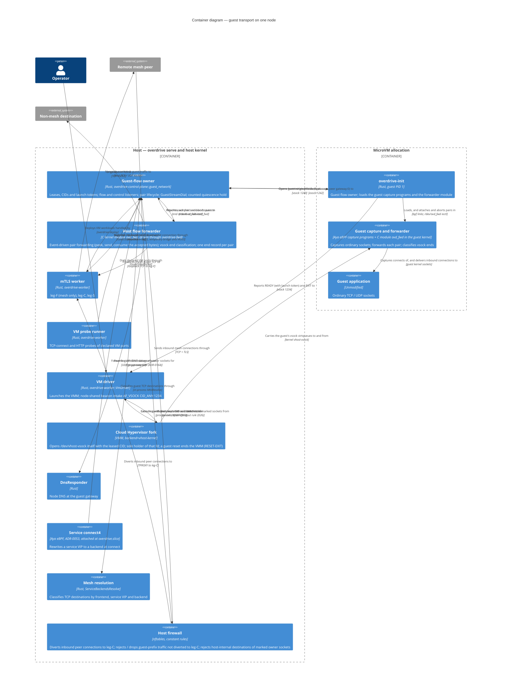

# Feature delta — netns-density-295

**Feature ID:** `netns-density-295`
**GitHub issue:** [GH #295](https://github.com/overdrive-sh/overdrive/issues/295)

**Problem.** A VM workload is attached to the node through the guest's
virtio-vsock device over the kernel vhost-vsock backend of the vendored Cloud
Hypervisor fork, with every guest flow forwarded by an event-driven in-kernel
forwarder in the guest and host kernels (ADR-0197; ordinary guest sockets are
captured by guest-kernel Aya programs). This replaces the per-VM network namespace, TAP device and
shared bridge attachment, whose port ceiling stopped the 16,384-attachment
density target natively (`EXFULL` at the bridge's 1,024 port slots,
`net/bridge/br_private.h:28-29`, `net/bridge/br_if.c:418 @ v7.0`;
`deliver/native-e18-bridge-capacity-falsification.md`). ADR-0145 records the
decision.

**Wave state.** `TCP-CORRELATION` is approved (§ *[REF] TCP capture
correlation*), closing STEP 11-06's `SPECIFICATION_AMBIGUITY`. Its one new
parameterized Tier-3 cell remains a DISTILL prerequisite, and the reconciled
roadmap requires final independent revalidation before DELIVER resumes.
The previously approved DESIGN and authored DISTILL artifacts remain the
baseline outside that bounded addition.
The data path is the in-kernel forwarder, approved for Linux guests with a
guest-neutral host side (§ *[REF] vsock data path — the in-kernel
event-driven forwarder (EVMOD)*); its contract-shaping spikes held on
Linux 7.0. The guest hop of a guest that runs no Linux kernel (Unikraft) is
[GH #321](https://github.com/overdrive-sh/overdrive/issues/321). DELIVER has
completed through step 11-05; step 11-06 resumes after the bounded DISTILL
addition and final roadmap revalidation.

ADR-0145 replaces the bridge / TAP attachment; its code stays in the tree until
DELIVER deletes it, as listed under *Bridge-era code for DELIVER to delete*.

## Wave: DESIGN / [REF] vsock Attachment Replacement DESIGN

### Status

- Every accepted decision keeps its own approval date in § *Approval record*,
  one row per user ruling. `TCP-CORRELATION` is accepted: Linux 7.0 source and
  the executed final-ACK spike prove the sixth-program contract required to
  construct `GuestIoEvent::OutboundCaptured`. The one authorized Tier-3 cell
  remains DISTILL work and the folded roadmap remains pending final independent
  revalidation.
- Same-node mesh leg-B (LEGB-DIAL): the dial to a guest-prefix peer is
  marked and source-bound; no route covers the guest prefix except the
  gateway `/32` (GW-LOCAL: the guest gateway is the one host-local address
  of the prefix).
- Probes: a VM probe dial is exempt from the allocation's flow quota; a
  `Capacity` or `Quiesced` refusal records no sample (PROBE-NOSAMPLE). The
  probe runner numbers each written run; the row merges by run number;
  `ServiceLifecycle` applies the threshold when it reads the row, acting
  once per crossing; a failed liveness stop is retried on the next probe row
  still past the threshold and never twice on one row (PROBE-RUN-COUNT, D-1).
  Every probe run that writes no row emits one `probe.not_sampled` event.
  Multiple probes per role are kept; `GUEST_PROBE_SLOTS` (8) bounds the
  probes of a spec. An intent persisted with more probes than
  `GUEST_PROBE_SLOTS` is not migrated (greenfield single cut; the Phase-1
  upgrade deletes the intent store).
- A foreign quiescence hold is a fail-stop, checked by the model
  (`quiescence-foreign-hold-ends-in-fail-stop`, run
  `ForeignHoldRestoreChangesNothingThenFailStops`, hazard
  `quiescence-hazard-foreign-ignored`) and by a unit test of the
  supervisor's mapping of `QuiescenceRestoreError::ForeignHold` to
  `SharedGuestNetworkFailStopCause::ForeignQuiescenceHold`; there is no test
  seam (the production composition has one supervisor and one owner).
  Assumption K-A5 is discharged by spike K-A5 (`spike/findings-ka5.md`,
  kernel `7.0.0-29`).
- Proven facts P-62 to P-65 (guest-slot spikes V-1 to V-4) stand:
  END-IDEMPOTENT (a trailing end after a pair's end is a no-op) and
  CLEAN-FULL-END (a clean full end is `0x2` each way before close,
  ADR-0180).
- **The data path is the event-driven in-kernel forwarder (EVMOD-ADOPT).**
  The forwarder (P-67, P-68; ADR-0197) moves every flow's bytes on both
  sides, consuming from a source only what its target accepted. Its
  contracts are approved for Linux guests: EVMOD-LIFE (the module's
  lifetime, unload-safe by module reference counting, ADR-0198), EVMOD-BUILD
  (one in-repository source, built per kernel release, ADR-0203), EVMOD-LOAD
  (loaded by the host image and by `overdrive-init`, never by `serve`,
  ADR-0205), EVMOD-GUEST-KIT (a Linux guest's kernel and module are one
  artifact, checked by the guest, ADR-0206), EVMOD-SAFE (late callbacks,
  ADR-0204), EVMOD-CTL (the pairs' lifetime bound to their control context,
  ADR-0199), EVMOD-REC (one preallocated end record per id, ADR-0202),
  EVMOD-STREAM-END (how a `GuestStream` resolves every end it observes,
  § *Driving port — guest stream dial*), EVMOD-STREAM-ABORT (how an owner
  abort reaches a `GuestStream` and the guest without touching `V_h`),
  EVMOD-ATTACH-END (an ended half is refused with its own errno class and
  the owner aborts the flow, ADR-0210), EVMOD-PORT, EVMOD-END (ADR-0180;
  its watch of a dialled vsock, ADR-0216), EVMOD-PAIR (ADR-0212),
  EVMOD-DGRAM (ADR-0201), EVMOD-KTLS (ADR-0200), EVMOD-WQ and EVMOD-AB (the
  release point at the end record; no guest slot pool, ADR-0209), with the
  EV-PINS corrections and the WATCH-ABORT rule (ADR-0211). D3's flow bounds
  are ADR-0208, apart from ADR-0147's one pair per flow. The contract-shaping
  spikes V-EV-END, V-EV-CTL, V-EV-PAIR and V-EV-DGRAM held on Linux 7.0
  (P-69 to P-72; physical host `7.0.0-38-generic`, guests
  `7.0.0-29-generic`).
- **The host side is guest-neutral (HOST-NEUTRAL, ADR-0207).** The flow
  request, the datagram frame and the end classes are the host-side protocol
  of every guest; the host owner and the host forwarder never branch on
  guest type. The guest hop of a guest that runs no Linux kernel (Unikraft)
  is [GH #321](https://github.com/overdrive-sh/overdrive/issues/321).
- RESTART-GEN-CRASH: the loss of a generation replacement placed but not
  started at a `serve` crash is
  [GH #325](https://github.com/overdrive-sh/overdrive/issues/325) and is
  **not** fixed in #295 (§ *Restart decision*, "Defect RESTART-GEN-CRASH").
  The `cid_lease` run `RedeployLeasedAtServeCrashIsPlacedAgain` and hazard
  `crashLosesPlacedGeneration` stay in the model, pending #325 for
  conformance. RECORD-COST (the cost of the `guest-flow-owner` full
  `--record` run) is an outcome-neutral architect disposition
  (§ *Approval record*, "Architect dispositions"); it is not a user approval.
- Quint `specs/quint/probe-count` (`evidence/summary.json`): 31 checks, each
  matching its expect (19 hold, 12 expected violations), all `ci = true`; 9 named runs on the conformance main
  `probe_streak_conf` plus 6 hazard runs; model-checking main `probe_streak`;
  hazard `streak_bugReconstruct` violates `NoEarlyTerminate`,
  `streak_bugNoActOnce` violates `NoReactOnSameRow`, `streak_bugOncePerStreak`
  and `streak_bugOnceEver` violate `NoMissedTerminate` (D-1 option (a) is
  load-bearing), `streak_bugNoSampleFail` violates `MissingSampleInert`,
  `streak_bugLwwObservedAt` violates `StoreHoldsLatest`.
- Composition (ADR-0219, ADR-0138): `run_server(config, adapters)` takes
  every driven adapter through a required `NodeAdapters` parameter; the
  intent store, view store, workflow journal and workload-identity CA are
  part of it, built by `NodeAdapters::host(&config, ..)`; `ServerConfig`
  is configuration only (§ *Composition*, "Driven adapters of `run_server`").
  The forwarder is opened, probed, audited and repaired on every node, in
  boot phase 1, before any boot effect (D-8). The vsock ports are node
  configuration with defaults 1234 / 1240 / 1243 (PORTS-CONFIG, ADR-0218);
  a test binds kernel-assigned ports and reads them back from their owners.
  The VM driver passes the three ports on the guest's kernel command line
  (GUEST-PORTS, ADR-0217). `[vsock]` node-TOML loading is
  [GH #327](https://github.com/overdrive-sh/overdrive/issues/327), outside
  #295. The inbound enforcement port holds leg S's guest dial (LEGS-DIAL,
  D-14, § *leg-S over vsock*).
- Lane prerequisites: `ovd_fwd` is loaded on Lima and on metal by the lane
  setup step `cargo xtask kmod-load` (FWD-PREREQ); the module build and lane
  setup are DELIVER step K, before step 0 (U-3 (b)). `kmod-load` reloads a
  stale idle module and reports any `EBUSY` on a live module as busy/retry
  with a message naming the holder class; no remedy is a reboot. The
  module's identity is its `version`, the whole-tree digest (D-20,
  ADR-0203). V-EV-SAFE and V-EV-UNLOAD
  use no KASAN: their oracles are no oops and the refcount on the stock 7.0
  kernel.
- V-9's measurements are the benchmark
  [GH #326](https://github.com/overdrive-sh/overdrive/issues/326);
  `vsock_density.rs` is a 64-VM correctness test. The `mtls_guardrails` AC3
  failure at HEAD is out of scope for #295 (no issue). The guest-kit
  microVM fixture (T-1) is built, launching through the production
  `CloudHypervisorVmm` (U-4 (a)). GH #324 is fixed in #295
  (RESTART-SSOT, § *Restart decision*, step 0 of § *Roadmap impact*).
- Quint `specs/quint/guest-flow-owner` (`evidence/summary.json`, kernel
  `7.0.0-38-generic`, Quint 0.32.0, Apalache 0.56.1): 279 of 279 checks
  matched expect (209 hold, 70 expected violations), 44 of them `cid_lease`
  and 37 `fwd_safe`; no open counterexample. `cargo xtask quint
  verify-evidence --subsystem guest-flow-owner` and `typecheck` pass;
  `verify-evidence` passes for `probe-count`. Check inventory (§ *Formal
  protocol model*): hazards are one per ADR-level decision; witnesses exist
  only for states no named run reaches (`owner-flows-witness-phantom-connect`,
  `fwd-pair-witness-watch-half-close`, `fwd-pair-dgram-witness-vmm-exit`);
  there are no rejected-alternative checks and no bounded Apalache copy
  beside an exhaustive TLC check, except the two on instances no exhaustive
  check covers (`owner-flows-two-safety-apalache`, `flows_two` CFG `core2`,
  two dial slots; `udp-slots-safety-apalache`, `slots_ok`, two
  destinations; both `ci = false`). The 70 expected violations are 65 hazard
  checks, 3 witnesses and the 2 violation-form checks of the #325-window
  guard pair. Hazards per module: `fwd_pair` 11, `owner_flows` 15,
  `cid_lease` 12, `fwd_safe` 12, `quiescence` 7, `udp_slots` 6, `flow_quota`
  2. `GuestHalfEnds` runs on the one-flow instance `flows_one` (CFG "one":
  one guest-opened and one host-opened flow). `fwd_pair` instances: `ok`,
  `watch` and `live` carry one unit each way, `dgram` one datagram each way;
  `pair_mid` (stream mode with 2 units and datagram mode with 2 datagrams,
  one direction, `gh` only, one fault; no watch mode) runs under exhaustive
  `fwd-pair-mid-safety-tlc` (invariant `MidSafety` = `DgramSafety` in a
  datagram trace and `Safety` otherwise; 695,292 distinct states; `ci =
  false`); the datagram-frame hazard runs on the hazard-only instance
  `pair_dhazConsumePartialFrame` (CFG `dhaz`, 3 datagrams: with 2 the cut
  frame is the last queued item and corrupts nothing). `fwd_safe` models no
  module unload or text lifetime. Every `OFF` string in a module
  belongs to a hazard `checks.toml` lists. `fwd_pair.qnt` has no ghost
  `gh.recPend`, no `tcpErrSeen` definition and no `WatchRecord` step action.
  The `WatchRecord` variant of `ConfStep` and the `WatchRecordBeforeWake`
  invariant stay because both conformance drivers map the variant (to a
  hazard-only error); no `step` action produces it.

### DISTILL handoff

What DISTILL takes from this DESIGN:

- **Quint record.** The oracle is `specs/quint/guest-flow-owner/` as
  recorded in `evidence/summary.json` (279 checks; § *Status*, § *Formal
  protocol model*). The run checks per recording main in `checks.toml` equal
  the counts `distill/test-scenarios.md` records the drivers pin:
  `flows_conf` 45, `flows_beacon_conf` 7, `pair_conf` 39, `quota_conf` 7,
  `slots_conf` 12, `quiesce_conf` 11 (10 pinned), `lease_conf_ok` 23 (21
  pinned, 2 model-only guard runs), `lease_conf_325` 3 (1 pinned, 2
  guard-run checks) and `lease_conf_three` 1. The target inventory:
  - `fwd_safe` has no module-unload runs; `safe_runs` has 14 runs. The
    module-suite cells under V-EV-UNLOAD are real-kernel cells, not model
    oracles.
  - The scenario tables cite only hazards that exist in the record (the
    hazard table in § *Formal protocol model*, 65 rows).
  - `flows_one`, `flows_two`, `pair_mid` and the hazard-only
    `pair_dhazConsumePartialFrame` are model-checking mains. None is a
    driver target.
  - V-EV-UNLOAD and U-EV-UNLOAD use the stock 7.0 kernel; the stress's
    oracles are no oops and the refcount
    (`the_unload_stress_never_faults_in_a_guest`). The unload tests
    (`unload.rs`, `unload_in_guest.rs`) are dev-host and stock-kernel Tier-3
    cells; the appliance has `CONFIG_MODULE_UNLOAD` off.
  - `xtask`'s `kmod_load`: any `EBUSY` on a live module is busy/retry.
- **Interface and fixture decisions (D-UP-1 to D-UP-20 and D-8 to D-22, each
  pinned in its owning contract section).**
  (1) The composed rig boots through phase 1
  (`probe_guest_flow_startup`) and `boot_server` with
  `GuestNetworkSource::Composed`. (2) Every `serve` test calls `run_server(config, adapters)` (or the
  CLI's `run_with_adapters(args, cgroup_fs, builder)`, whose builder
  receives the `&ServerConfig`) with a `NodeAdapters`, built
  from `NodeAdapters::host(&config, cgroup_fs, kek)` with the fields it
  simulates replaced by name — typically `boot.kek` a `SimKek`,
  `boot.dataplane` a `SimDataplaneComposer` where it injected
  `SimDataplane` before, `boot.mtls.intercept` / `boot.guest_dns` the sim
  adapters it used before, `boot.clock` a `SimClock` where it set one —
  and sets `vsock_ports: NodeVsockPortConfig::kernel_assigned()` (in
  `ServerConfig`, or in `ServeArgs` for a CLI test); the stores and the CA
  come from `NodeAdapters::host` over the test's temporary `data_dir`
  (STORES-IN), a fresh bundle per boot;
  `guest_flow` is always `GuestFlowAdapter::host()` out of crate; a
  simulated-VM test passes `SimVmm` + `SimBeaconIo` with
  `VmCapability::Required`. No test sets a `ServerConfig` adapter or fault
  field (none exists); faults are scripted on the sim adapters (the
  replacement table under § *Composition*, "Driven adapters of
  `run_server`"). Every `serve` test lane has `ovd_fwd` loaded by `cargo
  xtask kmod-load` (FWD-PREREQ; the hooks run it too) and runs the real
  forwarder probe; the lane's fixture compares the loaded module's
  `version` (the whole-tree digest, D-20) with the built one
  first and fails as a missing or stale
  lane prerequisite naming the step. These tests stay whole-binary members of `host-kernel-shared` (they
  still converge the gateway `/32` route and write the `overdrive-mtls`
  table). A boot whose forwarder probe fails (the
  seam's scripted `DeviceAbsent` and each scripted stage failure, on the
  composed rig) refuses at step 1, `guest_network.probe`, before any boot
  effect: no veth pair, no nft table, no route, and no forwarder context
  left open. (3) The `fwd_pair` drivers (host
  and init) read `pr(s).out` / `.cause` / `.errno` / `rec = read` from
  `last_consumed_end`, and `ctx(s) = released` from the `SimFlowForwarder`
  context state, never from driver flags or taken records. (4) `cid_lease`
  reads `leased` from the owner and does not compare `up` / `reclaimed`;
  `lease` and `cursor` are not compared between a `Crash` and the next
  boot's first step (S-4, below). (5) (D-16, D-9.)
  Control-session loss without a VM fault has no production stimulus and
  no entry point is added: its evidence is the seeded-sim composed rig plus
  the in-guest session cells (§ *Roadmap impact*, 10-02); the `Forwarder`
  recovery stays seeded-sim + R5-61; leg-F loss is seeded sim plus the
  worker-level Tier-3 repair cell `leg_f_repair_rebinds_transparent_listener`,
  stimulated by an `EMFILE` accept error with the listener still `LISTEN`
  (§ *Validation plan* V-8). (6) (D-17.) R5-57 and the
  through-`serve` halves of R5-41 / R5-63 read the owner through
  `ServerHandle::guest_flow_observation()` from an `overdrive-control-plane`
  `kvm-tests` lane that boots `run_server` with `NodeAdapters::host(..)`
  and a `SimKek` — the composition `overdrive serve` runs — and deploys through the server's
  public API, so no CLI hook exposes `ServerHandle`. (7) R5-54 is authored against
  LEGS-DIAL: its seeded-sim half drives a leg-C
  connection through `SimMtlsEnforcement` built with the composed rig's
  `OwnerDial`. (8) The end-record-order Tier-3 cell
  `take_end_returns_records_in_end_order` (D-12). (9) The `GuestProcess`
  structure of the init drivers follows the lint ruling of § *Conformance
  observation surface and action map*, "Owner field" (S-7). (10)
  GUEST-PORTS fixes the token every guest-kit fixture writes: the
  fixture's scripted host peer binds kernel-assigned beacon and control
  ports and passes them (with a stream port) as `beacon=`, `stream=`,
  `control=` on the kernel command line it builds; no fixture binds a fixed
  host port. New cells: `NodeVsockPortConfig::new`'s refusals and default
  (default lane, proptest over the four refusal classes; no `[vsock]`
  file-section cell: the section is out of #295, GH #327),
  `parse_transport_token`'s three new fields
  and their refusals, a kernel-assigned bind read back from
  `BeaconIntake::bound_port` / `flow_ports()` / `ServerHandle::vsock_ports`,
  a listener repair that keeps the held socket and its port (no
  close, no bind; the accept task re-spawned), a second `BeaconIo::bind`
  with another port returning the first port, and the D-14 `teardown`
  awaiting the relay's end. (11) (NO-OVERRIDE-SEAMS, full scope.)
  Every test entry point and fixture below migrates to `NodeAdapters` /
  `BootAdapters` (§ *Composition*, "Driven adapters of `run_server`", and
  its replacement table), by crate:
  - **`overdrive-control-plane`.** In-crate: `src/lib.rs` tests — the
    `host_ipv4_with_override_fallback` tests are deleted with the function,
    the `compose_vm_driver` tests (injected VMM / cgroup-accounting probe
    failure) take `VmAdapters` with `Required`; `src/shared_network_test_ports.rs`
    (the composed rig, over `BootAdapters` and `SimGuestFlowIo`);
    `src/dataplane_config.rs`'s `ServerConfig::new` test use. `tests/common/dataplane_lo.rs`.
    `tests/acceptance/`: `job_stop_idempotent.rs`, `job_stop_intent_key.rs`,
    `job_stop_unknown.rs`, `preflight_before_workloads_bootstrap.rs`,
    `required_serve_ports_source_scan.rs` (its declarations move: the
    required ports are `MtlsAdapters.{intercept, enforcement}` and
    `BootAdapters.guest_dns`, the composition structs gain `NodeAdapters`,
    `BootAdapters` and `MtlsAdapters`, `ServerConfig` must declare no field
    whose type names a port trait, and the banned identifiers gain
    `dataplane_override`, `mtls_identity_override`, `dataplane_probe_fault`,
    `mtls_probe_fault`, `vm_override`, `VmOverride` and
    `host_ipv4_with_override_fallback`). `tests/compile_fail/server_config_requires_intercept_and_dns_ports.{rs,stderr}`
    is replaced by a fixture that omits a `NodeAdapters` field (one
    invariant per fixture). `tests/integration/`: `shared_guest_network_startup.rs`,
    `describe_round_trip.rs`, `observation_empty_rows.rs`,
    `idempotent_resubmit.rs`, `backend_discovery_bridge/boot_composition.rs`
    (S-BDB-14 through `HostDataplaneComposer::with_probe_fault`, below;
    the other S-BDB real-dataplane fixtures through `HostDataplaneComposer`
    with their `dataplane_pin_dir`), `shared_network_supervisor_recovery.rs`,
    `node_health_writer_runs_at_boot.rs`, `server_lifecycle.rs`,
    `workload_lifecycle/convergence_loop_spawned_in_production_boot.rs`,
    `network_cleanup_pending_status.rs`, `concurrent_submit_toctou.rs`,
    `built_in_ca_operator_composition/serve_persistent_ca.rs`,
    `guest_attachment_pool_per_server.rs`, `interest_router_run_server.rs`,
    `boot_member_clear_refusal.rs`, `submit_round_trip.rs`,
    `dns_responder_bind.rs`; and the new D-17 `kvm-tests` lane.
  - **`overdrive-cli`.** `src/commands/serve.rs` (production `run`;
    `run_with_adapters`); `tests/acceptance/service_kind_vm_workloads.rs`;
    `tests/integration/`: `vsock_support.rs` (the guest-kit lane helper),
    `walking_skeleton.rs`, `vm_walking_skeleton.rs`,
    `vm_stop_restart_and_vmm_death.rs`, `vm_reclamation_tier3.rs`,
    `vm_resources_sizing.rs`, `vm_boot_failure_vocabulary.rs`,
    `guest_stack_mtls_egress.rs`, `deploy_udp_walking_skeleton.rs`,
    `deploy.rs`, `submit_jq_pipeline.rs`, `workload_restart.rs`,
    `service_submit_streaming_cli_dispatch.rs`, `serve_lifetime_fail_stop.rs`,
    `serve_probe_refusal.rs`, `cluster_and_node_commands.rs`,
    `endpoint_from_config.rs`, `http_client.rs` (builds `ServerConfig` and
    calls `run_server` directly).
  - **`overdrive-sim`.** `src/invariants/netns_density_boot_order.rs` and
    `src/invariants/vm_reclamation.rs` (supplied-owner path, over
    `BootAdapters`); `tests/vm_lifecycle_latency_283_spike.rs` (five
    boots); the new `SimDataplaneComposer` and `SimMtlsEnforcementFactory`.
  - **`tests/conformance`.** `src/lib.rs` `DirectHandlerHarness::start`
    (supplied-owner path: `BootAdapters` with its `SimClock`,
    `SimObservationStore`, `SimVmHostState`, a `SimDataplaneComposer` over
    `127.0.0.1`, `SimMtlsIntercept`, `SimGuestDnsFactory`, `SimKek`, and
    the enforcement factory it chooses), and its module doc's composition
    paragraph.
  - **`overdrive-dataplane`.** `HostMtlsEnforcementFactory` (production
    surface; no test migrates).
  - **Stores, CA and the probe root (STORES-IN, PROBE-ROOT-ENV).**
    Every fixture above that builds a bundle by hand or reaches the
    supplied-owner path also supplies `BootAdapters.stores` and `.ca`:
    host bundles get them from `NodeAdapters::host(&config, ..)`; the
    supplied-owner fixtures (`overdrive-sim`'s
    `invariants/netns_density_boot_order.rs` and `invariants/vm_reclamation.rs`,
    `tests/vm_lifecycle_latency_283_spike.rs`, `tests/conformance`'s
    `DirectHandlerHarness::start`, the in-crate composed rig
    `shared_network_test_ports.rs`, and the owner-level doubles'
    fixtures in `overdrive-control-plane` that call
    `run_server_with_obs_and_drivers` / `_driver`) build
    `StoreAdapters::open(&config)` (or `SimViewStore` / `SimJournalStore`
    beside `IntentStoreAdapter::open`) and `CaAdapters::host()` (or one
    over `SimCaFactory`; the CA is a factory the boot calls over
    `boot.entropy`). Every fixture that boots twice over one `data_dir` (for
    example `built_in_ca_operator_composition/serve_persistent_ca.rs`, and
    the `cid_lease` driver, which also reads the surviving stores between
    a `Crash` and the next boot, S-4) builds a new bundle after the first
    server is down, reopening the stores from disk (`NodeAdapters::host` or
    `StoreAdapters::open`) with a fresh `CaAdapters` (D-21: no
    boot reuses the previous boot's store handles; `StoreAdapters` is not
    `Clone`). A driver that reads the surviving stores between two boots
    opens them itself and drops them before the next boot opens them. Every CLI fixture listed under
    `overdrive-cli` moves to `run_with_adapters(args, cgroup_fs, builder)`
    with `ServeArgs.vsock_ports = NodeVsockPortConfig::kernel_assigned()`;
    `serve_probe_refusal.rs` passes `RealCgroupFs::new().with_probe_root(..)`
    and drops `#[serial(env)]`, `EnvGuard` and its env mutation;
    `src/commands/serve.rs` loses `PROBE_ROOT_ENV_VAR` and
    `build_probe_adapter`. `src/main.rs` passes
    `NodeVsockPortConfig::default()` in `ServeArgs`.
    `backend_discovery_bridge/boot_composition.rs` S-BDB-14 uses
    `HostDataplaneComposer::with_probe_fault`. `required_serve_ports_source_scan.rs`
    adds `OVERDRIVE_TEST_PROBE_ROOT` to its banned identifiers and checks
    that `boot_server`'s body names none of `LocalIntentStore::open`,
    `RedbViewStore::open`, `RedbJournalStore::new`, `RcgenCa::new`,
    `RootKeyAeadCodec::new`. `xtask` (`guest_kit_prepare::forwarder_module_path`,
    `kmod-build`, `kmod-load` and its hooks form `--busy-ok` (a stale idle module is
    reloaded, a busy one is refused with the holder class; § *Composition*,
    "`kmod-load`"), the mutants wrapper's
    `OVERDRIVE_KMOD_DIR`) and `overdrive-testing` (`guest_kit.rs`'s module
    lookup from the workspace root) read the module path from the workspace
    root, not `cargo_target_dir`, with the S-12 drift guard extended to the
    module path; the fixture and `kmod-load` compare the module's `version`
    (the whole-tree digest), not `srcversion` (D-20). The init `fwd_pair`
    driver gates its comparisons on the `VmmExit` it applied (the `fwd_pair`
    map); the spec's invariant `CtxGoneIffVmDown` that justifies the gate is
    in `fwd_pair.qnt` (no witness check).
  A fixture added later follows the same rule. (12) The `quiescence` driver's `RestartWith` goes
  through the composed rig (`boot_server`), not `run_server`; the
  `cid_lease` driver replays `PoolExhaustedRestartCleansThePredecessorThenPlaces`
  on `lease_conf_three` with the background leases and relabelling of the
  `cid_lease` map; the D-9 cell follows the descriptor order in § *Roadmap
  impact* 10-02.

- **Module reference counting (MODULE-REFCOUNT).** Test support:
  - **Version surface.** `OVD_FWD_VERSION` returns `abi_version` only; there
    is no `PERMANENT` flag, no `ForwarderError::NotPermanent` and no
    `/proc/modules` check in the probe's `Version` stage.
  - **The fixture's stale verdict** names `cargo xtask kmod-load`, which
    reloads an idle module, and never a reboot.
  - **`kmod-load`'s tests** cover four outcomes: absent → load; current →
    done; stale and idle → unload, then load; stale and busy → refused,
    naming the holder class.
  - **The hooks** run `kmod-load --busy-ok`.
  - **The unload cell, V-EV-UNLOAD** (§ *Validation plan*), is a
    real-kernel cell of the module suite. The `/sys/module/ovd_fwd/refcnt`
    oracle and the placement rule are in that item.
  - **Step K and step 4** (§ *Roadmap impact*) carry the context half and
    the socket half of the cell.

- **T-1: the guest-kit fixture.** The guest-kit Cloud Hypervisor microVM
  fixture is DISTILL-owned test support: an `overdrive-testing` helper that
  boots the CH fork with a guest kernel, `ovd_fwd.ko`, and `overdrive-init`
  or a scripted guest vsock peer, on the native-metal `kvm-tests` lane.
  R5-59 (a) (the real-adapter pair of the sim accept arbiters cited by
  `quint_udp_slots.rs` and `flow_io/sim.rs`), the guest-side `ovd_fwd` cells
  and the in-guest real-kernel cells run on it.
  **U-4 (option (a)): the guest kit launches through the
  production `CloudHypervisorVmm`.** The fixture holds no cloud-hypervisor
  argv of its own: no second renderer, no exemption in the DWD-09 clause, no
  new production API (§ *VMM backend contract*).
- **RESTART-SSOT (GH #324).** DISTILL authors regression obligations 1–5 of
  § *Restart decision* for step 0, and the `cid_lease` driver projects
  `st` (`wait` / `done` / `failed`), `retry`, `ex` and `att` from the fixed
  `restart_status_for_alloc(target, kind, run_desired, row, generation)`,
  `attempt_index_for_alloc` and `current_alloc` over Service-kind workloads
  (QPROJ-2W; the `cid_lease` map, which pins every modelled variable and
  the `Redeploy` map per pre-state). The `cid_lease` map, with the
  recording main `lease_conf_three`, is recorded in `evidence/summary.json`
  (44 `cid_lease` checks, of which 12 hazards): item 7
  (`VmmCrash` and `GuestReset` run no tick; `Assign` places a
  successor while the predecessor's lease is still held; `Launch` cleans the
  predecessor; actions `Finalize` and `AssignRefused`; projected fields
  `pred` and `pst`; the model-only ghost `g.fin`). `Finalize` and `Redeploy`
  carry the `reclaimed` guard (the driver never steps either before
  `vm_reclamation_boot::converge` returned; `Redeploy` is a handler call,
  reachable only once the listener is bound after `converge`), the `retry`
  / `ex` row does not read a launch clash's row (the clash path stays
  unmapped), and the hazards and guard runs are not driver targets. The
  driver's `#[quint_test]` set is every run listed under `cid_lease` item 8
  on `lease_conf_ok` except `CrashIsNotEnabledInThe325Window` and
  `CrashIsEnabledInThe325WindowWithoutTheGuard` (they check a model-only
  guard; production never refuses a `serve` crash), plus
  `RedeployLeasedAtServeCrashIsPlacedAgain` on `lease_conf_325` with
  `#[ignore = "pending #325"]` (GH #325), plus
  `PoolExhaustedRestartCleansThePredecessorThenPlaces` on `lease_conf_three`
  (D-18); its `#[quint_run]` targets `lease_conf_ok`, which excludes the
  #325 window (item 9).

- **Conformance driver targets.** Each driver replays its module's
  recording main (QPROJ-1, D-UP-1, PD-6): `flows_conf` (host and guest
  drivers) and `flows_beacon_conf` (VM driver) for `owner_flows`;
  `pair_conf` for `fwd_pair`; `quota_conf`, `lease_conf_ok`, `quiesce_conf`,
  `slots_conf`; `probe_streak_conf` for `probe-count`. The model-checking
  mains (`flows_ok`, `flows_two`, `flows_sess`, `flows_one`, `flows_beacon`,
  `quota_ok`, `empty_ok`, `quiesce_ok`, `quiesce_live`, `probe_streak`)
  record no `conf_step` and are not driver targets. There is no `flow_end`
  or `udp_empty` module and no driver for either; their scenarios are
  `fwd_pair` (`pair_conf`) runs (§ *Formal protocol model*, "Change list for
  the forwarder").
- **The `fwd_pair` runs the `pair_conf` driver pins** (each holds in the
  recorded run in `evidence/summary.json`), each with
  `#[quint_test]`: the nineteen of § *Formal protocol model* (the seventeen
  of the change list and the prefixes `Paired` and `DgramPaired`);
  `HostHalfCloseThenAbortBeforeGuestAttachIsAbort`,
  `GuestCloseBeforeHostAttachAborts` (the in-flight branch: the guest's
  `0x3` still in transit at the host's attach, U-EV3-1),
  `RemoteFinThenResetAbortsPair`, `ForwarderRecoveryAbortsThenReopens` and
  `ReleasedWatchWithNoRecordReadsAsAbort`; and
  `GuestAppFinThenResetAbortsPairWithEpipe`,
    `EarlyVsockHalfCloseBeforeGuestAttachCompletes`,
    `AppWriteAndFinBeforePairedAttachesInCloseWaitAndCompletes`,
    `IntakeChildResetBeforePairedIsRefusedAndFlowAborts`,
    `DestinationResetBeforeHostAttachIsRefusedAndFlowAborts`,
    `GuestCloseWithEmptyQueueBeforeHostAttachIsRefusedAndFlowAborts`,
    `OwnerAbortOfWatchLeavesVhAndStreamReportsAborted`,
    `OwnerAbortSendsGuestAbortThenHolderDropIsInert`,
    `ContextReleaseShutsWatchedVhAndHolderReadsNotConnected`,
    `DroppedStreamAbortsWatchThenGuestSeesAbort`,
    `TruncatedFrameAtPeerEndAbortsFrameInvalid`,
    `PeerCloseRacingOwnHalfCloseIsClean` and
    `VmmExitWithWatchRecordInFlightResolvesFromRecord`. The driver also
    replays randomized `#[quint_run]` traces on `pair_conf`. It projects
    `gen` and `cgen` from `flow_observation().forwarder_generation` and the
    `Paired` phases' `generation`, `oldCtx` from `SimFlowForwarder` (named
    arbiter), `unclassified` from `inventory()`, and the ended-half, watch and
    stream variables by the spec's names as QPROJ-8, "Ended-half, watch and
    stream variables", classes them (`attRes` and `attEnded` through the
    owners' `forwarder_attach_ended`; `hres` from the production
    `GuestStream`; the holder's own observation `gh.hobs` and the other
    ghosts are model-only). It maps the action names the spec declares: `TcpRst`
    (not `EpRst`), `HolderDrop` (not `DialerDrop`), `GuestAbort`,
    `HolderEnd`, and the orphan sweep as `VmmExit` then `FwdErr(h)`
    (U-EV3-7). The instances `pair_wlive` and `pair_dlive` are
    model-checking mains and record no step; no driver replays them.
- **Foreign-hold fail-stop (user ruling 2026-10-15).** The `quiescence`
  driver maps `ForeignRestore` to the driver's own `restore` with a hold of a
  second `QuiescenceLedger` and compares the owner's state unchanged
  (`ForeignRestoreChangesNothing`); it does not drive the supervisor's
  fail-stop that follows, because no production path presents a foreign
  hold to the supervisor, so the driver does not pin the run
  `ForeignHoldRestoreChangesNothingThenFailStops`. The fail-stop is covered
  by `quiescence-foreign-hold-ends-in-fail-stop` (with its hazard
  `quiescence-hazard-foreign-ignored`) and by a named unit test of the
  supervisor: `restore` returning `QuiescenceRestoreError::ForeignHold`
  ends in `SharedGuestNetworkFailStopCause::ForeignQuiescenceHold`. No seam
  is added for it.
- **Foreign hold dropped unredeemed is leaked at its issuing ledger
  (model-only claim, D-UP-4, PD-1).** The `quiescence` model has one owner
  and represents no second ledger, so it does not check this claim
  (`quiescence.qnt` D-UP-4 comment; README § *Model-only claims and what
  discharges them*), and no conformance driver projects it. Its discharge
  is a named sim/unit scenario of R5-32, through the public ledger surface
  (PD-2): two `QuiescenceLedger`s; the owner's `restore` of a hold the
  second ledger issued returns `QuiescenceRestoreError::ForeignHold`; the
  hold is dropped; the second ledger's `leaked()` rises by exactly one and
  the owner's `leaked()` (and `flow_observation().leaked_quiescence_holds`)
  is unchanged.
- **K-A5 wording (spike K-A5).** The guest owner observes the end of its
  control connection as EOF on `read` or `EPOLLRDHUP`; `ECONNRESET` occurs
  only at `connect()` (no listener, full backlog); a host reset close and a
  graceful close are indistinguishable at the guest. Scenarios and the
  guest-side driver wait for EOF / `EPOLLRDHUP`, never for `ECONNRESET` or
  `EPOLLERR`, and do not assert which kind of host close occurred.
- **The forwarder (EVMOD-ADOPT; EVMOD-LIFE to EVMOD-AB).** The record is
  `evidence/summary.json` (279 checks; `verify-evidence` passes, § *Status*);
  V-EV-END, V-EV-CTL, V-EV-PAIR and V-EV-DGRAM held (P-69 to P-72), and
  their shapes and hazard variants are the module suite's negative controls.
  Every scenario, fixture and driver exercises the in-kernel forwarder
  (§ *[REF] vsock data path — the in-kernel event-driven forwarder
  (EVMOD)*); § *Lifecycle Gate Ownership*, "EVMOD re-derivation of the
  boundary scenarios", lists each R5 scenario's disposition.
- **R5-28 / R5-31 Tier-3 half: the in-guest lane (D-22).** The Tier-3 half of R5-28 and R5-31 (the V-24 shape) runs in
  the in-guest lane (`overdrive-init/tests/integration/in_guest_lane.rs`,
  `kvm-tests`, native metal, the guest-kit fixture of the T-1 ruling), not
  through `serve`. No in-guest observation surface is added to production
  `overdrive-init`.
  - **Roles.** The guest side is the production guest owner
    (`GuestFlowOwner` over `KernelGuestOwnerIo`, the real `ovd_fwd` and a
    Linux 7.0 guest on the Cloud Hypervisor fork), driven by an in-guest
    cell of `guest_flow::real_kernel`. The host side is the lane's scripted
    host peer over the real host vsock (vhost-vsock): it opens V_h to the
    guest's stream port, writes the request and nothing else, then closes
    V_h, in each order the rows name relative to the guest's accept (V_g
    accepted before `Paired`, V_g still queued); it plays the control
    session — a `Paired` for the aborted flow answered with nothing, an
    `Abort` for a flow the guest does not yet hold, a session close
    followed by a reconnect. This is V-24's host script, and the guest is
    the production owner in place of V-24's userspace model.
  - **Where the oracle is read.** Every read is in the guest, by the cell:
    (1) the owner through its pinned crate-private
    `GuestFlowOwner::guest_observation()` (DG-5; no new accessor) — the
    flow leaves `accepted`, no pair is attached (`forwarder_attached`
    unchanged), and the session is held again after the reconnect; (2) the
    cell's in-guest application listener — no connection C (R5-31's "no C"
    case) or C reset, and no byte; (3) the host peer's record of the control
    session — no message for the flow; (4) the kernel shape itself on a V_g
    the cell accepts with its own raw listener under the same host script:
    the request read succeeds, then EOF, `POLLRDHUP`, `EPIPE` on the first
    write — V-24's witness re-run in the lane, so the owner-path cells never
    rest on a kernel fact the lane did not observe. (5) Within 1 s of the
    abort the owner holds no socket of the flow (1) and the application side
    has none (2). R5-31's abort-to-reset latency over a 1,000-flow burst is
    reported (p50 / p99), not asserted. Placement: the
    cell's owner is the guest's **only** owner — the lane boots the guest
    kit with the scripted peer as PID 1 and no production `overdrive-init`
    (`overdrive_testing::guest_lane::run_in_guest_owner_cell`), so no second
    owner contends for the UDP slot binds, the capture programs or the
    control port. R5-28's "counted" clause (the structured event
    `guest_flow.control_discarded`) has no in-guest read surface and is
    discharged by the seeded-sim half only; the lane asserts "no reply".
  - **Why this is the Tier-3 half (`testing.md`, "DISTILL — prove composed
    system behavior").** Neither cause has a production stimulus a `serve`
    test can drive. Quiescence is entered only by a component recovery
    (QHOLD), whose stimuli the approved design drives in seeded sim (R5-32);
    driving one through `serve` needs a test seam (removed by
    NO-OVERRIDE-SEAMS) or a foreign mutation of Overdrive's kernel state (not
    a design driver on the appliance). Control-session loss without a VM
    fault has no production stimulus (D-16, item (5) above). A through-`serve`
    cell could only fabricate the cause, which `testing.md` forbids ("drive
    causes, not fabricated consequences"), and an observation surface on
    production `overdrive-init` would add production API to observe a state
    no `serve` test can reach. The composed behaviour is instead proven in
    two halves that meet at the wire: the host half — the production host
    owner deciding the abort, closing V_h after the request with no write
    (H-1) and discarding a late `Paired` — in the seeded-sim composed rig and
    the `owner_flows` conformance drivers; the wire →
    guest half — the real kernel's close propagation, the production guest
    owner's reaction and the application's view — in this lane. The host
    peer's script is exactly the wire behaviour the host half asserts, so
    no participant of the contract is missing from both halves.
- **Guest-neutral host side (ADR-0207).** Host-side scenarios and drivers
  assert the host's behaviour on the wire protocol only; none selects host
  behaviour by guest kind. The guest-side scenarios are those of a Linux
  guest; a guest that runs no Linux kernel is
  [GH #321](https://github.com/overdrive-sh/overdrive/issues/321).

### [REF] Approval record

One row per user ruling and per current decision id. § *Changed assumptions*
quotes the operative contracts this design replaces. Details the architect
pinned to make an approved ruling implementable (the `GuestStreamDial`
signature, `NoSession`, the leaked-hold fail-stop, the lost-count reset, the
dial constants) are recorded under the ruling they elaborate and carry its
date.

| Decision ids | Approved | Ruling |
|---|---|---|
| D1–D7, D9–D11, D13, D14, D16, D17, D18, D18a, D19, D20, D21 | 2026-10-05 | User approval of the decision index as proposed. Later rulings that restate a row are dated in that row of § *Decision index* |
| D8-PEER | 2026-10-05 (as part of D8); restated under INB-1 2026-10-11 | Host-opened guest connections present the guest gateway (ADR-0174) |
| D12 (#310), D15 (#308–#311), D19 restart scope (#312), S2Z (#93), G-MECH, G-CRASH | 2026-10-05 | User rulings on the replacement charter |
| D15-R1 | 2026-10-05 (acknowledged); restated under INB-1 2026-10-11 | Pre-activation host-local dials are refused at once (§ *D15 re-derivation*) |
| D16 next-fit (M-9), D20 remote-side `SO_LINGER{1,0}` (H-5) | 2026-10-06 | Corrections inside approved decisions, confirmed by the user |
| D8a, D15-R3 = (b), D24 (with D24-REFUSE), D24a, D25 (with D15-R2), D25-BIND, D26, U-1, U-2, U-5 (with assumption K-A4), SLOT-ABORT, KVER | 2026-10-06 | User rulings and approvals of 2026-10-06 |
| APPLIANCE (assumption A-31) | 2026-10-07 | Environment faults are narrowed to the appliance threat model |
| D8-PREFIX-CFG, D8-PREFIX-VIP, D19-LINKS | 2026-10-08 | User decisions of 2026-10-08 |
| ATTR-TOKEN, ATTR-LIVE-CLAIM, TCPACCEPT-END, D26-PINS | 2026-10-09 | Approved under the user's directive of 2026-10-09 ("if design needs changing, then you remediate, and then proceed to DISTILL") |
| QPROJ-1 to QPROJ-7, U-QP-1, U-QP-2 | 2026-10-09 | User approval of the conformance projection (§ *Conformance observation surface and action map*) |
| DG-1 to DG-16 | 2026-10-09 | Approved under user delegation; each is pinned in its owning contract section |
| DG-2-R2, DG-4-CTOR, DG-CONST, DG-5-A, DG-5-B, DG-5-C, DG-5-E, DG-5-F, DG-5-Q | 2026-10-10 | Approved by the user (delegated: "choose the correct solution; surface only if it breaks functionality") |
| KERNEL-7.0 | 2026-10-10 | The pinned kernel is Linux 7.0; user ruling recorded in `CLAUDE.md` § "Vendored components" |
| END-STATE | 2026-10-11 | User ruling "End-state guest networking": the guest is NIC-less and vsock-only; #303 adapts to it |
| INB-1 (per-kind dial, `GuestStreamDial`, `NoSession`, the temporary leg-S bridge) | 2026-10-11 | User ruling "Finding 1", in its final form, recorded on [#303](https://github.com/overdrive-sh/overdrive/issues/303#issuecomment-6113302506) |
| R2-END, R2-DRAIN, CID-NOCLAIM, RESET-EXIT, QHOLD, NO-SURVIVE | 2026-10-11 | User ruling "Items 2–6 approved" |
| LEGB-DIAL | 2026-10-13 | User ruling "Leg-B dial contract replaces PREFIX-ROUTE-LO / INB-1-READ" |
| GW-LOCAL | 2026-10-13 | User approval of ADR-0152 as written |
| PROBE-NOSAMPLE | 2026-10-13 | User approval of ADR-0187 decisions 1–3; how a sample is counted is PROBE-RUN-COUNT |
| PROBE-RUN-COUNT | 2026-10-13 | User ruling "Probe threshold counting", and the user ruling of 2026-10-13 "Probe streak at source" (each row carries `same_status_runs`, counted by the probe runner; `ServiceLifecycle` applies the threshold at read time, keeps no streak, and acts once per crossing by the run sequence at which it last acted; a probe-runner restart resets the streak and is accepted). The run-sequence numbering, the run-sequence merge, the `SameStatusRuns` newtype, the act-once condition and the `ServiceLifecycleView` field are architect elaborations recorded under these rulings |
| PROBE-RUN-COUNT D-1 | 2026-10-13 | User decision "D-1 liveness stop retry", option (a): a failed liveness stop is retried on the next probe row that is still past the failure threshold (so at most once per probe run, bounded by the probe interval); a re-read of the same row never stops twice |
| PROBE-NOSAMPLE-EVENT | 2026-10-13 | User ruling "Probe threshold counting" ("each no-row case … emits an event"); recorded in its own ADR (ADR-0192). The event's name, fields, reasons and level are architect elaborations recorded under this ruling |
| D-UP-1, D-UP-3, D-UP-4 (with the typed `ForeignHold` error), D-UP-6, D-UP-8, D-UP-9, D-UP-10, D-UP-17 | 2026-10-14 | User approval "approve all" of the DISTILL design gaps. D-UP-1 as validated by spike QT1 (`spike/findings-qt1-conf-step.md`, WORKS): the step path is the single element `"<main>::<module>::conf_step"` and a driver's state projection matches qualified names; for `owner_flows`, with its two recording mains (PD-6), the paths are `"flows_conf::owner_flows::conf_step"` (host and guest drivers) and `"flows_beacon_conf::owner_flows::conf_step"` (the VM driver). D-UP-4: restoring a foreign hold is a typed error, never `unreachable!`, and a dropped hold reaches its issuing ledger by a pinned path (an `Arc` to the issuing ledger's inner). The contract surface the architect pinned under these decisions is PD-1 to PD-7 below |
| D-UP-12 | 2026-10-14; as carried by EVMOD-AB 2026-10-17 | User decision (PD decisions): multiple probes per role are kept (`[[health_check.<role>]]` arrays, `Vec<ProbeDescriptor>`), and a spec whose startup, readiness and liveness probes together exceed `GUEST_PROBE_SLOTS` (8) is refused with one validation error at each ingress. The cap is the most quota-exempt probe dials one allocation holds (a node-capacity bulkhead); the guest has no drain-slot pool. The error variant (`ParseError::ProbeCountExceeded`, `AggregateError::Validation { field: "probes" }`) and its `Display` text are architect elaborations recorded under this decision |
| D-UP-2, D-UP-5, D-UP-7, D-UP-11, D-UP-13 to D-UP-16, D-UP-18 to D-UP-20 | 2026-10-14 | Mechanical completions of approved decisions, confirmed by the user to stand as written |
| FHOLD-CHECK | 2026-10-15 | User ruling "Foreign-hold fail-stop", option (b): the supervisor's fail-stop on a foreign quiescence hold is checked by the Quint model (`quiescence-foreign-hold-ends-in-fail-stop`, run `ForeignHoldRestoreChangesNothingThenFailStops`) and by a unit test of the supervisor's `ForeignHold` → `ForeignQuiescenceHold` mapping; no seam is added for a state production cannot reach |
| OVERCAP-NOMIG | 2026-10-15 | User ruling "Over-cap persisted intents": an intent persisted with more than `GUEST_PROBE_SLOTS` probes is not migrated; greenfield single cut, the intent store is deleted on upgrade (the Phase-1 upgrade path) |
| K-A5 | 2026-10-15 | User ruling: assumption K-A5 is discharged by spike K-A5 (`spike/findings-ka5.md`, WORKS, 4,750 trials, kernel `7.0.0-29`), with its wording: the guest owner detects an end by EOF or `EPOLLRDHUP`; `ECONNRESET` happens only at connect; a reset close is indistinguishable from a graceful close |
| END-IDEMPOTENT, CLEAN-FULL-END (V-4 consequences) | 2026-10-15 | User ruling: a trailing end after a flow's end is a no-op, with idempotent end handling (no double release, no recycled-id effect); a clean full end needs `0x2` each way before close (ADR-0180; P-65) |
| VALVE-IN-295 | 2026-10-15 | User ruling: the unbounded redirect queue of guest-slot spike V-3 is fixed inside #295 by real backpressure, not an abort on a byte cap; ADR-0183's "slow reader is backpressure" claim must be made true. Discharged by EVMOD-ADOPT: the forwarder consumes from a source only what its target accepted (P-67, P-68) |
| EVMOD-ADOPT | 2026-10-16 | User data-path ruling: the event-driven in-kernel forwarder (evmod) is #295's vsock data path, replacing the BPF sockmap redirect (ADR-0197). Design inputs pinned by the ruling: the module is built in or cannot unload while any socket is hooked; a TLS-record-aware peek with `close_notify` → FIN if a forwarded TCP half carries kTLS; a real control interface and pair-completion event in place of the spike's `ioctl` and `/proc` polling; a per-CPU workqueue by default. Removed by the ruling: the valve (VALVE-1 to VALVE-6), the drain goal and sent counters and their recursion misses, A10 and V-31-MV, V-3-DGRAM if moot, and the parts of A+B, GS-E1 to GS-E5 and the Quint models that existed only because of the redirect. Rejected by the ruling: the userspace pump (CPU cost), a kernel patch (P1), BPF only (shown impossible). The contracts pinned under it are EVMOD-LIFE to EVMOD-AB below |
| EV-PINS | 2026-10-17 | User ruling "evmod spike corrections" ("proceed with recommendation"): fold the corrections of V-EV-END, V-EV-CTL, V-EV-PAIR and V-EV-DGRAM (`spike/findings-ev-{end,ctl,pair,dgram}.md`) into the EVMOD contracts — the TCP `sk_error_report` reset rule; attach accepts TCP `CLOSE_WAIT` and seeds the end classification at attach; an attach refused because a half reset or closed is a flow abort; a dropped `GuestStream` aborts its watch; `O_CLOEXEC`; the refusal precedence; `CONFIG_MODULE_FORCE_UNLOAD` off; per-context inventory; datagram D1–D4; the CLEAN-FULL-END ordering. Written into the contracts of EVMOD-LIFE to EVMOD-AB below |
| WATCH-ABORT | 2026-10-17 | User ruling, the recommended option of EV-CTL § 4.3: a watch's abort never touches the holder's socket; the holder always reads the end record after its read ends (EOF or error); only a context release shuts watched sockets (ADR-0211). How an owner abort then reaches the stream and the guest is EVMOD-STREAM-ABORT |
| EVMOD-LIFE, EVMOD-BUILD, EVMOD-LOAD, EVMOD-GUEST-KIT, EVMOD-SAFE, EVMOD-CTL, EVMOD-REC, EVMOD-STREAM-END, EVMOD-STREAM-ABORT, EVMOD-ATTACH-END, EVMOD-PORT, EVMOD-END, EVMOD-PAIR, EVMOD-DGRAM, EVMOD-KTLS, EVMOD-WQ, EVMOD-AB | 2026-10-17 | User approval "EVMOD approval" ("proceed with everything else"), for Linux guests: every contract of the table below. EVMOD-AB carries the rulings SLOT-RELEASE (the user's D-1), PROBE-DROP-ABORT (D-2) and ENDS-BEFORE-CLAIMS (B), approved 2026-10-15; EVMOD-DGRAM carries D4, UDP-EMPTY, D15-R4, UDP-SEQ and CELL-RECREATE |
| HOST-NEUTRAL | 2026-10-17 | User approval "EVMOD approval", new: the host-side frame protocol (request, datagram and end classes) is guest-neutral; the host forwarder never branches on guest type (ADR-0207; research `docs/research/networking/unikraft-guest-forwarder-research.md`). The Unikraft guest hop is separate work, [GH #321](https://github.com/overdrive-sh/overdrive/issues/321), created with user approval 2026-10-17 |
| T-1 | 2026-10-18 | User ruling "DISTILL rulings", T-1 approved: build the guest-kit Cloud Hypervisor microVM fixture — an `overdrive-testing` helper booting the CH fork with a guest kernel, `ovd_fwd.ko`, and `overdrive-init` or a scripted guest vsock peer, on the native-metal `kvm-tests` lane. R5-59 (a), the guest-side `ovd_fwd` cells and the in-guest real-kernel cells run on it. DISTILL owns the fixture as test support (DR2-CLOSE D-1) |
| U-4 | 2026-10-21 | User ruling "U-4", option (a): the guest kit (T-1) launches its microVM through the production `CloudHypervisorVmm` (`overdrive-host`); the kit renders no cloud-hypervisor command line of its own. Rejected: sanctioning a second renderer in dst-lint DWD-09 clause 1 (relaxes the gate), and exporting a pure argv renderer from `overdrive-host` (new production API) |
| STEP3-SPLIT | 2026-10-22 | User ruling "STEP3-SPLIT": DG-2 step 3 (VMM adapter) is split. Its adapter half — the fork launch argument (`vhost_kernel_vsock_arg`), `SimVmm` and the host VMM equivalence cells — is implemented before the attachment cut, with fork provisioning (step 1), because the guest-kit Tier-3 cells of steps 1, 4 and 5 launch through `CloudHypervisorVmm::create`; it replaces only a RED-scaffold body. The `VmDriver` caller half (DG-2 rows 4–6, `AllocationSpec.transport`, the `launch=` transport token) stays in the attachment cut. Rejected: moving the guest-kit cells of steps 1, 4 and 5 into the cut (the forwarder and guest steps could not go GREEN before it) |
| D21-LOCAL | 2026-10-22 | User ruling, exact words: "publish? what are u referring to? just keep it local wtf." Clarification: "u can push". The tested RESET-EXIT source commit may be pushed to the fork branch and pinned by full SHA, but no release tag, GitHub release, uploaded binary asset or other artifact publication is created. Each supported host architecture builds and stages its artifact locally from that pinned source, and provisioning installs it only after the architecture-specific SHA-256 matches. This supersedes only ADR-0161's release-publication/download mechanism; its one-source-pin, content-identity, no-stock-fallback and no-runtime-identification invariants remain. |
| IOCTL-NUMBERS | 2026-10-22 | User ruling "IOCTL-NUMBERS": the `OVD_FWD_*` request numbers use magic `0xB9` and numbers `0x00`–`0x06` in the EVMOD-CTL operations-table order, with the standard `_IO`/`_IOR`/`_IOW`/`_IOWR` encodings; `abi_version` = 1; defined in the module UAPI header in step K and mirrored in `uapi.rs` in step 4 (§ *Forwarder control interface*, "Request numbers") |
| TCP-CORRELATION-NO-WEAKEN | 2026-10-23 | The user asked “whats correct?” The orchestrator answered: “Preserve admission below the quota. The extra TCP correlation hook is justified. Retaining abandoned correlation entries until they fill the map—and then resetting valid connections—is a lifecycle flaw, not an acceptable tradeoff. DESIGN should resolve cleanup while preserving correct connection identity and reset-before-accept behavior. I shouldn’t have asked you to waive that correctness requirement.” The user explicitly replied “proceed”. This authorizes invariant-preserving DESIGN remediation and rejects the reviewed 65,536-row/below-quota reset relaxation; it is not approval of an exact replacement until that replacement passes independent review. |
| TCP-CORRELATION | 2026-10-23 | After independent DESIGN iteration 8 approved the exact correction for decision, the orchestrator asked: “Approve the reviewed correction [`.context/netns-density-295/11-06-design/correlation.md`], including that exception, the sixth correlation program, and one test in the existing lane?” The user replied: “approved. continue”. This approves `GuestProgram::TcpCorrelation`, the final-ACK ABI, capacity-free active socket storage, the 8,194-entry child handoff and combined 4,096-place count, the private pre-program-load create/pin/Aya-reuse/unlink exception to ADR-0159 with no runtime pin or adoption, the existing typed error mappings, neutral five-to-six assertion corrections and one parameterized Tier-3 cell in the existing guest-kit lane. |
| RESTART-SSOT (GH #324) | 2026-10-18 | User rulings: GH #324 filed with approval ("`restart_status_for_alloc` disagrees with `WorkloadLifecycle`'s restart decision"), then "fix the accessor, do not work around it": one shared restart decision in `overdrive-reconcilers` used by both `WorkloadLifecycle` and `restart_status_for_alloc`; #295 lands the fix and closes #324; `cid_lease` projects `retry` from the fixed accessor. The function shapes (`restart_decision`, `restart_after_failure`, the accessor's `kind` / `run_desired` / `failed` / `desired_generation` inputs, `attempt_index_for_alloc`, `current_alloc` made `pub`), the Job, `Draining` and intent clauses, and the `cid_lease` projection of `att`, `ex` and `failed` are architect elaborations recorded under this ruling (§ *Restart decision*) |
| RESTART-GEN-CRASH (GH #325) | 2026-10-18 | User ruling: the loss of a generation replacement placed but not started at a `serve` crash is a separate issue, GH #325; #295 does **not** fix it. The `cid_lease` run `RedeployLeasedAtServeCrashIsPlacedAgain` and hazard `crashLosesPlacedGeneration` stay pending, citing #325, until #325 lands; the run's DISTILL `#[quint_test]` is `#[ignore = "pending #325"]`. The design of that fix belongs to #325. The conformance-main exclusion of the window (`cid_lease` item 9) is an architect elaboration under this ruling |
| U-2, E-3 | 2026-10-19 | User rulings "DISTILL rulings (2026-10-19)": U-2: V-9's density measurements are the benchmark GH #326; `vsock_density.rs` stays a 64-VM correctness test. E-3: the `mtls_guardrails` AC3 failure at HEAD is out of scope, no issue. |
| PORTS-CONFIG, GUEST-PORTS, FWD-PREREQ, NO-OVERRIDE-SEAMS | 2026-10-19 | User rulings "DISTILL rulings". PORTS-CONFIG (ADR-0218): the beacon, flow stream and control vsock ports are node configuration, production defaults 1234 / 1240 / 1243; a test configures a kernel-assigned port and reads the bound port back from its owner; non-VM `serve` tests run the real production listeners, no simulated seam swapped in. GUEST-PORTS (ADR-0217): the VM driver passes the ports to the guest at launch; `overdrive-init` hard-codes none of them. FWD-PREREQ: `ovd_fwd` loaded on the test host is a declared lane prerequisite (a setup step), not an accident of suite order; non-VM `serve` tests run the real forwarder probe. NO-OVERRIDE-SEAMS (ADR-0219, amends ADR-0083 § D8): `run_server` receives its driven adapters as a parameter from the composition root (`overdrive serve` passes host adapters, tests pass sim adapters); `ServerConfig.vm_override` is removed and no adapter-swapping `ServerConfig` field is added; every VM test migrates; a `GuestFlowIoOverride::sim_vsock()` mechanism and `SimVmm` through `vm_override` for non-VM tests are rejected. Architect elaborations under these rulings: `VsockListenPort` / `NodeVsockPortConfig` and its validation (fixed ports above 1023, pairwise distinct, all fixed or all kernel-assigned; carried by `ServerConfig` and the CLI's `ServeArgs`, no file section), the bound-port accessors, a repair keeping the held listening socket, the three appended token fields, `NodeAdapters` / `VmAdapters` / `VmCapability` / `GuestFlowAdapter`, and the `cargo xtask kmod-load` setup step |
| NO-OVERRIDE-SEAMS scope | 2026-10-19 | User ruling "NO-OVERRIDE-SEAMS scope" ("proceed with recommendations"): ALL of it, in #295. `run_server` takes every driven adapter from the composition root through `NodeAdapters`; nothing in `ServerConfig` swaps or carries an adapter. Moved into `NodeAdapters`: `mtls_intercept`, `guest_dns`, the dataplane (replacing `dataplane_override`; mTLS composition is not keyed on its presence), the mTLS identity read (replacing `mtls_identity_override`), `clock` (no `SystemClock` default) and `kek`, and the adapters `run_server` built internally (the second `SystemClock`, a bug; the TCP/HTTP probers; `RealCgroupAccounting`; `RealVmHostState`; the observation wiring). Removed: `dataplane_probe_fault`, `mtls_probe_fault` (tests inject faults through sim adapters). Configuration that stays: `dataplane_pin_dir`, `dataplane_cgroup_attach_path`. Amends ADR-0138 (the two ports leave `ServerConfig`; the enforcement is built through a factory port). Architect elaborations under this ruling: the grouping (`BootAdapters`, `MtlsAdapters`, `ProbeAdapters`, `VmAdapters` with `cgroup_accounting`), `cgroup_fs` folded into the bundle, `entropy` and `transport` added beside `clock`, `NodeAdapters::host`, `DataplaneComposer` with `host_ipv4`, `MtlsEnforcementFactory` (the identity read is the factory's choice), `run_with_adapters`, and the supplied-owner path over `BootAdapters` |
| STORES-IN, PROBE-ROOT-ENV | 2026-10-19 | User rulings ("proceed with recommendations"). STORES-IN: the intent store (`LocalIntentStore`), view store (`RedbViewStore`), workflow journal (`RedbJournalStore`) and the workload-identity CA (`RcgenCa` + `RootKeyAeadCodec`) also come from the composition root through the adapters bundle; `NodeAdapters::host` opens them; `run_server` / `boot_server` construct no driven adapter at all; no carve-out. PROBE-ROOT-ENV: the `OVERDRIVE_TEST_PROBE_ROOT` env seam is removed from `serve.rs`; `serve_probe_refusal` passes a failing cgroup adapter through `run_with_adapters`. Architect elaborations under these rulings: `StoreAdapters` / `IntentStoreAdapter` / `CaAdapters` and their constructors, the generate-or-adopt staying in the boot as the CA's probe step, one `CaAdapters` per boot, `NodeAdapters::host(&ServerConfig, ..)`, `run_with_adapters(args, cgroup_fs, builder)` |
| NODE-CONFIG-LOADER, U-3, CA placement | 2026-10-20 | User rulings of 2026-10-20. NODE-CONFIG-LOADER: `overdrive serve` loading the operator node TOML (ADR-0025 `[node]`, ADR-0049 `[dataplane]`, ADR-0218's `[vsock]`) is out of #295, [GH #327](https://github.com/overdrive-sh/overdrive/issues/327) (created with user approval); in #295 the vsock ports are set only through `ServerConfig.vsock_ports` / `ServeArgs.vsock_ports`; ADR-0218 keeps its `[vsock]` design text marked deferred to #327. U-3, option (b): the forwarder module build (module source and `cargo xtask kmod-build`) moves ahead of DELIVER step 0, provided it depends on none of steps 0–3 (checked: § *Roadmap impact*, step K). CA placement: the CA comes from the bundle, and generate-or-adopt with its probes stays in `boot_server`; this stands. Architect elaborations: the step-K skeleton, the tree-digest `version` (D-20), the non-`Clone` stores (D-21), and `CaFactory`. `CaFactory` refines the CA placement ruling: the bundle supplies the CA's factory, and the boot builds the instance over its one entropy before generate-or-adopt |
| MODULE-REFCOUNT (part of EVMOD-LIFE and EVMOD-SAFE) | 2026-10-20 | User ruling MODULE-REFCOUNT. `ovd_fwd` is not permanent; it is unload-safe by module reference counting, as the data-path ruling of 2026-10-16 allowed ("cannot unload while any socket is hooked"). Every hooked socket and every open control context holds a module reference (`try_module_get` / `module_put`). rmmod is refused while any reference is held and succeeds at zero. The module gains a `module_exit` that tears down its device and workqueue. `kmod-load` unloads and then loads a stale idle module, and fails a busy one with a clear "busy, retry" message, never a reboot. On the appliance the module is still loaded once at boot. A real-kernel cell proves the refusal while hooked and the success after release. The module's lifetime is ADR-0198's reference-counted lifetime; EVMOD-SAFE carries rule 5 (ADR-0204); forced unload stays off. Architect elaborations: the holder table and release points, rule 5 (removal under the socket lock; a ULP present at removal keeps that socket's reference for the boot), `module_exit`'s order, the appliance keeping `CONFIG_MODULE_UNLOAD` off (ADR-0068 § 7), `OVD_FWD_VERSION` reporting `abi_version` only, `kmod-load`'s reload and busy messages, the hooks' `--busy-ok` form, the unload cell's placement, and the errno: the kernel refuses a held module with `EWOULDBLOCK` (`EAGAIN`), not `EBUSY` (`kernel/module/main.c:744-751 @ v7.0`; `EBUSY` is a module still initialising or going, `:810-816`) |
| LEGS-DIAL (D-14) | 2026-10-19 | User ruling "D-14 (LEGS-DIAL)", option (a): the inbound enforcement dials leg S over vsock; `guest_dial` moves to the enforcement port (`HostMtlsEnforcement::new(identity, limits, guest_prefix, guest_dial)`, `SimMtlsEnforcement` likewise) and is removed from `MtlsInterceptWorker::new`. D-UP-5 (2026-10-14) is read with it: the worker takes no `guest_dial`, and the VM probe runner's `guest_dial` (the other half of D-UP-5) is unchanged. Pinned with the ruling: `establish` splits into a blocking handshake, an awaited leg-S dial and the relay; the leg-S `GuestStream` is torn down through its drop, never held as a raw descriptor; D-13's accessor is the enforcement's; `compose_guest_network(ports, io, dial)` sets D-UP-16's shape. The split's internal shape is the crafter's |

**Architect dispositions.** Settled small decisions the architect took
without a user ruling, because neither changes a contract, a state meaning,
an owner or a check outcome (`.claude/rules/design.md` § "Surface material
design decisions"). They are not user approvals and are listed apart from the
table above.

| Id | Disposed | Disposition |
|---|---|---|
| RECORD-COST | Architect disposition (outcome-neutral) | The `guest-flow-owner` full `--record` run is the baseline for record cost. The long checks (`fwd-pair-safety-tlc`, `fwd-pair-watch-safety-tlc`, `fwd-pair-dgram-safety-tlc`, the `pair_live` liveness checks) are `ci = false`, so per-change CI cost is unchanged and only the full `--record` run, taken when a spec changes, pays it. Alternatives: lowering the TLC bounds of the long checks (weakens the exhaustive check of the watch and datagram protocols for a cost paid only at record time); asking the user (the cost is outcome-neutral, with no design consequence). Consequence for DISTILL: none |
| ADR-SLUG | Architect disposition (settled small decision) | An ADR's file slug must not misdescribe its decision. A faithful shortened prefix of the title is acceptable; a full-title slug is not required. ADR-0164 is `adr-0164-guest-vip-tcp-resolves-as-mesh-and-datagrams-use-the-connect4-rewrite.md` and ADR-0191 is `adr-0191-the-probe-runner-records-each-runs-streak-and-servicelifecycle-applies-thresholds-at-read.md`. Alternatives: full-title slugs for every ADR (long paths, no added fidelity); stale slugs (a link then misdescribes the decision it points at). Consequence for DISTILL: none |
| DR1-CLOSE | Architect disposition (small decisions, recommended options) | **D-1** — both vsock accept adapters close a connection whose peer CID is not a `GuestCid` and never return it (the conversion stays total; no runtime path on the appliance); R5-59 (a) runs against a scripted guest peer in a microVM on the T-1 fixture (alternatives: widen `GuestCid` to admit 1, a test-only state in a production type; a typed accept error the owner must branch on for a state production never reaches). **D-3** — a dial's `dials` entry leaves only at the owner's abort, the stream's drop or a pre-`Paired` error, never at the watch record's read (alternative: a cumulative abort counter, a second fact for one state). **D-4** — the device context table's rows carry `queued_ends`, released contexts included. **D-5** — `forwarder_attached` (both owners, cumulative) and `SimGuestFlowIo::vsock_half`. **D-6** — no `as_str` on `SharedGuestNetworkFailStopCause` (no consumer). **D-7** — observation types live with their owners; shared field types are core. **O-1** — the D25 and D-UP-12 ingress refusals belong to step 2. **FRAME-PARSE** — the frame parser files join the module source and the UAPI header names `OVD_FWD_FRAME_MAGIC`, `OVD_FWD_FRAME_HDR_LEN`, `OVD_FWD_FRAME_MAX_PAYLOAD`, `OVD_FWD_FRAME_MAX`. Consequence for DISTILL: the `fwd_pair` host and `cid_lease` drivers project these and map these; R5-59 (a) runs on T-1 |
| DR2-CLOSE | Architect disposition | **F-S1 (EVMOD-SWEEP)** — the orphan sweep's unlocked stores (`drivers/vhost/vsock.c:746-750 @ v7.0`) let a forwarder run read end-of-stream before the sweep's class is recorded. A run that reads an end from a vsock half with no recorded class takes `vsock_table_lock`, which the sweep holds across its stores and its `sk_error_report`, then acts on the class now recorded (`SocketError { ECONNRESET }`); `Unclassified` stays as the alarm for a forwarder defect only (§ *End classification*; ADR-0180). Alternatives: classify every unrecorded vsock end as the sweep's reset without the lock (removes the alarm); an unlocked `sk_err` re-read (no ordering); leave the end pending for the report (hangs the pair if none follows). The `fwd_safe` hazard `noSweepRecheck` violates `NoUnclassifiedEnd` (`fwd-safe-hazard-no-sweep-recheck` and `-run`). **T-5** — the `cid_lease` composition runs `WorkloadLifecycle` through the production convergence tick and the real `submit_workload` / `stop_workload` / `restart_workload` handlers; the pool is touched only by the action shim; `provision` and `teardown` of the substituted provisioner are the held step boundaries; `wait` / `done` / `retry` project from the reconciler's `hydrate_desired` and `restart_status_for_alloc` (QPROJ-2W; `retry` reads the accessor as fixed by RESTART-SSOT). Alternatives: direct pool calls with `wait` / `done` model-only (leaves "a stopped workload is not placed again" unchecked against its owner); a new shim seam (new API where the provisioner port already gives the boundary). **D-1** — R5-59 (a) runs on the T-1 guest-kit microVM fixture (the user's decision, row T-1); the accept rule (close a non-`GuestCid` peer) holds. **#42** — closed; the BYO-kernel interim cites #259. **Recovery step 1** — reads every queued record of the old context before closing, so a pair that completed with its record unread closes cleanly (linger cleared, D20), not as a reset; the record is not left queued. **U-R1** — recovery step 1 is an owner abort of every held stream, a watch already ended included: `strmAbort` true, `Abort { flow }` written while the session is live, later calls resolve owner-end-first, and what the stream already returned stays. In `fwd_pair` the recovery's `CtxRelease(h)` first takes the old context's queued host records (`TakeEnd(h)`) and closes a completed pair cleanly, and sets `strmAbort` for a held stream whose watch ended |
| DR5-CLOSE | Architect disposition | **Granularity** — a crash-class restart in the `cid_lease` map follows production's steps (`cid_lease` item 7): `VmmCrash` runs no tick; a predecessor lease `pred` / `pst`; `Assign` from `ended`; `Launch` cleans the predecessor; `Finalize` and `AssignRefused`. Below the ceiling no dispatch retires the crashed allocation's lease (the reclaim pass skips the pending restart owner below the attachment cap, `workload_lifecycle.rs:399-478`), and `RestartAllocation`'s dispatch assigns the successor before it retires and releases the predecessor (`action_shim/mod.rs:2707-2716`, `:1760-1789`, `:1808`). Alternatives: make the `VmmCrash` step's tick retire the lease through a new reclaim-on-crash path (changes production to fit the model); keep one lease per workload and project the predecessor lease as model-only (the predecessor's lease is real CID-pool state, and hiding it leaves `CidUnique` unchecked for it). Every `cid_lease` run, hazard, witness, invariant and instance is listed (item 8). Item 6 and the hazard table claim only what a recorded check refutes (`retryOffByOne` refutes `ExhaustsOnlyAtCeiling`, not `ServeCrashPlacesAWorkloadAtTheCeilingAgain`). The restart-accessor proptest covers `Job`, `Service` and `Schedule`. The #325 window is excluded from `lease_conf_ok` by a guard and kept on `lease_conf_325` (item 9; alternative: ignore the driver's `#[quint_run]` too, which would drop all randomized `cid_lease` conformance until #325). Consequence for DISTILL: the `cid_lease` driver pins item 7's map and item 8's run set |
| DR6-CLOSE | Architect disposition | **CI flags (stable rule)** — `ci = true` iff the check's own time (`Seconds`, start-up retries excluded) in the latest full record is under **60 s**, half the two-minute limit of `.claude/rules/design.md`, which absorbs the run-to-run variance of a multi-job record; every other check is `ci = false`. The runner's own warning (`ci_overrun`, over 120 s, `xtask/src/quint.rs`) is the backstop. The `checks.toml` header states the rule. Alternatives: keep the 120 s line on one record (flags flip each record); the maximum over several records (needs records the runner does not keep; git history only); shrink the slow models (weakens checks that defend approved decisions). **Finalize and Redeploy after boot reclamation** — `run_server` runs `vm_reclamation_boot::converge` before it spawns the convergence loop and before it binds the API listener, so no tick and no handler call runs before reclamation; `Finalize` carries the guard `reclaimed`, as `Assign` and `AssignRefused` do, and `Redeploy` (`handlers::restart_workload`, reachable only through the bound listener) carries it too (`Stop` and `Release` need none: after a `serve` crash neither is enabled until an `Assign` of the new process). Both guards keep conformance traces in production's boot order and carry no `Safety` property. **`retry` / `ex` row** — a launch clash's successor has no row while its `teardown` is held (`cleanup_restart_successor` runs before the successor's `Failed` row write, `action_shim/mod.rs:2873-2886`, row at `:2960-2985`); the row reads the placement allocation's row only for a crash's `ended` and for `Finalize`'s and a stop's `retiring`, and the clash's `retiring` (hazard-only, unmapped) is model-only. **Hazards of item 7's rules** (`cid_lease` items 6 and 7; one hazard per decision): `refusalKeepsPredecessor`, `terminalBeforeRelease`, `tickDuringPredecessorTeardown`, with the two invariants `FailedHoldsNoLease` and `NoUntrackedLease` in `Safety`; rules 7.1 to 7.3 carry no hazard check. **#325 guard check** — the run `CrashIsNotEnabledInThe325Window` (its last `.expect` before `Crash` asserts every other precondition of `Crash`) holds on `lease_conf_ok` and is violated on `lease_conf_325`; its positive twin `CrashIsEnabledInThe325WindowWithoutTheGuard` holds on `lease_conf_325` and is violated on `lease_conf_ok` (item 9). GH #325 is "WorkloadLifecycle marks a generation observed before its successor exists: a serve crash in that window loses the restart", scope matching § *Restart decision*. Consequence for DISTILL: `CrashIsNotEnabledInThe325Window` and `CrashIsEnabledInThe325WindowWithoutTheGuard` are not `#[quint_test]`s |

**PD-1 to PD-7 — decided by the user 2026-10-14** ("PD decisions"). PD-1
to PD-6 are public or cross-crate contract surface the architect pinned
while writing the 2026-10-14 decisions down; PD-7 is a disposition. Each is
written into its owning section as present-tense contract.

| Id | Decision (2026-10-14) | Contract | Owner and boundary | Alternatives | Consequence for DISTILL |
|---|---|---|---|---|---|
| PD-1 | Approved | `QuiescenceRestoreError { ForeignHold }` (`thiserror`, `as_str`) as the error of `restore`, and `SharedGuestNetworkFailStopCause::ForeignQuiescenceHold`: a foreign hold changes nothing in the owner and the supervisor fail-stops `serve` at once (§ *Owner and provisioner*, § *Typed error taxonomy*) | `overdrive-control-plane` owner trait; core fail-stop cause; supervisor branches | (a) `restore` returns `ForwardingRestore` and a foreign hold is a third variant `ForwardingRestore::ForeignHold` with the same fail-stop; (b) the foreign hold counts as leaked and is reported at the next audit tick (`LeakedQuiescenceHold`, no new cause) | R5-32's foreign-hold step and its oracle |
| PD-2 | Approved | The ledger's public surface: `QuiescenceLedger::{new, issue, redeem, leaked}`, non-`Clone`, public in `overdrive-control-plane` so the sim owner uses it; `QuiescenceHold` holds an `Arc` to its issuing ledger's inner (§ *Owner and provisioner*) | `overdrive-control-plane` public API; `overdrive-sim` consumer | (a) the ledger private to the owner and the sim owner keeps its own counter (the D-UP-4 problem: the sim cannot build a hold); (b) a `#[doc(hidden)]` constructor | Sim owner construction in every composition test |
| PD-3 | Decided | The single probe-cap refusal of D-UP-12: `ParseError::ProbeCountExceeded { count, max }` at the TOML ingress and `AggregateError::Validation { field: "probes" }` with the same `Display` text at the API ingress; no per-role duplicate refusal and no grammar change (§ *Core vocabulary*, § *Typed error taxonomy*) | `overdrive-core` spec parsing; the submit handler | (a) a new `AggregateError` variant at the API ingress (rejected: a second refusal family for one rule) | Deploy-refusal scenario R5-60 at both ingresses |
| PD-4 | Approved as `GUEST_PROBE_SLOTS` = 8 | Core constant `GUEST_PROBE_SLOTS = 8` (§ *Changed assumptions*), and `GUEST_FLOW_MAX_PAIRS_PER_ALLOCATION` moved from the host owner crate into `overdrive_core::guest_transport` (§ *Core vocabulary*) | `overdrive-core` public constants; host owner and `overdrive-init` consumers | (b) the quota stays in the host crate and `overdrive-init` depends on it (forbidden: a guest binary would link the control plane) | The deploy-refusal fixtures |
| PD-5 | Approved | Scenarios R5-57 (forwarder slot inventory, the real-adapter pair of `SimGuestFlowIo::inventory()`), R5-58 (supervisor audit detection, invariants `AuditDetectsComponentExitWithinOneTick`, `RepairErrIsOneFailedAttempt`, `EpisodeEndsByRestoreOrFailStop`) and R5-59 (accept-path adapter equivalence) as the discharge of D-UP-17, Q-1 and D-UP-19 (§ *Required boundary scenarios*) | DISTILL obligations; no production API | (a) leave the discharges unnamed (rejected by the review: an arbiter or assumption with no named discharge is a design gap) | Three scenarios to author |
| PD-6 | Approved | `owner_flows` has two conformance mains — `flows_conf` (host and guest drivers) and `flows_beacon_conf` (the VM driver) — so the D-UP-1 rule reads "one recording main per driver", not "one per module" (QPROJ-1) | Spec structure; DISTILL driver configuration | (a) one main with both step relations (the beacon instance's enabled actions, D-UP-20, would then admit host actions in a VM-driver trace) | Two `Config::nondet` paths for `owner_flows`; the *Wave: DISTILL* driver table is re-targeted to the recording mains |
| PD-7 | Decided | GH #319 ("ServiceLifecycle reads only probe index 0 of each role") stays open and in force: multiple probes per role remain, and `ServiceLifecycle`'s handling of the other indices is out of scope here. ADR-0191 § 7 and this delta cite it (§ *Core vocabulary*, § *VM probe runner*) | GitHub issue; ADR-0191 § 7; this delta | Closing #319 (rejected: multiple probes per role remain, so it keeps its subject) | None (no scenario depends on #319) |

Issue numbers #93, #259, #303, #308–#312, #317 and #319 are open GitHub
issues whose scope matches their use here. #259 (the image factory, which
owns delivery of the guest image and `overdrive-init`) and #317 (the
cross-node guest prefix) were checked open, with that scope, on 2026-10-18;
#42 is closed and is not cited. #319 ("ServiceLifecycle reads only probe index
0 of each role") was checked open, with that scope, on 2026-10-15.
[#321](https://github.com/overdrive-sh/overdrive/issues/321), the Unikraft
guest hop, was created with the user's approval on 2026-10-17.
[#325](https://github.com/overdrive-sh/overdrive/issues/325)
(RESTART-GEN-CRASH) is cited per the user's ruling of 2026-10-18; its scope
is to be confirmed with `gh issue view 325 --comments` before DISTILL cites
it in a test marker.

**EVMOD-LIFE to EVMOD-AB — approved by the user 2026-10-17, for Linux
guests.** The contracts pinned under EVMOD-ADOPT, with the spike corrections
of EV-PINS and the WATCH-ABORT rule written into them. Contract text:
§ *[REF] vsock data path — the in-kernel event-driven forwarder (EVMOD)*.
V-EV-END, V-EV-CTL, V-EV-PAIR and V-EV-DGRAM ran and held (P-69 to P-72); no
contract-shaping validation item is open (§ *Validation plan*). The host
side of each contract is guest-neutral (HOST-NEUTRAL, ADR-0207, approved
the same day and listed in the last row); the guest-side clauses are those
of a Linux guest, and a guest that runs no Linux kernel is
[GH #321](https://github.com/overdrive-sh/overdrive/issues/321).

| Id | Contract | Owner and boundary | Alternatives | Consequence for the next wave |
|---|---|---|---|---|
| EVMOD-LIFE (ADR-0198; MODULE-REFCOUNT) | One out-of-tree C module `ovd_fwd` (GPL-2.0) with `module_init` and `module_exit`, unload-safe by module reference counting. Every open control context holds a reference through the device's `fops` owner, and every hooked socket holds one (`__module_get` at attach or watch, `module_put` at the end of its free work, after rule 5). `delete_module` is refused `EWOULDBLOCK` while any reference is held and succeeds at zero (`kernel/module/main.c:730-751`, `:828-835 @ v7.0`). `module_exit` deregisters the device, destroys the workqueue (draining it) and frees the scratch pool. Forced unload stays off wherever modules can be unloaded. The appliance image kernel has no module unloading (`CONFIG_MODULE_UNLOAD` off; ADR-0068 § 7), so nothing unloads a module there. The probe checks the ABI version; no permanence check | Image kernel configuration; the module; `kmod-load` | (0) permanent: no `module_exit` (a module change then needs a kernel boot, which on a shared development VM ends every workspace's runs); (a) built into the appliance kernel (a modified kernel tree, which the charter excludes; the stock-kernel Tier-3 hosts need the loadable form anyway; every forwarder change a kernel rebuild); (b) a reference per hooked socket dropped at unhook (a saved kTLS callback outlives the unhook — answered here by rule 5 and the ULP check); (c) detach-all at exit instead of counting (panicked with a saved pointer) | A module change on a development host is a reload while the module is idle; the unload cell (§ *Validation plan*, V-EV-UNLOAD) |
| EVMOD-BUILD (ADR-0203) | Source `kmod/ovd_fwd/` with the UAPI header (the C SSOT of the control ABI); built by `cargo xtask kmod-build --kernel-build-dir <dir>` (`W=1`, sparse, `checkpatch --strict` clean) to `target/kmod/<kernel-release>/ovd_fwd.ko`, once per supported kernel release (the pinned appliance kernel and the stock 7.0 kernels of the Tier-3 hosts and guest fixture; a module is checked against the kernel it was built for by its `vermagic` — with `CONFIG_MODVERSIONS` by `same_magic`, `kernel/module/version.c:97-105 @ v7.0`, which skips the release word for a module with CRCs, and by its symbol CRCs, `:13-94` — or, without `CONFIG_MODVERSIONS`, by the whole string); signed with the image's key when the kernel enforces module signatures | xtask; the release process | (a) a crate's `build.rs` builds it (a kernel tree and a C toolchain on every `cargo check` of that crate); (b) one module for every 7.0 release with forced loading (`MODULE_INIT_IGNORE_VERMAGIC`, against a layout it was not built for); (c) DKMS on the target (a compiler in the immutable image) | A DELIVER step for the module build |
| EVMOD-LOAD (ADR-0205) | Host: the appliance image loads the module at boot, before `overdrive serve` starts; `serve` never loads modules and gains no `CAP_SYS_MODULE`; development hosts load the running workspace's build in the lane setup (`cargo xtask kmod-load`; not the Lima template or `infra/metal` provisioning, which several workspaces share; it reloads a stale idle module and refuses a busy one with a "busy, retry" message naming the holder class, never a reboot); a missing module refuses `serve`'s start through the forwarder probe (G-V1). Guest: `overdrive-init` loads it with `finit_module` from `GUEST_FORWARDER_MODULE_PATH = "/lib/overdrive/ovd_fwd.ko"` before READY, then opens and probes its context (G-V7) | Image and provisioning (host); `overdrive-init` (guest) | (a) `serve` loads the module (needs `CAP_SYS_MODULE`, a boot-time image fact moved into the control plane); (b) a host-supplied boot medium per launch (the launch-injection option of EVMOD-GUEST-KIT) | A DELIVER step for host provisioning and the guest load |
| EVMOD-GUEST-KIT (ADR-0206; Linux guests) | A Linux guest kernel and its module are one Overdrive artifact, the **guest kit** (kernel image + `ovd_fwd.ko` built against it + `overdrive-init`), published per supported guest kernel: the pinned appliance kernel, and for Tier-3 the guest fixture's stock 7.0 kernel (module built at the fixture's provisioning). End state: the guest kernel is the pinned appliance kernel and the image factory (#259) builds every guest root filesystem with the kit's `overdrive-init` and module. While VM specs name their own kernel and root filesystem (an interim until the image factory, #259): the spec's kernel must be a kit's kernel and its root filesystem carries that kit's `overdrive-init` and module, the contract under which `overdrive-init` is already baked; any other kernel is unsupported. `overdrive-init` compares the module's `vermagic` release with `uname` before `finit_module`, on every kernel configuration — on a kernel with `CONFIG_MODVERSIONS` this is the only comparison of the release, because that kernel's `same_magic` (`kernel/module/version.c:97-105 @ v7.0`, not the `#else` stub of `internal.h:421-424`, which serves only kernels without `CONFIG_MODVERSIONS`) skips the release word for a module with CRCs and the kernel checks CRCs instead (`version.c:75-94`, `:13-73 @ v7.0`); the appliance image's configuration does not exclude `CONFIG_MODVERSIONS` — and fails before READY with `ForwarderModuleMissing { path }`, `ForwarderModuleRelease { module, kernel }` (`KernelRelease`, `overdrive-init`-private) or `ForwarderModuleLoad { source }` | `overdrive-init`; xtask and the release process; the image factory (#259); the VM spec contract | (a) inject the module at launch from the host, chosen by the kernel image's version string (a host-side lookup on the boot path, a second boot medium the VMM attaches, and a module store for every release a spec might name); (b) a digest allow-list of guest kernels checked by the VM driver before launch (the Tier-3 stock kernels differ per host, so the list cannot be a build constant; it would duplicate the check the guest makes with both facts in hand); (c) rely on `finit_module` alone (with `CONFIG_MODVERSIONS` a module of another release loads whenever its CRCs match; where it is refused, the refusal is a symptom, `ENOEXEC` or `EINVAL`, not the fact) | The kit becomes a release artifact; DISTILL adds the three pre-READY refusals (missing, other release, refused) to the guest-start scenarios |
| EVMOD-SAFE (ADR-0204) | Overrides find their pair only through `sk_user_data` read with acquire semantics under `rcu_read_lock`; a pair's end restores each callback (`WRITE_ONCE`) and then clears `sk_user_data` with a release store, under `sk_callback_lock` for writing (not `rcu_assign_pointer(…, NULL)`, which has no barrier for a constant `NULL`); the state is freed in the order RCU grace period, then the completion of the pair's work item, then the free — the end runs inside the pair's own work item, which cannot cancel or wait for itself, so it queues a free work with `queue_rcu_work` that calls `cancel_work_sync` on the pair's work item before freeing; an override that finds no pair calls the socket's current callback, which is then the original; the control path by id (`OVD_FWD_ABORT`, `ABORT_ALL`, `PAIR_STATE`) looks the id up and queues the pair's work item or copies its counters only under the context's record-queue lock, and the end removes the id and queues the end record in one section under that lock before it queues the free work, so no enqueue races the free's `cancel_work_sync` (`kernel/workqueue.c:4481-4484 @ v7.0`); a watch's end belongs to the path that removes its id; holds with EVMOD-KTLS (no ULP saves an override). Rule 5 (MODULE-REFCOUNT): `sk_write_space` is never overridden — the write-space trigger is a wait-queue entry, because `sock_wfree` calls `sk_write_space` on vsock and UDP sockets from preemptible process context with no lock; the removal takes each half's socket lock (`lock_sock`), removes the entry, then takes `sk_callback_lock`; and a hooked socket's module reference is dropped by `module_put` as the free work's last statement. That free work runs on the module's own workqueue, after the grace period and `cancel_work_sync`. A TCP half that has a ULP installed when it is removed keeps its reference for the boot. Checked by the DELIVER review against the source, by V-EV-SAFE (stress on the stock 7.0 kernel, control calls on ending ids included) and by V-EV-UNLOAD | The module | (f) for rule 5: drop the reference after the grace period without the socket lock at removal (a process-context caller holding the socket lock is no RCU reader and can enter the override after the text is freed); (a) `rcu_assign_pointer` + `rcu_dereference` (no ordering of the later callback read: an override can call itself); (b) an override that finds no pair returns (the event is lost to the socket's reader); (c) a per-pair reference count (same grace period needed, an atomic per callback); (d) an id lookup under RCU that queues the work after leaving the lock (an enqueue after the free work was queued: the work could run on freed state); (e) a reference held by each control call while it waits (the id check under the lock suffices) | Module-internal; no port or wire change |
| EVMOD-STREAM-ABORT (under WATCH-ABORT) | An owner abort of an open `GuestStream` (quiescence's first hold, teardown, session loss, the `Forwarder` recovery) is one owner step: `abort(watch)` (record queued, `V_h` untouched); `Abort { flow }` on the control session while it is live, so the guest aborts its pair at once; the node slot and (for `Relay`) quota place released; every pending and later stream call returns `Err(ConnectionAborted)` at once, the owner waking a call parked on `V_h` through the stream's I/O (`GuestStreamIo`, the owner's adapter). A dropped stream aborts its watch, then closes `V_h` (`0x3` to the guest). The stream's resolution order: the owner's own end (`ConnectionAborted`), else the watch's record (`Ok(0)` for `HalfClose`, `ConnectionReset` for an abort), else wait for the in-flight record | Host owner; `GuestStream` | (a) the forwarder shuts `V_h` on an owner abort (it changes the holder's socket under it: its `read` then returns 0 or `ENOTCONN`, P-70 § 3.5; rejected by WATCH-ABORT); (b) leave the guest to learn only at the holder's close (a holder that keeps the stream after the error keeps the guest application's connection open while the host has released the flow) | `QuiescedHoldsNoFlow` holds on the host side at the hold; the guest pair ends on the `Abort` or the holder's close; Quint `fwd_pair` (T-5, T-6) |
| EVMOD-ATTACH-END (ADR-0210; under the user ruling of 2026-10-17, "attach reset/closed errnos are a flow abort") | Attach and watch refuse a half that has ended — a pending `sk_err` (TCP reset; the vsock orphan sweep, checked before the state) or a vsock `CLOSING` — with `ECONNABORTED`, `bad_side` and `end_errno` (its `sk_err`, else `ECONNRESET`); the adapter returns `ForwarderError::HalfEnded { side, errno }`; the owner ends the flow by its existing pre-`Paired` (or, on `Paired`, abort) path, closing each TCP half with `SO_LINGER{1,0}`, and counts `forwarder_attach_ended` (host `flow_observation()`, guest `guest_observation()`); `ENOTCONN` keeps meaning a never-connected, listening or self-shut half (an owner defect). Measured refusal and flow abort: P-70 § 3.6, P-71 | The module; both owners; `FlowForwarder` | (a) return the half's own errno directly, as the spike modules did (`ECONNRESET`, `EPIPE`, `ENOTCONN` for `CLOSING`): `ENOTCONN` collides with the never-connected defect and a pending `sk_err` may equal another refusal's errno; (b) accept ended halves and abort them in the first run, yielding an end record (unmeasured: both spike modules refused these states; against the user's ruling) | The attach error taxonomy and the owners' failure projection; Quint `fwd_pair` (T-4) |
| EVMOD-CTL (ADR-0199) | `/dev/ovd_fwd`; each `open()` (`O_CLOEXEC`) is a context owning its pairs and watches; the context's release aborts every live pair and watch (TCP reset, vsock `SHUT_RDWR`, a watched `V_h` included, the holder's descriptor kept) before it returns — the only operation that shuts a watched socket (WATCH-ABORT); one context per owner, held by value; the host `Forwarder` recovery aborts every flow, closes the old context, then opens and probes a new one; any other end of the host owner is the end of `serve`; operations `VERSION`, `ATTACH` (accepted states pinned; refusal precedence `EBADF`/`ENOTSOCK` → `EINVAL` → `ESOCKTNOSUPPORT` → `EPROTONOSUPPORT` → state (`ECONNABORTED` for an ended half, EVMOD-ATTACH-END; `ENOTCONN` for a never-connected one) → `EBUSY` → `EMSGSIZE`, `bad_side` the first offending half, a refused attach consumes an id; TCP halves `AF_INET` or `AF_INET6`), `WATCH`, `ABORT` (a watch's abort leaves its socket untouched), `ABORT_ALL`, `INVENTORY` (per context), `PAIR_STATE`; the host flow observation carries `forwarder_generation` and each `Paired` phase its `generation` (`ForwarderGeneration`, QPROJ-8). Measured: P-70 | Host owner and guest owner; the module; the supervisor's `Forwarder` recovery | (a) pairs that outlive the process (forwarding continues while `serve` is down, against ADR-0159); (b) a context reopened beside the failed one (orphan pairs); (c) an inheritable descriptor (a VMM child keeps the context alive); (d) a per-pair owner-liveness token (a second liveness mechanism) | The owners' recovery order and fail-closed death; `owner_flows` has no owner-death action |
| EVMOD-REC (ADR-0202) | Each pair and watch yields exactly one 32-byte end record, preallocated with the pair, unless its context is released first; ids `u64`, never reused per context; records read whole with `read()`, signalled by `poll()`; an owner abort's record is queued before the abort returns. Measured: P-70 | Host owner and guest owner; the module | (a) generic netlink with multicast ends (drops on `ENOBUFS`); (b) a fixed ring (drops when full); (c) an `eventfd` per pair (two fds per flow, no cause); (d) `/proc` polling (latency, no cause); (e) reused ids with an epoch per record (the redirect's A2) | The owners' end handling and release points; no ring, epoch or loss count |
| EVMOD-STREAM-END (under WATCH-ABORT; no ADR — contract § *Driving port — guest stream dial*, "How an end is resolved") | The `GuestStream` resolves every end it observes on `V_h` — a read of 0, any read or write error — never from the socket call's return, in this order: the owner's own end of the watch (`Err(ConnectionAborted)`); else the watch's record (`Ok(0)` for `GuestHalfClose` on a read, `Err(ConnectionReset)` for an abort); else it waits for the in-flight record. The wait is bounded because the module queues a watch's record **before** it calls the socket's original callback, in `sk_state_change` and `sk_error_report`, taking only the context's record-queue spinlock (`spin_lock_bh` on every path; no socket lock, no allocation), so the orphan sweep's atomic path under `vsock_table_lock` queues it before the holder is woken (§ *End classification*, "Watch" and "Locking on the callback paths"). Measured: P-69 (record present at the holder's observation 6,640 of 6,640, 640 on the sweep path) | Host owner; `GuestStream`; the module's watch overrides | (a) original callback first, then the record (held on the locked path, 1,200 of 1,200, hazard 8; on the sweep path the original's wakeup lets the holder read the end before the record exists); (b) the stream classifies from its `read` (an aborted dial reads EOF 2,000 of 2,000, P-69; against WATCH-ABORT) | `HolderOutcomeFromWatch`, `WatchRecordBeforeWake`; Quint `fwd_pair` |
| EVMOD-PORT | Core `overdrive_core::guest_transport::forwarder`: `FlowForwarder<S>` (`probe`, `attach`, `watch`, `abort`, `abort_all`, `take_end`, `pair_state`, `inventory`), `ForwardId`, `ForwarderGeneration`, `PairSide`, `PairMode`, `AbortCause` (with `Unclassified`), `ForwardOutcome`, `ForwardEnd`, `PairState`, `ForwarderInventory`, `ForwarderError` (with `BufferTooSmall` and `HalfEnded`; probe observation `ContextInheritable`); host adapter `overdrive-fwd::KernelFlowForwarder` (new `adapter-host` crate, no async runtime, linked by `serve` and `overdrive-init`); sim `overdrive-sim::SimFlowForwarder` (named arbiter, paired with V-EV-END / V-EV-CTL) | `overdrive-core`, new crate `overdrive-fwd`, `overdrive-sim` | (a) the adapter in `overdrive-host` (its dependency graph would enter the static guest binary); (b) a crate-private seam per owner with no core port (two copies of one contract; the sim cannot be shared) | Replaces `GuestFlowForwarder`, `GuestFlowError` and the forwarder parts of the DG-3 / DG-5 seams |
| EVMOD-END (ADR-0180; the watch of a dialled V_h, ADR-0216) | R2-END's rule unchanged (`0x2` clean; `0x3` with a direction open or `RST` abort; trailing ends no-ops), computed per received SHUTDOWN / RST in the forwarder's `sk_state_change` before the end is readable, plus `sk_err` (the orphan sweep) as an abort; an end present at attach classified once from the attach-time state by the same table (this side's send always open: `SEND` only clean, anything else abort); `sk_err` on a TCP half, seen by its `sk_error_report`, aborts the pair while a direction is open, even after a FIN read as end-of-stream (the spike's falsified "a TCP half needs no classifier"); a TCP reset's errno `ECONNRESET` or `EPIPE` (in `CLOSE_WAIT`) is a reset; "this side shut its send" is the vsock half's own `sk_shutdown & SEND_SHUTDOWN` under its lock, set before the SHUTDOWN leaves; a dialled V_h is **watched** so `GuestStream` keeps `GuestStreamEnd`; an end-of-stream whose class was never recorded aborts with its own cause `Unclassified { side }` (record cause `5`) and counts `unclassified_eof` (an alarm). Measured: P-69, P-71 | The module; `GuestStream` | (a) keep the BPF raw-tracepoint classifier and ring beside the module (two mechanisms, ring loss, recursion skips); (b) forward every vsock end-of-stream as a FIN (a guest reset becomes a clean close at the far end: the spike's `rst-G` read EOF); (c) the guest sends `Abort` on the control session before closing (cross-connection ordering at the host unproven; userspace in the end path); (d) map an unclassified end to `PeerAbort` (hides a broken invariant behind a reachable cause) | Removes A2, A4, A5, A6, A7, the classifier program and its source check |
| EVMOD-PAIR (ADR-0212) | Pairing stays out of band; the acceptor reads the request before attach (H-1); attach happens at pairing (host and guest TcpAccept before sending `Paired`, guest TcpConnect and datagram on `Paired`); early bytes and an early end wait in the source's own receive queue and the attach-time run forwards them; attach accepts a still-connected half whose peer already ended its direction (TCP `ESTABLISHED` / `CLOSE_WAIT`, no `sk_err`; vsock `ESTABLISHED` with any peer bits, no `sk_err`), classifies that end at attach, and refuses a half that has ended (EVMOD-ATTACH-END), all in one section under `lock_sock`, `sk_callback_lock` and, for vsock, `vsock_table_lock`; an owner never shuts or writes a socket before attaching it, and never reads, writes or shuts an attached socket before its end record; at most `GUEST_TCP_PENDING_MAX = 4_096` guest TcpConnect flows are held before `Paired`, an intake child beyond it reset and counted (`guest_tcp_pending_exhausted`). Measured: P-71 (961,995 of 962,000; `CLOSE_WAIT` acceptance and attach-time seeding load-bearing, hazards `h_strict` and `h_noseed`) | Both owners; per-kind total orders | (a) keep install at establishment (needs a hook on every intake child before data, i.e. the redirect's machinery); (b) attach at accept with no target (no such pair: the forwarder needs both halves) | TcpConnect / TcpAccept / datagram total orders lose their install, arm, route and parking steps |
| EVMOD-DGRAM (ADR-0201) | A datagram association is one vsock STREAM (kind `2`, port 1240) with the ADR-0149 frame both ways; the forwarder frames UDP → vsock (peek with `MSG_TRUNC`, resume a partly sent frame, consume after the whole frame; oversize consumed and counted) and unframes vsock → UDP (one datagram per frame, empty included; the whole-frame wait keyed on `vsock_stream_has_data`; a bad frame aborts `FrameInvalid`; at the peer's end the callback's class decides first — an abort-class end, the only production one, aborts `PeerAbort` whatever is queued, and a clean-class end, which no owner produces, completes after the last whole frame or aborts `FrameInvalid` if a frame is left incomplete); datagram-mode attach refuses a vsock half whose `buffer_size` is below `MAX_GUEST_DATAGRAM_FRAME` (`BufferTooSmall`); slot sockets bind an explicit port, and the guest slot release aborts the pair, discards the slot socket's queue without reading payload, then disconnects; no `ENOBUFS` handling, `IP_RECVERR` off; every datagram, an empty one included, delivered once and in order. Measured: P-72 | Both owners; the module | (a) keep the sockmap for datagrams (two mechanisms; V-3-DGRAM open with no valve); (b) SEQPACKET from the guest under the forwarder (prefix-then-resend, P-3); (c) userspace moves (rejected with the pump) | Removes kind `3`, port 1241, UDP-SEQ, UDP-EMPTY, CELL-RECREATE, the framing and reassembly cells, `UnframeLo`, `udp_empty` |
| EVMOD-KTLS (ADR-0200) | No socket the forwarder joins carries kTLS: attach and watch refuse a TCP socket with a ULP (`UpperLayerProtocol`), no owner installs one after attach; leg-S stays the temporary userspace relay over a watched `GuestStream` until #303; no record-aware peek is pinned | The module; leg-S (ADR-0186) | (a) leg-S kernel-forwarded (attach leg-C's kTLS socket to V_h with a control-buffer peek and `close_notify` → `SHUT_WR`): deletes the relay early, needs its own contract-shaping spike, serves a path #303 deletes; (b) allow kTLS after attach (every alert aborts) | No TLS code in the module |
| EVMOD-WQ | Every pair runs on one per-CPU workqueue (`WQ_PERCPU`); no per-pair unbound option | The module | (a) a per-pair unbound option at attach (no production caller knows a flow will be large); (b) unbound for all (0.041 vs 0.106 GiB/s at 64 peers, 1 KiB) | None |
| EVMOD-AB (ADR-0209) | The host releases a forwarded flow's quota place and node slot when it reads the flow's end record, and a dial's when the stream is dropped or aborted; no host place waits for the guest's final close; `shutdown_write` works for every stream, a probe stream included; the guest holds no drain-slot pool and makes no slot claim; `GUEST_PROBE_SLOTS` (8) and its refusal are the most quota-exempt probe dials one allocation holds (a node-capacity bulkhead); END-IDEMPOTENT and CLEAN-FULL-END hold. Takes the place of SLOT-RELEASE, PROBE-DROP-ABORT and ENDS-BEFORE-CLAIMS | Host owner (release point), guest owner, deploy validation | (a) keep SLOT-RELEASE: the host pair completes only once the vsock peer also released its socket (the callback can observe it), so a guest pair that outlives its host flow — a guest application that half-closed and stopped reading — counts against the quota; defends guest-internal memory the guest's own application holds, as on any Linux host; (b) keep PROBE-DROP-ABORT without SLOT-RELEASE (no subject) | Quint `flow_quota` release point; R5-20, R5-50, R5-53, R5-57, R5-60 re-derived |
| HOST-NEUTRAL (ADR-0207) | The flow request, the datagram frame (both directions) and the end classes (`0x2` clean half-close; `0x3` with a direction open or RST abort; `0x2` each way then close a clean full end) are the host-side protocol of every guest and carry no field naming a guest kind; the host owner and the host forwarder admit, pair, attach, watch, classify, frame, unframe and release the same way for every guest and never branch on guest type. A Linux guest implements its side with `overdrive-init` and its guest kit; a guest that runs no Linux kernel implements the same protocol in its own image ([GH #321](https://github.com/overdrive-sh/overdrive/issues/321)) | Host owner; host forwarder; the wire contracts | (a) a guest-kind field with host branches per kind (a guest's gap becomes host code on the path every flow crosses); (b) per-guest feature negotiation at session start (a capability matrix on the host) | Host-side scenarios assert the wire protocol only; no host scenario varies by guest kind |

### Charter and inputs

- **Trigger.** The E18 density run hit the shared bridge's port ceiling
  natively: `EXFULL` at `set_link_master`, commit `9460d899`; Linux 7.0 allows
  1,024 ports per bridge (`net/bridge/br_private.h:28-29`,
  `net/bridge/br_if.c:418 @ v7.0`)
  (`deliver/native-e18-bridge-capacity-falsification.md`).
- **User selection (binding).** Shared-memory virtio queues + virtio-vsock +
  Aya Rust eBPF forwarding in the kernel; the Rust control plane manages
  sockets, maps, activation and lifecycle. Forbidden: a userspace payload
  relay, with one exception — the leg-S kTLS↔vsock relay for VM backends,
  temporary, deleted when #303 lands (INB-1, approved 2026-10-11); kernel
  patches or a forked or patched kernel; TAP-based attachment; C eBPF. Native
  validation on qualified metal. A VMM fork is not a kernel fork: D13 rules
  the vendored Cloud Hypervisor fork in, and RESET-EXIT is a change to it.
  **The user's forwarding selection is the event-driven in-kernel
  forwarder (EVMOD-ADOPT, 2026-10-16, ADR-0197):** payload is forwarded by a
  loadable C module (`ovd_fwd`; an
  out-of-tree module, not a kernel patch — the kernel source stays
  unmodified), on both sides; Aya Rust eBPF stays for the guest's socket
  capture (cgroup socket hooks, `sock_release`). Rust-for-Linux on 7.0 has
  no socket abstractions (`vendors/linux/rust/kernel/net.rs:6`), so the
  module is C; the C-eBPF prohibition is unchanged.
- **Kernel.** Linux 7.0 is the pinned appliance kernel (KERNEL-7.0,
  2026-10-10). Every kernel claim in this design is read in `vendors/linux`
  at tag `v7.0` and cited `path:line @ v7.0`. Every spike of this design ran
  on Linux 7.0.
- **Inputs.** The user rulings in § *Approval record*; the spike findings
  under `docs/feature/netns-density-295/spike/` cited per fact below; the
  Quint specification `specs/quint/guest-flow-owner/` (§ *Formal protocol
  model*).

### Evidence classification

#### Proven facts (with measured boundary)

Native runs: qualified metal (AMD EPYC 8024P, no nesting), stock Ubuntu
`7.0.0-29-generic` host and guest; rows that name Lima also ran on
`7.0.0-34` aarch64. Linux 7.0 is the pinned kernel (KERNEL-7.0), so every row
ran on the pinned kernel line. **None ran through `overdrive serve` +
`overdrive deploy`.** Fact numbers are stable identifiers; numbers not listed
supported mechanisms this design does not contain.

| # | Fact | Evidence | Boundary — what it does NOT show |
|---|---|---|---|
| P-1 | Aya SK_SKB + SockHash forwards TCP between host `AF_INET` and host `AF_VSOCK` STREAM over kernel vhost-vsock queues; backpressure; 16,384 owners | `spike/aya-vsock-proxy-findings.md`, `42f5d368` | Synthetic virtqueue driver in a private host-role VM |
| P-3 | Stock vsock SEQPACKET nonblocking send can emit a partial message, return `EAGAIN`, and re-emit the whole message. Reproduced without BPF | `spike/kernel-vs-aya-benchmark.md`, increment-l | Host-side effect on the sockmap path: P-53 |
| P-4 | STREAM host→guest + SEQPACKET guest→host on one CID: six cohorts, 384 windows, populations 1–16,384, references drained to 0 | benchmark `b63b1507d`, review APPROVED | Synthetic endpoints; cutoff losses kept as losses |
| P-5 | Empty datagrams survive as an 8-byte carrier; 0 / 1 / 64 / 1,431 / 59,000 B byte-exact; malformed frames fail closed with counters | `spike/aya-zero-udp-findings.md`, `3ee2a6ef` | Host-local delivery on `lo` only |
| P-6 | Corrected Aya at 16,384 UDP owners, 59,000 B: 0.883 GiB/s; 4.52 core-s/GiB; SUnreclaim +2.794 GiB; 16,466 kernel tasks | benchmark | Synthetic endpoints; not a production teardown bound |
| P-10 | SK_SKB cannot redirect into vsock with `BPF_F_INGRESS`: `bpf_sk_redirect_map` and `bpf_sk_redirect_hash` return `SK_DROP` for an ingress redirect to a vsock socket (`net/core/sock_map.c:656-657`, `:1262-1263 @ v7.0`); every redirect targets a socket's egress | proxy findings and review | — |
| P-12 | Stock CH v53.0 has no kernel vhost-vsock backend: `--vsock` always builds the userspace `VsockUnixBackend`, stream-only, ≤1,023 connections per VMM | source check; the fork's base diff on v53.0 `9ed824d6d` | — |
| P-14 | **The CH fork boots an unmodified guest on kernel vhost-vsock.** Guest CID = configured CID; `vhost-<pid>` kernel worker; CH holds `/dev/vhost-vsock` and no vsock Unix socket; seccomp on | `spike/ch-vhost-vsock-findings.md` P2 | Spike harness, not the VM driver; no uid drop, launch hook, launch seccomp filter or Landlock rules |
| P-15 | Fork data path: STREAM and SEQPACKET byte-exact both ways; **0 payload bytes** through CH syscalls (vs 8,413,773 on the Unix backend for the same 4 MiB) | same, P3–P4 | 1 vCPU, 512 MiB, ≤2 VMs |
| P-16 | Fork isolation and CID lifecycle: two VMs isolated; guest→guest refused; duplicate CID exits non-zero (`Failed to assign guest CID … EADDRINUSE`) with the first VM unaffected; CID reusable immediately after poweroff, `kill -9`, reboot and hot-unplug (20/20) | same, P5, P7, P9 | — |
| P-17 | Guest bind to a foreign CID (own+100, 2, 1) fails `EADDRNOTAVAIL`; the host sees the assigned CID for every accepted connection | same, P6 | Socket API only; the packet level is P-48 |
| P-18 | Fork refuses snapshot with a typed error; while paused, host connects time out | same, P10 | Migration refusal not exercised |
| P-19 | **Unmodified guest programs work in a NIC-less guest** (`curl` to host and Internet, `sshd`/`ssh -tt`/`scp`, `getent`, `dig`, busybox `nslookup`), carried by guest-kernel and host-kernel Aya over the fork | `spike/guest-vsock-capture-findings.md` (increments g, h) | One VM; spike owners, not `overdrive-init` or `serve` |
| P-20 | D15 identity holds: workload address on a guest dummy device and in `getsockname`; bind to it works; `getpeername` / `recvfrom` return the original peer; inbound `sshd` logged the host's real client address | same, G-D15, G-V4a | Inbound clients were host-local |
| P-21 | Only control I/O crosses either owner: 12 socket calls per side, sizes {8, 16}, across 64 MiB TCP, 8 MiB scp, DNS and 59,000 B UDP | same, G-KP (`strace -f -yy`) | The temporary leg-S relay (INB-1) is a payload relay by design and is not covered |
| P-22 | Early data is never lost under the out-of-band ordering: 10,000/10,000 each for egress write+FIN (serial and ×8), egress server-first, egress no-FIN, inbound server-first, inbound client-first, first UDP datagram (unconnected); 2,000/2,000 connected UDP; Recv-Q 0 everywhere at quiescence | same, G-V3 (increment h) | — |
| P-23 | **K1 as first stated is false.** In-band `Paired`: 18/100 egress server-first failed (64 B banner stranded in guest vsock), 1/100 inbound failed. Late install without re-arm: 0/100. Late install after client write+FIN: 0/100 (`sock_map` requires `ESTABLISHED`). UDP late install: 0/30 | same, G-K1 controls | — |
| P-24 | Kernel facts (v7.0 source, reproduced): TCP has a payload-free re-arm (`SO_RCVLOWAT` → `tcp_data_ready`); UDP and vsock deliver one skb per `data_ready` with no re-arm; a child installed before `accept()` ignores `data_ready`; a FIN-only skb redirected to egress disables TX with `EPIPE`; guest virtio-vsock splits host data into ≤4 KiB skbs; `FIONREAD` on a psock TCP socket reports the psock queue | same, discoveries table | — |
| P-25 | The drain signal works: verdict-forwarded bytes = `TCP_INFO.bytes_received` − FIN, plus `fexit(skb_send_sock)` sent count; 120,008 half-closes, 0 truncations. Counters must be exact (LRU eviction stalled 1 of 10,000 in increment g) | same, G-V2b, increment g/h | A single `fexit` counter loses increments to recursion misses (P-55); R2-DRAIN uses two programs and a level backstop |
| P-26 | General UDP to a host-local destination: sizes 0, 1, 1,431, 4,096, 4,097, 59,000 B, connected and unconnected, reply source = original destination | same, G-V5b | Destination was on the host; off-host: P-29, P-50 |
| P-27 | Host owner killed: in-flight `ECONNRESET`, new connects reset, DNS fails, recovery after restart. Guest owner killed: hooks gone, new TCP/UDP `ENETUNREACH`, nothing reaches the host — but in-flight applications saw a **clean EOF** | same, G-FC1, G-FC2 | Spike owners were ordinary processes; in production the guest owner is PID 1 and its death ends the VM (RESET-EXIT) |
| P-28 | Host programs ran in the physical host kernel, confined to owned maps, a `lo` TCX program (no-op unless a tuple is registered), the `fexit` counter and `sock_ops` on a cgroup holding only the owner; the host was restored after every run | same, § Host footprint | The `lo` TCX program is not part of this design (UDP-EMPTY) |
| P-29 | **V-11: off-host guest UDP works.** Sizes 0, 1, 1,431, 4,096, 4,097, 59,000 B, connected and unconnected, reply source = original destination; first-datagram stresses 1,000 + 500 + 300 empty + 200 × 4,097 B + 50 × 59,000 B untraced, all OK; real Internet DNS (`dig @1.1.1.1`) OK; only {8, 16}-byte socket I/O in both owners | `spike/v11-vip-v14-findings.md`, increments e–f | Non-empty datagrams were stripped by the verdict alone, as in this design; empty ones went through an egress TC program this design does not have (empties: P-50). No second machine: destinations were a netns behind veth (MTU 1,500) and TEST-NET / 1.1.1.1 through the physical NIC (wire captures, no echo); NIC without UDP segmentation offload; one VM |
| P-30 | Tuple-gated unframe on egress TC alone loses every datagram above the egress MTU (fragmentation precedes TC egress). Verdict-only strip works for non-empty datagrams; a zero-length redirect disables the psock's TX for the rest of the association | same, E-a / E-a2 / E-b / E-bn | — |
| P-32 | **VIP:** the ADR-0053 `connect4` program on the owner's cgroup rewrites guest TCP and UDP to a VIP; the guest sees the VIP in `getpeername` / `recvfrom`; 300/300 stress each; no map entry → unreachable | same, E-vip-* | The program was attached to the owner's own cgroup; inheritance from an ancestor (`overdrive.slice`) was not tested (A-19) |
| P-35 | **UDP slot recycling hazard** in the guest mechanism: a slot released before `Paired` returned to the pool with frames parked, was re-associated to the departed application's destination, and later first datagrams on it failed (12/200 with pairing delayed 300 ms; 200/200 without delay). No cross-destination leak observed | same, increment f | Triggered only when pairing is slower than an application's lifetime |
| P-36 | Without guest `net.ipv4.fwmark_reflect=1`, the guest's reset toward a transparent client address is not routed back, and a refusal takes the connect timeout (~3 s); with it, ~1 ms. A blocking owner `connect()` stalls unrelated flows (5 s) | same, increments c, e | — |
| P-37 | **V-22 (K-A2, K-B1).** A dead VM's established host-side vsock connections are reset before its CID is reused (4,000/4,000: `ERR` + `ECONNRESET` before reuse; `EOF` / `EPIPE` after; no byte of the new VM ever read on them; a bystander VM untouched). A connection the guest closed before the host accepted it reads its data, then EOF (4,000/4,000 each, with and without data). **Falsified: a connection still in a host accept queue when the VMM dies is marked reset, yet `accept()` returns it with the new VM's CID as peer and its first read returns the dead VM's buffered bytes** (4,000/4,000); a queued connection with no buffered bytes reads `ECONNRESET` at once (4,000/4,000). While a stale entry on a 4-tuple is unaccepted or unclosed, the new VM's connect from that tuple is refused `ECONNRESET` (500/500); once closed, it connects (500/500). `ss --vsock` keeps showing reset sockets `ESTAB` | `spike/findings-v22.md`; `spike-scratch/netns-density-295-v22/increment-f` | CH fork `41a619d19` opening the device itself; release at VMM exit. Whether an accept-time poll is race-free was not measured (not used: ATTR-TOKEN) |
| P-38 | **V-24 (K-A4).** The host's close of V_h (abort, quiescence, control-session loss, close after reconnect, owner SIGKILL) ends V_g, accepted or still queued in the guest: after the 16-byte request is read, V_g reads EOF, reports `POLLRDHUP` (already set at accept for a queued V_g) and its first write fails `EPIPE`; C is reset; 0 guest connections remain 1 s later; 18,930/18,930 flows on each of two boots. No byte reached C — but only because the host wrote nothing after the request (H-1): bytes the host sends after the request and before its close reach C (3,200/3,200). Single-flow close-to-reset 0.24–0.59 ms; under a 1,000-flow burst p99 up to 112 ms (guest scheduling). U-5 discards held (1,000/1,000 each way) | `spike/findings-v24.md`; `spike-scratch/netns-density-295-v24/` | The guest owner was a userspace model — the production sockmap route V_g → C over an ended V_g is DELIVER step 5's Tier-3 check |
| P-39 | **V-25, the facts CID-NOCLAIM keeps.** A vhost-vsock CID stays held while any reference to the device instance that set it is open (`EADDRINUSE`, 1,000/1,000 for a `dup`, a fork child, an exec-inherited descriptor, an `SCM_RIGHTS` copy) and is free at the last close; it is free ≤ 0.06 ms after the VMM is reaped (poweroff and SIGKILL, 20/20 each); while another process keeps a copy, the CID stays held after VMM exit | `spike/findings-v25.md`; `spike-scratch/netns-density-295-v25/` | Ran as root; the descriptor-handoff prototype it also measured is not part of this design |
| P-41 | **V-5(c) (K-B3, U-2).** After a host-only abort a connected guest UDP socket re-associates on its next datagram (200/200 per variant, exactly 200 associations, none while idle). With the slot's cells cleared, a refused association starts no association until the application sends again (1 per refused send; without clearing 3,348–3,805). **Recreated** cells deliver nothing of the old frames (exactly one association per repetition, 10/10); **emptied** cells do not — frames in the cell's sender-side queue or psock backlog refill it and start 3–8 associations per repetition (0/10 with exactly one). Ending an association with the reassembly cell's output cut first: 0 unstripped late replies in 2,200 cycles. Readiness dispatch by raw descriptor with recreated cells caused 7–8 spurious associations per 200 cycles; by per-registration identity, 0 | `spike/findings-v5c.md`; `spike-scratch/netns-density-295-v5c/` (increments c, e clean; b invalid) | A Rust stand-in for `overdrive-init`; the residue location inferred from the refill pattern, not read from the kernel |
| P-42 | **V-13 (H-5, G-CRASH).** `SO_LINGER{1,0}` resets every far end the **dying** owner holds — guest application (outbound non-mesh and mesh, inbound), non-mesh remote, mesh remote, inbound external client — 110/110 per cell, kTLS TX 20/20. Far ends the **surviving** owner holds observed EOF in 98, 103, 4, 4 and 49 of 110 trials: the survivor sees the dead owner's flow vsock end (`EPOLLRDHUP` only; `EPOLLHUP` never, 79/79) before control-session loss in 415 of 415 deaths; the later reset reaches the sender as `EPIPE` | `spike/findings-v13.md`; `spike-scratch/netns-density-295-v13/` | Single-threaded stand-in owners; one VM; remotes in a netns on the same host. A guest-owner death with the VM still running is not a production state: the guest owner is PID 1, and its death ends the VM (RESET-EXIT); survivor-held far ends are reset through R2-END (P-52) |
| P-47 | **V-21 (B-1).** A marked-socket output rule rejects every locally delivered destination before a byte leaves: 0 of 20 marked dials reached a service (TCP `ECONNREFUSED` in 0.1–0.7 ms; UDP `connect()` succeeds, first `send()` `EPERM`); `gateway:53` and off-host reachable; unmarked unaffected; an address added after the check rejected; no bypass by v4-mapped IPv6, `SO_BINDTODEVICE` or a 59,000 B datagram. Holes the rule's construction must close: a `ct state established,related accept` before it lets a marked UDP socket on a reused source port through; separate delete and add transactions leak (559–1,446 connects); `reject with tcp reset` passes UDP and `drop` hangs TCP; `SO_BROADCAST` lets broadcast and multicast past `fib daddr type local` (closed by `!= unicast`); marks with extra bits escape an exact-value match | `spike/findings-v21.md`; `spike-scratch/netns-density-295-v21/` | Lima and metal; netns stand-in for the root namespace; userspace sends, not the forwarder's redirect |
| P-48 | **V-10 (K-A1).** A guest forging its vsock `src_cid` cannot make the host deliver a connection or datagram attributed to another CID: the host `vhost_vsock_handle_tx_kick` `kfree_skb`s any packet whose header `src_cid` ≠ the device's host-set `guest_cid` before it reaches any `AF_VSOCK` socket. Control (`forge_cid=0`) accepts 2 with peer CID 3271; forging a sibling CID (3272) and the host CID (2) each yield `accepts=0`, `connect()` `ETIMEDOUT`, no host response; STREAM, SEQPACKET and mid-stream forging all fail. ATTR-TOKEN / ATTR-LIVE-CLAIM stay the defence for CID reuse across launches (K-A2′, V-22), which this item does not touch | `spike/findings-v10.md`; `spike-scratch/netns-density-295-v10/` | x86_64 metal, fork CH v53.0.0 `backend=vhost-kernel`; forge via a `kretprobe` override of `virtio_transport_get_local_cid()`, method-independent (the host checks received header bytes) |
| P-49 | **V-28: leg-S and VM probes over an owner-opened vsock flow.** A leg-S stand-in (real kTLS 1.3 on leg-C, `splice` or copy into a host-opened vsock STREAM to a real microVM) is byte-exact both ways in all six configurations. Half-close in every ordering is byte-exact, 0 bad and 0 hang over 2,016 stress flows. With the plain vsock socket API a guest application reset arrives as clean EOF (192/192 truncation): an established-state `RST` runs `virtio_transport_do_close`, which sets `SOCK_DONE` and `peer_shutdown` but no `sk_err` (`net/vmw_vsock/virtio_transport_common.c:1244-1252`, `:1463-1464 @ v7.0`); with a classifier on `vsock:virtio_transport_recv_pkt` on host and guest, resets cross both ways (192/192 each). A `TcpAccept` peer of gateway:0 makes the guest application see the gateway with a port the guest kernel picks (40/40 distinct). TCP-connect and HTTP probes over the flow answer as a direct probe does in every state, including a listener that never accepts (healthy while its backlog has room, then `T:110` at the guest's 1.5 s connect timeout); a dead VMM gives `ENODEV` at vsock connect in 0.04 ms. Cost: connection setup +0.55 ms; client→guest throughput −34 % (1 MiB) and −37 % (64 MiB), guest→client −2 % and −12 %; at 64 KiB −47 % up and −69 % down | `spike/findings-v28-legs-vsock.md`; `spike-scratch/netns-density-295-v28-legs-vsock/` | A stand-in relay, not the production leg-S (no rustls handshake); the baseline is loopback plaintext TCP, not the route to the VM address; throughput measured with the classifier off; the classifier was the perf-attached form (raw form: P-52); 5/192 dials refused `R:104` in one abort scenario, not investigated; the client's upload byte counter in the death runs is unverified |
| P-50 | **V-29: owner-sent empty datagrams.** With the host verdict stripping every frame, dropping a declared-length-0 frame with a ringbuf notice and the owner sending `send(fd, NULL, 0)`: every empty is emitted exactly once as a real zero-length datagram (3,000/3,000 on the wire; about 98,000 across 35 phases, none duplicated) with no psock interaction (0 send errors, 0 data datagrams lost). Empties are reordered: ungated, 31–70 % overtake their predecessor at no load and 98.8 % under a 5 Mbit throttle, by up to 2,423 positions; non-empty order is unaffected. A full notice ring is observable: 1,000 empties into a 4,096-byte ring gave 102 records + 898 counted drops, and compensating by count restored the number, not the positions. A zero-length `SK_PASS` into a psock makes `recv` return `-EFAULT` until the socket leaves the map (`net/core/skmsg.c:444-445 @ v7.0`); a zero-length redirect sends nothing (`net/core/skbuff.c:3314`, `:3336-3338 @ v7.0`) and the psock then clears TX (`net/core/skmsg.c:718,731-732 @ v7.0`). A redirected skb of ≥ 32,768 B without `bpf_skb_pull_data` leaves as 2–4 datagrams (30/30); with it, one byte-exact datagram (65/65, 1 KiB to 65,507 B). `udp_bpf` overrides no `sendmsg` (`net/ipv4/udp_bpf.c:128-135 @ v7.0`) | `spike/findings-v29-udp-empty.md`; `spike-scratch/netns-density-295-v29-udp-empty/increment-d` | Destination a netns behind a veth, no second machine; no concurrent associations, IPv6 or `UDP_SEGMENT`; the stale-epoch notice path was not exercised |
| P-51 | **V-30: guest reset.** The stock fork reboots a reset guest in place: 0 VMM exits in 29 reset trials across 7 reset kinds (PID-1 exit, `sysrq-c`, `reboot`, `reboot -f`, `sysrq-b`, triple fault, panic then triple fault) — same pid, CID and launch token; a crashing PID 1 loops (9 reboots in 15 s), never ending the VMM. The fork's reset dispatch calls `vm_reboot` (`vendors/cloud-hypervisor` `vmm/src/lib.rs:2088-2093`) and the fork has no option to exit on reset. With the VMM the only holder of its device, host flows into the old incarnation are reset (`ECONNRESET` 22–45 ms after the reset request) and the CID is free at once (32/32): the device's last close unhashes the CID and resets every connected socket whose peer CID has no device (`drivers/vhost/vsock.c:753-768`, `:721-750 @ v7.0`). A second holder of the device descriptor keeps host flows `ESTABLISHED` to the dead guest (observed 7–8 s, `send` succeeds) and the CID held until it closes. The fork grants `/dev/vhost-vsock` through one Landlock rule for `backend=vhost-kernel` (`vmm/src/vm_config.rs:908-910`) and opens and sets the CID itself (`virtio-devices/src/vsock/vhost_kernel.rs:209-214`) | `spike/findings-v30-guest-reset.md`; `spike-scratch/netns-density-295-v30-guest-reset/` | Fork `41a619d19`; the reset-exit fork change is a source reading, not built or run (A-37); `--landlock` in the device-opening mode not run; busybox initramfs guest, not the production rootfs or driver; the orphan sweep inferred from the differential and the source, not traced; 4–5 runs per cell |
| P-52 | **V-31: kernel-classified flow end, no deadline.** Clean half-close: 0 truncated, stuck or misclassified in 174,000 loopback trials and 15,000/15,000 in a microVM. Host destination `RST`: 0 clean EOF after a reset in 12,000 trials (5,931 resets) with the A6 TCP-source end check, 6/12,000 without it. Guest, host and `serve`-side owner kills: 0 violations in 6,400 held + 24,000 busy microVM trials per owner, every far end reset; the guest receives `0x3` and aborts when the `serve`-side owner dies. Control-session loss: 5,021/5,021 paired flows finished clean. Forced recursion misses at 30 % of calls: one cumulative counter alone completes 1,936/3,000 flows, cumulative + level backstop 3,000/3,000 (also at 70 % and 90 %); real misses over 77M `fexit` calls: 96,000 flows, 0 stuck; 5 GiB flows across a 32-bit wrap 6/6 exact. A perf-attached tracepoint program stranded flows in 7 of 1,173 reps; the raw tracepoint in 0 of 1,312: `trace_call_bpf`, the perf path (`kernel/events/core.c:11329`), skips a program when `bpf_prog_active` is already held (`kernel/trace/bpf_trace.c:115-127`), and a raw tracepoint is not gated on other programs (`:1568 @ v7.0`) but is still skipped, and counted in its `recursion_misses`, on the same program's recursion on one CPU (`kernel/trace/bpf_trace.c:2080-2083 @ v7.0`); such a skip is an A4 unannounced-end abort, measured by V-31-MV. Kernel facts: `shutdown(SHUT_WR)` sends `SHUTDOWN` with flags `0x2` (`net/vmw_vsock/virtio_transport_common.c:1084-1097`); close sends `0x3`, or `RST` when the peer already shut both directions (`:1288-1295`); the tracepoint fires before the socket lookup (`:1622`, `:1639`); the cumulative sent quantities are TCP `write_seq` (`net/ipv4/tcp.c:1390`) and vsock `tx_cnt` (`virtio_transport_common.c:504 @ v7.0`) | `spike/findings-v31-r2-halfclose.md`; `spike-scratch/netns-density-295-v31-r2-halfclose/` | Every microVM run used the perf-attached build; the raw form is proven on loopback only (A-34); the holder of `bpf_prog_active` was not identified; stand-in owners; no kTLS, UDP, IPv6 or hostile-guest over-credit |
| P-53 | **V-32: guest UDP into SEQPACKET.** Under credit pressure a SEQPACKET send emits a prefix without EOM, returns `-EAGAIN` and the psock backlog resends (406,799 prefixes); the host sockmap verdict with the ADR-0149 length check delivers each datagram once: 0 duplicated, 0 lost in 3,520,000; a `recv()` consumer instead merges records. The guest strparser cell stops on variable-size datagrams with default TCP options (7 of 7 cells, `strp_bad_frame = 2`); `TCP_NODELAY` on the cell's sender: 15 mixed-size cells, 1.5M datagrams, 0 stalls. The prefix rate falls with the host credit window (59,000 B: 99,988 / 17 / 0 per 100,000 at 64 / 128 / 256 KiB). A SEQPACKET send larger than `min(peer_buf_alloc, buf_alloc)` fails `-EMSGSIZE` (`net/vmw_vsock/virtio_transport_common.c:825-831`, `:843-845 @ v7.0`); the psock sends with `MSG_DONTWAIT` (`net/core/skbuff.c:3322 @ v7.0`). Without `pull_data` in the guest P2 verdict 2.4–100 % of datagrams are lost | `spike/findings-v32-udp-seqpacket.md`; `spike-scratch/netns-density-295-v32-udp-seqpacket/` | One association per VM; a TCP sink stands in for the destination; a send split into two skbs without an `-EAGAIN` between them was synthetic only (0 natural in 3.52M); most cells not repeated; IPv6 and aarch64 not run |
| P-54 | **T1: the drain gap exists.** With the target's reader paused, `sent < tcpi_bytes_received − 1` at the first `EPOLLRDHUP` in 8–97 % of TCP-source directions; half-closing at `EPOLLRDHUP` without a drain check passes only 345, 216 and 11 of 10,000 1 MiB flows at 0 / 300 / 3,000 ms pauses (2 kB flows lose 2.6–3.1 %); with the drain gate 10,000/10,000 at every pause. The verdict had always run for the final skb at `EPOLLRDHUP` (forwarded < goal in 0 of every run) | `spike/findings-drain-t1-t6.md`; `spike-scratch/netns-density-295-v27-drain/` | Stand-in single-threaded epoll owners, not the production owner; no kTLS, UDP or IPv6 |
| P-55 | **T2: event-driven drain completion.** Owner stores `goal`, then `armed`, then reads `sent`; whoever wins `cmpxchg(fired, 0, 1)` reports, else the owner waits for one ringbuf record: 194,000 loopback + 38,000 microVM flows, 0 missed, duplicate or early records, 0 truncated, 0 stuck. **One `fexit(skb_send_sock)` counter is not safe:** recursion misses lose increments, 3 of 96,000 flows stuck forever; **two independent programs**, the larger count used: 0 of 96,000 (the counters disagreed in 5 flows, never both short). Each trampoline program skips a call and counts a miss on its own recursion guard (`kernel/bpf/trampoline.c:1150-1154 @ v7.0`) | same | A last-call skip by both programs was not observed (A-35) |
| P-56 | **T3: vsock `shutdown(SHUT_WR)` ordering.** 0 early EOF in 30,000 loopback and 12,000 microVM trials, including 4,201 with credit exhausted and up to 19.6 MB accepted | same | — |
| P-57 | **T4: goal exactness.** For a TCP source the goal `tcpi_bytes_received − 1` equals the forwarded total for FIN-only and FIN-on-data (20,000 flows each, 0 mismatches; wire capture 300/300 of each shape); for a vsock source the survivor's forwarded count equals the peer's final-hop sent. Exceptions: (a) ~5e-5 of guest intake children at the default receive window end with `fwd = goal + 47,616` (receive-queue overlap duplicates; the destination receives corrupt excess bytes), 0 in 180,000 with a 4 MiB intake `SO_RCVBUF`; (b) a flow vsock installed with data already queued strands (32/400 loopback, 64/400 microVM) — installed at `connect()`, 400/400; (c) `SO_RCVLOWAT` 65,536 on flow vsocks: 0 flows complete | same | The overlap mechanism of (a) is an interpretation; the kernel source was not read (A-36) |
| P-58 | **T5: the `SHUTDOWN` flags discriminate an end.** SIGKILL and `close()` → `SHUTDOWN` flags `0x3`, `SHUT_WR` → `0x2`, 0 misclassified (660 microVM trials per side, 900 loopback); the record precedes the `EPOLLRDHUP` wake by 11–287 µs; poll shows `RDHUP` only | same | Ran with the perf-attached tracepoint; the record-before-wake order holds for the raw form only (P-52) |
| P-59 | **T6: failure path.** A TCP target reset mid-drain gives `EPOLLERR` / `EPOLLHUP` and the owner aborts: 100,000 trials, 61,295 aborted role-flows, 0 violations. A target vsock leaving `ESTABLISHED` gives no poll signal beyond `RDHUP` (`net/vmw_vsock/af_vsock.c:1250-1258 @ v7.0`) and later redirects are refused: 81 of 3,000 flows stuck without a kernel notice; with the verdict's redirect-refused record (A3) 0 stuck; an end with no announcement must abort (A4, 25,164 aborts). 54 notices arrived after abort and cell recycle and were discardable by epoch. Also: events keyed on fd numbers caused a spurious early EOF (keys must be flow ids); intake children need a `SO_RCVLOWAT` re-arm after `accept()` and the parking cell at `Paired`; `recursion_misses` is readable from the program fd's fdinfo | same | — |
| P-60 | **V-LEGB-MARK: leg-B mark + source bind for a guest-prefix peer.** With only the gateway `/32` `local` route covering the prefix, a dial with `SO_MARK = 0x1` and `bind(127.0.0.1:0)` reaches an `IP_TRANSPARENT` leg-C stand-in as `peer=127.0.0.1:<eph> local=100.95.0.7:8080`, with no default route (S1) and with one (S2: 0 IPv4 packets on the uplink); a marked dial to a tuple not in `inbound_destinations` is TCP `ECONNREFUSED`, UDP `EPERM` (S3); unmarked or mark-only → `ENETUNREACH`, bind-only → `ENETUNREACH` without a default route, `EINVAL` with one (S4, `route_localnet = 0`); a non-prefix peer gets neither option and routes as before (S5); `SO_BINDTODEVICE=lo` works only together with the bind (S6); the production client installs `32765: fwmark 0x1 lookup 100` ahead of `main` (S7); S8-equivalent: a real Cloud Hypervisor microVM answered through a leg-C stand-in over vsock | [`spike/findings-v33-legb-mark.md`](spike/findings-v33-legb-mark.md); Lima `7.0.0-38-generic` aarch64 and metal `7.0.0-29-generic` x86_64 | No `serve` + `deploy` (V-LEGB-SERVE); leg-C is a stand-in, not production leg-C; plaintext (no CA / mTLS); each probe once per host (no repetition count, concurrency or IPv6) |
| P-61 | **K-A5: the guest observes the host's end of a guest-opened control connection.** A guest that `connect()`s to CID 2 and then waits with no timer (blocked in `recv()`, or in `epoll_wait(-1)` on `EPOLLIN\|EPOLLRDHUP`) observes every host end as EOF on `read` or `EPOLLIN\|EPOLLRDHUP`, then `EPIPE` on write: host `close()`, `close()` with `SO_LINGER{1,0}` (not an RST on vsock: `vsock_linger` returns at once for a zero time, `net/vmw_vsock/af_vsock.c:1156-1158 @ v7.0`, after the SHUTDOWN is sent, `virtio_transport_common.c:1294-1295 @ v7.0`), SIGKILL of the holder with the connection accepted or still queued, listener close with it queued (`af_vsock.c:985-988 @ v7.0`), 16 bytes then close; p99 at most 330 µs for a close, 1,251 µs for a kill. `ECONNRESET` occurs only at `connect()` (no listener, full backlog: `virtio_transport_common.c:1175-1214`, `:1345-1362 @ v7.0`). An idle unrelated connection saw no end over the run. 4,750 trials: 0 missed ends, 0 false ends, 0 setup failures | [`spike/findings-ka5.md`](spike/findings-ka5.md); native metal x86_64, host and guest `7.0.0-29-generic`, CH fork `41a619d19` | A userspace stand-in guest owner, not the production one; not probed: host `shutdown()` without `close()`, accept-queue overflow beyond one queued filler, guest-owner restart; VMM death and host panic are covered by K-A2′ / K-C4 |
| P-62 | **Guest-slot V-1: a drain toward an application that never reads.** A vsock-source direction whose target is a TCP socket whose peer never reads reached `sent ≥ goal` for every tail up to 128 KiB: 0 stuck in 1,200 trials on the default stack (guest `lo` MTU 65,536) and 1,000 on an emulated 1,500-MTU path, both directions; on the default stack every tail up to 2.5 MiB completed. Above a threshold the drain never completes while the application does not read: `sent` plateaus at the target's unacknowledged send queue plus the application's unread receive window (2,695,828 B on the default stack; 479,600 B and about 710 KB on the 1,500-MTU path; 2.4–6.2 MB across application `SO_RCVBUF` 16 KiB–1 MiB), flat from 2.75 MiB to 16 MiB tails; `fwd − sent` is held in the target's psock queue. The plateau follows `sk_sndbuf` (autotune, `net/ipv4/tcp_input.c:605-635`, `:741-747`, `:6094-6099 @ v7.0`), not `sk_rcvbuf`. The psock retries on `-EAGAIN` every jiffy (`net/core/skmsg.c:710-728 @ v7.0`) and queues with no limit (`skmsg.c:985-992 @ v7.0`). The guest client's write of 16 MiB was never throttled (credit returned at `read_skb`) | [`spike/findings-v1-guest-slot.md`](spike/findings-v1-guest-slot.md); `spike-scratch/netns-density-295-v1/`; native metal x86_64, host and guest `7.0.0-29-generic`, CH fork `41a619d19`; about 6,300 trials | The 1,500-MTU path is an emulation (guest `lo` MTU and `TCP_MAXSEG`), not a NIC or veth; plateau observed only to 5 s after the source EOF; memory not measured (P-64); whether `serve` + `deploy` produces a never-reading application with a large tail was not checked |
| P-63 | **Guest-slot V-2: K-PS2 — a released flow's end precedes the next request at the guest.** In 8,275 timed microVM trials the guest kernel received the released flow's end before any byte of a later request, and before the later connection's request when it was a fresh dial: four host release kinds (a dial dropped after its request write; a stream dropped after pairing; a host close and an `SO_LINGER{1,0}` abort of a guest-opened flow, which also yields SHUTDOWN), a fresh and a pre-established next connection, back to back, 0–1,000 µs random and a 25–1,000 µs grid, idle and under CPU load: 0 reorderings. A reversed-order control was flagged 250 of 250. The oracle is the guest's `vsock:virtio_transport_recv_pkt` order (`net/vmw_vsock/virtio_transport_common.c:1622 @ v7.0`, the classifier's site); the host queues every packet of the device on one queue (`drivers/vhost/vsock.c:296-297`, `:125-140`, `:238 @ v7.0`) and the guest handles its RX ring in order (`net/vmw_vsock/virtio_transport.c:624`, `:680 @ v7.0`). The released flow and the next request were different vsock connections of one device | [`spike/findings-v2-guest-slot.md`](spike/findings-v2-guest-slot.md); `spike-scratch/netns-density-295-v2/increment-b`; native metal x86_64, host and guest `7.0.0-29-generic`, CH fork `41a619d19`, guest 2 vCPUs | A userspace stand-in guest owner; the classifier site observed through the tracepoint, not the production raw-tracepoint program; the "classifier skipped, end pending as readiness" case (A4) not exercised (V-31-MV); control-session messages were not among the measured packets, only the same cross-connection order |
| P-64 | **Guest-slot V-3: the sockmap redirect queue toward a target that does not read is unbounded.** An `sk_skb` stream verdict redirecting (egress) from a vsock source into a TCP socket whose peer never reads queued `fwd − sent` = 14,083,960 B per 16 MiB flow (100 of 100), with the sender never throttled (median 481 MB/s, `max_send_ms` 1); uncapped, the queue grew linearly to 338–398 MiB in under 1 s and the guest OOM-killed the owner and then its agent on a 1 GiB guest; the queue is not charged to the owner's memory cgroup (`memory.current` 6.1 MiB while `SUnreclaim` rose by 448 MiB); a TCP source behaves the same (129 MiB queued at a 100 MiB cap, never stalled); the guest→host direction queues on the host the same way (381–400 MiB, recovered after close). Kernel memory rises about 1.155× the queued bytes and is returned on close. Without a sockmap the vsock sender stops at exactly 262,144 B (`VSOCK_DEFAULT_BUFFER_SIZE`). Causes: vsock credit is returned before the verdict runs (`net/vmw_vsock/virtio_transport_common.c:1776-1781 @ v7.0`); `tcp_read_skb` orphans the skb from the TCP source (`net/ipv4/tcp.c:1782-1785`, `include/net/sock.h:2456-2465 @ v7.0`); the egress redirect queues with no limit (`net/core/skmsg.c:989 @ v7.0`). Removing the source from its sockmap at 8 MiB queued restored credit backpressure at once (the sender blocked after `fwd + 262,144` B); re-inserting it alone did not resume forwarding, and resuming needed the owner to read the 262,144 B residue | [`spike/findings-v3-guest-slot.md`](spike/findings-v3-guest-slot.md); `spike-scratch/netns-density-295-v3/`; native metal x86_64, host and guest `7.0.0-29-generic`, CH fork `41a619d19` | A minimal always-redirect verdict and a loopback TCP target, not the production verdict or path; ingress redirect not tested; peak queue lower-bounded (OOM between samples); a guest raising `SO_VM_SOCKETS_BUFFER_SIZE` not measured; the C5 resume probe discarded the residue, so it is not a design |
| P-65 | **Guest-slot V-4: a guest `close()` of a flow vsock reaches the host as one SHUTDOWN `0x3` first.** 2,000 of 2,000 microVM trials, guest-opened and host-opened, ten pre-states (clean exchange, unread bytes 1 KiB and 128 KiB on the guest, the host or both, own or peer half-close first, `0x2` each way): exactly one SHUTDOWN `0x3`, no earlier RST or `0x3`, the record before the host's wake in 2,000 of 2,000 (record to wake p50 23.2 µs). Bytes the guest wrote before `close` stay readable at the host, then EOF; unread guest bytes are dropped with no extra record. With no host-unread bytes the host kernel answers the `0x3` with an RST within about 4 µs; with host-unread bytes it does not, and the guest's close timer sends an RST 8.14–8.39 s later (400 of 400 such flows; `VSOCK_CLOSE_TIMEOUT`, `net/vmw_vsock/virtio_transport_common.c:24`, `:1258-1275`, `:1306-1308 @ v7.0`). `close()` cannot express clean or abort: only the "`0x2` each way, then `close()`" history ends with no direction open. `EPOLLHUP` appears at the host only when its own write side was already shut (`net/vmw_vsock/af_vsock.c:1250-1259 @ v7.0`) | [`spike/findings-v4-guest-slot.md`](spike/findings-v4-guest-slot.md); `spike-scratch/netns-density-295-v4/increment-c`; native metal x86_64, host and guest `7.0.0-29-generic`, CH fork `41a619d19` | Tracepoint observation, not the production BPF classifier; a single-threaded stand-in guest owner; not tested: guest `SO_LINGER`, a guest close racing a host close, close with TX in flight, a reused flow id after the trailing RST; the 0.14–0.39 s excess over 8 s not isolated |
| P-66 | **Valve spike: real backpressure through the `sk_skb` egress redirect.** Byte-verified (splitmix64) streams, host→guest (A), guest→host (B), guest-local TCP source (T). Controls reproduce P-64 (3/3 each hit the 160 MiB cap in ≤ 0.33 s). **vsock source — no verdict-side or sockmap-resident mechanism is lossless and bounded:** credit is returned before the verdict (`net/vmw_vsock/virtio_transport_common.c:1779`, `:1781 @ v7.0`), so `SK_PASS` and parking throttle nothing (`pass-A` 215,508 skbs, `park-A` 160 MiB); native knobs do not bound (`knobs-A`, `ingress-T`); removing the source above a bound stops the sender but loses an in-flight skb (`skmsg.c:1240-1254 @ v7.0`; 12/20, 20/40, 8/100 trials lost data); an `SO_RCVLOWAT`-gated removal gave 320/320 intact but loses data at 1 ms owner gaps (14/40) and overshoots with owner latency (40 MiB at +100 ms); re-joining deadlocked (20/20 with the gate left raised) or reordered (1/20). **Owner move (pure pump): lossless and bounded** — `purepump-A/B/T` 10/10 each, the sender blocked at 2.7–2.8 MiB for the whole 3 s stall, kernel memory flat, throttled to a 20 MiB/s reader. **TCP source — park valve: lossless and bounded with no removal** — verdict passes once `queued + len ≥ HIGH` or while parked bytes are unforwarded, the owner forwards parked bytes after `queued` reaches 0, the verdict resumes by itself: `park-T` 20/20 intact, peak 3.96–4.00 MiB at a 4 MiB bound; `parkstress-T` 100/100 (25.6 GiB verified), peak ≤ 4.00 MiB, kernel memory rise ≤ 0.5 MiB; slow readers, cycles and a 10 s stall all intact; parked bytes stay charged to the source (`pass-T` 15 skbs; 0.43 MiB over 10 s). Costs (1 GiB, fast sender): A redirect 427 / move 659 MiB/s; B 1,857 / 1,536; T 1,954 / 1,238 (park 1,196); owner CPU 0.46–0.83 s/GiB on the moved paths; small-message p99 A 517 → 1,674 µs, B and T unchanged within noise | `spike-scratch/netns-density-295-valve/` (`evidence/vm-*/`, `bpf/src/main.rs`, `probe/src/main.rs`, `vmrun.py`); [`spike/findings-v3-valve.md`](spike/findings-v3-valve.md); native metal x86_64, host and guest `7.0.0-29-generic`, CH fork, BPF object sha256 `f3a5e587…` | One flow per probe; a minimal always-redirect verdict, a loopback TCP target, no mTLS/kTLS; half-close and FIN through park and move not exercised; the pump used plain `recv`, not `MSG_PEEK`; park and move were never combined on one flow, nor run through the production verdict, cells, records or owners |
| P-67 | **evmod: an event-driven in-kernel forwarder is bounded, byte-exact and fast.** A C module overriding each socket's `sk_data_ready`, `sk_write_space`, `sk_state_change` and `sk_error_report`, one work item per pair on a per-CPU workqueue, moving bytes by `MSG_PEEK` → non-blocking send → consume of the accepted count. **Bounded:** with a target that does not read, the pipeline plateaued at 2.62–2.77 MiB (vsock source → guest TCP, A), 2.58–8.05 MiB (TCP → TCP, T; TCP autotune, flat at 3.95 MiB over 10 s) and 0.25–2.95 MiB (TCP → vsock, G), flat for 3 s and 10 s stalls; the sender blocked for the whole stall and resumed 1.3–3.5 ms after the reader; guest unreclaimable slab rose ≤ 0.6 MiB; the sockmap control on the same VM queued 160 MiB in 0.36 s with +179 MiB slab. **Correct:** 504 trials, 64.6 GiB splitmix-verified, 0 bad; FIN propagated both ways in the module (eof 120/120, tiny 180/180, bidir 30/30); 27 of 27 injected loss / duplicate / reorder faults detected. **Fast:** at 16,384 peers, 64 KiB request/reply, 1.198 GiB/s against Aya 0.955, 2.71 against 3.18 core-s/GiB, p99 0.780 against 0.966 ms; parity at 64 peers; 16,466 kernel tasks (no proxy thread); 2.76 GiB unreclaimable slab (Aya 2.79, `shmproxy` 5.38). Kernel facts: a peek returns no credit, only a dequeue does (`net/vmw_vsock/virtio_transport_common.c:806-809`, `:536`, `:583`, `:654-655 @ v7.0`); the credit update wakes the writer (`:1440-1441`); the sockmap path returns credit before the verdict (`:1779`, `:1781`) | [`spike/findings-evmod.md`](spike/findings-evmod.md); `spike-scratch/netns-density-295-evmod/`; host and guest `7.0.0-29-generic`, CH fork, native metal; private QEMU host-role VM | Directions measured with the module in the guest (host role in P-68); spike-only `ioctl` control and `/proc` polling; `tcp_abort`, `rmmod` with a live pair and tight buffers on the final build in P-68; a vsock end-of-stream was forwarded as FIN whatever its cause (no classification); no datagram mode; no production owner. Measured with the `sk_write_space` override as the write-space trigger, which the design replaces with a wait-queue entry (ADR-0204): the resume times and the **Fast** throughput, core-s/GiB and p99 figures belong to that trigger and are re-measured with the entry under V-9's benchmark (GH #326). Through the entry a vsock target wakes on `sock_def_write_space`, only when `sock_writeable` holds (`net/core/sock.c:3617-3637`, `include/net/sock.h:2631-2641 @ v7.0`), so a credit update that arrives while transmit skbs are in flight no longer wakes it; the resume waits for a later `sock_wfree`. The bound and the correctness results do not depend on the trigger |
| P-68 | **evmod follow-up: host role, lifecycle, workqueue, kTLS.** **Host role** (`bench-v3`, vsock source on vhost): byte-exact, plateau 4.69 MiB (v2t) and 0.65 MiB (t2v) flat over 3 s and 10 s, slab rise ≤ 0.5 MiB, resume p50 2.50 / 0.72 ms. **Abort propagation** (final build): cut-A, cut-G, rst-T, rst-G, kill-A, kill-T aborted 5–20 of 5–20 with `live = 0` (cut-A p50 0.37 ms, max 202 ms; rst-T p50 0.23 ms); a target that only `shutdown(SHUT_RD)`s and keeps its fd open looked like a stalled reader (cut-T 2 of 5 stayed open, 2.6 MB held; `tcp_shutdown` sends nothing for `SHUT_RD`, `net/ipv4/tcp.c:3113-3114 @ v7.0`). **Unload:** `rmmod` with live pairs 90/90 clean without kTLS, counters balanced. **Tight buffers** (64 KiB): pipeline 0.12–0.51 MiB. **Workqueue:** unbound was worse for many flows and small messages (0.041 vs 0.106 GiB/s at 64 peers, 1 KiB; −14 % at 16,384 peers, 64 KiB) and 1.1–1.4× better for one large flow. **kTLS:** installed before attach, byte-exact and bounded, but a `close_notify` aborted the pair (`tls_sw_recvmsg` returns `-EIO` for a non-data record without a control buffer, `net/tls/tls_sw.c:1844-1860`, `:2062 @ v7.0`); installed after attach, `rmmod` panicked the guest (the TLS ULP had saved the module's `sk_data_ready`, `:2511-2516`, `:2693-2694`, `:2603-2606`) | [`spike/findings-evmod-followup.md`](spike/findings-evmod-followup.md); `spike-scratch/netns-density-295-evmod/inc2/`; physical host `7.0.0-38-generic`, guest and QEMU host-role VM `7.0.0-29-generic` | Stand-in owners; one fault-injection trial was a no-op (injector bug); module-to-module chains (host and guest forwarders on one flow) not run; no datagram mode; no end classification |
| P-69 | **V-EV-END: end classification with the forwarder on both sides of a microVM.** Per-transition classification in `sk_state_change`, plus `sk_err` in `sk_error_report`, chained host and guest, gave exactly R2-END at every far end: clean ends (guest first, remote first, simultaneous; 3 × 1,000) completed with every byte and EOF; CLEAN-FULL-END with the host or guest run lagging 15 ms 1,000/1,000 each; every reset and abort shape (guest RST, remote RST with both or one direction open, `close()` with unread data, host and guest owner abort in the 2 × 2 of direct `0x3` / `0x2` then `0x3` × direction open / closed, a stalled 6 MiB pipeline) reached the other far end as a reset, never EOF; 48 pairs reset at once (4,800 pairs) and 7,580 random event chains gave exactly one record per id and nothing live afterwards; a VMM `kill -9` gave one `SocketError { ECONNRESET }` record per host pair and watch and no clean EOF at any remote (0 of 1,920); `unclassified_eof` 0. A TCP reset errno is `ECONNRESET`, or `EPIPE` in `CLOSE_WAIT` (`net/ipv4/tcp_input.c:4905-4930 @ v7.0`). Watch: the record was present at the holder's observation in 6,640 of 6,640 (640 on the unlocked sweep path); an aborted dial read as EOF at the holder in 2,000 of 2,000. **Falsified sentence:** "a TCP half needs no classifier": after a FIN the forwarder stops reading the half and a later reset reaches only `sk_error_report` (hazard 16: 20 of 20 left the far end in `CLOSE_WAIT`). Hazard controls: every vsock end forwarded as a FIN reset nothing (100 % of reset shapes failed); classification from accumulated `peer_shutdown` aborted 100 of 100 clean lag shapes; a watch record queued from the work item was absent at the holder's end in 8–68 %; the original callback called before the record held 1,200 of 1,200 on the locked path. Permanence: `[permanent]` and `delete_module` `EBUSY` on host and guest | [`spike/findings-ev-end.md`](spike/findings-ev-end.md); `spike-scratch/netns-density-295-ev-end/`; metal host `7.0.0-38-generic` (AMD EPYC 8024P, `systemd-detect-virt` none), host-role QEMU VM and CH-fork guest `7.0.0-29-generic` | Nested L1/L2 timing is not production latency; payloads ≤ 32 KiB except the stalled shapes; VMM kill 40 rounds per shape; the sweep-path record order is evidence, not proof; datagram mode, kTLS and the attach errno matrix not covered; stand-in owners |
| P-70 | **V-EV-CTL: the control context.** Release by `close()`, `kill -9` and `exit` with 48 pairs and 16 watches, idle or with 8 MiB queued: 48 of 48 far TCP ends reset at release return, before the parent's `waitpid` returned, every far vsock end classified `PeerAbort`, no record queued (68 of 68); `dup` and `fork` holders keep the context until the last close; 120 `SIGKILL`s inside attach, abort and abort-all ioctls left no unreset attached pair, no reset never-attached pair, no leak; the same over the real vhost device. A storm of 16,384 pair ends in six shapes: exactly one record per id, 0 lost or duplicated; `kill -9` of the owner reset all 16,384 far ends by `waitpid` return. Ids strictly increasing and never reused over 1,000,001 attaches and watches, one record each; ids are per context. Watch ordering under load: 400/400 per class and 4,096 parallel watches correct; **after the forwarder's `SHUT_RDWR` the holder's `read` failed `ENOTCONN` in 10/400 (`0x3`), 4/400 (`close()`) and 1,916/4,096 (parallel), not 0** (`net/vmw_vsock/af_vsock.c:1220`, `:2522-2531 @ v7.0`). `delete_module` `EBUSY` for flags 0, `O_NONBLOCK`, `O_TRUNC` and both, with and without live pairs (27/27), `CONFIG_MODULE_FORCE_UNLOAD` off. Attach refusals: seven pairwise distinct errno classes with a fixed precedence (42/42); `CLOSE_WAIT` TCP accepted; IPv6 TCP accepted; a reset TCP half and a `CLOSING` vsock refused `ENOTCONN`. kTLS installed after attach: byte-exact, one record, no oops, `delete_module` refused (18/18). Without `O_CLOEXEC` an exec'd child kept the context and its pairs forwarding (8 of 8); with it, 0 of 8. A holder's `close()` alone left its watch live | [`spike/findings-ev-ctl.md`](spike/findings-ev-ctl.md); `spike-scratch/netns-density-295-ev-ctl/`; metal host `7.0.0-38-generic`, CH-fork guests `7.0.0-29-generic` (module loaded only in guests) | The module in the vhost host role not run here (P-69 ran it); no `ENOMEM` injection; ULP-after-attach observed for four endings only; the forced-unload case not run; the recovery order (h), the owner-abort holder case (i) and the stale-invocation stress (j) of the planned item not run (§ *Validation plan*) |
| P-71 | **V-EV-PAIR: attach at pairing loses no early data.** 961,995 of 962,000 trials byte-exact both ways (FNV-1a and `memcmp`), every end record's byte counts exact; the 5 failures were the harness's `connect()` resets before any attach. Shapes: egress write + FIN before `Paired` (89–90 % found early bytes and an early FIN at attach; serial, ×8 and 8 × 10,000), egress server-first with and without an early FIN, egress no-FIN, a pending intake child that resets (attach refused), a destination reset before `Paired` (the attach-time abort branch ran 5,678 times), inbound server-first ± FIN, inbound client-first in H-1 order, and inbound client-first violating H-1; over vsock loopback and a real vhost device. Early data waited only in the source's queue, bounded by its buffer (≤ 262,144 B on vsock, ≈ 128 KB on a TCP intake child); kernel memory plateaued. Hazards: an `ESTABLISHED`-only attach refused 414 of 500 write-and-FIN flows (`h_strict`); no attach-time classification aborted 289–386 of 500 as `unclassified_eof` (`h_noseed`); no attach-time run stranded TCP early data (`h_nokick`); publishing "send shut" after the SHUTDOWN left aborted 270–300 of 300 clean flows (`h_lateshut`, the CLEAN-FULL-END race found and fixed in the module). A consumed `sk_err` reads as EOF (`net/ipv4/tcp.c:2794-2806 @ v7.0`) | [`spike/findings-ev-pair.md`](spike/findings-ev-pair.md); `spike-scratch/netns-density-295-ev-pair/`; metal host `7.0.0-38-generic`, CH-fork guest `7.0.0-29-generic` | The host pair ran on vsock loopback, not vhost; the destination-reset shape on vhost had the peer play the forwarder; datagram mode, kTLS halves, pending-cap exhaustion and a release with early data pending not tested; the module refused a reset TCP half and an empty-queue `0x3` vsock half with the half's errno (`ECONNRESET`, `EPIPE`, `ENOTCONN`), where the contract returns `ECONNABORTED` with the cause in `end_errno` (EVMOD-ATTACH-END; module code, checked in DELIVER) |
| P-72 | **V-EV-DGRAM: datagram mode.** 0, 1, 1,431, 4,096, 4,097 and 59,000 B datagrams and 10,000 mixed sizes, connected and unconnected, both ways at once: delivered once, whole and in order, empties included (4,050 in the mixed run), over loopback vsock with the module at both ends and over a real vhost device to an independent host parser. 6,079 partial-send resumes under a 64 KiB credit window, 0 lost, duplicated or corrupt; frames written in random 1–5,000 B pieces 1,200/1,200; datagrams queued before attach forwarded. Oversize consumed and counted, no desync; a bad magic or length aborts `FrameInvalid`. A 10 s stall in four positions: every datagram accounted for (sent = delivered + drops), drops only at UDP receive queues (`net/ipv4/udp.c:1721-1731 @ v7.0`), kernel memory flat. ICMP refusal and the D26 rule ended the association `SocketError` (111, 1). The `recvmsg4` rewrite restored the original reply source (200/200). Slot release: abort then discard then reconnect carried 0 stale datagrams; without the discard 1,018 reached the next association; a port-0 slot changed port at disconnect (`net/ipv4/udp.c:2209-2235`, `net/ipv4/af_inet.c:562-563 @ v7.0`). Found: a frame left incomplete at the peer's end hung the pair (fixed: abort `FrameInvalid`); a frame larger than a lowered vsock buffer can never be queued; `ENOBUFS` never surfaces without `IP_RECVERR` (`net/ipv4/udp.c:1195-1201 @ v7.0`; 1,086,869 qdisc drops, `err` 0). Per-datagram CPU below the Aya path at every size and population | [`spike/findings-ev-dgram.md`](spike/findings-ev-dgram.md); `spike-scratch/netns-density-295-ev-dgram/`; metal host `7.0.0-38-generic`, QEMU VM and CH-fork guest `7.0.0-29-generic` | The host-side module on a real vhost transport not run; the spike's ioctl and end ring stood in for `/dev/ovd_fwd`; IPv6, `UDP_SEGMENT` / GRO and a natural vsock RST in datagram mode not covered; per-association kernel memory below the noise floor |

#### Assumptions needing focused validation

"Blocks" names the DELIVER work whose acceptance the item gates (§ *Roadmap
impact*). A-8 (a guest cannot forge its `src_cid`) is proven at the packet
level by V-10 (P-48) and at the bind level by P-17, and is not in the table:
the host accepts a guest packet only when its `src_cid` equals the device's
CID and frees it otherwise (`drivers/vhost/vsock.c:551-558 @ v7.0`).
None may be treated as true. Each item's classification (contract-shaping or not) is in § *Validation
plan*.

| # | Assumption | Validation | Blocks |
|---|---|---|---|
| A-9 | Forwarding-owner loss is fail-closed in the production composition | V-8 | DELIVER 10-02 replacement |
| A-11 | The startup probe (loopback vsock) proves the forwarder module: its ABI, stream and datagram forwarding, half-close, end classification, backpressure, watch and context release; it does not prove the vhost data path (§ *[REF] vsock data path — the in-kernel event-driven forwarder (EVMOD)*, "Earned Trust") | Earned Trust gold test | DELIVER of the forwarder step |
| A-17 | The fork VM boots and passes data under the production launch identity: uid drop, ADR-0129 hook, ADR-0143 launch filter, CH Landlock with the fork's one rule for `/dev/vhost-vsock`, the VMM opening the device itself (CID-NOCLAIM) | V-1(c) | DELIVER new step 3 |
| A-19 | The ADR-0053 `connect4` program attached at `overdrive.slice` is effective for sockets of `overdrive.slice/control-plane.slice` (ancestor inheritance, `kernel/bpf/cgroup.c:442-447 @ v7.0`; already production behaviour for workload cgroups) | V-15 (inside V-6) | DELIVER new step 11 |
| A-23 | The constant guest-prefix rules (ADR-0172) keep every packet to a guest-prefix address that is not diverted to leg-C from reaching a host socket or leaving the host by another route, for marked, unmarked and remote clients, and stay in place while `serve` is down | V-19 | DELIVER new step 9 |
| A-45 | No override and no control call by id touches an ended pair's state, and no override calls itself: the release/acquire order of ADR-0204, its id-table locking and its free order (RCU grace period, then the completion of the pair's work item, then the free) hold under ≥ 10^5 pair ends while the sockets receive at line rate on every CPU and the owner issues `OVD_FWD_ABORT` and `OVD_FWD_PAIR_STATE` on ending ids, on the stock 7.0 kernel (EVMOD-SAFE) | V-EV-SAFE (not contract-shaping: a failure is a module defect) | DELIVER of the forwarder step |
| A-37 | The fork change that routes the guest-reset dispatch to the VMM exit path ends the VMM on a guest PID-1 crash under `panic=1` and on a triple fault, with no guest `EXIT` record; host flows are reset and the driver sees a VMM exit before or after READY and classifies it a failure (V-30 read the source only, P-51) | RESET-EXIT fork build test (ADR-0182) | DELIVER of the fork step |
| A-38 | Boot reclamation kills every VMM the new `serve` process does not supervise before any `assign`, and a reclaimed VMM's vhost-vsock device is released before its cgroup can be removed (Quint K-C5). Source support for the second half, for the task that drops the last reference: `exit_files` (`kernel/exit.c:971`) queues the final `fput` as task work (`fs/file_table.c:528-531`), `exit_task_work` (`kernel/exit.c:976`) runs it, and the task leaves its cgroup only later, in `do_cgroup_task_dead` (`kernel/cgroup/cgroup.c:7072-7083`), called through `cgroup_task_dead` from `finish_task_switch` after the task's last schedule (`kernel/sched/core.c:5193 @ v7.0`); `cgroup_task_exit` (`kernel/exit.c:980`) only runs the subsystems' exit callbacks | V-RECLAIM: Tier-3 `serve`-restart reclamation scenario | DELIVER of the reclamation step |

A-40 (chained classification), A-41 (the control context), A-42 (attach at
pairing) and A-43 (datagram mode) are proven by V-EV-END, V-EV-CTL,
V-EV-PAIR and V-EV-DGRAM (P-69 to P-72); the part of them the spikes did not
run is A-45 above and the DELIVER items of § *Validation plan*. The attach
of an ended half is refused and the flow aborted (EVMOD-ATTACH-END), the
measured behaviour of both spike modules (P-70 § 3.6, P-71), so no
assumption about accepting such a half remains.

**A-31 — only Overdrive writes the node's kernel objects (APPLIANCE,
approved 2026-10-07).** On the appliance, the nft tables, routes, BPF
programs, maps and links, cgroups, network namespaces and vsock devices this
design relies on are written only by Overdrive. Discharged by the appliance
image configuration (ADR-0068: no SSH, no operator shell, no third-party
daemon, and no network manager that removes routes it did not create), not by
a runtime validation item. A-31 is not in the table above, which lists
assumptions needing focused validation.

### [REF] TCP capture correlation

`TCP-CORRELATION` is **APPROVED 2026-10-23**. The exact approved correction
adds the sixth guest program, the private pre-program-load staging-pin
exception to ADR-0159 and the bounded DISTILL work recorded below.

User ruling `TCP-CORRELATION-NO-WEAKEN` (2026-10-23) requires the replacement
to preserve admission below `GUEST_TCP_PENDING_MAX`, correct connection
identity and reset-before-accept. It expressly rejects retaining abandoned
correlation rows until a fixed map fills. The normative audit below removes
that relaxation: every transient belongs to a live handshake or accepted
child and has an exact consume-or-close cleanup.

The accepted event contract requires a TCP intake accept to yield
`OutboundCaptured { child, original_destination, cookie }`, but the accepted
program set names only `Connect4`, `Sendmsg4`, `Getpeername4`, `Recvmsg4` and
`SockRelease`. On Linux 7.0, `tcp_v4_pre_connect` invokes `connect4` before
`tcp_v4_connect` allocates an ephemeral local port
(`net/ipv4/tcp_ipv4.c:206-218`, `:301-308 @ v7.0`). The accepted child exposes
the application's allocated local port, but not the application's socket
cookie or the destination that `connect4` replaced. `sock_release` cannot fill
the gap: the verifier admits `src_port` only for post-bind programs, not for
`BPF_CGROUP_INET_SOCK_RELEASE` (`net/core/filter.c:8960-9002 @ v7.0`).

The successful guest-capture spike carried the missing post-allocation join
through a separate SockOps program: `connect4` stored the original destination
by application socket cookie; `BPF_SOCK_OPS_ACTIVE_ESTABLISHED_CB`, after
local-port allocation, used that cookie to publish the original destination by
local port; the intake owner consumed that row using the accepted child's peer
port
(`spike-scratch/netns-density-295-guest-vsock-capture/bpf/src/main.rs:169-313`,
`vfwd/src/owner.rs:1001-1017`). This ordering matches Linux 7.0: the active
established callback runs in `tcp_finish_connect`
(`net/ipv4/tcp_input.c:6753-6768 @ v7.0`) before the client sends the ACK
(`:6994-7022`), while the server child becomes accept-visible only when that
ACK completes the hashdance and queues the child
(`net/ipv4/tcp_minisocks.c:933-945`,
`net/ipv4/inet_connection_sock.c:1382-1442 @ v7.0`).
The earlier active/full-tuple proposal was independently reviewed and rejected:
an application release can precede passive establishment, while retaining
abandoned active rows introduces a below-quota refusal. The user explicitly
ruled that admission below the quota must be preserved; that proposed
relaxation is removed.

**Decision TCP-CORRELATION.** Keep the five accepted guest programs
and their meanings unchanged, and add one guest-only
`GuestProgram::TcpCorrelation` SockOps program. It is loaded and attached to
the guest root cgroup before `Connect4`, before READY. It uses a guest-internal
TCP option on the ACK that completes the local handshake, installs no socket
in a sockmap, parks no bytes and moves no payload. EVMOD-PAIR and the deletion
of the redirect machinery remain unchanged.

The option ABI is exactly 18 bytes: experimental kind `254`; length `18`;
magic/version `0x4f56`; application `SocketCookie` as BE `u64`; original IPv4
address in network order; original port as BE `u16`. It exists only on the
guest-local TCP handshake to `workload_addr:GUEST_TCP_INTAKE_PORT` and is not
a host wire or persisted format.

`Connect4` only records the accepted per-socket original destination and then
rewrites. After Linux allocates the ephemeral port,
`BPF_SOCK_OPS_TCP_CONNECT_CB` copies that origin into
`ACTIVE_CORRELATION`, `BPF_MAP_TYPE_SK_STORAGE` on that exact active socket,
and arms the SockOps write and parse callbacks.
`BPF_SOCK_OPS_ACTIVE_ESTABLISHED_CB` makes the storage eligible to emit and
precedes the final ACK. While the storage exists in that phase, each non-SYN
ACK reserves and writes the exact option. The first later non-SYN peer packet
deletes it; without such a packet it follows the active socket to destruction.
Application file release does not remove storage from the still-live orphaned
TCP socket, so an ACK retransmission cannot lose its metadata.

For an ordinary or syncookie handshake,
`BPF_SOCK_OPS_PASSIVE_ESTABLISHED_CB` loads and validates the current final ACK
with `bpf_load_hdr_opt(..., flags = 0)` and writes
`Ready { application_cookie, original_destination }` to
`CHILD_CORRELATION[child_cookie]`. For TCP Fast Open, passive establishment
runs on the data-bearing SYN and writes `Pending`; the child's parse callback
loads the later final ACK and changes that exact row to `Ready`. An absent,
malformed or duplicate option never creates `Ready`.

`KernelGuestOwnerIo` accepts the child and looks up its exact cookie. `Ready`
is lookup-and-deleted once and yields the already-approved
`OutboundCaptured`. A Fast Open `Pending` child reserves one
`GUEST_TCP_PENDING_MAX` place immediately and is held without an owner event;
its final-ACK callback submits a best-effort private wake, and the existing
event wait scans every held Pending row before blocking and after every poll
wake; the existing fixed one-second owner audit deadline is the quiescent
fallback. `Ready` then yields the event;
an absent row or a child that ends while pending is reset/dropped, releases
the place, emits no `GuestIoEvent`, opens no flow and sends no control message.
`SockRelease` deletes any child row for that exact cookie. A dropped wake can
delay classification only until the next event-wait scan, at most the audit
deadline when the owner is otherwise idle, but cannot lose it. No new public or
`pub(crate)` owner-event variant is added.

Linux and executed evidence pin the mechanism:

- `tcp_connect` invokes `BPF_SOCK_OPS_TCP_CONNECT_CB` after ephemeral-port
  allocation and before the SYN (`net/ipv4/tcp_output.c:4300-4305 @ v7.0`),
  and active establishment precedes the final ACK
  (`net/ipv4/tcp_input.c:6753-6768`, `:6994-7022`).
- Linux's header-option selftest loads the current final ACK specifically when
  syncookie mode has no saved SYN
  (`tools/testing/selftests/bpf/progs/test_tcp_hdr_options.c:458-478 @ v7.0`).
  A Fast Open child receives passive establishment on the SYN and changes to
  `TCP_ESTABLISHED` on the final ACK (`net/ipv4/tcp_fastopen.c:326-371`,
  `net/ipv4/tcp_input.c:7118-7291 @ v7.0`).
- Linux builds SYN options, including Fast Open, before BPF reservation. The
  program writes nothing on the SYN. On the stock guest
  `tcp_ecn=2`, so the ordinary final ACK uses the 12-byte timestamp and leaves
  28 of 40 option bytes for the exact 18-byte option
  (`net/ipv4/tcp_ipv4.c:3508-3511`,
  `net/ipv4/tcp_output.c:1148-1232 @ v7.0`).
- The bounded Aya probe `spike/findings-tcp-correlation-option.md` ran the
  final-ACK option on Linux `7.0.0-38-generic` with Aya eBPF 0.1.1 / Aya
  0.13.1: ordinary immediate close, forced syncookie, actual data-in-SYN Fast
  Open `Pending -> Ready`, direct rejection, post-handshake active-storage
  deletion and refused-connect socket-lifetime cleanup all held. The same run
  created the BTF-backed storage through Aya, removed its transient pin before
  program attach and reached `VERDICT=WORKS`. The existing v20 probe
  independently exercised socket-storage lifetime, syncookies, Fast Open and
  SockOps state callbacks at scale.

**Contract Shape — bounded-change.** The declared universe is one guest boot:

- the accepted per-application-socket origin fact, unchanged by owner flow end
  and removed only by `sock_release` / socket destruction;
- `ACTIVE_CORRELATION = { phase, application_cookie,
  original_destination }` as socket storage on each captured active TCP
  socket, from `TCP_CONNECT_CB` until its first post-handshake non-SYN peer
  packet or socket destruction;
- the immutable 18-byte option on each non-SYN ACK while that active storage
  exists;
- `CHILD_CORRELATION[child_cookie] = Pending | Ready {
  application_cookie, original_destination }` until classification or exact
  child `sock_release`; and
- the sixth BPF link and the one child currently being classified.

`ACTIVE_CORRELATION` is socket-local storage with `max_entries = 0` and no
fixed capacity: every value belongs to and is automatically removed with its
exact active socket. Aya 0.13.1 loads its BTF-backed legacy declaration by a
private bpffs staging pin. Setup creates the map and pin, lets
`EbpfLoader::allow_unsupported_maps().map_pin_path(..)` reuse it, then unlinks
the pin and staging directory before program load, attach or READY. The
running owner holds only FDs; no pin exists during service or teardown. Any
returned setup failure unlinks/closes the staging objects before returning; a
PID-1 death in that pre-READY window ends the VM, so no next owner can adopt
them. `CHILD_CORRELATION` is an ordinary preallocated, unpinned Aya hash map
with exactly 8,194 entries: at most
4,097 children in the intake accept queue for `listen(4096)`, at most 4,096
accepted Fast Open `Pending` children, and one spare classification entry.
`bind_tcp_intake` uses backlog 4,096 and enables `TCP_FASTOPEN` with backlog
4,096 so existing `MSG_FASTOPEN` behavior is not silently disabled. No active
collection, LRU, eviction, tuple conflict, runtime/persistent pin, adoption or
new timer exists. Sequential connections cannot accumulate child rows, so
correlation creates no admission bound below `GUEST_TCP_PENDING_MAX`.

The only allowed state deltas are:

1. `Connect4` records/replaces only that application socket's accepted origin,
   then rewrites. Failure to retain it returns 0 before rewrite, so Linux
   returns `EPERM` and creates no intake child
   (`kernel/bpf/cgroup.c:1649-1702 @ v7.0`).
2. At `TCP_CONNECT_CB`, `TcpCorrelation` creates that exact socket's active
   storage from the origin and arms write/parse callbacks. `Connect4` never
   owns SockOps arming. There is no active collection or capacity; a
   kernel/map defect remains fail-closed rather than guessing.
3. Active establishment makes the final non-SYN ACK writer eligible. Each ACK
   while the active storage is in its emit phase writes exactly kind `254`, length `18`, magic
   `0x4f56`, BE cookie, network-order IPv4 and BE port. It writes nothing on a
   SYN. Reserve/store failure writes no partial identity.
4. Ordinary/syncookie passive establishment validates the current ACK and
   atomically replaces/creates the exact child `Ready` row. Fast Open passive
   establishment creates `Pending`; its parse callback performs the same
   validation on the final ACK. It
   never infers identity from a port or tuple.
5. The active parse callback deletes its storage on the first non-SYN peer
   packet after emit; otherwise socket destruction removes it automatically.
   `sock_release` removes the accepted application origin as before but does
   not remove the active retransmission copy from a still-live orphaned TCP
   socket. Child `sock_release` deletes that exact child row.
6. Intake accept lookup-and-deletes `Ready` once. It holds and counts
   `Pending`; every event wait scans it before blocking and after a wake, with
   the next fixed audit as the idle fallback. Missing,
   malformed, ended or second-consume state resets/drops with no event.
7. `overdrive-init` teardown drops the unpinned runtime maps and BPF link. No
   correlation state survives owner death, guest boot or VM end.

Identity cannot alias: the full cookie and destination travel in the same
connection's final ACK and materialize under that connection's child cookie.
The active storage is neither port-keyed nor tuple-keyed and cannot alias
another socket; the exact socket lifetime is its cleanup.

`KernelGuestOwnerIo` owns the exact count of every accepted `CapturedConn`
from accept through successful `attach_outbound` or consuming `abort`/`close`,
including Fast Open children it still holds internally as `Pending`. It
therefore enforces the same 4,096-place total across internal Pending children
and already-emitted handles without changing `GuestOwnerIo`,
`GuestIoEvent` or the owner model. The owner's existing event-side quota check
remains a redundant guard for emitted handles.

**Normative no-weakening audit.** The replacement removes no accepted
`zero`, `never`, `must`, `exactly`, fail-closed or required outcome. D15's
per-socket original-peer restoration remains through `sock_release`;
`GUEST_TCP_PENDING_MAX` remains the first correlation-independent pending-flow
bound and keeps its reset outcome; reset/release before accept keeps exact
cookie/destination identity; missing/malformed metadata never opens a flow;
EVMOD-PAIR still parks early bytes only in the intake child's receive queue.
The only additive contract is the sixth pre-READY program, its guest-internal
18-byte final-ACK option ABI, the two exact transient state lifecycles, the
event wait's pending-child scans with the existing audit deadline fallback,
`TCP_FASTOPEN` on the intake, and ADR-0159's approved private
pre-program-load BTF/map create-pin-Aya-reuse-unlink staging exception. The
staging pin is absent before program load, attach and READY; no runtime pin or
adoption is permitted.

The exact setup contract becomes:

```rust
enum GuestProgram {
    TcpCorrelation,
    Connect4,
    Sendmsg4,
    Getpeername4,
    Recvmsg4,
    SockRelease,
}
```

`TcpCorrelation::as_str()` is `"tcp_correlation"`. Its load failure maps to
the existing `GuestTransportSetupError::ProgramLoad { program:
GuestProgram::TcpCorrelation, source }`; its attach failure maps to the
existing `ProgramAttach` variant with the same payload. No new setup-error,
wire, owner-event or flow-lifecycle variant is added. Every active-storage
BTF/create/staging-pin/reuse/unlink or child-map/ELF-map load failure is
represented as that same
`ProgramLoad { program: GuestProgram::TcpCorrelation, source:
aya::EbpfError::MapError(..) }`, preserving the exact typed cause rather than
encoding it in a diagnostic string. The intake `listen`/`TCP_FASTOPEN`
configuration remains within `bind_tcp_intake`; its failures map to the
existing `GuestTransportSetupError::IntakeBind { addr, source }`.

Rejected alternatives:

- Looking up the peer with socket diagnostics after `accept()` does not cover
  an application socket already reset and released, and the accepted event
  still requires its kernel cookie. It turns a capture fact into a timing
  guess.
- Encoding a correlation token in `SO_MARK` adds an unapproved mark protocol,
  changes the workload socket's mark, and requires a new collision,
  exhaustion and cleanup contract. It is neither the accepted five-program
  mechanism nor the measured spike path.
- Restoring the spike's passive-established sockmap parking branch would
  reintroduce machinery EVMOD-PAIR explicitly removed. The proposed passive
  callback only re-keys metadata under the accepted child's cookie; it never
  installs or parks the child.
- The reviewed SYN/saved-SYN/SK_STORAGE proposal is invalid: Fast Open consumes
  the SYN option space and syncookie children have no saved SYN. It also needs
  accepted-child storage whose load lifecycle was left unspecified. The
  replacement writes the current final ACK, uses socket storage only for the
  active lifetime where capacity-free ownership is necessary, and pins its
  create/reuse/unlink staging entirely before program attach and READY.

Bounded production fallout: the design-owned, Rust `pub(crate)`
`GuestProgram` enum and `GuestProgram::ALL`; `GuestTransportOps`' production
load/attach dispatch; the guest Aya object's private option ABI, active/child
storage/child map, BTF-backed create/reuse/unlink loader, parse callbacks and
private wake record; `bind_tcp_intake`'s exact
backlog and `TCP_FASTOPEN`; and the private `KernelGuestOwnerIo` pending-child
table/audit integration. No
language-level `pub` or cross-crate Rust type, host wire type, persisted
format, owner-event variant, flow lifecycle or model variable changes. The
exact guest setup contract and READY attachment set do change from five
programs to six.

**DISTILL authorization and validation.** Existing pre-authored
transport tests receive neutral body corrections only: the program list,
labels, setup order/call count and existing `ProgramLoad` / `ProgramAttach`
cases change from five to six. Those are not a new behavioral scenario. One
new parameterized Tier-3 correlation scenario is required because SockOps has
no meaningful `BPF_PROG_TEST_RUN` substitute:

- in the existing disposable guest-kit owner lane on Metal, the source-local
  `guest_flow::real_kernel` cell configures the production
  `KernelGuestTransportOps` / `KernelGuestOwnerIo`; ordinary application TCP
  connects to non-local destinations must yield `OutboundCaptured` values
  whose destinations and application `SO_COOKIE`s are exact, and a second
  take of an accepted child must yield no replay; active storage disappears
  after the first post-handshake peer packet or socket destruction, and the
  child map returns to baseline;
- the application closes immediately after `connect()` and before userspace
  accept; the passive callback must still preserve the exact cookie/destination;
- forced syncookie and actual data-in-SYN Fast Open variants drive the current
  final-ACK producer; Fast Open must pass through `Pending -> Ready`, consume
  one pending place while held and release it after classification;
- a direct, uncorrelated connection to the reserved intake drives the real
  passive producer with no correlation option and is reset with no
  `GuestIoEvent`, flow or control record;
- the existing integration wrapper runs that one added source-local cell. No
  seeded correlation state, raw-packet fixture, production branch or public
  test-support API is authorized.

This changes `guest_flow::real_kernel` from 7 to 8 cells and the in-guest lane
from 11 to 12 cells. It adds no new lane, model, benchmark or test-support
surface. DISTILL owns the exact executable body and the
roadmap's step-11-06 counts, correlation criterion and spike-source range
(`spike/findings-tcp-correlation-option.md` and its standalone Aya sources);
the scenario remains required before STEP 11-06 DELIVER resumes.

### Decision index

Every row is approved by the user on the date shown (§ *Approval record*).
"Open validations" are DELIVER-blocking proof obligations
(§ *Validation plan*), not conditions on the approval. An id missing from this
table is not a current decision (§ *Changed assumptions*).

| ID | Decision (one sentence) | Status | ADR | Open validations |
|---|---|---|---|---|
| D1 | Guest application traffic crosses the VM's virtio-vsock device and is forwarded only in the guest and host kernels — by the event-driven in-kernel forwarder since EVMOD-ADOPT; no guest NIC, TAP, bridge or per-VM netdevice | **APPROVED 2026-10-05**; forwarder **APPROVED 2026-10-16** (EVMOD-ADOPT) | [0145](../../product/architecture/adr-0145-vsock-kernel-forwarded-guest-transport-replaces-shared-bridge.md) (supersedes 0114; supersedes as moot 0126, 0127, 0130, 0142, 0144) | — |
| EVMOD-ADOPT | Every guest flow is forwarded on each side by one event-driven in-kernel forwarder that peeks its source, sends without blocking and consumes only what the target accepted, so the source's own queue holds a stalled flow's bytes; a clean end is forwarded as `SHUT_WR` after the last accepted byte | **APPROVED 2026-10-16** | [0197](../../product/architecture/adr-0197-guest-flows-are-forwarded-by-an-event-driven-in-kernel-forwarder.md) | V-EV-END, V-EV-CTL, V-EV-PAIR, V-EV-DGRAM (contract-shaping; ran and held, P-69 to P-72) |
| EVMOD-LIFE | The forwarder module `ovd_fwd` has `module_init` and `module_exit` and holds a module reference for every open context and every hooked socket, so it unloads only when nothing can call its text; the appliance image kernel has no module unloading | **APPROVED 2026-10-17; MODULE-REFCOUNT 2026-10-20** | [0198](../../product/architecture/adr-0198-the-flow-forwarder-module-unloads-only-when-nothing-references-it.md), [0204](../../product/architecture/adr-0204-neither-a-late-forwarder-callback-nor-a-control-call-by-id-touches-an-ended-pairs-state.md) rule 5, [0068](../../product/architecture/adr-0068-pinned-appliance-kernel-floor.md) § 7 | V-EV-UNLOAD |
| EVMOD-BUILD | One in-repository C source, built by `cargo xtask kmod-build` once per supported kernel release | **APPROVED 2026-10-17** | [0203](../../product/architecture/adr-0203-the-flow-forwarder-module-is-built-from-one-source-once-per-supported-kernel-release.md) | — |
| EVMOD-LOAD | The host image loads the module at boot and `overdrive-init` loads it before READY; `serve` never loads modules | **APPROVED 2026-10-17** | [0205](../../product/architecture/adr-0205-the-flow-forwarder-module-is-loaded-at-boot-by-the-host-image-and-by-overdrive-init-never-by-serve.md) | — |
| EVMOD-GUEST-KIT | A Linux guest kernel and its module ship as one guest kit; `overdrive-init` checks the module's release against the running kernel before loading and fails before READY otherwise | **APPROVED 2026-10-17** (Linux guests) | [0206](../../product/architecture/adr-0206-a-guest-kernel-and-its-forwarder-module-ship-as-one-guest-kit.md) | — |
| EVMOD-SAFE | Neither a late callback nor a control call by id touches an ended pair's state: acquire/release on `sk_user_data`, callbacks restored before it is cleared, control calls reach a pair by id only under the context's record-queue lock, the id removed before the free work is queued, the state freed after an RCU grace period and then the completion of its work item | **APPROVED 2026-10-17** | [0204](../../product/architecture/adr-0204-neither-a-late-forwarder-callback-nor-a-control-call-by-id-touches-an-ended-pairs-state.md) | V-EV-SAFE (DELIVER) |
| EVMOD-CTL | Every pair and watch belongs to the `O_CLOEXEC` control context that created it, whose release aborts them; a context is replaced only after the old one is released | **APPROVED 2026-10-17** | [0199](../../product/architecture/adr-0199-forwarder-pairs-live-and-die-with-the-control-context-that-attached-them.md) | V-8 |
| EVMOD-REC | Every pair and watch yields exactly one preallocated 32-byte end record; ids are never reused per context | **APPROVED 2026-10-17** | [0202](../../product/architecture/adr-0202-each-forwarder-pair-and-watch-reports-exactly-one-preallocated-end-record.md) | — |
| EVMOD-STREAM-END | A `GuestStream` resolves every end it observes from the owner's own end of its watch or the watch's record, never from its read | **APPROVED 2026-10-17** | — (§ *Driving port — guest stream dial*) | — |
| EVMOD-STREAM-ABORT | An owner abort of a stream aborts its watch without touching `V_h`, sends `Abort { flow }` while the session is live, releases its places and ends every stream call with `ConnectionAborted` | **APPROVED 2026-10-17** | — (§ *Owners' use of the forwarder*) | — |
| EVMOD-ATTACH-END | Attach and watch refuse a half that has ended with `ECONNABORTED` and its cause; the owner aborts the flow | **APPROVED 2026-10-17** | [0210](../../product/architecture/adr-0210-a-half-that-has-ended-before-attach-is-refused-and-its-flow-aborted.md) | — |
| WATCH-ABORT | An owner's abort of a watch never touches the watched socket; only the context's release shuts it; the holder takes its outcome from the watch after its read ends | **APPROVED 2026-10-17** | [0211](../../product/architecture/adr-0211-an-owners-abort-of-a-watch-never-touches-the-watched-socket.md) | — |
| EVMOD-PORT | The core driven port `FlowForwarder` with the kernel adapter `overdrive-fwd::KernelFlowForwarder` and the sim adapter `SimFlowForwarder` | **APPROVED 2026-10-17** | — (§ *Driven port — `FlowForwarder`*) | — |
| EVMOD-END | A vsock end is classified per received SHUTDOWN or RST in the forwarder's callbacks, or once at attach, by R2-END's rule; a TCP half's `sk_err` aborts the pair while a direction is open; a dialled V_h is watched so its stream keeps the classified end | **APPROVED 2026-10-17** | [0180](../../product/architecture/adr-0180-a-flows-end-is-classified-in-the-forwarders-socket-callbacks-from-the-kernels-end-facts.md) (classification), [0216](../../product/architecture/adr-0216-the-host-forwarder-watches-a-dialled-vsock-so-its-stream-keeps-the-classified-end.md) (the watch of a dialled V_h) | — |
| EVMOD-PAIR | Each side attaches its pair at pairing; early bytes and an early end wait in the source's own queue | **APPROVED 2026-10-17** | [0212](../../product/architecture/adr-0212-each-side-attaches-a-flows-pair-to-the-forwarder-at-pairing.md) | — |
| EVMOD-DGRAM | A datagram association is one vsock STREAM carrying the ADR-0149 frame both ways, framed and unframed by the forwarder a datagram at a time; the frame header is interpreted only by one pure C function, `ovd_fwd_frame_parse` (FRAME-PARSE, architect disposition 2026-10-18, § *Datagram mode*) | **APPROVED 2026-10-17** | [0201](../../product/architecture/adr-0201-a-datagram-association-is-one-framed-vsock-stream-forwarded-a-datagram-at-a-time.md), [0149](../../product/architecture/adr-0149-length-prefixed-datagram-frame-with-empty-carrier.md) | — |
| EVMOD-KTLS | No socket the forwarder joins carries kTLS | **APPROVED 2026-10-17** | [0200](../../product/architecture/adr-0200-no-socket-the-flow-forwarder-joins-carries-ktls.md) | — |
| EVMOD-WQ | Every pair runs on one per-CPU workqueue | **APPROVED 2026-10-17** | [0197](../../product/architecture/adr-0197-guest-flows-are-forwarded-by-an-event-driven-in-kernel-forwarder.md) | — |
| EVMOD-AB | The host releases a forwarded flow's places at its end record and a dial's at its drop or abort; the guest holds no drain-slot pool | **APPROVED 2026-10-17** | [0209](../../product/architecture/adr-0209-a-guest-flows-places-are-released-when-the-host-reads-its-end-record.md) | — |
| HOST-NEUTRAL | The flow request, the datagram frame and the end classes are the host-side protocol of every guest; the host owner and forwarder never branch on guest type (the Unikraft guest hop is [GH #321](https://github.com/overdrive-sh/overdrive/issues/321)) | **APPROVED 2026-10-17** | [0207](../../product/architecture/adr-0207-the-host-side-guest-flow-protocol-is-guest-neutral.md) | — |
| END-STATE | The guest is NIC-less and vsock-only; in-guest kernel mTLS + kTLS (#303) adapts to it, reaching the host through a guest-local loopback TCP peer whose ciphertext the guest's forwarder carries over vsock (§ *Guest-mTLS boundary*) | **APPROVED 2026-10-11** | [0145](../../product/architecture/adr-0145-vsock-kernel-forwarded-guest-transport-replaces-shared-bridge.md); § *Guest-mTLS boundary (#303)* | — |
| D2 | Every VM's one vsock device uses the fork's `backend=vhost-kernel`; the VMM opens `/dev/vhost-vsock` itself under the fork's one Landlock rule for the device and is the only holder of its descriptor; nothing falls back | **APPROVED 2026-10-05**; device opened by the VMM (CID-NOCLAIM) **APPROVED 2026-10-11** | [0146](../../product/architecture/adr-0146-vm-vsock-device-uses-kernel-vhost-backend-opened-by-the-vmm.md) (supersedes 0128) | V-1(c) |
| D3 | One forwarded socket set per transport flow, never multiplexed; node pair capacity `GUEST_FLOW_MAX_PAIRS = 65,536` (four flows per attachment at the target); per-allocation quota 4,096 as a bulkhead, counting half-closed, not yet completed flows (R2-DRAIN); both places are held until the host releases the flow at its end record, or a dial's at its drop or abort (EVMOD-AB) | **APPROVED 2026-10-05**; half-closed flows counted **APPROVED 2026-10-11**; release point **APPROVED 2026-10-17** (EVMOD-AB) | [0147](../../product/architecture/adr-0147-one-kernel-forwarded-pair-per-transport-flow.md) (one pair per flow), [0208](../../product/architecture/adr-0208-guest-flows-are-bounded-by-a-node-pair-capacity-and-a-per-allocation-quota.md) (the two bounds), [0209](../../product/architecture/adr-0209-a-guest-flows-places-are-released-when-the-host-reads-its-end-record.md) (release point) | V-9 (sizing) |
| D5 | Every datagram is framed (4-byte magic + BE `u32` length; empty = header alone; bound 59,000 B) only inside the transport; the frame never reaches an application or a remote peer; on one vsock STREAM each way (EVMOD-DGRAM) | **APPROVED 2026-10-05**; carrier **APPROVED 2026-10-17** | [0149](../../product/architecture/adr-0149-length-prefixed-datagram-frame-with-empty-carrier.md), [0201](../../product/architecture/adr-0201-a-datagram-association-is-one-framed-vsock-stream-forwarded-a-datagram-at-a-time.md) | — |
| D6 | Ordinary guest sockets are captured by guest-kernel Aya programs and paired by `overdrive-init`, which attaches each pair to the guest's in-kernel forwarder | **APPROVED 2026-10-05**; forwarding by the in-kernel forwarder **APPROVED 2026-10-16** (EVMOD-ADOPT) | [0150](../../product/architecture/adr-0150-guest-kernel-aya-adaptation-controlled-by-overdrive-init.md), [0197](../../product/architecture/adr-0197-guest-flows-are-forwarded-by-an-event-driven-in-kernel-forwarder.md) | — |
| TCP-CORRELATION | The guest READY set has `TcpCorrelation` before `Connect4`: exact application cookie/destination travel in the final ACK; active metadata is capacity-free socket storage, and the child handoff is bounded to the complete queued/held universe with exact cleanup and the same 4,096 pending total | **APPROVED 2026-10-23** | [0150](../../product/architecture/adr-0150-guest-kernel-aya-adaptation-controlled-by-overdrive-init.md), [0159](../../product/architecture/adr-0159-guest-forwarding-kernel-objects-are-unpinned.md) | One parameterized Tier-3 cell in the existing guest-kit lane |
| D7 | One node-scoped guest-flow owner exclusively holds the host forwarder (its control context since EVMOD-ADOPT), the control and flow listeners, control sessions and host pair sockets | **APPROVED 2026-10-05**; forwarder **APPROVED 2026-10-16** (EVMOD-ADOPT) | [0151](../../product/architecture/adr-0151-one-node-guest-flow-owner-holds-forwarder-and-pair-sockets.md) | — |
| INB-1 | There is no host-local delivery to the guest prefix (no `local` route for the prefix, steering, intake listeners or listener mirroring). Exec and process workloads keep the plaintext TCP connect of leg-S and the probe runner; for a VM workload, leg-S and the VM probe runner call `GuestStreamDial::dial(target, purpose)` (the `purpose` argument, `DialPurpose::{Relay, Probe}`, is part of PROBE-NOSAMPLE), which the owner answers for a declared TCP port of an Active VM lease by opening a host-initiated `TcpAccept` vsock flow (peer gateway:0, the CID's live launch token) and returning a `GuestStream` on `Paired`, or a typed `GuestDialError` — `Refused { errno }`, `TimedOut { errno }`, `PairingDeadline`, `NotServing`, `NoSession`, `Quiesced`, `Unreachable { errno }` or the existing typed capacity refusal; `GUEST_DIAL_PAIRING_DEADLINE` > `GUEST_INBOUND_CONNECT_TIMEOUT`; a TCP-connect probe is healthy iff `dial` returns `Ok`, an HTTP probe runs over the stream; leg-S over vsock is a temporary userspace kTLS↔vsock relay, deleted when #303 lands | **APPROVED 2026-10-11** | [0173](../../product/architecture/adr-0173-host-platform-clients-reach-a-vm-port-through-an-owner-opened-vsock-flow.md) (amends 0094, 0120); [0214](../../product/architecture/adr-0214-the-host-end-of-a-host-opened-flow-is-held-by-its-dialer-never-forwarded.md) (the dialled host end held by its dialer); [0216](../../product/architecture/adr-0216-the-host-forwarder-watches-a-dialled-vsock-so-its-stream-keeps-the-classified-end.md) (its watch, EVMOD-END 2026-10-17); [0186](../../product/architecture/adr-0186-leg-s-reaches-vm-backends-through-a-temporary-vsock-relay-until-303.md) (the temporary leg-S relay) | — (reset fidelity rests on R2-END, P-69) |
| PROBE-NOSAMPLE | The VM probe runner dials with `DialPurpose::Probe` (leg-S with `DialPurpose::Relay`): a probe dial takes a node flow slot but does not count against the allocation's flow quota, and each probe task holds at most one dial in flight, so the in-flight probe dials of an allocation are bounded by the probe count its spec declares. A VM probe attempt whose dial returns `GuestDialError::Capacity` (for a probe dial: node flow slots only) or `GuestDialError::Quiesced` yields no sample: no `ProbeResultRow`, no startup-probe attempt consumed, no threshold advanced, the probe runs again at its next period, and one `probe.not_sampled` event (PROBE-NOSAMPLE-EVENT) per probe per period; every other `GuestDialError` is a probe failure with its `as_str` as detail. How a sample is counted: PROBE-RUN-COUNT | **APPROVED 2026-10-13** | [0187](../../product/architecture/adr-0187-a-vm-probe-refused-by-node-capacity-or-quiescence-records-no-sample.md); linked from [0173](../../product/architecture/adr-0173-host-platform-clients-reach-a-vm-port-through-an-owner-opened-vsock-flow.md) | — |
| D8-PEER | Host-opened guest connections present the guest gateway address, with a port the guest kernel picks, to the guest application; remote clients therefore appear from the gateway | **APPROVED 2026-10-05** (as part of D8); restated under INB-1 **2026-10-11** | [0174](../../product/architecture/adr-0174-host-opened-guest-connections-appear-from-the-guest-gateway.md) | — (V-28 done, P-49) |
| D8-PREFIX-CFG | Startup refuses `GuestPrefixOverlapsNodeAddress` when a node interface address lies inside the guest prefix and `GuestPrefixOverlapsVipRange` when a range of the configured `vip_range` overlaps it (D8-PREFIX-VIP), both in `probe_startup` before any boot effect | **APPROVED 2026-10-08** | [0185](../../product/architecture/adr-0185-the-guest-prefix-holds-no-node-address-and-no-vip.md) | — |
| GW-LOCAL | The guest gateway is the one host-local address of the guest prefix: boot converges one Overdrive-tagged `local <gateway>/32` route on `lo` (keep identical, replace differing, add missing), never removed and with no runtime writer; the rest of the prefix is not host-local. Spike evidence: with the gateway route as the only route in the prefix, an unbound UDP socket connected to `100.95.0.1:53` was answered from `100.95.0.1` while other prefix addresses failed `ENETUNREACH` (Lima `7.0.0-38-generic`; [`spike/findings-prefix-route-lo.md` § "Case 6 — rules restored, route removed, GW-LOCAL kept"](spike/findings-prefix-route-lo.md#case-6--rules-restored-route-removed-gw-local-kept)); and with the ADR-0172 constant rules loaded, a datagram to `100.95.0.1:53` was delivered to a host socket while every other prefix destination was rejected (Lima `7.0.0-38-generic` and metal `7.0.0-29-generic`; [`spike/findings-v33-legb-mark.md`](spike/findings-v33-legb-mark.md) S3) | **APPROVED 2026-10-13** | [0152](../../product/architecture/adr-0152-only-the-guest-gateway-is-host-local-in-the-guest-prefix.md) | — |
| LEGB-DIAL | When the leg-B peer is inside the guest prefix, `HostMtlsEnforcement` sets `SO_MARK = MTLS_TPROXY_MARK` and binds `127.0.0.1:0` before `connect()` (neither otherwise), so a same-node mesh dial to a VM address reaches leg-C through the existing `fwmark 0x1 → table 100` rule and TPROXY with no route covering the prefix except the gateway `/32` and no node default route; `guest_prefix` is a required constructor input (§ *[REF] Component — host mTLS enforcement leg-B dial (LEGB-DIAL)*) | **APPROVED 2026-10-13** | [0190](../../product/architecture/adr-0190-leg-b-marks-and-loopback-binds-same-node-vm-dials.md) | V-LEGB-SERVE (DELIVER) |
| PROBE-RUN-COUNT | Each written `ProbeResultRow` carries the producer's run sequence number `run_seq` (`ProbeRunSeq`, one per written run of an (alloc, role, probe_idx) key; a run that writes no row consumes none) and the observed streak `same_status_runs` (`SameStatusRuns`, the consecutive written runs ending with this one that produced its status, counted by the probe runner); the observation merge keeps the row with the greater `run_seq`; `ServiceLifecycle` keeps no streak and applies each threshold to the latest row at read time (`status == Fail && same_status_runs ≥ failure_threshold`, and the success analogue), and terminates a liveness probe once per crossing by the run sequence at which it last acted (`ServiceLifecycleView::liveness_last_acted_run`); D-1: a failed liveness stop is retried on the next probe row that is still past the threshold, and a re-read of the same row never stops twice (§ *[REF] VM probe runner*) | **APPROVED 2026-10-13** (threshold rule and D-1 approved the same day) | [0191](../../product/architecture/adr-0191-the-probe-runner-records-each-runs-streak-and-servicelifecycle-applies-thresholds-at-read.md) | R5-PROBE-COUNT (DISTILL seeded-sim scenario) |
| PROBE-NOSAMPLE-EVENT | Every probe run that writes no row — a VM probe dial refused `Capacity` or `Quiesced` (PROBE-NOSAMPLE), a prober adapter error, a failed observation write — emits one `probe.not_sampled` event per probe per period at `warn`, naming the probe and the reason; it replaces the bare `probe_tick.error` warn and changes no row, verdict or view (fields: § *[REF] VM probe runner*, *The not-sampled event*) | **APPROVED 2026-10-13** | [0192](../../product/architecture/adr-0192-a-probe-run-that-writes-no-row-emits-one-not-sampled-event.md) | R5-PROBE-COUNT (DISTILL seeded-sim scenario) |
| D8a | Constant nft rules reject (output) or drop (prerouting) every packet to a guest-prefix address that is not diverted to leg-C — the gateway excluded (GW-LOCAL, ADR-0152) — so such a packet neither reaches a host socket nor leaves the host by another route; `managed_guest_ips` is replaced by the constant prefix (ADR-0125 rules 5 and 8) | **APPROVED 2026-10-06**; narrowed to the constant rules under INB-1 **2026-10-11** | [0172](../../product/architecture/adr-0172-constant-rules-refuse-guest-prefix-traffic-not-diverted-to-leg-c.md) | V-19 (A-23) |
| D9 | Guest TCP to a mesh destination is resolved once at pairing and reaches leg-F only through a registered pair; leg-F does not re-resolve and needs no write gate | **APPROVED 2026-10-05** | [0153](../../product/architecture/adr-0153-vsock-flows-terminate-at-the-accepted-mtls-enforcement-boundary.md) (supersedes 0115, 0139) | — |
| D10 | Guest DNS keeps today's nameserver (the guest gateway) and travels as an ordinary datagram association to the node `DnsResponder`, over a host UDP socket connected to `gateway:53`, which reaches the responder because the gateway is host-local (GW-LOCAL, ADR-0152) | **APPROVED 2026-10-05** | [0154](../../product/architecture/adr-0154-guest-dns-reaches-node-responder-as-ordinary-datagram-association.md) | — |
| D11 | 16,384 stays a measurement target and admission placeholder; the vsock attachment introduces no fixed limit below it; #295 captures no density receipts; V-9's density measurements are the benchmark GH #326 (U-2, 2026-10-19) | **APPROVED 2026-10-05**; receipt scope per U-2 2026-10-19 | [0155](../../product/architecture/adr-0155-vsock-attachment-density-target-introduces-no-topology-ceiling.md) (supersedes 0117) | V-9 |
| D12 | Inbound UDP service to VMs deferred | **APPROVED 2026-10-05** (#310) | — | — |
| D13 | VMM path = the vendored CH fork (`overdrive-sh/cloud-hypervisor`, branch `overdrive/vhost-kernel-vsock`, `--vsock cid=N,backend=vhost-kernel`), the only VMM Overdrive runs with | **APPROVED 2026-10-05** | [0146](../../product/architecture/adr-0146-vm-vsock-device-uses-kernel-vhost-backend-opened-by-the-vmm.md), [0161](../../product/architecture/adr-0161-vendored-cloud-hypervisor-fork-is-built-pinned-and-provisioned-as-a-checksummed-release.md) | — |
| RESET-EXIT | A guest reset ends the VMM: the fork routes the guest-reset dispatch to the VMM exit path instead of `vm_reboot`; the pinned fork SHA carries the change; the launch token (ATTR-TOKEN) is sound only with it. That a reset is classified as a crash and charges the restart budget is the ruling's purpose (a crash loop must charge the restart budget, `CLAUDE.md`), and the existing classification already gives it: a reset ends the VMM with no guest `EXIT` record, which the VM driver classifies as a failure without reading the VMM's exit status (pre-READY `VmGuestExitUnreported`, post-READY `WorkloadCrashedImmediately`), so no exit-status contract is added | **APPROVED 2026-10-11** | [0182](../../product/architecture/adr-0182-a-guest-reset-ends-the-vmm.md), [0161](../../product/architecture/adr-0161-vendored-cloud-hypervisor-fork-is-built-pinned-and-provisioned-as-a-checksummed-release.md), [0177](../../product/architecture/adr-0177-guest-opened-host-vsock-connections-are-attributed-by-peer-cid-and-launch-token.md) | RESET-EXIT fork build test (A-37) |
| D14 | Non-mesh egress kernel-forwarded directly to its destination; leg-F's cleartext relay removed | **APPROVED 2026-10-05** | [0162](../../product/architecture/adr-0162-non-mesh-guest-egress-is-kernel-forwarded-to-its-destination.md) | — |
| D15 | Today's guest network behaviour wherever the kernel allows it | **APPROVED 2026-10-05** (#308–#311) | 0150, 0173, 0174, 0154 | — |
| D15-R1 | A host-local platform client's dial before activation returns `GuestDialError::NotServing` at once instead of going unanswered (§ *D15 re-derivation*) | **APPROVED 2026-10-05** (acknowledged); restated under INB-1 **2026-10-11** | [0173](../../product/architecture/adr-0173-host-platform-clients-reach-a-vm-port-through-an-owner-opened-vsock-flow.md) | — |
| D15-R2 | Residual D15 differences of D25: the reserved guest port range, the guest pool limits, the 120 s idle expiry of a UDP association | **APPROVED 2026-10-06** (with D25) | [0150](../../product/architecture/adr-0150-guest-kernel-aya-adaptation-controlled-by-overdrive-init.md) | — |
| D15-R3 | A guest TCP connect to an unresponsive non-mesh destination fails as it does today: the host's destination connect is bounded only by the host kernel's SYN retries (`net.ipv4.tcp_syn_retries`, about 2 min by default); the TcpConnect opener holds no pairing deadline of its own; with it each kind bounds its pairing wait at one side (a datagram opener by the pairing deadline; a host-opened flow by the guest's connect timeout, strictly inside the owner's pairing deadline) | **APPROVED 2026-10-06** as option (b) | [0162](../../product/architecture/adr-0162-non-mesh-guest-egress-is-kernel-forwarded-to-its-destination.md) (the connect bound), [0215](../../product/architecture/adr-0215-each-kind-of-flow-bounds-its-pairing-wait-at-exactly-one-side.md) (the per-kind wait bounds) | V-9 (pending-flow capacity cost) |
| D16 | A VM's CID is `GUEST_CID_BASE + lease_offset`, computed once in `assign`, never persisted; `assign` is next-fit | **APPROVED 2026-10-05**; next-fit **APPROVED 2026-10-06** | [0156](../../product/architecture/adr-0156-guest-cid-derived-from-admission-lease.md) | — |
| CID-NOCLAIM | No host-kernel CID claim: within one `serve` process lease uniqueness gives CID uniqueness, and boot reclamation runs before any `assign`; the VMM is the only holder of its vhost-vsock descriptor and no Overdrive process keeps a copy, so the device's last close resets every host flow of that guest; the lease is released only after the VMM has exited; a launch whose device cannot be opened fails before READY through the typed VMM-exit start failure | **APPROVED 2026-10-11** | [0146](../../product/architecture/adr-0146-vm-vsock-device-uses-kernel-vhost-backend-opened-by-the-vmm.md), [0156](../../product/architecture/adr-0156-guest-cid-derived-from-admission-lease.md) | V-RECLAIM (A-38); V-30 done (P-51) |
| D17 | The beacon is accepted by one node-shared `AF_VSOCK` listener (`VMADDR_CID_ANY`:1234) and attributed by peer CID together with the launch token its READY carries (ATTR-TOKEN) | **APPROVED 2026-10-05**; launch token and live-launch claim approved under the user's directive of 2026-10-09 | [0157](../../product/architecture/adr-0157-beacon-on-node-shared-vsock-listener-keyed-by-peer-cid.md), [0177](../../product/architecture/adr-0177-guest-opened-host-vsock-connections-are-attributed-by-peer-cid-and-launch-token.md) | — (V-10 done, P-48; V-22 done, P-37) |
| D18 | A flow's 32-byte request is written first on its own vsock connection and read by the acceptor before anything else touches the socket (H-1); every other pairing message (`Paired`, `Refused`, `Abort`, a host-opened flow's timeout reply) travels out of band on the control session | **APPROVED 2026-10-05** | [0158](../../product/architecture/adr-0158-a-flows-request-travels-in-band-and-every-other-pairing-message-out-of-band.md) | — |
| U-1 | A flow's admission check and its registration in the allocation's flow table are one step relative to quiescence, teardown and control-session loss (the same for a dial); a pairing continuation attaches and sends `Paired` only for a flow still open, else closes its socket and sends nothing; a `Paired` for a closed host-opened flow is discarded | **APPROVED 2026-10-06** | [0213](../../product/architecture/adr-0213-a-flow-is-admitted-and-registered-in-one-step-and-never-acted-on-after-it-closed.md) | — |
| D18a | The control session is a dedicated per-VM vsock session to host port 1243, owned by the guest-flow owner, not multiplexed on the beacon; one live session per CID by atomic claim; a control message for an unknown or closed flow is discarded and counted with no reply, SLOT-ABORT excepted (U-5), relying on K-A4 for host-opened flows; a session is claimed only after its opening record names the CID's live launch token | **APPROVED 2026-10-05**; U-5 **confirmed by the user 2026-10-06**; launch token and live-launch claim approved under the user's directive of 2026-10-09 | [0166](../../product/architecture/adr-0166-flow-control-messages-travel-on-a-dedicated-per-vm-control-session.md), [0177](../../product/architecture/adr-0177-guest-opened-host-vsock-connections-are-attributed-by-peer-cid-and-launch-token.md) | — (V-22 done, P-37; V-24 done, P-38) |
| D19 | Guest forwarding kernel objects have no runtime pin and are owned by their process — the guest capture links, maps after the approved TCP-CORRELATION pre-program-load staging pin is unlinked, and every forwarded pair through its process's control context (EVMOD-CTL); process exit fails closed and closes guest connections | **APPROVED 2026-10-05**; control context **APPROVED 2026-10-17**; bounded staging exception **APPROVED 2026-10-23** | [0159](../../product/architecture/adr-0159-guest-forwarding-kernel-objects-are-unpinned.md), [0199](../../product/architecture/adr-0199-forwarder-pairs-live-and-die-with-the-control-context-that-attached-them.md) | V-8 |
| NO-SURVIVE | VMs do not survive a `serve` restart: boot reclamation kills every VM the new process does not supervise; survival across a restart is #312; the guest's control-session reconnect covers only a listener re-bound inside the same `serve` process | **APPROVED 2026-10-11** | [0159](../../product/architecture/adr-0159-guest-forwarding-kernel-objects-are-unpinned.md), [0166](../../product/architecture/adr-0166-flow-control-messages-travel-on-a-dedicated-per-vm-control-session.md) | V-RECLAIM (A-38) |
| D19-LINKS | The guest's process-owned capture links have no runtime audit, damage recovery or gold-test detach injection; while `serve` holds them only an explicit detach removes them, and on the appliance only Overdrive could issue one (A-31) | **APPROVED 2026-10-08** | [0159](../../product/architecture/adr-0159-guest-forwarding-kernel-objects-are-unpinned.md) | — |
| D20 | Stop aborts flows with reset; owner-held sockets whose far end is outside the owner carry `SO_LINGER{1,0}` — application side and remote side (the host's socket toward a non-mesh destination and leg-F's remote socket); restore reopens admission only; how a half-close completes is R2-DRAIN | **APPROVED 2026-10-05**; remote-side extension **APPROVED 2026-10-06** | [0160](../../product/architecture/adr-0160-forwarding-stop-aborts-flows-and-restore-reopens-admission-only.md) | — (V-13 done, P-42) |
| R2-END | A flow's end is classified from the kernel's vsock `SHUTDOWN` flags: `0x2` = clean half-close of the peer's direction, `0x3` while any direction is open or `RST` = abort, computed in the forwarder's own callbacks per received `SHUTDOWN` / `RST` or once at attach (EVMOD-END); no control message announces a half-close; end handling is idempotent — a SHUTDOWN or RST after a pair's or watch's end (the trailing RST of P-65) is a no-op: no reclassification, no second release or count, and ids are never reused; a clean full end is `0x2` each way, then close | **APPROVED 2026-10-11**; idempotent end and clean full end **APPROVED 2026-10-15**; classification in the forwarder **APPROVED 2026-10-17** (EVMOD-END) | [0180](../../product/architecture/adr-0180-a-flows-end-is-classified-in-the-forwarders-socket-callbacks-from-the-kernels-end-facts.md) | — (P-69) |
| R2-DRAIN | A half-close completes with no deadline: the forwarder shuts a direction's target for writing after its source's clean end, after the last byte the target accepted, consuming from a source only what its target accepted, so a slow reader is backpressure bounded by the flow's own socket buffers; the owner learns a flow is over from the pair's end record (EVMOD-REC); the per-allocation flow quota counts half-closed flows, so a guest withholding credit holds at most its own quota of node flow places | **APPROVED 2026-10-11**; carried out by the forwarder **APPROVED 2026-10-16** (EVMOD-ADOPT) | [0183](../../product/architecture/adr-0183-a-half-close-completes-in-the-kernel-forwarder-after-the-last-accepted-byte.md), [0160](../../product/architecture/adr-0160-forwarding-stop-aborts-flows-and-restore-reopens-admission-only.md), [0208](../../product/architecture/adr-0208-guest-flows-are-bounded-by-a-node-pair-capacity-and-a-per-allocation-quota.md) | — (P-67, P-68) |
| D21 | The fork is built from one pinned SHA (carrying RESET-EXIT); x86_64 and aarch64 artifacts are built and staged only on their local provisioning hosts, then verified by their pinned SHA-256 before install. No tag, GitHub release or uploaded binary asset exists; the pushed source commit is the only remote object (D21-LOCAL) | **APPROVED 2026-10-05; publication mechanism replaced by explicit user ruling D21-LOCAL 2026-10-22** | [0161](../../product/architecture/adr-0161-vendored-cloud-hypervisor-fork-is-built-pinned-and-provisioned-as-a-checksummed-release.md) (one source pin, checksum identity and no runtime identification retained; release transport superseded) | — |
| D24 | Guest service-VIP access uses the existing ADR-0053 `connect4` rewrite on the guest-flow owner's always-connected host sockets; the owner runs at `overdrive.slice/control-plane.slice` and refuses to start outside the attach subtree (D24-REFUSE); the guest keeps reporting the VIP | **APPROVED 2026-10-06** | [0164](../../product/architecture/adr-0164-guest-vip-tcp-resolves-as-mesh-and-datagrams-use-the-connect4-rewrite.md) | V-15 (A-19) |
| D24a | Guest TCP to a service VIP is mesh-resolved before classification: the resolution adapter keys each service's `(VIP, port)` like its frontend; a TCP destination in the VIP ranges that matches no service is `MeshUnreachable`; `connect4` serves datagram VIP flows only | **APPROVED 2026-10-06** | [0164](../../product/architecture/adr-0164-guest-vip-tcp-resolves-as-mesh-and-datagrams-use-the-connect4-rewrite.md), [0153](../../product/architecture/adr-0153-vsock-flows-terminate-at-the-accepted-mtls-enforcement-boundary.md) | V-6 |
| D25 | Guest intake model: reserved guest ports `61000` (TCP intake) and `61001–62024` (1,024 UDP slots) bound without address reuse and reserved from ephemeral use — an application bind fails `EADDRINUSE` only on a port holding an intake of that protocol (D25-BIND); a slot per (application socket, destination); every slot of a released socket released; idle slot release after `GUEST_DATAGRAM_SLOT_IDLE` (120 s); an association ended by `Refused` / `Abort` / pairing deadline discards the slot socket's queued datagrams and does not re-associate by itself (U-2); at most 4,096 pending guest TcpConnect flows (`GUEST_TCP_PENDING_MAX`); exhaustion → application reset (TCP) / `EPERM` (UDP); a VM spec declaring a listener port in the reserved range is refused at deploy (`ParseError::ListenerPortReserved`; `AggregateError::Validation` at the API ingress) | **APPROVED 2026-10-06**; D25-BIND and U-2 **APPROVED 2026-10-06** | [0150](../../product/architecture/adr-0150-guest-kernel-aya-adaptation-controlled-by-overdrive-init.md) | V-9 |
| D26 | Guest flows to host-internal destinations are refused `HostInternal`: `127.0.0.0/8`, `169.254.0.0/16`, and every address whose route type is `local`, `broadcast`, `multicast` or `anycast` (the rule's `fib daddr type != unicast`, D26-PINS), except `gateway:53` and mesh-resolved TCP; checked by the owner and enforced atomically by a marked-socket output rule. A guest-prefix address other than the gateway is `unicast` (it has no entry in the `local` table, `net/ipv4/fib_frontend.c:223-231 @ v7.0`) and is refused by D8a's constant rules, not by D26 | **APPROVED 2026-10-06** | [0167](../../product/architecture/adr-0167-guest-flows-to-host-internal-destinations-are-refused.md) | — (V-21 done, P-47) |
| D26-PINS | The host-internal rules match the owner's dedicated mark bit under its mask, precede every `accept` in their chain, use plain `reject`, match `fib daddr type != unicast` (plus loopback and link-local), are replaced only in one nft transaction; a rejected forwarded datagram ends the association with cause `DestinationUnreachable` | Approved under the user's directive of 2026-10-09 (P-47) | [0167](../../product/architecture/adr-0167-guest-flows-to-host-internal-destinations-are-refused.md) | — |
| ATTR-TOKEN | Every guest-opened host vsock connection (beacon 1234, flows 1240, control session 1243) is attributed by its peer CID **and** the per-launch `LaunchToken` its first record carries; the token is drawn from the injected `Entropy` with the lease in `GuestAddressPool::assign`, reaches the guest on the kernel command line, and is compared by the host before any claim, registration completion or pairing; a mismatch closes the connection with no control message and no effect; the token identifies one launch only because a guest reset ends the VMM (RESET-EXIT) | Approved under the user's directive of 2026-10-09 (P-37) | [0177](../../product/architecture/adr-0177-guest-opened-host-vsock-connections-are-attributed-by-peer-cid-and-launch-token.md) | — |
| ATTR-LIVE-CLAIM | A session or beacon claim is taken only in one per-CID serialized step after the first record is read, which requires its token to equal the CID's **live** launch token (owner: the lease Provisioned or Active; driver: launch started and not stopped) and the claim to be free; teardown and `driver.stop` end the live token in the step that closes the session and releases the claim; every flow token comparison uses the live token | Approved under the user's directive of 2026-10-09 | [0177](../../product/architecture/adr-0177-guest-opened-host-vsock-connections-are-attributed-by-peer-cid-and-launch-token.md), [0166](../../product/architecture/adr-0166-flow-control-messages-travel-on-a-dedicated-per-vm-control-session.md), [0157](../../product/architecture/adr-0157-beacon-on-node-shared-vsock-listener-keyed-by-peer-cid.md) | — |
| TCPACCEPT-END | After reading a `TcpAccept` request the guest owner checks its accepted vsock for end of flow (`POLLRDHUP` / EOF) and ends the flow there, connecting nothing and sending nothing, before attaching it; a successful request read never proves the flow is live | Approved under the user's directive of 2026-10-09 (P-38) | [0166](../../product/architecture/adr-0166-flow-control-messages-travel-on-a-dedicated-per-vm-control-session.md) | — |
| QHOLD | Forwarding quiescence is a counted, move-only hold: `quiesce()` increments the count and returns a `QuiescenceHold` (the first hold latches admission closed and aborts flows); `restore(hold)` consumes it and reopens admission only when the count reaches zero; a hold dropped without `restore` increments a leaked-hold count, keeps forwarding quiesced, and the recovery supervisor (ADR-0124) fail-stops `serve`; a failed boot write of the shared mTLS nft table (boot step 8) refuses boot | **APPROVED 2026-10-11** | [0169](../../product/architecture/adr-0169-forwarding-quiescence-is-a-counted-move-only-hold.md), [0184](../../product/architecture/adr-0184-a-failed-boot-write-of-the-shared-mtls-table-refuses-boot.md), [0124](../../product/architecture/adr-0124-bounded-shared-network-owner-recovery.md) | — |
| KERNEL-7.0 | The pinned appliance kernel is Linux 7.0; `vendors/linux` at `v7.0` is the source every kernel claim is read in | **APPROVED 2026-10-10** | [0068](../../product/architecture/adr-0068-pinned-appliance-kernel-floor.md) | — |
| QPROJ-1 to QPROJ-7 | The Quint conformance drivers run source-local in each owner's crate and project every compared variable from a pinned public read-only owner accessor or a pinned sim arbiter paired with a Tier-3 scenario; every other variable is classified ghost, model-internal, stimulus or hazard-only (§ *Conformance observation surface and action map*) | **APPROVED 2026-10-09** (with rulings U-QP-1, U-QP-2) | — | — |
| DG-1 to DG-16 | DISTILL design-gap decisions, each pinned in its owning contract section | Approved under user delegation 2026-10-09; DG-2-R2, DG-4-CTOR, DG-CONST, DG-5-A to DG-5-C, DG-5-E, DG-5-F and DG-5-Q approved 2026-10-10 | — | — |

### D15 re-derivation — pre-activation behaviour and READY

**READY meaning (ADR-0082 §D4) is unchanged.** READY means "guest platform
init, including guest network configuration, completed". Guest network
configuration is: the dummy device with `workload_addr/32`, the fwmark rule and
`net.ipv4.fwmark_reflect=1`, the guest capture programs loaded and attached,
the forwarder module loaded and its context opened and probed (EVMOD-LOAD,
EVMOD-GUEST-KIT), and the inbound vsock listener bound. READY waits
for exactly that and nothing on the host; it includes no listener-map seed.
The per-VM control session is not a READY precondition; host activation
requires it (G-V3), and a dial to an Active allocation whose control session
is not live returns `GuestDialError::NoSession`.

**Pre-activation and dial behaviour.** "Today" is the production attachment
this design replaces (per-VM TAP on a shared bridge, leg-S dialling the
workload address over it).

| Situation | Today (bridge / TAP attachment) | This design | Kernel-imposed? |
|---|---|---|---|
| Guest application traffic before activation | None: the application starts at EXEC, after activation | Same | — |
| Remote client to a declared port before activation | Reaches leg-C (rule 4); leg-S's dial to the guest goes unanswered (TAP down) until leg-S's deadline | Reaches leg-C; leg-S's `GuestStreamDial::dial` returns `NotServing` at once (the address is not an Active VM lease); leg-C closes | Outcome for the remote client is the same (failure) |
| Host-local platform client (leg-S, VM probe runner) before activation | Unanswered (TAP down) | `dial` returns `GuestDialError::NotServing` at once; no flow is opened | **No** — a typed refusal instead of a wait. **D15-R1**: accepted by the user 2026-10-05, restated under INB-1 2026-10-11 |
| Dial to an Active VM allocation whose control session is not live | n/a | `dial` returns `NoSession` at once, with no state change; distinct from `NotServing` so that an operator can tell a lost session from an address that is not served | **No** — the owner cannot pair a flow without the session (INB-1) |
| Connect after activation while the guest application is not listening | Refused by the guest kernel (RST) | The guest's own connect to the application is refused by the guest kernel; the guest replies `Refused { errno: ECONNREFUSED }` and `dial` returns it; a probe reports unhealthy, and leg-S ends the remote client's connection as for any refused dial | Preserved; the host keeps no listener state, so there is no mirroring lag |
| Guest application listens but never accepts | The guest kernel completes the handshake while the backlog has room | Same: the guest's connect completes and `dial` returns `Ok`, so a TCP-connect probe is healthy while the backlog has room; once the backlog is full the guest's connect times out at `GUEST_INBOUND_CONNECT_TIMEOUT` and `dial` returns `TimedOut { errno }` (P-49) | Preserved |
| Connect while node forwarding is quiesced | n/a (TAP down: unanswered) | `dial` returns `Quiesced` at once and opens no flow; guest-opened flows are refused by admission | Changed from unanswered to refused; same outcome class |
| Early bytes from a client before pairing completes | Delivered | Guest-opened flows: held in the source socket's own receive queue until the pair is attached and then delivered in order (P-71). Host-opened flows: the dialer writes only after `dial` returns the `GuestStream` (H-1); a remote client's bytes wait in leg-C's socket until then | Preserved |
| A peer resets or crashes on an established connection | The other side sees a TCP reset | The end crosses the VM boundary as the vsock `SHUTDOWN` flags, classified by the forwarder on each side (R2-END, EVMOD-END): `0x3` while any direction is open, or `RST`, aborts the other side with a reset; `0x2` is a clean half-close, completed after the last accepted byte without a deadline (R2-DRAIN) (P-69) | Preserved |
| Outbound guest `connect()` completes before the destination is reached | Yes: leg-F accepted the TPROXYed connection first; destination failure surfaced afterwards as a close | Yes: the guest TCP intake accepts first; destination failure surfaces as a reset after pairing is refused | Preserved (inherited from leg-F) |
| Bound on reaching a non-mesh destination | Kernel SYN retries (`tcp_syn_retries`, about 2 min), then close | Same: the host's destination connect is bounded only by the host kernel's SYN retries; a refusal or ICMP unreachable fails at once, an unresponsive destination after about 2 min; then reset. The flow holds one of the guest's pending TcpConnect places (`GUEST_TCP_PENDING_MAX`) and its quota slot meanwhile | Preserved. **D15-R3 = (b), APPROVED 2026-10-06** |
| Guest TCP / UDP to `127.0.0.0/8`, `169.254.0.0/16`, the host's own addresses, the gateway except port 53 | TCP: reached host services through leg-F's pass-through (no deny list). UDP: dropped by implicit martian handling (loopback) or routed (others) | Refused `HostInternal` (D26) | **No** — a security decision. **D26, APPROVED 2026-10-06** |
| Application binds a port in `61000–62024` on `workload_addr` or `0.0.0.0` | Succeeds | TCP bind on 61,000 and UDP bind on 61,001–62,024 fail `EADDRINUSE` (each holds an intake of that protocol, D25-BIND); a TCP bind on 61,001–62,024 or a UDP bind on 61,000 succeeds; no reserved port is ever handed out as an ephemeral port; a VM spec declaring any port of the range, either protocol, is refused at deploy (`ParseError::ListenerPortReserved`) | **Partly** — some guest ports must hold the intakes; the range is a choice. **D15-R2**, part of D25, APPROVED 2026-10-06; bind scope D25-BIND APPROVED 2026-10-06 |
| More than 1,024 concurrent UDP (socket, destination) pairs, or more than 4,096 outbound TCP flows pending pairing, in one VM | Unlimited | `EPERM` on the new destination (UDP) / reset (TCP), counted (D25) | **No** — pool sizes. D15-R2, APPROVED 2026-10-06 |
| A guest UDP association idle for 120 s | Unaffected | Ends; the next datagram opens a new association; a late reply to the old one is dropped (D25) | **No** — bounds slot lifetime. D15-R2, APPROVED 2026-10-06 |
| A guest application sends an empty UDP datagram | Delivered in order with its neighbours | Same: the forwarder delivers it once and in order with its neighbours (EVMOD-DGRAM, P-72) | Preserved |

### C4 — system context and containers

The diagrams show the VM path. Exec and process workloads keep leg-S's and
the probe runner's plaintext TCP connect to `workload_addr:port`, unchanged
(INB-1).

```mermaid
C4Context
  title System context — VM guest transport over kernel vhost-vsock (#295)
  Person(op, "Operator")
  System(node, "Overdrive node", "overdrive serve")
  System_Ext(peer, "Remote mesh peer", "Another node's agent")
  System_Ext(ext, "Non-mesh destination", "External address")
  System_Boundary(vm, "MicroVM allocation") {
    System(guest, "Guest workload", "Unmodified application; lo + dummy device carrying the workload address; no NIC")
  }
  Rel(op, node, "Deploys workloads through", "overdrive deploy")
  Rel(node, guest, "Launches, and opens host-initiated flows to", "virtio-vsock, kernel vhost")
  Rel(guest, node, "Reports READY and requests outbound flows from", "virtio-vsock")
  Rel(peer, node, "Connects with mTLS to", "TCP + kTLS, leg-C")
  Rel(node, peer, "Originates mTLS to", "TCP + kTLS, leg-F")
  Rel(node, ext, "Forwards non-mesh guest traffic to", "TCP / UDP, kernel-forwarded")
```



Notes on the diagram:

- **Dial path (INB-1).** leg-S and the VM probe runner reach a VM port only
  through the owner's `GuestStreamDial`: the owner opens a host-initiated
  vsock STREAM to the guest's inbound port 1242 with a `TcpAccept` carrying
  peer `gateway:0`, the declared port and the live launch token; the guest
  connects to the application and answers `Paired`, `Refused { errno }` or
  `TimedOut { errno }` on the control session. The dialer holds the host
  vsock of a host-opened flow; the host forwarder watches it and does not
  forward it. leg-S relays kTLS ↔ vsock in userspace; it is deleted when
  #303 lands.
- **Guest gateway (GW-LOCAL, ADR-0152).** The gateway is the one host-local
  address of the guest prefix (one Overdrive-tagged `local <gateway>/32` route
  on `lo`), and guest DNS reaches the `DnsResponder` through it. No other
  address of the prefix is local, and no other route covers the prefix
  (INB-1); the host firewall refuses guest-prefix traffic that is not diverted
  to leg-C (ADR-0172), the gateway excluded. Spike evidence: with the
  gateway route as the only route in the prefix, an unbound UDP socket
  connected to `100.95.0.1:53` was answered from `100.95.0.1`, and TCP / UDP
  to other prefix addresses failed `ENETUNREACH` (Lima `7.0.0-38-generic`;
  [`spike/findings-prefix-route-lo.md` § "Case 6 — rules restored, route removed, GW-LOCAL kept"](spike/findings-prefix-route-lo.md#case-6--rules-restored-route-removed-gw-local-kept)).
- **Leg-B to a same-node VM address (LEGB-DIAL, [ADR-0190](../../product/architecture/adr-0190-leg-b-marks-and-loopback-binds-same-node-vm-dials.md)).** When the leg-B
  peer is inside `GUEST_NODE_PREFIX`, `HostMtlsEnforcement` sets `SO_MARK =
  MTLS_TPROXY_MARK` and binds `127.0.0.1:0` before `connect()`; for any other
  peer it sets neither. The marked lookup matches the existing `fwmark 0x1 →
  table 100` rule and its `local default dev lo` route; the bound source keeps
  the `RTN_LOCAL` result from choosing the destination as the source
  (`net/ipv4/route.c:2848-2868 @ v7.0`), which is not a host address and fails
  the lookup with `ENETUNREACH` (`net/ipv4/route.c:2729`, `:2766-2769 @
  v7.0`). The dial is delivered on `lo` and assigned to leg-C by the existing
  TPROXY rule for a registered `inbound_destinations` tuple. The node needs no
  default route and no prefix route. Contract and fail-closed table: §
  *[REF] Component — host mTLS enforcement leg-B dial (LEGB-DIAL)*.
- **Reset-exit fork (RESET-EXIT, ADR-0182).** The fork routes the guest-reset
  dispatch to the VMM exit path, so a guest PID-1 crash or reset ends the VMM
  and the driver observes an ordinary VMM exit. The VMM is the only holder of
  its `/dev/vhost-vsock` file (CID-NOCLAIM, ADR-0146), so the file's release
  at VMM exit (`vhost_vsock_dev_release`, `drivers/vhost/vsock.c:753 @ v7.0`)
  runs the orphan sweep (`drivers/vhost/vsock.c:767–768 @ v7.0`), which
  marks every host flow to that guest reset
  (`sk->sk_err = ECONNRESET`, `drivers/vhost/vsock.c:749 @ v7.0`; V-30).
- **Flow ends (R2-END, R2-DRAIN; EVMOD-ADOPT).** The in-kernel forwarder on
  each side forwards a clean end as `SHUT_WR` after the last accepted byte
  and aborts a pair with resets on any other end (ADR-0197, ADR-0183); it
  classifies a vsock end in its own callback and reports each pair's end as
  one record on the owner's control context (EVMOD-END, EVMOD-CTL,
  EVMOD-REC). There is no ring, classifier program or drain program.
- **Guest-neutral host side (HOST-NEUTRAL, ADR-0207).** Everything inside
  the host boundary acts the same way for every guest. The guest boundary is
  drawn for a Linux guest (`overdrive-init` and its guest kit); a guest that
  runs no Linux kernel is [GH #321](https://github.com/overdrive-sh/overdrive/issues/321).

`docs/product/architecture/c4-diagrams.md` and `brief.md` carry the
system-level view; this section is the feature's own.

### Contract impact matrix

Classes: **Replaced** (subject gone; the replacing ADR supersedes it) ·
**Retained** (holds as written) · **Revalidate** (principle kept;
topology-bound content re-pinned and re-proven) · **Correct** (states
something false; the correction is recorded). "Topology" = bridge, TAP,
guest netdevice, L2, nft-on-bridge or netns.

#### ADRs 0114–0144

| ADR | Subject | Class | Replacement / note |
|---|---|---|---|
| 0114 | Shared bridge + per-VM TAP | **Replaced** | 0145. "Delete netns/veth/`NetSlot`" and "one owner per server" survive in 0145 / 0151 |
| 0115 | TCX classification feeds transparent mTLS | **Replaced** | 0153 + 0162. The `mtls.intercept.install.success` receipt and the kTLS+splice evidence method are reusable |
| 0116 | DNS on the bridge gateway | **Revalidate** | Resolver semantics and bind rule retained; the gateway address is the same, and it is host-local by the gateway `/32` route (0152, GW-LOCAL); guest DNS reaches the responder as a datagram association (0154) |
| 0117 | 16,384 bridge density target | **Replaced** | 0155 |
| 0118 | Address lease replaces `NetSlot`; derived TAP/MAC | **Revalidate** | Lease-as-ownership, release-last (the lease is released only after the VMM has exited) and no adoption retained; derived identity is `workload_addr` + gateway + `GuestCid` + launch token; assignment is next-fit (0156, M-9) |
| 0120 | Node-shared leg-F / leg-C | **Revalidate** | O(1) listeners, generation capability and publish fence retained; leg-F outbound is mesh-only, resolved by registration (0153); its TPROXY outbound accept and cleartext pass-through are deleted (0162); leg-S reaches a VM backend through `GuestStreamDial` and an exec / process backend by plaintext TCP (0173) |
| 0121 | 16,384 admission cap | **Revalidate** | As amended by 0132–0134; the cap stays an admission placeholder and measurement target (0155) |
| 0122 | One guest-network error family | **Revalidate** | Family retained; operations, facts and sources replaced (§ *Typed error taxonomy*) |
| 0123 | Generations minted in the listener owner | **Retained** | The registration takes no generation from callers |
| 0124 | Bounded owner recovery, 5 s fail-stop | **Revalidate** | Cadence, EXEC gate and fail-stop retained; the containment primitive is the counted, move-only `QuiescenceHold` (0169) and a leaked hold is an exhausted recovery (fail-stop); a failed boot write of the shared mTLS table refuses boot (0184); component set 0151; bounds re-measured (V-9) |
| 0125 | Constant nft rules, shared element sets | **Revalidate** | Rules 2–3 and `outbound_sources` removed; rules 1, 4, 6, 7 and `inbound_destinations` retained; `managed_guest_ips` deleted — rules 5 and 8 match the constant guest prefix (the gateway excluded, GW-LOCAL) (0172); the host-internal reject rule added (0167, D26) |
| 0126 | Fixed bridge MAC | **Replaced (moot)** | 0145 |
| 0127 | Inherited TAP queue fd; TAP down until intercept-live | **Replaced** | 0145; the zero-frame invariant carries as G-V3 |
| 0128 | VMM adapter owns the TAP fd | **Replaced** | 0146 |
| 0129 | VMM child inherits stdio + fd 3; `close_range` hook | **Revalidate** | Hook and `no_new_privs` retained; the fd-3 TAP mapping is removed; the fork opens `/dev/vhost-vsock` itself and the launcher hands it no device descriptor (0146) |
| 0130 | uid-0 TAP owner | **Replaced (moot)** | 0145 |
| 0131 | Raise the TAP after intercept-live, before EXEC release | **Revalidate** | Ordering retained exactly; the action is forwarding activation, which also requires the control session (G-V3) |
| 0132 | Linearize admission at assignment | **Retained** | The lease also derives the CID (0156) |
| 0133 | Retiring counts until cleanup | **Retained** | Cleanup body: guest-opened flows, host-opened dial flows, control session; a half-closed flow keeps its quota slot until its end record (0183) |
| 0134 | Placement read-port | **Retained** | — |
| 0135 | Awaited, convergent element release | **Revalidate** | Released elements: inbound nft members and forwarded registrations |
| 0136 | Row-neutral reclaim | **Retained** | Teardown contents change |
| 0137 | Members converge to empty at boot | **Revalidate** | Inbound nft members; the forwarder is empty by construction (0159); boot converges the gateway `local` route (keep identical / replace differing / add missing, never removed) (0152, GW-LOCAL) |
| 0138 | Required serve ports | **Retained** | Port contents change |
| 0139 | R18 intercept-mark guard | **Replaced** | 0153; R18's E14 receipts retained as artifacts |
| 0140 | R19 TPROXY reorder | **Replaced (moot)** | Moot with its subject |
| 0141 | CleanupPending from the live lease | **Retained** | — |
| 0142 | TAP egress delivers only to the guest MAC | **Replaced** | 0145; the threat class is peer-CID authenticity (P-48, V-10) |
| 0143 | VMM seccomp denies TAP ioctls | **Revalidate** | Launch-filter mechanism and probe stage retained; the deny list contains no `VHOST_*` request and is shown compatible with the fork's own open of `/dev/vhost-vsock` under the production launch (V-1(c)); #302 scope unchanged |
| 0144 | Managed link identity | **Replaced (moot)** | Its principle (no correctness dependence on host configuration, #304) carries into `/dev/vhost-vsock` access and the owner cgroup placement check (`OwnerCgroupPlacement`) |

Counts (30 ADRs; 0119 absent): Replaced 11 (0114, 0115, 0117, 0126, 0127,
0128, 0130, 0139, 0140, 0142, 0144); Retained 7 (0123, 0132, 0133, 0134,
0136, 0138, 0141); Revalidate 12 (0116, 0118, 0120, 0121, 0122, 0124, 0125,
0129, 0131, 0135, 0137, 0143).

#### Outside 0114–0144

| Item | Class | Note |
|---|---|---|
| ADR-0068 (appliance OS, pinned kernel) | **Amended** (dated amendments: KERNEL-7.0, user ruling 2026-10-10; § 7, EVMOD-LIFE, approved 2026-10-17) + **Correct** | The pinned kernel is Linux 7.0 (`vendors/linux` at `v7.0`); §5 (the root-namespace interface requirement) is removed; § 7: the image kernel of host and guest has `CONFIG_MODULE_UNLOAD` off (nothing on the appliance unloads a module, and forced unload, the one bypass of the forwarder's reference count, is then unconfigurable). §4 correction: stock Cloud Hypervisor `--vsock` does not use `/dev/vhost-vsock` (P-12); only the fork's `backend=vhost-kernel` does. Kernel floor: host `CONFIG_VHOST_VSOCK`; guest `CONFIG_VIRTIO_VSOCKETS` and `CONFIG_DUMMY`; the forwarder module `ovd_fwd` built for the kernel (EVMOD-BUILD); BPF with BTF and cgroup socket hooks and `sock_release` for the guest capture programs; the nftables `fib` match in the output path; policy routing; `IP_TRANSPARENT`. No kernel version gate (KVER) |
| ADR-0087 § D7 retained `restart_status_for_alloc` | **Amended** (dated amendment 2026-10-18, RESTART-SSOT, GH #324, user ruling; not yet implemented) | The retained method and every `WorkloadLifecycle` ceiling check use one shared restart decision; the method takes the workload kind, whether a run is desired, the current row and the desired generation (§ *Restart decision*). D7's purpose (streaming, not a hydration cross-read) is unchanged |
| ADR-0082 §D4 beacon | **Revalidate** | Message set and READY meaning unchanged. The transport is a node-shared `AF_VSOCK` listener (0157); READY carries `launch=<token>` (0177, ATTR-TOKEN). READY waits on no guest listener state (the guest keeps no listener map) |
| ADR-0094 marked probes | **Amended** by 0173 (dated amendment 2026-10-11); amended by 0187 (PROBE-NOSAMPLE, approved 2026-10-13; not yet implemented) | A VM probe target is dialled through `GuestStreamDial`: a TCP-connect probe is healthy iff `dial` returns `Ok` (the stream is then dropped); an HTTP probe runs over the `GuestStream`; a never-accepting listener is healthy while its backlog has room, as a direct TCP probe is. The probe dials with `DialPurpose::Probe` (exempt from the allocation quota) and a dial refused `Capacity` (node flow slots) or `Quiesced` records no sample; `ServiceLifecycle` applies each threshold to the probe runner's recorded streak at read time ([0191](../../product/architecture/adr-0191-the-probe-runner-records-each-runs-streak-and-servicelifecycle-applies-thresholds-at-read.md), PROBE-RUN-COUNT). Exec / process probes unchanged, except the producer-recorded streak and the read-time threshold (PROBE-RUN-COUNT) |
| ADR-0054 §5 probe row LWW | **Amended** by [0191](../../product/architecture/adr-0191-the-probe-runner-records-each-runs-streak-and-servicelifecycle-applies-thresholds-at-read.md) (dated amendment 2026-10-13, PROBE-RUN-COUNT; not yet implemented) | The probe row carries `run_seq` (`ProbeResultRowV2`) and a written row replaces the stored row only if its `run_seq` is greater; `last_observed_at_unix_ms` is the observation time shown to operators and takes no part in the merge (§ *[REF] Observation row — ProbeResultRow V2 and the probe run sequence (PROBE-RUN-COUNT)*). Applies to every workload kind |
| ADR-0055 probe counters in the `ServiceLifecycle` View | **Amended** by [0191](../../product/architecture/adr-0191-the-probe-runner-records-each-runs-streak-and-servicelifecycle-applies-thresholds-at-read.md) (dated amendment 2026-10-13, PROBE-RUN-COUNT with D-1; not yet implemented) | The thresholds are applied to the latest row's `same_status_runs` at read time; the four counter maps leave the View and `liveness_last_acted_run` joins it; a failed liveness stop is retried on the next row still past the threshold; a missing row changes nothing for any role (§ *[REF] VM probe runner*) |
| ADR-0080 § D5 / § D8 readiness counter relocation (Stage 2, not yet implemented) | **Amended** by [0191](../../product/architecture/adr-0191-the-probe-runner-records-each-runs-streak-and-servicelifecycle-applies-thresholds-at-read.md) (dated amendment 2026-10-13, PROBE-RUN-COUNT; not yet implemented) | No counter relocates: when § D5 lands, the relocated `compute_backend_healthy` applies the read-time threshold to the latest readiness row's `same_status_runs`, and `BackendDiscoveryBridgeView` gains no field. The owner of readiness → backend membership is unchanged |
| ADR-0097 D2 startup-attempt de-duplication by observed-at | **Amended** by [0191](../../product/architecture/adr-0191-the-probe-runner-records-each-runs-streak-and-servicelifecycle-applies-thresholds-at-read.md) (dated amendment 2026-10-13, PROBE-RUN-COUNT; not yet implemented) | Replaced: the startup attempts are the latest startup row's `same_status_runs`, compared with `max_attempts`; `startup_attempts_per_alloc` and `startup_last_fail_seen_at` are removed. D1 unaffected |
| ADR-0057 §1 / ADR-0080 § D1 per-role probe arrays | **Amended** (dated amendments 2026-10-14, D-UP-12; both ADRs are implemented; the amendment is not yet implemented) | The grammar is unchanged and a role may declare several probes; the spec's probes across startup, readiness and liveness together are capped at `GUEST_PROBE_SLOTS` (8), refused above it with `ParseError::ProbeCountExceeded` (TOML ingress) and `AggregateError::Validation { field: "probes" }` (API ingress) (§ *Core vocabulary*). The per-role `ProbeIdx` and the row key are unchanged. Applies to every Service spec. The probe cap bounds the quota-exempt probe dials one allocation holds. `ServiceLifecycle`'s handling of indices other than 0 is GH #319 |
| ADR-0169 (counted quiescence hold; accepted, not implemented) | **Corrected** (D-UP-3, D-UP-4 with PD-1 and PD-2, approved 2026-10-14; present-tense correction, no amendment history) | A failed repair or post-repair audit is a counted attempt that keeps its hold, and a leaked hold comes only from an Overdrive defect (D-UP-3); holds are issued and redeemed by the owner's own ledger, a hold of another ledger is refused with a typed error that changes nothing and the supervisor fail-stops on it, a dropped hold reaches its issuing ledger, and the supervisor's shutdown cancellation drops a hold without a classified fail-stop (D-UP-4; § *Owner and provisioner*). Alternatives added: "a `?` as a leak path", "`unreachable!` on a foreign hold", "a foreign hold counted as leaked", "a private ledger" |
| ADR-0157 (beacon listener; accepted, not implemented) | **Corrected** (D-UP-9, approved 2026-10-14; present-tense correction) | The driver's stop and the driver's observation of the launch's VMM exit each end the launch's liveness, close its beacon sessions and release its claim in one per-CID step, so the next launch's READY takes the claim (§ *Beacon intake*) |
| ADR-0197 (new) | **New, accepted** (EVMOD-ADOPT, approved by the user 2026-10-16) | Guest flows are forwarded by an event-driven in-kernel forwarder, not by a sockmap redirect |
| ADR-0198, ADR-0199, ADR-0200, ADR-0201, ADR-0202, ADR-0203, ADR-0204, ADR-0205, ADR-0206 (new) | **New, accepted** (EVMOD-LIFE, EVMOD-CTL, EVMOD-KTLS, EVMOD-DGRAM, EVMOD-REC, EVMOD-BUILD, EVMOD-SAFE, EVMOD-LOAD, EVMOD-GUEST-KIT, approved by the user 2026-10-17; ADR-0198 and ADR-0204 carry MODULE-REFCOUNT 2026-10-20) | The module that unloads only when nothing references it; the pairs' lifetime bound to their control context; no kTLS on a forwarded socket; datagram associations as one framed stream; one preallocated end record per pair and watch (the completion channel only; a `GuestStream`'s end resolution is EVMOD-STREAM-END, in this delta alone, and the `Unclassified` cause is EVMOD-END, ADR-0180); the per-release build; the load placement; the Linux guest kit; the late-callback rules |
| ADR-0207 (new) | **New, accepted** (HOST-NEUTRAL, approved by the user 2026-10-17) | The host side of the guest flow protocol is guest-neutral; the Unikraft guest hop is GH #321 |
| ADR-0208, ADR-0209, ADR-0210, ADR-0211 (new) | **New, accepted**: ADR-0208 the flow bounds of D3 (approved 2026-10-05), ADR-0209 EVMOD-AB, ADR-0210 EVMOD-ATTACH-END, ADR-0211 WATCH-ABORT (approved 2026-10-17) | One decision each, linked from ADR-0147, ADR-0180, ADR-0212 and ADR-0199, each of which records one decision: the node pair capacity and per-allocation quota; the release point at the end record (no guest slot pool); the refusal of an ended half and the flow abort that follows; an owner's abort of a watch never touches the watched socket |
| ADR-0212, ADR-0213, ADR-0214, ADR-0215 (new; split from ADR-0158) | **New, accepted**: ADR-0212 EVMOD-PAIR (approved 2026-10-17), ADR-0213 U-1 (approved 2026-10-06), ADR-0214 the dialled host end (INB-1, approved 2026-10-11), ADR-0215 the per-kind pairing-wait bounds (D15-R3 = (b), approved 2026-10-06) | One decision each: attach at pairing with early bytes in the source's own queue; one-step admission and registration and no continuation for a closed flow; the host end of a host-opened flow held by its dialer, never forwarded; each kind bounds its pairing wait at one side. ADR-0158 keeps D18 alone (the request in band and first, every other pairing message out of band); the guest's pending TcpConnect bound stays in ADR-0150 and non-blocking owner connects in ADR-0151 |
| ADR-0216 (new; split from ADR-0214) | **New, accepted**: the watch clause of EVMOD-END, with EV-PINS's "a dropped `GuestStream` aborts its watch" (approved 2026-10-17) | The host forwarder watches every dialled vsock before the request is written; the stream takes its end from the owner's end of the watch or the watch's record, never from its `read`; dropping the stream aborts its watch, then closes `V_h`. Separately reversible from ADR-0214's INB-1 (the dialer holds the host end) |
| ADR-0145, ADR-0147, ADR-0149, ADR-0150, ADR-0151, ADR-0158, ADR-0159, ADR-0180, ADR-0183 (accepted, not implemented) | **Corrected in present tense** for the forwarder (EVMOD-ADOPT 2026-10-16; EVMOD-LIFE to EVMOD-AB 2026-10-17) | Payload is forwarded by the in-kernel forwarder; the owners hold its control contexts; ADR-0147 is one pair per flow only; ADR-0149 is the frame on one stream each way (EVMOD-DGRAM); ADR-0158 is the out-of-band pairing order alone (D18); ADR-0180 classifies in the forwarder's callbacks (R2-END computed as EVMOD-END) with its V-4 consequences; ADR-0183 completes a half-close after the last accepted byte |
| ADR-0187 (accepted, not implemented) | **Revalidate** | Decision 1's one-dial-per-probe bound holds because a dial's places are released at its stream's drop or abort (ADR-0209) |
| ADR-0153, ADR-0154, ADR-0160, ADR-0162, ADR-0173, ADR-0186 (accepted, not implemented) | **Corrected in present tense** (EVMOD-ADOPT, EVMOD-DGRAM) | Their references to the host verdict, sockmap install and frame strip now name the forwarder |
| ADR-0191 § 7 (GH #319 for probe indices other than 0) | **Retained** (PD-7) | Multiple probes per role remain, so `ServiceLifecycle` reading only index 0 of each role stays out of scope and tracked by GH #319 |
| ADR-0120 leg-S plaintext delivery | **Amended** by 0173 (dated amendment) | For a VM backend leg-S relays kTLS ↔ the `GuestStream` of a `GuestStreamDial` (temporary bridge, deleted with #303); for an exec / process backend it keeps its plaintext TCP connect |
| ADR-0125 rules 5 and 8 | **Amended** by 0172 (dated amendment) | See the 0125 row above |
| ADR-0124 containment | **Amended** by 0169 and 0184 (dated amendment) | See the 0124 row above |
| ADR-0053 cgroup sock-addr delivery | **Retained**, load-bearing for guests | Its `connect4` rewrite applies to the guest-flow owner's connected host sockets, because the owner runs below the `overdrive.slice` attach point; guest VIP access depends on it (D24, ADR-0164; inheritance: a cgroup's effective programs include its ancestors' attached programs, `kernel/bpf/cgroup.c:442-447 @ v7.0`, spike-evidenced by V-15). The owner never needs ADR-0053's `sendmsg4` / `recvmsg4` |
| ADR-0028 control-plane slice | **Retained**, load-bearing | The owner's cgroup `overdrive.slice/control-plane.slice` is below the `connect4` attach point (D24) |
| ADR-0072 dial-by-name | **Retained** | Via 0154 |
| ADR-0038 one eBPF pipeline | **Retained** | The guest capture programs are artifacts of it; the forwarder module is built by `cargo xtask kmod-build` (EVMOD-BUILD) |
| ADR-0071 / ADR-0072 mesh resolution | **Revalidate** | `MtlsResolve::resolve` signature unchanged; `ServiceBackendsResolve` classification gains the VIP branch and takes the configured VIP ranges at construction (D24a, 0164) |
| ADR-0049 service VIP allocator | **Retained** | Its configured VIP ranges are the one SSOT also handed to the resolution adapter (D24a), to the owner's VIP test (D26) and to the startup prefix-overlap check (D8-PREFIX-VIP) |

**Amendment pointers on the remaining Revalidate ADRs (M-4).** ADR-0068,
0094, 0120, 0124 and 0125 carry dated amendment notes. Each other Revalidate
ADR receives a status-line pointer to the ADR that amends it, added by the
DELIVER step that implements the amending decision:

| Accepted ADR | Pointer |
|---|---|
| 0116 | Gateway host-local through the gateway `/32` route (GW-LOCAL); DNS reached as a datagram association — see 0152, 0154 |
| 0118 | Derived identity and next-fit assignment — see 0156 |
| 0121 | Admission placeholder and measurement target — see 0155 |
| 0122 | Error family operations, facts and sources — see feature delta § *Typed error taxonomy* (the error contract is not an ADR) |
| 0129 | fd-3 TAP mapping removed; the VMM opens its own device — see 0146 |
| 0131 | Action is forwarding activation and requires the control session — see 0166 and G-V3 |
| 0135 | Released elements: inbound members and forwarded registrations — see 0151 |
| 0137 | Boot convergence covers inbound members and the gateway route — see 0152 |
| 0143 | Filter shown compatible with the fork's own `/dev/vhost-vsock` open — see 0146 (V-1(c)) |
| 0082 §D4 | Beacon transport — see 0157; READY carries the launch token — see 0177 |

**ADRs of this feature.**
[0145](../../product/architecture/adr-0145-vsock-kernel-forwarded-guest-transport-replaces-shared-bridge.md) (vsock transport replaces the bridge),
[0146](../../product/architecture/adr-0146-vm-vsock-device-uses-kernel-vhost-backend-opened-by-the-vmm.md) (vhost-kernel device opened by the VMM),
[0147](../../product/architecture/adr-0147-one-kernel-forwarded-pair-per-transport-flow.md) (one pair per flow),
[0149](../../product/architecture/adr-0149-length-prefixed-datagram-frame-with-empty-carrier.md) (datagram frame),
[0150](../../product/architecture/adr-0150-guest-kernel-aya-adaptation-controlled-by-overdrive-init.md) (guest adaptation),
[0151](../../product/architecture/adr-0151-one-node-guest-flow-owner-holds-forwarder-and-pair-sockets.md) (one node owner),
[0152](../../product/architecture/adr-0152-only-the-guest-gateway-is-host-local-in-the-guest-prefix.md) (only the gateway is host-local in the guest prefix; GW-LOCAL),
[0153](../../product/architecture/adr-0153-vsock-flows-terminate-at-the-accepted-mtls-enforcement-boundary.md) (mTLS boundary),
[0154](../../product/architecture/adr-0154-guest-dns-reaches-node-responder-as-ordinary-datagram-association.md) (guest DNS),
[0155](../../product/architecture/adr-0155-vsock-attachment-density-target-introduces-no-topology-ceiling.md) (density target),
[0156](../../product/architecture/adr-0156-guest-cid-derived-from-admission-lease.md) (CID from the lease),
[0157](../../product/architecture/adr-0157-beacon-on-node-shared-vsock-listener-keyed-by-peer-cid.md) (beacon listener),
[0158](../../product/architecture/adr-0158-a-flows-request-travels-in-band-and-every-other-pairing-message-out-of-band.md) (the request in band and first, every other pairing message out of band; D18),
[0159](../../product/architecture/adr-0159-guest-forwarding-kernel-objects-are-unpinned.md) (unpinned forwarding objects),
[0160](../../product/architecture/adr-0160-forwarding-stop-aborts-flows-and-restore-reopens-admission-only.md) (stop aborts, restore reopens admission),
[0161](../../product/architecture/adr-0161-vendored-cloud-hypervisor-fork-is-built-pinned-and-provisioned-as-a-checksummed-release.md) (fork provisioning),
[0162](../../product/architecture/adr-0162-non-mesh-guest-egress-is-kernel-forwarded-to-its-destination.md) (non-mesh egress),
[0164](../../product/architecture/adr-0164-guest-vip-tcp-resolves-as-mesh-and-datagrams-use-the-connect4-rewrite.md) (service VIP access),
[0166](../../product/architecture/adr-0166-flow-control-messages-travel-on-a-dedicated-per-vm-control-session.md) (control session),
[0167](../../product/architecture/adr-0167-guest-flows-to-host-internal-destinations-are-refused.md) (host-internal refusal),
[0169](../../product/architecture/adr-0169-forwarding-quiescence-is-a-counted-move-only-hold.md) (counted quiescence hold),
[0172](../../product/architecture/adr-0172-constant-rules-refuse-guest-prefix-traffic-not-diverted-to-leg-c.md) (constant guest-prefix rules),
[0173](../../product/architecture/adr-0173-host-platform-clients-reach-a-vm-port-through-an-owner-opened-vsock-flow.md) (host platform clients dial through the owner),
[0174](../../product/architecture/adr-0174-host-opened-guest-connections-appear-from-the-guest-gateway.md) (host-opened connections appear from the gateway),
[0177](../../product/architecture/adr-0177-guest-opened-host-vsock-connections-are-attributed-by-peer-cid-and-launch-token.md) (peer CID + launch token),
[0180](../../product/architecture/adr-0180-a-flows-end-is-classified-in-the-forwarders-socket-callbacks-from-the-kernels-end-facts.md) (flow-end classification in the forwarder's callbacks; R2-END, EVMOD-END),
[0182](../../product/architecture/adr-0182-a-guest-reset-ends-the-vmm.md) (a guest reset ends the VMM),
[0183](../../product/architecture/adr-0183-a-half-close-completes-in-the-kernel-forwarder-after-the-last-accepted-byte.md) (half-close after the last accepted byte, no deadline),
[0184](../../product/architecture/adr-0184-a-failed-boot-write-of-the-shared-mtls-table-refuses-boot.md) (failed boot table write refuses boot),
[0185](../../product/architecture/adr-0185-the-guest-prefix-holds-no-node-address-and-no-vip.md) (the guest prefix holds no node address and no VIP),
[0186](../../product/architecture/adr-0186-leg-s-reaches-vm-backends-through-a-temporary-vsock-relay-until-303.md) (leg-S reaches VM backends through a temporary vsock relay until #303),
[0187](../../product/architecture/adr-0187-a-vm-probe-refused-by-node-capacity-or-quiescence-records-no-sample.md) (a VM probe refused by node capacity or quiescence records no sample; PROBE-NOSAMPLE),
[0190](../../product/architecture/adr-0190-leg-b-marks-and-loopback-binds-same-node-vm-dials.md) (leg-B marks and source-binds a dial to a guest-prefix peer; LEGB-DIAL),
[0191](../../product/architecture/adr-0191-the-probe-runner-records-each-runs-streak-and-servicelifecycle-applies-thresholds-at-read.md) (the probe runner numbers each written run and records its streak; `ServiceLifecycle` applies the threshold at read time; PROBE-RUN-COUNT with D-1),
[0192](../../product/architecture/adr-0192-a-probe-run-that-writes-no-row-emits-one-not-sampled-event.md) (a probe run that writes no row emits one not-sampled event; PROBE-NOSAMPLE-EVENT),
[0197](../../product/architecture/adr-0197-guest-flows-are-forwarded-by-an-event-driven-in-kernel-forwarder.md) (the in-kernel forwarder; EVMOD-ADOPT),
[0198](../../product/architecture/adr-0198-the-flow-forwarder-module-unloads-only-when-nothing-references-it.md) (the module unloads only when nothing references it; EVMOD-LIFE with MODULE-REFCOUNT),
[0199](../../product/architecture/adr-0199-forwarder-pairs-live-and-die-with-the-control-context-that-attached-them.md) (the control context; EVMOD-CTL),
[0200](../../product/architecture/adr-0200-no-socket-the-flow-forwarder-joins-carries-ktls.md) (no kTLS on a forwarded socket; EVMOD-KTLS),
[0201](../../product/architecture/adr-0201-a-datagram-association-is-one-framed-vsock-stream-forwarded-a-datagram-at-a-time.md) (datagram associations as one framed stream; EVMOD-DGRAM),
[0202](../../product/architecture/adr-0202-each-forwarder-pair-and-watch-reports-exactly-one-preallocated-end-record.md) (one end record per pair and watch; EVMOD-REC),
[0203](../../product/architecture/adr-0203-the-flow-forwarder-module-is-built-from-one-source-once-per-supported-kernel-release.md) (the per-release build; EVMOD-BUILD),
[0204](../../product/architecture/adr-0204-neither-a-late-forwarder-callback-nor-a-control-call-by-id-touches-an-ended-pairs-state.md) (late callbacks and control calls by id; EVMOD-SAFE),
[0205](../../product/architecture/adr-0205-the-flow-forwarder-module-is-loaded-at-boot-by-the-host-image-and-by-overdrive-init-never-by-serve.md) (load placement; EVMOD-LOAD),
[0206](../../product/architecture/adr-0206-a-guest-kernel-and-its-forwarder-module-ship-as-one-guest-kit.md) (the Linux guest kit; EVMOD-GUEST-KIT),
[0207](../../product/architecture/adr-0207-the-host-side-guest-flow-protocol-is-guest-neutral.md) (the guest-neutral host side; HOST-NEUTRAL),
[0208](../../product/architecture/adr-0208-guest-flows-are-bounded-by-a-node-pair-capacity-and-a-per-allocation-quota.md) (the node pair capacity and per-allocation quota; D3),
[0209](../../product/architecture/adr-0209-a-guest-flows-places-are-released-when-the-host-reads-its-end-record.md) (the release point at the end record; EVMOD-AB),
[0210](../../product/architecture/adr-0210-a-half-that-has-ended-before-attach-is-refused-and-its-flow-aborted.md) (an ended half is refused and its flow aborted; EVMOD-ATTACH-END),
[0211](../../product/architecture/adr-0211-an-owners-abort-of-a-watch-never-touches-the-watched-socket.md) (an owner's abort of a watch never touches the watched socket; WATCH-ABORT),
[0212](../../product/architecture/adr-0212-each-side-attaches-a-flows-pair-to-the-forwarder-at-pairing.md) (attach at pairing; EVMOD-PAIR),
[0213](../../product/architecture/adr-0213-a-flow-is-admitted-and-registered-in-one-step-and-never-acted-on-after-it-closed.md) (one-step admission and registration, no continuation for a closed flow; U-1),
[0214](../../product/architecture/adr-0214-the-host-end-of-a-host-opened-flow-is-held-by-its-dialer-never-forwarded.md) (the dialled host end held by its dialer; INB-1),
[0215](../../product/architecture/adr-0215-each-kind-of-flow-bounds-its-pairing-wait-at-exactly-one-side.md) (the per-kind pairing-wait bounds; D15-R3),
[0216](../../product/architecture/adr-0216-the-host-forwarder-watches-a-dialled-vsock-so-its-stream-keeps-the-classified-end.md) (the host forwarder's watch of a dialled vsock; EVMOD-END).
The process rule for model-checked protocol specifications lives in
`.claude/rules/design.md` § "Concurrent protocols carry a model-checked Quint
specification" and `.claude/rules/testing.md` § "Quint conformance".

#### Evidence and ceilings

- **R18 / R19 (E14(a)–(e))** receipts stay as qualified evidence for the
  bridge/TAP topology. Their conclusions do not transfer; V-8 proves
  fail-closure for the vsock attachment.
- **`NetSlot` (4,096)** stays removed for VMs. **The bridge ceiling
  (~1,023)** does not apply: there is no bridge. **The CH Unix-muxer ceiling
  (1,023 per VMM)** is avoided by D2 / D13 (kernel vhost-vsock, no Unix
  socket backend).

### Roadmap impact (list only — `roadmap.json` not edited)

Phases 01–04 stay frozen. Code built for the bridge or TAP is dead on the
production path; the steps below delete it with its tests (§ *Bridge-era
code for DELIVER to delete*).

| Step | Verdict | Reason |
|---|---|---|
| 05-00 managed-link identity / bridge MAC | **Replace** | No bridge; delete `ensure_bridge`, `GUEST_BRIDGE_MAC`, the managed-link identity reads and their tests |
| 05-01 required serve ports + shared intercept listener | **Retain** | Topology-neutral |
| 05-02 audited launch hook + seccomp | **Revalidate** | Hook retained; filter re-run against the fork under the production launch (V-1(c)) |
| 05-03 CH TAP fd handoff | **Replace** | The fork's vsock device, opened by the VMM with the leased CID (D2, CID-NOCLAIM); provisioning per ADR-0161 |
| 05-04 creation-time CLOEXEC + lint | **Retain** | New socket creation sites join the lint |
| 06-01 egress guest-MAC classifier | **Replace** | Deleted |
| 06-02 owner allocation lifecycle (TAP) | **Replace** | CID registration and control session |
| 06-03 admission pool per server | **Rework** | Lease states kept; derives CID and launch token; drops `bridge` |
| 06-04 TAP activation gate | **Rework** | Same sequencer and EXEC wait; action = forwarding activation; adds the control-session precondition (G-V3) |
| 07-01 awaited convergent element release | **Revalidate** | Inbound members + forwarded registrations |
| 07-02 reclaim action / shim arm | **Rework** | Cleanup body: guest-opened flows, host-opened dial flows, control session, inbound members |
| 07-03 placement read-port, reclaim emission | **Retain** | — |
| 07-04 CleanupPending status | **Retain** | — |
| 08-01 R18 guard + native E14 | **Replace** | Guard deleted with its tests; E14 receipts kept as artifacts; V-8 replaces |
| 08-02 boot member convergence | **Revalidate** | Inbound members; forwarder empty by construction; the gateway route converged at boot (GW-LOCAL) |
| 08-03 member / policy-route / guard audit | **Rework** | Guard removed; forwarder bookkeeping, flow and control listeners and control sessions audited; the forwarder's links are not audited (D19-LINKS); the gateway route is converged at boot and not audited at runtime (APPLIANCE) |
| 08-04 E18 density measurement | **Replace** | V-9 through `serve` + `deploy` |
| 09-01 complete supervisor | **Rework** | Component set replaced; containment by the counted `QuiescenceHold` with leaked-hold fail-stop (QHOLD, ADR-0169); boot step 8 failure refuses boot (ADR-0184). **DELIVER divergence:** DISTILL's markers for the ADR-0184 clause (`quint_quiescence.rs:671`, `shared_network_recovery_acceptance.rs:376` and `:416`, `shared_guest_network_startup.rs:418`, `netns_density_boot_order.rs:692`) read plain "step 12", so the roadmap delivers that clause in the step-12 firewall step (roadmap 13-04), not in the cut; the markers are authoritative |
| 09-02 serve-lifetime evidence | **Retain** | — |
| 10-01 walking skeleton on metal | **Replace** | The vsock attachment end to end (V-6) |
| 10-02 native fault evidence (TAP deletion) | **Replace** | Faults: owner kill (host and guest; the host's control-context release aborts every pair, and no VMM child keeps the context, EVMOD-CTL), the `Forwarder` component recovery (every flow aborted, the old context closed before the new one opens), guest PID-1 crash ending the VMM (RESET-EXIT; the device release aborts every host pair), `serve` crash followed by boot reclamation (NO-SURVIVE), control-session loss without a VM fault, UDP slot released before `Paired`, a far reader that stops (the sender blocks within the per-flow bound); no link-detach injection (D19-LINKS). **Fault entry points (D-9, D-16):** control-session loss without a VM fault has no production stimulus through `serve` + `deploy`: in a deployed VM the session's guest end is held by the production `overdrive-init` (PID 1), which closes it only by exiting, and PID 1's exit ends the VM (RESET-EXIT); the owner closes the host end on a decode failure or a read error (§ *Control session*, "I/O", "Accept"), which only a defective `overdrive-init` or the VM's end produces, and at the allocation's teardown, which is not a fault. No entry point and no test-only guest is added to the production VM driver (the guest kit's scripted peer is PID 1 only on a VMM the fixture launches itself, and `deploy` never launches one). Its evidence is (i) the seeded-sim composed rig — the production owner, supervisor and action shim over `SimGuestFlowIo`, the session's close and a malformed message scripted at the seam, with § *Control session*, "Loss" as the oracle (every flow of that VM aborted on both sides, `NoSession` dials, activation waits, the next `ControlOpen` restores service) — and (ii) the in-guest session cells on the guest-kit lane, which run the production guest owner against a scripted host peer that closes the session or answers malformed, proving the guest side aborts every flow and reopens. Leg-F loss and the `Forwarder` component recovery have no production-reachable external stimulus on the appliance: only an Overdrive defect ends leg-F's accept task or fails the forwarder context, no foreign actor exists (CLAUDE.md, appliance threat model), and no test-only fault hook is added to `run_server` (`development.md` § "Production code is not shaped by simulation"). Their evidence is the seeded-sim composed rig — the production supervisor and owner, with the leg-F accept end scripted at `SimMtlsIntercept` and the context `Io` / inventory drift at `SimGuestFlowIo` (R5-61, the `quiescence` and `fwd_pair` drivers, `ForwarderRecoveryAbortsThenReopens`) — paired with Tier-3 proof of the kernel effects the recovery relies on: a context release resets every far end and aborts every vsock peer (R5-61 through `KernelFlowForwarder`; the `serve`-death cell, where process exit releases the context), and leg-F's repair on the real kernel — the worker-level Tier-3 cell `leg_f_repair_rebinds_transparent_listener` (below). **What ends leg F's accept task in production (D-9):** an `accept(2)` error on its listener — `shared_listener_task` returns the error and the task ends `TaskFailed { leg: F }` (`overdrive-worker` `mtls_intercept_worker.rs:1388`). The reachable errors leave the listener `LISTEN` with the pending connection still queued, because they fail before the connection is dequeued: descriptor exhaustion (`EMFILE` / `ENFILE` at `get_unused_fd_flags`, `include/linux/file.h:198-201`, through `FD_ADD` at `net/socket.c:2022 @ v7.0`) and socket allocation failure (`ENFILE` at `sock_alloc`, `net/socket.c:1965-1967 @ v7.0`, before `ops->accept` at `:1988`). **The cell's evidence:** stimulus `EMFILE` — the test lowers its own `RLIMIT_NOFILE` soft limit to its open-descriptor count, queues one TPROXY-captured connection, observes `TaskFailed { leg: F }` with the listener still `LISTEN` (`ss -ltn`), restores the limit, then drives the supervisor's repair port on the real `HostMtlsIntercept`. Oracle: the repair returns `Ok` — with no `EADDRINUSE`, which has teeth here because a second bind conflicts with a still-`LISTEN` `SO_REUSEADDR` socket (`inet_bind_conflict`, `net/ipv4/inet_connection_sock.c:177-181 @ v7.0`), so a repair that bound before releasing the old socket fails — the old descriptor is closed, the new listener is `LISTEN` on the same address with a new inode, and a new TPROXY-captured connection accepts on it. A `shutdown(SHUT_RD)` stimulus is not used: it moves the old socket out of `LISTEN` (`net/ipv4/tcp.c:3409-3414 @ v7.0`), so a bind-before-release repair also succeeds there (`inet_connection_sock.c:170-176`), and it is no production event. The cell runs in a test binary of its own (the lowered limit is process-wide) under `host-kernel-shared`. **Order within the cell:** every descriptor the stimulus needs exists before the limit is lowered — the client socket is created first (or the connection is opened from another process), because a socket created under the lowered limit fails `EMFILE` itself — and `ss -ltn` runs only after the limit is restored (spawning it needs pipes); the delayed `ss` still shows `LISTEN` because the worker's `SharedOwner` keeps the listener in its `leg_f_listener` slot after the task ends (`mtls_intercept_worker.rs:2479-2484`). The existing `mtls` Tier-3 suite proves only the first bind and accept |
| 10-03 conformance through required ports | **Revalidate** | Same ports; new owner |
| 10-04 non-regression composition | **Revalidate** | Re-run against the vsock attachment |
| 10-05 attachment-capacity receipts | **Replace** | Bridge-era receipts do not carry over (D11); density measurements are the benchmark GH #326 (U-2) |

New steps (DELIVER owns IDs and order; the numbers are the references
DISTILL's pending markers and the attachment-cut step (DG-2) use):

K. **Forwarder module build and lane setup (EVMOD-BUILD; U-3 option (b))
   — scheduled before step 0, the first DELIVER step.** It lets FWD-PREREQ
   hold from the first commit, so the `serve` fixtures and the hooks run as
   DISTILL authored them. It depends on no other step: the C module includes only kernel
   headers and its own UAPI header, which is the SSOT of the frame and
   control constants (the Rust-side equality assertions against
   `overdrive_core::guest_transport::wire` live in `overdrive-fwd`, step 4);
   `kmod-build` and `kmod-load` are xtask orchestration and import no
   `overdrive-*` crate; and until step 4 `serve`'s phase-1 forwarder probe
   does not open the module, so nothing in steps 0–3 reads it. Contents:
   - `kmod/ovd_fwd/` as a buildable, unloadable module skeleton
     (EVMOD-LIFE with MODULE-REFCOUNT). It contains:
     - `Kbuild`;
     - `ovd_fwd.c`, GPL-2.0, with `module_init` and `module_exit`;
     - the misc device `/dev/ovd_fwd`, whose `file_operations.owner` is
       `THIS_MODULE`, so an open context holds a module reference;
     - `OVD_FWD_VERSION` returning `abi_version`;
     - the module's per-CPU workqueue;
     - `module_exit` in § *Module placement and lifetime*'s order:
       deregister the device, destroy the workqueue;
     - `MODULE_VERSION` taken from the tree-digest define, with an `#error`
       when it is absent;
     - `include/uapi/linux/ovd_fwd.h` (§ *Composition*, "Which module is
       loaded").

     Step 4 grows the source to the full EVMOD contract together with the
     tests that exercise it, including the per-socket references and rule
     5. This step adds no forwarding behaviour, because nothing before step
     4 can test it.
   - `cargo xtask kmod-build [--kernel-build-dir <dir>]`:
     `MO=<workspace>/target/kmod/<release>/`, `W=1`, `C=1` and
     `checkpatch.pl --strict`, and the whole-tree digest passed as the
     `MODULE_VERSION` define (sorted relative paths and contents of
     `kmod/ovd_fwd/`). No test greps the source; the module's `module_exit` and `THIS_MODULE` owner are checked by
     the DELIVER review and by V-EV-UNLOAD's real-kernel cell.
   - `cargo xtask kmod-load [--busy-ok]` (§ *Composition*, "`kmod-load`"):
     load when absent, accept a current module, and reload a stale idle
     one; a busy one is refused with the holder class.
   - The context half of V-EV-UNLOAD (§ *Validation plan*), with the
     placement that item pins. While a context is open, `refcnt` is 1 and
     `delete_module` is refused `EWOULDBLOCK`. Once it is closed, `refcnt`
     is 0 and the unload succeeds; a reload then opens a context and
     answers `OVD_FWD_VERSION`.
   - The build prerequisites of the development hosts — the running
     kernel's build tree (`/lib/modules/$(uname -r)/build`) and `sparse` —
     in the Lima template and the `infra/metal` provisioning. They install
     build tools only; neither loads a module (EVMOD-LOAD).
   - `infra/metal/README.md`'s lane setup; the CI jobs that run `serve`
     tests (strict `kmod-load`); the mutants wrapper's `OVERDRIVE_KMOD_DIR`;
     the `overdrive-testing` and `guest_kit_prepare` module path from the
     workspace root.
   - The lefthook changes: pre-push's `kmod-prepare` before `nextest`, and
     pre-commit's `nextest-affected` script running `kmod-build` and
     `kmod-load --busy-ok` first (§ *Composition*, "The lanes that run
     it"). They land in this step and in no earlier commit, because
     `kmod-build` exists only from this step on.
0. **Restart decision SSOT (RESTART-SSOT; closes
   [GH #324](https://github.com/overdrive-sh/overdrive/issues/324)) —
   scheduled first after step K.** It depends on no other step, and the `cid_lease`
   conformance driver's `retry` projection (QPROJ-2W) reads its fixed
   accessor. `restart_decision` and `restart_after_failure` in
   `overdrive-reconcilers`; the reconciler's three ceiling checks call
   `restart_decision`; `ReconcilerRuntime::restart_status_for_alloc` takes
   the kind, `run_desired`, the current row and the desired generation and
   returns `restart_after_failure`'s decision, `attempt_index_for_alloc`
   serves the three index-only streaming callers, and `current_alloc`
   becomes `pub`; the boundary unit test that pins
   the defect is replaced. Regression obligations 1–5 of § *Restart
   decision* (the ceiling boundary, both exemptions, the agreement property
   across both kinds, the Job stream's `will_restart`). Single cut: the old
   signature is removed.
1. **Fork provisioning** (ADR-0161 as amended by D21-LOCAL, RESET-EXIT /
   ADR-0182): `versions.env`, `common-system.sh`, `common-user.sh` and
   `overdrive-dev.yaml` build and stage the fork artifact locally per host
   architecture from the pinned source commit; no tag, release or uploaded
   asset exists. The fork commit's guest-reset dispatch (`EpollDispatch::Reset` /
   `reset_evt`) goes to the VMM exit path instead of `vm_reboot`; the
   patch sets no particular exit status (§ *VMM backend contract*). The VMM
   opens `/dev/vhost-vsock` itself (`backend=vhost-kernel`, under the fork's
   Landlock rule for the device). The fork change is blocked on its
   validation item (a fork build with the change: guest PID-1 crash under
   `panic=1` and a triple fault each end the VMM, host flows reset, the
   driver sees a pre- or post-READY exit; § *Validation plan*).
2. **Core types and wire codec**: `GuestCid`, `FlowId`, `LaunchToken`, the
   request with its launch token, control open, control messages (`Paired`,
   `Refused { errno }`, `TimedOut { errno }`, `Abort`), the datagram frame,
   READY's `launch` field; the core port trait `GuestStreamDial` with
   `GuestStream`, `GuestStreamEnd`, `GuestDialError` and `DialPurpose`
   (PROBE-NOSAMPLE); `QuiescenceHold` (ATTR-TOKEN, INB-1, R2-END, QHOLD); the
   core forwarder vocabulary and port `FlowForwarder` (EVMOD-PORT); the
   deploy refusals at both ingresses — a listener port in the reserved guest
   range (`ParseError::ListenerPortReserved` / `AggregateError::Validation
   { field: "listeners[].port" }`, D25) and more probes than
   `GUEST_PROBE_SLOTS` (`ParseError::ProbeCountExceeded` /
   `AggregateError::Validation { field: "probes" }`, D-UP-12), each before
   any intent write. The `FlowEvent` record, `FlowCell`, `CellEpoch` and
   request kind `3` are not built (EVMOD-ADOPT, EVMOD-DGRAM).
3. **VMM adapter**: fork launch arguments with the leased CID (no device
   descriptor handoff), the transport token's `launch=` field (no new probe
   stage, DG-1).
4. **Forwarder module and adapter** (EVMOD-ADOPT; contracts EVMOD-LIFE,
   EVMOD-BUILD, EVMOD-LOAD, EVMOD-SAFE, EVMOD-CTL, EVMOD-REC,
   EVMOD-STREAM-END, EVMOD-ATTACH-END, EVMOD-PORT, EVMOD-END, EVMOD-PAIR,
   EVMOD-DGRAM, EVMOD-KTLS, EVMOD-WQ; the host side guest-neutral,
   HOST-NEUTRAL): the C module
   `kmod/ovd_fwd/` grown from step K's skeleton to the full
   contract, with its UAPI header (stream and datagram modes, the
   attach order, accepted states and refusal precedence, end classification
   at attach and per transition with the TCP `sk_error_report` rule, the
   watch with its record-before-original order, control context, end records
   with the `unclassified` cause, per-context inventory and pair state;
   the module reference per hooked socket and rule 5 of ADR-0204 — the
   write-space wait-queue entry in place of an `sk_write_space` override,
   removal under the socket lock, `module_put` as the free work's last
   statement, the ULP check at removal on TCP halves — with the pair-state rules 1–4, per-CPU
   workqueue, ULP refusal, the datagram-mode buffer refusal, the
   incomplete-frame abort);
   the module built per supported kernel release with step K's
   `cargo xtask kmod-build`; the image kernel
   configuration (`CONFIG_MODULE_UNLOAD` off, ADR-0068 § 7); V-EV-BUILD,
   V-EV-SAFE and the socket half of V-EV-UNLOAD;
   host loading by the image (development hosts already load it through
   step K's lane setup); the new crate `overdrive-fwd` (`KernelFlowForwarder`,
   the UAPI mirror with layout assertions, the probe); `SimFlowForwarder`
   in `overdrive-sim`; the module's Tier-3 suite (the evmod battery shapes
   through `KernelFlowForwarder`). Replaces the host forwarder of
   `overdrive-dataplane` and its programs in `overdrive-bpf`, which are
   not built (list E).
5. **Guest adaptation** in `overdrive-init` + guest capture programs in
   `overdrive-bpf`: kernel-command-line token with `launch=`, dummy device,
   rule, `fwmark_reflect`, the capture programs, the forwarder module loaded
   with `finit_module` from `GUEST_FORWARDER_MODULE_PATH` and its context
   opened and version-checked before READY, the Tier-3 fixture's root
   filesystem carrying the module for its kernel (EVMOD-LOAD,
   EVMOD-GUEST-KIT), the guest TCP intake listener (no `GUEST_INTAKE_RCVBUF`), the
   inbound connect bounded by `GUEST_INBOUND_CONNECT_TIMEOUT` answered
   `Paired` / `Refused { errno }` / `TimedOut { errno }`, the control
   session with its `ControlOpen`, the flow owner writing the launch token
   in every request and checking it on `TcpAccept`, the end-of-flow check
   on V_g after the request read (TCPACCEPT-END), attach of each pair at
   pairing and the end records (EVMOD-PAIR, EVMOD-REC), the module's release
   check and its three typed failures (`ForwarderModuleMissing`,
   `ForwarderModuleRelease`, `ForwarderModuleLoad`; EVMOD-GUEST-KIT), the
   UDP slot release
   by abort, queue discard and disconnect of a slot bound to its explicit
   port (EVMOD-DGRAM); no parking, framing or
   reassembly cells, guest `lo` unframe, classifier or drain programs.
6. **Beacon relocation** to the node-shared listener (D17), with READY's
   launch token compared with the live launch's in the beacon claim's step
   (ATTR-TOKEN, ATTR-LIVE-CLAIM).
7. **Owner flows**: control session (open read, live-token check and claim in
   one per-CID step; teardown ending the live token), TcpConnect / Datagram
   acceptor (token check after the request read, before any action), the
   `TcpAccept` opener behind `GuestStreamDial` (peer `gateway:0`, the
   declared port and the live launch token from the owner's record; pairing
   deadline `GUEST_DIAL_PAIRING_DEADLINE`), non-blocking connects; each pair
   attached to the host forwarder before `Paired` and each dial's V_h
   watched (EVMOD-PAIR, EVMOD-END); flow ends taken from the forwarder's end
   records, with release, linger clearing and close cause per record
   (EVMOD-REC, failure projection); the `GuestStream` end resolved from the
   watch (EVMOD-STREAM-END); the `Forwarder` component recovery in its pinned
   order (abort every flow, close the old context, open and probe a new one,
   advancing `forwarder_generation`; EVMOD-CTL); the per-allocation quota counting
   half-closed flows; abort, quiescence (`abort_all`), teardown and
   control-session loss through the forwarder; the owner-death matrix (D3,
   D18, D20, ATTR-TOKEN, ATTR-LIVE-CLAIM); leg-F clearing its remote
   socket's linger only on a clean close of both directions.
8. **mTLS**: mesh registration (D9) and deletion of leg-F's TPROXY outbound
   accept and cleartext pass-through (D14).
9. **Host platform clients dial through the owner** (INB-1, ADR-0173,
   ADR-0174, ADR-0186): the owner's `GuestStreamDial` implementation and its sim
   counterpart; leg-S per kind — a VM backend through the dial with reset
   fidelity (TLS-peer RST → vsock close while open; `GuestStreamEnd::Abort` →
   `SO_LINGER{1,0}` reset of the TLS client; FIN ↔ `0x2` both ways), an exec /
   process backend by plaintext TCP as today; the VM probe runner per kind
   (TCP-connect healthy iff `dial` returns `Ok`; HTTP over the
   `GuestStream`); the `DialPurpose` argument (leg-S `Relay`, probe runner
   `Probe`, the probe dial's quota exemption) and the no-sample outcome
   (PROBE-NOSAMPLE). Probe-run counting (PROBE-RUN-COUNT, every workload
   kind): `ProbeRunSeq`, `SameStatusRuns`, `ProbeResultRowV2` with envelope
   `V2` and its fixtures, the merge by `run_seq` in `LocalObservationStore`
   and `SimObservationStore`, the producer's run numbering and streak, the
   `probe.not_sampled` event, and `ServiceLifecycle`'s read-time threshold
   with the act-once `liveness_last_acted_run` (the three streak fields and
   `startup_last_fail_seen_at` removed; § *[REF] VM probe runner*,
   § *[REF] Observation row — ProbeResultRow V2 and the probe run sequence
   (PROBE-RUN-COUNT)*), including the `write_probe_result` rustdoc restated
   on `run_seq` with its `Err` postcondition. The same change rewrites the
   comment at `crates/overdrive-cli/src/render.rs:372-389`, which states that
   the durable probe row carries no consecutive-failure field and names
   `ServiceLifecycleView::liveness_consecutive_failures` as the only counter
   (both false once V2 lands); the rendered output does not change.
10. **DNS** via datagram association (D10).
11. **Owner cgroup placement** under the `connect4` attach point and guest
    VIP flows end to end (D24), including the resolution adapter's VIP branch
    and its VIP-range input (D24a).
12. **Firewall single cut** (ADR-0125 revalidation, ADR-0172): delete nft
    rules 2–3, the `outbound_sources` set, its element lifecycle and their
    tests; delete `managed_guest_ips`, its element lifecycle and their tests;
    rules 5 and 8 match the constant guest prefix (the gateway excluded,
    GW-LOCAL); keep the
    constant output reject / prerouting drop of guest-prefix traffic not
    diverted to leg-C (R5-43); a failed boot write of
    the shared mTLS table refuses boot, typed, before forwarding opens
    (ADR-0184).
13. **Guest-prefix boot checks**: the `probe_startup` refusals
    `GuestPrefixOverlapsNodeAddress` (D8-PREFIX-CFG) and
    `GuestPrefixOverlapsVipRange` (D8-PREFIX-VIP, ADR-0185); the gateway
    `local /32` route (GW-LOCAL) converged at boot (keep identical / replace
    differing / add missing; never removed; no runtime writer); no route
    covers the rest of the prefix. The leg-B dial of a guest-prefix peer marks
    and source-binds (LEGB-DIAL, [ADR-0190](../../product/architecture/adr-0190-leg-b-marks-and-loopback-binds-same-node-vm-dials.md); `HostMtlsEnforcement::new` takes
    the required `guest_prefix` beside `guest_dial` — its one constructor
    contract is LEGS-DIAL's, under § *Interface contracts*).
14. **Host-internal deny set** (D26), built per D26-PINS — a masked dedicated
    mark bit, before every `accept` of its chain, plain `reject`, `fib daddr
    type != unicast`, one-transaction replacement, and the datagram projection
    to `DestinationUnreachable` (R5-6, R5-7, R5-48).
15. **Pool next-fit assignment** (M-9) with the launch token drawn from the
    injected `Entropy` (ATTR-TOKEN); the lease released only after the VMM
    has exited; boot reclamation of every VMM the new process does not
    supervise before any `assign` (NO-SURVIVE).

The attachment-cut step (DG-2) groups the
steps that move the VM attachment from TAP to vsock. The forwarder's
contracts (EVMOD-LIFE to EVMOD-AB) are approved, and V-EV-END, V-EV-CTL,
V-EV-PAIR and V-EV-DGRAM held (P-69 to P-72); DELIVER has not started. Step 4 includes
V-EV-BUILD and V-EV-SAFE; step 5 includes the Tier-3 fixture's guest kit
(EVMOD-GUEST-KIT: the module built for the fixture's kernel at
`GUEST_FORWARDER_MODULE_PATH` beside `overdrive-init`). **DELIVER divergence:** the step-4 in-guest cells (`unload_in_guest`, `guest_boundary`) boot that kit, so the roadmap stages the module into the kit in step 4 (11-05) and step 5 (11-06) consumes it. The amendment pointers of § *Contract
impact matrix* are added by the step that implements the amending decision.

#### Bridge-era code for DELIVER to delete

Inventory of `crates/` and `tests/` in the working tree, by `wc -l` and
measured line ranges. Production modules are deleted by DELIVER with their
tests (§ "Deletion discipline", `.claude/rules/development.md`); test bodies
and conformance drivers that defend only removed mechanisms are removed or
reworked by DISTILL in its re-derivation (`.claude/rules/testing.md`: the
acceptance designer owns test bodies). Not on the list, because a kept
mechanism or the exec / process path uses them: leg-C TPROXY
(`install_inbound_tproxy`), the `DnsResponder`, the exec / process netns and
veth provisioning in `veth_provisioner.rs`, the launch seccomp filter
(`overdrive-host/src/vmm/launch_seccomp.rs`, ADR-0143 Revalidate), the beacon
intake, and the guest TCP intake listener on port 61000.

**A. Bridge / TAP era — whole files**

| File | Lines |
|---|---|
| `crates/overdrive-bpf/src/programs/guest_tcx.rs` | 154 |
| `crates/overdrive-bpf/src/maps/guest_tcx.rs` | 22 |
| `crates/overdrive-bpf/tests/integration/guest_tcx_classifier_test_run.rs` | 767 |
| `crates/overdrive-dataplane/src/guest_tcx.rs` | 2,877 |
| `crates/overdrive-dataplane/tests/integration/guest_tcx_inventory.rs` | 890 |
| `crates/overdrive-dataplane/tests/integration/guest_tcx_egress_lifecycle.rs` | 180 |
| `crates/overdrive-netlink/tests/integration/bridge_guard_lifecycle.rs` | 125 |
| `crates/overdrive-netlink/tests/integration/managed_link_address.rs` | 237 |
| `crates/overdrive-netlink/tests/integration/scratch_tap.rs` | 74 |
| `crates/overdrive-netlink/tests/integration/tap_debug_msg_mask.rs` | 120 |
| **Subtotal** | **5,446** |

**B. Bridge / TAP era — ranges in files that stay**

| File | Items | Lines |
|---|---|---|
| `crates/overdrive-netlink/src/nft.rs` | `pub mod bridge` (bridge-family guard adapter), 4965–6322 | 1,358 |
| `crates/overdrive-netlink/src/nft.rs` | R18 intercept-mark guard: `observe_intercept_mark_guard`, `converge_intercept_mark_guard`, `mod intercept_mark_guard`, 3067–3302 | 236 |
| `crates/overdrive-netlink/src/client.rs` | `TapLinkState`, `ObservedLinkKind`, `ObservedLinkIdentity`, `PersistentTapIdentity`, `create_persistent_tap`, `set_persistent_tap_owner` (+ non-Linux stubs), 43–248; `ensure_bridge`, `set_link_down`, `set_link_mac`, `set_link_master`, `observe_persistent_tap*`, `observe_link_identity`, 318–423; TAP / link-identity decoders and `nla_u8` / `nla_u32`, 1022–1178 | 469 |
| `crates/overdrive-netlink/src/ethtool.rs` | TAP debug-message-mask reads (`debug_msg_mask`, `debug_msg_masks` and their decoders), 228–521 | 294 |
| `crates/overdrive-control-plane/src/guest_network.rs` | bridge-guard and `TcxAttachPoint` re-exports, 32–35; `GuestNetworkProbeStage`, `GuestNetworkScratchCount`, `GuestNetworkScratchComplement`, `GuestLinkKind`, `GuestBpfMapKind`, `GuestEndpointFact`, 264–367; `GuestNetworkFact` TAP / bridge / TCX / BPF-pin / guard / scratch variants, 371–435 and 451–463; `TapHostAddress`, 465–479; `ScratchCleanupIncomplete`, `StartupProbeCleanup`, 520–528 | 211 |
| `crates/overdrive-control-plane/src/veth_provisioner.rs` | per-VM TAP plan and its converge path (`VmTapPlan`, `derive_vm_tap_plan`, `ObservedVmTap`, `VmTapStep`, `vm_tap_converge_steps`, `provision_vm_tap`, `observe_vm_tap`, `execute_vm_tap_step`, the persistent-TAP helpers), 743–832, 1463–1525, 2175–2211, 2726–2804, 2934–2991, 3325–3336, 3352–3366 | 354 |
| **Subtotal** | | **2,922** |

**C. Mechanisms removed by the 2026-10-11 rulings — whole files**

| File | Mechanism | Lines |
|---|---|---|
| `crates/overdrive-dataplane/src/guest_steering.rs` | guest-prefix steering (the whole module) | 294 |
| `crates/overdrive-dataplane/proptest-regressions/guest_steering.txt` | same | 8 |
| **Subtotal** | | **302** |

**D. Mechanisms removed by the 2026-10-11 rulings — ranges in files that stay**

| File | Items | Lines |
|---|---|---|
| `crates/overdrive-dataplane/src/guest_flow.rs` | `IntakeListenerKey`, `ParkedIntake`, 38–47; `converge_unframe_interfaces`, `register_intake_listener`, `unregister_intake_listener`, `adopt_intake`, `begin_inbound`, `complete_inbound`, 95–158; `UnframeConvergence`, `UnframeAttachError`, 276–328 | 127 |
| `crates/overdrive-control-plane/src/guest_network.rs` | error variants of the unframe, steering, intake and quiescence-holder mechanisms (`UnframeAttach`, `IntakePortBlockConflict`, `StackedInterface`, `IntakeCapacityReached`, `IntakeSteer` and the steering-converge and holder-busy variants), 551–604; `describe_stacking`, 610–619 | 64 |
| `crates/overdrive-control-plane/src/guest_network/flow_owner.rs` | the old flow-end observation, the half-close announcement and the quiescence holder enum, 245–295; `IntakePortBlockConflict`, `InterfaceStacking`, `StackedLinkKind`, 376–441 | 117 |
| `crates/overdrive-control-plane/src/guest_network/prefix_boot_acceptance.rs` | steering boot-order bodies, 163–345; intake-listener bind bodies, 415–497; interface-stacking and boot unframe-attach bodies, 695–877 (the D8-PREFIX-CFG / D8-PREFIX-VIP, D24 and fd-budget bodies stay) | 449 |
| `crates/overdrive-core/src/guest_transport/mod.rs` | intake steering capacity and host-port constants (`GUEST_INTAKE_STEERING_MAX`, `GUEST_INTAKE_HOST_PORT_BASE`, `GUEST_INTAKE_PORTS_PER_ALLOCATION_MAX`, `guest_intake_host_ports`, `guest_intake_host_port`), 393–421 | 29 |
| `crates/overdrive-core/src/guest_transport/wire.rs` | the `ListenState` and half-close control-message variants, 256–274; `GUEST_UNFRAME_FRAGMENTS_MAX`, 439–441; the drain deadline constant, 452–453 | 24 |
| **Subtotal** | | **810** |

**E. The sockmap forwarder (EVMOD-ADOPT).** Measured on the working tree
(`grep -c ^`); not included in the total below, which counts lists A–D. Production files are
DELIVER's to delete with their tests; test files are DISTILL's (they are in
the uncommitted DISTILL work and defend only the removed forwarder).

| File | Items | Lines | Owner |
|---|---|---|---|
| `crates/overdrive-dataplane/src/guest_flow.rs` | the whole host forwarder module (`GuestFlowForwarder`, `FlowPairKey`, `InstalledVsock`, `ArmedPeer`, drain calls, `GuestFlowError`, probe stages) | 775 | DELIVER |
| `crates/overdrive-bpf/src/maps/guest_flow.rs` | the forwarder maps (sockhash, routes, cells, ring) | 71 | DELIVER |
| `crates/overdrive-dataplane/tests/integration/vsock_forwarder_verdict.rs` | verdict tests | 774 | DISTILL |
| `crates/overdrive-dataplane/tests/integration/vsock_drain.rs` | drain cell and program tests | 565 | DISTILL |
| `crates/overdrive-dataplane/tests/integration/vsock_flow_end_classifier.rs` | classifier tests | 355 | DISTILL |
| `crates/overdrive-dataplane/tests/integration/vsock_seqpacket_length.rs` | SEQPACKET length-check tests (EVMOD-DGRAM) | 202 | DISTILL |
| **Subtotal** | | **2,742** | |

Ranges in files that stay, not measured line by line (DELIVER measures them
when its step starts): the seam methods `install_accepted_vsock`,
`arm_peer`, `complete_outbound`, `register_dialed_vsock`, `install_datagram`,
`store_goal`, `arm`, `read_sent`, `backstop_poll`, `cell`, `next_flow_event`,
`drain_recursion_misses` and `remove_pair` of
`crates/overdrive-control-plane/src/guest_network/flow_io.rs` and their sims
in `flow_io/sim.rs` (replaced by the `FlowForwarder` calls); the
`FlowEvent` record, `FlowCell`, `CellEpoch`, `WireField::Event*` and
`FlowEventKind` in `crates/overdrive-core/src/guest_transport/wire.rs`
(`DrainRecursionMisses` goes with the whole host forwarder module of
`crates/overdrive-dataplane/src/guest_flow.rs`, above); `GUEST_FLOW_SLOTS`,
`GUEST_INTAKE_RCVBUF` and the guest cell constants in
`overdrive_core::guest_transport`; the program loads, cells, drain and
classifier handling and parking of `crates/overdrive-init/src/transport/mod.rs`
and `crates/overdrive-init/src/guest_flow/{mod.rs, sim.rs}`; with
EVMOD-DGRAM also the framing and reassembly cells, the guest `lo` unframe
program `UnframeLo` and the SEQPACKET listener on 1241, the empty-datagram
handling (`crates/overdrive-control-plane/src/guest_network/owner_acceptance/datagrams.rs`'s
empty-notice bodies) and `crates/overdrive-control-plane/src/guest_network/quint_udp_empty.rs`.

**Total counted: 9,480 lines** (bridge / TAP era 8,368: A + B; mechanisms
removed by the 2026-10-11 rulings 1,112: C 302 + D 810). DELIVER deletes
lists A–D when its step starts, and re-measures then.

**Scattered sites, changed by the owning step (not counted).**
`Vmm::create`'s CID argument and its callers (`overdrive-host/src/vmm.rs`,
`overdrive-worker/src/vm_driver.rs`, `overdrive-sim/src/adapters/vmm.rs`
and the tests that implement `Vmm`) take a plain `GuestCid`; step 3 passes
the leased CID there; the holder-list quiescence (`StillQuiesced
{ holders }`) at the owner, the supervisor (`overdrive-control-plane/src/lib.rs`)
and `overdrive-sim/src/adapters/guest_network.rs` (09-01 rework);
`outbound_sources` / `managed_guest_ips` in `overdrive-netlink/src/nft.rs`
(`mod shared_ip`), `overdrive-worker/src/mtls_intercept_port.rs`,
`mtls_intercept_worker.rs`, `overdrive-control-plane/src/lib.rs` and
`overdrive-sim/src/adapters/mtls_intercept.rs` (step 12); the R18 guard
read-back field `intercept_mark_guard` in `mtls_intercept_port.rs`,
`mtls_intercept_worker.rs` and `mtls_intercept.rs` (08-01 replace); the
`IntakeListener` / `IntakeChild` / `ParkedChild` handles and the
`converge_steering`, `bind_intake`,
`accept_intake`, `steer`, `register_intake`, `unregister_intake`,
`adopt_intake` and `begin_inbound` effects of the owner seam
`overdrive-control-plane/src/guest_network/flow_io.rs` and its sim
`flow_io/sim.rs` (steps 7, 9); the seam's `converge_prefix_route`, which
today converges the removed `local <prefix>` route and takes a gateway, and
its sim, replaced by `converge_gateway_route(gateway)` (GW-LOCAL) in step 13;
the stale doc comments of
`GUEST_PREFIX_ROUTE_PROTOCOL` (`overdrive-core/src/guest_transport/mod.rs:388-391`)
and `GUEST_NODE_GATEWAY` (`:384-385`), which still describe that `local`
route, are corrected in the same step; `SharedGuestNetworkComponent::IntakeListeners`
and `SharedGuestNetworkFailStopCause::TapQuiescenceUndetermined`
(`overdrive-core/src/guest_network.rs`); the public
`WorkloadNetworkProvisioner::provision`
(`overdrive-control-plane/src/action_shim/mod.rs:899-903`), which becomes
`fn provision(&self, workload: &WorkloadNetnsPlan) -> Result<(),
VethProvisionError>` — the exec / process netns only; a VM allocation has no
workload netns and does not call it — with the `VmTapPlan` argument removed
at every caller (D-UP-15; attachment-cut step 7); the `ListenState` handling in
`overdrive-init/src/guest_flow/{mod.rs, sim.rs}` (step 5).

**Test files that mix bridge-era or removed-mechanism bodies with kept ones
(DISTILL reworks them; not counted).**
`crates/overdrive-control-plane/tests/integration/shared_guest_network_startup.rs`
(1,994), `shared_network_supervisor_recovery.rs` (3,630), the
`shared_network_task_owner_acceptance` module of
`crates/overdrive-control-plane/src/lib.rs` (1879–6353),
`crates/overdrive-cli/tests/integration/vm_walking_skeleton.rs` (4,261),
`guest_stack_mtls_egress.rs` (3,724),
`crates/overdrive-worker/tests/integration/mtls_intercept_install.rs`
(2,337), `shared_intercept_members.rs` (1,001),
`netns_density_shared_owner.rs` (2,200), the `mod tests` of
`crates/overdrive-netlink/src/nft.rs`, the VM-TAP property tests of
`veth_provisioner.rs` (5200–5310), the `overdrive-sim` tests that construct
`VmTapPlan` (`driver_neutral_allocation_replacement.rs` and four spike
tests), `crates/overdrive-control-plane/src/guest_network/flow_io/sim/tests.rs`,
`crates/overdrive-init/src/guest_flow/tests/{session.rs, tcp_connect.rs,
tcp_accept.rs}`, `crates/overdrive-core/tests/acceptance/vsock_wire_codec.rs`
and `vsock_guest_transport_vocabulary.rs`, and `tests/conformance/src/lib.rs`
(the `prefix_landing` module and its TAP helpers).

### [REF] Interface contracts

These pin interface contracts only: public and cross-crate API, wire and
persisted formats, ownership, lifecycle, ordering and the typed error set.
Private structure is the crafter's: helper functions, module layout, map key
encodings, program decomposition inside a binary.

The vsock data path is § *[REF] vsock data path — the in-kernel event-driven
forwarder (EVMOD)*; every section below is written for it. The host-side
contracts are guest-neutral (HOST-NEUTRAL, ADR-0207): nothing below varies
by guest kind. The guest-side contracts (§ *Guest adaptation contract*, the
guest owner's rows elsewhere) are those of a Linux guest; a guest that runs
no Linux kernel is [GH #321](https://github.com/overdrive-sh/overdrive/issues/321).

#### [REF] Core vocabulary — `overdrive-core`

```rust
// overdrive_core::guest_transport

/// First guest CID handed out by admission. Every leased CID is
/// `GUEST_CID_BASE + lease_offset`.
pub const GUEST_CID_BASE: u32 = 0x0100_0000;
/// Number of CIDs in the leased range: one per offset of the /16 prefix.
pub const GUEST_CID_SPAN: u32 = 65_536;

/// Host-unique vsock context identifier of one allocation's VM.
#[derive(Debug, Clone, Copy, PartialEq, Eq, PartialOrd, Ord, Hash)]
pub struct GuestCid(/* private */ u32);
impl GuestCid {
    /// Accepts `GUEST_CID_BASE..GUEST_CID_BASE + GUEST_CID_SPAN` only.
    pub fn new(raw: u32) -> Result<Self, GuestCidError>;
    pub const fn get(self) -> u32;
}
// FromStr (decimal) / Display (decimal) / Serialize / Deserialize matching
// them; proptest roundtrip mandatory.

#[derive(Debug, Clone, PartialEq, Eq, thiserror::Error)]
pub enum GuestCidError {
    #[error("guest CID {raw} is outside the leased range")]
    OutOfRange { raw: u32 },
    #[error("guest CID is not a decimal integer")]
    Unparseable,
}

/// Host listeners bind `VMADDR_CID_ANY` and check the peer CID; guest
/// listeners bind `VMADDR_CID_ANY`. Values use the existing `VsockPort`.
/// The two host-listener constants (and `BEACON_VSOCK_PORT`, 1234) are the
/// production defaults of `NodeVsockPortConfig` only (PORTS-CONFIG,
/// ADR-0218); the bound ports are reported by their owners and reach the
/// guest on its kernel command line (ADR-0217).
pub const GUEST_FLOW_STREAM_PORT: VsockPort;     // 1240 default, host listens, SOCK_STREAM (TCP flows and datagram associations)
pub const GUEST_INBOUND_PORT: VsockPort;         // 1242, guest listens, SOCK_STREAM (guest-side; not node configuration)
pub const GUEST_FLOW_CONTROL_PORT: VsockPort;    // 1243 default, host listens, SOCK_STREAM (D18a)

/// ATTR-TOKEN (ADR-0177): identifies one launch of one allocation's VM — the
/// lease, its CID and the one VMM that runs on it. 16 bytes drawn from the
/// injected `Entropy` port by `GuestAddressPool::assign`; never all zero
/// (all zero is the invalid encoding). Not a secret: the guest reads it from
/// its kernel command line, and only connections opened by this launch can
/// carry it. Not persisted (the pool persists nothing, ADR-0118). It names
/// one guest boot only because a guest reset ends the VMM (RESET-EXIT,
/// ADR-0182): an in-place reboot would keep the same command line.
#[derive(Debug, Clone, Copy, PartialEq, Eq, Hash)]
pub struct LaunchToken(/* private */ [u8; 16]);
impl LaunchToken {
    /// `Err(LaunchTokenError::Zero)` for sixteen zero bytes.
    pub fn from_bytes(bytes: [u8; 16]) -> Result<Self, LaunchTokenError>;
    /// Draws a token; redraws until non-zero (a zero draw has probability
    /// 2^-128). Called only by the pool.
    pub fn generate(entropy: &dyn Entropy) -> Self;
    pub const fn as_bytes(&self) -> &[u8; 16];
}
// FromStr / Display: exactly 32 lowercase hex characters, case-sensitive
// (machine-generated, never typed; the content-hash rule of `rust.md`
// § Newtypes); Serialize / Deserialize matching them; proptest roundtrip
// mandatory, including rejection of upper case, wrong length and all zero.

#[derive(Debug, Clone, PartialEq, Eq, thiserror::Error)]
pub enum LaunchTokenError {
    #[error("launch token is all zero")]
    Zero,
    #[error("launch token is not 32 lowercase hex characters")]
    Unparseable,
}

/// Allocation → driver handoff. Replaces `GuestNetworkAssignment`.
/// Constructed only by the pool's `assign`.
#[derive(Debug, Clone, PartialEq, Eq)]
pub struct GuestTransportAssignment { /* private: workload_addr, gateway, cid, launch, flow_ports */ }
impl GuestTransportAssignment {
    pub fn new(workload_addr: std::net::Ipv4Addr, gateway: std::net::Ipv4Addr, cid: GuestCid, launch: LaunchToken, flow_ports: GuestFlowPorts) -> Self;
    /// GUEST-PORTS (ADR-0217): the guest-flow owner's bound stream and
    /// control ports; the VM driver writes them on the kernel command line
    /// beside its own intake's beacon port.
    pub fn flow_ports(&self) -> GuestFlowPorts;
    pub fn workload_addr(&self) -> std::net::Ipv4Addr;
    /// The node's guest gateway: the guest's DNS server address, and the
    /// peer address every host-opened flow presents to the guest application
    /// (ADR-0174).
    pub fn gateway(&self) -> std::net::Ipv4Addr;
    /// The leased CID, `GUEST_CID_BASE + lease_offset`.
    pub fn cid(&self) -> GuestCid;
    /// ATTR-TOKEN: this launch's token. The VM driver puts it on the kernel
    /// command line and checks it on READY; the owner checks it on every
    /// guest-opened connection of this CID and writes it into every flow
    /// request it opens to this CID.
    pub fn launch(&self) -> LaunchToken;
}
```

- `AllocationSpec.network: Option<GuestNetworkAssignment>` becomes
  `AllocationSpec.transport: Option<GuestTransportAssignment>`. `None` keeps
  today's meaning (no guest owner composed; sim-driver fixtures only).
  Production `StartAllocation` always sets it.
- `GuestNetworkAssignment`, `VmNetworkAttachment` and `VmConfig.network` are
  deleted.
- `GuestStreamDial` (port trait), `GuestStream`, `GuestStreamEnd`,
  `GuestDialError` and `DialPurpose` are `overdrive-core` items; their signatures and
  behavioural contract are § *Driving port — guest stream dial
  `GuestStreamDial`*.

```rust
// overdrive_core::traits::vmm
/// CID-NOCLAIM: `config` carries no vsock field; the launch's one vsock
/// device is `--vsock cid=<cid>,backend=vhost-kernel`, and the VMM opens
/// `/dev/vhost-vsock` itself. No Overdrive process opens the device or holds
/// a descriptor of it, before or after `create` returns.
async fn create(&self, config: &VmConfig, cid: GuestCid) -> Result<VmProcess>;
// The hardcoded `cid=3` and `VmRunDir::vsock_socket()` / `beacon_socket()`
// are deleted. `VmVsockDevice` does not exist.
```

The VM driver passes `spec.transport.cid()`. A VM start whose spec has no
transport fails with `DriverError::GuestTransportMissing { alloc }`
(non-terminal start failure; it arises only from a composition error, which
placement never issues).

`VmmError` (core): every `TapQueue*` variant is deleted. **No vsock-specific
launch variant is added.** A vsock device the fork cannot set up — the device
cannot be opened, or the kernel refuses the CID (`VHOST_VSOCK_SET_GUEST_CID`
returns `-EADDRINUSE` for a CID the guest→host transport holds,
`drivers/vhost/vsock.c:804-805`, or another device holds, `:807-813 @
v7.0`) — makes CH exit before READY;
the driver projects it through the existing pre-READY VMM-exit start failure,
carrying CH's diagnostic text as context only. No owner branches on that
text: every such start failure retires and releases the lease (ADR-0133), and
placement may retry with a fresh lease.

`VmmProbeError` (core) is unchanged. Overdrive runs only with the vendored
Cloud Hypervisor fork (ADR-0161); no probe stage and no error variant
identifies which Cloud Hypervisor build is installed (DG-1).

`/dev/vhost-vsock` is not probed at startup: the pinned appliance kernel
provides `vhost_vsock` and the image sets the device's mode (ADR-0068). A
launch whose device cannot be opened fails before READY, as above.

**Newtypes (M-5;** `.claude/rules/rust.md` § *Newtypes*). Each has a
validating constructor returning `Result`, `FromStr`, `Display`, and
`Serialize` / `Deserialize` matching them, with a mandatory proptest
roundtrip. No raw primitive carries these concepts in any interface below.

```rust
// overdrive_core::net (new module) unless noted
/// A kernel network interface index; never 0.
pub struct InterfaceIndex(/* private */ std::num::NonZeroU32);
/// A TCP listen port an allocation declares; never 0.
pub struct ListenPort(/* private */ std::num::NonZeroU16);
// Constructors `new` and their error types `ListenPortError` /
// `InterfaceIndexError`: DG-11.
```

Socket addresses and their ports stay `std::net::SocketAddrV4`.

**Guest intake constants (D25).** One SSOT, consumed by `overdrive-init`,
the guest programs (`no_std`) and the deploy validation:

```rust
// overdrive_core::guest_transport
pub const GUEST_TCP_INTAKE_PORT: u16 = 61_000;   // on workload_addr
pub const GUEST_UDP_SLOT_BASE: u16 = 61_001;     // slot n binds GUEST_UDP_SLOT_BASE + n
pub const GUEST_UDP_SLOTS: u16 = 1_024;          // slots 61_001..=62_024
/// EVMOD-PAIR: the most guest TcpConnect flows the guest owner holds before
/// `Paired` (accepted intake children not yet attached). An intake child
/// accepted beyond it is reset (the application sees `ECONNRESET`), counted
/// `guest_tcp_pending_exhausted`.
pub const GUEST_TCP_PENDING_MAX: u32 = 4_096;
pub const GUEST_DATAGRAM_SLOT_IDLE: std::time::Duration; // 120 s
/// The guest flow owner's audit tick (DG-5-A): 1 s.
pub const GUEST_OWNER_AUDIT_PERIOD: std::time::Duration;
/// The reserved guest port range, inclusive: GUEST_TCP_INTAKE_PORT ..=
/// GUEST_UDP_SLOT_BASE + GUEST_UDP_SLOTS - 1.
pub fn guest_reserved_ports() -> std::ops::RangeInclusive<u16>;
/// The per-allocation flow quota (ADR-0208). Declared here, not in the host
/// owner crate, so that `overdrive-init` and the host owner share one SSOT
/// without the guest binary linking the control plane (D-UP-12, PD-4).
pub const GUEST_FLOW_MAX_PAIRS_PER_ALLOCATION: u32 = 4_096;
/// The most probes one workload may declare across startup, readiness and
/// liveness together (D-UP-12, PD-4, EVMOD-AB). Each probe task holds at
/// most one dial in flight, and a probe dial is exempt from the
/// allocation's flow quota (PROBE-NOSAMPLE), so this bounds the node flow
/// slots one allocation holds outside its quota (a node-capacity
/// bulkhead). A spec with more probes is refused at deploy
/// (`ParseError::ProbeCountExceeded`).
pub const GUEST_PROBE_SLOTS: u32 = 8;
/// EVMOD-LOAD: the fixed path in a Linux guest's root filesystem from which
/// `overdrive-init` loads the forwarder module of its guest kit.
pub const GUEST_FORWARDER_MODULE_PATH: &str = "/lib/overdrive/ovd_fwd.ko";
```

The range lies above the guest kernel's default ephemeral range
(32,768–60,999).

The guest holds no fixed pool of per-flow slots: a pair's state is
allocated by the forwarder at attach (EVMOD-AB). Rejected (D-UP-12): one
probe per role (it removes the existing multi-probe grammar); no cap (the
quota-exempt dials of one allocation unbounded).

**Deploy refusal of a reserved port (D25).** A workload spec whose
`[[listener]]` declares a port inside `guest_reserved_ports()`, of either
protocol, is refused at deploy, naming the port and the range. Every
workload is a VM (`WorkloadDriver::Vm` is the only driver), so the check
applies to every spec. It joins the existing listener-validation family at
both ingresses, exactly where `port = 0` is refused today:

```rust
// overdrive_core::aggregate::workload_spec — TOML parser ingress
// (`overdrive deploy <SPEC>`). One variant added beside `ListenerPortZero`:
pub enum ParseError {
    // ... existing variants unchanged ...
    /// A `[[listener]]` declared a port the guest reserves for its intakes
    /// (D25). `first` / `last` are `guest_reserved_ports()`'s bounds.
    #[error("listener port {port} is reserved for the guest transport ({first}..={last}); choose a port outside this range")]
    ListenerPortReserved { port: u16, first: u16, last: u16 },
}
```

At the API ingress (`ServiceV1::from_submit`, the only constructor that
accepts listeners) the same check returns the existing
`AggregateError::Validation { field: "listeners[].port", message }`, with the
`ParseError::ListenerPortReserved` `Display` text as `message`; no
`AggregateError` variant is added (that family carries listener refusals as
`Validation`, as it does for port 0). The check reads
`guest_reserved_ports()`; neither ingress spells the range.

**Per-allocation probe cap (D-UP-12, approved 2026-10-14).** A workload
spec keeps the existing grammar: each role is an array of tables
(`[[health_check.startup]]`, `[[health_check.readiness]]`,
`[[health_check.liveness]]`) and the intent carries three
`Vec<ProbeDescriptor>`; a role may declare several probes. The total number
of probes across the three roles — counted on the vectors the intent will
carry, so ADR-0058's inferred default startup probe counts when it is
synthesised — must not exceed `GUEST_PROBE_SLOTS` (8). A spec over the cap
is refused at deploy with one validation error at each ingress, before any
intent write. This bounds the quota-exempt probe dials of every allocation
by `GUEST_PROBE_SLOTS` (§ *VM probe runner*). `ProbeIdx`, the per-role
0-based index and the probe row key are unchanged.

**Persistence and compatibility (OVERCAP-NOMIG, user ruling 2026-10-15).**
The cap is checked at the two ingresses only; the persisted intent format
does not change. An intent that an earlier build persisted with more than
`GUEST_PROBE_SLOTS` probes is not migrated and has no read-side check: the
Phase-1 upgrade path deletes the intent store (greenfield single cut,
`.claude/rules/development.md` § "rkyv schema evolution", "Migration policy
is greenfield single-cut for Phase 1"), so no such intent reaches this build.

```rust
// overdrive_core::aggregate::workload_spec — TOML parser ingress. One variant,
// in the health-check family:
pub enum ParseError {
    // ... existing variants unchanged ...
    /// The spec's startup, readiness and liveness probes together exceed
    /// `GUEST_PROBE_SLOTS` (D-UP-12). `count` includes an inferred default
    /// startup probe (ADR-0058); `max` is `GUEST_PROBE_SLOTS`.
    #[error("[[health_check.*]] declares {count} probes across startup, readiness and liveness (including any inferred default startup probe); at most {max} probes per workload are supported")]
    ProbeCountExceeded { count: usize, max: u32 },
}
```

The TOML parser returns it after the three role arrays are parsed and the
default startup probe is inferred, so a spec that is also malformed reports
its first per-probe error. At the API ingress (`ServiceV1::from_submit`,
after the three `validate_probe_mechanics` calls) the same check returns the
existing `AggregateError::Validation { field: "probes", message }` with the
`ParseError::ProbeCountExceeded` `Display` text as `message`; no
`AggregateError` variant is added (the family carries spec refusals as
`Validation`, as for the reserved port above). Both ingresses read
`GUEST_PROBE_SLOTS`; neither spells 8. Rejected (PD-3 alternatives): a new
`AggregateError` variant at the API ingress (a second refusal family for one
rule); a per-role limit (a role may declare several probes, so the cap is
per spec).

`ServiceLifecycle` reads probe index 0 of each role
(`crates/overdrive-reconcilers/src/service_lifecycle.rs:899-904`); acting on
the other indices is out of scope here and tracked by
[GH #319](https://github.com/overdrive-sh/overdrive/issues/319). The probe
runner runs and records every probe, so every probe counts toward the cap.

Contracts:

- **`GuestCid::new`.** Edge cases 0, 1, 2 and `u32::MAX` return
  `OutOfRange`.
- **CID derivation (CID-NOCLAIM).** Pure function of the lease offset,
  computed only in the pool, never persisted. Within one `serve` process,
  uniqueness over Admitted + Retiring leases (ADR-0132) gives CID
  uniqueness: a lease is released only after its VMM has been reaped
  (release-last, § *Composition*), and the VMM is the only holder of its
  vhost-vsock device, whose release runs during the VMM's exit, before it
  can be reaped (§ *VMM backend contract*). A VMM left by an earlier `serve`
  process is killed by boot reclamation before the pool's first `assign`
  (NO-SURVIVE); that its device is released before its cgroup can be
  removed is assumption K-C5, open validation item V-RECLAIM. A launch that
  still meets a CID the kernel holds is refused by the kernel
  (`VHOST_VSOCK_SET_GUEST_CID` returns `EADDRINUSE`,
  `drivers/vhost/vsock.c:807-813 @ v7.0`), the fork exits before READY, and
  the existing pre-READY start failure retires the lease.
- **Guest-kit CID bands (S-6; a test convention the pool does not
  enforce).** The guest-kit CID bands (`PRODUCTION_BAND_WIDTH` = 0x1000,
  fixture bands from 0x2000) are not guarded by the pool: its next-fit spans
  `GUEST_CID_SPAN` (65,536 offsets) with no CID reuse inside one `serve`
  process, so a `serve` past 4,096 placements enters the fixture bands.
  Every `serve` test that can share a host with a guest-kit fixture makes
  fewer than 0x1000 placements per `serve` process (the largest in-tree
  cohort is the 64-VM density cell); the GH #326 benchmark, which exceeds it,
  must not run beside guest-kit fixtures on the same host. The guest-kit
  registry guard checks the bands only; the pool is not changed for a test
  convention.
- **Gateway.** The first host address of the node guest prefix, as today.
  `GuestAddressPool::new(node_prefix, gateway, entropy: Arc<dyn Entropy>)`
  drops `bridge` and `dns` (`dns` = `gateway`) and takes the entropy port as
  a required argument (no default; `OsEntropy` in production, `SimEntropy`
  under test).
- **`GuestAddressPool::assign` (ADR-0156, ATTR-TOKEN ADR-0177).** Signature:
  `pub(crate) fn assign(&self, alloc: AllocationId, listen_ports:
  &[ListenPort], flow_ports: GuestFlowPorts) -> Result<GuestNetworkPlan>`
  (`flow_ports`: the owner's bound ports, carried unchanged into the
  assignment; constant for the process, so an existing Admitted plan already
  carries the same value; PORTS-CONFIG), where `listen_ports` is the
  allocation's declared TCP listener ports (the PORT-295-C TCP projection,
  distinct); the returned plan's `listen_ports()` is that set and is the set
  `GuestStreamDial` admits ports from. The pool reserves nothing for them.
  Order, under one lock acquisition: an Admitted lease for this allocation
  returns its existing plan (same CID, same token); Retiring →
  `LeaseRetiring`; cap → `AdmissionCapReached`; then the next free offset in
  next-fit order from the cursor is Admitted, the cursor advances past it,
  and the plan's `GuestTransportAssignment` carries `cid = GUEST_CID_BASE +
  offset` and a token drawn by `LaunchToken::generate(entropy)` in the same
  lock acquisition. No free offset → `PoolExhausted`. `assign` makes no
  kernel call. A new lease — the next allocation on an offset included —
  draws a new token; the pool does not persist it.
- **`release`.** Returns the lease's offset to the free set. Its caller
  invokes it only after the allocation's VMM has been reaped (release-last).
- **Conformance observation (QPROJ-2).** The pool's public read-only
  `lease_observation()` — leases and cursor — is pinned with its contract
  in § *Owner and provisioner*; § *Conformance observation surface and
  action map* maps it onto the `cid_lease` model.

#### [REF] VMM backend contract — `overdrive-host::CloudHypervisorVmm`

- **One launcher (U-4).** `CloudHypervisorVmm` is the only renderer of the
  cloud-hypervisor command line. The T-1 guest kit launches its microVM
  through it (a `Vmm::create` with a `VmConfig`), so the kit's scripted-peer
  VM runs under the same launch argument, confinement and exit semantics as a
  production VM.
- **Launch argument.** Exactly one `--vsock cid=<cid>,backend=vhost-kernel`.
  No `socket=` field, no `fd=` field, no other vsock device. The VMM opens
  `/dev/vhost-vsock` itself, takes ownership and sets the guest CID on it
  (`virtio-devices/src/vsock/vhost_kernel.rs:208-214` in
  `vendors/cloud-hypervisor` at `41a619d19`), under the fork's Landlock rule
  that grants read-write on the device for `backend=vhost-kernel`
  (`vmm/src/vm_config.rs:908-910` at `41a619d19`). The launcher passes no
  vsock descriptor.
- **The VMM is the only holder (CID-NOCLAIM).** No Overdrive process opens
  `/dev/vhost-vsock` or keeps a copy of the VMM's descriptor (V-30 Q2c: a
  copy held past VMM exit keeps host flows ESTABLISHED to a dead guest). So
  the VMM's exit is the device's last close: `do_exit` queues the file's
  final put as task work in `exit_files` and runs it in `exit_task_work`,
  before `exit_notify` makes the VMM reapable (`kernel/exit.c:971`, `:976`,
  `:988`; `fs/file_table.c:528-531 @ v7.0`). The release unhashes the CID
  and resets every connected host vsock whose remote CID no longer has a
  device (`drivers/vhost/vsock.c:753-768`, sweep `:721-750 @ v7.0`; a
  socket whose own close timeout is already pending ends by that timeout,
  `:743-744`). Measured: V-30 Q2a/Q2d (`ECONNRESET` at VMM exit, CID free
  at once).
- **A guest reset ends the VMM (RESET-EXIT, ADR-0182).** A property of the
  fork pin (§ *VMM fork provisioning contract*): a guest reset — triple
  fault, a reset register write, a PID-1 crash under `panic=1` — ends the
  VMM through its exit path instead of rebooting the guest in place. The
  driver observes it as the existing pre- or post-READY VMM exit; host flows
  of that guest are reset by the release above. The driver does not
  supervise the `vm/rebooting` event (a race, V-30 Q3b).
- **A reset exit is classified by the existing table; no exit-status
  contract.** The driver's classification never reads the VMM process's own
  exit status; the guest's `EXIT <status>` record on the beacon session
  decides (ADR-0082 § D3; `classify_vm_exit`,
  `crates/overdrive-worker/src/vm_driver.rs:2030-2043`). A reset sends no
  record, so:

  | Point of the reset | Guest `EXIT` record | VMM exit status | Classification |
  |---|---|---|---|
  | before READY | none | any (diagnostic only) | start failure `VmGuestExitUnreported { vmm_exit_code, vmm_signal }` (`vm_driver.rs:1980-2005`) → `Failed`, a failure reason (`crates/overdrive-core/src/transition_reason.rs:67`, `:1003`) |
  | after READY | none | not read | `ExitKind::Crashed { exit_code: None, signal }` (`vm_driver.rs:2037-2043`) → `Failed / WorkloadCrashedImmediately` (`crates/overdrive-control-plane/src/worker/exit_observer.rs:609-618`) |
  | guest `poweroff` after READY | `EXIT n` | not read | `n = 0` → `CleanExit`; else `Crashed { exit_code: Some(n) }` (unchanged) |

  Both reset rows are failures, handled as every other VM failure of that
  row: the lifecycle restarts a restartable workload under the restart
  budget (ADR-0082 § D8) or finalises it `Failed` (a Job's pre-READY exit,
  `crates/overdrive-reconcilers/src/workload_lifecycle.rs:1638-1641`). A
  crash loop is therefore visible and spends the budget whatever status the
  fork's exit path returns.
- **Never issued:** snapshot, restore, migration or pause of a VM (P-18).
- **`Vmm::probe` adds no stage (DG-1).** Its stages are today's. The
  installed binary is the checksum-pinned fork (ADR-0161); nothing inspects
  it for the vsock backend.
- **Seccomp and Landlock.** The ADR-0143 launch filter and the fork's own
  filters admit opening `/dev/vhost-vsock` and `VHOST_SET_OWNER`,
  `VHOST_VSOCK_SET_GUEST_CID`, `VHOST_SET_MEM_TABLE`, the vring ioctls and
  `VHOST_VSOCK_SET_RUNNING` on it. The launch under `--landlock` with the
  device opened by the VMM was not exercised by V-30; it is part of the fork
  step's validation (§ *Validation plan*).

#### [REF] VMM fork local provisioning contract

D21-LOCAL is a bounded amendment to ADR-0161. It replaces publication and
download only. One pinned fork source, one exact artifact per supported host
architecture, checksum identity, `/usr/local/bin/cloud-hypervisor`, no stock
fallback and no runtime fork-identification API all remain mandatory.

`infra/provision/versions.env` replaces `CLOUD_HYPERVISOR_VERSION` with these
exact values; the Lima template carries the same values in its existing
hand-maintained parameter block:

| Key | Exact value / meaning |
|---|---|
| `CLOUD_HYPERVISOR_FORK_REPO` | `overdrive-sh/cloud-hypervisor`; source only, never a binary-release location |
| `CLOUD_HYPERVISOR_FORK_REV` | `f252bb20b0d141d59e4c15a9ac09c5c2dd7c350d`; equals the `vendors/cloud-hypervisor` submodule pointer and carries both `backend=vhost-kernel` and RESET-EXIT |
| `CLOUD_HYPERVISOR_BUILD_TOOLCHAIN` | `1.89.0`, the fork workflow's pinned Rust toolchain used for both local artifacts |
| `CLOUD_HYPERVISOR_SHA256_X86_64` | `6d54fbd2611e692fda00e476fc0723e9502bfd8acd53c8bc46edd96e84f3e842` |
| `CLOUD_HYPERVISOR_SHA256_AARCH64` | `74195594db430695d4fbd9a8ecbc1d6d4b196f17c52afa6a3e96c967d86a91cc` |

There is no `CLOUD_HYPERVISOR_FORK_TAG`: no release tag is created and no
GitHub release or binary asset is uploaded. The source commit may be pushed to
`overdrive/vhost-kernel-vsock`, per the user's clarification "u can push".

**Local source and artifact lifecycle.** The local build owner fetches or reads
exactly `CLOUD_HYPERVISOR_FORK_REV`, verifies the full `HEAD`, and copies it
without `.git` metadata to the exact local build root below. Removing the
metadata is part of the content contract: Cloud Hypervisor's build script
otherwise embeds the local `git describe` result, producing different bytes
for the same source commit depending on checkout history.

```text
/var/tmp/overdrive/cloud-hypervisor/<rev>/source
/var/tmp/overdrive/cloud-hypervisor/<rev>/build
/var/tmp/overdrive/cloud-hypervisor/<rev>/artifacts/<rust-target>/cloud-hypervisor
```

Cargo uses the `build` path above as `CARGO_TARGET_DIR`. After the native
`strip`, the build owner first verifies the architecture-specific pinned
checksum, then copies those exact bytes to the `artifacts` path. The build
directory is never an install source. A rebuilt binary whose bytes differ is
not silently re-pinned or installed; changing either checksum is a new
reviewed artifact decision with the corresponding architecture evidence.

The exact architecture mapping and build are:

| `uname -m` | Rust target | Cargo arguments after `build` | Pinned checksum |
|---|---|---|---|
| `x86_64` | `x86_64-unknown-linux-musl` | `--all --release --features mshv --target x86_64-unknown-linux-musl --locked` | `CLOUD_HYPERVISOR_SHA256_X86_64` |
| `aarch64` | `aarch64-unknown-linux-musl` | `--all --release --target aarch64-unknown-linux-musl --locked` | `CLOUD_HYPERVISOR_SHA256_AARCH64` |

Both builds use `cargo +1.89.0`, the native `musl-gcc`, and the native `strip`.
Any other host architecture is refused. x86_64 has the native RESET-EXIT,
vsock-device, VMM-equivalence and launch-seccomp evidence; aarch64 retains the
accepted compile-only status of ADR-0161.

**Provisioning ownership and refusal.** `infra/provision/common-system.sh`
removes the upstream Cloud Hypervisor download and installs no stock fallback.
After the system packages and user Rust toolchain exist,
`infra/provision/common-user.sh` on metal and the existing user-mode block in
`infra/lima/overdrive-dev.yaml` own the local build/stage operation above and
only then install the architecture-selected staged artifact at
`/usr/local/bin/cloud-hypervisor`. An already-installed binary is
accepted only when its bytes have that same checksum. A missing local source,
unsupported architecture, build failure, missing artifact, checksum mismatch,
or failed install refuses provisioning and leaves no accepted foreign stock
binary. The installed file is checksum-verified again after installation, then
the existing `--landlock` presence check runs. The checksum is the build
identity check; nothing probes for the vsock backend or reset behavior (DG-1),
and `VmmProbeError` gains no variant.

The local cache is disposable and is never committed or uploaded. A revision
change uses a new `<rev>` directory, new per-architecture checksums and the
same validations. A mechanical consistency check asserts that the parent
repository's submodule pointer equals `CLOUD_HYPERVISOR_FORK_REV`; it does not
contact a release API.

#### [REF] Wire contracts — flow request, control message, datagram frame

One SSOT, consumed by the host owner and `overdrive-init`; the datagram
frame's constants are also in the forwarder module's UAPI header, which the
`overdrive-fwd` mirror checks against this SSOT with `const` assertions. The
forwarder's end record is pinned in § *[REF] vsock data path*, "Control
interface" (EVMOD-REC); it never leaves the machine. The crafter picks the
module that satisfies the crate classes; the values exist exactly once.

**Guest-neutral (HOST-NEUTRAL, ADR-0207).** The flow request, the datagram
frame and the end classes of a flow vsock (§ *[REF] vsock data path*, "End
classification") are the host-side protocol of every guest. No field names a
guest kind; the host owner and the host forwarder decode, admit, pair,
attach, classify, frame, unframe and release the same way whatever guest
sent them, and never branch on guest type. A Linux guest implements its side
with `overdrive-init` and its guest kit (EVMOD-GUEST-KIT); a guest that runs
no Linux kernel implements the same protocol in its own image,
[GH #321](https://github.com/overdrive-sh/overdrive/issues/321).

**Flow id.**

```rust
/// Identifies one flow within one VM's control session. The opener allocates
/// it. Top bit = origin: 0 guest-opened, 1 host-opened.
#[derive(Debug, Clone, Copy, PartialEq, Eq, PartialOrd, Ord, Hash)]
pub struct FlowId(/* private */ u32);
#[derive(Debug, Clone, Copy, PartialEq, Eq)]
pub enum FlowOrigin { Guest, Host }
impl FlowId {
    /// `seq` must be < 2^31.
    pub fn new(origin: FlowOrigin, seq: u32) -> Result<Self, FlowWireError>;
    pub const fn origin(self) -> FlowOrigin;
    pub const fn get(self) -> u32;
}
```

Each side allocates ids monotonically within its origin half and skips ids
still live in its flow table; the claim is atomic (`ClaimSet`).

**Flow request** (32 bytes; written once by the opener, first on its flow
vsock connection, never followed by any control byte):

| Offset | Size | Field | Values |
|---|---|---|---|
| 0 | 2 | magic | `b"OF"` |
| 2 | 1 | version | `2` |
| 3 | 1 | kind | `1` TcpConnect (guest→host, STREAM 1240) · `2` DatagramStream (guest→host, STREAM 1240; the association's one connection, EVMOD-DGRAM) · `4` TcpAccept (host→guest, STREAM 1242; opened only by `GuestStreamDial`). `3` is not defined (`UnknownKind`) |
| 4 | 4 | flow id | BE `u32`; origin must be Guest for kinds 1 and 2, Host for kind 4 |
| 8 | 4 | address | IPv4, network order. Kinds 1 and 2: original destination. Kind 4: the peer address the guest binds the application connection to — always the guest gateway (`GuestTransportAssignment::gateway`, ADR-0174) |
| 12 | 2 | port | BE. Kinds 1 and 2: original destination port, never 0. Kind 4: always `0` (the guest kernel picks the source port, V-28 Q3) |
| 14 | 2 | listen port | BE. Kind 4: the declared guest listen port the dial targets (`ListenPort`, non-zero). Kinds 1 and 2: `0` |
| 16 | 16 | launch token | `LaunchToken` bytes (ATTR-TOKEN): the launch whose `overdrive-init` opened the flow (kinds 1 and 2), or to which the host addressed it (kind 4). Never all zero |

```rust
// overdrive_core::guest_transport::wire
pub const FLOW_REQUEST_LEN: usize = 32;
#[derive(Debug, Clone, Copy, PartialEq, Eq)]
pub enum FlowKind { TcpConnect, DatagramStream, TcpAccept }
impl FlowKind { pub const fn as_str(self) -> &'static str; }
#[derive(Debug, Clone, Copy, PartialEq, Eq)]
pub enum FlowRequest {
    TcpConnect { flow: FlowId, destination: std::net::SocketAddrV4, launch: LaunchToken },
    DatagramStream { flow: FlowId, destination: std::net::SocketAddrV4, launch: LaunchToken },
    /// `peer`: the address the guest binds its connection to the application
    /// to (port 0 on the wire); the guest gateway for every request.
    TcpAccept { flow: FlowId, peer: std::net::Ipv4Addr, listen_port: ListenPort, launch: LaunchToken },
}
impl FlowRequest {
    pub fn kind(&self) -> FlowKind;
    pub fn flow(&self) -> FlowId;
    pub fn launch(&self) -> LaunchToken;
    pub fn encode(&self) -> [u8; FLOW_REQUEST_LEN];
    pub fn decode(bytes: &[u8; FLOW_REQUEST_LEN]) -> Result<Self, FlowWireError>;
}
```

**Control session open** (24 bytes; written once by `overdrive-init`, first
on the control session, before any control message; ATTR-TOKEN):

| Offset | Size | Field | Values |
|---|---|---|---|
| 0 | 2 | magic | `b"OC"` |
| 2 | 1 | version | `1` |
| 3 | 5 | reserved | all `0` |
| 8 | 16 | launch token | `LaunchToken` bytes of the guest's own launch. Never all zero |

```rust
pub const CONTROL_OPEN_LEN: usize = 24;
#[derive(Debug, Clone, Copy, PartialEq, Eq)]
pub struct ControlOpen { pub launch: LaunchToken }
impl ControlOpen {
    pub fn encode(&self) -> [u8; CONTROL_OPEN_LEN];
    pub fn decode(bytes: &[u8; CONTROL_OPEN_LEN]) -> Result<Self, FlowWireError>;
}
```

**Beacon READY** (ADR-0082 §D4 line wire, `overdrive_core::vm::beacon`):
`READY pid=<pid> port=<port> launch=<LaunchToken Display>` — `BeaconMessage::
Ready { pid, port, launch: LaunchToken }`. A READY line without the field
or with an extra field is `BeaconParseError::FieldCount`; a third field not
shaped `launch=<v>` is `MissingKey`; a token that fails
`LaunchToken::from_str` is `BeaconParseError::InvalidLaunchToken` (DG-7). No
beacon message is added; EXEC, EXIT and SHUTDOWN are unchanged.

**Attribution (ATTR-TOKEN, ATTR-LIVE-CLAIM, ADR-0177).** A guest-opened
host connection (beacon 1234, flows 1240, control 1243) belongs to an
allocation only when its peer CID is that allocation's leased CID **and** its
first record carries the CID's **live launch token**: the lease's
`LaunchToken` while the CID is Provisioned or Active (owner), or while the
launch is started and not stopped (VM driver). Teardown and `driver.stop`
end that liveness in the per-CID step that closes the launch's session and
releases its session or beacon claim (`ClaimSet`); a CID with no live launch
matches no token. The host compares the token before a flow's request is
acted on (policy, resolution, matching, attach, any control message), and a
session or beacon claim is taken only in the same per-CID step as the
comparison that admits it — a state check at accept closes connections early
but never admits a claim. A mismatch closes the connection: no control
message (its flow id belongs to another launch's id space), no refusal, no
effect on any allocation; counted (`StaleLaunch`). The peer CID alone
attributes nothing: a connection queued by a VM that died is accepted with
the CID's next holder as peer and still delivers its buffered first record
(P-37). A queued connection with no buffered bytes fails its first read and
is closed like any read failure. The guest checks the token of a `TcpAccept`
request against its own and closes a mismatch the same way, so every receiver
of a request applies one rule.

**Control message** (8 bytes; only on the per-VM control session):

| Offset | Size | Field |
|---|---|---|
| 0 | 1 | type: `1` Paired · `2` Refused · `3` Abort · `4` TimedOut |
| 1 | 1 | Refused: refusal code (table below). Otherwise `0` |
| 2 | 2 | Refused with code `11` and TimedOut: the guest kernel's errno, BE, non-zero. Otherwise `0` |
| 4 | 4 | flow id, BE |

Direction: `Paired` / `Refused` from a flow's acceptor to its opener;
`TimedOut` from the guest to the host only, as the reply to a `TcpAccept`;
`Abort` either way. The pairing reply to a `TcpAccept` (a host-opened flow)
is exactly one of `Paired`, `Refused { ApplicationRefused { errno } }` (the
guest's connect to the application failed with `errno`) and
`TimedOut { errno }` (the guest's connect did not complete within
`GUEST_INBOUND_CONNECT_TIMEOUT`; `errno` = `ETIMEDOUT`), or a
host-domain refusal the guest sends before it connects (`Malformed`,
`Unsupported`). No half-close message exists: a flow's end crosses the VM
boundary as the kernel's vsock SHUTDOWN flags (R2-END, § *[REF] vsock data
path*, "End classification").

| Refusal code | `FlowRefusal` | Sent by | Meaning |
|---|---|---|---|
| `1` | `NotActive` | host | CID unknown, Provisioned or Retiring (a CID with no live control session cannot receive any refusal; § *Control session*) |
| `2` | `Policy` | either | Destination excluded: multicast `224.0.0.0/4`, limited broadcast, `0.0.0.0/8`, reserved `240.0.0.0/4`, a UDP destination — requested, or the connected socket's kernel peer after a VIP rewrite — inside the guest prefix other than `gateway:53` (#310). (A TcpAccept to an undeclared port cannot arise: the owner dials only declared ports, § *Driving port — guest stream dial*) |
| `3` | `IntakeUnavailable` | host | Leg-F unavailable, or allocation not intercept-live (mesh flows); DNS responder unavailable |
| `4` | `Capacity` | host | Pair table or per-allocation quota (half-closed flows included, ADR-0208) exhausted |
| `5` | `Malformed` | either | Request failed to decode |
| `6` | `Unsupported` | either | Request version not supported |
| `7` | `Quiesced` | host | Node forwarding quiesced (recovery) |
| `8` | `MeshUnreachable` | host | `MtlsResolve` returned `MeshUnreachable` — never cleartext |
| `9` | `ResolveFailed` | host | `MtlsResolve` returned an error — fail closed |
| `10` | `DestinationUnreachable` | host | Non-mesh connect failed (refused, unreachable or timed out) |
| `11` | `ApplicationRefused { errno }` | guest | TcpAccept: the guest's connect to the application failed with `errno` (`ECONNREFUSED` when nothing listens) |
| `12` | `HostInternal` | host | D26: the destination is host-internal — `127.0.0.0/8`, `169.254.0.0/16`, or an address whose route type is `local`, `broadcast`, `multicast` or `anycast` — and is neither `gateway:53` nor a mesh-resolved TCP destination (§ *Per-flow policy*) |

```rust
pub const CONTROL_MESSAGE_LEN: usize = 8;

/// A Linux errno value as a kernel reported it; never 0. Both the host and
/// the guest run Linux 7.0, so one numbering serves both.
#[derive(Debug, Clone, Copy, PartialEq, Eq, Hash)]
pub struct KernelErrno(/* private */ std::num::NonZeroU16);
impl KernelErrno {
    pub fn new(raw: u16) -> Result<Self, FlowWireError>; // 0 → InvalidField { field: ControlErrno }
    pub const fn get(self) -> u16;
    pub const ENODEV: Self;        // 19
    pub const ECONNRESET: Self;    // 104
    pub const ETIMEDOUT: Self;     // 110
    pub const ECONNREFUSED: Self;  // 111
}
// FromStr / Display (decimal) / Serialize / Deserialize matching them;
// FromStr::Err = FlowWireError (NotDecimal { field: ControlErrno } for
// non-decimal text, InvalidField { field: ControlErrno } for 0; D-UP-13);
// proptest roundtrip mandatory.

#[derive(Debug, Clone, Copy, PartialEq, Eq)]
pub enum FlowRefusal {
    NotActive, Policy, IntakeUnavailable, Capacity, Malformed, Unsupported,
    Quiesced, MeshUnreachable, ResolveFailed, DestinationUnreachable,
    ApplicationRefused { errno: KernelErrno }, HostInternal,
}
impl FlowRefusal { pub const fn as_u8(self) -> u8; pub const fn as_str(self) -> &'static str; }
#[derive(Debug, Clone, Copy, PartialEq, Eq)]
pub enum ControlMessage {
    Paired { flow: FlowId },
    Refused { flow: FlowId, refusal: FlowRefusal },
    Abort { flow: FlowId },
    /// Guest → host, TcpAccept only: the guest's connect to the application
    /// did not complete within `GUEST_INBOUND_CONNECT_TIMEOUT`.
    TimedOut { flow: FlowId, errno: KernelErrno },
}
impl ControlMessage {
    pub fn encode(&self) -> [u8; CONTROL_MESSAGE_LEN];
    pub fn decode(bytes: &[u8; CONTROL_MESSAGE_LEN]) -> Result<Self, FlowWireError>;
}

#[derive(Debug, Clone, Copy, PartialEq, Eq)]
pub enum WireField { FlowSeq, Port, ListenPort, ControlDetail, ControlErrno, ControlFlow, LaunchToken, ControlOpenReserved }

#[derive(Debug, Clone, PartialEq, Eq, thiserror::Error)]
pub enum FlowWireError {
    #[error("flow request magic {observed:02x?} is not recognised")]
    BadMagic { observed: [u8; 2] },
    #[error("flow request version {version} is not supported")]
    UnsupportedVersion { version: u8 },
    #[error("flow request kind {kind} is not defined")]
    UnknownKind { kind: u8 },
    #[error("flow id origin does not match kind {kind:?}")]
    OriginMismatch { kind: FlowKind },
    #[error("field {field:?} has an invalid value")]
    InvalidField { field: WireField },
    #[error("control message type {ty} is not defined")]
    UnknownControlType { ty: u8 },
    #[error("refusal code {code} is not defined")]
    UnknownRefusal { code: u8 },
    /// `FromStr` of a wire newtype: the text is not a decimal integer of the
    /// newtype's width (D-UP-13).
    #[error("field {field:?} is not a decimal integer")]
    NotDecimal { field: WireField },
}
```

`decode` accepts only canonical encodings, so round-trip equality holds over
every valid value and every accepted byte string; proptest mandatory. A
TcpAccept request with a non-zero port is `InvalidField { field: Port }`; a
TcpConnect or datagram request with port 0 is the same. A `Refused` with code
`11` and errno 0, a `TimedOut` with errno 0, and a non-zero errno field on any
other message are `InvalidField { field: ControlErrno }`; a non-zero detail
byte on a message other than `Refused` is `InvalidField { field:
ControlDetail }`. An all-zero launch token is `InvalidField { field:
LaunchToken }`; a non-zero reserved byte of the control open is
`InvalidField { field: ControlOpenReserved }`; the control open's magic and
version use `BadMagic` and `UnsupportedVersion`. A golden-bytes test pins
each request kind (with its launch token), the control open, each control
message type, each refusal code (code `11` with an errno), the READY line
with its launch field, the kernel command-line token, an empty frame and a
maximum frame across the Rust codec, and the frame constants against the
module's UAPI header.

**Datagram frame** (every datagram of an association, both directions):

| Offset | Size | Field |
|---|---|---|
| 0 | 4 | magic `b"OVD1"` |
| 4 | 4 | logical payload length, BE `u32`, `0..=59_000` |
| 8 | n | payload (absent when n = 0) |

```rust
pub const DATAGRAM_FRAME_MAGIC: [u8; 4] = *b"OVD1";
pub const DATAGRAM_FRAME_HEADER_LEN: usize = 8;
pub const MAX_GUEST_DATAGRAM_PAYLOAD: u32 = 59_000;
/// The largest frame: MAX_GUEST_DATAGRAM_PAYLOAD + DATAGRAM_FRAME_HEADER_LEN.
pub const MAX_GUEST_DATAGRAM_FRAME: u32 = 59_008;
```

The Rust codec of the frame is `DatagramFrame` / `DatagramFrameError` (DG-8).

- **Both directions, one stream (EVMOD-DGRAM, ADR-0201).** A datagram
  association is one vsock STREAM (request kind `2`, port 1240) carrying the
  frame both ways. The forwarder frames each datagram from the UDP half into
  the vsock half and unframes each frame from the vsock half into one
  datagram on the UDP half, an empty datagram included, in order; a bad
  magic or a declared length above `MAX_GUEST_DATAGRAM_PAYLOAD` aborts the
  association (`FrameInvalid`); a datagram above the bound from the UDP half
  is consumed and counted (`dgram_oversize`). No escape rule: a payload that
  parses as a frame is payload. The vsock half's buffer holds the largest
  frame: datagram-mode attach refuses a vsock half whose `buffer_size` is
  below `MAX_GUEST_DATAGRAM_FRAME`, and neither owner lowers
  `SO_VM_SOCKETS_BUFFER_SIZE` (§ *[REF] vsock data path*, "Datagram mode").

```rust
// overdrive_core::guest_transport::wire
/// The node-wide bound on concurrent flows (the host's pair capacity).
pub const GUEST_FLOW_MAX_PAIRS: u32 = 65_536;
```

**Deadlines** (one SSOT, `overdrive_core::guest_transport::wire`, public;
consumed by both owners):

```rust
pub const FLOW_REQUEST_DEADLINE: std::time::Duration;  // 2 s — acceptor reading a request
pub const FLOW_PAIRING_DEADLINE: std::time::Duration;  // 5 s — guest opener of a datagram association waiting for Paired/Refused
/// INB-1: the guest's bound on its connect to the application for a
/// TcpAccept; on expiry it replies `TimedOut`.
pub const GUEST_INBOUND_CONNECT_TIMEOUT: std::time::Duration; // 1.5 s
/// INB-1: the host dial's wait for the pairing reply (Paired, Refused or
/// TimedOut) of a TcpAccept; on expiry the owner closes V_h, sends
/// `Abort { flow }` while the control session is live, and returns
/// `GuestDialError::PairingDeadline`; a late reply is discarded (U-5).
/// Invariant: GUEST_DIAL_PAIRING_DEADLINE > GUEST_INBOUND_CONNECT_TIMEOUT
/// (a compile-time assertion), so a guest that answers within its own bound
/// is always heard (V-28 Q4: 1.5 s guest, 3 s host).
pub const GUEST_DIAL_PAIRING_DEADLINE: std::time::Duration;   // 3 s
pub const CONTROL_RECONNECT_BACKOFF: std::time::Duration; // 250 ms — guest re-opening a lost control session
```

A flow has no drain deadline: a half-close completes in the forwarder after
the last byte the target accepted (R2-DRAIN, ADR-0183, EVMOD-ADOPT).

**Bounds per kind (D15-R3 = (b)).**

- **Datagram associations.** The guest opener waits `FLOW_PAIRING_DEADLINE`
  for `Paired` / `Refused`, then aborts (`PairingTimeout`). The host's UDP
  `connect()` sends nothing and completes at once.
- **TcpAccept (host dial).** The host waits `GUEST_DIAL_PAIRING_DEADLINE`
  for the pairing reply; the guest bounds its connect to the application by
  `GUEST_INBOUND_CONNECT_TIMEOUT` and replies `TimedOut` when it expires.
- **TcpConnect.** The guest opener sets **no** pairing deadline: a guest
  `connect()` to a non-mesh destination fails exactly as it does today. The
  host answers every TcpConnect request it has read with `Paired` or
  `Refused`:
  - non-mesh: the host's connect to `dst` is bounded only by the host
    kernel's own SYN retries (`net.ipv4.tcp_syn_retries`, about 2 min by
    default); the owner sets no timeout of its own. Refused or ICMP
    unreachable → `Refused(DestinationUnreachable)` at once; no answer →
    `Refused(DestinationUnreachable)` when the kernel gives up;
  - mesh: the host bounds its loopback connect to leg-F by
    `FLOW_PAIRING_DEADLINE − FLOW_REQUEST_DEADLINE` (3 s), then
    `Refused(IntakeUnavailable)`; leg-F is in the same process, so this
    bound never applies to a remote destination.

  The guest flow ends earlier only by the application closing its socket
  (the guest sends `Abort`), a `Refused` / `Abort`, quiescence, teardown, or
  control-session loss — the same causes that end every other flow.

Every owner `connect()` (host and guest) is non-blocking; its wait never
blocks the owner's event loop, so a destination in SYN retry never delays
another flow.

**Pending capacity under D15-R3.** A TcpConnect waiting on an unresponsive
non-mesh destination holds, for up to the host's SYN-retry time: one
per-allocation quota slot (4,096), one of the guest's pending TcpConnect
places (`GUEST_TCP_PENDING_MAX` = 4,096) with the application's early bytes
in its intake child's receive queue, and on the host the accepted vsock
socket and the connecting peer socket (both inside the fd budget's
`4 × GUEST_FLOW_MAX_PAIRS` term). A VM that opens 4,096 concurrent connects
to dead destinations exhausts its own quota and pending places — new
outbound TCP from that VM is reset (`Capacity` / `guest_tcp_pending_exhausted`)
— and affects no other VM: the per-allocation quota is the bulkhead
(ADR-0208). V-9's benchmark (GH #326) measures the cost of held pending connects at density.

#### [REF] Per-kind total orders

G = guest (`overdrive-init`, its capture programs and the guest forwarder);
H = host (the owner and the host forwarder). "Attach A–B" = the side's
`FlowForwarder::attach` of the pair in § *[REF] vsock data path*, "Sides
and pairs"; "watch V" = `FlowForwarder::watch`. An attach or watch refused
`HalfEnded` ends the flow by the side's existing pre-`Paired` (or, on
`Paired`, abort) path (§ *[REF] vsock data path*, "Owner response to an
ended half at attach"). Every flow consumes one quota slot from its first
request until the host reads its end record — or, for a dial, until its
stream is dropped or aborted — half-closed directions included (ADR-0208,
R2-DRAIN, EVMOD-AB / ADR-0209). An owner never shuts or writes a socket it will attach
after reading its request, and never reads, writes or shuts an attached
socket before its end record (EVMOD-PAIR). The orders are the host's for
every guest (HOST-NEUTRAL); the G steps are those of a Linux guest.

**TcpConnect** (guest opens):

1. G kernel: the application's `connect(dst)` is rewritten to the TCP intake
   on `workload_addr`; the guest kernel completes the handshake, and the
   application's early bytes, and an early FIN, wait in the intake child I's
   own receive queue.
2. G: `accept()` I. If the guest already holds `GUEST_TCP_PENDING_MAX`
   pending TcpConnect flows, close I with `SO_LINGER{1,0}` (the application
   sees a reset), counted `guest_tcp_pending_exhausted`. Otherwise claim a
   guest-origin `FlowId`; non-blocking `connect()` V_g to (2, 1240); write
   the request. Until `Paired`, G observes I only for its error (`EPOLLERR` /
   `EPOLLHUP`) and does not read it; on an error it aborts the flow (closes
   V_g and I, sends `Abort { flow }`).
3. H: accept V_h; check the peer CID is Active with a live control session
   (no live session → close V_h, no message, counted `NoControlSession`),
   the node is not quiesced, and quota, and register the flow in the CID's
   flow table — **the check and the registration are one step** relative to
   quiescence, teardown and control-session loss (U-1), so each of those
   finds every admitted flow and aborts it; read the 32-byte request **in
   userspace** within `FLOW_REQUEST_DEADLINE`; compare its launch token with
   the CID's live launch token (ATTR-TOKEN, ATTR-LIVE-CLAIM): a mismatch
   closes V_h, removes the registration and sends nothing (counted
   `StaleLaunch`); only on a match is the flow carried on. No byte can follow
   the request on V_h before `Paired`: the guest attaches I only on `Paired`,
   so the application's bytes wait in I (step 1) — H-1.
4. H: static policy (`Policy`; the static part of D26 → `HostInternal`), then
   `MtlsResolve::resolve(dst)` exactly once. The resolution recognises
   frontends, service VIPs and backends (D24a): `Mesh(b)` → bind D on
   loopback, `register_forwarded_outbound(alloc, D.local, dst, b)`, peer D
   connects to leg-F (unmarked, no linger: same process); `NonMesh` → the
   local-delivery check of D26 (`HostInternal` if `dst` would be delivered
   locally), then peer D, created with `SO_LINGER{1,0}` and the owner egress
   mark, connects to `dst`; `MeshUnreachable` → `Refused(MeshUnreachable)`;
   error → `Refused(ResolveFailed)`. A TCP `dst` inside the VIP ranges is never
   `NonMesh` (D24a), so `connect4` never rewrites a TCP peer D.
5. H: non-blocking `connect()` of D. The connect to `dst` is bounded only by
   the host kernel's SYN retries (D15-R3); the connect to leg-F by
   `FLOW_PAIRING_DEADLINE − FLOW_REQUEST_DEADLINE`. Connect failure
   (including a reject by the host-internal firewall rule, or the kernel
   giving up) → `Refused(DestinationUnreachable)`, or
   `Refused(IntakeUnavailable)` for leg-F.
6. H: when the connect completes, **if the flow is already Closed** (aborted
   by quiescence, teardown, session loss or `Abort` while connecting), close D
   and send nothing (U-1); otherwise attach V_h–D (`Stream`); send `Paired`.
7. G: on `Paired`, attach I–V_g (`Stream`).

A destination that speaks first: its bytes wait in D's receive queue until
step 6, then in V_g's until step 7. Application bytes sent from step 1 on
wait in I until step 7. Both directions then flow in order, and an early
end is carried out by the attach-time run (P-71).

**Datagram association** (guest opens):

1. G kernel: the application's `sendto(dst)` is rewritten to the slot's UDP
   slot socket S on `workload_addr`, bound to its explicit port
   `GUEST_UDP_SLOT_BASE + n` and connected to the application socket's
   address; datagrams wait in S's receive queue.
2. G: on S's readiness (no read): claim a guest-origin `FlowId`;
   non-blocking `connect()` V_g (STREAM 1240); write the DatagramStream
   request.
3. H: accept V_h (the same CID checks, and the same single
   check-and-register step, as TcpConnect step 3, U-1); read the request in
   userspace within `FLOW_REQUEST_DEADLINE`; a launch token that is not the
   CID's live launch token closes V_h, removes the registration and sends
   nothing (ATTR-TOKEN, `StaleLaunch`).
4. H: static policy and D26; create UDP socket H (the owner egress mark
   unless `dst` is in the VIP ranges; `IP_RECVERR` off) and `connect()` it
   to `dst` (a service VIP is rewritten to a backend by ADR-0053 `connect4`,
   D24); read H's kernel peer (`getpeername`): a peer inside the guest prefix
   other than `gateway:53` → `Refused(Policy)` (#310); then — unless the flow
   was closed meanwhile, in which case H closes its sockets and sends nothing
   (U-1) — attach V_h–H (`Datagram { udp: B }`) and send `Paired`. A UDP
   `connect()` sends nothing, so these checks precede every byte.
5. G: on `Paired`, attach S–V_g (`Datagram { udp: A }`). Datagrams queued
   in S from step 1 on are forwarded in order by the attach-time run.

**UDP slot release** (guest, any time, including before `Paired`; D25): a
slot is released (a) when the application socket that owns it is released —
every slot of that socket, found through `overdrive-init`'s slot-ownership
table keyed by socket cookie — or (b) when its association has carried no
datagram in either direction for `GUEST_DATAGRAM_SLOT_IDLE`. G ends the
association in this order (EVMOD-DGRAM, P-72): abort the pair (or, before
`Paired`, close V_g; the host observes either as the association's end);
discard S's receive queue without reading payload
(`recvmsg(MSG_DONTWAIT | MSG_TRUNC)` into an empty buffer until `EAGAIN`);
disconnect S; only then return the slot to the pool. Without the discard,
queued datagrams of one association reached the next association's peer
(P-72 § 7). A released slot is never re-associated; a late `Paired` for its
flow finds no slot and is answered with `Abort` (SLOT-ABORT). The
`sock_release` hook only reports the released socket; if the report cannot
be queued, the level-triggered audit finds slots whose socket cookie no
longer exists (socket diagnostics) and releases them.

**End of an association whose slot is still owned** (U-2): on `Refused`, on
`Abort`, when G's `FLOW_PAIRING_DEADLINE` expires, or on the pair's end
record, G aborts the pair (or closes V_g before `Paired`) and discards S's
receive queue as above, and keeps the slot, still connected, for its
(application socket, destination). The discarded datagrams never trigger a
new association. A datagram the application sends after the end starts a
new association at step 2 (P-41). So a destination that refuses every
attempt costs at most one attempt per pairing round trip, paced by the
application's own sends. A datagram the application sends while the
association ends may be discarded, which UDP permits.

Every owner event on both sides is dispatched by flow id or registration
token, never by raw descriptor number (T1–T6, "Other facts" 1).

**TcpAccept** (host opens, through `GuestStreamDial::dial(target, purpose)` only;
INB-1, ADR-0173):

1. H: the dial's admission — `target.ip()` is the workload address of an
   Active VM allocation with a live control session, `target.port()` is one
   of its declared TCP listen ports, the node is not quiesced, and quota —
   and the registration of the host-opened flow in the CID's flow table are
   **one step** (U-1); a failed check is the dial's typed result with no
   state change (§ *Driving port — guest stream dial*). Claim a host-origin
   `FlowId`; non-blocking `connect()` V_h to (CID, 1242); when it completes,
   watch V_h (it is not forwarded: the dialer reads and writes it); write the
   request (`peer` = the guest gateway, port 0; `listen_port` =
   `target.port()`; `launch` = the CID's live launch token — the CID is
   Active, so it is the lease's token); start `GUEST_DIAL_PAIRING_DEADLINE`.
   A connect error → `GuestDialError::Unreachable { errno }`; a watch refused
   `HalfEnded` (the VMM exited) → `Unreachable { errno }` with the half's
   cause.
2. G: accept V_g; read the 32-byte request in userspace; a launch token
   other than its own closes V_g with no message (ATTR-TOKEN); then check V_g
   for end of flow — `POLLRDHUP` or EOF on V_g after the request means the
   host has already closed V_h (TCPACCEPT-END, P-38), and the flow ends here:
   no C is created, nothing is sent. Until it attaches V_g, G observes V_g
   only for its end (DG-5-E). No byte follows the request before `Paired`:
   `dial` returns the stream only at `Paired`, so the dialer cannot write
   earlier — H-1. A successful request read does not prove the flow is live:
   a V_g the host closed delivers the request, then EOF.
3. G: create C with `SO_LINGER{1,0}`, `IP_TRANSPARENT` bound to the
   request's `peer` with port 0 (the guest kernel picks the port; the
   application sees the client from the gateway, ADR-0174), the platform
   `SO_MARK`; non-blocking `connect()` C to `workload_addr:listen_port`,
   bounded by `GUEST_INBOUND_CONNECT_TIMEOUT`. Connect failure with `errno`
   → `Refused(ApplicationRefused { errno })`; the bound expires → close C,
   `TimedOut { errno: ETIMEDOUT }`.
4. G: if the flow is already Closed (an `Abort` arrived, or the session was
   lost), close C and send nothing (U-1); otherwise attach V_g–C (`Stream`)
   and send `Paired`.
5. H: `Paired` for an open dial flow → `dial` returns `Ok(GuestStream)`
   owning V_h. `Refused` → `Err(Refused { errno })` for `ApplicationRefused`,
   or the dial error that projects the refusal; `TimedOut` →
   `Err(TimedOut { errno })`; `GUEST_DIAL_PAIRING_DEADLINE` expires →
   `Err(PairingDeadline)` (a running VM only: a VMM exit before the reply
   resets V_h and the dial returns `Err(Unreachable { errno: ECONNRESET })`);
   quiescence, teardown or an observed session loss before the reply →
   `Err(Quiesced)`, `Err(NotServing)`, `Err(NoSession)`. Every `Err` aborts
   the watch and closes V_h (the guest reads EOF on a V_g it holds and tears
   down V_g and C, K-A4) and removes the flow. A pairing reply for a flow H
   has closed is discarded (U-5).

From `Paired` on, the bytes of the host-opened flow move between the dialer
and V_h in userspace (leg-S's relay, the probe runner's read); the guest
forwarder moves them between V_g and C. The guest application's end of its
direction reaches the dialer as the end the owner resolves from the watch
(§ *Driving port — guest stream dial*, "How an end is resolved").

**Receipt of `Refused` / `Abort`** closes the flow on the receiving side with
reset semantics (D20). The guest opener of a datagram association with no
`Paired` / `Refused` by `FLOW_PAIRING_DEADLINE` aborts and sends `Abort`; a
TcpConnect opener has no pairing deadline (D15-R3, § *Wire contracts*) and
sends `Abort` when its intake child reports an error or a reset before
`Paired`. An EOF on the intake child before `Paired` is a half-close carried
out by the attach-time run at `Paired` (an intake child in `CLOSE_WAIT` is
attached, EVMOD-PAIR), never an abort.

**A control message for an unknown or closed flow id** (U-5): the receiver —
host or guest, any kind — discards a `Paired`, `Refused`, `TimedOut` or
`Abort` naming a flow id it never opened or has already closed, counts it
(`guest_flow.control_discarded`), and sends no reply. The one exception is
SLOT-ABORT: a late `Paired` for a released guest UDP slot is answered with
`Abort`. This is safe because the side that closes a flow before `Paired`
sends `Abort` while the session is live, session loss aborts every flow on
both sides, and — for a host-opened `TcpAccept` the guest does not yet hold
(V_g still in its accept queue when the host closes V_h, or when the session
is lost) — the host's close of V_h reaches the guest: a V_g accepted after
the close delivers its request, then reads EOF, reports `POLLRDHUP` and fails
its first write `EPIPE`; the guest sees it ended at step 2 (or, if the close
lands after step 2, as terminal readiness on V_g, which the guest watches
from accept until it attaches V_g, DG-5-E, or as an attach refused
`HalfEnded` at step 4) and tears down V_g and C (K-A4, P-38,
V-24). In the second case the guest application may accept a connection for
a client the host already gave up on and sees it reset at once; no byte of
that flow reaches it, because the host writes nothing on V_h after the
request before `Paired` (H-1, P-38).

#### [REF] Control session

- **Open.** `overdrive-init` opens one STREAM to (2, 1243) once its capture
  programs are attached and its forwarder context is open, before READY, and does not gate READY on it; its first write
  is the 24-byte `ControlOpen` with its own launch token (ATTR-TOKEN). On
  refusal or loss it reconnects every `CONTROL_RECONNECT_BACKOFF` for the
  life of the VM, writing a new `ControlOpen` each time.
- **Accept.** The host closes at once a connection from a CID that is not
  Provisioned or Active (an early close; it admits nothing). It then reads
  the `ControlOpen` in userspace within `FLOW_REQUEST_DEADLINE`: a decode
  failure closes the connection (`ControlMalformed`); a read error, EOF or
  the deadline closes it. The claim is decided in **one per-CID serialized
  step** after the read (ATTR-LIVE-CLAIM): the open's token must equal the
  CID's live launch token — which exists only while the CID is Provisioned
  or Active, so a CID that teardown has moved to Retiring matches no token —
  and the claim must be free (`ClaimSet<GuestCid>`: the check and the claim
  are one operation, the guard releases it when the session ends). A token
  mismatch closes the connection (`StaleLaunch`, ATTR-TOKEN); a held claim
  closes it (`SessionHeld`, L-3). So a connection a dead VM left queued can
  never hold the claim against its CID's next launch, and a connection
  accepted while the CID was Provisioned and read after its teardown —
  which found no session to close — cannot take a claim that would outlive
  the lease (§ *Formal protocol model*, `owner_flows`). The beacon listener
  (D17) uses the same discipline against the driver's live launch.
  Attribution is by kernel-reported peer CID (P-17) together with the launch
  token: the peer CID alone cannot tell a CID's launches apart, because a
  queued connection of a dead launch is accepted with the next launch's CID
  and delivers its buffered bytes (P-37).
- **Claims are free before the CID is leased again.** The claims are keyed
  by CID, and a CID's next lease exists only after `pool.release`, which runs
  after `driver.stop` and `teardown` return and after the VMM has been
  reaped (*Composition*, teardown). `driver.stop` returns only after the
  launch's beacon session is closed and its claim released; `teardown`
  returns `Ok` only after the CID's control session is closed and its claim
  released; each ends its launch's live token in that same step, so no
  connection read afterwards can re-take either claim. So a new launch's
  `ControlOpen` or READY never meets the previous launch's claim, and
  `SessionHeld` arises only from a second concurrent connection of the same
  launch. Teardown does not track or close connections whose first record is
  still unread: each is closed at its read, because its token can no longer
  match.
- **Stale queued connections.** Every host vsock listener of the owner and
  the VM driver accepts continuously and closes a stale connection at its
  first read (a read error, or a token mismatch). While a stale entry is
  neither accepted nor closed, a guest connect from the same 4-tuple is
  refused `ECONNRESET` (P-37); guest local ports are chosen by the guest
  kernel, so this needs a 4-tuple collision, and it lasts until that entry
  is accepted and closed. The guest's control session retries every
  `CONTROL_RECONNECT_BACKOFF`; the beacon connect retries within its
  existing attempt budget; a refused flow connect ends that one flow (the
  application sees a reset). Counted, never misattributed.
- **Flows require a live session and a matching token.** A flow connection
  (1240) from a CID without a live session is closed without a control
  message and counted `NoControlSession` (M-7): no refusal could be
  delivered. A flow request whose launch token is not the CID's live launch
  token is closed without a control message and counted `StaleLaunch`
  (ATTR-TOKEN): its flow id is another launch's. A dial to an Active CID
  without a live session is `GuestDialError::NoSession` with no state change.
- **I/O.** After the `ControlOpen`, exactly 8-byte messages, read and written
  in userspace. A message that fails to decode closes the session (counted
  as `ControlMalformed`). Every control-session write is non-blocking and
  never stalls the owner's event loop. The session carries pairing replies
  and aborts only; a flow's half-close never touches it (R2-END).
- **Loss.** When a session ends, each side aborts every flow of that VM
  (DG-5-F): no further pairing reply or `Abort` can be delivered. A pending
  dial ends with its typed error (§ *Driving port — guest stream dial*). The
  host marks the CID's session absent; activation requires it (G-V3). A
  host-opened flow whose V_g still waits in the guest's accept queue is not
  in the guest's table, so the guest's abort does not reach it; the host's
  close of V_h ends it when the guest accepts V_g, on the old or a
  reconnected session: after the request read V_g reads EOF, reports
  `POLLRDHUP` and fails its first write `EPIPE` (K-A4, P-38). No flow's end
  depends on the session: an abort reaches the far side as the vsock's
  `0x3` SHUTDOWN, which its forwarder classifies as an abort (EVMOD-END,
  P-69).

#### [REF] Driven port — host forwarder

The host forwarder is the in-kernel forwarder `ovd_fwd`, reached through the
core port `FlowForwarder` and its kernel adapter
`overdrive-fwd::KernelFlowForwarder`; the contract is § *[REF] vsock data
path — the in-kernel event-driven forwarder (EVMOD)*, "Driven port —
`FlowForwarder`", "Control interface" and "Owners' use of the forwarder".
The host owner holds one context by value (EVMOD-CTL). `overdrive-dataplane`
carries no guest-flow forwarder, and `overdrive-bpf` no host forwarding
program.

**Guest-neutral (HOST-NEUTRAL, ADR-0207).** The host forwarder and the host
owner's use of it never branch on guest type: attach, watch, end
classification, datagram framing and unframing, end records and release are
the same for every guest, and no host input names a guest kind. A guest that
runs no Linux kernel reaches the same host side through its own guest hop
([GH #321](https://github.com/overdrive-sh/overdrive/issues/321)).

**Simulation.** The owner reaches the forwarder only through
`FlowForwarder`; under seeded simulation it is `SimFlowForwarder`, the named
arbiter of the forwarder's kernel facts (queues, per-direction state,
classification, end records), paired with the module's Tier-3 suite
(V-EV-END, V-EV-CTL). The owner's other socket and control-session I/O goes
through the crate-private seam `GuestFlowIo` (DG-3). Kernel effects are
Tier-3.

#### [REF] vsock data path — the in-kernel event-driven forwarder (EVMOD)

**Status.** The event-driven in-kernel forwarder measured by the evmod spike
(P-67, P-68) is #295's vsock data path on both sides of the VM boundary
(EVMOD-ADOPT, approved by the user 2026-10-16,
[ADR-0197](../../product/architecture/adr-0197-guest-flows-are-forwarded-by-an-event-driven-in-kernel-forwarder.md)).
Its contracts below are approved by the user 2026-10-17, for Linux guests,
one id each (§ *Approval record*, "EVMOD-LIFE to EVMOD-AB"): EVMOD-LIFE (the
module unloads only when nothing references it, ADR-0198; MODULE-REFCOUNT
also gives EVMOD-SAFE its rule 5), EVMOD-BUILD (one in-repository source built
per kernel release, ADR-0203), EVMOD-LOAD (loaded by the host image and by
`overdrive-init`, never by `serve`, ADR-0205), EVMOD-GUEST-KIT (a Linux
guest's kernel and module are one kit, ADR-0206), EVMOD-SAFE (a late
callback never touches an ended pair's state, ADR-0204), EVMOD-CTL (the
control context, the pairs' lifetime bound to it, and the owner-failure
order, ADR-0199), EVMOD-REC (one preallocated end record per id, the
completion channel, ADR-0202), EVMOD-STREAM-END (a `GuestStream` resolves
every end from the owner and the watch, never from its read; contract in
§ *[REF] Driving port — guest stream dial*), EVMOD-STREAM-ABORT (how an
owner abort reaches a `GuestStream` and the guest without touching `V_h`),
EVMOD-ATTACH-END (an ended half is refused with its own errno class and the
owner aborts the flow, ADR-0210), EVMOD-PORT (the core port `FlowForwarder`
and its adapters), EVMOD-END (end classification in the forwarder,
ADR-0180), EVMOD-PAIR (attach at pairing, ADR-0212), EVMOD-DGRAM (datagram
mode, ADR-0201), EVMOD-KTLS (no forwarded socket carries kTLS, ADR-0200),
EVMOD-WQ (per-CPU workqueue only) and EVMOD-AB (the release point; no guest
slot pool, ADR-0209). The spike corrections of V-EV-END, V-EV-CTL, V-EV-PAIR
and V-EV-DGRAM (P-69 to P-72; EV-PINS) and the WATCH-ABORT rule (ADR-0211)
are written into
them (§ *Spike pins and their disposition*). No contract-shaping validation
item is open.

**Guest-neutral host side (HOST-NEUTRAL, ADR-0207).** The flow request, the
datagram frame both ways and the end classes of a flow vsock are the
host-side protocol of every guest. The host forwarder and the host owner
never branch on guest type: every host contract in this section holds the
same way whatever guest kernel holds the other end of the vsock. The
guest-side clauses here (`overdrive-init`, the guest kit, the guest's pairs)
are those of a Linux guest. A guest that runs no Linux kernel carries no
`ovd_fwd` and reaches the same host side through its own guest hop,
[GH #321](https://github.com/overdrive-sh/overdrive/issues/321).

##### Disposition of the redirect machinery

Each mechanism of the sockmap forwarder whose code is in the tree (§ *Bridge-era
code for DELIVER to delete*, list E), why it existed, what the forwarder
does instead, and its disposition: removed by EVMOD-ADOPT or by the contract
named.

| # | Mechanism (where it was pinned) | Why it existed | Under the forwarder | Disposition |
|---|---|---|---|---|
| 1 | Host and guest `sk_skb` stream verdicts, sockhash routes, `sock_ops` arming of the host peer and the guest intake child (D6, D7, D18; § *Driven port — host forwarder*; DG-3, DG-5) | A sockmap moves bytes only between member sockets, and a socket installed after its data arrived loses or strands it (P-23, T4(b)) | The forwarder joins two connected sockets at any time; bytes that arrived earlier wait in the source's own receive queue and the attach-time run forwards them (`evmod.c` `ev_attach` queues one run for each direction) | **Removed.** Attach order: EVMOD-PAIR |
| 2 | Install at establishment and at `connect()`, the `SO_RCVLOWAT` re-arm, T4(b), T4(c), the P-24 re-arm rules, the source checks for them | The redirect is driven by `sk_data_ready` once per skb and must be installed before the first byte | No verdict and no per-skb trigger: the forwarder's run reads the queue until it is empty or the target is full | **Removed** |
| 3 | Guest TCP parking cells (`GUEST_TCP_PARK_CELLS`, loopback cell pairs, their re-arm at `Paired`) | Somewhere to hold the application's early bytes until `Paired`, because the intake child had to be installed at establishment | The intake child's own receive queue holds them; its window holds the application | **Removed.** The count bound stays as `GUEST_TCP_PENDING_MAX` (EVMOD-PAIR) |
| 4 | Drain cells (`goal`, `armed`, `fired`, `sent`, `fwd`), `drain_sent_a` / `drain_sent_b` (`fexit(skb_send_sock)`), `drain_level_read` (`fentry(sock_poll)`), `DrainStep` order, `DrainComplete`, `recursion_misses` reads, counter reads at the audit tick, A1, A8, A9, A1-BOTH, H-3 (R2-DRAIN, ADR-0183) | A redirect queue reports nothing when it empties, so the owner needed a kernel count of accepted bytes | The forwarder reads a source's end only once the source queue is empty (`net/ipv4/tcp.c:2794-2795`, `net/vmw_vsock/af_vsock.c:2326-2328 @ v7.0`) and has consumed only bytes the target accepted; it then shuts the target's write side itself | **Removed.** ADR-0183 states the replacement |
| 5 | `RedirectRefused` and the cell's `drops` (A3) | A redirect into a vsock that left `ESTABLISHED` was dropped silently (T6) | The forwarder's send returns the error (`-EPIPE` once the peer shut its receive side, `net/vmw_vsock/af_vsock.c:2176-2177 @ v7.0`) and the pair aborts | **Removed** |
| 6 | `FLOW_EVENT_RING`, the flow event record, `FlowCell`, `CellEpoch`, epochs (A2), `ring_lost` (A7), `ring_dropped` | A BPF ring buffer drops records when full, and slots are reused | One end record per pair, stored in the pair and queued when it ends; ids never reused (ADR-0202) | **Removed.** Replacement EVMOD-REC |
| 7 | `flow_end_classifier` (raw tracepoint on `vsock:virtio_transport_recv_pkt`), A4, A5 and its source check, A6, A-34, V-31-MV, A10 and its remainder | An established vsock RST reads as EOF (P-49), and the redirect had no callback of its own on the vsock | The forwarder's own `sk_state_change` sees every received SHUTDOWN and RST with the socket lock held, before the end is readable (`net/vmw_vsock/virtio_transport_common.c:1443-1464`, `:1244-1253`, `:1661`, `:1705 @ v7.0`), and its `sk_error_report` sees the orphan sweep's `sk_err`; a TCP reset is seen by the TCP half's `sk_error_report` (`net/ipv4/tcp_input.c:4890-4902 @ v7.0`), which the forwarder needs because it stops reading a source after its FIN and a later reset reaches no `recvmsg` (P-69, hazard 16) | **Removed** (A10 and V-31-MV by the ruling). Replacement EVMOD-END (measured, P-69) |
| 9 | SEQPACKET from the guest, port 1241, request kind `3` `DatagramSeqpacket`, the host's matching of kinds 2 and 3, the UDP-SEQ length check and its `short` / `long` / `lt8` / `badmagic` / `oversize` counters, the `EMSGSIZE` buffer invariant, the split-send residual, V-32-MIX, A-39 (D4, UDP-SEQ; ADR-0148) | A stream verdict cannot see record boundaries, and a SEQPACKET send under credit pressure resends a whole record after a prefix (P-3, P-53) | The forwarder frames and unframes on one STREAM itself | **Removed** (EVMOD-DGRAM) |
| 10 | Guest framing and reassembly strparser cells, CELL-RECREATE, cell generations, K-B3 (P-41) | The redirect needed a framing hop, and emptied cells refilled from hidden queues | The slot socket's receive queue is the only queue; the guest owner discards it at an association's end | **Removed** (EVMOD-DGRAM) |
| 11 | The host verdict's frame strip, the `EmptyDatagram` notice and `empty_lost`, the owner-sent empty datagram, UE-1, UE-2, D15-R4 (UDP-EMPTY, ADR-0165) | A zero-length skb can be neither passed nor redirected (P-30, P-50) | The forwarder sends a zero-length datagram itself, in order | **Removed** (EVMOD-DGRAM) |
| 12 | The guest `lo` unframe TC program (`UnframeLo`, ADR-0150) | The host→guest redirect into the slot socket carried the frame | The forwarder sends the unframed payload on the slot socket | **Removed** (EVMOD-DGRAM) |
| 13 | V-3-DGRAM | The redirect's datagram queues were unbounded | A UDP source's receive queue is bounded and the kernel drops beyond it (`net/ipv4/udp.c:1721-1731 @ v7.0`) | **Moot** (EVMOD-DGRAM); the bound is measured by V-EV-DGRAM |
| 14 | `GUEST_INTAKE_RCVBUF`, T4(a), T4a-SRC, A-36 | `tcp_read_skb` hands each queued skb whole to the verdict (`net/ipv4/tcp.c:1778-1785 @ v7.0`), so an overlapping segment was forwarded twice | The forwarder reads with `tcp_recvmsg`, which copies from `copied_seq` (`net/ipv4/tcp.c:2731`, `:2767 @ v7.0`) | **Removed** |
| 15 | Guest drain-cell slots `GUEST_FLOW_SLOTS`, `GUEST_FLOW_CELL_LEN`, the guest cell array | One drain cell per guest flow | A pair's state is allocated at attach (248 B in the spike) | **Removed** |
| 19 | `GUEST_PROBE_SLOTS` (8) and `ParseError::ProbeCountExceeded` | A guaranteed guest drain slot per probe | A probe dial is quota-exempt; the cap bounds the node flow slots one allocation holds outside its quota | **Kept** (EVMOD-AB) |
| 20 | END-IDEMPOTENT, CLEAN-FULL-END (P-65) | A trailing RST or `0x3` after an end | The forwarder ignores transitions after a pair's or watch's end; an owner closes a flow's sockets only after its end record | **Kept** |
| 21 | H-1, TCPACCEPT-END, K-A4 | The request must not reach the target | An attached socket's bytes are payload, so the acceptor reads the request before attach | **Kept** (H-1 reads "before attach") |
| 22 | D20 `SO_LINGER{1,0}` on owner sockets | Owner death resets the far ends | The context's release aborts every attached pair; linger still covers owner sockets not yet attached | **Kept** |
| 23 | A-11 and the forwarder startup probe stages | The probe proved the program set | The probe proves the forwarder | **Replaced** (§ *Earned Trust*) |
| 24 | ADR-0068's kernel floor entries for the redirect: `sock_ops`, SK_SKB with strparser over vsock, TCX on guest `lo`, `fexit` / `fentry` and raw tracepoints, ring buffers, mmapable arrays | The redirect's programs | The forwarder module, built for the pinned kernel; guest capture keeps cgroup socket hooks and `sock_release` | **Replaced** in the floor by the step that ships the module |

Unchanged by the forwarder: the control session and its messages, ATTR-TOKEN
and ATTR-LIVE-CLAIM, the beacon, leases and CIDs, `GuestStreamDial` and its
errors, QHOLD, the quota's count of half-closed flows, policy and D26, D24 /
D24a, LEGB-DIAL, GW-LOCAL, the probe contracts, the guest capture programs
and the UDP slot sockets.

##### Spike pins and their disposition

The four contract-shaping spikes ran on Linux 7.0 (physical host
`7.0.0-38-generic`, guests and the host-role VM `7.0.0-29-generic`) and held
(P-69 to P-72). Each pin they returned, and where the contract answers it:

| Spike, pin | Pin | Disposition (where pinned) |
|---|---|---|
| EV-END 1 | "A TCP half needs no classifier" is falsified for a half whose source direction already ended: a later reset is seen only by `sk_error_report` | The TCP rule of § *End classification*, "TCP halves", already pinned; disposition table row 7 |
| EV-END 2, EV-PAIR 9.6 | A TCP reset's errno is `ECONNRESET`, or `EPIPE` in `CLOSE_WAIT` (`net/ipv4/tcp_input.c:4905-4930 @ v7.0`); both are a reset | § *End classification*, "TCP halves"; § *Failure projection* |
| EV-END 3 | Queue a watch's record before calling the original callback, in `sk_state_change` and `sk_error_report`; the sweep path takes no socket lock | § *End classification*, "Watch" |
| EV-END 3, EV-CTL 4.3 | An owner's abort of a watch: unspecified in the spike (the spike's `ABORT` did not touch the socket); a forwarder `SHUT_RDWR` makes the holder's `read` fail `ENOTCONN` in part of the trials | **WATCH-ABORT, approved by the user 2026-10-17:** an owner abort never touches `V_h`; only a context release shuts watched sockets; the holder takes its outcome from the watch after its read ends (§ *End classification*, "A watch ended by the owner"; EVMOD-STREAM-END; EVMOD-STREAM-ABORT) |
| EV-END 4 | `GuestStream` never infers a clean end from `read() == 0` | § *Owners' use*, "`GuestStream`" |
| EV-END 5 | Attach-time classification untested there | Measured by EV-PAIR (`h_noseed`, P-71) |
| EV-CTL 4.1, EV-PAIR 9.1 | Accept a TCP half in `CLOSE_WAIT` | Already pinned (§ *Control interface*, accepted states) |
| EV-CTL 4.2, EV-PAIR 9.3 | The spike modules refused a reset TCP half (`ECONNRESET`, `EPIPE`) and a vsock half in `CLOSING` (`ENOTCONN`, which is also the never-connected errno); the owner then aborted the flow (measured: `eg-rst` refused in ≥ 99 %, `eg-drst`'s host attach refused, P-71) | **User ruling 2026-10-17: an attach refused because a half has ended is a flow abort.** EVMOD-ATTACH-END gives the class its own errno, `ECONNABORTED`, with the half's own cause in `end_errno`, so it cannot be confused with a never-connected half (`ENOTCONN`, an owner defect) or with another refusal class (§ *Control interface*, "States attach and watch accept") |
| EV-CTL 4.4 | A holder's `close()` alone leaves the watch live | A `GuestStream` drop aborts the watch, then closes `V_h` (EVMOD-STREAM-ABORT) |
| EV-CTL 4.5 | Error precedence, `bad_side`, refused attaches consume ids | § *Control interface*, "Attach refusals" |
| EV-CTL 4.6 | Pin the TCP families accepted | § *Control interface*: `AF_INET` and `AF_INET6` (the hooks are family-agnostic; the owners create IPv4 only, § *Scope*) |
| EV-CTL 4.7 | kTLS installed after attach clobbers the saved callbacks | No owner installs a ULP on an attached socket (ADR-0200); unchanged. MODULE-REFCOUNT adds that a half which has a ULP at removal keeps its module reference for the boot (§ *Pair end*, "Stale invocations", rule 5) |
| EV-CTL 4.8 | `O_CLOEXEC` is load-bearing | Already pinned; the probe's `Version` stage checks `FD_CLOEXEC` on the context descriptor |
| EV-CTL 4.9 | The module's unload safety | The module is unload-safe by reference count (§ *Module placement and lifetime*; ADR-0198). Forced unload — the one bypass of the count — stays off wherever modules can be unloaded, and the appliance image kernel has no module unloading (ADR-0068 § 7), which makes it unconfigurable there. The probe makes no permanence check |
| EV-CTL 4.10 | Inventory counters are per context | § *Control interface* |
| EV-PAIR 9.2 | Seed the classification at attach | Already pinned (§ *Forwarding*, "Attach order") |
| EV-PAIR 9.4 | Record "this side shut its send" before the SHUTDOWN leaves | § *End classification*, CLEAN-FULL-END row |
| EV-PAIR 9.5 | The attach-time run is load-bearing for TCP halves | Already pinned |
| EV-PAIR 9.6 | An owner that reads, writes or shuts an attached socket turns a reset into a clean end | § *Forwarding*, "Owners never touch an attached socket" |
| EV-DGRAM D1 | An incomplete frame at the peer's end aborts `FrameInvalid` | § *Datagram mode*, "The peer's end with frames queued": the callback's class decides first — `PeerAbort` for an abort-class end (every production end), `FrameInvalid` only for a clean-class end that leaves a frame incomplete (no production producer), completion after the last whole frame otherwise (U-EV-9) |
| EV-DGRAM D2 | Slot sockets bind an explicit port; release is abort → discard → disconnect | § *Datagram mode*, "Guest slot release" |
| EV-DGRAM D3 | The vsock half's `buffer_size` ≥ `MAX_GUEST_DATAGRAM_FRAME` | § *Datagram mode*; attach refuses (`BufferTooSmall`) |
| EV-DGRAM D4 | The whole-frame wait keys on `vsock_stream_has_data` | § *Datagram mode* |
| EV-DGRAM | No `ENOBUFS` handling; `IP_RECVERR` stays off | § *Datagram mode* |
| Modeller U-EV-7 | No cause for an unclassified end | `AbortCause::Unclassified`, record cause `5` (§ *End classification*) |

Items the spikes did not run, and their class:
V-EV-CTL (h) the recovery order is a composition of measured facts (the
release completes before it returns; one context's release leaves another's
pairs running, P-70 § 3.8) and runs through the production owner in DELIVER
(V-8); V-EV-CTL (i) the holder's observation after an owner abort does not
shape a contract, because the holder's end is resolved from the watch
whatever its `read` returns; V-EV-CTL (j) the stale-invocation stress under
stock-kernel stress is V-EV-SAFE, a module-internal check in DELIVER (ADR-0204); the
widened-window attach race of V-EV-PAIR is a module-internal check in
DELIVER (the attach section's locks are read in the source, F9). The
attach of an ended half needs no further run: the user's ruling refuses it
and aborts the flow, the measured behaviour of both spike modules (P-70
§ 3.6, P-71); EVMOD-ATTACH-END changes only the errno the module returns for
the class, which is module code checked by the module suite in DELIVER.

##### Module placement and lifetime (EVMOD-LIFE, ADR-0198; EVMOD-BUILD, ADR-0203; EVMOD-LOAD, ADR-0205; EVMOD-GUEST-KIT, ADR-0206; EVMOD-SAFE, ADR-0204)

- **One module, `ovd_fwd`, on both sides.** Out-of-tree, loadable, C,
  GPL-2.0 (it calls GPL-only symbols such as `tcp_abort`,
  `net/ipv4/tcp.c:5141 @ v7.0`). Rust-for-Linux on 7.0 has no socket
  abstractions (`vendors/linux/rust/kernel/net.rs:6` declares only `phy`).
- **Unload-safe by reference count (EVMOD-LIFE; MODULE-REFCOUNT).** `ovd_fwd` has `module_init` and `module_exit`. It holds a
  module reference for every object through which the kernel can still call
  its text, so it unloads only when nothing can.

  How `delete_module` decides (`kernel/module/main.c @ v7.0`):
  - It refuses `-EBUSY` a module that is still initialising or already
    going (`:810-816`), and, permanently, a module that has an `init` and
    no `exit` (`:818-825`; an `ovd_fwd` built from this source always has
    an `exit`).
  - Otherwise `try_stop_module` (`:828`) removes the loader's base
    reference. If any other reference remains, `try_release_module_ref`
    puts it back (`:730-742`) and the syscall returns `-EWOULDBLOCK`
    (`EAGAIN`) without calling `exit` (`:744-751`).
  - Only at zero does it mark the module `GOING`, after which
    `try_module_get` fails (`:907-920`). It then calls `exit`
    (`:832-835`) and frees the module (`:847`).

  The holders, and when each releases its reference:

  | Holder | Taken | Released | What it keeps callable |
  |---|---|---|---|
  | An open forwarder context (the misc device's `file_operations.owner` is `THIS_MODULE`) | `misc_open` → `fops_get` → `try_module_get` (`drivers/char/misc.c:131`, `include/linux/fs.h:2336-2339 @ v7.0`) | `__fput`'s `fops_put` (`fs/file_table.c:474 @ v7.0`), after the context's `release` has returned (`:468-469`) and after epoll's entries on the file were removed (`:460`) | Every `ioctl`, `read`, `poll` and the release itself, which aborts every pair and watch and waits until the id table is empty (EVMOD-CTL) |
  | A hooked socket: each half of a pair and each watched `V_h` | `__module_get` (`kernel/module/main.c:898-904`) inside `OVD_FWD_ATTACH` / `OVD_FWD_WATCH`, before its overrides are installed (the caller's context reference keeps the module live) | `module_put` (`:923-932`) as the last statement of the pair's or watch's free work, once per hooked socket. That work runs after rule 5 of § *Pair end*, "Stale invocations", after the RCU grace period, and after `cancel_work_sync` (rule 3). A refused attach takes no reference, or releases the one it took before returning | The `sk_data_ready`, `sk_state_change` and `sk_error_report` overrides and the write-space wait-queue entry's function, entered from any kernel path; the pair's or watch's work item and free work |
  | A hooked TCP half that has a ULP installed when its overrides are removed (`inet_csk_has_ulp`, checked only on a TCP half: `sk_family` `AF_INET` / `AF_INET6` and `sk_protocol` `IPPROTO_TCP`, because the helper reads `inet_connection_sock` fields, `include/net/inet_connection_sock.h:347-350 @ v7.0`; a vsock or UDP half has no ULP; no Overdrive owner produces this, ADR-0200) | as above | Never: the reference is kept for the life of the boot, and the module logs the socket once. The ULP may have saved a copy of an override (kTLS: `net/tls/tls_sw.c:2693-2694`, called at `:2511-2516 @ v7.0`) | The saved copy |

  Work items hold no reference of their own. Every item belongs to a pair
  or watch whose socket references outlive it, and runs on the module's own
  per-CPU workqueue (EVMOD-WQ), never a system queue. The free work's
  return after its own `module_put` still runs module text. `module_exit`
  waits for it: `destroy_workqueue` drains every pending and running item
  (`kernel/workqueue.c:5962`, `:5979`, `:4183-4194 @ v7.0`). Besides the
  overrides, the module's only other entry from a socket is each hooked
  half's write-space wait-queue entry (rule 5), which is removed before the
  half's reference is dropped. The module registers no timer, notifier,
  `call_rcu` or `kfree_rcu` callback, and no procfs or sysfs entry beyond
  the module's own attributes, so nothing else can call it.

  **`module_exit`** runs only at zero references, so no context is open
  and no socket is hooked. In order, it deregisters the misc device
  (`misc_deregister`, `drivers/char/misc.c:284`), destroys the workqueue
  (the drain above), then frees the scratch pool — the reverse of
  `module_init`. It calls no `rcu_barrier()`, because the module queues no
  RCU callback of its own (`queue_rcu_work`'s callback is workqueue code,
  and a pending one holds its pair's socket references).

  **Forced unload stays off** wherever modules can be unloaded, because
  `delete_module(…, O_TRUNC)` under `CONFIG_MODULE_FORCE_UNLOAD` skips the
  count (`:714-721`, `:747-751`). The stock 7.0 kernels of the development
  and Tier-3 hosts have it off (P-70; the `7.0.0-29-generic`
  configuration).

  **The appliance image kernel**, host and guest, has no module unloading
  (`CONFIG_MODULE_UNLOAD` off, ADR-0068 § 7). On the appliance the module is
  loaded once at boot and nothing unloads it. `delete_module` is the
  not-implemented stub there (`kernel/sys_ni.c:92 @ v7.0`), forced unload
  cannot be selected (`kernel/module/Kconfig:140-142 @ v7.0`), and the
  reference calls are inline no-ops (`include/linux/module.h:722-736 @
  v7.0`). The appliance relies on not unloading; every kernel that can
  unload relies on the count. The requirement is asserted over the image
  kernel's `.config` when the image is built.

  **No permanence check.** `OVD_FWD_VERSION` reports the ABI version only.
  The probe reads neither a flag nor `/proc/modules`.

  **Rejected:**
  - Permanent, with no `module_exit`: a module change needs a kernel
    boot, which on the shared development VM ends every workspace's runs.
  - Built into the appliance kernel (ADR-0198).
  - A reference dropped at unhook: a saved kTLS pointer outlives the unhook.
    Rule 5 and the ULP check close that.

  The module's real-kernel unload cell is V-EV-UNLOAD (§ *Validation plan*).
- **Pair-state and unload safety (EVMOD-SAFE).** A pair's freed state is
  protected by the stale-invocation rules 1–4 of § *Pair end*, "Stale
  invocations" (ADR-0204), which hold only while no ULP saves a copy of an
  override (EVMOD-KTLS, ADR-0200). Rule 5 fixes when a hooked socket's
  module reference may be dropped.
- **Source.** `kmod/ovd_fwd/` at the repository root: `ovd_fwd.c`, the
  frame parser `ovd_fwd_frame.c` and `ovd_fwd_frame.h` (FRAME-PARSE, below;
  `Kbuild` links both objects into the one `ovd_fwd.ko`), `Kbuild`, and
  `include/uapi/linux/ovd_fwd.h`, the C SSOT of the control ABI and of the
  frame constants. Not under `crates/` (no crate builds it), not under
  `spike-scratch/`.
- **Build (EVMOD-BUILD).** `cargo xtask kmod-build --kernel-build-dir <dir>` runs the
  kernel's out-of-tree build (`make -C <dir> M=kmod/ovd_fwd modules`)
  against the build tree of one kernel release (Linux 7.0, ADR-0068) with
  `W=1`, `C=1` (sparse) and `checkpatch --strict` clean, and writes
  `<workspace>/target/kmod/<kernel-release>/ovd_fwd.ko`, under the
  repository checkout it runs in, never the shared cargo target directory
  (§ *Composition*, "Where the built module lives"). Kbuild's outputs go to
  that directory through `MO=` (`Makefile:137-139`, `:195 @ v7.0`), so
  `kmod/ovd_fwd/` holds sources only. The module's `version` modinfo
  field is the whole-tree digest `kmod-build` passes as a define (§
  *Composition*, "Which module is loaded"), the identity FWD-PREREQ's stale-module check
  compares. `finit_module` checks a module
  against the kernel it was built for through `same_magic`
  (`kernel/module/main.c:2593-2596 @ v7.0`): with `CONFIG_MODVERSIONS` that
  is `kernel/module/version.c:97-105 @ v7.0`, which for a module with CRCs
  compares the rest of `vermagic` after the release word, and the kernel
  checks the symbol CRCs (`version.c:75-94`, `:13-73`;
  `kernel/module/main.c:3340-3341`, `:1261-1262 @ v7.0`); without
  `CONFIG_MODVERSIONS` it is the `#else` stub that compares the whole
  `vermagic` (`kernel/module/internal.h:421-424 @ v7.0`) — so each root
  filesystem carries the build for its own kernel: the host image's
  against the host kernel's release and a guest's against its guest
  kernel's release, which differ today (host `7.0.0-38`, guest `7.0.0-29`
  in the spikes). Overdrive builds and publishes one module per kernel
  release it supports: the pinned appliance kernel (host and guest, ADR-0068
  § 4) and the stock 7.0 kernels its Tier-3 hosts and guest fixture run.
  xtask is the right home: it
  consumes kernel build artifacts and imports no `overdrive-*` crate
  (`.claude/rules/development.md`). The module is signed with the image's
  module-signing key when the pinned kernel enforces module signatures; no
  runtime signature policy is added (a root-level loader is outside the
  threat model).
- **Loading (EVMOD-LOAD).** Host: the appliance image loads it at boot, before
  `overdrive serve` starts; `serve` never loads modules, and nothing on the
  appliance unloads one. Development hosts: the lane setup loads the
  workspace's own build (`cargo xtask kmod-load`, which checks the loaded
  module's `version` and reloads a stale module while it is idle;
  § *Composition*, "Forwarder module as a lane prerequisite"). The Lima
  template and `infra/metal` provisioning load no module at boot, because
  they cannot know which workspace's build to load. A module change is a
  reload while the module is idle, never a reboot. Guest: `overdrive-init` loads it with `finit_module` from the
  fixed path `GUEST_FORWARDER_MODULE_PATH = "/lib/overdrive/ovd_fwd.ko"`
  (a core constant beside the guest's other paths) before READY, beside the
  vsock transport modules it already loads.
- **Who puts the module in a Linux guest (EVMOD-GUEST-KIT).** A
  module is bound to one kernel build, so a Linux guest kernel and its module
  are one Overdrive artifact, the **guest kit**: for each guest kernel
  release Overdrive supports, one kernel image, the `ovd_fwd.ko` that
  `cargo xtask kmod-build` built against that kernel's build tree, and the
  `overdrive-init` of the same Overdrive release, published together. The
  supported guest kits are the pinned appliance kernel's (ADR-0068 § 4) and,
  for Tier-3 only, the stock Linux 7.0 kernel the guest fixture boots, whose
  module the fixture's provisioning builds on the host it runs on.
  - **End state (the guest design).** The guest kernel is the pinned
    appliance kernel, and the image factory (#259) builds every guest root
    filesystem with `overdrive-init` and the kit's module at
    `GUEST_FORWARDER_MODULE_PATH`. No deploy can pair a guest kernel with a
    module of another kit.
  - **While VM specs name their own kernel and root filesystem.** BYO
    artifacts are an interim until the image factory
    ([#259](https://github.com/overdrive-sh/overdrive/issues/259)) delivers
    the guest image and `overdrive-init`, not the guest design. A VM
    spec's `kernel` must be the kernel image of a published guest kit, and
    its root filesystem carries that kit's `overdrive-init` and module at
    `GUEST_FORWARDER_MODULE_PATH` — the same contract under which the
    operator already bakes `overdrive-init` into the root filesystem
    ("the platform ships the binary and the contract"). Any other guest
    kernel is not supported and fails the VM's start before READY with a
    cause naming both releases (next bullet). `overdrive deploy` of a VM
    built from a kit runs the slice end to end; the Tier-3 walking skeleton
    runs on the fixture's kit.
  - **A guest that runs no Linux kernel** carries no `ovd_fwd` and no guest
    kit; it implements the same host-side protocol in its own image
    (HOST-NEUTRAL), and that hop is
    [GH #321](https://github.com/overdrive-sh/overdrive/issues/321).
- **A refused or missing module (EVMOD-GUEST-KIT).** `overdrive-init` makes
  the mismatch an observed fact: before `finit_module` it reads the module
  file's `vermagic` from its `.modinfo` section and the running release from
  `uname(2)`, and compares the module's release (the first word of
  `vermagic`, which is `UTS_RELEASE`, `include/linux/vermagic.h:41-42 @
  v7.0`) with the kernel's, on every kernel configuration. The kernel does
  not always compare the release. `check_modinfo` compares `vermagic`
  through `same_magic` (`kernel/module/main.c:2593-2596 @ v7.0`). With
  `CONFIG_MODVERSIONS` — which the appliance image's configuration does not
  exclude — that function is `kernel/module/version.c:97-105 @ v7.0`: for a
  module that carries CRCs it skips the release word and compares the rest,
  and the kernel checks the CRC of `module_layout` (`version.c:75-94`,
  refused `ENOEXEC` at `main.c:3340-3341`) and of every imported symbol
  (`version.c:13-73`, refused `EINVAL` at `main.c:1261-1262 @ v7.0`): a
  module of another release whose CRCs all match would load. Only without
  `CONFIG_MODVERSIONS` is `same_magic` the `#else` stub that compares the
  whole string (`kernel/module/internal.h:421-424 @ v7.0`).
  `overdrive-init`'s comparison is therefore the only release check on a
  `CONFIG_MODVERSIONS` kernel, not a diagnostic. A module of the same
  release but another build is refused by the kernel — the rest of
  `vermagic` or a CRC, or the whole string without `CONFIG_MODVERSIONS` —
  and reported
  as `ForwarderModuleLoad`. Three distinct failures, each a
  `GuestTransportSetupError` variant printed on the guest console, after
  which the guest exits before READY (the existing "guest exited before
  READY" start failure): `ForwarderModuleMissing { path }` (no file at the
  path); `ForwarderModuleRelease { module: KernelRelease, kernel:
  KernelRelease }` (the module was built for another kernel; the message
  names both and says that the VM's kernel and root filesystem must come
  from one guest kit); `ForwarderModuleLoad { source: std::io::Error }` (any
  other refusal of `finit_module`, a signature refusal under enforced module
  signing included). `KernelRelease` is an `overdrive-init`-private newtype
  (non-empty, at most 64 bytes, `__NEW_UTS_LEN`,
  `include/uapi/linux/utsname.h:15`, `:28 @ v7.0`; no whitespace or NUL;
  `FromStr` / `Display`). Deploy
  validation does not check the kernel: the API ingress does not read the
  node's kernel image, and the guest is the one owner that holds both facts
  — the running release and the module's — before any flow (ADR-0206,
  alternatives).
- **Version.** The control device reports its ABI version; the adapter
  refuses a different ABI (`ForwarderError::AbiMismatch`). No permanence
  flag or `/proc/modules` check exists (MODULE-REFCOUNT).

##### Sides and pairs

Every pair has exactly one `AF_VSOCK` `SOCK_STREAM` half. Half A is named
first at attach.

| Side | Flow kind | Half A | Half B | Mode | Attached by, when |
|---|---|---|---|---|---|
| Host | TcpConnect, non-mesh | V_h (accepted on 1240, request read) | D (TCP to the destination) | Stream | Host owner, after D's connect completed, before `Paired` |
| Host | TcpConnect, mesh | V_h | L (loopback TCP to leg-F) | Stream | Host owner, after L's connect completed, before `Paired` |
| Host | Datagram association | V_h (accepted on 1240, kind 2, request read) | H (connected UDP) | Datagram, UDP half B | Host owner, after H's `connect()`, before `Paired` |
| Host | TcpAccept (a dial) | V_h, held by the dialer | — | **Watch** | Host owner, when the dial's V_h connects, before the request is written |
| Guest | TcpConnect | I (intake child) | V_g (to host 1240) | Stream | Guest owner, on `Paired` |
| Guest | TcpAccept | V_g (accepted on 1242, request read) | C (to the application) | Stream | Guest owner, after C's connect completed, before `Paired` |
| Guest | Datagram association | S (UDP slot socket, connected to the application socket's address) | V_g (to host 1240, kind 2) | Datagram, UDP half A | Guest owner, on `Paired` |

The directions the evmod spike measured map onto these pairs: A (vsock
source to guest TCP target) is the guest's TcpAccept and TcpConnect inbound
direction, G (guest TCP source to vsock target) their outbound direction,
and the host role's `v2t` / `t2v` (P-68) the host pairs. No pair joins two
TCP sockets (the spike's T direction belonged to the removed parking cell).

##### Forwarding, per direction

- **Trigger.** Both halves are a source of one direction and the target of
  the other. The forwarder overrides `sk_data_ready`, `sk_state_change` and
  `sk_error_report` of both halves and keeps the originals. It does **not**
  override `sk_write_space`: its write-space trigger is an entry on each
  half's socket wait queue (`sk->sk_wq->wait`), added at attach with
  `add_wait_queue` and removed at the pair's end with `remove_wait_queue`
  (`kernel/sched/wait.c:18-27`, `:69-76 @ v7.0`). The socket's own
  `sk_write_space` (TCP `sk_stream_write_space`, which clears
  `SOCK_NOSPACE` only when writeable, `net/core/stream.c:34-51`; vsock and
  UDP `sock_def_write_space`, `net/core/sock.c:3617-3637`, or on a UDP
  socket its `sock_wfree` fast path `sock_def_write_space_wfree`,
  `:2675-2685`, `:3643-3660 @ v7.0`) wakes the queue with `EPOLLOUT`, and
  the entry's function, for a wake whose key carries `EPOLLOUT`,
  `EPOLLWRNORM` or `EPOLLWRBAND` (or has no key), marks the direction whose
  target this half is and queues the pair's work item. Why not an override:
  rule 5 of § *Pair end*, "Stale invocations" (a vsock or UDP socket's
  `sk_write_space` is also called by `sock_wfree` from preemptible process
  context with no lock). Each override and the entry's function record
  which directions need a run and queue the pair's one work item. The
  original `sk_data_ready` is not called (an attached socket has no
  userspace reader); on a pair's halves the originals of `sk_state_change`
  and `sk_error_report` are called first, as in the spike, because a pair's
  end record is queued by its work item after the abort actions, not in the
  callback. A watch is the exception (§ *End classification*, "Watch").
  A callback never sleeps and moves no byte; the vsock receive path calls it
  with the socket lock held (`net/vmw_vsock/virtio_transport_common.c:1661`,
  `:1693`, `:1705 @ v7.0`). The entry's function runs with the wait-queue
  head's lock held and interrupts disabled (`kernel/sched/wait.c:104-108`,
  `:118-127 @ v7.0`), so it takes no lock of the module's that is taken
  with `spin_lock_bh` and touches only the pair's direction bits and
  `queue_work`.
- **Run.** Peek at most `FWD_CHUNK` (64 KiB) from the source with
  `MSG_PEEK | MSG_DONTWAIT`; send the peeked bytes to the target with
  `MSG_DONTWAIT | MSG_NOSIGNAL`; consume from the source exactly the bytes
  the target accepted (an `iov_iter_discard` receive). On `-EAGAIN` or a
  short send stop and wait for the target's write-space wake (its
  wait-queue entry); on an empty
  source stop and wait for its `sk_data_ready`. After `FWD_RUN_BUDGET`
  (256 KiB) in one direction requeue, so one pair cannot hold a worker.
  `FWD_CHUNK` and `FWD_RUN_BUDGET` are module constants, not contract; a
  change needs V-9's measurement.
- **Why it is bounded.** A peek returns no vsock credit; only a dequeue
  advances `fwd_cnt` and sends the credit update
  (`net/vmw_vsock/virtio_transport_common.c:806-809`, `:536`, `:583`,
  `:654-655 @ v7.0`), and a TCP source's window stays closed while its bytes
  stay queued. A credit update and a TCP ACK that frees space wake the
  writer (`virtio_transport_common.c:1440-1441`; `include/net/tcp.h:770-776
  @ v7.0`), so the forwarder resumes without a timer.
- **Attach order (EVMOD-PAIR).** For each half in turn the forwarder takes
  the half's socket lock (`lock_sock`), then `sk_callback_lock` for writing,
  installs its overrides and sets `sk_user_data`, and **in the same
  section** reads the half's attach-time state. The half's write-space
  wait-queue entry is added under the socket lock after that section (a
  write-space wake carries no state the attach must classify; a wake before
  the entry exists is covered by attach's first run of each direction), so
  the module never takes a wait-queue head's lock inside `sk_callback_lock`
  or `vsock_table_lock`. The section reads: for TCP `sk_state`,
  `SOCK_DONE` / `RCV_SHUTDOWN` and `sk_err` (read with `READ_ONCE`, never
  `sock_error`, which would clear it); for vsock `sk_state`,
  `peer_shutdown`, `SOCK_DONE` and `sk_err`. For a vsock half the section
  also holds `vsock_table_lock` (`net/vmw_vsock/af_vsock.c:247-248`), the
  lock the device release's orphan sweep runs under
  (`net/vmw_vsock/af_vsock.c:453-471`, `drivers/vhost/vsock.c:721-750 @
  v7.0`), which sets `sk_err` without the socket lock. Lock order: the
  socket lock, then `vsock_table_lock`, then `sk_callback_lock`. The sweep
  holds the table lock when it calls `sk_error_report`, and an override
  that takes `sk_callback_lock` for reading would deadlock against an
  attach holding `sk_callback_lock` for writing while it waits for the
  table lock; the end re-check of EVMOD-SWEEP takes the table lock under
  the socket lock, in the same order. Every transition that
  changes this state runs under one of the held locks: vsock receive
  processing under `lock_sock` (`net/vmw_vsock/virtio_transport_common.c:1661`,
  `:1705 @ v7.0`), TCP input queued to the backlog while the socket is owned
  and processed at `release_sock` with the overrides in place
  (`net/ipv4/tcp_ipv4.c:2318-2321 @ v7.0`), the orphan sweep under the table
  lock. So a transition is either in the attach-time state or seen by an
  override, never neither and never both unrecorded. The state check that
  refuses an ended half (EVMOD-ATTACH-END) is made in this same section,
  before anything is installed on that half. Half A is checked and hooked
  before half B is examined; a refusal on half B unhooks half A (the order
  of § *Pair end*, "Stale invocations") before the call returns, so a
  refused attach leaves neither half hooked (measured: after a refusal the
  other half could still be attached or watched, P-70 § 3.6). Every refusal
  of an ended half ends in the owner's abort of the flow, so an event half A
  received while briefly hooked has no reader it must reach. The attach-time state
  of each half is recorded as the bits and end it has acted on, and attach
  then queues one run of each direction, which forwards the queued bytes and
  carries out an end already present (§ *End classification*, "Ends present
  at attach").
- **Owners never shut before attach, and never touch an attached socket.**
  An owner neither shuts down nor writes a socket it will attach after
  reading that socket's request; this is what makes the attach-time
  classification unambiguous. Once attached, the owner neither reads, writes
  nor shuts the socket until it has read the pair's end record: a read that
  consumes a TCP half's `sk_err` makes the forwarder's next read return
  end-of-stream (`net/ipv4/tcp.c:2794-2806 @ v7.0`), turning a reset into a
  clean end (P-71 § 9.6). The only owner calls on an attached socket's
  pair are `abort` and `abort_all`.

##### End classification (EVMOD-END, ADR-0180)

The classification rule of R2-END is computed in the forwarder. For each vsock half the forwarder keeps the peer-shutdown bits it
has already acted on. In its `sk_state_change` override — called after every
received SHUTDOWN with its flags recorded in `peer_shutdown`
(`net/vmw_vsock/virtio_transport_common.c:1443-1461 @ v7.0`) and after an
`RST` (`:1463-1464` → `virtio_transport_do_close`, `:1244-1253`) — it
compares `peer_shutdown` with them:

| Transition the callback sees | Class | Effect |
|---|---|---|
| `SEND_SHUTDOWN` newly set, `RCV_SHUTDOWN` not set | Clean half-close of the peer's direction | Forwarded as EOF once the vsock's queue is empty (the reader sees end-of-stream only then, `net/vmw_vsock/af_vsock.c:2326-2328 @ v7.0`) |
| `SEND_SHUTDOWN` newly set together with `RCV_SHUTDOWN` (`0x3`, or an `RST`) | Abort: the peer closed or reset with its direction open | Pair aborted |
| `RCV_SHUTDOWN` newly set, `SEND_SHUTDOWN` already acted on, and this side has shut its own send direction — the vsock half's own `sk_shutdown & SEND_SHUTDOWN`, read under its socket lock; `vsock_shutdown` sets it before the SHUTDOWN leaves, under the same lock (`net/vmw_vsock/af_vsock.c:1203`, `:1216`, `:1221 @ v7.0`), so the peer's `0x3` cannot be classified before it. A forwarder flag published after the SHUTDOWN left is the defect EV-PAIR found (hazard `h_lateshut`: a clean flow aborted in 270 of 300, P-71) | The peer released a flow ended both ways (CLEAN-FULL-END) | None (END-IDEMPOTENT) |
| `RCV_SHUTDOWN` newly set while this side still sends | Abort: the peer stopped receiving | Pair aborted (a send would fail `-EPIPE`, `af_vsock.c:2176-2177 @ v7.0`) |
| `sk_err` set — the device release's orphan sweep (`drivers/vhost/vsock.c:746-750 @ v7.0`, reported through `sk_error_report`, no state change) | Abort, `SocketError { ECONNRESET }` | Pair aborted |
| Any transition after the pair's or watch's end | — | None |

The class is fixed per transition, in the callback, so once a half is
attached the forwarder never classifies from an accumulated state: `0x2`
followed later by `0x3` and a direct `0x3` are told apart. On the locked
receive path the class is recorded before the end is readable: the
transition and its callback run under the half's socket lock, which the
forwarder's run also holds while it reads the half.

**The orphan sweep is the one writer outside the socket lock (EVMOD-SWEEP,
F-S1).** `vhost_vsock_reset_orphans` stores `SOCK_DONE`,
`peer_shutdown = SHUTDOWN_MASK`, `sk_state = SS_UNCONNECTED` and
`sk_err = ECONNRESET` as four plain stores, then calls `sk_error_report`
(`drivers/vhost/vsock.c:746-750 @ v7.0`), holding only `vsock_table_lock`
(`net/vmw_vsock/af_vsock.c:458`, `:471`). A run that reads the half between
the store of `peer_shutdown` (`:747`) and the store of `sk_err` (`:749`)
sees end-of-stream with `sk_err` still 0: the state stored at `:748`,
`SS_UNCONNECTED`, is the value 1 (`include/uapi/linux/net.h:49-50`), which
`recvmsg` reads as `TCP_ESTABLISHED` (`include/net/tcp_states.h:13`), so the
read passes the state check (`af_vsock.c:2522`) and reaches the wait loop;
the loop stops on the peer's SEND bit (`:2326-2328`) and, with no byte
queued and `sk_err` 0, the read returns 0 (`:2439-2442`). The class the
sweep's `sk_error_report` override will record is not yet recorded. The
stores carry no barrier, so on a weakly ordered CPU the run may see them in
any subset; every subset either reads as that end-of-stream, as
`-ECONNRESET`, or as no end. The same holds for the guest transport's reset
(`virtio_vsock_reset_sock`, `net/vmw_vsock/virtio_transport.c:413-423`,
run through the same table-lock walk, `:442-443 @ v7.0`), whose run reads
`-ENOTCONN` from the state without `SOCK_DONE` (`af_vsock.c:2530-2531`).

The rule: **a run that reads an end — end-of-stream or an error — from a
vsock half whose class is not recorded takes `vsock_table_lock`
(`spin_lock_bh`) before acting, then reads the recorded class again and acts
on it.** Every store of the sweep and its `sk_error_report` call are inside
one hold of that lock, so the acquisition orders the run after a sweep that
was in progress when it read, on every architecture: the override has run
and recorded `SocketError { ECONNRESET }`, and the run aborts the pair with
that cause. A sweep that had not started on this socket when the run read
stored nothing the run saw. The nesting — socket lock held, then
`vsock_table_lock` — is the kernel's own order (`vsock_bind` →
`__vsock_bind`, `af_vsock.c:1106-1107`, `:863 @ v7.0`); the sweep never
takes the socket lock, so the two cannot deadlock. The re-check costs one
uncontended lock acquisition per vsock end that found no class, which
outside a sweep is no end at all.

Only an end whose class is still unrecorded after that re-check is
`Unclassified`: no writer in the kernel source produces it (every locked
path that sets `SEND_SHUTDOWN` in `peer_shutdown` without `sk_err` calls
`sk_state_change`, `virtio_transport_common.c:1253`, `:1461 @ v7.0`, and
both unlocked writers end in `sk_error_report` under `vsock_table_lock`), so
it is reachable only through a broken invariant of the forwarder itself.
The forwarder aborts the pair with its own cause, `Unclassified { side }`
(record cause `5`), and counts `unclassified_eof` as an alarm (U-EV-7). It
is not mapped to `PeerAbort`: a broken invariant keeps a cause no reachable
end uses. Measured 0 in every non-hazard run of P-69 and P-71 (including
1,280 pairs and 640 watches ended by a VMM kill, P-69); with the
attach-time seeding removed, 289 to 386 of 500 (hazard `h_noseed`, P-71).
The sweep window cannot be widened without changing the kernel, so the
re-check is discharged by the source reading above and the model, not by a
measurement: in `fwd_safe` the design's run takes the lock and
`NoUnclassifiedEnd` (part of `Safety`) holds (`fwd-safe-pair-safety-tlc`,
`fwd-safe-watch-safety-tlc`); the hazard `noSweepRecheck`, which omits the
re-check, violates it (`fwd-safe-hazard-no-sweep-recheck`, TLC); the runs
`SweepStoresBeforeErrReadRechecksUnderTableLock` and
`SweepErrVisibleFirstRechecksUnderTableLock` hold (§ *Formal protocol
model*). `NoUnclassifiedEof` is `fwd_pair`'s invariant, not `fwd_safe`'s.
`fwd_safe` models the vhost orphan sweep's two stores; the guest
transport's reset (`virtio_transport.c:413-423`, walked under
`vsock_table_lock` at `:442-443` and `:752-753 @ v7.0`) has the same shape
— `TCP_CLOSE` and `sk_err` stored, then `sk_error_report` — and is covered
by the same rule through the source reading above, not by a separate model
action.

**Ends present at attach.** An end that reached a half before its overrides
existed is in the attach-time state (§ *Forwarding*, "Attach order"), and is
classified once, there, by the table above with this side's send direction
open — which it always is at attach, because an owner never shuts a socket
before attaching it:

| Attach-time state of the half | Class | Effect of the first run |
|---|---|---|
| vsock: `peer_shutdown = SEND_SHUTDOWN` only, no `sk_err` | Clean half-close of the peer's direction | Queued bytes forwarded, then `shutdown(SHUT_WR)` on the target |
| vsock: `ESTABLISHED` with `RCV_SHUTDOWN` set (with or without `SEND_SHUTDOWN`), including `SOCK_DONE` with `peer_shutdown = SHUTDOWN_MASK` and bytes still queued (an `RST`, or `0x3`, that found data queued: `virtio_transport_do_close` leaves the state `ESTABLISHED` then, `:1249-1252`) | Abort | Pair aborted in the first run, after no byte: `PeerAbort { side }` |
| TCP: `CLOSE_WAIT` (`RCV_SHUTDOWN`, `SOCK_DONE`; `net/ipv4/tcp_input.c:4953-4960 @ v7.0`), no `sk_err` | Clean end of the peer's direction | Queued bytes forwarded, then `shutdown(SHUT_WR)` on the target |

This is the table's rule, not a second one: its only clean case with
`RCV_SHUTDOWN` requires that this side has shut its own send direction,
which cannot be true at attach. A `0x2` followed by `0x3` before attach is
therefore an abort, as a direct `0x3` is, and need not be distinguished. A
half that has **ended** — no connection left to forward — is not attached
at all: attach refuses it and the owner aborts the flow (EVMOD-ATTACH-END,
§ *Control interface*, "States attach and watch accept"). The shapes are
reachable: before the host attaches, the guest owner's close of
`V_g` (a pending intake child that reset, the pairing deadline, session
loss) sends `0x3` or `RST`; before the guest TcpConnect attaches on
`Paired`, the host forwarder may already have forwarded the destination's
FIN as `0x2` on `V_h` (the control session and the flow vsock are different
connections, so `Paired` and the `0x2` are not ordered), and may then abort
(`0x3`); a guest application that writes and half-closes before `Paired`
leaves its intake child in `CLOSE_WAIT`; an intake child, a destination or
an application reset before attach leaves its TCP half in `CLOSE` with
`sk_err` pending. Measured (P-71): the accepted rows (`CLOSE_WAIT`; vsock
`ESTABLISHED` with `SHUTDOWN_MASK` and queued data, aborted at attach 5,678
times) and the refused ended halves (an intake child reset before `Paired`,
refused in ≥ 99 % of `eg-rst`; a destination reset before the host attach,
`eg-drst`), each followed by the owner's flow abort with no clean EOF at a
far end.

**TCP halves.** A FIN makes `recvmsg` return 0 after every queued byte
(`net/ipv4/tcp_input.c:4953-4954`, `net/ipv4/tcp.c:2794-2795 @ v7.0`).
End-of-stream does not prove the end was clean: `tcp_recvmsg` tests
`SOCK_DONE` before `sk_err` (`net/ipv4/tcp.c:2794`, `:2797 @ v7.0`), so a
peer that sends a FIN and then a reset — a server closing with unread data —
reads as end-of-stream, and the reset is visible only through
`sk_error_report` (`tcp_done_with_error`, `net/ipv4/tcp_input.c:4890-4900
@ v7.0`) or a later send. The rule: **`sk_err` on a TCP half aborts the
pair while any direction of the pair is still open**, whatever its
`recvmsg` returned — seen by the half's `sk_error_report` override (an
`sk_err` already pending at attach refuses the attach instead,
EVMOD-ATTACH-END; it is read there with `READ_ONCE`). Once both directions have ended
the pair has already completed and the transition is ignored. A6's end
check has no subject. The rule is load-bearing: the forwarder stops reading
a source after its FIN, so a later reset reaches no `recvmsg`; without the
`sk_error_report` rule the pair stayed live and the far end stayed in
`CLOSE_WAIT` (hazard 16: 20 of 20 in each half-closed shape, P-69). The
record's errno for a TCP reset is `ECONNRESET`, or `EPIPE` when the half
was in `CLOSE_WAIT` (`tcp_reset`, `net/ipv4/tcp_input.c:4905-4930 @ v7.0`;
measured 200 and 200 at the host, 250 and 200 at the guest, P-69); owners
and `ForwardOutcome` consumers treat both as a reset.

**Watch (ADR-0216).** A dialled V_h (the `GuestStream`, held and read by
leg-S or the probe runner) is not forwarded (ADR-0214). The owner watches it: the forwarder
overrides only its `sk_state_change` and `sk_error_report`, applies the
table above (the watch is installed by the same locked section as an
attach, so an end present when the watch is installed is in its attach-time
state), and, in both overrides, **first queues the watch's end record** for
the first class of the guest's direction (`HalfClose` or `Aborted { cause }`)
**and then calls the socket's original callback** (the holder's wakeups are
otherwise unchanged). On the locked receive path the record is therefore
queued before the end is readable (the holder's `recvmsg` and `poll` take
the same socket lock, `net/vmw_vsock/af_vsock.c:1280`, `:2518 @ v7.0`); on
the device release's orphan sweep, which sets `SOCK_DONE`, the peer bits,
the state and `sk_err` and then calls `sk_error_report` without the socket
lock (`drivers/vhost/vsock.c:725-750`, `net/vmw_vsock/af_vsock.c:458-471 @
v7.0`), it is queued before the holder is woken. The end may be readable on
that path before the callback runs, so the holder never classifies from its
`read`: the owner resolves it (EVMOD-STREAM-END, § *[REF] Driving port —
guest stream dial*, "How an end is resolved").

**Locking on the callback paths (EVMOD-STREAM-END for the watch's order,
EVMOD-REC for the record queue; module-internal, checked by the DELIVER
review against the source).** A watch override runs in two
contexts: the vsock receive path, in process context under `lock_sock`,
and the orphan sweep, which holds `vsock_table_lock` with
`spin_lock_bh` — bottom halves disabled, atomic, no socket lock
(`net/vmw_vsock/af_vsock.c:458`, `:471 @ v7.0`). So queueing a record
never sleeps, never allocates (the record is preallocated with the watch,
ADR-0202) and never takes the socket lock: it takes only the context's
record-queue lock, a spinlock taken with `spin_lock_bh` on every path
(the override, the pair's work item, `OVD_FWD_ABORT` / `ABORT_ALL` /
`PAIR_STATE`, `read` and `poll`) that also guards the context's id table
(§ *Pair end*, "Stale invocations", rule 4), removes the watch's id and
inserts the record, releases the lock, wakes the context's
own wait queue (the owner's readiness), and only then calls the socket's
original callback. The release of the record-queue lock happens before
the original callback's wakeup of the holder, and the owner takes records
under the same lock, so a holder woken by the original callback, which
then asks the owner, finds the record. The pair overrides on TCP halves
run in softirq context (TCP input with the socket not owned,
`net/ipv4/tcp_ipv4.c:2318-2321`; `tcp_fin` calls `sk_state_change`,
`net/ipv4/tcp_input.c:5004`; `tcp_done_with_error` calls `sk_error_report`,
`:4900 @ v7.0`); they record which directions need a run and queue the
pair's work item, and never touch the record queue, whose pair records the
work item queues in process context. The
opposite order (original first) held 1,200 of 1,200 on the locked path
(hazard 8, P-69), where the lock orders the reader either way, and is
rejected for the sweep path. Measured with this order: the record was
present at the holder's observation in 6,640 of 6,640, including 640 on the
sweep path; an aborted dial read as EOF at the holder in 2,000 of 2,000
(P-69), which is why the read's return is never the classification.
`GuestStream`'s contract is `Ok(0)` for a classified half-close and
`Err(ConnectionReset)` for an abort.

**A watch ended by the owner (U-EV-3; WATCH-ABORT, approved by the user
2026-10-17, ADR-0211).** `OVD_FWD_ABORT` on a watch id, or `abort_all`, queues the
watch's record (`Aborted { Detached }`), then restores the watch's two
callbacks and clears `sk_user_data` (the order of § *Pair end*, "Stale
invocations"), then drops the forwarder's file reference — and **never
touches the holder's socket**: no shutdown, no state change, nothing sent
on the vsock. The holder's descriptor and its socket stay as they were. The
guest learns of the abort from the owner, not from the socket: the owner
sends `Abort { flow }` on the control session while it is live, and the
holder's close of `V_h` when it drops the stream sends `0x3` with the host's
direction open, which the guest's pair classifies as an abort
(EVMOD-STREAM-ABORT, § *Owners' use*, "`GuestStream`"). The spike's `ABORT`
of a watch behaved this way (P-70 § 3.8, § 4.3).

**Only the context's release shuts watched sockets.** At release no owner
remains to tell the guest or the holder, so the release shuts every live
watch's `V_h` with `shutdown(SHUT_RDWR)` (the guest sees `0x3` with its
direction open and classifies an abort) and queues no record. After that
shutdown the holder's `read` returns 0 or fails `-ENOTCONN`:
`vsock_shutdown` clears `SOCK_DONE` (`net/vmw_vsock/af_vsock.c:1220 @
v7.0`), and once the socket has left `ESTABLISHED` without it `recvmsg`
returns `-ENOTCONN` rather than 0 (`:2522-2531`; 0 is returned only while
the state is `ESTABLISHED`, `:2545-2548`); a write fails `EPIPE`. Measured
after the forwarder's `SHUT_RDWR`: `ENOTCONN` in 10 of 400 (`0x3`), 4 of
400 (`close()`) and 1,916 of 4,096 (the parallel run), the rest 0 (P-70
§ 3.5). **Whatever the holder's read returns after it ends — EOF or an
error — the holder takes its outcome from the watch** (EVMOD-STREAM-END). A watch
ended by the guest's own classified end shuts nothing: the holder still
holds an open direction (a guest half-close leaves the host's direction to
the holder).

##### Pair end

- **Stream mode.** A clean end of a source (TCP end-of-stream; vsock
  end-of-stream classified a clean half-close) is forwarded as
  `shutdown(SHUT_WR)` on the target after the last byte the target accepted
  (ADR-0183); a vsock `SHUT_WR` sends SHUTDOWN `0x2`
  (`net/vmw_vsock/virtio_transport_common.c:1084-1097 @ v7.0`) and never
  overtakes accepted bytes (T3, P-56). The pair **completes** when both
  directions ended cleanly.
- **Abort.** The pair aborts on: an error from any `recvmsg` or `sendmsg`
  of either half, or `sk_err` reported by a half's `sk_error_report`
  (`SocketError { side, errno }`; on a vsock half whose class was not
  recorded, only after the `vsock_table_lock` re-check of EVMOD-SWEEP, which
  turns an orphan sweep or transport reset in progress into its recorded
  `SocketError { ECONNRESET }`); a vsock half classified abort
  (`PeerAbort { side }`); an invalid or incomplete datagram frame
  (`FrameInvalid { side }`); an end-of-stream whose class is still not
  recorded after that re-check (`Unclassified { side }`, an alarm); the owner's `abort` (`Detached`); the
  release of the context (no record). The abort action: `tcp_abort(sk,
  ECONNABORTED)` on each TCP half still open, which sends a reset
  (`net/ipv4/tcp.c:5087-5141 @ v7.0`); `shutdown(SHUT_RDWR)` on the vsock
  half, which the peer's forwarder or watch classifies abort; nothing to
  send on a UDP half.
- **Order of a pair's end.** In the pair's work item: on each half, with
  the half's socket lock held (`lock_sock`, rule 5), remove its write-space
  wait-queue entry (`remove_wait_queue`), then, under `sk_callback_lock`
  for writing, restore the saved callbacks and clear `sk_user_data` (the
  pattern of `drivers/nvme/host/tcp.c:1917-1922 @ v7.0`), noting for a TCP
  half whether a ULP is installed (rule 5); then, for an abort, the abort
  action above (so its wakeups reach the restored callbacks); then drop the
  file references; then, in one section under the context's record-queue
  lock, remove the pair's id from the context's table and queue its one end
  record (ADR-0202; none when the context is being released); last, queue
  the pair's free work (rules 3 and 4 below). The owner, on reading the
  record, clears linger on a cleanly completed TCP
  socket it holds (D20), closes its descriptors and releases the flow's
  quota place and node flow slot.
- **Stale invocations (EVMOD-SAFE, ADR-0204).** An override may still be
  running, or be entered, on another CPU while its pair ends, and a control
  call by id (`OVD_FWD_ABORT`, `OVD_FWD_ABORT_ALL`, `OVD_FWD_PAIR_STATE`)
  may race the pair's own end, and the module may be unloaded once nothing
  references it. Five rules, internal to the module, make that harmless:
  1. The overrides find their pair only through `sk_user_data`, read with
     acquire semantics (`smp_load_acquire`) inside `rcu_read_lock()`; a pair
     found is processed (a spurious run is harmless). The one other path
     from a socket to a pair is the half's write-space wait-queue entry,
     embedded in the pair: its function runs only under the wait-queue
     head's lock (`kernel/sched/wait.c:104-108`, `:118-127 @ v7.0`), and the
     pair's end removes the entry under that same lock
     (`remove_wait_queue`, `:69-76`) before it queues the free work, so no
     entry function holds the pair once the removal has returned. The only
     path that does not start at a socket is the context's id table
     (rule 4).
  2. A pair's end restores the callbacks before it clears `sk_user_data`, on
     each half under `sk_callback_lock` for writing: each callback pointer
     back to its saved original with `WRITE_ONCE`, then `sk_user_data`
     cleared with a release store (`smp_store_release`). Not
     `rcu_assign_pointer(…, NULL)`: for a constant `NULL` it is a plain
     `WRITE_ONCE` with no release barrier (`include/linux/rcupdate.h:575-576
     @ v7.0`). An override that reads `NULL` therefore sees the restored
     original and calls the socket's current callback of the same kind
     (`READ_ONCE`), which is the original — never itself — so an event
     racing the removal still reaches the socket's reader.
  3. The pair's state is freed in this order: an RCU grace period that
     follows the removal, then the completion of the pair's work item, then
     the free. A pair's end runs inside the pair's own work item (§ *Pair
     end*, "Order of a pair's end"), which cannot cancel or wait for itself,
     so the end does not free: it marks the pair ended first, and its last
     step — after the id has left the context's table (rule 4) — queues the
     pair's free work with `queue_rcu_work`, which runs only after a full
     grace period (`kernel/workqueue.c:2639-2664 @ v7.0`); it touches the
     pair no further. After the grace period no override can still hold the
     pair (rule 1 reads it inside `rcu_read_lock()`), no wait-queue entry
     function can (its entry was removed before, rule 1), and no control call can
     reach it (its id left the table before the free work was queued), so
     nothing can queue its work item again. The free work then calls
     `cancel_work_sync` on the pair's work item, which returns with the item
     neither pending nor running only "as long as there aren't racing
     enqueues" (`kernel/workqueue.c:4477-4498`, the caveat at `:4481-4484 @
     v7.0`) — which these rules exclude. It waits for the ending run and any
     run an override or a control call queued earlier, each of which finds
     the pair ended and does nothing, and only then frees the state. The end
     record is not part of the freed state while it is queued; it is freed
     when the owner reads it (ADR-0202).
  4. **The control path by id.** The context's id table maps each live id to
     its pair or watch and is guarded by the context's record-queue lock
     (the spinlock of "Locking on the callback paths", taken with
     `spin_lock_bh`). `OVD_FWD_ABORT` and `OVD_FWD_ABORT_ALL` look each id up
     and, while still holding the lock, mark the abort requested (cause
     `Detached`) and `queue_work` the pair's work item; `OVD_FWD_PAIR_STATE`
     looks the id up and copies the pair's counters (`READ_ONCE`) while
     holding the lock. None of them dereferences a pair after releasing the
     lock. The pair's end, in its work item, removes the id from the table
     and queues the end record in **one** section under that lock, then
     wakes the context's wait queue (inside the section), then queues the
     free work. So a control call either found the id and finished with the
     pair before that section — any work it queued is waited for by the free
     work's `cancel_work_sync` — or finds no id and returns `ENOENT` (the
     record is queued or was read). An `OVD_FWD_ABORT` of a pair returns
     only once its record is queued (EVMOD-REC): it waits on the context's
     wait queue and re-checks by id under the lock, never through the pair.
     Ids are never reused within a context, so a stale id never names a
     later pair. A watch's end belongs to the path that removes its id under
     the lock — the watch's override on the guest's classified end, an
     owner's `OVD_FWD_ABORT` / `ABORT_ALL`, or the release — and that path
     queues the watch's record (none at release) in the same section; the
     watch's overrides are then removed (by that path in process context,
     or by the watch's work item when the path is an override), and its free
     work, with the same grace-period order, is queued only after that. A
     path that finds the id already removed does nothing more. The context's
     release runs at the file's last `fput`, so no control call is in flight
     on it; it requests the end of every live id as `ABORT_ALL` does, with
     no record, waits until the table is empty, and frees the context only
     after that.

  5. **A hooked socket's module reference is dropped only when no module
     text can be running or entered on its behalf (MODULE-REFCOUNT,
     2026-10-20).** The whole of an override's text counts, its prologue
     and epilogue included, not only its `rcu_read_lock` section. The
     module is entered from a socket in two ways, each closed by its own
     mechanism:
     - **The overrides** (`sk_data_ready`, `sk_state_change`,
       `sk_error_report`; a watch's `sk_state_change` and
       `sk_error_report`). Each is invoked from one of three caller
       classes:
       - **lock:** a caller that owns the socket lock — the vsock receive
         path (`net/vmw_vsock/virtio_transport_common.c:1661`, `:1705 @
         v7.0`), TCP backlog processing in `release_sock`;
       - **rcu:** a caller inside a region a vanilla RCU grace period waits
         for — an `rcu_read_lock` section, preemptible or not, or a region
         with bottom halves, preemption or interrupts disabled
         (`include/linux/rcupdate.h:671-675`, `:687-691 @ v7.0`): TCP input
         with the socket not owned (`net/ipv4/tcp_ipv4.c:2318-2321`), the
         orphan sweep under `spin_lock_bh`, UDP receive under
         `ip_local_deliver_finish`'s `rcu_read_lock`
         (`net/ipv4/ip_input.c:240-242`) and ICMP-error delivery in softirq;
       - **work:** the forwarder's own work item, including the error
         reports its own sends cause.

       So rule 2's removal is done, on each half, with the half's socket
       lock held (`lock_sock`, then `sk_callback_lock` for writing, in
       process context: the pair's work item, or for a watch the aborting
       `ioctl`, the release or the watch's work item). A **lock** caller
       that loaded the old pointer has therefore returned before the
       removal, and no caller can load it afterwards. The free work runs
       after a vanilla RCU grace period, which waits for every **rcu**
       caller, and after `cancel_work_sync` (rule 3), which waits for the
       **work** caller.
     - **The write-space wait-queue entry** (pairs only). `sk_write_space`
       is never overridden, because it has a fourth caller class that
       neither mechanism above covers — **wfree:** `sock_wfree`, for a
       socket without `SOCK_USE_WRITE_QUEUE` (vsock and UDP; TCP sets it,
       `net/ipv4/tcp.c:477 @ v7.0`), calls `sk->sk_write_space` when a
       transmit skb is freed, holding no socket lock, outside any RCU
       section and with bottom halves enabled (`net/core/sock.c:2675-2693 @
       v7.0`), from preemptible process context: the host's vhost worker
       (`drivers/vhost/vsock.c:95-103`, `:252`), the guest's virtio-vsock
       transmit work (`net/vmw_vsock/virtio_transport.c:342-361`), both via
       `virtio_transport_consume_skb_sent`
       (`net/vmw_vsock/virtio_transport_common.c:475-491`; the vsock
       transmit skb's destructor is `sock_wfree`, set at `:288-289` through
       `skb_set_owner_w`, `net/core/sock.c:2716-2726 @ v7.0`), and a NIC driver freeing a UDP
       transmit skb (`net/core/dev.c:3464-3470`;
       `drivers/net/virtio_net.c:6304-6315`, `:6336-6345`, `:7097 @
       v7.0`). A task preempted in an override's prologue or epilogue
       there is waited for by neither the socket lock nor a vanilla grace
       period. The socket's own `sk_write_space` wakes the wait queue
       instead, and the entry's function runs only with the wait-queue
       head's lock held and interrupts disabled
       (`kernel/sched/wait.c:104-108`, `:118-127 @ v7.0`); the pair's end
       removes the entry with `remove_wait_queue` under that lock
       (`:69-76`) before the free work is queued. Once the removal has
       returned, no entry function is running or can be entered, whatever
       its caller's class.

     The free work runs on the module's own workqueue and calls
     `module_put` as its last statement, once per hooked socket. A **TCP**
     half (`sk_family` `AF_INET` / `AF_INET6`, `sk_protocol`
     `IPPROTO_TCP`) that has a ULP installed at its removal
     (`inet_csk_has_ulp`, `include/net/inet_connection_sock.h:347-350 @
     v7.0`) keeps its reference for the boot, and the module logs it: the
     ULP may have saved a copy of an override, which no removal can
     withdraw. The check is made on TCP halves only: the helper reads
     `inet_connection_sock` fields, which a vsock or UDP socket does not
     have, and neither can carry a ULP. `module_exit`'s `destroy_workqueue`
     waits for the free work's return after its `module_put`.

     **Excluded by precondition:** `sk_error_report` is also called from
     process context with no lock when an error-queue completion is
     delivered — a `MSG_ZEROCOPY` completion (`net/core/skbuff.c:1868-1878
     @ v7.0`) and a transmit timestamp through `sock_queue_err_skb`
     (`:5468-5485`). Neither reaches a hooked socket: the forwarder never
     sends with `MSG_ZEROCOPY` or a timestamping control message, a watched
     socket's holder sends the same way, and no owner sets `SO_ZEROCOPY` or
     transmit timestamping on a socket it attaches or watches (no crate
     sets either today). Attach and watch refuse a half that already has
     `SOCK_ZEROCOPY` set or any `SOF_TIMESTAMPING_TX_RECORD_MASK` bit in
     `sk_tsflags` with `ESOCKTNOSUPPORT`, which the owner reads as the
     existing `ForwarderError::UnsupportedSocket` (no new variant). That
     refusal is partial: an owner can still set either option after the
     attach, so the owner obligation stands, and the DELIVER review checks
     both it and the refusal.
     An invocation path outside these classes is a module defect.

  Rule 2's "the current callback is the original" holds only because no
  other subsystem holds a saved copy of an override (ADR-0200: no ULP on an
  attached socket); rule 5 keeps the text alive for a copy that exists
  anyway. The DELIVER review of the module step checks the following against
  the source: the order of rule 2, the free order of rule 3, the id-table
  locking of rule 4, and for rule 5: the socket lock at removal; no
  assignment to `sk_write_space` anywhere in the module, and the
  write-space wait-queue entry removed before the free work is queued;
  `module_put` placement; the ULP check guarded by `sk_family` `AF_INET` /
  `AF_INET6` and `sk_protocol` `IPPROTO_TCP` before `inet_csk_has_ulp` is
  called; no `MSG_ZEROCOPY` or timestamping send in the module; the
  attach- and watch-time `ESOCKTNOSUPPORT` refusal of a half with
  `SOCK_ZEROCOPY` or a transmit-timestamping bit in `sk_tsflags`; and no
  `SO_ZEROCOPY` or transmit-timestamping option set by an owner on a socket
  it attaches or watches, before or after the attach. The module's Tier-3 suite runs V-EV-SAFE, with
  control calls on ending ids among its stimuli, and V-EV-UNLOAD
  (§ *Validation plan*).
- **Measured propagation** (P-68, final build): a close, kill or RST at
  either end reaches the other far end in well under a millisecond typical
  (cut-A p50 0.37 ms, max 202 ms; rst-T p50 0.23 ms; 23 of 23 close, kill
  and RST shapes ended with no live pair).
- **A read-shutdown-only peer.** A TCP application that calls
  `shutdown(SHUT_RD)` and keeps its socket open sends nothing
  (`net/ipv4/tcp.c:3113-3114 @ v7.0`); once its receive buffer is full its
  zero window stops the forwarder, and the flow looks exactly like a stalled
  reader (cut-T: 2 of 5 stayed open, 2.6 MB held, no leak). It is what a
  direct TCP connection to that application does. **Owner policy: none.**
  No deadline, probe or abort: the flow holds its quota place until the
  application reads, closes or resets, or the flow is aborted by
  quiescence, teardown, control-session loss or the VM's end (ADR-0183: a
  slow reader is backpressure; ADR-0208: it holds only its own quota).

##### Datagram mode (EVMOD-DGRAM, ADR-0201)

- **One connection.** A datagram association is one vsock STREAM (kind `2`
  `DatagramStream`, port 1240) carrying the frame of ADR-0149 both ways.
- **UDP half → vsock half.** Peek one datagram with `MSG_TRUNC` to learn its
  length; a datagram longer than `MAX_GUEST_DATAGRAM_PAYLOAD` is consumed and
  counted `dgram_oversize`, not sent; otherwise send the 8-byte header and
  the payload, keeping a per-direction count of the current frame's bytes
  already accepted and resuming there; consume the datagram only after its
  whole frame was accepted.
- **vsock half → UDP half.** Peek the 8-byte header and pass it, with the
  queued-byte count, to the frame parser (below); a bad magic or a
  declared length above the bound aborts the pair (`FrameInvalid`); wait
  until the whole frame is queued, keyed on the queued-byte count
  (`vsock_stream_has_data`, exported GPL, `net/vmw_vsock/af_vsock.c:1030-1037
  @ v7.0`), so no payload peek repeats while a frame accumulates; send the
  payload as one datagram — zero bytes for an empty one — and consume the
  frame after the send. A send that returns `-EAGAIN` waits for the UDP
  socket's write-space wake on its wait queue (§ *Forwarding, per
  direction*, "Trigger"). With `sk_write_space` left as
  `sock_def_write_space`, a connected UDP socket (`SOCK_RCU_FREE`,
  `net/ipv4/udp.c:329 @ v7.0`) keeps `sock_wfree`'s fast path, which wakes
  the queue inside `rcu_read_lock` (`net/core/sock.c:2675-2685 @ v7.0`).
  Resuming was measured with the `sk_write_space` override (P-72
  § 8); the wait-queue trigger is checked by V-EV-SAFE's full-target cases
  (§ *Validation plan*).
- **The vsock half's buffer holds the largest frame.** Datagram-mode attach
  refuses a vsock half whose `buffer_size` (`include/net/af_vsock.h:71 @
  v7.0`) is below `MAX_GUEST_DATAGRAM_FRAME` (59,008 B) with `EMSGSIZE`
  (`ForwarderError::BufferTooSmall { side }`, an owner defect); the owners
  never set `SO_VM_SOCKETS_BUFFER_SIZE` (default 256 KiB,
  `net/vmw_vsock/af_vsock.c:199`). A smaller buffer can never queue a large
  frame: with 32,768 B the pair stayed live and the peer's write never
  finished (P-72 § 8).
- **The peer's end with frames queued (EV-DGRAM D1; U-EV-9).** The end's
  class is fixed first, in the vsock half's callback (§ *End
  classification*), and decides the cause:
  - **An abort-class end** (`0x3` with a direction open, or an `RST`) aborts
    the pair `PeerAbort { side }` in the callback, whatever frames are
    queued, whole or partial. Every production end of a datagram vsock is of
    this class: the guest slot release and the host's abort both shut the
    vsock both ways (§ *Pair end*, the abort action), and no owner
    half-closes a datagram vsock (U-EV-5). So after a production end the run
    never meets an incomplete frame.
  - **A clean-class end** (`0x2` only; no production producer): the run
    sends every whole frame still queued, in order, and the pair completes
    after the last one is sent (`Completed`); if a frame is left incomplete
    — a partial header or a partial payload — the pair aborts
    `FrameInvalid { side }`. The forwarder reads `peer_shutdown &
    SEND_SHUTDOWN` before the queued-byte count, so an incomplete frame is
    never waited on after the end.
  This last branch is not a defence against a reachable state; it is the
  forwarder's one correct effect for an input the class table admits — the
  other effects are a pair that waits for ever (reproduced with an
  independent peer, `trunc_fix=0`: the pair ended only on the owner's
  detach) or a frame dropped while the association reports a clean end.
  Measured with the rule: `kind=2 cause=3 side=1` at once, `dg_trunc` 1, in
  both environments (P-72 § 8).
- **No `ENOBUFS` handling; `IP_RECVERR` stays off.** A UDP send whose packet
  a qdisc drops returns success and counts `SndbufErrors` unless
  `IP_RECVERR` is set (`net/ipv4/udp.c:1195-1201 @ v7.0`; 1,086,869 qdisc
  drops, `err` 0, the pair kept running, P-72 § 8). The owners never set
  `IP_RECVERR` on a pair's UDP half, so a qdisc drop is UDP loss, not an
  association's end.
- **End.** A UDP half has no end of stream. The pair ends when the vsock
  half's peer ends its direction (the association is over: `Completed` for a
  classified half-close once every whole frame is sent, `Aborted { PeerAbort
  }` otherwise; the bullet above), on a socket
  error (a connected UDP socket's ICMP-reported `ECONNREFUSED`, or the D26
  rule's `EPERM`: `SocketError`, which the host owner reports as
  `DestinationUnreachable`, D26-PINS), or on the owner's abort.
- **Guest slot release.** The guest owner aborts the pair, then discards
  the slot socket's receive queue without reading payload
  (`recvmsg(MSG_DONTWAIT | MSG_TRUNC)` into an empty buffer until `EAGAIN`),
  then disconnects the slot socket and returns the slot (U-2, slot release,
  idle release). The order is load-bearing: without the discard, 1,018
  queued datagrams of one association reached the next association's peer;
  with it, none (P-72 § 7). A datagram the application sends while the
  association ends may be discarded, which UDP permits; the next one starts
  a new association.
- **Slot sockets bind an explicit port.** Each slot socket is bound to its
  own `GUEST_UDP_SLOT_BASE + n` (as § *Guest adaptation contract* pins),
  never port 0: `__udp_disconnect` unhashes the socket and clears its port
  unless the bind set `SOCK_BINDPORT_LOCK` (`net/ipv4/udp.c:2209-2235`,
  `net/ipv4/af_inet.c:562-563 @ v7.0`), so an autobound slot changes its
  port at disconnect (59,778 → 57,681, P-72 § 7), and the slot's address
  keys the capture programs' maps.
- **Bound.** Datagrams wait in the source UDP socket's receive queue; once
  it is full the kernel drops new ones (`net/ipv4/udp.c:1721-1731 @ v7.0`),
  as for an unforwarded socket.
- **Order and empties.** Every datagram, an empty one included, is delivered
  once and in order (measured: the strict-order check held across 4,050
  empties in the mixed run, P-72 § 1).
- **Frame parser (FRAME-PARSE, ADR-0201).** The host and the guest forwarder interpret a frame
  header received on a vsock half only through one pure C function in its
  own source file. It allocates nothing, takes no lock, touches no socket
  and calls no kernel API; it reads only `buf[0 .. min(buf_len, 8)]`, never
  a byte past its input; it checks the declared length against
  `MAX_GUEST_DATAGRAM_FRAME` (in 64-bit arithmetic, so the header-plus-length
  sum cannot wrap) and against `avail` before using it; and it returns a
  typed outcome. Nothing else in the module interprets bytes received from
  the peer. The UDP → vsock direction builds a header from the length
  `MSG_TRUNC` reported and parses nothing; TCP stream payload is never
  parsed.

  Files: `kmod/ovd_fwd/ovd_fwd_frame.c` and `kmod/ovd_fwd/ovd_fwd_frame.h`.
  The `.c` includes only the `.h`; the `.h` includes only `<linux/types.h>`
  and the module's UAPI header `include/uapi/linux/ovd_fwd.h` (the one
  SSOT of the frame magic, header length and bounds, ADR-0149), so the same
  file compiles in the kernel build (EVMOD-BUILD; `W=1`, sparse, checkpatch
  clean) and in userspace.

  The frame constants of the UAPI header, each the C mirror of one
  `overdrive_core::guest_transport::wire` constant (ADR-0149):

  ```c
  /* include/uapi/linux/ovd_fwd.h — frame constants */
  #define OVD_FWD_FRAME_MAGIC        0x4f564431U  /* "OVD1": the header's first 4 bytes, read big-endian; DATAGRAM_FRAME_MAGIC */
  #define OVD_FWD_FRAME_HDR_LEN      8U           /* magic + BE __u32 payload length; DATAGRAM_FRAME_HEADER_LEN */
  #define OVD_FWD_FRAME_MAX_PAYLOAD  59000U       /* MAX_GUEST_DATAGRAM_PAYLOAD */
  #define OVD_FWD_FRAME_MAX          59008U       /* OVD_FWD_FRAME_MAX_PAYLOAD + OVD_FWD_FRAME_HDR_LEN; MAX_GUEST_DATAGRAM_FRAME */
  ```

  The header asserts `OVD_FWD_FRAME_MAX == OVD_FWD_FRAME_MAX_PAYLOAD +
  OVD_FWD_FRAME_HDR_LEN` at compile time. The `overdrive-fwd` UAPI mirror
  carries the four values and asserts at compile time that each equals its
  core constant (the byte order of the magic included), beside its layout
  assertions, so the Rust codec, the C parser and the module cannot
  disagree on a frame bound. Where this section says
  `MAX_GUEST_DATAGRAM_FRAME`, the C side reads `OVD_FWD_FRAME_MAX`.

  ```c
  /* kmod/ovd_fwd/ovd_fwd_frame.h */
  enum ovd_fwd_frame_outcome {
  	OVD_FWD_FRAME_NEED_MORE = 0,
  	OVD_FWD_FRAME_COMPLETE  = 1,
  	OVD_FWD_FRAME_OVERSIZE  = 2,
  	OVD_FWD_FRAME_INVALID   = 3,
  };

  enum ovd_fwd_frame_outcome ovd_fwd_frame_parse(const __u8 *buf,
  					       __u32 buf_len,
  					       __u64 avail,
  					       __u32 *need,
  					       __u32 *len);
  ```

  - **Inputs.** `buf`/`buf_len`: the bytes at the stream head the caller
    holds (the module passes its peek of at most 8 header bytes); `buf` may
    be `NULL` only when `buf_len` is 0. `avail`: the bytes queued at the
    stream head, `avail >= buf_len` (the module passes
    `vsock_stream_has_data`). `need` and `len` are never `NULL` and are
    written on every return.
  - **Outcomes, decided in this order.**
    1. `avail < buf_len` → `INVALID` (a caller precondition; no production
       call reaches it, because the module never peeks more than is queued).
    2. `buf_len < 8` → `NEED_MORE`, `*need = 8`, `*len = 0`; no byte is
       inspected, so a partial header is never rejected early.
    3. The magic is not `OVD1` → `INVALID`, `*need = 0`, `*len = 0`.
    4. The declared length `n` has `8 + n > MAX_GUEST_DATAGRAM_FRAME` →
       `OVERSIZE`, `*need = 0`, `*len = n`.
    5. `avail >= 8 + n` → `COMPLETE`, `*need = 8 + n`, `*len = n` (`n = 0`
       is the empty datagram).
    6. Otherwise → `NEED_MORE`, `*need = 8 + n`, `*len = n`.
  - **The module's use.** `COMPLETE` → consume the 8 header bytes, send
    `*len` payload bytes as one datagram, consume them after the send.
    `NEED_MORE` → keep `*need` in the direction's state and wait until the
    queued-byte count reaches it (the partly queued frame resumes there, with
    no payload peek repeated); at a clean-class end with `NEED_MORE`
    outstanding the pair aborts `FrameInvalid { side }` (the end bullet
    above). `INVALID` and `OVERSIZE` → abort `FrameInvalid { side }`
    (ADR-0149); the two are separate outcomes only so the tests can compare
    them with the Rust codec's `BadMagic` and `Oversize`.
  - **Verification obligations (owned by DISTILL and DELIVER; their tests
    are not designed here).**
    (a) The shipped `ovd_fwd_frame.c` itself is compiled into a userspace
    Rust test crate with the `cc` crate behind a thin FFI wrapper (test
    support); no copy or port of the parser is tested in its place. The
    userspace build also enforces purity: a kernel API call does not link.
    (b) A default-lane proptest **differential** against the Rust codec of
    ADR-0149 in `overdrive-core` (`DatagramFrame`, `DatagramFrameError`):
    over arbitrary buffers and arbitrary split points, and over Rust-encoded
    datagram sequences delivered in arbitrary chunks, the C parser and the
    codec agree on accept or reject (`COMPLETE` ↔ `decode` of the frame's
    `8 + n` bytes is `Ok`; `INVALID` ↔ `BadMagic`; `OVERSIZE` ↔ `Oversize`
    with the same length; `NEED_MORE` ↔ fewer bytes than the frame), on the
    payload length, and on every datagram boundary. That the parser reads
    nothing past its input is checked by a sanitizer build of the same file
    in the fuzz lane, with the input allocated to exactly `buf_len` bytes.
    (c) A coverage-guided `cargo-fuzz` target on the same FFI entry point,
    with arbitrary `buf` and `avail`, runs in the nightly soak with
    [GH #322](https://github.com/overdrive-sh/overdrive/issues/322).
    The module's Tier-3 suite (the truncated-frame and partial-frame
    shapes above) remains the composed check through real vsock.

##### kTLS (EVMOD-KTLS, ADR-0200)

The production path puts kTLS on no socket the forwarder joins (§ *Sides and
pairs*); leg-C's kTLS socket stays with leg-S's userspace relay over a
watched `GuestStream` (ADR-0186) until #303, and after #303 the guest's kTLS
socket reaches the host through a loopback TCP peer that carries
ciphertext (§ *Guest-mTLS boundary*). Attach and watch refuse a TCP socket
with an upper layer protocol installed (`inet_csk_has_ulp`,
`include/net/inet_connection_sock.h:349 @ v7.0`) with
`ForwarderError::UpperLayerProtocol`, and no owner installs a ULP on an
attached socket. No TLS-record-aware peek, `close_notify` mapping or hook
order is needed. The rejected alternative — forwarding leg-S in the kernel
with a control-buffer peek (`net/tls/tls_sw.c:1844-1860`, `:2062 @ v7.0`) —
would need its own contract-shaping spike before acceptance.

##### Workqueue (EVMOD-WQ)

The forwarder runs every pair on one per-CPU workqueue (`WQ_PERCPU`,
`include/linux/workqueue.h:405 @ v7.0`), with no per-pair choice. Measured
(P-68 item 3): an unbound queue (`WQ_UNBOUND`, `:372`) helped one large flow
by 1.1–1.4× and was worse wherever flows were many or messages small (0.041
against 0.106 GiB/s at 64 peers and 1 KiB; −14 % at 16,384 peers and 64 KiB).
No production caller knows at attach that a flow will be large, so no
option is offered.

##### Memory and backpressure bounds

- **Per direction of a stalled flow** (the far reader stopped): the source's
  receive queue (a vsock source: at most its buffer, 256 KiB by default,
  `net/vmw_vsock/af_vsock.c:199`, `:939 @ v7.0`; a TCP source: its receive
  buffer) + the target's send queue (TCP: its send buffer; vsock: limited by
  the peer's credit) + at most one `FWD_CHUNK` of scratch while a run is in
  progress. It does not grow with the stall's length. The owners do not set
  socket buffer sizes; TCP buffers autotune up to `net.ipv4.tcp_rmem` and
  `tcp_wmem`'s maxima.
- **Measured** (P-67, P-68): default buffers — guest pipeline 2.6–2.8 MiB
  (vsock source to TCP), up to 8 MiB (TCP autotune), 0.25–1.7 MiB (TCP
  source to vsock); host role 4.69 and 0.65 MiB; with 64 KiB buffers
  0.12–0.51 MiB; unreclaimable slab rise ≤ 0.6 MiB across 3 s and 10 s
  stalls. The sockmap control queued 160 MiB in 0.36 s. P-67's and P-72
  § 8's resume times and throughput / core-s / p99 figures were measured with
  the `sk_write_space` override and belong to that trigger; they are
  re-measured with the wait-queue entry under V-9's benchmark (GH #326).
  Through the entry a vsock target wakes only when `sock_writeable` holds, so
  the resume waits for a later `sock_wfree`; V-EV-SAFE has full-target resume
  cases for a TCP, a vsock and a UDP target and checks correctness only.
- **The forwarder's own memory:** about 248 B per pair (spike) plus a
  scratch pool of `FWD_CHUNK` buffers, one per concurrently running work
  item (`pool_miss` 0 at 16,384 pairs with 8 buffers on 4 vCPUs); one queued
  end record per ended, unread pair.
- **Per node:** the per-flow bound × the node flow capacity
  (`GUEST_FLOW_MAX_PAIRS`); V-9's benchmark (GH #326) measures it at density. At 16,384 peers the
  spike measured 2.76 GiB of unreclaimable slab (Aya 2.79) and 16,466 kernel
  tasks.

##### Control interface (EVMOD-CTL, ADR-0199; EVMOD-REC, ADR-0202)

The C UAPI header `include/uapi/linux/ovd_fwd.h` is the SSOT; the Rust
mirror lives in `overdrive-fwd` with `const` size and offset assertions and
a Tier-3 round-trip test. The pairs' lifetime (the context and its release)
is EVMOD-CTL; the end record, `read` and `poll` are EVMOD-REC.

- **Device.** One misc character device, `/dev/ovd_fwd`, mode `0600`,
  owner root (the image sets it; the guest's `overdrive-init` runs as root).
- **Context (EVMOD-CTL).** Each `open()` is a forwarder context, opened
  `O_RDWR | O_CLOEXEC | O_NONBLOCK` by `KernelFlowForwarder::open`; every
  pair and watch belongs to the context that created it. The context's
  release — the last `close()` of its file, or the exit of its process —
  aborts every live pair and watch of the context before it returns (TCP
  halves reset, vsock halves `SHUT_RDWR`, a watched `V_h` included — the
  only operation that shuts a watched socket (WATCH-ABORT) — overrides
  restored, references dropped) and queues no record. `O_CLOEXEC` keeps the
  descriptor out of every child the owner's process spawns (`serve` spawns
  the VMMs), so no child can hold the context past the owner; a user task's
  last `fput` runs the release before `close()` returns to userspace
  (`fs/file_table.c:528-530 @ v7.0`). A watched `V_h`'s holder keeps its own
  descriptor.
- **Ids.** `u64`, from 1, never reused within a context.
- **Operations** (`ioctl` unless stated):

| Operation | Input | Result | Errors |
|---|---|---|---|
| `OVD_FWD_VERSION` | — | `abi_version: u32` | — |
| `OVD_FWD_ATTACH` | `fd_a: i32`, `fd_b: i32`, `mode: u32` (`0` stream, `1` datagram with UDP half A, `2` datagram with UDP half B), `flags: u32` (0) | `id: u64`; on error `bad_side: u8` and `end_errno: u16` (non-zero only with `ECONNABORTED`) | `EBADF` / `ENOTSOCK`; `ESOCKTNOSUPPORT` (a half of an unsupported kind for the mode, or not exactly one vsock STREAM half, or a half with `SOCK_ZEROCOPY` set or any `SOF_TIMESTAMPING_TX_RECORD_MASK` bit in `sk_tsflags`, `include/net/sock.h:1005`, `include/uapi/linux/net_tstamp.h:59-63 @ v7.0`; § *Pair end*, rule 5, "Excluded by precondition"); `EPROTONOSUPPORT` (a TCP half with a ULP); `ECONNABORTED` (a half that has ended, EVMOD-ATTACH-END; `end_errno` carries its cause); `ENOTCONN` (a half that never connected, listens, or whose own send this side shut — an owner defect); `EBUSY` (`sk_user_data` already set: attached or watched elsewhere); `EMSGSIZE` (datagram mode: the vsock half's `buffer_size` below `MAX_GUEST_DATAGRAM_FRAME`); `EINVAL` (one socket twice, unknown mode or flag bits) |
| `OVD_FWD_WATCH` | `fd: i32` | `id: u64`; on error `end_errno: u16` | as attach, for one vsock STREAM half |
| `OVD_FWD_ABORT` | `id: u64` | `0` once the id's record is queued, or `ENOENT` when the id is not live (its end record is queued or was read). The id is looked up, and the abort requested, only under the context's record-queue lock (§ *Pair end*, "Stale invocations", rule 4). For a pair: the abort is carried out by the pair's work item (the abort action, § *Pair end*); for a watch: record, unhook, reference dropped, **the socket untouched** (WATCH-ABORT, ADR-0211) | — |
| `OVD_FWD_ABORT_ALL` | — | the number of ids aborted, each as `OVD_FWD_ABORT` does; returns once every one of their records is queued | — |
| `OVD_FWD_INVENTORY` | — | of this context only: `live_pairs: u32`, `live_watches: u32`, `queued_ends: u32`, cumulative counters (`attached`, `completed`, `aborted` by cause, `unclassified_eof`, `dgram_oversize`) | — |
| `OVD_FWD_PAIR_STATE` | `id: u64` | per direction: `source_end: u8` (0 none, 1 clean, 2 abort), `target_shut: u8`, `moved: u64`, copied under the context's record-queue lock while the id is live (rule 4) | `ENOENT` |
| `read()` | buffer of `n × 32` bytes | whole end records, oldest first; `EAGAIN` when none (non-blocking) | `EINVAL` for a buffer shorter than one record |
| `poll()` | — | `EPOLLIN` while a record is queued | — |

- **Request numbers (IOCTL-NUMBERS).** The module's UAPI header
  `include/uapi/linux/ovd_fwd.h` defines them (it is the SSOT; step 4 mirrors
  them in `overdrive-fwd/src/uapi.rs` with equality assertions). Magic `0xB9`,
  unused in `Documentation/userspace-api/ioctl/ioctl-number.rst @ v7.0`; numbers
  in the order of the table above: `OVD_FWD_VERSION` = `_IOR(0xB9, 0x00, struct
  ovd_fwd_version)`, `OVD_FWD_ATTACH` = `_IOWR(0xB9, 0x01, struct ovd_fwd_attach)`,
  `OVD_FWD_WATCH` = `_IOWR(0xB9, 0x02, struct ovd_fwd_watch)`, `OVD_FWD_ABORT` =
  `_IOW(0xB9, 0x03, __u64)`, `OVD_FWD_ABORT_ALL` = `_IO(0xB9, 0x04)`,
  `OVD_FWD_INVENTORY` = `_IOR(0xB9, 0x05, struct ovd_fwd_inventory)`,
  `OVD_FWD_PAIR_STATE` = `_IOWR(0xB9, 0x06, struct ovd_fwd_pair_state)`.
  `abi_version` is `1` (`OVD_FWD_ABI_VERSION`).

- **States attach and watch accept (EVMOD-PAIR, U-EV-1;
  EVMOD-ATTACH-END, ADR-0210).** Attach accepts a half that is still connected even when its
  peer has already ended its direction, so such an end is carried out by the
  first run; it refuses a half that has **ended** — whose connection is gone
  — and the owner aborts the flow (user ruling 2026-10-17: "attach
  reset/closed errnos are a flow abort"). Checked in the locked section of
  § *Forwarding*, "Attach order", `sk_err` first:

| Half | Accepted | First run | Refused `ECONNABORTED` — ended; the owner aborts the flow | Refused `ENOTCONN` — an owner defect |
|---|---|---|---|---|
| TCP | `ESTABLISHED`; `CLOSE_WAIT` (FIN received), each with no `sk_err` | Forwards the queued bytes; carries out a FIN as a clean end | `sk_err` pending (a reset received, before or after a FIN: `tcp_reset` leaves `CLOSE` with `ECONNRESET`, or `EPIPE` when the half was in `CLOSE_WAIT`, `net/ipv4/tcp_input.c:4905-4931 @ v7.0`); `end_errno` = the pending error, read with `READ_ONCE` and never consumed (`sock_error` would clear it) | `LISTEN`, `SYN_SENT`, `SYN_RECV`, `CLOSE` without `sk_err` (never connected, or an error the owner consumed), and every state in which this side has shut its send (`FIN_WAIT1`, `FIN_WAIT2`, `CLOSING`, `LAST_ACK`, `TIME_WAIT`) |
| vsock STREAM | `ESTABLISHED` with any `peer_shutdown` bits and no `sk_err` (including `SHUTDOWN_MASK` with bytes still queued) | Forwards the queued bytes; classifies the end by § *End classification*, "Ends present at attach" | `sk_err` set — the orphan sweep, `ECONNRESET` (`drivers/vhost/vsock.c:746-750 @ v7.0`), checked before the state because the sweep writes `SS_UNCONNECTED` (1) into `sk_state` (`:748`), the value of `TCP_ESTABLISHED` (`include/uapi/linux/net.h:49-50`, `include/net/tcp_states.h:13 @ v7.0`); or `CLOSING`, set only by `virtio_transport_do_close` on an `RST`, or on `0x3` with an empty queue, of a connected socket (`net/vmw_vsock/virtio_transport_common.c:1249-1252 @ v7.0`); `end_errno` = `sk_err`, else `ECONNRESET` | `LISTEN`, `SYN_SENT`, an unconnected socket (`TCP_CLOSE` without `SOCK_DONE`), and a socket on which this side has shut its send |
| UDP (datagram mode) | connected (`sk_state` `ESTABLISHED`), with or without a pending `sk_err` (a connected UDP socket stays usable after an ICMP error) | Forwards queued datagrams; aborts on `sk_err` (`SocketError`) | — | unconnected |

  **Why its own errno.** The class is a flow event, not an owner defect, so
  it must not share an errno with one: `ENOTCONN` is also the never-connected
  errno, and a half's pending `sk_err` may be any errno, so returning it
  directly could collide with another refusal class. `ECONNABORTED` is used
  by no other refusal, and the half's own cause travels in `end_errno`; the
  adapter maps it to `ForwarderError::HalfEnded { side, errno }`. The errno
  the module returns is module code, checked by the module suite in DELIVER,
  and the kernel facts the class rests on are cited above. A refused ended half is never hooked, so no end record follows; the
  owner's abort is the flow's only end (§ *Failure projection*, "Owner
  response to an ended half at attach").

  **Measured.** `ESTABLISHED` and `CLOSE_WAIT` TCP halves and `ESTABLISHED`
  vsock halves with any peer bits were accepted and carried out in every
  shape of P-71 (961,995 of 962,000 trials; the 5 failures were the
  harness's own `connect()` before any attach); the `CLOSE_WAIT` acceptance
  is load-bearing (an `ESTABLISHED`-only rule refused 414 of 500
  write-and-FIN flows, hazard `h_strict`). Ended halves were refused and the
  flow aborted with no clean EOF at any far end (`eg-rst` refused in ≥ 99 %;
  `eg-drst`'s host attach refused when the destination's reset preceded it;
  P-71 § 5, § 7).
- **Address families.** A TCP half may be `AF_INET` or `AF_INET6` (the hooks
  are family-agnostic; IPv6 TCP was accepted, P-70 § 3.6); the owners create
  IPv4 sockets only (§ *Scope — IP family, UDP, in and out*).
- **Attach refusals (EV-CTL pin 4.5).** Checked in this order, the first
  failing check deciding the errno: `EBADF` / `ENOTSOCK` (each half in
  turn); `EINVAL` (one socket twice, unknown mode or flags); `ESOCKTNOSUPPORT`;
  `EPROTONOSUPPORT`; the state check, half A then half B, `ECONNABORTED` or
  `ENOTCONN` by the table above; `EBUSY`; `EMSGSIZE`. `bad_side` names the
  first offending half, and half B for a same-socket `EINVAL`. A refused
  attach changes nothing on either half (the other half can still be
  attached or watched) and consumes an id: ids are never reused and not
  necessarily consecutive. Measured: the seven classes the spike module had
  are pairwise distinct, and the precedence holds (P-70 § 3.6; 42 of 42).

- **End record (EVMOD-REC)** (32 bytes, native byte order; it never leaves the machine):

| Offset | Size | Field | Values |
|---|---|---|---|
| 0 | 8 | `id` | the pair or watch |
| 8 | 1 | `kind` | `1` pair completed · `2` pair aborted · `3` watch: guest half-close · `4` watch: aborted |
| 9 | 1 | `cause` | kinds 2 and 4: `1` peer abort · `2` socket error · `3` frame invalid · `4` detached · `5` unclassified (an alarm, § *End classification*); else `0` |
| 10 | 1 | `side` | causes 1–3 and 5: `0` half A, `1` half B; else `0` |
| 11 | 1 | reserved | `0` |
| 12 | 2 | `errno` | cause 2: the errno, non-zero; else `0` |
| 14 | 2 | reserved | `0` |
| 16 | 8 | `moved_ab` | bytes accepted by half B from half A (payload bytes in datagram mode) |
| 24 | 8 | `moved_ba` | bytes accepted by half A from half B |

  Every id produces exactly one record unless its context is released
  first. The record's storage is allocated with the pair, so queueing it
  cannot fail. Measured (P-70 § 3.3, § 3.4, § 3.8): the layout and offsets
  above; 16,384 pairs ending at once in six storm shapes gave one record per
  id, 0 lost and 0 duplicated; 1,000,001 ids strictly increasing with one
  record each; `read` of a buffer shorter than one record `EINVAL`, of 100
  bytes three whole records; `ABORT` of a live id returns with its
  `Detached` record queued.
- **Attach takes a file reference to each half** (`sockfd_lookup`) and
  drops it at the pair's end; the owner keeps its own descriptors until it
  reads the pair's end record (it needs them to clear linger and, in the
  guest, to discard a slot socket's queue).

##### [REF] Driven port — `FlowForwarder` (EVMOD-PORT)

```rust
// overdrive_core::guest_transport::forwarder — pure data and the port trait;
// no I/O. One SSOT for the host owner, `overdrive-init`, the adapters and
// the sims.

/// A forwarded pair or a watched vsock, named by the forwarder context that
/// created it. Never reused within one context.
#[derive(Debug, Clone, Copy, PartialEq, Eq, PartialOrd, Ord, Hash)]
pub struct ForwardId(/* private */ std::num::NonZeroU64);
impl ForwardId {
    pub fn new(raw: u64) -> Result<Self, ForwardIdError>; // 0 → Zero
    pub const fn get(self) -> u64;
}
// FromStr / Display (decimal) / Serialize / Deserialize matching them;
// proptest roundtrip mandatory.
#[derive(Debug, Clone, PartialEq, Eq, thiserror::Error)]
pub enum ForwardIdError {
    #[error("forward id is zero")] Zero,
    #[error("forward id is not a decimal integer")] NotDecimal,
}

/// The generation of an owner's forwarder context: 1 for the first context
/// an owner opens, + 1 for each later open in the same process (only the
/// host's `Forwarder` recovery opens a later one). A `ForwardId` names a
/// pair only together with the generation it was issued in. Observation
/// only (QPROJ-8); no kernel ABI carries it.
#[derive(Debug, Clone, Copy, PartialEq, Eq, PartialOrd, Ord, Hash)]
pub struct ForwarderGeneration(/* private */ std::num::NonZeroU64);
impl ForwarderGeneration {
    pub const FIRST: Self;
    pub fn new(raw: u64) -> Result<Self, ForwardIdError>; // 0 → Zero
    pub const fn get(self) -> u64;
    /// The next generation; `None` only at `u64::MAX`.
    pub const fn next(self) -> Option<Self>;
}
// FromStr / Display (decimal) / Serialize / Deserialize matching them;
// proptest roundtrip mandatory.

/// The half of a pair, in attach order.
#[derive(Debug, Clone, Copy, PartialEq, Eq)]
pub enum PairSide { A, B }
impl PairSide { pub const fn as_str(self) -> &'static str; }

#[derive(Debug, Clone, Copy, PartialEq, Eq)]
pub enum PairMode {
    /// Both halves stream sockets (one vsock STREAM, one TCP).
    Stream,
    /// One vsock STREAM half carrying ADR-0149 frames and one connected UDP
    /// half, named by `udp` (ADR-0201).
    Datagram { udp: PairSide },
}

#[derive(Debug, Clone, Copy, PartialEq, Eq)]
pub enum AbortCause {
    /// The vsock half's peer closed or reset with a direction open, or
    /// stopped receiving while this side still sent (EVMOD-END).
    PeerAbort { side: PairSide },
    /// A `recvmsg` / `sendmsg` of that half failed (a TCP reset, `EPIPE`, the
    /// device release's `ECONNRESET`, a UDP `ECONNREFUSED` or `EPERM`).
    SocketError { side: PairSide, errno: KernelErrno },
    /// Datagram mode: a frame with a bad magic or an oversized length, or a
    /// frame left incomplete when the vsock peer ended its direction with a
    /// clean-class end (`0x2`; an abort-class end is `PeerAbort`).
    FrameInvalid { side: PairSide },
    /// The owner's `abort` or `abort_all`.
    Detached,
    /// An end-of-stream on that vsock half whose class was never recorded:
    /// a broken invariant (record cause 5), counted `unclassified_eof`.
    Unclassified { side: PairSide },
}
impl AbortCause { pub const fn as_str(&self) -> &'static str; }

#[derive(Debug, Clone, Copy, PartialEq, Eq)]
pub enum ForwardOutcome {
    /// Pair: both directions ended cleanly.
    Completed,
    /// Watch: the guest's direction ended with a clean half-close.
    GuestHalfClose,
    /// Pair or watch.
    Aborted { cause: AbortCause },
}

#[derive(Debug, Clone, Copy, PartialEq, Eq)]
pub struct ForwardEnd {
    pub id: ForwardId,
    pub outcome: ForwardOutcome,
    /// Bytes accepted by half B from half A, and by half A from half B
    /// (payload bytes in datagram mode; zero for a watch).
    pub moved_ab: u64,
    pub moved_ba: u64,
}

#[derive(Debug, Clone, Copy, PartialEq, Eq)]
pub enum SourceEnd { Clean, Abort }
#[derive(Debug, Clone, Copy, PartialEq, Eq)]
pub struct DirectionState { pub source_end: Option<SourceEnd>, pub target_shut: bool, pub moved: u64 }
/// Read-only state of a live pair (the conformance pairing's accessor).
#[derive(Debug, Clone, Copy, PartialEq, Eq)]
pub struct PairState { pub a_to_b: DirectionState, pub b_to_a: DirectionState }

#[derive(Debug, Clone, Copy, PartialEq, Eq, Default)]
pub struct ForwarderInventory {
    pub live_pairs: u32, pub live_watches: u32, pub queued_ends: u32,
    pub attached: u64, pub completed: u64, pub aborted: u64,
    pub unclassified_eof: u64, pub dgram_oversize: u64,
}

#[derive(Debug, Clone, Copy, PartialEq, Eq)]
pub enum AbortResult { Aborted, AlreadyEnded }

/// The forwarder of one side, through one context. `S` is the adapter's
/// socket handle: `dyn std::os::fd::AsFd` for the kernel adapter, the sim's
/// socket type for the sim. Every method is synchronous and non-blocking.
pub trait FlowForwarder<S: ?Sized>: Send + Sync {
    /// Earned Trust (§ *Earned Trust*). Kernel adapter: the probe stages.
    fn probe(&self) -> Result<(), ForwarderError>;
    fn attach(&self, a: &S, b: &S, mode: PairMode) -> Result<ForwardId, ForwarderError>;
    fn watch(&self, vsock: &S) -> Result<ForwardId, ForwarderError>;
    fn abort(&self, id: ForwardId) -> Result<AbortResult, ForwarderError>;
    fn abort_all(&self) -> Result<u32, ForwarderError>;
    /// The oldest queued end record, `None` when none is queued.
    fn take_end(&self) -> Result<Option<ForwardEnd>, ForwarderError>;
    fn pair_state(&self, id: ForwardId) -> Result<Option<PairState>, ForwarderError>;
    fn inventory(&self) -> Result<ForwarderInventory, ForwarderError>;
}

#[derive(Debug, Clone, Copy, PartialEq, Eq)]
pub enum ForwarderOp { Open, Version, Attach, Watch, Abort, AbortAll, Read, Inventory, PairState }
#[derive(Debug, Clone, Copy, PartialEq, Eq)]
pub enum ForwarderProbeStage {
    DeviceOpen, Version, StreamRoundTrip, HalfClose, PeerAbortClassified,
    Backpressure, DatagramRoundTrip, WatchClassified, ContextRelease, Cleanup,
}
#[derive(Debug, Clone, Copy, PartialEq, Eq)]
pub enum ForwarderProbeObservation {
    BytesDiffer, NothingReceived, TailTruncated, WrongOutcome, SenderNotBlocked,
    DatagramSplit, FarEndNotReset, ResidueRemains { pairs: u32 },
    /// The context descriptor lacks `FD_CLOEXEC` (EV-CTL pin 4.8).
    ContextInheritable,
}

#[derive(Debug, thiserror::Error)]
pub enum ForwarderError {
    #[error("the flow forwarder device cannot be opened")]
    DeviceAbsent { #[source] source: std::io::Error },
    #[error("forwarder ABI {found} is not the expected {expected}")]
    AbiMismatch { expected: u32, found: u32 },
    #[error("socket {side:?} is not a supported kind for this pair")]
    UnsupportedSocket { side: PairSide },
    #[error("socket {side:?} carries an upper-layer protocol")]
    UpperLayerProtocol { side: PairSide },
    #[error("socket {side:?} is not connected")]
    NotConnected { side: PairSide },
    /// EVMOD-ATTACH-END: the half was connected and has ended (a
    /// pending reset error, a vsock `CLOSING` or the device release's
    /// sweep); `errno` is its cause (`end_errno`). Not an owner defect: the
    /// owner aborts the flow.
    #[error("socket {side:?} has already ended: errno {errno}")]
    HalfEnded { side: PairSide, errno: KernelErrno },
    #[error("socket {side:?} is already attached or watched")]
    AlreadyHooked { side: PairSide },
    #[error("vsock socket {side:?} has a buffer smaller than the largest datagram frame")]
    BufferTooSmall { side: PairSide },
    #[error("forwarder operation {op:?} failed")]
    Io { op: ForwarderOp, #[source] source: std::io::Error },
    #[error("a forwarder end record failed to decode")]
    EndDecode { field: ForwardRecordField },
    #[error("forwarder probe stage {stage:?} failed")]
    Probe { stage: ForwarderProbeStage, #[source] source: Box<ForwarderError> },
    #[error("forwarder probe stage {stage:?} observed {observed:?}")]
    ProbeMismatch { stage: ForwarderProbeStage, observed: ForwarderProbeObservation },
}
#[derive(Debug, Clone, Copy, PartialEq, Eq)]
pub enum ForwardRecordField { Id, Kind, Cause, Side, Errno, Reserved }
```

`KernelErrno` is the wire newtype of § *Wire contracts*. Adapters:

- **`overdrive-fwd::KernelFlowForwarder`** — a new crate, `crate_class =
  "adapter-host"`, depending on `overdrive-core`, `nix` and `thiserror` only
  (no async runtime), so both `overdrive-control-plane` and the static
  `overdrive-init` link it. It opens `/dev/ovd_fwd` with `O_RDWR | O_CLOEXEC
  | O_NONBLOCK` in `KernelFlowForwarder::open() -> Result<Self,
  ForwarderError>`; the type is not `Clone`, and dropping it closes the
  context (ADR-0199). It implements `FlowForwarder<dyn AsFd>`,
  and exposes the context's descriptor for the owners' event loops
  (`fn readiness_fd(&self) -> BorrowedFd<'_>`, inherent). It holds the
  `#[repr(C)]` mirrors of the UAPI.
- **`overdrive-sim::SimFlowForwarder`** — implements
  `FlowForwarder<SimSocket>` over the sim sockets the owners' seams use;
  it is the named arbiter of the forwarder's kernel facts (the queues, the
  per-direction state, the classification and the end records), scripted
  per test (a peer's `0x2` / `0x3` / RST, a reader that stops, a socket
  error, a context release); its Tier-3 pair is V-EV-END and V-EV-CTL.

Contract of the port:

- **Preconditions.** `attach`: exactly one half is a vsock STREAM and, in
  `Stream`, the other is a TCP socket, in `Datagram { udp }` the named half
  a UDP socket; each half in a state the control interface's accepted-state
  table admits (a half whose peer already ended its direction is admitted);
  neither half carries a ULP; neither is attached or watched; the caller has
  not shut either half's send direction. `watch`: one vsock STREAM in an
  admitted state. Every violation is a typed error and changes nothing. A
  half that has ended is not a precondition violation the caller could
  avoid — the peer ended it — and returns `HalfEnded { side, errno }`, which
  the caller handles as the end of the flow.
- **Postconditions.** `attach` returns a live id; the forwarder holds a
  reference to both halves and has queued one run per direction. `abort`
  returns `Aborted` and the id's record (`Detached`) is queued before it
  returns, or `AlreadyEnded` when the id's record was already queued or read.
  `abort_all` aborts every live id of the context. `take_end` returns each
  id's record once.
- **Edge cases.** An id of another context, or unknown, is `AlreadyEnded`
  for `abort` and `None` for `pair_state`. A pair whose both sources have
  already ended cleanly when attached completes in its first run; one with a
  vsock half whose peer sent `0x3` or an `RST` while bytes were still queued
  aborts in its first run; one with a half reset before attach, or a vsock
  half in `CLOSING`, is refused `HalfEnded`. A watch on a vsock whose guest
  direction already ended queues its record at once. `abort` of a watch
  queues its record, unhooks it and drops the forwarder's reference, and
  changes nothing on the socket (WATCH-ABORT); only the context's release
  shuts a watched vsock. In datagram mode a vsock half whose
  `buffer_size` is below `MAX_GUEST_DATAGRAM_FRAME` is `BufferTooSmall`. An
  `Unclassified` outcome is a broken invariant: the owner handles it as an
  abort and reports it as an alarm.
- **Observable invariants.** At most one record per id; no record after the
  context's release; `live_pairs + live_watches` equals the ids attached or
  watched minus the records queued or read; the forwarder never shuts a
  target before its source's clean end and never forwards a byte past the
  first abort.

##### Owners' use of the forwarder

- **Host owner** (`overdrive-control-plane::guest_network`) opens one
  context at `converge_shared` and holds it for its life (ADR-0151, ADR-0159),
  replacing it only by the `Forwarder` recovery of "Context lifetime and
  owner failure" below:
  it attaches each TcpConnect and datagram pair before sending `Paired`,
  watches each dial's V_h, waits on the context's readiness descriptor with
  its other inputs, and on each end record releases the flow (quota place
  and node flow slot), closes its descriptors (clearing linger first on a
  completed TCP flow) and records the close cause. Quiescence's first hold
  calls `abort_all` and ends every stream as EVMOD-STREAM-ABORT pins
  (below); teardown and control-session loss abort each affected id. An
  attach or watch refused `HalfEnded` ends the flow at once (§ *Failure
  projection*, "Owner response to an ended half at attach"). There is no
  flow-event ring, drain step, counter read or audit-tick read for flows.
- **Guest owner** (`overdrive-init`) checks and loads the module
  (EVMOD-GUEST-KIT), opens one context and runs `version` before READY;
  attaches each TcpConnect pair on `Paired`, each TcpAccept pair before
  sending `Paired`, each datagram pair on `Paired`; reads end records in its
  event loop; keeps a pending intake child unattached and observes it only
  for its error (`EPOLLERR` / `EPOLLHUP`) until `Paired`; on an `Abort {
  flow }` for a paired flow aborts its pair (`abort`).
- **`GuestStream` (EVMOD-STREAM-END).** The host owner answers every end a
  stream observes on `V_h` from its own end of the watch or the watch's
  record, never from the socket call's return; the rule, its order and its
  results are pinned once, in § *[REF] Driving port — guest stream dial*,
  "How an end is resolved".
- **An owner abort of a stream (EVMOD-STREAM-ABORT, under
  WATCH-ABORT).** Quiescence's first hold, the allocation's teardown,
  control-session loss and the `Forwarder` recovery end every open stream
  of the affected allocations in one owner step: (a) `abort(watch)` — the
  record is queued and `V_h` is untouched; (b) `Abort { flow }` on the
  control session while it is live (U-5), so the guest owner aborts its
  pair for the flow at once — resetting the guest application's connection
  and shutting `V_g`, which reaches `V_h` as `0x3` and changes nothing the
  stream reports; (c) the node flow slot and, for `Relay`, the quota place
  are released; (d) the stream is marked ended by the owner, and every
  pending and later `read`, `write` and `shutdown_write` returns
  `Err(ConnectionAborted)` without waiting for `V_h`: the owner wakes a
  call parked on `V_h`'s readiness through the stream's I/O, which is the
  owner's own adapter (`GuestStreamIo`), so a holder blocked in `read`
  (leg-S's relay, an HTTP probe) returns at once. With the session lost no
  `Abort` is sent: session loss already aborts every flow at the guest
  (DG-5-F); at teardown the VM is ending. This keeps
  `QuiescedHoldsNoFlow`: after the first hold no host flow, dial or stream
  is open, and the guest's pair ends on the `Abort` or at the holder's
  close, whichever comes first.
- **A dropped `GuestStream`** aborts its watch, then closes `V_h`, in one
  step; the close sends `0x3` (`virtio_transport_common.c:1288-1295 @
  v7.0`), which the guest's pair classifies as an abort with a direction
  open, or as CLEAN-FULL-END after both directions ended cleanly. A
  `close()` alone would leave the watch live and the guest unaware, because
  the forwarder holds its own file reference (P-70 § 4.4: `live_watches=1`
  after the close, the far end saw nothing until the `ABORT`). A stream the
  owner already ended has no live watch, and its drop only closes `V_h`.
- **Release point (EVMOD-AB).** The host releases a forwarded
  flow's places when it reads its end record, and a dial's when its stream
  is dropped or aborted; no host place waits for the guest's final close.

##### Context lifetime and owner failure (EVMOD-CTL, ADR-0199; U-EV-4)

- **One context per owner, held by value.** `KernelFlowForwarder` is not
  `Clone`; the host owner holds it as a field it alone owns, and lends only
  `readiness_fd()` (a `BorrowedFd` for its own event loop). `overdrive-init`
  holds the guest's. No context descriptor is duplicated, sent or inherited
  (`O_CLOEXEC`).
- **In-process recovery of the host `Forwarder` component** — the only path
  that replaces a context while `serve` runs — runs inside one ADR-0124
  recovery under its quiescence hold, in this order:
  1. `quiesce()`: the first hold latches admission and aborts every flow,
     dial and stream on the node (G-V5, `QuiescedHoldsNoFlow`). The owner
     calls `abort_all()` on the current context; then, in the same step,
     takes every end record queued in that context (`take_end` until it
     returns `None` or an error; an error ends the reads) and applies each as an ordinary dispatch would (§ *Failure
     projection*): a `Completed` pair's TCP socket has its linger cleared
     (D20) and closes cleanly, so a pair that completed before the recovery
     and whose record was still unread is not turned into a reset; every
     other record closes as its row says (the `Aborted { Detached }` records
     `abort_all` itself queued end their flows with cause `OwnerAbort`).
     Every flow still in its table
     after that — a dial or stream with no forwarded pair, or a pair whose
     record was not read because `abort_all` or `take_end` failed — ends
     with cause `OwnerAbort`:
     the owner closes the flow's descriptors (TCP with `SO_LINGER{1,0}`,
     D20), releases its quota place and node flow slot, and ends every dial
     and `GuestStream` with the quiescence result (`Quiesced`). A held
     `GuestStream` whose watch has already ended (`guest_end: Some(_)`) is
     ended the same way, as an owner abort (D-3: its `dials` entry leaves at
     the owner's abort; U-R1): `Abort { flow }` is written while the session
     is live (the guest discards an `Abort` for a flow id it no longer holds;
     ids are never reused), and the stream resolves later calls by the
     order of "How an end is resolved" — the owner's own end first — while
     what it already returned to the holder and its `end()` class stay as
     they were. After this step the owner's flow table is empty and no id of
     the old context is referenced by it.
  2. Repair (`converge_shared` for `Forwarder` only): the owner takes the
     old `KernelFlowForwarder` out of its field and drops it, which closes
     its descriptor; the release aborts every pair and watch `abort_all`
     did not reach (an `Io` failure included) and queues no record. Only
     then does the repair call `KernelFlowForwarder::open()` and `probe()`;
     a successful open advances `forwarder_generation` (QPROJ-8); a failure
     is a failed attempt of the same recovery (UP-7).
  3. Audit: the new context's `inventory()` shows no live pair, watch or
     queued end, and the owner's flow table is empty.
  4. `restore(hold)`: admission reopens when the count reaches zero.
  Step 1 reads every record the old context queued before its release; the
  release in step 2 queues none, so no record of the old context is left
  unread for a flow the owner still holds. No path opens a second context while
  the first is open, so no pair forwards without an owner.
- **Every other end of the host owner is the end of `serve`.** The owner is
  not replaced in-process: the supervisor's end in any form is already a
  fail-stop of `serve` (`SupervisorReturned`, `SupervisorFailed`,
  `SupervisorPanicked`, `SupervisorCancelled`,
  `crates/overdrive-control-plane/src/lib.rs:1518-1533`), as are the
  leaked-hold and foreign-hold causes. At the process exit the context's
  release aborts every pair (far ends reset), the owner's own descriptors
  close (linger reset on D, H-5), every control session's host socket closes
  (the guest observes EOF, K-A5), dial futures end with the process, and no
  claim, session, flow or dial survives into the next process, whose boot
  reclaims every VM it does not supervise (NO-SURVIVE). This is why
  `owner_flows` needs no owner-death action: the owner's death is the end
  of every behaviour the model describes, and the restart is `cid_lease`'s
  reclamation.
- **The guest owner** is PID 1; its death panics the guest kernel and ends
  the VM (RESET-EXIT), and the host side aborts every pair on the device
  release's `sk_err`.

##### Failure projection

| Outcome | Owner's response | Close cause |
|---|---|---|
| Pair `Completed` | Release; clear linger on the TCP half; close | `PeerEof` |
| `Aborted { PeerAbort }` | Release; close (the forwarder already reset the TCP half) | `PeerReset` |
| `Aborted { SocketError }` on the destination half of a datagram association (`ECONNREFUSED`, `EPERM`) | Release; close | `DestinationUnreachable` (D26-PINS) |
| `Aborted { SocketError }` otherwise (`ECONNRESET` and `EPIPE` alike — a TCP reset in `CLOSE_WAIT` reports `EPIPE`, `net/ipv4/tcp_input.c:4905-4930 @ v7.0` — and `ECONNRESET` from the device release included) | Release; close | `PeerReset` |
| `Aborted { FrameInvalid }` | Release; close; counted | `FrameInvalid` |
| `Aborted { Unclassified }` | Release; close; a structured `warn` event naming the pair, side and context, beside the `unclassified_eof` counter (an alarm: unreachable under the design) | `PeerReset` |
| `Aborted { Detached }` | The owner's own abort; release already decided by its cause | the abort's cause |
| `attach` or `watch` refused `HalfEnded { side, errno }` (EVMOD-ATTACH-END) | Not a defect: the flow ended before it was attached. The owner ends it by the table below, closes its descriptors (each TCP half with `SO_LINGER{1,0}`, D20, so its far end reads a reset), releases its places and counts `forwarder_attach_ended` | `PeerReset` |
| `attach` refused (`UnsupportedSocket`, `UpperLayerProtocol`, `NotConnected`, `AlreadyHooked`, `BufferTooSmall`) | An owner defect: refuse the flow (`Refused(IntakeUnavailable)` host-side), close its sockets, count `forwarder_attach_refused` | `OwnerAbort` |
| `Io` on the context (`read`, `ioctl`), or an audit drift between the owner's flow table and `inventory` | A failure of the `Forwarder` component: the supervisor's recovery (ADR-0124) in the order of "Context lifetime and owner failure" below | each flow's abort cause (`OwnerAbort`) |

**Owner response to an ended half at attach (EVMOD-ATTACH-END).**
Each row is the flow's existing end before `Paired` (or, for the guest's
attach on `Paired`, an abort of a flow the host has already attached), so
no new message or phase is added:

| Side, kind, when | Ended half | Owner's step | What the far side sees |
|---|---|---|---|
| Host TcpConnect or datagram, before `Paired` | `D` / `H` (the destination reset after the connect) or `V_h` (the guest closed `V_g`) | Ends the flow as every flow it closes before `Paired`: closes `V_h` and `D` / `H`, sends `Abort { flow }` while the session is live (U-5), releases the quota place and node slot | Guest: `V_g` ends with `0x3` and the guest resets its intake child; destination: reset by `D`'s linger |
| Host dial (watch of `V_h`) | `V_h` (the orphan sweep: the VMM exited) | The dial returns `Unreachable { errno }` (the `end_errno`, `ECONNRESET`), as for a VMM exit with the dial in flight | — |
| Guest TcpConnect, on `Paired` | `I` (the intake child reset) or `V_g` (the host already aborted) | Closes `I` (linger) and `V_g` | Host: its attached pair classifies the `0x3` on `V_h` with a direction open as `PeerAbort` and resets `D` |
| Guest TcpAccept, before `Paired` | `C` (the application reset after accepting) | Writes `Refused { errno: end_errno }`, closes `C` (linger) and `V_g` | Host: the dial returns `Refused { errno }` |
| Guest TcpAccept, before `Paired` | `V_g` (the host ended its dial) | Closes `C` (linger) and `V_g`; sends nothing (a reply would be discarded as late, U-5) | — |
| Guest datagram association, on `Paired` | `V_g` (the host already aborted) | The slot release of § *Datagram mode*: discard, disconnect, return the slot | Host: already ended |

A pending intake child's error before `Paired` is the guest owner's own
input: it watches the child for `EPOLLERR` / `EPOLLHUP` and aborts the flow
on it without attaching; the race in which the reset lands after that check
and before the attach is the `I` row above.

##### Earned Trust — the forwarder probe

`KernelFlowForwarder::probe`, run on the host first by `probe_forwarder` in
boot phase 1 (step 1, before any boot effect, on a context it opens and
releases; D-8), then by `open_forwarder` on every context the owner serves
from (boot step 9, and each `Forwarder` repair), over the vsock loopback
transport (CID 1, which delivers through
`virtio_transport_recv_pkt` like vhost, `net/vmw_vsock/vsock_loopback.c:142
@ v7.0`), one `ForwarderProbeStage` each: `DeviceOpen`; `Version` (the ABI
version, and `FD_CLOEXEC` on the context descriptor, `ContextInheritable`
otherwise; no permanence check, MODULE-REFCOUNT); `StreamRoundTrip` (a vsock STREAM pair and a loopback TCP
pair attached, bytes both ways byte-exact); `HalfClose` (a tail after
`SHUT_WR` delivered, then end-of-stream, then `Completed`);
`PeerAbortClassified` (closing the vsock peer with a direction open yields
`Aborted { PeerAbort }` and a reset at the TCP far end); `Backpressure` (a
target whose reader does not read stops the sender with the source queue
within its buffer); `DatagramRoundTrip` (0, 1 and 59,000-byte datagrams and
an empty one, in order); `WatchClassified` (`0x2` → `GuestHalfClose`, `0x3`
with a direction open → `Aborted`); `ContextRelease` (a second context
closed with a live pair: its TCP far end is reset); `Cleanup` (inventory
zero). The guest runs `DeviceOpen` and `Version` before READY. The gold test
injects each failure a stage exists to catch — the module absent, a module
of another ABI, an inheritable context descriptor, the vsock loopback
transport absent, a peer that resets where the stage expects a clean end —
and requires the refusal to name the stage; a probe that passes under its
own failure fails the test. Three layers: subtype (`FlowForwarder::probe`),
structural (the boot-order test: phase 1's forwarder probe before
`compose_vm_driver`, the veth provisioning and every other boot effect, and
no forwarder context open when phase 1 returns), behavioural (the gold
test).

##### Lifecycle Gate Ownership impact

The forwarder adds no gate. G-V1's promise is "forwarder context opened and
probed"; G-V7's guest network configuration includes the module loaded from
`GUEST_FORWARDER_MODULE_PATH` and its ABI version checked
(READY's meaning is unchanged; a missing module, a module of another kernel
release and any other refusal are `GuestTransportSetupError`'s
`ForwarderModuleMissing`, `ForwarderModuleRelease` and
`ForwarderModuleLoad`, each the existing pre-READY start failure;
EVMOD-BUILD, EVMOD-LOAD and EVMOD-GUEST-KIT add no gate, they name who supplies the
module the existing precondition already needs); G-V5's `Forwarder` repair closes the old
context before opening the new; G-V9's owner is the side
holding the direction's target, here the forwarder under that owner's
context, and its promise is no half-close before the last accepted byte and
every other end an abort, with the forwarder's
classification and end record as its inputs. Forwarding backpressure is flow control
inside `Paired` and gates nothing (§ *Lifecycle Gate Ownership*).

##### Source, build and test

- **Where:** `kmod/ovd_fwd/` (C module and UAPI header); `crates/overdrive-fwd`
  (adapter, UAPI mirror); `overdrive-core` (`guest_transport::forwarder`);
  `overdrive-sim` (`SimFlowForwarder`).
- **Build and checks:** `cargo xtask kmod-build` (`W=1`, `C=1` sparse,
  `checkpatch.pl --strict` clean); the Rust mirror's `const` layout
  assertions; mutation testing does not cover the C module
  (`.claude/rules/testing.md`: C kernel code is outside cargo-mutants).
- **Tier-3:** the forwarder probe's gold test and the module's own suite
  (the evmod battery shapes — stall, long, slow, cycles, burst, bidir, eof,
  tiny, fault injection, cut, rst, kill, tight buffers, and the unload cell
  V-EV-UNLOAD — run against `ovd_fwd` through `KernelFlowForwarder`) on the host role in
  Lima and in a native metal microVM guest (`cargo xtask metal run`,
  `kvm-tests`); the composed paths through `overdrive serve` +
  `overdrive deploy` (V-6, V-8, V-9).
- **Seeded sim:** the owners over `SimFlowForwarder`; its facts are paired
  with the module's Tier-3 suite, whose shapes are those of V-EV-END,
  V-EV-CTL, V-EV-PAIR and V-EV-DGRAM (P-69 to P-72) with their hazard
  variants as negative controls (`h_lateshut`, `h_noseed`, `h_strict`,
  hazards 1, 2, 4, 8 and 16, the truncated-frame and no-discard controls),
  plus V-EV-SAFE.

#### [REF] Driving port — guest stream dial `GuestStreamDial`

Decisions: INB-1, ADR-0173, ADR-0174.

A host platform client reaches a TCP port of a VM only through a flow the
guest-flow owner opens over vsock. No workload address of the guest prefix
is host-local (INB-1; only the gateway is, GW-LOCAL, ADR-0152): no host socket listens for one, and a host-local
`connect()` to a workload address is refused by the constant guest-prefix
rules (ADR-0172).
Two production clients exist: leg-S of the inbound mTLS intercept, for a VM
backend (§ *leg-S over vsock*), and the VM probe runner (§ *VM probe
runner*). Each dispatches on the target: an address inside the node guest
prefix goes through this port; any other address keeps today's plaintext TCP
connect, unchanged.

```rust
// overdrive_core::guest_transport::dial

/// INB-1 (ADR-0173): opens a host-initiated TCP connection to a declared
/// listen port of an Active VM allocation, carried by one host-opened vsock
/// flow. Production impl: the guest-flow owner
/// (`overdrive-control-plane::guest_network`); sim impl:
/// `overdrive-sim::SimGuestStreamDial`. A required constructor argument of
/// every consumer (leg-S, the VM probe runner); never defaulted. The
/// `purpose` parameter is PROBE-NOSAMPLE surface (ADR-0187, approved
/// 2026-10-13); the rest of the signature is INB-1
/// (approved 2026-10-11).
#[async_trait::async_trait]
pub trait GuestStreamDial: Send + Sync {
    async fn dial(
        &self,
        target: std::net::SocketAddrV4,
        purpose: DialPurpose,
    ) -> Result<GuestStream, GuestDialError>;
}

/// PROBE-NOSAMPLE (ADR-0187): what a
/// dial is for. It decides only whether the dial counts against the target
/// allocation's flow quota; every other step of `dial` is the same.
#[derive(Debug, Clone, Copy, PartialEq, Eq)]
pub enum DialPurpose {
    /// leg-S relaying a client connection. Takes a node flow slot and counts
    /// against the allocation's flow quota, like every other flow.
    Relay,
    /// The VM probe runner. Takes a node flow slot; does not count against
    /// the allocation's flow quota. Each probe task holds at most one dial
    /// in flight, so the exemption is bounded by the probe count the
    /// allocation's spec declares (at most `GUEST_PROBE_SLOTS`).
    /// In every other respect a probe stream is a relay stream:
    /// `shutdown_write` half-closes it, and its drop aborts its watch and
    /// releases the node slot at once [EVMOD-AB].
    Probe,
}
impl DialPurpose { pub const fn as_str(self) -> &'static str; }

/// The host end of a paired host-opened flow: the connected host vsock
/// `V_h`, owned until the stream is dropped. The holder (leg-S's relay, the
/// probe runner) reads and writes the bytes itself; the forwarder moves none
/// of them. The owner **watches** `V_h` (`FlowForwarder::watch`, set up
/// when `V_h` connects, before the request is written) [EVMOD-END,
/// EVMOD-STREAM-END], so the guest's end of its direction is classified by the
/// forwarder's callback, not by the socket call that observed it.
///
/// - Every end the stream observes on `V_h` — a `read` of 0, any `read`
///   error (`ENOTCONN` and `ECONNRESET` included), any `write` error — is
///   resolved from the watch, in this order: the owner's own end of the
///   watch (`Err(ConnectionAborted)`); else the watch's end record
///   (`GuestHalfClose` → `Ok(0)` for a read; `Aborted { .. }` →
///   `Err(ConnectionReset)`); else the record is in flight (only the
///   orphan sweep makes an end readable before its callback) and the call
///   waits for it. A read's return is never the classification
///   [EVMOD-STREAM-END].
/// - An owner abort (quiescence's first hold, the allocation's teardown,
///   control-session loss, the `Forwarder` recovery) ends the stream at
///   once: the watch's record is queued and `V_h` is untouched
///   [WATCH-ABORT]; the owner writes `Abort { flow }`
///   to the guest while the session is live; every pending and later
///   `read`, `write` and `shutdown_write` returns `Err(ConnectionAborted)`
///   without waiting on `V_h` [EVMOD-STREAM-ABORT].
/// - Move-only. Dropping it aborts the watch, then closes `V_h` (the guest
///   receives `0x3`), in one step; a stream the owner already ended only
///   closes `V_h` [EVMOD-STREAM-ABORT]. The node flow slot and (for
///   `Relay`) the quota place are released at the drop or the owner's
///   abort, whichever comes first [EVMOD-AB].
#[must_use]
#[derive(Debug)]
pub struct GuestStream { /* private: target, io: Box<dyn GuestStreamIo> */ }
impl GuestStream {
    /// Constructed by a `GuestStreamDial` implementation only.
    pub fn new(target: std::net::SocketAddrV4, io: Box<dyn GuestStreamIo>) -> Self;
    /// The address `dial` was called with.
    pub fn target(&self) -> std::net::SocketAddrV4;
    /// `Ok(n > 0)`: guest application bytes, in order. `Ok(0)`: the
    /// guest's direction ended with `GuestStreamEnd::HalfClose` (resolved
    /// from the watch's record) and every byte before it was read.
    /// `Err(ConnectionReset)`: the guest's direction ended with `Abort`.
    /// `Err(ConnectionAborted)`: the owner ended the stream
    /// [EVMOD-STREAM-ABORT].
    pub async fn read(&mut self, buf: &mut [u8]) -> std::io::Result<usize>;
    /// `Ok(n)` while the host→guest direction is open, also after the guest
    /// half-closed its own. After `shutdown_write`: `Err(BrokenPipe)`.
    /// Any `V_h` write error is `Err(ConnectionReset)` unless the owner
    /// ended the stream, which is `Err(ConnectionAborted)`
    /// [EVMOD-STREAM-END, EVMOD-STREAM-ABORT].
    pub async fn write(&mut self, buf: &[u8]) -> std::io::Result<usize>;
    /// Ends the host→guest direction cleanly: the guest receives a vsock
    /// SHUTDOWN with flags 0x2 and half-closes the application connection.
    /// A second call returns `Ok(())` and sends nothing. After an owner
    /// abort: `Err(ConnectionAborted)`. The same for both purposes
    /// [EVMOD-AB].
    pub async fn shutdown_write(&mut self) -> std::io::Result<()>;
    /// The classified end of the guest→host direction, once it has ended:
    /// `None` until then, then fixed for the stream's life. An owner abort
    /// reports `Some(Abort)`. Resolved as the reads are [EVMOD-STREAM-END].
    pub fn end(&self) -> Option<GuestStreamEnd>;
}

/// The I/O behind a `GuestStream`: the owner's vsock adapter in production
/// (which resolves every end from the watch and is woken by the owner on
/// an owner abort, EVMOD-STREAM-ABORT), an in-memory pipe in
/// `overdrive-sim`. Same four operations, same contract as the
/// `GuestStream` methods that delegate to it.
#[async_trait::async_trait]
pub trait GuestStreamIo: Send + std::fmt::Debug {
    async fn read(&mut self, buf: &mut [u8]) -> std::io::Result<usize>;
    async fn write(&mut self, buf: &[u8]) -> std::io::Result<usize>;
    async fn shutdown_write(&mut self) -> std::io::Result<()>;
    fn end(&self) -> Option<GuestStreamEnd>;
}

/// R2-END: how the guest ended its direction of the flow, as the watch's
/// end record reports it [EVMOD-REC, EVMOD-STREAM-END].
#[derive(Debug, Clone, Copy, PartialEq, Eq)]
pub enum GuestStreamEnd {
    /// The guest sent a vsock SHUTDOWN with flags 0x2 (SEND only): the guest
    /// application half-closed its connection (record `GuestHalfClose`).
    HalfClose,
    /// The guest sent 0x3 while a direction was open, or an RST; or the VM
    /// ended (the device release's `sk_err`); or the owner ended the stream
    /// (record `Aborted { cause }`, or the owner's own end).
    Abort,
}
impl GuestStreamEnd { pub const fn as_str(self) -> &'static str; }

// `KernelErrno` is the errno newtype of § *Wire contracts* (never 0).

#[derive(Debug, Clone, Copy, PartialEq, Eq, thiserror::Error)]
pub enum GuestDialError {
    /// The guest's connect to the application failed (its `Refused` reply);
    /// `ECONNREFUSED` when nothing listens on the port.
    #[error("the guest refused the connection: errno {errno}")]
    Refused { errno: KernelErrno },
    /// The guest's connect to the application did not complete within
    /// `GUEST_INBOUND_CONNECT_TIMEOUT` (its `TimedOut` reply), e.g. a full
    /// listen backlog.
    #[error("the guest's connect to the application timed out: errno {errno}")]
    TimedOut { errno: KernelErrno },
    /// No pairing reply within `GUEST_DIAL_PAIRING_DEADLINE` from a VM whose
    /// VMM is still running (a VMM exit ends the dial `Unreachable`).
    #[error("no pairing reply from the guest within the pairing deadline")]
    PairingDeadline,
    /// The address is not the workload address of an Active VM allocation,
    /// or the port is not one of its declared TCP listen ports; also the
    /// result of an in-flight dial that the allocation's teardown ended.
    #[error("no Active VM allocation serves this address and port")]
    NotServing,
    /// The allocation is Active but its control session is not live as the
    /// owner observes it, so no pairing reply could be delivered; also the
    /// result of an in-flight dial ended by the session loss the owner
    /// observed.
    #[error("the VM's control session is not live")]
    NoSession,
    /// Node forwarding is quiesced (ADR-0169); also the result of an
    /// in-flight dial that the first quiescence hold ended.
    #[error("node forwarding is quiesced")]
    Quiesced,
    /// The VM or its vsock device is gone while the owner still holds the
    /// session live: the vsock connect failed (`ENODEV` when no device holds
    /// the CID), or the VMM exited with the dial in flight and the device
    /// release reset V_h (`ECONNRESET`), or another connect or I/O error of
    /// V_h before pairing.
    #[error("the VM is unreachable over vsock: errno {errno}")]
    Unreachable { errno: KernelErrno },
    /// The node's flow-slot capacity is exhausted, or, for a
    /// `DialPurpose::Relay` dial, the allocation's flow quota is. A
    /// `DialPurpose::Probe` dial is never refused for the allocation quota
    /// (PROBE-NOSAMPLE).
    #[error("guest flow capacity exhausted")]
    Capacity,
}
impl GuestDialError { pub const fn as_str(&self) -> &'static str; }
```

The two INB-1 deadlines, `GUEST_INBOUND_CONNECT_TIMEOUT` (1.5 s) and
`GUEST_DIAL_PAIRING_DEADLINE` (3 s, compile-time asserted to exceed the
former), are declared in § *Wire contracts*.

`GUEST_DIAL_PAIRING_DEADLINE` is the opener's pairing deadline for every
TcpAccept flow; `FLOW_PAIRING_DEADLINE` keeps bounding datagram
associations. The 1.5 s margin covers the guest's accept, request read and
reply; with the owner's deadline at or below the guest's timeout the owner
abandons dials the guest can still answer (V-28 Q4 used 1.5 s / 3 s; the
Quint hazard `owner-flows-hazard-owner-deadline-shorter` violates
`DialDeadlineAfterGuestReply` and `NoPairedAfterDialEnded`).

**Contract of `dial`:**

- **Preconditions:** none on the caller beyond holding the port. Every
  `target` is accepted; an address outside the guest prefix, the gateway,
  port 0 and an undeclared port are answered `NotServing`, never a panic.
- **Order of decision** (the owner, in the target CID's serialized order,
  M-7): (1) `target.ip()` is not the `workload_addr` of a lease whose CID is
  Active, or `target.port()` is not in that lease's `listen_ports()` (the
  PORT-295-C TCP projection) → `NotServing`; (2) node forwarding quiesced →
  `Quiesced`; (3) the CID's control session not live → `NoSession`; (4) the
  node's flow-slot capacity (`GUEST_FLOW_MAX_PAIRS`) full, or, for
  `DialPurpose::Relay` only, the allocation's flow quota
  (`GUEST_FLOW_MAX_PAIRS_PER_ALLOCATION`) full → `Capacity`. A
  `DialPurpose::Probe` dial takes a node flow slot and no quota slot
  (PROBE-NOSAMPLE); the probe runner holds one dial in flight per declared
  probe and a spec declares at most `GUEST_PROBE_SLOTS` (8) probes across
  its roles, so an allocation holds at most `GUEST_PROBE_SLOTS` probe dials
  (D-UP-12, approved 2026-10-14; § *Core vocabulary*). A
  dial's flow holds a node flow place; its `V_h` is watched, not paired
  (EVMOD-END), and the watch's `ForwardId` keys its one end record
  (EVMOD-REC). Steps 1–4 and the registration of
  the dial slot are one step relative to quiescence, teardown and
  control-session loss (U-1), so each of those finds every registered dial.
  Steps 1–4 return immediately and change nothing: no slot, no socket, no
  quota slot, no message (Quint `owner_flows` `TypedRefusalChangesNothing`
  for steps 1–3). Step 4's `Capacity` — node flow slots for both purposes,
  the allocation quota for `Relay` and its exemption for `Probe` — and the
  release of the slot and quota slot on cancellation and teardown are
  discharged by the seeded-sim scenario R5-53 against the production owner;
  the Quint dial model has no capacity bound.
- **Opening** (after registration): claim a host-origin `FlowId`;
  non-blocking `connect()` of a host vsock STREAM to (CID,
  `GUEST_INBOUND_PORT`); a connect failure → `Unreachable { errno }` (the
  kernel reports `ENODEV` when no device holds the CID,
  `drivers/vhost/vsock.c:290 @ v7.0`) and the slot is removed. On connect,
  write the TcpAccept request: `client` = the lease's guest gateway with
  port 0 (the guest kernel picks the port, ADR-0174, V-28 Q3),
  `listen_port` = `target.port()`, `launch` = the CID's live launch token
  (ATTR-TOKEN). Before writing the request the owner watches `V_h`
  (`FlowForwarder::watch`, EVMOD-END); the forwarder moves none of its
  bytes. A watch refused `HalfEnded { errno }` ends the dial `Unreachable {
  errno }` (EVMOD-ATTACH-END): from the orphan sweep (the VMM exited, which
  resets the control session too) with no message, as a VMM exit during the
  dial does; from any other end of `V_h` before the request was written (a
  guest close of `V_g`, which no guest path produces before it read the
  request) as a `V_h` I/O error, with `Abort { flow }` while the session is
  live (below).
- **A gone VM.** While the VMM has exited but the owner has not yet
  observed the control session's loss, step 3 passes and the vsock connect
  fails → `Unreachable { errno: ENODEV }`. Once the owner has observed the
  session loss, step 3 answers `NoSession`.
- **Outcome:** the guest's pairing reply on the control session decides it:
  `Paired` → `Ok(GuestStream)`; `Refused { errno }` → `Refused { errno }`;
  `TimedOut { errno }` → `TimedOut { errno }`. No reply by
  `GUEST_DIAL_PAIRING_DEADLINE` after the request was written, from a VM
  whose VMM is still running → `PairingDeadline`. Every error closes the host vsock (the guest sees the
  end of V_g and tears down its half, K-A4) and releases the slot and its
  quota slot (a `Relay` dial's) before the result returns.
- **`Abort` when the owner ends the dial before `Paired`.** When the owner
  ends a host-opened flow before `Paired` — at the pairing deadline, on a
  dropped `dial` future, or on a V_h write or I/O error (`Unreachable {
  errno }`) — and the CID's control session is live, it sends `Abort { flow
  }` on the control session in the same step that closes V_h, as for every
  other flow closed before `Paired` (§ *Per-kind total orders*, U-5) and as when
  the host aborts an open host-opened flow. The guest closes its half of a
  flow it holds and discards an `Abort` for a flow id it does not yet hold
  (U-5; the close of V_h reaches that flow instead). With the session not
  live no `Abort` is sent (session loss already aborts every flow on both
  sides, DG-5-F). No `Abort` is sent when V_h fails with `ECONNRESET` from
  the device-release sweep: the same sweep resets the control session, and
  the owner then observes the session loss (Quint `VmStop`: `toGuestAbort`
  unchanged; the run asserts it is empty). A vsock connect failure
  (`ENODEV`) opens no flow and sends nothing. Quint `owner_flows`
  `HostDialDeadline`, `DialCancel` and `HostAbortAccept`.
- **In-flight aborts:** quiescence, teardown and control-session loss abort
  a registered dial like any flow (DG-5-F), closing V_h and releasing its
  slot and quota slot. The dial reports the cause with the admission result
  of that cause: the first quiescence hold → `Quiesced`; teardown of the
  allocation → `NotServing`; the session loss the owner observed →
  `NoSession`. None of these owner-initiated ends returns `Unreachable`.
  `Unreachable` comes only from V_h itself, which is not owner-initiated: a
  VMM exit resets the host vsock through the device-release orphan sweep
  (`sk_err = ECONNRESET`, `drivers/vhost/vsock.c:746-750 @ v7.0`), before
  the owner has observed the session's loss; the dial returns
  `Unreachable { errno: ECONNRESET }`, never `PairingDeadline`.
- **Late replies:** a `Paired`, `Refused` or `TimedOut` for a dial that has
  already returned — including one the owner ended at the pairing deadline
  or on a dropped future after sending `Abort` — is discarded and counted
  (`guest_flow.control_discarded`, U-5), gets no reply, and never yields a
  stream (`NoPairedAfterDialEnded`; `LatePairedForClosedHostFlowIsDiscarded`,
  `PairingDeadlineFiresOnlyAfterGuestTimeoutAndLateReplyIsDiscarded`).
- **Cancellation:** dropping the `dial` future before it completes aborts
  the dial exactly as a `PairingDeadline` does (vsock closed, `Abort { flow
  }` sent while the session is live, slot and quota slot released, a late
  reply discarded; Quint
  `DroppedDialFutureEndsLikeThePairingDeadline`). No slot outlives its
  future.
- **Concurrency:** dials are independent; none blocks the owner's event
  loop or another dial, and none waits on another CID.

**Contract of `GuestStream`:**

Each clause names the decision it rests on.

- **How an end is resolved (EVMOD-STREAM-END, under WATCH-ABORT; the one
  home of this rule).** Every end the stream observes on
  `V_h` — a `read` of 0, any `read` error (`ENOTCONN`, `ECONNRESET`), any
  `write` error — is resolved from the watch, never from the socket call's
  return: the stream asks the owner, which takes every queued end record
  and answers, in this order: (1) the owner's own end of the watch, when
  the owner ended it — `Err(ConnectionAborted)` (the watch's `Detached`
  record is taken and discarded); (2) the watch's record, when the owner has
  read it — `GuestHalfClose` gives `Ok(0)` for a read, `Aborted { .. }`
  gives `Err(ConnectionReset)`; (3) otherwise the record is in flight, and
  the call waits for it on the owner's readiness. Only the device release's
  orphan sweep can make an end readable before its callback ran: it stores
  the peer bits, the state and `sk_err` before it calls `sk_error_report`,
  without the socket lock (`drivers/vhost/vsock.c:746-750 @ v7.0`), so a
  holder reading then gets the queued bytes and then end-of-stream (read
  between `:747` and `:749`) or `-ECONNRESET`
  (`net/vmw_vsock/af_vsock.c:2326-2328`, `:2439-2442`; U-EV-11, EVMOD-SWEEP),
  and the callback queues the record before it wakes anyone (§ *End
  classification*, "Watch"); case (3) waits for it. An aborted dial reads EOF at
  the holder in 2,000 of 2,000 (P-69), which is why a read's return is never
  the classification.
- **Reads.** `Ok(n > 0)`: guest application bytes in order. `Ok(0)`: the
  guest direction ended with `GuestStreamEnd::HalfClose` and every byte
  before it has been read. `Err(ConnectionReset)`: the guest direction
  ended with `Abort` (a guest `0x3` with a direction open, an RST, the VM's
  end). `Err(ConnectionAborted)`: the owner ended the stream
  (EVMOD-STREAM-ABORT).
- **Writes.** `Ok(n)` while the host→guest direction is open, also after
  the guest half-closed its own direction. After `shutdown_write`:
  `Err(BrokenPipe)`. A `V_h` write error is `Err(ConnectionReset)` unless
  the owner ended the stream (`Err(ConnectionAborted)`): the guest stops
  receiving only by an abort, or after the host shut its own direction,
  after which the stream does not write (EVMOD-STREAM-END).
- **`shutdown_write`.** Sends a vsock SHUTDOWN with flags 0x2
  (`net/vmw_vsock/af_vsock.c:1179-1222`,
  `net/vmw_vsock/virtio_transport_common.c:1084-1097 @ v7.0`); the guest's
  pair forwards it to the application as a half-close after the last byte
  the application accepted. A second call returns `Ok(())` and sends
  nothing; after an owner abort, `Err(ConnectionAborted)`. The same for both
  purposes (EVMOD-AB).
- **`end`.** `None` until the guest direction has ended; then the class,
  fixed for the stream's life, resolved as above. An owner abort reports
  `Some(Abort)`.
- **Owner abort (EVMOD-STREAM-ABORT, under WATCH-ABORT).** Quiescence's
  first hold, the allocation's teardown, control-session loss and the
  `Forwarder` recovery end every open stream of the affected allocations in
  one owner step: `abort(watch)` queues the watch's record and leaves `V_h`
  untouched; `Abort { flow }` is written on the control session while it is
  live, so the guest aborts its pair at once (resetting the application's
  connection and shutting `V_g`, which reaches `V_h` as `0x3` and changes
  nothing the stream reports); the node flow slot and (for `Relay`) the
  quota place are released; every pending and later `read`, `write` and
  `shutdown_write` returns `Err(ConnectionAborted)` at once, the owner
  waking a call parked on `V_h` through the stream's I/O. With the session
  lost no `Abort` is sent (session loss aborts every guest flow, DG-5-F).
- **Drop (EVMOD-STREAM-ABORT).** Dropping the stream aborts its watch, then
  closes `V_h`, in one step; the close sends SHUTDOWN 0x3
  (`virtio_transport_common.c:1288-1295 @ v7.0`), which the guest's pair
  classifies as an abort while a direction is open, or as CLEAN-FULL-END
  after both directions ended cleanly. A `close()` alone would leave the
  watch live and the guest unaware: the forwarder holds its own reference
  to `V_h` (P-70 § 4.4). A stream the owner already ended only closes
  `V_h`. Close cause `StreamDropped`; bytes the holder had not read are
  discarded with the vsock. The node flow slot and (for `Relay`) the quota
  place are released at the drop (EVMOD-AB).
- **Cancellation.** A `read`, `write` or `shutdown_write` future dropped
  before it completes consumes no byte and changes no state.

**Observable invariants.** Every `Ok(stream)` was preceded by the guest's
`Paired` for that flow id on the session of the CID's current launch, and
the flow holds its node flow slot (`GUEST_FLOW_MAX_PAIRS`) and (for
`Relay`) counts against the allocation's quota from registration until the
host releases it — at the stream's drop or the owner's abort (EVMOD-AB;
half-closed streams count, `DrainingFlowHoldsItsSlot`). A dial's one
watch is live from the dial's connect of `V_h` until its end record is
queued — by the guest's end, the owner's abort or the stream's drop — and
no watch outlives the stream's drop (`NoLiveWatchAfterDrop`). No outcome the stream
reports is taken from a socket call's return (`HolderOutcomeFromWatch`).
A dial that returns an error leaves no slot, socket, watch or quota slot. `GUEST_DIAL_PAIRING_DEADLINE >
GUEST_INBOUND_CONNECT_TIMEOUT` (`DialDeadlineAfterGuestReply`). Every
TcpAccept request a dial writes carries peer gateway:0, the target port and
the live launch token.

**Telemetry.** `guest_dial.failed { alloc?, target, error }`
(`GuestDialError::as_str`); `guest_dial.paired { alloc, cid, target }`.

#### [REF] Owner and provisioner — `overdrive-control-plane::guest_network`

Decisions: D7, D8; gates G-V1 to G-V7.

The owner's use of the forwarder — attach, watch, end records, release,
recovery — is § *[REF] vsock data path — the in-kernel event-driven
forwarder (EVMOD)*, "Owners' use of the forwarder", "Context lifetime and
owner failure" and "Failure projection"; the owner flow rules T1–T6 below
state the owner's own steps around it. The owner is guest-neutral: nothing
below varies by guest kind (HOST-NEUTRAL, ADR-0207).

```rust
pub trait GuestNetworkProvisioner: Send + Sync {
    /// Registers `plan.alloc`'s CID as Provisioned with the lease's launch
    /// token (`plan.assignment().launch()`, ATTR-TOKEN): its control session
    /// is accepted when its `ControlOpen` carries that token; its flow
    /// requests carrying that token are refused `NotActive`; connections
    /// carrying any other token are closed unattributed. Binds nothing.
    async fn provision(&self, plan: &GuestNetworkPlan) -> Result<()>;
    /// The only Provisioned → Active edge. Requires the CID's control session
    /// to be live; then marks the CID Active, after which guest-opened flows
    /// are admitted and `GuestStreamDial::dial` serves the CID's declared
    /// ports. Binds nothing. Idempotent on an Active CID (`Activated`).
    /// `Err(PostconditionMismatch { operation: ForwardingActivate, .. })` when
    /// the CID is unknown or Retiring. Serialized with quiescence by the
    /// existing sequencer, and with this CID's session events and dial
    /// admissions by the per-allocation order (M-7).
    async fn activate(&self, plan: &GuestNetworkPlan) -> Result<ForwardingActivation>;
    /// Marks the CID Retiring, closes its control session, aborts every flow
    /// of the CID — guest-opened flows, datagram associations, in-flight
    /// dials and open `GuestStream`s — and converges on absence. Returns `Ok`
    /// only when no flow or control session of the CID remains; a failure to
    /// abort or remove a flow returns `Err` as today and teardown is retried
    /// by the existing reclaim path, the lease staying Retiring (ADR-0133,
    /// CleanupPending ADR-0141). `pool.release` runs only after `Ok` and after
    /// the VMM has exited.
    async fn teardown(&self, plan: &GuestNetworkPlan) -> Result<()>;
}

pub enum ForwardingActivation {
    Activated,
    /// Node forwarding is quiesced; retry under the EXEC claim (ADR-0131).
    QuiescenceLatched,
    /// The guest's control session is not yet live; retry under the EXEC
    /// claim within the same budget as `QuiescenceLatched`.
    ControlSessionPending,
}

pub trait SharedGuestNetworkOwner: GuestNetworkProvisioner + GuestStreamDial {
    /// Owner placement (D24), fd budget, and the guest prefix configuration
    /// checks (D8-PREFIX-CFG, D8-PREFIX-VIP), from one `host_facts()`
    /// snapshot; the host owner's body is `probe_guest_flow_startup` over its
    /// own seam (D-8, § *Composition*), which `run_server` also runs before
    /// the owner exists. After those checks it runs the forwarder probe on
    /// a context of its own (`GuestFlowIo::probe_forwarder`: open, every
    /// `ForwarderProbeStage`, release; the `Cleanup` stage leaves inventory
    /// zero), so a missing or mis-built module refuses before any boot
    /// effect → `GuestNetworkError::Forwarder { source }`. An address
    /// configured on any root-namespace interface inside the guest prefix →
    /// `GuestNetworkError::GuestPrefixOverlapsNodeAddress`; any range of the
    /// configured service VIP range overlapping the guest prefix →
    /// `GuestNetworkError::GuestPrefixOverlapsVipRange` (checked first, so a
    /// node that would fail both names the VIP range). The production owner
    /// is constructed with the configured `VipRange` as a mandatory
    /// parameter — the same `config.vip_range` value the service VIP
    /// allocator and `ServiceBackendsResolve::new` receive; no default.
    /// Runs before any boot effect (*Composition* step 1). Changes nothing
    /// that outlives it: the probe's context is released before return, on
    /// `Ok` and on `Err`.
    async fn probe_startup(&self) -> Result<()>;
    /// Verifies no process-scoped owner object (listener, link, map, socket)
    /// survives from a previous run. It does not inspect the gateway route
    /// (GW-LOCAL), a node-global object `converge_shared` converges (H-4).
    async fn sweep_stale(&self) -> Result<()>;
    /// At boot: opens and probes the owner's serving forwarder context
    /// (`KernelFlowForwarder::open`, `probe`; EVMOD-CTL), binds the flow and
    /// control listeners, then converges the gateway route
    /// (GW-LOCAL): keep an identical Overdrive-tagged `local <gateway>/32
    /// dev lo` route, replace a tagged one whose attributes differ, add a
    /// missing one. No other route covers the guest prefix and no other
    /// address of it is made local. Idempotent: re-running after a crash at
    /// any point reaches the same state. Nothing removes the route. When a
    /// runtime recovery calls it as its repair, it converges only that
    /// recovery's component and never writes the route; for the
    /// `Forwarder` component it closes the old context before it opens and
    /// probes the new one (EVMOD-CTL). The listeners bind the owner's
    /// configured ports (`VsockListenPort`, PORTS-CONFIG) at boot, once per
    /// process; a listener repair neither closes nor binds: it re-spawns the
    /// accept task on the held listening socket after `bind_listener`
    /// confirms it is still listening (§ *Composition*, "Repair").
    async fn converge_shared(&self) -> Result<()>;
    /// PORTS-CONFIG (ADR-0218). `None` until this owner's first
    /// `converge_shared` returns `Ok`; from then on `Some` of the ports its
    /// stream and control listeners bound, the same value for the rest of
    /// the process (a listener repair keeps the held socket, so its port
    /// never changes). Reads only.
    fn flow_ports(&self) -> Option<GuestFlowPorts>;
    /// Non-repairing. Reports damage of the process-owned shared components
    /// and of the shared firewall state; the `Forwarder` component is
    /// damaged when its context fails `Io` or its `inventory()` disagrees
    /// with the owner's flow table. Not audited: the gateway route (only
    /// boot writes it).
    async fn audit_shared(&self) -> std::result::Result<SharedGuestNetworkAudit, SharedGuestNetworkAuditError>;
    /// QHOLD (ADR-0169). Increments the node's quiescence hold count and
    /// returns the new hold. The hold that takes the count from 0 to 1
    /// latches admission `Quiesced` (new flows refused `Quiesced`, dials
    /// answered `GuestDialError::Quiesced`) and aborts every live flow on the
    /// node — guest-opened flows, datagram associations, in-flight dials and
    /// open `GuestStream`s; a later hold only increments the count.
    /// `unconfirmed` reports per-allocation flow-abort failures at return.
    /// Infallible: per-allocation failures are classified, never returned.
    /// The hold is issued by this owner's own `QuiescenceLedger` (D-UP-4).
    async fn quiesce(&self) -> (QuiescenceHold, ForwardingQuiescence);
    /// QHOLD. Redeems `hold` at this owner's ledger and decrements the count.
    /// At zero: clears the latch (admission and dials reopen) → `Reopened`.
    /// Above zero: changes nothing else → `StillQuiesced`. Aborted flows are
    /// not restored. The caller (the supervisor) calls it only after its own
    /// repair and a clean audit.
    /// `Err(ForeignHold)` (D-UP-4 and PD-1, approved 2026-10-14): `hold`
    /// was issued by
    /// another ledger. The count, the latch and this owner's leaked count are
    /// unchanged, so forwarding stays as quiesced as it was (fail-closed);
    /// the foreign hold is dropped unredeemed and counts as leaked at the
    /// ledger that issued it. Never a panic.
    async fn restore(&self, hold: QuiescenceHold) -> Result<ForwardingRestore, QuiescenceRestoreError>;
}

pub struct ForwardingQuiescence { pub unconfirmed: std::collections::BTreeMap<AllocationId, GuestNetworkError> }

/// QHOLD: one outstanding quiescence of node forwarding. Not `Clone`; built
/// only by `QuiescenceLedger::issue`; consumed only by the `redeem` of the
/// ledger that issued it (reached through `restore`). It holds a shared
/// reference to its issuing ledger's state (an `Arc` to the ledger's private
/// inner), which is how a drop reaches that ledger: dropped unredeemed, it
/// increments that ledger's leaked count (one atomic increment; no I/O, no
/// lock, nothing awaited). The owner's hold count stays raised, so
/// forwarding stays quiesced until the process ends.
#[must_use]
#[derive(Debug)]
pub struct QuiescenceHold { /* private: Arc<the issuing ledger's inner>, redeemed flag */ }

/// QHOLD capability (D-UP-4 and PD-2, approved 2026-10-14; public in
/// `overdrive-control-plane` so the sim owner uses it). Issues and redeems the
/// `QuiescenceHold`s of one owner and counts those dropped without a redeem.
/// Not `Clone`: each owner constructs and holds exactly one; a ledger is
/// never shared between owners.
pub struct QuiescenceLedger { /* private: Arc<inner { leaked: AtomicU32 }> */ }
impl QuiescenceLedger {
    pub fn new() -> Self;
    /// A new hold bound to this ledger (it clones this ledger's inner `Arc`).
    pub fn issue(&self) -> QuiescenceHold;
    /// Consumes `hold` without counting a leak when this ledger issued it
    /// (identity: `Arc::ptr_eq` of the hold's inner and this ledger's);
    /// returns it unchanged otherwise.
    pub fn redeem(&self, hold: QuiescenceHold) -> Result<(), QuiescenceHold>;
    /// Holds of this ledger dropped without a redeem; never decreases.
    pub fn leaked(&self) -> u32;
}

#[derive(Debug, Clone, Copy, PartialEq, Eq)]
pub enum ForwardingRestore {
    /// The count reached zero: admission and dials reopened.
    Reopened,
    /// Other holds remain; nothing reopened.
    StillQuiesced,
}

#[derive(Debug, Clone, Copy, PartialEq, Eq, thiserror::Error)]
pub enum QuiescenceRestoreError {
    /// The hold was issued by another owner's ledger (a composition defect:
    /// one supervisor is composed with one owner).
    #[error("quiescence hold was issued by another owner's ledger")]
    ForeignHold,
}
impl QuiescenceRestoreError { pub const fn as_str(self) -> &'static str; }
```

The ledger keeps its inner state alive as long as any hold of it exists, so
a hold dropped after its owner is dropped still increments a valid counter
(that no one reads). The owner's hold count and latch are the owner's, not
the ledger's: `quiesce` issues then increments, `restore` redeems then
decrements; `flow_observation().leaked_quiescence_holds` is the owner's
ledger's `leaked()`. A process-wide forgery of a hold that reopens an owner's
forwarding is unrepresentable: only that owner's ledger issued holds it
redeems, and the ledger is reachable only inside the owner.

Activation returns `QuiescenceLatched` while the hold count is above zero.
The runtime supervisor (RUN-295-B) is the only caller of quiesce and
restore: each component's recovery takes one hold, repairs with
`converge_shared` only while it holds, audits, and restores with its own
hold. No repair — of the firewall (`IpRules` / `IpSets`) included — runs
without a hold. A boolean latch is not used: the first recovery's restore
would reopen forwarding while a second recovery is still repairing.

**A recovery ends only by restore or fail-stop (D-UP-3, approved
2026-10-14; UP-7 governs).** A repair `Err` and a failed post-repair audit
are failed attempts within the recovery's budget (ADR-0124). The recovery
keeps its `QuiescenceHold` across them and either repairs within its budget
and restores, or reaches the budget's fail-stop still holding it. No
recovery returns, and none is dropped, while it holds a hold: the supervisor
ends a recovery only through `restore` or through the fail-stop of `serve`
(process exit). A `restore` that returns `Err(ForeignHold)` ends the
recovery by ADR-0124's typed fail-stop of `serve` at once, cause
`SharedGuestNetworkFailStopCause::ForeignQuiescenceHold` (PD-1, approved
2026-10-14); forwarding stays quiesced until then.

**Leaked hold → fail-stop (QHOLD).** A hold is leaked when it is dropped
unredeemed. Because no recovery path drops one, a leak is an Overdrive
defect, and the leaked-hold count bounds the effect of these defect classes:
(1) an early return (`?`, `return`, `break`) out of a recovery between
`quiesce` and `restore`; (2) a recovery future dropped by anything but the
supervisor's own shutdown cancellation — a `select!` arm that loses, a
timeout wrapper, an `abort()` of a recovery task; (3) a hold moved into a
value that is dropped or overwritten (a replaced map entry, a dropped
struct); (4) a panic that unwinds, in a profile that unwinds (the release
profile aborts on panic, `panic = "abort"`, `Cargo.toml:284`, which ends the
process instead). The supervisor reads the owner's leaked-hold count at
every audit tick. A count above zero is an exhausted recovery: the
supervisor takes ADR-0124's typed fail-stop of `serve` at once, cause
`SharedGuestNetworkFailStopCause::LeakedQuiescenceHold` (beside
`RecoveryDeadlineExceeded`). Forwarding stays quiesced until then; the
supervised restart converges on boot (*Composition*, step 8 included).

**Shutdown cancellation (D-UP-3).** `serve`'s shutdown stops the supervisor
task through its cancellation token; a recovery in progress is dropped with
it and its hold is dropped unredeemed, which increments the ledger's leaked
count. That drop is not a defect and is not classified as one: the only
reader of the count is the supervisor's audit tick, which runs in the
cancelled task and never runs again, so no fail-stop cause is recorded and
the shutdown exit is unchanged. Forwarding stays quiesced until the process
exits (the safe direction: nothing reopens unrepaired), and the next boot's
owner starts with a count of 0 and converges (*Composition*). The
supervisor does not restore a hold at shutdown: that would reopen
forwarding over a component whose repair did not finish.

Rejected (D-UP-3, D-UP-4): a `?` on a repair `Err` as a leak path
(contradicts UP-7 and turns a transient repair failure into a fail-stop of
`serve`); no leaked-hold count (a defect that drops a hold would keep
forwarding quiesced with no bound, the QHOLD counterexample); a public
`QuiescenceHold` constructor (anyone could reopen forwarding); a
`#[cfg(test)]` constructor (the sim owner is another crate and cannot see
it); moving the sim owner into the owner crate (the action shim and other
crates' composition tests need it from `overdrive-sim`); `unreachable!` on a
foreign hold (a panic for a fault the type cannot exclude; the typed error
keeps forwarding fail-closed and reaches the supervisor's fail-stop).

- `GuestNetworkPlan` exposes `alloc()` and `node_prefix()`;
  `assignment()` returns `&GuestTransportAssignment`; and
  `listen_ports(): &[ListenPort]` (the PORT-295-C TCP projection, distinct
  and in ascending order) is the ports `dial` serves for the CID. It has no
  `bridge()`.
- **One writer per allocation (M-7).** For each CID the owner applies
  `provision`, `activate`, `teardown`, the quiescence abort, control-session
  open / loss, dial admission and every flow registration in one serialized
  order (a per-CID queue drained by one task; the crafter shapes it). A dial
  is served exactly when `Active ∧ hold count = 0 ∧ session Live ∧ port ∈
  listen_ports()` at its point in that order.
- The owner's concrete constructor is `HostSharedGuestNetworkOwner::new(
  GuestFlowOwnerPorts)` (DG-3): the clock, `Arc<dyn MtlsResolve>`, the mTLS
  worker handle, the configured service VIP range, the node prefix and the
  gateway, each explicit (no defaulting; `.claude/rules/development.md`
  § "Port-trait dependencies"). The VIP range is the same value handed to
  the VIP allocator and to `ServiceBackendsResolve::new` (one SSOT at
  composition).
- **Owner placement (D24).** The owner runs inside the `overdrive serve`
  process, enrolled at `overdrive.slice/control-plane.slice`. `probe_startup`
  refuses with `GuestNetworkError::OwnerCgroupPlacement` unless the owner's
  cgroup is the ADR-0053 `connect4` attach path (`overdrive.slice`) or below
  it.
- **Non-blocking owner I/O.** Every owner `connect()` is non-blocking and
  completes on readiness; no owner task blocks on a socket call, so one slow
  destination never delays another flow, a dial or a session event.

**Contract shapes, bounded-change universes:**

| Operation | Universe | Delta |
|---|---|---|
| `provision` | Owner CID table | +1 Provisioned entry |
| `activate` | CID entry | Provisioned → Active; Active unchanged |
| `teardown` | CID entry, its control session, its flows (forwarder pairs and watches, sockets, `ForwardedOutbound` guards), its dial slots and streams | `Ok`: all absent. Not in universe: inbound nft members (removed first by `stop_alloc`) |
| `quiesce` | Hold count; admission latch; every flow, dial and stream on the node | count +1. 0 → 1: latch `Quiesced`; all flows, dials and streams aborted. CID table and control sessions unchanged |
| `restore` | Hold count; admission latch | Own hold: count −1; reaches 0: latch cleared; otherwise nothing else. Foreign hold (`Err(ForeignHold)`): nothing in this owner changes |
| `Drop` of an unredeemed `QuiescenceHold` | The issuing ledger's leaked count | +1; every owner's hold count and latch unchanged |
| `dial` (`GuestStreamDial`) | The target CID's dial slots; a node flow slot; for `DialPurpose::Relay` its quota (a `DialPurpose::Probe` dial takes no quota slot) | Refusal before registration: nothing. Otherwise +1 slot (and +1 quota slot for `Relay`) until `Err` (slot gone) or `Ok` (slot held by the stream, then released at its drop or the owner's abort, EVMOD-AB) |
| `converge_shared` | At boot: the forwarder context, flow / control listeners, the gateway route (GW-LOCAL). At runtime (the repair of one recovery): only that recovery's component | Boot: forwarder context opened and probed; listeners bound; the gateway route as pinned. Runtime: the route unchanged; for `Forwarder`, the old context closed, a new one opened and probed |
| `sweep_stale` | none (observation of process-scoped objects) | — |

**Remote-side linger (H-5).** The host peer D a non-mesh TCP flow connects
toward its destination is created with `SO_LINGER{1,0}`, so the host owner's
exit resets the remote destination instead of sending a clean FIN on a
truncated stream (P-42: 110/110). D toward leg-F carries none: both ends are
in the same process. Linger covers only the far ends the dying owner holds.
When the guest side ends abnormally the host owner survives and holds D: a
guest owner (`overdrive-init`) crash panics the guest kernel before file
teardown, so no SHUTDOWN is sent; the VM ends (RESET-EXIT, ADR-0182) and the
last close of the VMM's vhost-vsock file runs the orphan sweep, which sets
`ECONNRESET` on every host flow vsock of that guest
(`drivers/vhost/vsock.c:721-750`, `:753-768 @ v7.0`). The host forwarder's
`sk_error_report` on that vsock aborts the pair, resetting D, and queues
the pair's end record (`SocketError { ECONNRESET }`), from which the owner
releases the flow. Leg-F clears its remote socket's linger only on
a clean close of both directions; an error or reset on its loopback leg (the
owner's abort of D) closes the remote socket with linger set (ADR-0160).

**Structural enforcement that the control plane never reads payload.** The
owner holds sockets only as the typed, move-only handles of its seam
`GuestFlowIo` (DG-3). Once attached, every pair socket is a `PairSocket`,
for which the seam offers only `clear_linger`, `abort` (close with
`SO_LINGER{1,0}`) and `close`, each called only after the pair's end
record; no method reads, writes or shuts it, and the production adapter
holds the descriptor (the owners never touch an attached socket, EVMOD-PAIR).
The enforcement is the seam's signatures: a read, write or shutdown of a
`PairSocket` does not compile. (The types are crate-private, so a
`trybuild` fixture cannot name them; the DELIVER reviewer checks the
signatures.) The guest seam `GuestOwnerIo` (DG-5) applies the same rule to
`GuestPairSocket`. A UDP slot socket's readiness is observed with `EPOLLIN`
interest only as the association trigger, never followed by a read of
payload; the slot release's discard reads with an empty buffer and
`MSG_TRUNC`, consuming datagrams without copying payload. Control sockets
and vsock flow connections are read only for their fixed-length messages.
The host vsock of a host-opened flow leaves the owner as a `GuestStream`
after `Paired`; its payload is moved by the stream's holder (leg-S, the
probe runner), never by the owner.

**Owner flow rules (T1–T6, pinned; both owners).** This list is the single
home of the owners' own socket rules around the forwarder (§ *[REF] vsock
data path*, "Forwarding, per direction" and "Pair end", owns what the
forwarder does).

- An owner never shuts or writes a socket it will attach after reading that
  socket's request, and never reads, writes or shuts an attached socket
  before the pair's end record; the only owner calls on an attached pair are
  `abort` and `abort_all` (EVMOD-PAIR; P-71 § 9.6).
- Each pair is attached at pairing (§ *Per-kind total orders*); bytes that
  arrive earlier wait in the source's own receive queue.
- Every readiness event and end record is keyed on a flow id or a
  `ForwardId` with its `ForwarderGeneration`, never on a descriptor number
  (drain probes: a reused descriptor's stale event ended a flow early,
  `spike/findings-drain-t1-t6.md`).
- Until a socket is attached, `EPOLLERR` or `EPOLLHUP` on it aborts its flow
  (a pending intake child that resets, a destination connect that fails
  after completing); after attach, the forwarder owns every end of it.
- A refused attach or watch is projected by § *[REF] vsock data path*,
  "Failure projection" (`HalfEnded` ends the flow; any other refusal is an
  owner defect, counted, and the flow is refused).

**Flow end (owner; mirrored by `overdrive-init`; R2-END ADR-0180, R2-DRAIN
ADR-0183).** The forwarder classifies every end, forwards a clean end of a
direction as `SHUT_WR` after the last accepted byte, aborts on any other end,
and reports each pair's end as one record (EVMOD-END, EVMOD-REC). The owner
never moves payload and runs no drain step. On each end record it applies
the failure projection (§ *[REF] vsock data path*, "Failure projection"):

- **Completed** (both directions ended cleanly, CLEAN-FULL-END): clear linger
  on the TCP half it holds, close every descriptor of the flow, release the
  flow — on the host its node flow slot and quota place (EVMOD-AB). A vsock
  `close()` after both directions ended cleanly is the end of a completed
  flow at the peer (P-65).
- **Aborted**: close every descriptor of the flow (TCP still with
  `SO_LINGER{1,0}`, though the forwarder has already reset it), release the
  flow and record the close cause; the peer side learns of the abort from
  its own forwarder's classification of the vsock end.
- **End handling is idempotent (END-IDEMPOTENT).** A pair ends once; a later
  SHUTDOWN or RST changes nothing in the forwarder, and an id is never
  reused, so no trailing end (the RST 8.14–8.39 s after a guest's `0x3`,
  P-65) can release anything a second time or reach a later flow.
- **Owner aborts.** An `Abort` message, control-session loss (DG-5-F),
  quiescence (`abort_all`), teardown, or an owner-side failure: `abort` the
  flow's pair (its record is queued before `abort` returns, `Detached`),
  then close the descriptors as above; the forwarder resets every TCP half
  and shuts the vsock both ways, so every far end this side holds is reset,
  never ended with a FIN.
- **Datagram association.** Ends by its pair's end record (in production
  every end of a datagram vsock is abort-class) or by an owner abort; the
  guest then discards its slot socket's queue (§ *Per-kind total orders*).
- **State:** `Requested → Paired → Closed`; `Closed` (clean or aborted) is
  terminal. A Paired flow's directions are the forwarder's
  (`FlowForwarder::pair_state`).
- **Exposure.** A guest that withholds vsock credit, or an application that
  does not read, holds its half-closed flows open; the per-allocation quota
  bounds how many flows it holds (`GUEST_FLOW_MAX_PAIRS_PER_ALLOCATION`),
  and the forwarder bounds the bytes each holds by its sockets' buffers
  (§ *[REF] vsock data path*, "Memory and backpressure bounds").

**Telemetry (structured tracing; not persisted).**

| Event | Fields |
|---|---|
| `guest_flow.paired` | `alloc`, `cid`, `kind` |
| `guest_flow.refused` | `alloc?`, `cid`, `kind`, `refusal` (`FlowRefusal::as_str`), `cause?` (`MtlsInterceptInstallError` variant name, or connect `io::ErrorKind`) |
| `guest_flow.closed` | `alloc`, `cid`, `kind`, `cause` (`FlowCloseCause::as_str`) |
| `guest_flow.connection_closed_unattributed` | `cid`, `port` (1240 / 1243), `cause` (`NoControlSession`, or `StaleLaunch`: the first record's launch token is not the CID's live launch token, ATTR-TOKEN, ATTR-LIVE-CLAIM) |
| `vm_beacon.connection_closed_unattributed` | `cid`, `cause` (`StaleLaunch`, `NoLiveLaunch`, `SessionHeld`, `Malformed`) — VM driver, ATTR-TOKEN |
| `guest_flow.control_discarded` | `cid`, `message` (`Paired` / `Refused` / `TimedOut` / `Abort`), `flow` (U-5) |
| `guest_flow.unclassified_end` (`warn`) | `cid`, `flow`, `side` (`PairSide::as_str`), `generation` — an `Aborted { Unclassified }` end record (an alarm, EVMOD-END) |
| `guest_flow.attach_refused` | `cid`, `flow`, `error` (`ForwarderError` variant name) — an owner defect (failure projection) |
| `guest_dial.paired` / `guest_dial.failed` | § *Driving port — guest stream dial* |

```rust
pub enum FlowCloseCause {
    /// The pair completed: both directions ended cleanly.
    PeerEof,
    /// The pair aborted on a peer's end: `PeerAbort`, a `SocketError` other
    /// than a datagram destination's, `Unclassified` (an alarm), or a half
    /// refused `HalfEnded` at attach (§ *[REF] vsock data path*, "Failure
    /// projection").
    PeerReset,
    Refused, AbortReceived, Quiesced, Teardown, OwnerAbort,
    RequestTimeout, PairingTimeout,
    ControlSessionLost, ControlMalformed, NoControlSession, StaleLaunch,
    /// D26-PINS: the host-internal output rule rejected the transmit of a
    /// forwarded datagram, or the destination refused it (the pair's
    /// `SocketError` on its UDP half).
    DestinationUnreachable,
    /// A datagram frame failed its magic or length check (`FrameInvalid`).
    FrameInvalid,
    /// A host-opened flow whose `GuestStream` was dropped with a direction
    /// open.
    StreamDropped,
}
impl FlowCloseCause { pub const fn as_str(self) -> &'static str; }
```

**Host fd budget.** `probe_startup` reads `RLIMIT_NOFILE` and refuses with
`GuestNetworkError::FdBudget { required, available }` below
`required = 4 × GUEST_FLOW_MAX_PAIRS + 16,384 (control sessions) + 1 (the
forwarder context) + reserve`, where `reserve` is the existing `serve`
baseline. A host-opened flow holds one descriptor (its vsock) inside the
`4 × GUEST_FLOW_MAX_PAIRS` term. Leg-F's own per-mesh-connection fds and
splice threads, and leg-S's per-connection descriptors, are not in the
formula; V-9's benchmark (GH #326) measures them.

**Per-flow policy and the host-internal deny set (owner).** Evaluated in this
order; the first match decides.

1. **Static `Policy`:** `0.0.0.0/8`, `224.0.0.0/4`, `255.255.255.255`,
   `240.0.0.0/4`; for datagrams, a requested destination in the guest prefix
   other than `gateway:53` (#310).
2. **Static `HostInternal` (D26):** `127.0.0.0/8`, `169.254.0.0/16`.
3. **Mesh resolution (TCP only):** `MtlsResolve::resolve(dst)` with the VIP
   branch (D24a). `Mesh(b)` → leg-F (no further check: the owner never
   connects `dst`); `MeshUnreachable` / error → refused.
4. **Local-delivery `HostInternal` (D26):** for every flow the owner
   would connect directly (TCP `NonMesh`; every datagram whose `dst` is not a
   service VIP), `dst` is refused if the host's route type for it is `local`
   — the host's own addresses and the gateway (GW-LOCAL, ADR-0152) — or
   `broadcast`,
   `multicast` or `anycast`, except `gateway:53` (UDP and TCP). The kernel
   rule decides the same set (`fib daddr type != unicast`).
5. **Datagram kernel-peer check:** after `connect()`, a kernel peer inside the
   guest prefix other than `gateway:53` → `Policy` (#310).

A non-mesh TCP connect to another workload address of the guest prefix
passes these checks (the address is not local); the constant guest-prefix
output reject (ADR-0172) refuses it, which projects to
`Refused(DestinationUnreachable)` (F-4).

**Kernel enforcement (D26, D26-PINS, ADR-0167).** Every host socket the
owner connects directly for a guest flow, other than a datagram socket to a
service VIP, carries the owner egress mark. Constant output rules in the
shared firewall table accept a marked packet to `gateway:53`, then reject a
marked packet whose destination is not routed as unicast (`fib daddr type
!= unicast`: local, broadcast, multicast and every other non-unicast type) or
is in `127.0.0.0/8` / `169.254.0.0/16`. The owner's check gives the typed
refusal; the rules close the check-then-connect window. Pinned by V-21
(P-47):

- **F-6 — mark.** `OWNER_EGRESS_MARK = 0x4` is one dedicated bit (SSOT
  constant in `overdrive_core::dataplane::mtls_mark` beside
  `MTLS_LEG_S_DIAL_MARK = 0x2` and `MTLS_TPROXY_MARK = 0x1`, DG-9); the rules
  match it under its mask (`meta mark & 0x4 == 0x4`), and a unit test in
  `overdrive-core` pins the three as single, pairwise-disjoint bits. The
  owner's connect to leg-F stays unmarked.
- **F-1 — position.** The two D26 rules come before any `accept` in their
  chain — a `ct state established,related accept` included — so they are the
  first rules of the output chain (composition step 8); an accept placed
  after them cannot pass a marked packet to a local destination. The leg-C
  divert and the guest-prefix output reject follow the D26 rules; neither
  matches the owner bit's traffic differently because of the order.
- **F-3 — verdict.** Plain `reject` (TCP `ECONNREFUSED`, UDP `EPERM`); never
  `reject with tcp reset` (passes UDP) or `drop` (TCP hangs).
- **F-2 — replacement.** The shared table is replaced only in one nft
  transaction (delete and add in one batch), never as separate delete and
  add.
- **F-4 — projection.** A TCP connect the rules reject →
  `Refused(DestinationUnreachable)`. A UDP `connect()` sends nothing; the
  rules reject the first transmit. For a forwarded datagram that transmit is
  the forwarder's send on the owner's socket H, which returns the error, and
  the pair aborts `SocketError` on its UDP half (measured: the D26 rule's
  `EPERM` and an ICMP refusal ended the association `SocketError` with errno
  1 and 111, P-72). The projection is errno-agnostic: any `SocketError` on
  H's half ends the association with close cause `DestinationUnreachable`;
  the guest's next datagram starts a new association, which step 4 refuses
  `HostInternal`. R5-7's Tier-3 run through the production forwarder
  discharges it.
- **F-5 — broadcast and multicast.** The non-unicast match closes them
  structurally, whatever the socket's options; no rule depends on the owner
  leaving `SO_BROADCAST` unset.

| Request | Host-facing peer | Otherwise |
|---|---|---|
| TcpConnect | `Mesh(b)` → leg-F after registration (0153); `NonMesh` → `dst` directly, marked, `SO_LINGER{1,0}` (0162) | `Policy`, `HostInternal`, `MeshUnreachable`, `ResolveFailed`, `IntakeUnavailable`, `DestinationUnreachable` |
| Datagram | UDP connected to `dst` (`gateway:53` reaches the `DnsResponder` through the host-local gateway, GW-LOCAL; a VIP is rewritten by `connect4`) | `Policy`, `HostInternal` |
| TcpAccept | host side: the dialer's `GuestStream`; guest side: the application on the declared `listen_port`, reached from gateway:0 | `Refused { errno }` / `TimedOut { errno }` from the guest |

Justification: every guest flow is an owner decision, so D26 makes the deny
set explicit. A pass-through that dialled `orig_dst` from the host with no
mark and no deny list would let guest TCP reach host loopback services and
instance metadata.

```rust
// Declared in overdrive_core::guest_transport (§ Core vocabulary, D-UP-12)
// and used from there; not redeclared.
pub use overdrive_core::guest_transport::GUEST_FLOW_MAX_PAIRS_PER_ALLOCATION; // 4_096
```

The per-allocation flow quota (ADR-0208, 4,096) counts half-closed, not yet
completed flows. A guest that withholds credit therefore holds at most its
quota of node flow places — what an untrusted guest can already hold with
open flows — and the forwarder bounds the bytes each holds by its sockets'
buffers (EVMOD-ADOPT). The quota counts every flow of the allocation from
its registration until the host releases it — at the flow's end record, or
for a dial at its stream's drop or the owner's abort (EVMOD-AB):
guest-opened TCP flows, datagram associations, and `DialPurpose::Relay`
host-opened flows (an in-flight dial, then its `GuestStream`). A
`DialPurpose::Probe` dial takes a node flow slot and no quota slot
(PROBE-NOSAMPLE).

**Conformance observation (owner accessors).** The read accessors the Quint
conformance drivers project from are pinned below; the projection tables
and the action map are in § *Conformance observation surface and action
map*.

```rust
// overdrive_control_plane::guest_network — public, read-only, compiled in production
impl GuestAddressPool {
    pub fn lease_observation(&self) -> GuestLeaseObservation;
}

#[derive(Debug, Clone, PartialEq, Eq)]
pub struct GuestLeaseObservation {
    /// The CID at which the next `assign` walk starts (the next-fit cursor, M-9).
    pub next_fit: GuestCid,
    /// Every Admitted and Retiring lease.
    pub leases: BTreeMap<AllocationId, GuestLeaseView>,
}

#[derive(Debug, Clone, PartialEq, Eq)]
pub struct GuestLeaseView {
    /// `GUEST_CID_BASE + lease offset`.
    pub cid: GuestCid,
    /// The existing lease state: Admitted | Retiring.
    pub state: GuestAttachmentLease,
    pub launch: LaunchToken,
}

impl HostSharedGuestNetworkOwner {
    pub async fn flow_observation(&self) -> GuestOwnerObservation;
}

// overdrive_control_plane — public, #[cfg(feature = "integration-tests")]
impl ServerHandle {
    /// The running node's guest-flow owner's `flow_observation()` (D-15:
    /// R5-57, and the R5-41 / R5-54 / R5-63 cells through `serve`). `None`
    /// when the boot took the supplied-owner path
    /// (`run_server_with_obs_and_drivers`), whose owner exposes only
    /// `SharedGuestNetworkOwner`. Reads only; changes nothing.
    ///
    /// Reached without a CLI hook (D-17): the through-`serve`
    /// cells run in an `overdrive-control-plane` integration lane under the
    /// `kvm-tests` feature on native metal, which calls
    /// `run_server(config, adapters)` with `NodeAdapters::host(&config,
    /// cgroup_fs, kek)` — the bundle `overdrive serve` builds, with a
    /// hermetic `SimKek` (NO-OVERRIDE-SEAMS) — and kernel-assigned
    /// vsock ports, holds the returned `ServerHandle`, and deploys through
    /// the server's public deploy API (the handler `overdrive deploy`
    /// calls). The CLI's `ServeHandle` keeps its `ServerHandle` private and
    /// gains no pass-through.
    pub async fn guest_flow_observation(&self) -> Option<GuestOwnerObservation>;
}

#[derive(Debug, Clone, PartialEq, Eq)]
pub struct GuestOwnerObservation {
    /// QHOLD: outstanding holds, leaked holds included.
    pub quiescence_holds: u32,
    /// QHOLD: holds of this owner's ledger dropped unredeemed since the owner
    /// started (`QuiescenceLedger::leaked`, D-UP-4).
    pub leaked_quiescence_holds: u32,
    /// The admission latch, read apart from the count so a divergence
    /// between them is visible.
    pub admission: GuestAdmission,
    /// The flow and control listeners' accept tasks are all running.
    pub flow_listeners_running: bool,
    /// The generation of the forwarder context the owner holds:
    /// `ForwarderGeneration::FIRST` after boot step 9's open, + 1 at each
    /// `Forwarder` repair's successful open (EVMOD-CTL; QPROJ-8, U-EV-8).
    /// The count of serving contexts this owner has opened, never
    /// decremented: a repair's close does not change it, and phase 1's probe
    /// context (`probe_forwarder`, D-8) is not one of them. Observable only
    /// after `converge_shared` returned Ok, so always at least `FIRST`.
    pub forwarder_generation: ForwarderGeneration,
    /// `FlowForwarder::inventory()` of the context the owner holds, read in
    /// the same snapshot (D-15; the owner's audit
    /// compares the same value with its flow table).
    pub forwarder_inventory: ForwarderInventoryRead,
    /// Cumulative attaches and watches the forwarder refused `HalfEnded`,
    /// each ended by the owner as a flow abort (EVMOD-ATTACH-END; QPROJ-8).
    /// Never decremented.
    pub forwarder_attach_ended: u64,
    /// Cumulative attaches and watches the forwarder accepted (`Ok`), raised
    /// in the dispatch that made the call, in every context this owner held
    /// (QPROJ-8, `attRes`). Never decremented.
    pub forwarder_attached: u64,
    /// The last end record this owner consumed (`take_end` in its dispatch,
    /// EVMOD-REC), from any context it held: depth 1, replaced at each
    /// consumption, `None` until the first (D-11). A
    /// consumed flow has left `cids`, so this is the only surface that still
    /// shows how it ended (development.md § "A convergent record cannot
    /// answer 'did it happen'").
    pub last_consumed_end: Option<ForwardEnd>,
    /// Cumulative end records this owner consumed. Never decremented.
    pub consumed_ends: u64,
    pub cids: BTreeMap<GuestCid, CidObservation>,
}

#[derive(Debug, Clone, Copy, PartialEq, Eq)]
pub enum GuestAdmission { Open, Quiesced }

/// The forwarder inventory as one snapshot found it. Two distinct
/// non-inventory states, so neither is a sentinel.
#[derive(Debug, Clone, Copy, PartialEq, Eq)]
pub enum ForwarderInventoryRead {
    /// The context the owner holds answered `inventory()`.
    Read(ForwarderInventory),
    /// The owner holds no context: between a `Forwarder` repair's close and
    /// its reopen, or after a failed reopen.
    NoContext,
    /// The held context's `inventory()` failed; the same failure is the
    /// `Forwarder` component's damage, which the audit reports.
    Unreadable,
}

#[derive(Debug, Clone, PartialEq, Eq)]
pub struct CidObservation {
    pub alloc: AllocationId,
    pub launch: LaunchToken,
    pub phase: CidPhase,
    /// Holder of the CID's `ClaimSet<GuestCid>` session claim.
    pub session: Option<GuestConnKey>,
    /// Control connections accepted on 1243 whose `ControlOpen` is not yet read.
    pub unread: BTreeSet<GuestConnKey>,
    /// Registered guest-opened TCP flows (U-1), by connection.
    pub guest_flows: BTreeMap<GuestConnKey, GuestFlowPhase>,
    /// Host-opened flows: in-flight dials and open `GuestStream`s, by flow
    /// id, each with its purpose (D-UP-17, approved 2026-10-14).
    pub dials: BTreeMap<FlowId, DialObservation>,
    /// Datagram associations, by guest-origin flow id.
    pub datagrams: BTreeMap<FlowId, AssociationObservation>,
    /// Flows counted against the allocation's quota, draining ones included:
    /// every entry of `guest_flows` and `datagrams`, and the
    /// `DialPurpose::Relay` entries of `dials`. A `DialPurpose::Probe` dial
    /// is not counted (PROBE-NOSAMPLE, D-UP-17).
    pub held_flows: u32,
}

#[derive(Debug, Clone, Copy, PartialEq, Eq)]
pub struct DialObservation {
    pub purpose: DialPurpose,
    pub phase: DialPhase,
}

#[derive(Debug, Clone, Copy, PartialEq, Eq)]
pub enum CidPhase { Provisioned, Active, Retiring }

/// Kernel-reported identity of an accepted guest-opened host vsock connection.
#[derive(Debug, Clone, Copy, PartialEq, Eq, PartialOrd, Ord)]
pub struct GuestConnKey { pub listener: VsockPort, pub peer_cid: GuestCid, pub peer_port: VsockPort }

#[derive(Debug, Clone, Copy, PartialEq, Eq)]
pub enum GuestFlowPhase {
    /// Admitted and registered (U-1); the request is not yet complete. Its
    /// completion and the token comparison are one step.
    Registered { request: RequestRead },
    /// The request's token matched the live token.
    Attributed,
    /// The non-blocking connect is issued; its completion is not processed.
    Connecting,
    /// The pair (V_h, D or L) is attached and `Paired` sent (EVMOD-PAIR).
    /// Its per-direction state is `FlowForwarder::pair_state(pair)`; the
    /// flow leaves the table, and `held_flows` drops, in the dispatch that
    /// reads the pair's end record (EVMOD-AB). `generation` is the context
    /// generation the pair was attached in (QPROJ-8).
    Paired { pair: ForwardId, generation: ForwarderGeneration },
}

#[derive(Debug, Clone, Copy, PartialEq, Eq)]
pub enum RequestRead { Nothing, Partial }

#[derive(Debug, Clone, Copy, PartialEq, Eq)]
pub enum DialPhase {
    /// V_h connected and the TcpAccept request written; no reply processed.
    AwaitingReply,
    /// `Paired` received; the flow is held by its `GuestStream`. `watch` is
    /// the forwarder watch on V_h; `guest_end` is its end record's class
    /// once the owner has read it; `host_shut` the holder's `SHUT_WR`;
    /// `generation` the context generation the watch was made in.
    Paired { watch: ForwardId, generation: ForwarderGeneration, guest_end: Option<GuestStreamEnd>, host_shut: bool },
}

#[derive(Debug, Clone, Copy, PartialEq, Eq)]
pub struct AssociationObservation {
    pub phase: AssociationPhase,
}

#[derive(Debug, Clone, Copy, PartialEq, Eq)]
pub enum AssociationPhase {
    AwaitingPaired,
    /// The datagram pair (V_h, H) is attached and `Paired` sent.
    Paired { pair: ForwardId, generation: ForwarderGeneration },
}

```

A flow's per-direction state is read from the forwarder,
`FlowForwarder::pair_state(id)` (`source_end`, `target_shut`, `moved`), by
the `ForwardId` its phase carries; its release is observed as the flow
leaving the owner's table and `held_flows` dropping in the same dispatch.

**A dial's entry in `dials` (D-3).** A dial's entry is present from its
registration until the host releases the flow, and leaves `dials` at
exactly one of these, in the owner step that performs it: the owner's abort
of the stream (quiescence's first hold, teardown, an observed session loss,
the `Forwarder` recovery's `abort_all`); the drop of its `GuestStream`; or,
before `Paired`, the dial's own typed error or the drop of its dial future.
Reading the watch's end record does not remove the entry: it sets
`Paired { guest_end: Some(_), .. }`, and the entry stays until the stream is
dropped (the flow holds its node slot and, for `Relay`, its quota place
until then, EVMOD-AB). So, while the holder still holds a `Paired` stream,
the entry's absence means the owner aborted it.
`ForwardId` is `overdrive_core::guest_transport::forwarder::ForwardId`.
`GuestAttachmentLease`, `GuestCid`, `LaunchToken`, `FlowId` and `VsockPort`
are the existing core types. The observation types are items of their
owners' crates, as the code blocks pin them: the host owner's above in
`overdrive_control_plane::guest_network`, the guest owner's
(`GuestSideObservation`, `GuestAcceptPhase`, `SlotObservation`) in the
`overdrive-init` binary (§ *Guest adaptation contract*). No observation
type is shared between the two owners, because they project different
state (D-UP-6): neither side keeps a copy of the other's type, and every
type both sides carry (`ForwardId`, `FlowId`, `GuestCid`, `LaunchToken`,
the forwarder vocabulary) is the one core type, so no field has a second
SSOT.

Contract of `lease_observation`:

- **Preconditions:** none. Infallible; callable at any time on a live pool.
- **Postconditions:** an owned copy of the lease table and cursor, taken
  under one acquisition of the pool lock, released before return. `leases`
  holds exactly the Admitted and Retiring leases at that instant. The call
  runs no `assign` walk and changes no state.
- **Consistency point:** between two pool operations (`assign`, `retire`,
  `release`).
- **Edge cases:** an empty pool returns empty `leases` and the initial
  cursor. A Retiring lease keeps its CID and launch token until `release`,
  which runs only after the VMM has exited. A pool built after a `serve`
  restart reports no lease of the previous process (NO-SURVIVE).
- **Invariants:** at most one lease per CID (`CidUnique`); a repeated call
  with no intervening pool operation returns an equal value.

Contract of `flow_observation`:

- **Preconditions:** none. Infallible; callable on a started owner at any
  time, including while quiesced and after `teardown` of every allocation.
- **Postconditions:** an owned copy of the owner's per-CID tables, the hold
  and leaked-hold counts and the listener-task state. No lock or queue slot
  is held after return. The call starts no step: it registers no flow,
  sends no message and changes no state. Dropping the future before it
  completes has no effect on the owner (cancellation-safe).
- **Consistency point:** between two steps of every CID's serialized order
  (M-7) and of quiescence. The call is ordered through each CID's queue and
  the quiescence section, so it never reports a flow half-registered or a
  count that disagrees with `admission` because a quiesce is mid-way. The
  attach and the `Paired` send of one dispatch, and the release of one end
  record, are reported after the dispatch, never inside it.
- **Edge cases:** an owner with no allocation returns empty `cids`, both
  counts 0, `admission = Open` and `flow_listeners_running = true`. A flow,
  dial, association or CID the owner no longer holds is absent; an aborted
  or closed flow is absent. A CID in `Retiring` stays until `teardown`
  returns `Ok`. A dial that returned an error is absent. A dropped
  `GuestStream` is absent. `leaked_quiescence_holds` starts at 0 in every
  owner instance (a `serve` restart starts at 0).
- **Observable invariants:** `admission = Quiesced` iff
  `quiescence_holds > 0` (`LatchIffCount`); `leaked_quiescence_holds` never
  decreases, and `leaked_quiescence_holds > 0` implies `quiescence_holds > 0`
  (`LeakedHoldKeepsForwardingQuiesced`); `held_flows` equals the number
  of the CID's entries in `guest_flows` and `datagrams` plus its
  `DialPurpose::Relay` entries in `dials` (D-UP-17) and never exceeds
  `GUEST_FLOW_MAX_PAIRS_PER_ALLOCATION` (`QuotaBound`); while
  `admission = Quiesced` every CID's `guest_flows`, `dials` and `datagrams`
  are empty (`QuiescedHoldsNoFlow`); every `ForwardId` in a phase names a pair
  or watch of the owner's current forwarder context whose end record the
  owner has not yet read; `dials` is empty for a CID that is not
  Active; each `GuestConnKey` appears in at most one of a CID's `unread`,
  `guest_flows` and `session`; a repeated call with no intervening owner
  step returns an equal value.

The guest flow owner's accessor (`overdrive-init`) is pinned in § *Guest
adaptation contract*; the runtime supervisor's `recovery_observation()`
keeps its contract (§ *Conformance observation surface and action map*).

#### [REF] leg-S over vsock (temporary bridge until #303) and the mTLS forwarded-outbound port

Owners: `overdrive-dataplane::HostMtlsEnforcement` for leg S's guest dial
and relay (LEGS-DIAL, D-14); `overdrive-worker::MtlsInterceptWorker` for the
forwarded-outbound port. Decisions: D9, D14, INB-1, LEGS-DIAL (ADR-0173,
ADR-0186).

**leg-S to a VM backend (INB-1, ADR-0173, ADR-0186; temporary until
[#303](https://github.com/overdrive-sh/overdrive/issues/303)).** Inbound mesh
traffic to a VM keeps today's leg C: the leg-C divert captures a remote
client's connection to `workload_addr:port`, leg C completes the mTLS
handshake and arms kTLS (ADR-0069, ADR-0120). Leg S changes by target:

- **Target inside the guest prefix (a VM backend):** leg S is a
  `GuestStream` from `GuestStreamDial::dial(orig_dst, DialPurpose::Relay)`, made
  only after leg C's client authenticated, by the enforcement port
  (LEGS-DIAL, below). The dial is awaited in an async context, never
  blocked on. A dial error closes leg C
  with reset (`SO_LINGER{1,0}`) and returns
  `MtlsEnforcementError::GuestDial { source: GuestDialError }` (added,
  `#[from]`; the variant names the dial outcome for the operator). No byte of
  leg C reaches the guest before `Paired`.
- **Any other target:** leg S keeps today's plaintext TCP connect with the
  leg-S dial mark (`MTLS_LEG_S_DIAL_MARK`), unchanged.

The leg-S relay for a VM backend is a userspace copy between leg C's kTLS
socket and the `GuestStream` (the vsock STREAM has no `splice_read`; a pipe
buys nothing on that leg, V-28 Q1). It is the one userspace payload relay
the design admits, approved as a temporary bridge (2026-10-11) and deleted
when #303 lands: in-guest kernel mTLS then terminates TLS in the guest and
the host forwards ciphertext through the in-kernel forwarder. Accepted
cost (V-28): about +0.5 ms per connection and 12–37 % less bulk
client→guest throughput than loopback TCP. End and reset fidelity:

| Event | leg-S action |
|---|---|
| TLS client half-close (`close_notify` / FIN) on leg C | `GuestStream::shutdown_write` (0x2); the guest half-closes the application connection |
| TLS client reset or leg-C error | drop the `GuestStream` with the host→guest direction open (0x3); the guest aborts the application connection with reset |
| `GuestStream::read` → `Ok(0)` (guest application half-closed) | half-close leg C (`close_notify`, then `shutdown(SHUT_WR)`) as today |
| `GuestStream::read` → `Err(ConnectionReset)` (guest application reset, VM gone) or `Err(ConnectionAborted)` (owner abort) | reset leg C (`SO_LINGER{1,0}` close) |
| both directions ended cleanly | close both legs |

**Who dials leg S and relays it (D-14; LEGS-DIAL — option (a), approved by
the user 2026-10-19).** `HostMtlsEnforcement::enforce`
(inbound) owns the whole inbound path: the leg-C server handshake and kTLS
arm, then — only after the client authenticated — the leg-S dial
(`dial_leg_s`, `mtls/inbound.rs`: "no leg S is dialed" on a handshake
failure), then the pumps, the in-flight limit and the connection's
teardown. `MtlsInterceptWorker` only spawns `enforce(connection)` and never
sees the connection again, so the guest dial belongs to the enforcement,
the one component that knows the client authenticated. Contract:

- `HostMtlsEnforcement::new(identity: Arc<dyn IdentityRead>, limits:
  MtlsLimits, guest_prefix: Ipv4Net, guest_dial: Arc<dyn GuestStreamDial>)
  -> Self` — `guest_dial` required (no default, no `Option`), appended
  after `guest_prefix` (LEGB-DIAL); `SimMtlsEnforcement::new` takes the same
  argument, appended after its other ones, and honours the same
  contract (its inbound arm dials `guest_dial` for a guest-prefix
  `orig_dst` and relays over the returned stream). `run_server` passes the
  boot's `OwnerDial` (§ *Owner and mTLS-worker composition*), created
  unbound before the probe-runner gate, given to the enforcement at step 5
  and bound by `compose_guest_network`.
- `MtlsInterceptWorker::new(enforcement: Arc<dyn MtlsEnforcement>, resolve:
  Arc<dyn MtlsResolve>, clock: Arc<dyn Clock>, intercept: Arc<dyn
  MtlsIntercept>) -> Self` — today's four ports; it takes no `guest_dial`
  (the dial is the enforcement's, D-14). The VM probe runner keeps its
  `guest_dial` (§ *VM probe runner*).
- `MtlsEnforcement::enforce` keeps its signature. For `Routed::Inbound {
  orig_dst }` with `orig_dst.ip()` outside `guest_prefix`, the path is
  today's (TCP leg S, `dial_leg_s`, the splice pumps). With `orig_dst.ip()`
  inside `guest_prefix`, the inbound path is three stages in this order
  (the split of today's single `spawn_blocking(inbound::establish)`,
  `mtls/mod.rs:861`):
  1. **Handshake (blocking, `spawn_blocking`).** The rustls server
     handshake with its existing `handshake_deadline`, the
     peer-verification guard, leg C's transport-death timeouts (before the
     ULP, as today) and the kTLS TX+RX arm. It returns the armed leg C and
     the 0.5-RTT plaintext rustls already decrypted (`early_deliver`). A
     failure is today's typed error; no dial is made.
  2. **Dial (awaited, on the enforcement's async task).**
     `guest_dial.dial(orig_dst, DialPurpose::Relay).await`, bounded by the
     owner's `GUEST_DIAL_PAIRING_DEADLINE`, not by `handshake_deadline`:
     the two deadlines are consumed in sequence, neither is extended. A
     `GuestDialError` resets leg C (`SO_LINGER{1,0}`) and returns
     `MtlsEnforcementError::GuestDial { source }`. No thread blocks on the
     dial.
  3. **Relay (async).** `early_deliver` is written to the `GuestStream`
     first, then the two directions are copied between leg C's kTLS
     socket and the stream per the end-and-reset table above. The
     connection is registered as an `EnforcedConnection`; the
     self-teardown trigger and retirement end it.
- **The in-flight ledger.** The F4 in-flight
  slot is a pre-arm slot: `enforce` claims it on entry and releases it when
  `enforce` returns (`mtls/mod.rs:336-344`). For a guest-prefix target it
  therefore covers stages 1 and 2 — the handshake and the awaited dial, at
  most `handshake_deadline` + `GUEST_DIAL_PAIRING_DEADLINE` — and is
  released before the relay runs, exactly as it is released for a TCP leg S
  once its pumps start. The relay is not counted by the ledger; what bounds
  it is the owner's per-allocation flow quota, which counts the `Relay`
  dial from registration until the `GuestStream`'s drop (EVMOD-AB).
- **`teardown` and `liveness` of a relayed connection** (the trait
  docstrings of `MtlsEnforcement`, `overdrive-core`
  `traits/mtls_enforcement.rs`, state both points). `teardown(handle)`
  stops the relay cooperatively and **awaits its end** before it returns
  `Ok`: the relay task has returned, so the `GuestStream` has been dropped
  — its watch aborted and `V_h` closed, which is what lets the owner
  release the flow's quota and node slot — and leg C is closed. A teardown
  that returns while the relay's drop is only queued violates the trait's
  "both legs closed; both pump tasks have stopped" postcondition
  (`rust.md` § "Async effects require async APIs"). `liveness(handle)` for
  a relayed connection, which has no `PumpHandle`: `Running` while the
  relay task has not returned, `Gone` once it has returned or after
  `teardown`; never `Stalled` (the `pump_stall_deadline` predicate samples
  splice-pump progress and is reserved for those pumps, #232).
  **What bounds a relay that stops progressing (the deliberate
  replacement of a progress check).** No v1 component acts on `Stalled`:
  the splice pumps' liveness is the kernel's transport-death reaping
  (`TCP_USER_TIMEOUT` = `pump_stall_deadline` plus keepalive, armed on the
  legs) and each pump task's self-teardown at its own terminal exit, and
  `derive_liveness`'s `Stalled` is a reserved predicate for #232's
  deferred watchdog that no tick drives (`overdrive-dataplane`
  `src/mtls/supervision.rs:11-20`). The relay keeps the same two
  mechanisms: leg C carries the same transport-death timeouts (stage 1,
  armed before the ULP as today), and the relay's task ends at its own
  terminal exit — leg C's `ETIMEDOUT` / error / EOF, or the `GuestStream`'s
  `ConnectionReset` when the VM ends (the orphan sweep) or
  `ConnectionAborted` when the owner aborts the flow (EVMOD-STREAM-ABORT).
  A guest application that stops reading is backpressure, not a fault
  (ADR-0183): the relay's write blocks, leg C's receive window closes and
  the client is held, and the held relay counts against the allocation's
  flow quota until it ends, which bounds what one allocation can hold.
  So reporting a relay `Running` rather than `Stalled` forgoes no
  protection v1 has; when #232 lands its watchdog, the relay is a consumer
  to cover, as the pumps are.
- **Teardown of leg S is the `GuestStream`'s drop.** The relay owns the
  `GuestStream` as a value for its whole life; the connection's state never
  holds it, or a descriptor taken from it, as a raw `OwnedFd` among the
  legs it closes (`ConnState`'s `legs: Vec<OwnedFd>`, `mtls/mod.rs:84-87`).
  Ending the connection ends the relay, and the relay's drop of the stream
  aborts its watch and, with the host→guest direction open, makes the
  guest see `0x3` (EVMOD-STREAM-ABORT, WATCH-ABORT); closing a raw
  descriptor would skip the stream's drop — the watch abort through which
  the owner releases the flow's quota and node slot (EVMOD-STREAM-ABORT,
  EVMOD-AB). Leg C stays an `OwnedFd` closed as
  today. How the relay task is held and cancelled is the crafter's,
  within `rust.md` § "Concurrency & async" (a cooperative stop; `abort()`
  only as a backstop) and the `teardown` contract above: whatever shape is
  chosen, `teardown` observes the relay's end before it returns.

Alternatives: (b) keep D-UP-5 and give the dial to `enforce` per
connection (`Routed::Inbound { orig_dst, guest_dial }`) — the same
mechanism with a dependency threaded per call instead of injected at
construction (`development.md` § "Port-trait dependencies"); (c) split the
inbound enforcement port into an authenticate step returning the armed leg
C and a relay step, with the worker dialling between them — two new port
methods and a leg C handed across a crate boundary for no gain; (d) dial
the guest before the handshake — rejected: an unauthenticated client would
open a connection to the guest application and consume the allocation's
flow quota. Consequence for DISTILL: R5-54 is authorable. Its seeded-sim
half drives a leg-C connection through `SimMtlsEnforcement` constructed with
the composed rig's `OwnerDial`, and asserts the dial appears in the
composed owner's `dials` as `DialPurpose::Relay` (D-13), that a handshake
refused by peer verification makes no dial, and that ending leg C (reset,
then half-close) yields the owner-observed `0x3` / `0x2` end; its
`serve` + deploy half needs no new surface.

The leg-S dial mark exemption in the constant rules (ADR-0125) does not
concern the guest prefix: leg S never connects into it (ADR-0172). Leg C
keeps ADR-0070's transport-death timeouts; the `GuestStream` needs none —
a dead VM resets its host vsock through the orphan sweep (`ECONNRESET`).

```rust
impl MtlsInterceptWorker {
    /// Registers that the next connection accepted on leg-F whose peer is
    /// `forwarder_local` belongs to `alloc`'s current capability (resolved
    /// internally, ADR-0123), was dialled to `original_destination`, and must
    /// be enforced to `backend` — the owner's single resolution. Leg-F does
    /// not resolve it again.
    pub fn register_forwarded_outbound(
        &self,
        alloc: &AllocationId,
        forwarder_local: std::net::SocketAddrV4,
        original_destination: std::net::SocketAddrV4,
        backend: ResolvedBackend,
    ) -> Result<ForwardedOutbound, MtlsInterceptInstallError>;
    /// Leg-F's loopback address for forwarded mesh flows.
    pub fn leg_f_addr(&self) -> Option<std::net::SocketAddrV4>;
}

/// Held by the owner for the whole life of the flow. Dropping it releases the
/// registration whether or not leg-F has claimed it; a claimed flow's leg-F
/// sockets then close clean only if the loopback leg ended cleanly in both
/// directions, else with reset (DG-10). The registration survives until
/// leg-F claims it at accept; time does not remove it.
#[must_use]
pub struct ForwardedOutbound { /* private */ }

// added to MtlsInterceptInstallError:
#[error("allocation {alloc} is not intercept-live; forwarded outbound refused")]
NotInterceptLive { alloc: AllocationId },
#[error("a forwarded-outbound registration for {forwarder_local} already exists")]
DuplicateForwardedRegistration { forwarder_local: std::net::SocketAddrV4 },

// added to overdrive_core::traits::mtls_enforcement::MtlsEnforcementError:
#[error("leg-S dial to the VM backend failed: {source}")]
GuestDial { #[from] source: GuestDialError },
```

- **Remote-side linger (H-5).** Leg-F's socket toward the remote peer of a
  registered flow is created with `SO_LINGER{1,0}` and cleared before a clean
  close, so an `overdrive serve` exit resets the remote peer instead of
  ending its stream cleanly (ADR-0160).
- **Constant rules.** The mTLS worker writes the constant rule set in one
  nft transaction, among them the guest-prefix output reject and prerouting
  drop of traffic not diverted to leg-C (ADR-0172). It holds no
  per-allocation element for the guest prefix.

**Mesh resolution VIP branch (D24a, APPROVED 2026-10-06).**
`MtlsResolve::resolve(orig_dst)` keeps its signature. `ServiceBackendsResolve`
gains one classification branch, evaluated after the frontend branch and
before the backend-address branch:

- `(orig_dst.ip(), orig_dst.port(), Tcp)` equals a service's `(vip, listener
  port, Tcp)` — the VIP read from the same `service_backends` rows the index
  already holds → classified exactly as a frontend hit of that service
  (`Mesh(first healthy backend by Ord)` or `MeshUnreachable`);
- no service matches and `orig_dst.ip()` lies in the configured VIP ranges →
  `MeshUnreachable` (fail closed, never `NonMesh`).

`ServiceBackendsResolve::new` gains a mandatory `vip_ranges` parameter — the
same configured value the service VIP allocator is built from (one SSOT at
composition; no default). The `mtls_resolve_rekey` equivalence test extends to
the VIP branch with per-arm mutation coverage.

- **Claim.** Lookup and claim by exact 4-tuple are one atomic operation; a
  second accept from the same peer finds nothing and is closed. A leg-F accept
  with no registration is closed without resolution.
- **No write gate.** The owner's socket to leg-F is attached to the flow
  vsock once its connect completed; bytes leg-F writes before that wait in
  the socket's receive queue and are forwarded by the attach-time run
  (EVMOD-PAIR).
- **Error projection is total.** Every `MtlsInterceptInstallError` from this
  method maps to `Refused(IntakeUnavailable)` plus `guest_flow.refused` with
  the variant name.
- **Deleted.** Leg-F's TPROXY outbound accept path, `spawn_cleartext_passthrough`,
  `OutboundAction::PassThrough`, and their tests (D14). `decide_outbound`'s
  three-arm security core moves to the owner's single resolution step and keeps
  its per-arm mutation obligation.

#### [REF] Component — host mTLS enforcement leg-B dial (LEGB-DIAL)

Owner: `overdrive-dataplane::mtls::HostMtlsEnforcement`
(`crates/overdrive-dataplane/src/mtls/mod.rs:109-120`). Decision: LEGB-DIAL
([ADR-0190](../../product/architecture/adr-0190-leg-b-marks-and-loopback-binds-same-node-vm-dials.md), **APPROVED 2026-10-13**). Evidence: V-LEGB-MARK (P-60).

**Constructor (interface contract).** `guest_prefix` is a required input; no
default, no builder, no `Option`. The constructor's fourth input, `guest_dial`,
is the leg-S dial (LEGS-DIAL, D-14, § *leg-S over vsock*); the leg-B dial does
not use it:

```rust
use ipnet::Ipv4Net;

impl HostMtlsEnforcement {
    /// `guest_prefix`: the node's guest prefix. A leg-B peer inside it is a
    /// same-node VM and is dialled marked and source-bound (LEGB-DIAL).
    /// `guest_dial`: the leg-S dial of a VM backend (LEGS-DIAL).
    #[must_use]
    pub fn new(
        identity: Arc<dyn IdentityRead>,
        limits: MtlsLimits,
        guest_prefix: Ipv4Net,
        guest_dial: Arc<dyn GuestStreamDial>,
    ) -> Self;
}
```

`Ipv4Net` is the type of `GUEST_NODE_PREFIX`
(`crates/overdrive-core/src/guest_transport/mod.rs:382`). Every caller
passes all four inputs.

**Composition call site.** `run_server_with_obs_and_drivers`
(`crates/overdrive-control-plane/src/lib.rs:7800-7804`) passes
`GUEST_NODE_PREFIX` and the boot's `OwnerDial` (§ *leg-S over vsock*). Tests
pass the prefix their topology uses.

**The conditional (per leg-B dial, before `connect()`).**

| Peer | Socket options set before `connect()` |
|---|---|
| `peer.ip()` ∈ `guest_prefix` | `SO_MARK = MTLS_TPROXY_MARK` (`0x1`, `crates/overdrive-core/src/dataplane/mtls_mark.rs:27`), `IP_BIND_ADDRESS_NO_PORT`, `bind(127.0.0.1:0)` |
| any other peer | none of them (today's dial) |

The mark stays conditional: a mark-1 lookup of a peer outside the prefix
resolves to `local … dev lo table 100` (V-LEGB-MARK S5, S7) and would send a
remote dial to `lo`. Both halves are needed: an unbound marked dial gets the
`RTN_LOCAL` result's destination as its source (`net/ipv4/route.c:2848-2868
@ v7.0`), which is not a host address — the local-source check
(`__ip_dev_find`, `net/ipv4/devinet.c:143-170 @ v7.0`) finds no interface
address and falls back to the local table only (`:158-162`), where no prefix
address but the gateway has a `local` route — and fails `ENETUNREACH`
(`net/ipv4/route.c:2729`, `:2766-2769 @ v7.0`); an unmarked bound dial
fails `ENETUNREACH` without a default route — the main-table lookup finds no
route (`net/ipv4/route.c:2814`, `:2844 @ v7.0`; `fib_lookup` maps `-ESRCH`
to `-ENETUNREACH`, `net/ipv4/fib_rules.c:104-105 @ v7.0`) — and `EINVAL`
with one, a loopback source on a non-loopback device
(`net/ipv4/route.c:2578-2582 @ v7.0`; with `route_localnet = 0`, which
production never sets).

**`IP_BIND_ADDRESS_NO_PORT`.** The option moves the port choice from
`bind()` to `connect()`: `IP_BIND_ADDRESS_NO_PORT` sets the socket bit
(`net/ipv4/ip_sockglue.c:1023-1025 @ v7.0`), and `bind()` of port 0 with the
bit set skips `get_port` (`net/ipv4/af_inet.c:542-544 @ v7.0`). Without it,
`bind(127.0.0.1:0)` reserves a local port per socket at bind time
(`inet_csk_get_port` → `inet_csk_find_open_port`,
`net/ipv4/inet_connection_sock.c:316-410 @ v7.0`, which takes only a port
with no bind conflict), so concurrent same-node leg-B dials would each hold
one port of the ephemeral range on `127.0.0.1` and exhaust it at the range's
size. With it, `connect()` chooses the port in `__inet_hash_connect`
(`net/ipv4/inet_hashtables.c:1035-1226 @ v7.0`), which reuses a port another
connect created whenever the 4-tuple is unique (`check_established`,
`:1099-1104`, `:1118-1124`), so the limit is per destination, as for an
unbound dial. V-LEGB-MARK did not compare the option on and off
(`spike/findings-v33-legb-mark.md` § "Not run, and limits"); that
comparison is part of V-LEGB-SERVE (DELIVER, not contract-shaping).

**Path.** The marked dial matches the existing `fwmark 0x1 → table 100` rule
(the production client installs it at pref 32765, ahead of `main`, V-LEGB-MARK
S7; `crates/overdrive-worker/src/mtls_intercept.rs:994-1012`) and
`local default dev lo table 100`; it is delivered on `lo` and assigned to
leg-C by the existing TPROXY rule for a registered `inbound_destinations`
tuple. No new rule, route, netdevice, BPF program or node state.

**Fail-closed (measured, V-LEGB-MARK on Linux 7.0).**

| Leg-B dial to a guest-prefix address | Outcome |
|---|---|
| Marked + bound, tuple in `inbound_destinations` | Reaches leg-C, with or without a node default route (S1, S2: 0 packets on the uplink) |
| Marked + bound, tuple not in `inbound_destinations`, TCP | `ECONNREFUSED` (ADR-0172's output reject with tcp reset; S3) |
| Marked + bound, tuple not in `inbound_destinations`, UDP | `EPERM` at `send()` (ADR-0172's plain output reject; S3) |
| Mark only (unbound) | `ENETUNREACH` (S4 c) |
| Bind only (unmarked), no default route | `ENETUNREACH` (S4 d1) |
| Bind only (unmarked), with a default route | `EINVAL` (S4 d2) |
| Unmarked, unbound, no default route | `ENETUNREACH` (S4 a) |
| Peer outside the guest prefix | Neither option set; routed by the main table as today (S5) |

No row reaches a host socket. The only host-local prefix address is the
gateway (GW-LOCAL), and leg-B never dials it.

**Observable consequence.** A same-node peer appears to leg-C as
`127.0.0.1:<ephemeral>` on every host (an unmarked dial presents the uplink
address when a default route exists, V-LEGB-MARK S4 b2, Q3). Nothing in leg-C keys on the
client source address; identity is the peer SVID.

**Routes.** No route covers `GUEST_NODE_PREFIX` except GW-LOCAL's gateway
`/32` `local` route on `lo` (INB-1 holds at the route table).

**Single-node limit.** "A peer inside `GUEST_NODE_PREFIX` is a same-node VM"
holds while Overdrive is single-node: `GUEST_NODE_PREFIX` is one constant,
not per-node. Cross-node VM addressing is
[#317](https://github.com/overdrive-sh/overdrive/issues/317).

**Crafter-owned.** How `dial_leg` (`mod.rs:647-652`, only caller
`outbound.rs:83`) builds the socket and carries `guest_prefix` from the
adapter to the dial (parameters, helper functions, error mapping into
`MtlsEnforcementError::Io`) is internal structure.

#### [REF] Beacon intake — `overdrive-worker::VmDriver`

Decision: D17.

- At composition the driver binds exactly one host `AF_VSOCK` `SOCK_STREAM`
  listener on (`VMADDR_CID_ANY`, `BEACON_VSOCK_PORT`) —
  `BeaconIntake::bind(VsockBeaconIo)`, passed to `VmDriver::new`, over the
  core port `BeaconIo` (DG-4). A bind failure is a driver probe refusal (`health.startup.refused`,
  reason `vm_driver.beacon_bind`).
- An accepted connection is attributed by kernel-reported peer CID together
  with the launch token its READY carries (ATTR-TOKEN, ADR-0177). No live
  launch holds that CID → closed without effect. Otherwise the connection is
  pending: `overdrive-init` dials the beacon before it configures the guest
  network and sends READY after (ADR-0082 §D4), so the driver holds the
  connection unclaimed and reads its first line. The claim is decided in
  **one per-CID serialized step** after the read (ATTR-LIVE-CLAIM): READY's
  `launch` must equal the token of the CID's live launch — a launch the
  driver started and has not stopped — and the CID's beacon claim
  (`ClaimSet<GuestCid>`) must be free; then it takes the claim and is that
  launch's READY. The live-launch check at accept is only an early close.
  `driver.stop` ends the launch's liveness in the step that closes its
  beacon session and releases its claim, so a connection accepted before the
  stop and read after it takes nothing. **A VMM exit takes the same step
  (D-UP-9, approved 2026-10-14):** when the driver observes a launch's VMM
  exit — a guest reset included (RESET-EXIT) — it ends that launch's
  liveness, closes its beacon sessions and releases its beacon claim in one
  per-CID step, the step `driver.stop` takes (ATTR-LIVE-CLAIM, ADR-0157). An
  exited VMM's CID is therefore absent from `beacon_observation().live`
  (QPROJ-4), and a crashed launch's claim never holds out the next launch's
  READY; a later `driver.stop` of that launch finds nothing left to release.
  Rejected: releasing only at `driver.stop` (a crashed launch's claim
  outlives its VMM until the lifecycle stops the allocation). A READY with another token, or for a
  CID with no live launch, any other first message, a parse failure, a read
  error or EOF closes the connection without effect (`StaleLaunch` for the
  token case, `NoLiveLaunch` for a stopped launch; counted). A connection
  from a CID whose claim is already held is closed without effect
  (`SessionHeld`). Before READY only
  `overdrive-init` runs in the guest (the workload command starts at EXEC),
  so pending connections from a live launch are its own; a connection queued
  by a dead launch with no buffered bytes fails its first read at once, and
  one with a buffered READY fails the token check (P-37). The launch's
  existing READY deadline bounds the wait; no deadline is added.
- The launch token is sound only because a guest reset ends the VMM
  (RESET-EXIT, ADR-0182): a token on the kernel command line does not change
  across an in-VMM reboot, so a rebooted guest would present the same token
  for a new boot.
- The beacon message set and meanings (READY, EXEC, EXIT, SHUTDOWN; ADR-0082
  §D4) are unchanged; READY's line gains the `launch` field (§ *Wire
  contracts*).
- **Conformance observation.** The driver's public read-only
  `beacon_observation()` and its beacon seam's sim read surface are pinned in
  § *Conformance observation surface and action map*.

#### [REF] VM probe runner

Owners: `overdrive-worker::probe_runner` (the probe task: the dial, the
sample, the run numbering and the not-sampled event) and
`overdrive-reconcilers::service_lifecycle` (applying the thresholds). Decisions:
INB-1, ADR-0094, ADR-0173, PROBE-NOSAMPLE
([ADR-0187](../../product/architecture/adr-0187-a-vm-probe-refused-by-node-capacity-or-quiescence-records-no-sample.md),
**APPROVED 2026-10-13**, decisions 1–3), PROBE-RUN-COUNT
([ADR-0191](../../product/architecture/adr-0191-the-probe-runner-records-each-runs-streak-and-servicelifecycle-applies-thresholds-at-read.md),
**APPROVED 2026-10-13**, with its threshold rule — the probe runner records
the observed streak, `ServiceLifecycle` applies the threshold at read time
and acts once per crossing — and D-1 — a failed liveness stop is retried on
the next row still past the threshold — approved the same day; it applies
to every workload kind, not only VMs), PROBE-NOSAMPLE-EVENT
([ADR-0192](../../product/architecture/adr-0192-a-probe-run-that-writes-no-row-emits-one-not-sampled-event.md),
**APPROVED 2026-10-13**; this section is the only home of the event's
fields). The probe row's persisted format and its merge are
§ *[REF] Observation row — ProbeResultRow V2 and the probe run sequence
(PROBE-RUN-COUNT)*. Today only the VM driver runs probes (its
`probe_runner` field, `crates/overdrive-worker/src/vm_driver.rs:956`; the one
`ProbeRunner::start_alloc` call, `:1922`).

The probe runner's network target for a VM workload is the allocation's
`workload_addr` (ADR-0090, today's projection). For a target inside the
guest prefix every network probe goes through `GuestStreamDial`; any other
target keeps today's plaintext TCP connect, unchanged. The runner takes
`guest_dial: Arc<dyn GuestStreamDial>` as a required constructor argument,
appended after the existing ones, as in `HostMtlsEnforcement::new`
(D-UP-5; the dial of leg S belongs to the enforcement, LEGS-DIAL):
`ProbeRunner::new(tcp_prober: Arc<dyn TcpProber>, http_prober: Arc<dyn
HttpProber>, clock: Arc<dyn Clock>, observation_store: Arc<dyn
ObservationStore>, guest_dial: Arc<dyn GuestStreamDial>) -> Self`; the
composition helper that builds the runner with its gate takes it last too
(`compose_and_probe_runner_gate(.., guest_dial)`).

| Probe kind | VM semantics |
|---|---|
| TCP-connect | Healthy iff `dial(workload_addr:port, DialPurpose::Probe)` returns `Ok`; the stream is dropped at once, which aborts the flow with both directions open (the guest application sees its accepted connection reset, as a direct TCP-connect probe that closes at once leaves it). `GuestDialError::Capacity` and `GuestDialError::Quiesced` are no sample (below; PROBE-NOSAMPLE); every other `GuestDialError` (`NotServing`, `NoSession`, `Refused`, `TimedOut`, `PairingDeadline`, `Unreachable`) is unhealthy, its `as_str` the probe's failure detail |
| HTTP | The request runs over the `GuestStream`; healthy iff a 2xx response arrives within the probe's existing timeout. A dial (`DialPurpose::Probe`) that returns `Capacity` (node flow slots) or `Quiesced` is no sample; any other dial error, a read or write error, or the timeout is unhealthy. A request that cannot be built from the spec's `path` is an adapter error, as today: no row, `probe.not_sampled { reason: "adapter_error" }` (below). The runner drops the stream when the probe ends; the drop aborts the watch and releases the node flow slot (EVMOD-STREAM-ABORT, EVMOD-AB) |

**Probe dials and the allocation quota (PROBE-NOSAMPLE).** The
runner dials with `DialPurpose::Probe`: the dial takes a node flow slot but
no slot of the allocation's flow quota. Each probe task holds at most one
dial in flight, and a spec declares at most `GUEST_PROBE_SLOTS` (8) probes
across startup, readiness and liveness (D-UP-12, approved 2026-10-14;
`ParseError::ProbeCountExceeded`, § *Core vocabulary*), so an allocation
holds at most `GUEST_PROBE_SLOTS` quota-exempt probe dials at once (a
node-capacity bulkhead, EVMOD-AB). The runner runs every
declared probe of every role (`probe_idx` is the 0-based position in its
role's array, `crates/overdrive-core/src/aggregate/workload_spec.rs:1110-1112`);
`ServiceLifecycle` reads probe index 0 of each role
(`crates/overdrive-reconcilers/src/service_lifecycle.rs:899-904`), and its
handling of the other indices is out of scope, tracked by
[GH #319](https://github.com/overdrive-sh/overdrive/issues/319). A hung
application at its own quota therefore still fails its HTTP probe (the dial
succeeds outside the quota, the request times out), and a busy healthy VM at
its quota passes, as a direct TCP probe of an exec workload does. Rejected
(ADR-0187): treating allocation-quota `Capacity` as a failure (kills a busy
healthy VM at quota); treating it as no sample (hides a hung application at
quota); a reserve of the allocation's host flow quota for probes (needs a
sizing rule; the purpose exemption is bounded by construction).

**No guest slot bound (EVMOD-AB).** The guest holds no fixed pool of
per-flow slots: the guest forwarder allocates a pair's state at attach, and
the guest owner makes no slot claim. A probe flow is held only while its
stream lives: its drop aborts the watch and releases the node flow slot at
once, and a probe stream's `shutdown_write` half-closes it like any other
(§ *Contract of `GuestStream`*). A guest pair that outlives its host flow —
a guest application that half-closed and stopped reading — is guest
memory the guest's own application holds, bounded per pair by its sockets'
buffers (§ *[REF] vsock data path*, "Memory and backpressure bounds").

**No sample (PROBE-NOSAMPLE).** Node flow-slot capacity is shared
by every VM of the node (16 VMs at their 4,096-flow quota fill
`GUEST_FLOW_MAX_PAIRS`, and a credit-withholding guest's draining flows
count), and quiescence is Overdrive's own recovery (ADR-0169). Neither is a
fact about the probed workload: a direct TCP probe of an exec workload is
not affected by other workloads' flows. A VM probe attempt whose dial
returns `GuestDialError::Capacity` (for a probe dial: the node's flow slots
only) or `GuestDialError::Quiesced` therefore yields no sample: the runner
writes no `ProbeResultRow` for it and consumes no run number (below), so it
consumes no startup-probe attempt and advances or resets no threshold, and
it probes again at the next period. It emits the shared not-sampled event
with `reason` `node_capacity` (`Capacity`) or `quiesced` (`Quiesced`)
(§ *The not-sampled event*, below). How the runner represents the third
outcome internally is the crafter's; no public type changes.

**Run numbering (PROBE-RUN-COUNT; the producer).** The probe task of one
key `(alloc, role, probe_idx)` — `supervised_probe_loop`
(`crates/overdrive-worker/src/probe_runner/mod.rs:560-597`) calling
`probe_tick` (`:483-541`) — holds the `ProbeRunSeq` of the last row it
wrote, for the task's life. That counter is task-private (internal
structure, the crafter's); the runner exposes no accessor for it, and the
written row's `run_seq` is its only observable.

- The first row the task writes carries `run_seq = ProbeRunSeq::FIRST` (1);
  every later row carries the previous written row's `run_seq` + 1.
- A run that writes no row consumes no number, and the next written row
  reuses it. Such a run is a no sample (PROBE-NOSAMPLE: `Capacity`,
  `Quiesced`), an adapter error (`ProbeRunnerError::ProbeAdapterFailed`,
  `mod.rs:399-404`, raised at `:496-517`) or a failed write
  (`ProbeRunnerError::ObservationWriteFailed`, `:405-413`, raised at
  `:533-539`): a row whose `write_probe_result` returns `Err` is not
  written, so the task keeps the previous written number. A run therefore
  counts exactly once iff its row is written, and a run that writes no row
  changes nothing.
- The sequence is monotone for the key's whole life. A probe task is never
  re-spawned for a live allocation (`start_alloc` returns once the
  supervisor is started, `mod.rs:297-300`; `stop_role` is final,
  `:364-369`), and a restart or a `serve` restart mints a new
  `AllocationId` (boot reclamation,
  `crates/overdrive-control-plane/src/vm_reclamation_boot.rs:110-140`; the
  successor id, `crates/overdrive-reconcilers/src/workload_lifecycle.rs:1207`,
  `:1355-1359`). No run-sequence state outlives the task, and none needs to.
  A crash restart leaves the predecessor allocation's probe tasks running
  ([#318](https://github.com/overdrive-sh/overdrive/issues/318)); they write
  under the predecessor's `AllocationId`, a different key, so they are not a
  second writer of the successor's keys and do not affect its rows or
  verdicts.
- **Invariant: an `AllocationId` is never re-minted for a key that has a
  stored probe row.** `next_allocation_attempt`
  (`crates/overdrive-reconcilers/src/workload_lifecycle.rs:1377-1387`) mints
  the successor attempt above every accepted allocation row and every
  `WorkloadLifecycleView` key, and allocation rows persist: the
  `ObservationStore` trait has no allocation-row delete
  (`crates/overdrive-core/src/traits/observation_store.rs:805-813`, `:1790`),
  and the absent-intent GC stops rows (`StoppedBy::SystemGc`,
  `workload_lifecycle.rs:824-840`) rather than removing them, so a workload
  resubmitted after GC gets a fresh id
  (`crates/overdrive-sim/src/invariants/workload_gc_absent_intent.rs`,
  scenario 2). A stored probe row's `run_seq` therefore never faces a new
  task's `ProbeRunSeq::FIRST` under the same key. Any change that
  garbage-collects allocation rows (their unbounded growth, and the view's,
  is [#320](https://github.com/overdrive-sh/overdrive/issues/320)) deletes
  their probe rows in the same change; otherwise a re-minted id inherits a
  stored row whose greater `run_seq` makes the merge drop the new task's
  first rows.
- One run per probe period of at least one second cannot exhaust a `u64`.

**The observed streak (PROBE-RUN-COUNT; the producer).** The same task also
holds, task-private beside the run sequence, the status and
`SameStatusRuns` of the last row it wrote. Each written row carries
`same_status_runs`: the number of consecutive written runs of the key,
ending with this one, that produced this row's status.

- The first row the task writes carries `SameStatusRuns::ONE`; a written row
  whose status equals the previous written row's carries the previous
  value's `succ()`; any other written row carries `ONE`. "Status
  equal" compares the `ProbeStatus` variant (`Pass` / `Fail`), not the
  failure detail.
- A run that writes no row neither breaks nor extends the streak: the next
  written row is compared with the last written one.
- The count is an observed input, independent of any threshold; the
  producer reads no threshold.
- It is not persisted. A new task starts from `ONE`, and a new task exists
  only for a new allocation (above), whose key starts afresh, so a
  probe-runner restart can only undercount — delay an action — never cause
  an early one. This is accepted (user decision, 2026-10-13).

**The not-sampled event (PROBE-NOSAMPLE-EVENT, ADR-0192).** Every run that writes no row
emits one structured `tracing` event named `probe.not_sampled` with the
fields `alloc` (the `AllocationId`), `role` (`ProbeRole::as_str`),
`probe_idx` and `reason`, and, for `reason` `adapter_error` and
`write_failed`, `detail` — the `Display` of the `ProbeRunnerError`
(`ProbeAdapterFailed` / `ObservationWriteFailed`, `mod.rs:399-413`).
`reason` is one of:

| `reason` | Cause |
|---|---|
| `node_capacity` | A VM probe dial refused `GuestDialError::Capacity` (node flow slots; PROBE-NOSAMPLE) |
| `quiesced` | A VM probe dial refused `GuestDialError::Quiesced` (PROBE-NOSAMPLE) |
| `adapter_error` | The prober adapter returned `Err` (`ProbeAdapterFailed`). `ProbeFailure` has one variant, `InvalidTarget` (`crates/overdrive-core/src/traits/prober.rs:156-162`): a target that escaped parse validation (`tcp_prober.rs:61-70`, `http_prober.rs:196-219`). Unreachable for a VM TCP probe: its target is inside the guest prefix, the probe is the dial, and every dial result is a sample or a no sample (the table above). A VM HTTP probe reaches it only when its request cannot be built from the spec's `path` — a path that passes the parse checks (`workload_spec.rs:1503-1518`) but is not a valid request target (today's `InvalidTarget`, `http_prober.rs:213-219`); that is a property of the spec, so every run of that probe writes no row |
| `write_failed` | `write_probe_result` returned `Err` (`ObservationWriteFailed`) |

A key runs once per period, so the event fires at most once per probe per
period. It is emitted at `warn` for every `reason`, and is the only event
for these outcomes.

**`ServiceLifecycle` applies the threshold at read time (PROBE-RUN-COUNT;
the consumer).** Reconcile passes are not tied to the probe
period and the evaluation broker coalesces submits for one (reconciler,
target) (`crates/overdrive-core/src/eval_broker.rs:78`, `:109-124`), so a
pass can see one run several times or several runs as one, of any status.
`ServiceLifecycle` therefore keeps no streak: the producer's
`same_status_runs` (above) is the streak, and `ServiceLifecycle` compares it
with the spec's threshold each time it reads the row. It does no arithmetic
over the runs since it last looked, so coalesced or skipped looks cannot
miscount, and a threshold changed in the spec applies at the next read.
`ServiceLifecycleView` (`service_lifecycle.rs:273-348`, CBOR, additive)
carries:

```rust
// overdrive_reconcilers::service_lifecycle::ServiceLifecycleView
/// Per liveness probe key, the `run_seq` of the probe row on which this
/// reconciler last emitted a liveness terminate (PROBE-RUN-COUNT, act once
/// per crossing: a terminate is emitted only on a newer row). An input, not
/// a derived value; written only when a terminate is emitted. Absent ⇒
/// never terminated on this key.
#[serde(default)]
pub liveness_last_acted_run: BTreeMap<(AllocationId, ProbeIdx), ProbeRunSeq>,

// removed:
//   `startup_attempts_per_alloc: BTreeMap<AllocationId, u32>` (:277)
//   `liveness_consecutive_failures: BTreeMap<(AllocationId, ProbeIdx), u32>` (:282)
//   `readiness_consecutive_successes: BTreeMap<(AllocationId, ProbeIdx), u32>` (:288)
//   `startup_last_fail_seen_at: BTreeMap<AllocationId, u64>` (:301)
// — the row's `same_status_runs` is the streak.
```

The view has no `deny_unknown_fields`, so a persisted view that still
carries the removed fields decodes and drops them; the new field defaults
to empty.

The threshold rule, applied on each reconcile to every probe key
`ServiceLifecycle` hydrates (probe index 0 of each role, `:899-904`; the
other indices are GH #319),
with the key's latest row `(N, status, s)` (`N` its `run_seq`, `s` its
`same_status_runs`), the spec's threshold read at this reconcile, and
`A = liveness_last_acted_run[(alloc, probe_idx)]` (absent ⇒ 0):

| Role | Crossed / satisfied when | Effect |
|---|---|---|
| Liveness | `status == Fail && s.get() ≥ liveness_failure_threshold` | a liveness terminate (`StopAllocation { terminal: Stopped { by: LivenessProbe } }`, ADR-0087), emitted only if the allocation is `Running` (as today, `:1072`) **and** `N.get() > A`; only when it is emitted, `A := N`. A re-read of the same row emits nothing |
| Readiness | `status == Pass && s.get() ≥ readiness_success_threshold` | backend eligibility, a level re-derived at every reconcile with the existing other conditions of `compute_backend_healthy` (`:1198-1239`); no row ⇒ not eligible |
| Startup | attempts spent: `status == Fail && s.get() ≥ max_attempts` | the `StartupProbeFailed` gate, otherwise unchanged (attempts spent, the startup deadline elapsed, no `Pass`; `startup_probe_failed_action`, `:1300-1331`); announced once per allocation by `terminal_announced` (`:639`), so it needs no act-once entry |

1. **No new row ⇒ no change**, for every role: the latest row, and so every
   verdict, is the one last read, and the act-once condition is false for a
   row already acted on. A missing row changes no verdict, readiness
   included.
2. **Act once per crossing; retry a failed stop (D-1, option (a), approved
   2026-10-13).** The runtime awaits the
   action-shim dispatch inside the reconcile tick
   (`crates/overdrive-control-plane/src/reconciler_runtime.rs:1604-1640`),
   and the view is written before dispatch (`.claude/rules/development.md`
   § "Reconciler I/O", steps 7 → 9). A `StopAllocation` that succeeds
   writes the terminal `AllocStatusRow` within that dispatch, so at the next
   look the allocation is not `Running` and nothing is emitted. One that
   fails — `Driver::stop` returns an error other than `NotFound`
   (`action_shim/mod.rs:3229-3233`), or the mTLS stop or network teardown
   fails (`:3240-3248`) — leaves the allocation `Running`; a re-read of the
   same row emits nothing (`N = A`), and the next written `Fail` row of a
   crossed streak emits the stop again (`N > A`). A failed stop is
   therefore retried once per new probe run while the failures continue —
   the retry interval is bounded by the probe period — and never twice on
   one row. There is no failure counter to reset on emit.
3. `ProbeRunSeq` and `SameStatusRuns` are compared through `get()`.
4. Entries of an allocation leave the view with its other per-allocation
   entries (today they are never pruned:
   [#320](https://github.com/overdrive-sh/overdrive/issues/320)).

Hydration carries each hydrated key's latest `run_seq` and
`same_status_runs` (internal structure, the crafter's; the `ServiceAllocFact`
field `latest_startup_probe_observed_at`, `:120`, has no consumer once
startup attempts are read from the row). The rule applies to every workload
kind, exec included. The restart authority is unchanged: a liveness
terminate reaches `WorkloadLifecycle` as the `AllocStatusRow` terminal
(ADR-0087).

*Interaction with the probe-row consumers* (read-only check of the current
code). `ServiceLifecycle` hydrates the latest row per role
(`latest_probe_row`, `service_lifecycle.rs:864`, called at `:894-905`) and
reads no freshness or staleness of it: no consumer treats a missing or old
row as unhealthy, so the previous verdict stands, and under the threshold
rule a re-read row yields the same verdict and, by the act-once condition,
no second action. `StartupProbeFailed` needs the attempts
spent *and* the startup deadline elapsed (`:1331`), so a period with
no row consumes no attempt and cannot fail startup by itself; an
allocation never sampled stays not Stable and not backend-eligible (no
readiness row ⇒ not eligible). A period with no row neither creates nor
clears evidence beyond what the last written run gave. `WorkloadLifecycle`
reads no probe row (a liveness stop reaches it as the `AllocStatusRow`
terminal, ADR-0087).

The probe's existing timeout bounds the dial and the request together;
cancelling at the timeout drops the dial or stream future, which the owner
handles as a `PairingDeadline` or a stream drop (§ *Driving port — guest
stream dial*); the timeout is a failed attempt, not a no-sample. Outcomes
match a direct TCP probe in every guest state
measured (V-28 Q4): a listener that never accepts is healthy while its
backlog has room and `TimedOut { errno: ETIMEDOUT }` once it is full; no
listener → `Refused { errno: ECONNREFUSED }`; a dead VMM →
`Unreachable { errno: ENODEV }` until the owner observes the control
session's loss, `NoSession` after (a VMM that exits with a dial in flight →
`Unreachable { errno: ECONNRESET }`). Before activation the dial is `NotServing`: a
probe that runs then fails that attempt, as a probe against an application
that is not yet listening does today.

#### [REF] Observation row — ProbeResultRow V2 and the probe run sequence (PROBE-RUN-COUNT)

Owner: `overdrive-core::observation::probe_result_row` (the types and the
envelope); the merge belongs to every `ObservationStore` implementer.
Decision: PROBE-RUN-COUNT
([ADR-0191](../../product/architecture/adr-0191-the-probe-runner-records-each-runs-streak-and-servicelifecycle-applies-thresholds-at-read.md),
**APPROVED 2026-10-13**), which amends ADR-0054 § 5. The producer's
numbering and streak rules and the consumer's threshold rule are
§ *[REF] VM probe runner*.

**`ProbeRunSeq` — new newtype, beside `ProbeIdx`**
(`crates/overdrive-core/src/observation/probe_result_row.rs:43-76`),
re-exported from `overdrive_core::observation` with `ProbeIdx`
(`observation/mod.rs`). It follows `.claude/rules/rust.md` § "Newtypes" /
§ "Newtype completeness" and the shape of `MaglevTableSize`
(`crates/overdrive-core/src/dataplane/maglev_table_size.rs:40-109`):

```rust
// overdrive_core::observation::probe_result_row
/// Run sequence number of a written probe row: the producer's count of the
/// rows it has written for one `(alloc_id, role, probe_idx)` key, starting
/// at 1. A run that writes no row consumes no number (PROBE-RUN-COUNT).
#[derive(
    Debug, Clone, Copy, PartialEq, Eq, PartialOrd, Ord, Hash,
    Serialize, Deserialize, rkyv::Archive, rkyv::Serialize, rkyv::Deserialize,
)]
#[serde(try_from = "u64", into = "u64")]
pub struct ProbeRunSeq(u64); // private; always ≥ 1

impl ProbeRunSeq {
    /// The run sequence of the first row a probe task writes.
    pub const FIRST: Self = Self(1);
    /// Validating constructor; `Err(ProbeRunSeqParseError::Zero)` for 0.
    pub const fn new(seq: u64) -> Result<Self, ProbeRunSeqParseError>;
    pub const fn get(self) -> u64;
    /// The next run sequence (saturating; one run per second for a `u64`
    /// never reaches the ceiling).
    pub const fn succ(self) -> Self;
}

impl FromStr for ProbeRunSeq { type Err = ProbeRunSeqParseError; } // decimal, ≥ 1
impl Display for ProbeRunSeq { /* decimal */ }
impl TryFrom<u64> for ProbeRunSeq { type Error = ProbeRunSeqParseError; } // = new
impl From<ProbeRunSeq> for u64 { /* get */ }

#[derive(Debug, Clone, PartialEq, Eq, thiserror::Error)]
pub enum ProbeRunSeqParseError {
    #[error("probe run sequence must be at least 1, got 0")]
    Zero,
    #[error("probe run sequence is not a decimal u64: {0}")]
    Malformed(String),
}
```

`Display` writes the decimal value and `FromStr` accepts exactly that form;
serde carries the validated `u64` (`try_from` / `into`), so a 0 is rejected
on deserialisation as `FromStr` and `new` reject it. The producer's successor
is `prev.succ()`.

**`SameStatusRuns` — new newtype, beside `ProbeRunSeq`**, re-exported from
`overdrive_core::observation` with it, same rules and shape. A `u32`
because the thresholds it is compared with are `u32`
(`ServiceAllocFact::liveness_failure_threshold`, `max_attempts`,
`readiness_success_threshold`, `service_lifecycle.rs:124`, `:168`, `:207`):

```rust
// overdrive_core::observation::probe_result_row
/// The probe runner's observed streak: the number of consecutive written
/// runs of one `(alloc_id, role, probe_idx)` key, ending with this row, that
/// produced this row's status (PROBE-RUN-COUNT). Always ≥ 1; independent of
/// any threshold.
#[derive(
    Debug, Clone, Copy, PartialEq, Eq, PartialOrd, Ord, Hash,
    Serialize, Deserialize, rkyv::Archive, rkyv::Serialize, rkyv::Deserialize,
)]
#[serde(try_from = "u32", into = "u32")]
pub struct SameStatusRuns(u32); // private; always ≥ 1

impl SameStatusRuns {
    /// The streak of a row whose status differs from the previous written
    /// row's, or of the first row a probe task writes.
    pub const ONE: Self = Self(1);
    /// Validating constructor; `Err(SameStatusRunsParseError::Zero)` for 0.
    pub const fn new(runs: u32) -> Result<Self, SameStatusRunsParseError>;
    pub const fn get(self) -> u32;
    /// The streak of the next written row of the same status (saturating).
    pub const fn succ(self) -> Self;
}

impl FromStr for SameStatusRuns { type Err = SameStatusRunsParseError; } // decimal, ≥ 1
impl Display for SameStatusRuns { /* decimal */ }
impl TryFrom<u32> for SameStatusRuns { type Error = SameStatusRunsParseError; } // = new
impl From<SameStatusRuns> for u32 { /* get */ }

#[derive(Debug, Clone, PartialEq, Eq, thiserror::Error)]
pub enum SameStatusRunsParseError {
    #[error("probe same-status run count must be at least 1, got 0")]
    Zero,
    #[error("probe same-status run count is not a decimal u32: {0}")]
    Malformed(String),
}
```

The producer's successor for a row of the same status is `prev.succ()`.

**`ProbeResultRowV2` — the persisted row.** Every `ProbeResultRowV1` field
(`probe_result_row.rs:181-198`), unchanged in name, type and meaning, plus
the run sequence and the observed streak:

```rust
// overdrive_core::observation::probe_result_row
#[derive(Debug, Clone, PartialEq, Eq, Serialize, Deserialize,
         rkyv::Archive, rkyv::Serialize, rkyv::Deserialize)]
pub struct ProbeResultRowV2 {
    pub alloc_id: AllocationId,
    pub probe_idx: ProbeIdx,
    pub role: ProbeRole,
    pub status: ProbeStatus,
    /// Observation time shown to operators; does not decide the merge.
    pub last_observed_at_unix_ms: u64,
    pub inferred: bool,
    /// The producer's run sequence for `(alloc_id, role, probe_idx)`.
    pub run_seq: ProbeRunSeq,
    /// The producer's observed streak of `status` ending with this run.
    pub same_status_runs: SameStatusRuns,
}

pub type ProbeResultRow = ProbeResultRowV2;       // re-pointed at V2 (:206)
pub type ProbeResultRowLatest = ProbeResultRowV2; // re-pointed at V2 (:211)

pub enum ProbeResultRowEnvelope {                 // :224
    V1(ProbeResultRowV1), // discriminant 0, unchanged
    V2(ProbeResultRowV2), // discriminant 1, appended
}
```

- **Up-conversion.** `From<ProbeResultRowV1> for ProbeResultRowV2` copies
  every field and sets `run_seq = ProbeRunSeq::FIRST` and
  `same_status_runs = SameStatusRuns::ONE`. Reason: a V1 row can
  only belong to an allocation of an earlier `serve` process, which boot
  reclamation reclaims before any probe runs
  (`crates/overdrive-control-plane/src/vm_reclamation_boot.rs:110-140`), so
  it is never counted toward a live allocation. `into_latest()` maps
  `V1(v1) => Ok(v1.into())`, `V2(v2) => Ok(v2)`; `latest()` wraps `V2`.
- **Version-bump procedure.** `.claude/rules/development.md` § "rkyv schema
  evolution" → "Version-bump procedure", all six steps in one commit:
  the variant appended (never reordered), both aliases re-pointed,
  `latest()` and `into_latest()` updated, the `From` impl, and the
  fixtures. `known_discriminants()` becomes `&[0, 1]` and
  `discriminant_offset_from_end()` (`:252-254`, today `56`) is re-pinned,
  measured on a canonical V2 archive, together with the test's
  `GOLDEN_DISCRIMINANT_OFFSET_V1`
  (`crates/overdrive-core/tests/schema_evolution/probe_result_row.rs:37`)
  and a new V2 offset constant (R5-PROBE-V2).
- **Layer policy.** Observation layer: an undecodable row is logged and
  skipped (`ObservationStoreError::Envelope`; ADR-0048 § 3), as for V1
  today; convergence proceeds on the surviving rows.
- **API JSON unchanged.** `ProbeResultRowJson` and its
  `From<&ProbeResultRow>` (`crates/overdrive-control-plane/src/api.rs:803-866`)
  do not carry `run_seq` or `same_status_runs`; the CLI and API output is
  byte-identical.
- `last_observed_at_unix_ms` stays the raw V1 field (renaming or retyping it
  is not part of this decision).

**Merge (LWW by run sequence).** For a key `(alloc_id, role, probe_idx)` —
one writer, its probe task — a written row replaces the stored row iff no
row is stored, the stored row is undecodable (ADR-0048 § 3, unchanged), or
its `run_seq` is strictly greater than the stored row's. An equal or smaller
`run_seq` is dropped: no state change, no `SubscriptionEvent`. The
observation time does not decide the merge, so a backward wall-clock step
loses no row. The contract is the `ObservationStore::write_probe_result`
rustdoc (`crates/overdrive-core/src/traits/observation_store.rs:2150-2208`,
today "LWW resolution on `last_observed_at_unix_ms`"), restated on
`run_seq`, and both merging implementers follow it in the same commit:

| Adapter | Function | Today |
|---|---|---|
| `LocalObservationStore` (`adapter-host`) | `apply_probe_result_lww`, `crates/overdrive-store-local/src/observation_backend.rs:1374-1395` | `incoming.last_observed_at_unix_ms > prior_row.last_observed_at_unix_ms` |
| `SimObservationStore` (`adapter-sim`) | `PeerState::apply_probe_result`, `crates/overdrive-sim/src/adapters/observation_store.rs:520-536` | the same comparison |

The restated postconditions, as the trait rustdoc text (replacing the
`# Postconditions` "LWW resolution on `last_observed_at_unix_ms`" bullets and
completing the failed-write case, which today says only that a failed
transaction emits no event):

```rust
// overdrive_core::traits::observation_store::ObservationStore::write_probe_result
/// # Postconditions
/// - On `Ok(())` the merge outcome is durable: a later
///   [`Self::list_probe_results_for_alloc`] returns the written row iff no
///   row, or an undecodable row, was stored at `(alloc_id, role, probe_idx)`,
///   or the written row's `run_seq` is strictly greater than the stored
///   row's. `last_observed_at_unix_ms` does not decide the merge.
/// - An accepted write emits exactly one live [`SubscriptionEvent::Row`]
///   carrying [`ObservationRow::ProbeResult`], after the durable commit. A
///   write whose `run_seq` is equal to or smaller than the stored row's
///   changes no state and emits no event.
/// - On `Err(_)` the call changed no state and emitted no
///   [`SubscriptionEvent`]: the row stored at the key is the row stored
///   before the call, and a later write is merged against that row.
```

The `Err` clause is the store's half of PC-3 (a run that writes no row
leaves the store unchanged): R5-PROBE-COUNT discharges it for
`SimObservationStore` (`inject_write_failure`), R5-PROBE-MERGE's
failed-write case for `LocalObservationStore`.

Other `ObservationStore` implementations delegate the write
(`crates/overdrive-sim/src/invariants/terminal_contention.rs:270-279`) or are
test doubles. `list_probe_results_for_alloc` is unchanged: one row per
`(role, probe_idx)`, the merge winner.

#### [REF] Guest adaptation contract — `overdrive-init` + guest programs

Decisions: D6, D10, D15.

This is the guest side of a **Linux** guest: `overdrive-init`, its capture
programs and the guest kit's `ovd_fwd` (EVMOD-GUEST-KIT). `overdrive-init`
loads `ovd_fwd`, opens its context and attaches each pair (§ *[REF] vsock
data path*, "Module placement and lifetime", "Owners' use of the
forwarder"). A guest that runs no Linux kernel implements the same
host-side protocol in its own image (HOST-NEUTRAL;
[GH #321](https://github.com/overdrive-sh/overdrive/issues/321)).

- **Guest intake model (D25, APPROVED 2026-10-06; finding H-2).**

  | Item | Contract |
  |---|---|
  | TCP intake | One listener on `workload_addr:GUEST_TCP_INTAKE_PORT` (61,000); every captured outbound `connect()` is rewritten to it |
  | UDP slot sockets | `GUEST_UDP_SLOTS` (1,024) UDP sockets, slot n bound to its own explicit port `workload_addr:GUEST_UDP_SLOT_BASE + n` (61,001–62,024) from boot, never port 0 (EVMOD-DGRAM: a port-0 bind loses its port at disconnect) |
  | Reservation | All intakes bound before READY **without** `SO_REUSEADDR` / `SO_REUSEPORT`; `net.ipv4.ip_local_reserved_ports` set to `guest_reserved_ports()`, so no reserved port is handed out as an ephemeral port. An application bind on `workload_addr` or `0.0.0.0` fails `EADDRINUSE`, deterministically, only on a port holding an intake of that protocol: TCP 61,000; UDP 61,001–62,024 (D25-BIND). A TCP bind on 61,001–62,024 or a UDP bind on 61,000 succeeds. No application socket can share an intake |
  | Slot identity | One slot per (application socket cookie, original destination). A socket sending to N destinations holds N slots. `overdrive-init` holds the slot-ownership table (`slot → (cookie, destination)`), read from the kernel slot map |
  | Slot release | Every slot of a released socket (not only the last); or a slot idle for `GUEST_DATAGRAM_SLOT_IDLE` (120 s) in both directions; a lost `sock_release` report is recovered by the level-triggered audit (slots whose cookie no longer exists). Release order: abort the pair (or close V_g before `Paired`) → discard the slot socket's receive queue without reading payload → disconnect the slot socket → return the slot (EVMOD-DGRAM, P-72). Never re-associated; late `Paired` → `Abort` |
  | Event dispatch | Every readiness event is dispatched by flow id or slot index, never by raw descriptor number |
  | Pool sizes | Pending TcpConnect flows `GUEST_TCP_PENDING_MAX` = 4,096 (= the per-allocation quota); UDP slots 1,024. Both count against the per-allocation quota (4,096) while in use. The guest has no per-flow slot pool: the forwarder allocates a pair's state at attach (EVMOD-AB) |
  | Clean full end | The guest forwarder completes a pair only after both directions ended cleanly (its own `0x2` sent on V_g after the last accepted byte, and the host's `0x2` received; P-65; ADR-0180); the owner closes V_g after the end record. A close with a direction open is an abort. A SHUTDOWN or RST after a pair's end is a no-op (END-IDEMPOTENT) |
  | Exhaustion | `GUEST_TCP_PENDING_MAX` pending → the new outbound TCP connection is reset (application sees `ECONNRESET`), counted `guest_tcp_pending_exhausted`. No free slot → the capture program refuses the application's `connect()` / `sendmsg()` to a new destination with `EPERM`, counted `guest_udp_slot_exhausted`. Existing flows are unaffected |
  | Deploy validation | A spec whose `[[listener]]` declares a port (either protocol) in `guest_reserved_ports()` is refused at deploy: `ParseError::ListenerPortReserved` at the TOML ingress, `AggregateError::Validation { field: "listeners[].port", .. }` at the API ingress (§ *Core vocabulary*). A spec whose startup, readiness and liveness probes together exceed `GUEST_PROBE_SLOTS` (8) is refused: `ParseError::ProbeCountExceeded` at the TOML ingress, `AggregateError::Validation { field: "probes", .. }` at the API ingress (D-UP-12) |

- **Kernel command-line token:**
  `overdrive.transport=vsock2,addr=<workload_addr>,dns=<gateway>,launch=<LaunchToken>,beacon=<port>,stream=<port>,control=<port>`.
  Exactly one token; fields in that order; no extra fields. `beacon`,
  `stream` and `control` are the host listener ports this node bound
  (GUEST-PORTS, ADR-0217; PORTS-CONFIG, ADR-0218), decimal: the VM driver
  writes `beacon` from its own intake's `bound_port()` and `stream` /
  `control` from the assignment's `flow_ports()`. A port field that is not a
  decimal `u32`, lies in 0..=1023, is `u32::MAX` or repeats another port
  field is `TokenMalformed { field }`, refused before any guest setup step
  (the existing pre-READY exit). `launch` is the
  assignment's `LaunchToken` (32 lowercase hex characters, ATTR-TOKEN);
  `overdrive-init` writes it in its `ControlOpen`, in every flow request it
  opens, and in READY, and checks it on every `TcpAccept` request.
- **Guest network configuration** (before READY): `lo` up; a dummy device up
  with `<workload_addr>/32`; `ip rule fwmark <platform mark> lookup local`;
  `net.ipv4.fwmark_reflect=1` (so the guest kernel's own reset toward a
  transparent client address is routed back at once, P-36);
  `net.ipv4.ip_local_reserved_ports` = `guest_reserved_ports()` and every
  intake bound (D25); IPv6 stays disabled; resolver `nameserver <gateway>`;
  the guest capture programs loaded and every attachment linked; the
  forwarder module checked and loaded from `GUEST_FORWARDER_MODULE_PATH`, its
  context opened and its `DeviceOpen` and `Version` probe stages passed
  (EVMOD-LOAD, EVMOD-GUEST-KIT); inbound vsock listener bound on
  (`VMADDR_CID_ANY`, `GUEST_INBOUND_PORT`).
- **Guest image.** Carries the guest kit's `overdrive-init` and `ovd_fwd`
  for its kernel (EVMOD-GUEST-KIT), the capture programs, and the
  socket-diagnostics support the slot audit uses.
- **TcpAccept, guest side (INB-1).** On an inbound vsock connection V_g:
  read the 32-byte request; a launch token other than its own closes V_g
  with no message (ATTR-TOKEN); end-of-stream on V_g after the request means
  the host already closed it (TCPACCEPT-END, P-38) — the flow ends with no
  C and no message. Otherwise create C with `SO_LINGER{1,0}`,
  `IP_TRANSPARENT` bound to the request's `client` (the gateway with port 0;
  the guest kernel picks the port, V-28 Q3) and the platform `SO_MARK`;
  non-blocking `connect()` to `workload_addr:listen_port`, bounded by
  `GUEST_INBOUND_CONNECT_TIMEOUT`. Connected → attach V_g–C, send `Paired`
  (an attach refused `HalfEnded` ends the flow by § *[REF] vsock data path*,
  "Owner response to an ended half at attach"). Failed → send
  `Refused { errno }` with the connect's errno (`ECONNREFUSED` when nothing
  listens). Not connected by the timeout → send
  `TimedOut { errno: ETIMEDOUT }`. Either failure closes C and V_g. If the
  flow was closed meanwhile (an `Abort`, session loss, the end of V_g), C is
  closed and nothing is sent (U-1).
- **Flow end (guest).** The guest owner applies § *Owner and provisioner*'s
  flow-end rules and owner flow rules to its own flows; the guest forwarder
  classifies each end of V_g: a host vsock SHUTDOWN 0x2 → `SHUT_WR` on I or
  C after the last accepted byte; 0x3 while a direction is open, or RST →
  abort, resetting I or C; the guest owner learns each from the pair's end
  record.
- **Typed setup failures.** `overdrive-init` exits before READY on any of:

  ```rust
  // overdrive-init (binary), rendered to the console; the host sees the
  // existing "guest exited before READY" start failure.
  enum GuestTransportSetupError {
      TokenMissing,
      TokenDuplicate,
      TokenMalformed { field: TransportTokenField },   // Version, Addr, Dns, Launch, Beacon, Stream, Control (GUEST-PORTS), Extra
      DummyDevice { source: std::io::Error },
      AddressAdd { source: std::io::Error },
      FwmarkRule { source: std::io::Error },
      FwmarkReflect { source: std::io::Error },
      ProgramLoad { program: GuestProgram, source: aya::EbpfError },
      ProgramAttach { program: GuestProgram, source: aya::programs::ProgramError },
      InboundListenerBind { source: std::io::Error },
      /// D25: reserving `guest_reserved_ports()` failed.
      ReservedPorts { source: std::io::Error },
      /// D25: binding an intake on a reserved port failed.
      IntakeBind { addr: std::net::SocketAddrV4, source: std::io::Error },
      /// EVMOD-GUEST-KIT: no module file at `GUEST_FORWARDER_MODULE_PATH`.
      ForwarderModuleMissing { path: std::path::PathBuf },
      /// EVMOD-GUEST-KIT: the module was built for another kernel release;
      /// the message names both and says that the VM's kernel and root
      /// filesystem must come from one guest kit.
      ForwarderModuleRelease { module: KernelRelease, kernel: KernelRelease },
      /// EVMOD-GUEST-KIT: any other refusal of `finit_module` (a same-release
      /// build the kernel refuses by `vermagic` or a CRC, a signature
      /// refusal under enforced module signing).
      ForwarderModuleLoad { source: std::io::Error },
      /// The forwarder context could not be opened or failed its `DeviceOpen`
      /// / `Version` probe stages (EVMOD-CTL, EVMOD-LIFE).
      Forwarder { source: ForwarderError },
  }
  enum GuestProgram { Connect4, Sendmsg4, Getpeername4, Recvmsg4, SockRelease }
  ```

  No new beacon message is added.
- **UDP slot release** follows § *Per-kind total orders* and the intake model
  above: every slot of a released socket, its queued datagrams discarded
  without reading payload, a released slot never re-associated. An
  association ended by `Refused`, `Abort`, the pairing deadline or its pair's
  end record discards the queue the same way, keeps its slot and is not
  re-associated until the application sends again (U-2).
- **Non-blocking connects.** The guest's connect to the application (TcpAccept)
  is non-blocking and never delays another flow.
- **No payload in guest userspace.** On each flow vsock connection
  `overdrive-init` writes or reads exactly one 32-byte request; on the control
  session one 24-byte `ControlOpen`, then only 8-byte messages.
- **Order.** Every exchange follows § *Per-kind total orders*.
- **Abort visibility (G-CRASH).** Intake children and application
  connections (C) carry `SO_LINGER{1,0}` from creation; a clean close clears
  it first. The linger serves the guest owner's abort path only: every abort
  the guest owner takes resets I or C, and the guest forwarder resets them
  itself when it aborts a pair — including when the host owner dies, whose
  context release shuts every host flow vsock both ways, which the guest
  forwarder classifies as an abort (EVMOD-CTL, EVMOD-END). A vsock
  end-of-stream is never turned into a FIN unless it was classified a clean
  half-close. A guest
  owner death is not an abort path: the guest owner is PID 1, and its death
  panics the guest kernel (`kernel/exit.c:929-930 @ v7.0`) before its files
  are released (`exit_files`, `kernel/exit.c:971 @ v7.0`), so no guest
  linger runs; the VM ends (RESET-EXIT) and the host owner aborts its side.
  After a `serve` crash the VM keeps running until the next boot's
  reclamation kills it (NO-SURVIVE, #312).
- **Programs.** The capture programs are Aya Rust in `overdrive-bpf`,
  embedded in the guest image; the forwarder is the guest kit's `ovd_fwd`.
- **Conformance observation (guest flow owner).** `overdrive-init` is a
  binary; its guest flow owner (control session, flow table, UDP slot pool)
  runs over the guest-owner seam the seeded-sim lane uses (DG-5). The
  accessor is a normal, read-only method of that owner type, compiled into
  the binary; the types are items of the binary crate, and the in-crate
  driver is a `#[cfg(all(test, feature = "integration-tests"))]` module in
  the binary's `src/`, driving the owner in-process:

  ```rust
  // overdrive-init (binary) — read-only, compiled in the binary
  impl GuestFlowOwner {   // DG-5
      pub(crate) fn guest_observation(&self) -> GuestSideObservation;
  }

  #[derive(Debug, Clone, PartialEq, Eq)]
  pub struct GuestSideObservation {
      /// The guest owner holds a control-session connection it has not
      /// observed lost (D-UP-8, approved 2026-10-14): true from the dispatch
      /// that starts its connect until the dispatch that observes the loss
      /// (DG-5-F). The owner holds at most one such connection.
      pub session: bool,
      /// Host-opened (TcpAccept) flows the guest holds, by host-origin flow id.
      pub accepted: BTreeMap<FlowId, GuestAcceptPhase>,
      /// Paired TCP flows the guest holds (either opener), by flow id, each
      /// with its attached pair; per-direction state through
      /// `FlowForwarder::pair_state` (EVMOD-PORT). A flow leaves the map in
      /// the dispatch that reads its pair's end record.
      pub flows: BTreeMap<FlowId, ForwardId>,
      /// TcpConnect flows the guest opened that are not yet Paired; their
      /// intake children are unattached and observed only for an error.
      pub awaiting_paired: BTreeSet<FlowId>,
      /// Every UDP slot, by the slot socket's bound address
      /// (`workload_addr:GUEST_UDP_SLOT_BASE + n`).
      pub slots: BTreeMap<SocketAddrV4, SlotObservation>,
      /// Cumulative attaches the forwarder refused `HalfEnded`, each ended
      /// by the guest owner as a flow abort (EVMOD-ATTACH-END; QPROJ-8).
      /// Never decremented.
      pub forwarder_attach_ended: u64,
      /// Cumulative attaches the forwarder accepted (`Ok`), raised in the
      /// dispatch that made the call (QPROJ-8, `attRes`). Never decremented.
      pub forwarder_attached: u64,
      /// The last end record the guest owner consumed in a dispatch (its
      /// pair's `take_end`, EVMOD-REC): depth 1, replaced at each
      /// consumption, `None` until the first (D-11).
      pub last_consumed_end: Option<ForwardEnd>,
      /// Cumulative end records the guest owner consumed. Never decremented.
      pub consumed_ends: u64,
  }

  #[derive(Debug, Clone, Copy, PartialEq, Eq)]
  pub enum GuestAcceptPhase {
      /// V_g accepted, request read and token matched; V_g unattached and
      /// observed only for its end; the connect to the application is issued
      /// or pending.
      Accepted,
      /// (V_g, C) attached and `Paired` sent in one dispatch (EVMOD-PAIR).
      Paired { pair: ForwardId },
  }

  #[derive(Debug, Clone, PartialEq, Eq)]
  pub struct SlotObservation {
      /// The (application socket, original destination) owning the slot.
      pub owner: Option<(SocketCookie, SocketAddrV4)>,
      /// The slot's current association, if any.
      pub association: Option<FlowId>,
      /// The association's datagram pair (S, V_g) is attached (EVMOD-DGRAM).
      pub attached: Option<ForwardId>,
  }
  ```

  `ForwardId` is the core forwarder id (EVMOD-PORT). `SocketCookie` is the
  `overdrive-init`-private newtype pinned in DG-5.

  **The guest's session (D-UP-8, approved 2026-10-14).** The guest owner
  holds at most one control-session connection. It opens another only in a
  dispatch after the one that observed the loss of the connection it held
  (DG-5-F), and it holds none while its VM is down (the owner does not
  exist; the VM's next start runs a fresh owner). A second first-connect to
  the control port from the same CID — the racing connect of L-3 (R5-18) —
  is not the guest owner's: any guest process can open an `AF_VSOCK` socket
  to the host's `GUEST_FLOW_CONTROL_PORT` (1243), and a workload that read the launch token from
  the kernel command line can present it. The host owner's one-live-session
  rule (L-3) governs it; the guest owner's `session` is unaffected by it.
  In the model the guest's session is the guest-side variable `gSess` of
  `owner_flows`, and the racing connect is its own action,
  `WorkloadOpenSession(c)`. Rejected: deriving `session` from the host's
  `sess` table (it counts a dead session live after `VmStop`, and none after
  `HostSessionLoss` while the guest still holds its flows).

  **Real-kernel reach of the guest side (D-UP-18).** No driving port is
  missing: `configure_guest_transport(token, &mut KernelGuestTransportOps)`
  and `GuestFlowOwner` over `KernelGuestOwnerIo` and `KernelFlowForwarder`
  are reachable from source-local `#[cfg(all(test, feature =
  "integration-tests"))]` real-kernel tests in the binary (the placement the
  conformance drivers use) and from the microVM walking skeleton (P6-S13).
  Which lane carries each check is DISTILL's.

  Contract of `guest_observation`:

  - **Preconditions:** none. Infallible; callable on a constructed owner at
    any time, before and after the control session.
  - **Postconditions:** an owned copy of the owner's session flag, flow
    tables and slot table. The call accepts, routes, releases and closes
    nothing and changes no state.
  - **Consistency point:** between two owner steps. An owner step is one
    dispatch of the owner's serialized event handling (a control message, a
    readiness event, an accept, a forwarder end record, an
    application-leg event, a timer).
  - **Edge cases:** before the session opens, `session = false` and every
    table is empty except `slots`, which lists every slot with
    `owner = None`. A slot with an `owner` and no `association` has not
    started pairing; `attached` being `Some` implies `association` is
    `Some`. A flow the
    guest ended (closed, aborted, refused, timed out, or a V_g torn down in
    its accept queue) is absent. After the session ends, `session = false`
    and the tables hold only what the owner has not yet ended.
  - **Observable invariants:** a `FlowId` in `awaiting_paired` is in
    neither `accepted` nor `flows`; an `accepted` entry in
    `Paired { pair }` is in `flows` with the same `pair`; a repeated call
    with no intervening owner step returns an equal value.

#### [REF] Composition — production entry points

**Boot** (`run_server` → `run_server_with_obs_and_drivers`):

1. **Startup checks (phase 1 of the owner's two-phase boot, D-8).** Owner cgroup placement (D24), fd budget, no range of
   `vip_range` overlapping the guest prefix (D8-PREFIX-VIP) and no node
   interface address inside it (D8-PREFIX-CFG), all from one
   `GuestFlowIo::host_facts()` snapshot. They need only the seam and two
   configured values, never the owner's late ports (the resolve, the mTLS
   worker), so `run_server` runs them over the boot's `GuestFlowIo` with
   `probe_guest_flow_startup` (below) before the owner exists: after the
   ADR-0028 cgroup preflight and the control-plane slice enrolment (the
   placement check observes that enrolment) and before the probe-runner
   gate and `compose_vm_driver`, so before the beacon bind (step 2) and the
   load-balancer veth provisioning from `vip_range` (step 3). After those
   four checks phase 1 runs the forwarder probe
   (`GuestFlowIo::probe_forwarder`): it opens a context of its own, runs
   every `ForwarderProbeStage` and releases the context before it returns,
   on `Ok` and on `Err` (the `Cleanup` stage leaves inventory zero), so a
   missing or mis-built module refuses before any boot effect
   (ADR-0205, ADR-0159). Phase 1 leaves nothing behind. Refusal:
   `health.startup.refused`, reason `guest_network.probe`. The owner is
   composed at step 5 over the same `GuestFlowIo` instance and is not
   probed again before step 9. On the supplied-owner path
   (`run_server_with_obs_and_drivers`, below) step 1 is the supplied
   owner's `probe_startup()`, first in the boot. Only the owner's
   composition waits for step 5 — the resolve and the enforcement it takes
   need the CA identity of step 3 — and nothing that phase 1 checks needs
   either, so the two-phase split exists only for the composition.
2. `compose_vm_driver` over `adapters.vm` (NO-OVERRIDE-SEAMS, below):
   `Vmm::probe` (today's stages; DG-1) and `CgroupAccounting::probe` on
   `adapters.vm.cgroup_accounting`, then the beacon listener bind
   (`BeaconIntake::bind(adapters.vm.beacon, config.vsock_ports.beacon())`,
   passed to `VmDriver::new`, DG-4; the intake reports the bound port,
   PORTS-CONFIG). A failed probe leaves the node without a `Vm` driver when
   `adapters.vm.capability` is `Optional` and refuses boot (`vmm.probe`)
   when it is `Required`. The probe runner, the exec gate and the VM driver
   take `adapters.boot.clock`, the one clock of the boot. Guest forwarding does not depend on its outcome: the owner opens,
   probes, audits and repairs the forwarder and binds its listeners on
   every node (on the appliance the pinned Cloud Hypervisor fork
   is always present, ADR-0161, ADR-0068).
3. CA, identity (as today), then the dataplane through
   `adapters.boot.dataplane.compose(plan)` (NO-OVERRIDE-SEAMS, below), which
   returns the probed dataplane and the node's `host_ipv4`. With the default
   interface names, the host composer provisions ADR-0061's load-balancer
   veth pair `ovd-veth-cli` / `ovd-veth-bk` in the root namespace: gateways
   from `vip_range` (disjoint from the guest prefix by step 1) and the route
   `<vip_range> dev ovd-veth-cli`.
4. `GuestAddressPool::new(GUEST_NODE_PREFIX, GUEST_NODE_GATEWAY, entropy)`
   (DG-9) — `entropy` is `adapters.boot.entropy` (`OsEntropy` in
   production), which draws the launch tokens (ATTR-TOKEN).
5. Enforcement (`adapters.boot.mtls.enforcement.enforcement(deps)` with the
   boot's `IdentityMgr` as `deps.identity`, `GUEST_NODE_PREFIX` as
   `deps.guest_prefix`, LEGB-DIAL, and the boot's unbound `OwnerDial` as
   `deps.guest_dial`, LEGS-DIAL; production's factory builds
   `HostMtlsEnforcement::new` over them) and resolve probes;
   `MtlsInterceptWorker::new` (its four ports, no dial; the intercept is
   `adapters.boot.mtls.intercept`); `AppState`. The owner's ports take the mTLS
   worker (forwarded-outbound registration); the enforcement reaches the
   owner through the `OwnerDial`. This is phase 2 of the owner's boot (D-8):
   `compose_guest_network(ports, io, dial)` builds the worker over the
   enforcement and the owner over the step-1 `GuestFlowIo`, and binds the
   boot's one `OwnerDial` to the owner (D-13, below), so every component is
   constructed with its required arguments and none is defaulted or
   optional. The construction shape inside it is the crafter's.
6. `vm_reclamation_boot::converge` — kills every VM the new process does not
   supervise (NO-SURVIVE; VM survival across a `serve` restart is #312).
   Each reclaimed VMM's vhost-vsock file is released at its exit, before its
   cgroup is removed, and before any `assign` (`AssignAfterReclaim`).
7. `sweep_stale()`.
8. `mtls_worker.start_shared_owner()`: leg-F (registered mesh only), leg-C,
   the constant rules — 1, 4, 6, 7; 5 and 8 on the constant guest prefix
   (output reject / prerouting drop of guest-prefix traffic not diverted to
   leg-C, R5-43), after the leg-C divert, so the divert still sees every
   packet of its connections; the host-internal rules (D26: the marked
   `gateway:53` accept and the marked non-unicast / loopback / link-local
   reject) first in that output chain, ahead of every `accept` (D26-PINS
   F-1, P-47) — with `inbound_destinations` converged to empty. The table is
   written, and every later replacement of it is made, in one nft
   transaction (D26-PINS F-2). **A failure refuses boot (QHOLD,
   ADR-0184):** `health.startup.refused`, reason `mtls.shared_owner`,
   `ControlPlaneError::MtlsBoot(MtlsBootError::SharedOwner { source })`,
   before forwarding opens; the supervised restart converges on boot.
9. `converge_shared()`: the owner's serving forwarder context
   (`open_forwarder`: `KernelFlowForwarder::open` and `probe`, so no context
   is used before it passed; the module itself is loaded by the host image
   before `serve` starts, EVMOD-LOAD) and the flow and control listeners,
   bound on `config.vsock_ports.flow_stream()` / `.flow_control()`; from this
   call's first `Ok` the owner reports the bound ports (`flow_ports()`,
   PORTS-CONFIG), and `run_server` reads them once into the action shim's
   state. Then the gateway route (GW-LOCAL): one Overdrive-tagged (`proto
   GUEST_PREFIX_ROUTE_PROTOCOL`) `local <gateway>/32 dev lo` route, kept if
   identical, replaced if its attributes differ, added if missing, never
   removed. A failure refuses boot (`health.startup.refused`, reason
   `guest_network.converge`; `Netlink { operation: LocalRouteConverge }`).
   This is the only `converge_shared` call that writes the route. No other
   route covers the guest prefix (LEGB-DIAL).
10. DNS bind (ADR-0116), probe, serve.
11. Supervisor.
12. `open_after_boot()`.

**The owner's two-phase boot (D-8).** The guest-flow
owner cannot exist at step 1: its ports need the mTLS worker, which needs
the enforcement port (the CA identity of step 3) and the resolve built at
step 5. Its startup checks need neither, so they are a function of the seam
and run first; the owner is built later over the same seam:

```rust
// overdrive_control_plane::guest_network — crate-private
/// Phase 1 (Composition step 1): every `probe_startup` check over one
/// `io.host_facts()` snapshot — `GuestPrefixOverlapsVipRange` first, then
/// `GuestPrefixOverlapsNodeAddress`, `OwnerCgroupPlacement`, `FdBudget` —
/// then `io.probe_forwarder()` (`GuestNetworkError::Forwarder { source }`).
/// Leaves nothing behind: the probe's context is released before return.
/// `HostSharedGuestNetworkOwner::probe_startup` is this
/// function over the owner's own seam, `vip_range` and `node_prefix`, so the
/// two cannot disagree.
pub(crate) async fn probe_guest_flow_startup(
    io: &dyn GuestFlowIo,
    vip_range: &VipRange,
    node_prefix: Ipv4Net,
) -> Result<(), GuestNetworkError>;
```

Phase 2 is `compose_guest_network(ports, io, dial)` at step 5 (§ *Owner
and mTLS-worker composition (D-UP-16)*) over the `io` phase 1 checked. The
structural boot-order test pins phase 1 — its forwarder probe included —
before `compose_vm_driver` and every other boot effect, no forwarder
context open when phase 1 returns, and `compose_guest_network` after it; no
boot path composes an owner whose seam phase 1 did not check. The probe
context is not the serving context: the serving context is opened at step
9, so a forwarder module is proven usable before boot has changed
anything, and the context the owner serves from is still probed before it
is used.

**Entry points and the supplied owner (D-8).**

- `run_server(config, adapters)` (production; the composition root
  passes `adapters`, NO-OVERRIDE-SEAMS) takes the owner's seam from
  `adapters.guest_flow` and creates the boot's `OwnerDial::unbound()`, runs
  phase 1 over that seam, the probe-runner gate (over `adapters.probers`
  and the dial) and `compose_vm_driver` over `adapters.vm`, then the
  crate-private `boot_server` with `adapters.boot` and
  `GuestNetworkSource::Composed { io, dial }`, which composes at step 5.
  Neither `run_server` nor `boot_server` constructs an adapter over a host
  resource or a store: both compose driver and owner objects (the
  `VmDriver` in `compose_vm_driver`, the `DriverRegistry`, the owner, the
  workflow engine) over the ports they are given, and obtain the CA and
  the mTLS enforcement only through the supplied factories (STORES-IN).
- The in-crate composed rig (`shared_network_test_ports::composed`, T-8)
  boots the same way over `SimGuestFlowIo`: phase 1 over its seam, then
  `boot_server` with `GuestNetworkSource::Composed`. It builds no
  owner over a separately built worker, so D-UP-16's postcondition holds in
  the rig.
- `run_server_with_obs_and_drivers` keeps its supplied
  `Arc<dyn SharedGuestNetworkOwner>` parameter: it is the owner's driven
  port, for owner-level doubles (`TestOwnerProcess` over `TestSharedOwner`,
  the FHOLD-CHECK supervisor mapping) that script the owner's answers. It
  takes the boot-wide group `BootAdapters` (below); it has no `obs` or
  `vm_host_state` parameter and no adapter field of `ServerConfig`;
  `BootAdapters` carries the stores and the CA too
  (STORES-IN), so on this path as well the boot opens and constructs
  nothing: its caller passes `StoreAdapters::open(&config)` (or simulation
  view and journal stores beside an `IntentStoreAdapter::open` over its
  temporary directory) and `CaAdapters::host()` (or one over
  `SimCaFactory`), and the boot builds the CA over `boot.entropy` and runs
  the view-store probes and the CA's generate-or-adopt exactly as on the
  composed path. It takes no `NodeAdapters`, because it composes neither a
  VM driver (its caller builds the registry, with whatever `Vmm`,
  `BeaconIo` and `CgroupAccounting` that caller's `VmDriver` holds) nor the
  owner (supplied), and `config.vsock_ports` is not read on it (the
  supplied owner and the caller's `VmDriver` bound their own ports; the
  action shim reads the supplied owner's `flow_ports()` as on the composed
  path). Step 1 there is the supplied owner's `probe_startup()`, first in the boot;
  the enforcement takes the supplied owner as its `guest_dial`
  (LEGS-DIAL). D-UP-16's
  postcondition is not claimed on that path (no `compose_guest_network`
  runs), and no test that asserts the owner ↔ worker composition, the
  forwarded-outbound registration or a leg-S / probe dial uses it.

**No production branch on VM capability.**
Production boot is the same on every node: the owner's startup probe
includes the forwarder probe, `converge_shared` opens the serving forwarder
context and binds the flow and control listeners, and `audit_shared` and
the supervisor audit and repair `Forwarder`, `FlowListeners` and
`ControlListener` unconditionally. On the appliance the pinned Cloud
Hypervisor fork is always present and probes healthy (ADR-0161, ADR-0068);
a node whose `Vm` driver is not composed (a non-appliance host) still
requires the forwarder module (ADR-0205) and serves no VM: a `[vm]` deploy
fails at dispatch for the absent capability, as today. No state that only a
test configuration produces is given a production branch
(`development.md` § "Ground the premise"; design.md § "Correct, and no more
than correct").

**Driven adapters of `run_server` (NO-OVERRIDE-SEAMS, ADR-0219).** `run_server`
receives every driven adapter it composes the node over as one required
parameter, built by the composition root. `overdrive serve` passes the host
adapters; a test passes simulation adapters or host adapters it names.
Neither `run_server` nor the `boot_server` it delegates to constructs an
adapter over a host resource or a store (STORES-IN: no carve-out — the persistent stores and the workload-identity
CA come from the composition root too; the CA as a `CaFactory` the boot
calls over its one entropy). What they do build is composition over the
supplied ports: `compose_vm_driver` builds the `VmDriver` (a `Driver`
implementation) over `adapters.vm`, `run_server` builds the
`DriverRegistry` over it, and the boot obtains the CA and the mTLS
enforcement through the supplied factories. `ServerConfig` carries configuration only: no field of it
carries or swaps an adapter, and no field injects a fault. Removed from `ServerConfig`: `clock` (and its
`SystemClock` default in `ServerConfig::new`), `kek`, `dataplane_override`,
`mtls_intercept`, `guest_dns`, `mtls_identity_override`,
`dataplane_probe_fault`, `mtls_probe_fault` and `vm_override` (DG-4); no
guest-flow seam field exists (`GuestFlowIoOverride`, `sim_vsock` and
`guest_flow_io_override` do not exist). D-UP-16's
"`ServerConfig` gains no field for the owner's seam" holds. Removed
from `run_server`'s body: the second `SystemClock` (`lib.rs:2864`, which
ignored `config.clock`: the probe runner, the exec gate and the VM driver
ran on a different clock from the convergence loop), the construction of
`TokioTcpProber`, `HyperHttpProber`, `RealCgroupAccounting`,
`RealVmHostState`, the observation store
(`observation_wiring::wire_single_node_observation`), `OsEntropy` (three
sites: the workflow engine, the CA, the address pool), the workflow
engine's `TcpTransport`, `HostMtlsEnforcement` and `EbpfDataplane` (with
its veth provisioning and probe), and the `host_ipv4` fallback keyed on
`dataplane_override`'s presence (`host_ipv4_with_override_fallback`,
`lib.rs:2752-2761`, `:3682-3685`, deleted with its unit tests). Removed
from `boot_server`'s body (STORES-IN): `LocalIntentStore::open`
(`lib.rs:3433-3437`), `RedbViewStore::open` (`:3453-3459`), the journal's
`redb::Database::create` and `RedbJournalStore::new` (`:3744-3750`),
`RcgenCa::new` with its `OsEntropy` (`:3778-3779`) and
`RootKeyAeadCodec::new` (`:3789`). What stays in `boot_server` is building
the CA through the supplied `CaFactory` over the boot's entropy, and using
and probing the adapters, at today's positions: the view store's Earned-Trust
probe and bulk load inside each `runtime.register` (ADR-0035 § 5), and
the workload-identity CA's generate-or-adopt with its Earned-Trust probes
(`ca_boot::boot_ca`: KEK resolve (a), envelope decrypt (b); then
`bootstrap_node_intermediate`) over the supplied CA, codec, intent store
and KEK, refusing as today with `ControlPlaneError::CaBoot`. The
composition root wires; the boot probes and adopts before first use
(wire → probe → use), so every composition — host or test — runs those
probes.
Configuration that stays in `ServerConfig`: `bind`, `data_dir`,
`operator_config_dir`, `tick_cadence`, `node`, `vip_range`, `dataplane`,
`dataplane_pin_dir`, `dataplane_cgroup_attach_path` and `vsock_ports`.
`ServerConfig::new()` takes no argument (the fields keep today's defaults);
`ServerConfig` derives `Debug` and stays without `Default`.

**What decides the composition.** The mTLS worker, its enforcement and
resolve, the DNS task owner and the shared-network supervisor are composed
on every boot, whichever adapters are passed (ADR-0138; no `compose_mtls`
branch exists, as banned by
`required_serve_ports_source_scan.rs:86-92`). No branch of the boot keys on
which adapter a field holds: the dataplane is whatever the composer
returns, and the node address `ServiceMapHydrator` registers local backends
with (`host_ipv4`) is the address the composer resolved on its own client
interface — on the host composer `resolve_iface_ipv4(client_iface)` after
provisioning, a failure refusing the boot as today; on a simulation
composer the value it was built with. The `Vm` driver is composed when its
probes pass; when they fail, `VmCapability` decides between "no `Vm`
driver" and refusal.

```rust
// overdrive_control_plane — public
/// The driven adapters `run_server` composes over. Every field required;
/// no `Default`, no builder (`development.md` § "Port-trait dependencies").
pub struct NodeAdapters {
    /// The adapters both boot paths compose over (`run_server` and the
    /// supplied-owner path).
    pub boot: BootAdapters,
    /// The cgroupfs adapter: the workloads-slice bootstrap, the
    /// `CgroupManager` and the VM driver use it. `overdrive serve` passes the
    /// handle its ADR-0054 probe accepted (the probed handle is the used
    /// handle).
    pub cgroup_fs: Arc<dyn CgroupFs>,
    pub probers: ProbeAdapters,
    pub vm: VmAdapters,
    pub guest_flow: GuestFlowAdapter,
}

/// The adapters `boot_server` composes over, on both boot paths.
pub struct BootAdapters {
    /// The one clock of the boot: convergence loop, `TickContext`, probe
    /// runner, exec gate, VM driver, workflow engine, node-health writer,
    /// streaming handlers, supervisor. `SystemClock` in production.
    pub clock: Arc<dyn Clock>,
    /// The workflow engine's RNG, the workload-identity CA's key generation
    /// and the address pool's launch tokens. `OsEntropy` in production.
    pub entropy: Arc<dyn Entropy>,
    /// The workflow engine's `ctx.call` transport. `TcpTransport` in
    /// production.
    pub transport: Arc<dyn Transport>,
    /// The workload-identity CA's KEK (ADR-0063). `SystemdCredsKeyring` in
    /// production.
    pub kek: Arc<dyn Kek>,
    /// The observation store. In production the `LocalObservationStore`
    /// `observation_wiring::wire_single_node_observation(&config.data_dir)`
    /// opens (`NodeAdapters::host` derives the path from the configuration
    /// it is given, so the host bundle cannot disagree with it; a test that
    /// replaces this field keeps it over the same `data_dir` or a
    /// simulation store).
    pub observation: Arc<dyn ObservationStore>,
    /// The VM host state boot reclamation reads (composed whether or not a
    /// `Vm` driver is). `RealVmHostState` over the cgroup root,
    /// `/run/overdrive/vm` and `clone_index_dir(&config.data_dir)` in
    /// production (S-VM-84: `clone_index_dir` stays the one derivation both
    /// sites call).
    pub vm_host_state: Arc<dyn VmHostState>,
    /// The node's persistent stores (STORES-IN). In production
    /// `StoreAdapters::open(config)`.
    pub stores: StoreAdapters,
    /// The workload-identity CA's factory and codec (STORES-IN). In
    /// production `CaAdapters::host()`. The boot builds the CA over this
    /// bundle's `entropy`, then runs its generate-or-adopt.
    pub ca: CaAdapters,
    pub dataplane: Arc<dyn DataplaneComposer>,
    pub mtls: MtlsAdapters,
    /// ADR-0138. `HostGuestDnsFactory` in production.
    pub guest_dns: Arc<dyn GuestDnsFactory>,
}

/// The transparent-mTLS adapters (ADR-0138, ADR-0219).
pub struct MtlsAdapters {
    /// `HostMtlsIntercept` in production.
    pub intercept: Arc<dyn MtlsIntercept>,
    /// `HostMtlsEnforcementFactory` in production.
    pub enforcement: Arc<dyn MtlsEnforcementFactory>,
}

/// The node's persistent stores (STORES-IN, ADR-0219). Opened by the
/// composition root over `config.data_dir`; `boot_server` opens nothing.
/// Not `Clone`: one `StoreAdapters` serves one boot. Every boot opens its
/// stores from disk (`StoreAdapters::open` or `NodeAdapters::host`), so a
/// restart or crash test reopens the files the previous server released and
/// reruns `LocalIntentStore::open`'s boot-validation walks, as a new
/// process does (`rust.md`'s reopen-after-generation-bump precedent). For
/// the intent store, a boot over the previous boot's live handle is
/// unrepresentable: `IntentStoreAdapter` has private fields, only `open`,
/// and no `Clone`. `views` and `journal` are public `Arc` fields, so a
/// caller could build a second boot's `StoreAdapters` from the first boot's
/// `Arc`s by struct literal. The type does not prevent that; it is a caller
/// error, and every restart and crash test reopens through
/// `StoreAdapters::open` or `NodeAdapters::host` (DISTILL handoff (11)).
/// Production opens them once per process.
pub struct StoreAdapters {
    /// The intent store and the file it was opened from.
    pub intent: IntentStoreAdapter,
    /// The reconciler view store (ADR-0035). `RedbViewStore` over
    /// `<data_dir>/reconcilers/memory.redb` in production; `SimViewStore`
    /// in a simulated test. The boot probes and bulk-loads it in each
    /// `runtime.register`, as today.
    pub views: Arc<dyn ViewStore>,
    /// The workflow journal (ADR-0066). `RedbJournalStore` over
    /// `<data_dir>/workflow-journal.redb` in production; `SimJournalStore`
    /// in a simulated test.
    pub journal: Arc<dyn JournalStore>,
}
impl StoreAdapters {
    /// The host stores over `config.data_dir`, in this order: the intent
    /// store (`IntentStoreAdapter::open`, which creates `data_dir` when
    /// missing, so the two opens after it never depend on another
    /// component having created it), the view store
    /// (`RedbViewStore::open(&config.data_dir)`), the journal
    /// (`redb::Database::create(<data_dir>/workflow-journal.redb)` then
    /// `RedbJournalStore::new`).
    /// Err, first failure in that order, each the error `boot_server`
    /// returns for it today: the intent open's
    /// `ControlPlaneError::Internal` ("open LocalIntentStore"),
    /// `ControlPlaneError::ViewStoreBoot(ViewStoreBootError::Open { path,
    /// source })`, the journal create's `ControlPlaneError::Internal`
    /// ("create workflow-journal redb"). A file opened before the failure is
    /// closed by drop; the files themselves stay (they are the node's
    /// durable state, created idempotently). Effects: only the three files
    /// under `data_dir` (and `data_dir` itself).
    pub fn open(config: &ServerConfig) -> Result<Self, ControlPlaneError>;
}

/// The node's intent store (Phase-1 single mode: `LocalIntentStore` over
/// redb) and the path of its file. Concrete, not `Arc<dyn IntentStore>`:
/// `AppState.store` and the listener-fact rebuild take the concrete store,
/// and `LocalIntentStore` over a temporary directory is already the store
/// every test runs (`testing.md` § "Store composition"); no simulation
/// intent store exists to substitute. The path travels with the store, so
/// the CA boot's refuse-to-start remediations, the listener-fact rebuild and
/// `HydrationContext::intent_redb_path` name the file that was opened, not a
/// path re-derived from the configuration. Not `Clone`, for the reason
/// `StoreAdapters` is not; the boot shares the store through
/// `store().clone()` of the `Arc`.
pub struct IntentStoreAdapter { /* private: store: Arc<LocalIntentStore>, path: PathBuf */ }
impl IntentStoreAdapter {
    /// `LocalIntentStore::open(<data_dir>/intent.redb)`; creates `data_dir`
    /// when missing. Err: `ControlPlaneError::Internal` ("open
    /// LocalIntentStore"), as `boot_server` returns today.
    pub fn open(data_dir: &Path) -> Result<Self, ControlPlaneError>;
    pub fn store(&self) -> &Arc<LocalIntentStore>;
    /// The file `open` opened.
    pub fn path(&self) -> &Path;
}

/// The workload-identity CA's factory and the codec that seals its root key
/// under the KEK (ADR-0063, STORES-IN). The boot calls `factory.build` once,
/// over `BootAdapters.entropy`, so the CA's key generation always draws
/// from the boot's one entropy: a test that replaces `entropy` by struct
/// update cannot leave a CA keyed to another source (the representability
/// rule `NodeAdapters::host(&ServerConfig, ..)` applies to `data_dir`). The
/// built CA holds no root; the boot's `ca_boot::boot_ca` /
/// `bootstrap_node_intermediate` generate or adopt the persistent root and
/// the node intermediate over `BootAdapters.stores.intent` and
/// `BootAdapters.kek`, after its Earned-Trust probes. Each boot builds its
/// own CA: `RcgenCa` caches the root it adopted (`RaceOnceCell`).
/// `NodeAdapters` / `BootAdapters` are not `Clone`.
pub struct CaAdapters {
    /// `RcgenCaFactory` in production; `SimCaFactory` or a test-local
    /// factory in a test.
    pub factory: Arc<dyn CaFactory>,
    /// `RootKeyAeadCodec` (the only codec; `boot_ca` takes it concretely).
    pub root_key_codec: Arc<RootKeyAeadCodec>,
}
impl CaAdapters {
    /// `RcgenCaFactory` (over the workload CA trust-domain subject
    /// `boot_server` uses today, `spiffe://overdrive.local/overdrive/ca`)
    /// and `RootKeyAeadCodec::new()`. Infallible; no I/O.
    pub fn host() -> Self;
}

// overdrive_core::traits::ca — public, beside `Ca`
/// Builds the workload-identity CA over the entropy the boot supplies
/// (the precedent of `MtlsEnforcementFactory`: an adapter whose inputs
/// are known only to the boot is supplied as a factory).
pub trait CaFactory: Send + Sync {
    /// Called exactly once per boot, by `boot_server`, before
    /// `ca_boot::boot_ca`. Postcondition: the returned CA draws every key
    /// it generates from `entropy` and holds no root until `boot_ca` (or
    /// `bootstrap_node_intermediate`) installs one; two calls return two
    /// independent CAs. Infallible and effect-free: no I/O, no clock read.
    fn build(&self, entropy: Arc<dyn Entropy>) -> Arc<dyn Ca>;
}
// overdrive_host::ca — public
/// `build` returns `RcgenCa::new(entropy, subject)`.
pub struct RcgenCaFactory { /* private: subject */ }
impl RcgenCaFactory { pub fn new(subject: SpiffeId) -> Self; }
// overdrive_sim::adapters::ca — public
/// `build` returns `SimCa::new(entropy)`.
pub struct SimCaFactory;

/// The probe runner's probers (ADR-0054 § 7). `TokioTcpProber` and
/// `HyperHttpProber` in production.
pub struct ProbeAdapters {
    pub tcp: Arc<dyn TcpProber>,
    pub http: Arc<dyn HttpProber>,
}

/// The VM driver's driven ports (DG-4), the cgroup accounting probed beside
/// the VMM (ADR-0082 § D8 "Composition") and the composition root's
/// statement of whether this node requires VM capability.
pub struct VmAdapters {
    /// `CloudHypervisorVmm` in production; `SimVmm` in a simulated-VM test.
    pub vmm: Arc<dyn Vmm>,
    /// `VsockBeaconIo` in production; `SimBeaconIo` with `SimVmm`. A
    /// simulated VMM with a real beacon (or the reverse) is a caller error
    /// the type does not prevent; DG-4's "the two travel together" is a
    /// documented precondition of this struct.
    pub beacon: Arc<dyn BeaconIo>,
    /// `RealCgroupAccounting` in production. It rides the VM driver's
    /// composition gate (probed with the VMM, the same `VmCapability`
    /// classification), so it belongs to this group.
    pub cgroup_accounting: Arc<dyn CgroupAccounting>,
    pub capability: VmCapability,
}

/// What a failed `Vmm::probe` or `CgroupAccounting::probe` (or the
/// `/dev/kvm` group read or the clone-staging setup after them) means at
/// boot step 2. The probes run unconditionally either way (Earned Trust).
/// Why `Required` exists although `overdrive serve` never passes it:
/// ADR-0219, Decision.
#[derive(Debug, Clone, Copy, PartialEq, Eq)]
pub enum VmCapability {
    /// The node boots without a `Vm` driver and logs
    /// `driver.vm.not_composed`; a `[vm]` deploy fails at dispatch
    /// (ADR-0083 § D8's "capability absence"). `overdrive serve` passes this
    /// (today's production behaviour).
    Optional,
    /// The boot refuses: `health.startup.refused`, reason `vmm.probe`,
    /// `ControlPlaneError::VmmBoot` (ADR-0083 § D8's "substrate lie"). A
    /// root whose VMM is a double it constructed passes this.
    Required,
}
impl VmCapability { pub const fn as_str(self) -> &'static str; } // "optional" | "required"

/// The guest-flow owner's seam (`GuestFlowIo`, crate-private, § *Owner
/// and provisioner*). Opaque: outside the crate only the host seam can be
/// named, so every out-of-crate `serve` runs the production listeners and
/// forwarder (PORTS-CONFIG: no simulated seam is swapped in).
pub struct GuestFlowAdapter(/* private: Arc<dyn GuestFlowIo> */);
impl GuestFlowAdapter {
    /// `HostGuestFlowIo::new()`. Infallible; touches no kernel state. The
    /// in-crate composed rig does not go through `run_server`; it calls
    /// `boot_server` with `GuestNetworkSource::Composed` over
    /// `SimGuestFlowIo` (below), so no other constructor exists.
    pub fn host() -> Self;
}

impl NodeAdapters {
    /// The host bundle — the composition `overdrive serve` runs — over the
    /// configuration it will boot (every path is derived from
    /// `config.data_dir`, so the bundle and the boot cannot name two
    /// directories), with the two adapters the binary boundary chooses
    /// passed in: `cgroup_fs` (the handle its ADR-0054 probe already
    /// accepted: the caller probes first, as `serve` does) and `kek`
    /// (`SystemdCredsKeyring` in `serve`; C1-AMEND). Every other field is the
    /// host adapter named in its docstring above, `capability` is
    /// `VmCapability::Optional` and `guest_flow` is `GuestFlowAdapter::host()`.
    /// Order (STORES-IN): the infallible adapters (clock, entropy,
    /// transport, probers, VM ports, dataplane composer, mTLS adapters,
    /// guest-DNS factory, `RealVmHostState` over `config.data_dir`), then
    /// `StoreAdapters::open(config)`, then the observation store;
    /// `ca` is `CaAdapters::host()`.
    /// It is the one place the host adapters are named, so `serve` and every
    /// test that runs the production composition (the D-17 `kvm-tests` lane,
    /// the CLI lanes) use one list; a test replaces a field by struct update
    /// and so names each adapter it does not take from the host.
    /// Err: the first failing open, the error the boot returns for it today
    /// (`StoreAdapters::open`'s three, then the observation store's). Effects:
    /// the node's durable files under `config.data_dir` only; no kernel
    /// state. Precondition: nothing in this process still holds the same
    /// `data_dir`'s redb files (a restart or crash test shuts the first
    /// server down, or kills it with `kill_for_test`, which releases every
    /// handle, and drops any handle it opened itself before calling this
    /// again). A held file is redb's open refusal, returned as the error above.
    pub fn host(
        config: &ServerConfig,
        cgroup_fs: Arc<dyn CgroupFs>,
        kek: Arc<dyn Kek>,
    ) -> Result<Self, ControlPlaneError>;
}

pub async fn run_server(
    config: ServerConfig,
    adapters: NodeAdapters,
) -> Result<ServerHandle, ControlPlaneError>;

/// The supplied-owner path (above). `boot` carries the observation store,
/// the VM host state, the stores and the CA; preconditions: `drivers` and
/// `guest_network_exec` were built over `boot.clock` (the boot's one
/// clock), and `boot.stores` / `boot.observation` / `boot.vm_host_state`
/// are over `config.data_dir` or simulations.
pub async fn run_server_with_obs_and_drivers(
    config: ServerConfig,
    boot: BootAdapters,
    drivers: Arc<DriverRegistry>,
    shared_guest_network: Arc<dyn SharedGuestNetworkOwner>,
    guest_network_exec: GuestNetworkExecWiring,
    vm_cgroups: CgroupManager,
) -> Result<ServerHandle, ControlPlaneError>;
/// Its single-driver convenience sibling, the same change.
pub async fn run_server_with_obs_and_driver(
    config: ServerConfig,
    boot: BootAdapters,
    driver: Arc<dyn Driver>,
    shared_guest_network: Arc<dyn SharedGuestNetworkOwner>,
    guest_network_exec: GuestNetworkExecWiring,
    vm_cgroups: CgroupManager,
) -> Result<ServerHandle, ControlPlaneError>;

/// Boot step 3's dataplane block (ADR-0052, ADR-0061: provision →
/// construct → probe), behind a port because its production construction
/// has host effects that must follow the boot's startup checks.
#[async_trait::async_trait]
pub trait DataplaneComposer: Send + Sync {
    /// Called once per boot, at step 3.
    /// Ok: a dataplane that passed its Earned-Trust probe, and the node's
    /// address on `plan.config.client_iface`.
    /// Err: the `ControlPlaneError` the boot returns for that failure today
    /// — `DataplaneBoot(Provision | Construct | Probe)`, or the client
    /// interface's address-resolution error. Nothing the call created
    /// survives an Err (a constructed dataplane is dropped, which detaches
    /// its programs and unpins its maps, as today).
    async fn compose(&self, plan: DataplanePlan<'_>) -> Result<ComposedDataplane, ControlPlaneError>;
}

pub struct DataplanePlan<'a> {
    pub config: &'a DataplaneConfig,
    pub vip_range: &'a VipRange,
    /// `config.dataplane_pin_dir`, or `overdrive_dataplane::DEFAULT_PIN_DIR`.
    pub pin_dir: &'a Path,
    /// `config.dataplane_cgroup_attach_path`, or
    /// `overdrive_dataplane::DEFAULT_CGROUP_ATTACH_PATH`.
    pub cgroup_attach_path: &'a Path,
}

pub struct ComposedDataplane {
    pub dataplane: Arc<dyn Dataplane>,
    pub host_ipv4: Ipv4Addr,
}

/// Production: provisions the veth pair when the configured interfaces are
/// the default names (ADR-0061 § 1), constructs `EbpfDataplane` with
/// `plan.pin_dir` and `plan.cgroup_attach_path`, runs its probe, then
/// resolves `host_ipv4` from `plan.config.client_iface`. Infallible
/// constructor; touches nothing until `compose`. On a probe `Err` the
/// constructed `EbpfDataplane` is dropped before `compose` returns (its
/// `Drop` detaches the programs and unpins the maps).
pub struct HostDataplaneComposer { /* private: integration-tests-only probe fault */ }
impl HostDataplaneComposer {
    pub const fn new() -> Self;
    /// `integration-tests` only (`#[cfg(feature = "integration-tests")]`,
    /// the gate of `EbpfDataplane::set_probe_fault` it calls; absent from
    /// production builds). The production composer, except that `compose`
    /// arms `fault` on the `EbpfDataplane` it constructs (`set_probe_fault`)
    /// before running its probe, so the probe returns `fault` and `compose`
    /// takes its real `Err` path: `DataplaneBoot(Probe { source: fault })`,
    /// the dataplane dropped. A fault on the adapter itself, not a
    /// `ServerConfig` field (NO-OVERRIDE-SEAMS): it is the real-kernel
    /// evidence for the composer's `Err` path (S-BDB-14). `compose` takes
    /// the fault out of its slot (it is consumed by the one boot), held in a
    /// `parking_lot::Mutex` (`rust.md` § "Concurrency & async"; no lock
    /// poisoning, so a taken fault can never be read back as "no fault").
    pub fn with_probe_fault(fault: DataplaneError) -> Self;
}
```

```rust
// overdrive_core::traits::mtls_enforcement — public, beside `MtlsEnforcement`
/// What the boot supplies the enforcement: values that exist only inside
/// the boot.
pub struct MtlsEnforcementDeps {
    /// The boot's `IdentityMgr` (the held SVIDs and the trust bundle).
    pub identity: Arc<dyn IdentityRead>,
    pub limits: MtlsLimits,
    /// `GUEST_NODE_PREFIX` (LEGB-DIAL).
    pub guest_prefix: Ipv4Net,
    /// The boot's `OwnerDial` (LEGS-DIAL).
    pub guest_dial: Arc<dyn GuestStreamDial>,
}

pub trait MtlsEnforcementFactory: Send + Sync {
    /// Called once per boot, at step 5, before the enforcement's probe
    /// (`run_server` probes what this returns: wire → probe → use).
    /// Postcondition: the returned enforcement dials leg S through
    /// `deps.guest_dial` for a guest-prefix target (LEGS-DIAL) and enforces
    /// `deps.limits`. Production's enforcement reads `deps.identity`; a
    /// factory may build its enforcement over another `IdentityRead` (the
    /// former `mtls_identity_override` use: a `TestPki`-rooted identity,
    /// whose SVID must still chain to its bundle, because the production
    /// relying-party verifier stays active).
    fn enforcement(&self, deps: MtlsEnforcementDeps) -> Arc<dyn MtlsEnforcement>;
}
```

`HostMtlsEnforcementFactory` (`overdrive-dataplane`, beside
`HostMtlsEnforcement`; infallible `new()`) returns
`HostMtlsEnforcement::new(deps.identity, deps.limits, deps.guest_prefix,
deps.guest_dial)`. `SimMtlsEnforcementFactory` (`overdrive-sim`) returns a
`SimMtlsEnforcement::new(deps.identity, deps.limits, deps.guest_dial)`
whose probe can be scripted to fail. `SimDataplaneComposer` (`overdrive-sim`,
beside `SimGuestDnsFactory`, which already implements a port this crate
declares, ADR-0138) returns a `SimDataplane` with the `host_ipv4` it was
built with (`Ipv4Addr::LOCALHOST` for every test that injected
`SimDataplane` before, where the `lo` / `lo` or unprovisioned client
interface resolved to loopback or failed into the fallback), or a scripted
`DataplaneBoot` refusal. Their scripting methods are DISTILL's test
support. Since `compose_guest_network(ports, io, dial)`'s caller now builds
the enforcement through the factory with the same `dial`, the composition's
D-13 binding holds for every factory that meets its postcondition.

**`overdrive serve` and the CLI entry points (probe before the bundle; no
env seam).** The CLI has one entry function and production is a
call of it:

```rust
// overdrive_cli::commands::serve — public
/// `ServeArgs` gains `vsock_ports: NodeVsockPortConfig` (§ "Node vsock
/// ports"); its other fields are unchanged.
pub async fn run(args: ServeArgs) -> Result<ServeHandle, CliError>;
// = run_with_adapters(args, Arc::new(RealCgroupFs::new()),
//       |config, fs| NodeAdapters::host(config, fs,
//           Arc::new(SystemdCredsKeyring::new())))

/// Builds the `ServerConfig` from `args` (`bind`, `data_dir`,
/// `operator_config_dir` = `config_dir`, `vsock_ports`, the rest
/// `ServerConfig::new()`), then, in this order:
/// 1. probes `cgroup_fs` (ADR-0054); on `Err` emits `health.startup.refused`
///    (reason `cgroup_fs.probe`, typed `cause`, `adapter`) and returns
///    `CliError::ProbeRefused { cause }` — `adapters` is never called, so a
///    refused probe opens no store and creates no file;
/// 2. calls `adapters(&config, cgroup_fs)` — the probed handle is the one
///    the bundle carries;
/// 3. `run_server(config, bundle)`.
/// An `Err` from step 2 or 3 is mapped as `run_server`'s errors are today:
/// `ViewStoreBoot` emits `health.startup.refused` first; every error
/// becomes `CliError::Transport { endpoint, cause }`.
pub async fn run_with_adapters<F>(
    args: ServeArgs,
    cgroup_fs: Arc<dyn CgroupFs>,
    adapters: F,
) -> Result<ServeHandle, CliError>
where
    F: FnOnce(&ServerConfig, Arc<dyn CgroupFs>) -> Result<NodeAdapters, ControlPlaneError>;
```

A test passes its cgroupfs adapter and a builder that calls
`NodeAdapters::host(config, fs, Arc::new(SimKek::for_boot()))` and replaces
the fields it simulates by struct update. This keeps production's order
(probe, then open) in the test entry point too, and the builder receives
the same `&ServerConfig` the boot gets, so the bundle's paths cannot
disagree with it. `run_with_adapters` replaces `run_with_dataplane`,
`run_with_kek`, `run_with_kek_and_vm_override` and
`run_with_dataplane_and_vm_override`. It is not
feature-gated (it carries no test-only behaviour: `run` is a call of it).
The stale `run_with_kek` docstring claiming `compose_mtls =
dataplane_override.is_none()` goes with it.

**PROBE-ROOT-ENV.** The `OVERDRIVE_TEST_PROBE_ROOT`
environment variable (`serve.rs:44`, read by `build_probe_adapter`,
`serve.rs:365-371`) is removed with `build_probe_adapter` and its `mutants:
skip` comment: production `run` constructs `RealCgroupFs::new()` (probe
root `/sys/fs/cgroup`) unconditionally. `serve_probe_refusal.rs` passes a
failing cgroup adapter through `run_with_adapters` — `RealCgroupFs::new()
.with_probe_root(<a path under a regular file>)`, the real adapter's
existing probe-root constructor (`overdrive-host`, already exercised by
`overdrive-worker`'s `probe_with_custom_root.rs`), so the refusal still
comes from the real probe's `create_dir_all` failure — and asserts as
today: `CliError::ProbeRefused`, the `health.startup.refused` event with
its typed cause, no preflight event, and now also that the builder was
never called. The test loses `#[serial(env)]`, its `EnvGuard` and its
`unsafe` env mutation (how its event capture is scoped is DISTILL's test
support).

**How each removed test seam is replaced.**

| Removed | Users today | Replacement |
|---|---|---|
| `dataplane_override: Some(SimDataplane)` | the CLI `run_with_dataplane` callers and every control-plane, sim and conformance fixture listed in the DISTILL handoff (11) | `boot.dataplane = SimDataplaneComposer` built over the `SimDataplane` with `host_ipv4` `127.0.0.1` |
| `dataplane_override: None` (real dataplane) | `run_with_kek` callers; the S-BDB fixtures that configure their own interfaces | `boot.dataplane = HostDataplaneComposer::new()` (in `NodeAdapters::host`); `dataplane_pin_dir` / `dataplane_cgroup_attach_path` stay configuration |
| `dataplane_probe_fault: Some(msg)` | S-BDB-14 only (`backend_discovery_bridge/boot_composition.rs:849`) | S-BDB-14 keeps its real-kernel boot: `boot.dataplane = HostDataplaneComposer::with_probe_fault(DataplaneError::LoadFailed(msg))` (below) with the fixture's veth pair and `dataplane_pin_dir`; it asserts, as today, the `DataplaneBoot(Probe { LoadFailed(_) })` refusal, the `health.startup.refused` event with reason `dataplane.probe`, and that the `SERVICE_MAP` pin under the pin directory is gone after `run_server` returns — the evidence for `DataplaneComposer::compose`'s "nothing the call created survives an Err" on the production composer. A scripted `SimDataplaneComposer` refusal is the simulated-boot counterpart for tests that never construct a real dataplane; it carries no pin evidence. (`EbpfDataplane::set_probe_fault` alone does not cover the pin removal: its only use, `unconnected_udp_reply_hardening.rs:409`, checks that the typed error passes through intact.) |
| `mtls_probe_fault: Some(msg)` | none in the tree | a `SimMtlsEnforcementFactory` whose enforcement's probe is scripted to fail; `run_server`'s existing `mtls.probe` refusal (`MtlsBootError::Probe`) is the only refusal path. DISTILL decides whether a cell for it is added |
| `mtls_identity_override: Some(read)` | none in the tree | a test factory that builds `HostMtlsEnforcement::new(read, deps.limits, deps.guest_prefix, deps.guest_dial)` |
| `vm_override: Some(VmOverride { vmm, beacon })` | S-VM-13, S-VM-51, S-VM-75, the CLI VM lanes, `lib.rs` compose tests | `vm: VmAdapters { vmm, beacon, cgroup_accounting, capability: Required }` |
| the `ServerConfig::new` `SystemClock` default | every fixture that did not set `clock` | the fixture names its clock: `NodeAdapters::host`'s `SystemClock`, or `SimClock` |
| the stores and the CA `boot_server` opened and constructed (STORES-IN) | every boot (no test substituted them) | `boot.stores` / `boot.ca` from `NodeAdapters::host` (host bundles), or on the supplied-owner path `StoreAdapters::open(&config)` and `CaAdapters::host()`; a test may pass `SimViewStore`, `SimJournalStore` or a `CaAdapters` over `SimCaFactory` where it chooses to |
| `OVERDRIVE_TEST_PROBE_ROOT` (CLI env, PROBE-ROOT-ENV) | `serve_probe_refusal.rs` | `run_with_adapters` with a `RealCgroupFs::new().with_probe_root(..)` whose probe fails (above) |

Every in-crate test of the deleted `host_ipv4_with_override_fallback` is
deleted with it (`development.md` § "Deletion discipline"); the
`compose_vm_driver` tests take `VmAdapters`.

**Node vsock ports (PORTS-CONFIG; ADR-0218).** The
three node-global host vsock listener ports are node configuration. The
constants `BEACON_VSOCK_PORT` (1234), `GUEST_FLOW_STREAM_PORT` (1240) and
`GUEST_FLOW_CONTROL_PORT` (1243) remain only as the production defaults.

```rust
// overdrive_core::guest_transport — public
/// How one node-global host vsock listener's port is chosen.
#[derive(Debug, Clone, Copy, PartialEq, Eq)]
pub enum VsockListenPort {
    /// Bind exactly this port. Valid only above `LAST_RESERVED_PORT`
    /// (1023) and below `VMADDR_PORT_ANY` (`u32::MAX`); checked by
    /// `NodeVsockPortConfig::new`.
    Fixed(VsockPort),
    /// Bind `VMADDR_PORT_ANY` (`-1U`, `include/uapi/linux/vm_sockets.h:109
    /// @ v7.0`): the kernel picks a port above `LAST_RESERVED_PORT` from a
    /// per-network-namespace counter seeded at random
    /// (`net/vmw_vsock/af_vsock.c:787-788 @ v7.0`, shared with outbound
    /// auto-bind, `:251-259`): it tries up to `MAX_PORT_RETRIES` (24, `:229`)
    /// consecutive candidates and fails `EADDRNOTAVAIL` when all of them are
    /// bound (`:792-810 @ v7.0`). The caller never assumes which port it gets; it
    /// reads it back from the owner.
    KernelAssigned,
}

/// The three node-global listeners.
#[derive(Debug, Clone, Copy, PartialEq, Eq, PartialOrd, Ord)]
pub enum NodeVsockListener { Beacon, FlowStream, FlowControl }
impl NodeVsockListener { pub const fn as_str(self) -> &'static str; } // "beacon" | "flow_stream" | "flow_control"

/// The node's configured vsock listener ports. Validated at construction.
#[derive(Debug, Clone, Copy, PartialEq, Eq)]
pub struct NodeVsockPortConfig { /* private: beacon, flow_stream, flow_control */ }
impl NodeVsockPortConfig {
    /// Err, first match in this order: a fixed port in 0..=1023 →
    /// `Reserved`; a fixed `u32::MAX` → `PortAny`; fixed and
    /// kernel-assigned ports mixed → `Mixed`; two equal fixed ports →
    /// `Collision` (listeners in `NodeVsockListener` order).
    pub fn new(beacon: VsockListenPort, flow_stream: VsockListenPort,
               flow_control: VsockListenPort) -> Result<Self, NodeVsockPortConfigError>;
    /// All three `KernelAssigned` (what tests configure).
    pub const fn kernel_assigned() -> Self;
    pub const fn beacon(&self) -> VsockListenPort;
    pub const fn flow_stream(&self) -> VsockListenPort;
    pub const fn flow_control(&self) -> VsockListenPort;
}
/// `Fixed(1234)`, `Fixed(1240)`, `Fixed(1243)`.
impl Default for NodeVsockPortConfig { fn default() -> Self; }

#[derive(Debug, Clone, PartialEq, Eq, thiserror::Error)]
pub enum NodeVsockPortConfigError {
    #[error("vsock port {port} for the {listener} listener is in the reserved range 0-1023")]
    Reserved { listener: NodeVsockListener, port: u32 },
    #[error("vsock port 4294967295 (VMADDR_PORT_ANY) is not a fixed port for the {listener} listener; use VsockListenPort::KernelAssigned for a kernel-assigned port")]
    PortAny { listener: NodeVsockListener },
    #[error("vsock listener ports must be all fixed or all kernel-assigned")]
    Mixed,
    #[error("the {first} and {second} listeners are both configured on vsock port {port}")]
    Collision { first: NodeVsockListener, second: NodeVsockListener, port: u32 },
}

/// The ports the guest-flow owner's listeners are bound on (built by the
/// owner from its two binds' results).
#[derive(Debug, Clone, Copy, PartialEq, Eq)]
pub struct GuestFlowPorts { /* private: stream, control */ }
impl GuestFlowPorts {
    /// Err: either port in 0..=1023 or `u32::MAX` (`OutOfRange`), or the
    /// two equal (`Equal`). A bound port always passes (the kernel never
    /// assigns those values and the configuration refuses them).
    pub fn new(stream: VsockPort, control: VsockPort) -> Result<Self, GuestFlowPortsError>;
    pub const fn stream(&self) -> VsockPort;
    pub const fn control(&self) -> VsockPort;
}
#[derive(Debug, Clone, PartialEq, Eq, thiserror::Error)]
pub enum GuestFlowPortsError {
    #[error("vsock port {port} is not a valid guest-flow listener port")]
    OutOfRange { port: u32 },
    #[error("the guest-flow stream and control ports are both {port}")]
    Equal { port: u32 },
}
```

- **Configuration surface (NODE-CONFIG-LOADER, user ruling 2026-10-20).** `ServerConfig.vsock_ports:
  NodeVsockPortConfig` (required field; the argument-free
  `ServerConfig::new()` sets `Default`). The value is validated when it is
  constructed (`NodeVsockPortConfig::new`), so an invalid port set cannot
  reach `run_server` and the boot has no port-validation refusal. The CLI
  carries it as `ServeArgs.vsock_ports: NodeVsockPortConfig` (a required
  field of the CLI library's argument struct, copied into
  `ServerConfig.vsock_ports` by `run_with_adapters`); the `overdrive`
  binary's `main` passes `NodeVsockPortConfig::default()`, and every CLI
  test fixture passes `NodeVsockPortConfig::kernel_assigned()` — the
  mechanism by which a CLI-driven `serve` test reaches kernel-assigned
  ports. #295 adds no configuration-file section and no command-line flag:
  `overdrive serve` reads no node configuration file today (the
  `[dataplane]` parser, `dataplane_config::parse_dataplane_section`, has no
  production caller; `serve` boots on `ServerConfig::new()`'s
  `DataplaneConfig::single_node_veth()` default). Loading the operator node
  configuration file, a `[vsock]` section included, is out of #295's scope
  and is GH #327 (ADR-0218, "Deferred to GH #327"). In #295 production
  always runs the defaults.
- **Bound-port accessors (the owners).** `BeaconIo::bind(&self, port:
  VsockListenPort) -> Result<VsockPort, io::Error>` returns the port the
  bind took (`getsockname`, `vsk->local_addr`, `af_vsock.c:824`,
  `:1133-1138 @ v7.0`); `BeaconIntake::bind(io, port)` keeps it and
  `BeaconIntake::bound_port(&self) -> VsockPort` reports it;
  `BeaconIntakeError::Bind { port: VsockListenPort, source }`. A second
  `BeaconIo::bind` call returns the first bind's port whatever `port` it
  passes (the argument is not consulted after the first bind): the beacon
  is bound once per process by `compose_vm_driver`, so a second call has no
  production caller, and a typed refusal would be an error variant for a
  state no path reaches.
  `GuestFlowIo::bind_listener(&self, listener, port: VsockListenPort) ->
  Result<VsockPort, FlowIoError>` returns the bound port (on a listener the
  seam already holds, the held socket's port; § "Repair", below);
  `SharedGuestNetworkOwner::flow_ports(&self) -> Option<GuestFlowPorts>`:
  `None` until the owner's first `converge_shared` returns `Ok`, then the
  ports its two listeners bound, constant for the process. `run_server`
  reads it once after step 9 (`unreachable!` on `None` after an `Ok`
  converge: the trait's postcondition). `ServerHandle::vsock_ports(&self)
  -> BoundVsockPorts` (public, read-only) reports both owners' values:

  ```rust
  // overdrive_control_plane — public
  #[derive(Debug, Clone, Copy, PartialEq, Eq)]
  pub struct BoundVsockPorts {
      /// `None` when `run_server` composed no `Vm` driver (`Optional`
      /// capability absent) or on the supplied-owner path.
      pub beacon: Option<VsockPort>,
      pub flow: GuestFlowPorts,
  }
  ```

  A test that configured `kernel_assigned()` reads the ports here (or from
  the owner and intake in-crate) and never assumes a number.
- **Repair.** The owner's seam holds each listening
  socket for the process's life, apart from its accept task. What ends a
  listener's accept task in production is an `accept(2)` error that fails
  before the connection is dequeued (descriptor exhaustion,
  `include/linux/file.h:198-201 @ v7.0` through `net/socket.c:2022 @ v7.0`;
  socket allocation, `net/socket.c:1965-1967 @ v7.0`), which leaves the socket
  listening. A listener repair (`FlowListeners`, `ControlListener`) calls
  `bind_listener` on the held socket, which checks it is still listening
  (`SO_ACCEPTCONN`, `net/core/sock.c:1993-1995 @ v7.0`; set by
  `vsock_listen`, `af_vsock.c:1941 @ v7.0`) and returns its bound port with
  no close and no bind; the owner then spawns a new accept task on it. The
  port therefore never changes and no close-to-bind window exists. A
  rebind path is not built: nothing on the appliance closes or un-listens a
  held listener (the owner never shuts it, and no other actor exists), so a
  held socket found not listening is an Overdrive defect, reported as a
  failed attempt of that component's recovery (`FlowIoError`, ADR-0124's
  bound then fail-stop). The beacon listener is bound once per process.
- **Restart.** A restart reads the configuration again; kernel-assigned
  ports may differ. Every VM of the previous process is reclaimed at step 6
  before the first `assign` (NO-SURVIVE), so no running guest carries a
  previous process's ports.
- **Who uses the ports.** The VM driver writes the beacon port its intake
  bound and the flow ports carried in the allocation's
  `GuestTransportAssignment` onto the guest's kernel command line
  (GUEST-PORTS, ADR-0217; § *Guest adaptation contract*). Nothing else
  reads a port constant: the probe runner and leg S dial guest ports
  (`GUEST_INBOUND_PORT`, guest-side, unchanged), not host listeners.

**Forwarder module as a lane prerequisite (FWD-PREREQ).** `serve` never loads `ovd_fwd` (EVMOD-LOAD; on the appliance
the host image loads it). On a test host the lane's setup loads it, once per
kernel boot, as a declared prerequisite: `cargo xtask kmod-build` (with no
`--kernel-build-dir`, the module for the running kernel's
`/lib/modules/$(uname -r)/build`, V-EV-BUILD) then `cargo xtask kmod-load`
(an `xtask` build/dev orchestration step; it imports no `overdrive-*`
crate). On Lima: `cargo xtask lima run -- cargo xtask kmod-build` and
`cargo xtask lima run -- cargo xtask kmod-load`; on metal the same two
steps through `cargo xtask metal run --`, listed in the lane setup of
`infra/metal/README.md` before `guest-kit-prepare`.

- **Which module is loaded.** Every Conductor
  workspace shares the one Lima VM, so "an `ovd_fwd` is loaded" does not
  mean "this workspace's `ovd_fwd` is loaded". The module's identity is its
  **version**: `MODULE_VERSION` is a digest of the whole `kmod/ovd_fwd/` tree.
  `kmod-build` hashes the tree's files (sorted relative paths and contents)
  and passes the hex digest to the module build as a define; the source uses
  it for `MODULE_VERSION` and fails to compile (`#error`) without it. The
  reason: workspaces that share the one Lima VM can have different
  `ovd_fwd` builds loaded, and a digest tells builds of different sources
  apart with no hand-kept bump to forget (ADR-0203). `MODULE_VERSION` is
  `MODULE_INFO(version, ..)` (`include/linux/module.h:277-280 @ v7.0`), so
  the field is in the module's `.modinfo`, and the loaded module exposes it as
  `/sys/module/ovd_fwd/version` (`MODINFO_ATTR(version)`,
  `kernel/module/main.c:607 @ v7.0`, listed at `:1059`; the attribute
  exists only when the field does, `:590-593`). Every check reads the
  version back from a module's `version` field. Any source edit changes the
  digest, so it is detected as stale.
- **Where the built module lives (workspace-scoped).**
  `kmod-build` writes `<workspace>/target/kmod/<kernel-release>/ovd_fwd.ko`,
  where `<workspace>` is the root of the repository checkout the command
  runs in — never the cargo target directory. The cargo target directory
  is shared: in the Lima VM `CARGO_TARGET_DIR` is `~/.cargo-target-lima`
  (`infra/lima/overdrive-dev.yaml:457`) for every Conductor workspace, so a
  `.ko` there would be overwritten by whichever workspace built last. The
  workspace root is distinct per workspace (each is virtiofs-mounted at its
  own host path) and is the tree whose `kmod/ovd_fwd/` source was built. Both
  spellings — `xtask::guest_kit_prepare::forwarder_module_path` and the
  `overdrive-testing` lookup (`guest_kit.rs`, today
  `cargo_target_dir(..)`-based) — take the workspace root, not
  `cargo_target_dir`, and the S-12 drift guard covers the pair. Under
  `cargo xtask mutants` the mutated tree is a scratch copy without
  `target/`, so the wrapper exports `OVERDRIVE_KMOD_DIR` = the original
  tree's `<workspace>/target/kmod`, which the `overdrive-testing` lookup
  reads first — the precedent of `OVERDRIVE_BPF_OBJECT` (`testing.md`
  § "Mutation testing"). This is test support and xtask only; no production
  crate reads it.
- **`kmod-load` (MODULE-REFCOUNT).** It loads this workspace's
  `<workspace>/target/kmod/<uname -r>/ovd_fwd.ko`. Load and unload are the
  kernel's own atomic calls, and their return codes are the verdicts
  (`.claude/rules/rust.md`, "Check-and-act must be atomic"). The one
  separate read, `initstate` after an `EBUSY`, only classifies the `EBUSY`: it
  tells a module that finished unloading (back to step 1) from one still
  present. Any `EBUSY` on a present module is busy/retry, with no retry of
  its own:
  1. **Load.** It calls `finit_module`. `Ok` means the module was absent
     and is now loaded: done.
  2. **Compare.** On `EEXIST` it compares `/sys/module/ovd_fwd/version`
     with the `.ko`'s `version` modinfo field. Equal is success.
  3. **Unload a stale module.** When the two differ, it calls
     `delete_module("ovd_fwd", O_NONBLOCK)`. The kernel's reference check is
     the idle test.
     - `0`: the stale module was idle and is now gone. Return to step 1;
       the `.ko` is now loaded.
     - `ENOENT`: another process unloaded it first. Return to step 1.
     - `EWOULDBLOCK` / `EAGAIN` (references held, `kernel/module/main.c:744-751
       @ v7.0`), or any `EBUSY` while `/sys/module/ovd_fwd/initstate`
       (`kernel/module/main.c:964-986 @ v7.0`) reads `coming`, `going` or
       `live` (`:810-816`): the module is busy. `kmod-load` fails with "`ovd_fwd` is busy; retry when its
       holders are gone", naming both versions and the holder class:
       - **an open forwarder context:** a process with `/dev/ovd_fwd` open,
         found among `/proc/<pid>/fd` links and named by pid and `comm` (a
         `serve` test of this or another workspace);
       - **socket references still being freed, or a context reference not
         visible in `/proc`:** `/sys/module/ovd_fwd/refcnt`
         (`kernel/module/main.c:889-896 @ v7.0`) is above zero while no
         process has the device open in an fd table. These are pairs or
         watches of a released context whose free work has not run yet,
         which clear within an RCU grace period; or an open file of the
         device held outside every fd table (a descriptor in flight in an
         `SCM_RIGHTS` message, an io_uring fixed file), which clears when
         its holder drops it. If they persist, a socket that had a ULP
         installed after attach holds a reference for the boot (rule 5),
         and the module has logged that socket as a defect.
     - `EBUSY` and the `initstate` read fails with `ENOENT`: a `going`
       module finished unloading between the two calls. The module is gone;
       return to step 1.

     `kmod-load` never names a reboot as the remedy.

  Steps 1–3 are bounded to two passes. If the second `finit_module` finds
  another workspace's build loaded again, `kmod-load` reports busy/retry
  with the versions it read. It is never softened by `--busy-ok` and never
  names a reboot.

  With `--busy-ok` (the hooks' form, below) a busy stale module (the
  `EWOULDBLOCK` / `EBUSY` case) prints the same message and exits 0, leaving the stale verdict to the `serve`
  fixtures. Every other outcome is the same as the strict form.
  **Cost:** workspaces whose `ovd_fwd` sources differ still contend on the
  one Lima VM. Each workspace's setup reloads its own build whenever the
  module is idle, so a run can find the other workspace's build loaded
  between two of its `serve` tests and fail a later fixture as stale.
  Rerunning `kmod-load` is the remedy. No run of any workspace is
  interrupted.
- **The fixture's check.** Before it boots, a `serve` test's fixture reads
  `/sys/module/ovd_fwd/version` and the `version` modinfo field of the
  `.ko` built from its own workspace (the path above). The outcomes:
  - no built `.ko`: a missing prerequisite naming `cargo xtask kmod-build`;
  - no loaded module: a missing prerequisite naming `cargo xtask kmod-load`;
  - unequal values: the stale prerequisite. Its remedy is `cargo xtask
    kmod-load`, which reloads the module once it is idle.

  So a
  missing or foreign module is never read as a boot regression, and a test
  runs only against a loaded module whose `version` equals that of the
  module built from its own workspace's source (two workspaces whose
  trees are byte-identical share a loaded module).
- **The lanes that run it.** Every `serve` test, VM or not, runs the real
  phase-1 forwarder probe. CI runs the two steps (strict `kmod-load`) in
  every job that runs `serve` tests (the integration and mutation lanes);
  each CI job boots a fresh VM, so stale is not reachable there. The
  lefthook hooks run them too, in the lenient form: pre-push gains a
  `kmod-prepare` command, ordered before `nextest` (pre-push runs its
  commands in order), whose script runs `cargo xtask lima run -- cargo
  xtask kmod-build` then `cargo xtask lima run -- cargo xtask kmod-load
  --busy-ok`; pre-commit's `nextest-affected` script runs the same two
  commands before its `nextest` invocation (pre-commit runs its commands in
  parallel, so a separate command would race it). The hooks therefore load
  an absent module (so a push never fails ~75 `serve` tests on a missing
  prerequisite), reload a stale idle one after any edit under
  `kmod/ovd_fwd/`, and never fail on a busy one: the stale
  verdict is then the fixtures', which fail only when a `serve` test
  actually runs, so a commit or push whose affected set has no `serve`
  test is not blocked by another workspace's module.

A non-VM `serve` test still converges the node-global gateway `/32` route
on `lo` and writes the node-global `overdrive-mtls` table
(`start_shared_owner`), so its test binary stays a whole-binary member of
`host-kernel-shared` (`testing.md` § "Node-global kernel state requires a
catch-all nextest group"); PORTS-CONFIG removes only the vsock-port
collision. Every out-of-crate `serve` test binds the real flow and control
listeners (`GuestFlowAdapter::host()`), and the real beacon whenever it
passes `VsockBeaconIo` and its `Vm` driver is composed; with
`NodeVsockPortConfig::kernel_assigned()` none of them collides with another
`serve` on the host, whichever workspace runs it.

**`overdrive deploy` → `Action::StartAllocation`:**

1. `pool.assign(alloc, listen_ports, flow_ports)` → `GuestTransportAssignment`
   (`workload_addr`, `gateway`, CID = `GUEST_CID_BASE + lease offset`,
   `LaunchToken`, and the owner's bound `GuestFlowPorts` the action shim read
   at boot, PORTS-CONFIG): next-fit from the cursor (M-9), the launch token drawn with
   the lease (ATTR-TOKEN); the existing exhaustion refusal when no offset is
   free. Within one `serve` process lease uniqueness gives CID uniqueness
   (`CidUnique`).
2. `provision` → CID Provisioned.
3. `spec.transport = Some(..)`.
4. `driver.start`: `Vmm::create(config, cid)`: CH with
   `--vsock cid=…,backend=vhost-kernel` and the transport token (carrying
   `launch=` and, GUEST-PORTS / ADR-0217, `beacon=` from the driver's
   intake and `stream=` / `control=` from the assignment); the VMM opens `/dev/vhost-vsock` itself (ADR-0146). No
   Overdrive process holds a copy of that file, so its last close at VMM exit
   runs the orphan sweep and resets every host flow of the guest (V-30
   Q2c/Q2d). A device the VMM cannot open makes it exit before READY: the
   existing pre-READY VMM-exit start failure.
5. Guest: network configuration, control session opened (`ControlOpen` with
   the launch token; the owner claims the session only on a matching token),
   READY (carrying the launch token; the driver accepts it only on a match).
6. Running row written.
7. `mtls_lifecycle.start_alloc`: inbound elements, capability →
   intercept-live (`managed_guest_ips` does not exist; the guest-prefix rules
   use the constant prefix, ADR-0172).
8. `activate_guest_network` under `exec.claim_release()`; retried on
   `QuiescenceLatched` / `ControlSessionPending`.
9. `driver.release_for_exit_emission` (EXEC).

**Teardown, reclaim and stop:** retire → `driver.stop` (VMM exits; the last
close of its vhost-vsock file resets the guest's host flows) →
`mtls_lifecycle.stop_alloc` → `provisioner.teardown` → `pool.release`
(ADR-0133). `driver.stop` returns after the launch's beacon session and its
claim are released, and `teardown` after the control session and its claim
are, so neither claim outlives the lease (ATTR-TOKEN, § *Control session*).
Each ends its launch's live token in the same per-CID step, so a connection
of the launch read afterwards takes no claim (ATTR-LIVE-CLAIM). The lease is
released only after the VMM has exited and `teardown` returned `Ok`
(`LeaseOutlivesVmm`), so a CID is never leased again while a VMM or a flow
of the earlier lease exists.

**Guest reset (RESET-EXIT, ADR-0182).** The vendored fork routes the guest
reset to the VMM exit path. A guest PID-1 crash under `panic=1` or a triple
fault ends the VMM with no guest `EXIT` record; the driver sees a pre- or
post-READY VMM exit and classifies it a failure by the absence of that
record, never by the exit status (§ *VMM backend contract*), and the
lifecycle charges the restart budget; the guest's host flows are reset by
the orphan sweep. The same CID and launch token never run a second boot.
In the step that observes the VMM exit the driver ends the launch's
liveness and releases its beacon claim (D-UP-9, approved 2026-10-14;
§ *Beacon intake*), so the claim does not wait for `driver.stop`.

**Shutdown** (graceful or not) never removes the gateway route or the
constant firewall rules: they stay while `serve` is down; the next boot
converges them. The release of the host's forwarder context aborts every
host pair and the host's file teardown closes every host flow vsock; each
guest forwarder classifies the `0x3` as an abort and the guest keeps running
until the next boot's reclamation.

#### [REF] Ownership of descriptors and kernel objects

| Object | Created by | Held by | Removed by | Crate (class) |
|---|---|---|---|---|
| `/dev/vhost-vsock` file of one VM (CID = `GUEST_CID_BASE + lease offset`) | the VMM (fork, `backend=vhost-kernel`, its Landlock rule for the device) | the VMM only; no Overdrive process holds a copy | VMM exit (last close: the orphan sweep resets the guest's host flows) | launched by `overdrive-host` (adapter-host) |
| vhost worker | the VMM (`VHOST_SET_OWNER`) | VMM | VMM exit | launched by `overdrive-host` (adapter-host) |
| Beacon listener (`CID_ANY`, the node beacon port; default 1234, ADR-0218) and sessions | VM driver | VM driver | driver shutdown; session end | `overdrive-worker` (adapter-host) |
| Flow listener and control listener (the node stream and control ports; defaults 1240 and 1243, ADR-0218), control sessions | owner `converge_shared` (boot step 9 only; a repair re-spawns accept on the held listener, § *Composition*, "Repair") | owner, for the process's life | owner shutdown (listeners); teardown (sessions) | `overdrive-control-plane` (adapter-host) |
| Host vsock of a host-opened flow | owner, in `GuestStreamDial::dial` | the owner until `Paired`; then the `GuestStream` holder (leg-S, the probe runner); the owner keeps the flow's registration and the watch | the holder's drop (which aborts the watch first); an owner abort leaves the socket untouched (WATCH-ABORT) and the socket closes at the holder's drop; only the context's release shuts it | `overdrive-control-plane`; held in `overdrive-worker` |
| Host pair sockets | owner | owner (as `PairSocket` handles of `GuestFlowIo`, DG-3; the seam adapter holds the descriptors) | owner, after the pair's end record | `overdrive-control-plane` |
| Host forwarder context (`/dev/ovd_fwd`, `O_CLOEXEC`) and its pairs and watches | `KernelFlowForwarder::open` at boot `converge_shared` (and the `Forwarder` repair) | owner, by value (EVMOD-CTL) | context release: drop or process exit, which aborts every live pair and watch | `overdrive-fwd` (adapter-host), held by `overdrive-control-plane` |
| Host forwarder module `ovd_fwd` | the host image at boot (EVMOD-LOAD); on a development host, `cargo xtask kmod-load` | the kernel, with one module reference per open context and per hooked socket (EVMOD-LIFE, MODULE-REFCOUNT) | on the appliance never (no module unloading; machine reboot); on a development host `kmod-load`'s reload of a stale idle module, refused while any reference is held | `kmod/ovd_fwd` (no crate) |
| Gateway `local` route on `lo` (GW-LOCAL) | owner boot `converge_shared` only | kernel (node infrastructure; persists across `serve` restarts) | never removed; never written at runtime; converged at every boot (H-4) | via `overdrive-netlink` |
| Owner egress socket mark + host-internal reject rule (D26); guest-prefix output reject / prerouting drop of traffic not diverted to leg-C (ADR-0172) | `mtls_worker.start_shared_owner()` with the other constant rules | kernel | converged with the constant rule set (ADR-0125) | via `overdrive-netlink` (nft) |
| Guest capture programs and links, the guest forwarder context and its pairs, pair sockets, dummy device, rule | `overdrive-init` | `overdrive-init` | guest exit | `overdrive-init` (binary) |
| Guest forwarder module `ovd_fwd` (the guest kit's) | `overdrive-init`, `finit_module` (EVMOD-LOAD, EVMOD-GUEST-KIT) | the guest kernel, with its module references (EVMOD-LIFE) | never unloaded (guest exit) | guest kit |

#### [REF] Lifecycle

- **Allocation (owner, per CID):** `Provisioned → Active → Retiring → absent`.
  `activate` is the only Provisioned → Active edge. Quiescence latches node
  admission; it does not change per-CID state.
- **Control session (per CID):** `Absent ⇄ Live`; loss aborts every flow of
  the CID, host-opened ones included (DG-5-F).
- **Flow:** `Requested → Paired → Closed`; a Paired flow's directions are
  the forwarder's (`pair_state`); `Closed` (clean or aborted) is terminal and
  is reached at the pair's end record or the owner's abort.
- **Host-opened flow:** `AwaitingReply → Paired (held by the GuestStream) →
  Closed`; a refusal before registration creates nothing.
- **Quiescence (node):** a hold count; admission is latched `Quiesced` iff
  the count is above zero; a leaked hold keeps it above zero until the
  supervisor's fail-stop.
- **Drain to zero (teardown):** close the control session → abort every
  flow, dial and stream of the CID (each pair's or watch's `abort`, its
  record queued before it returns) → close sockets → read back the owner's
  table and the forwarder's inventory (no live pair or watch of the CID) →
  return `Ok` → lease released after the VMM has exited. A failure to abort or remove a flow returns `Err` and
  teardown is retried, the lease staying Retiring.
- **Crash / restart (D19):** owner death releases the forwarder context,
  which aborts every host pair, and closes every host flow; guests receive
  0x3 and abort their flows; remote far ends the dying owner
  holds are reset through `SO_LINGER{1,0}` (H-5). The gateway route
  (GW-LOCAL) and the constant firewall rules survive. Next boot:
  boot reclamation kills every VM the new process does not supervise
  (NO-SURVIVE, #312); `sweep_stale` verifies no process-scoped object
  remains; `start_shared_owner` converges the rules (failure refuses boot,
  ADR-0184); `converge_shared` opens and probes a forwarder context and
  converges the gateway route.
  No process-scoped object is adopted.
- **Guest reset:** the VMM exits (RESET-EXIT); the allocation sees a VMM
  exit; the lease is released after it.

#### [REF] Typed error taxonomy and who branches

The forwarder's errors are `ForwarderError` (§ *[REF] Driven port —
`FlowForwarder`*), carried by `GuestNetworkError` through one `#[from]`
variant `Forwarder { source: ForwarderError }` (never flattened to
`Internal`, `.claude/rules/rust.md`); the forwarder's per-flow outcomes are
§ *[REF] vsock data path*, "Failure projection". The guest's setup errors,
`GuestTransportSetupError` with the three EVMOD-GUEST-KIT variants and
`Forwarder { source: ForwarderError }`, are pinned in § *Guest adaptation
contract*; `KernelRelease` is an `overdrive-init`-private newtype.

**`GuestNetworkError`** (ADR-0122, revalidated):

- Kept: `PoolExhausted`, `ExecGateNotBootClosed`, `AdmissionCapReached`,
  `LeaseRetiring`, `Netlink { operation, source }`, `Io { operation, source }`,
  `PostconditionMismatch { operation, expected, observed }`,
  `ScratchCleanupIncomplete`, `StartupProbeCleanup`.
- `Tcx { … }` is removed; the forwarder's errors are `Forwarder { #[from]
  source: ForwarderError }`.
- Added: `Wire { operation, source: FlowWireError }`,
  `FdBudget { required: u64, available: u64 }`,
  `OwnerCgroupPlacement { owner: PathBuf, attach_point: PathBuf }` (D24: the
  owner's cgroup is not at or below the `connect4` attach path; the root
  cgroup never is),
  `GuestPrefixOverlapsNodeAddress { prefix: Ipv4Net, interface:
  InterfaceIndex, address: Ipv4Net }` (D8-PREFIX-CFG: the node's network
  configuration, which the operator owns, places an interface address
  inside the guest prefix; checked by `probe_startup` before any boot
  effect; startup refuses, naming the address and the interface),
  `GuestPrefixOverlapsVipRange { prefix: Ipv4Net, vip_range: Ipv4Net }`
  (D8-PREFIX-VIP: a range of the configured service VIP range, which the
  operator owns, overlaps the guest prefix; checked by `probe_startup`
  before any boot effect; startup refuses, naming the range).

**`GuestDialError`** (§ *Driving port — guest stream dial*) is returned to
the dialer only; it never enters `GuestNetworkError`.

**`SharedGuestNetworkFailStopCause`** (core) gains `LeakedQuiescenceHold`
(QHOLD: a hold of the owner's ledger was dropped unredeemed — an Overdrive
defect, D-UP-3) and `ForeignQuiescenceHold` (PD-1, approved 2026-10-14:
`restore` returned `QuiescenceRestoreError::ForeignHold`, a composition
defect). The enum has no `as_str` labels and gains none: the fail-stop
request carries the typed cause, its consumers match on the variant, and no
consumer needs a string label.

**`ParseError`** (core, TOML ingress) gains `ProbeCountExceeded { count,
max }` (D-UP-12, approved 2026-10-14; § *Core vocabulary*).

**`GuestNetworkOperation`:** `PoolAssign`, `StartupProbe`, `SharedAudit`,
`CleanupComplement`, `ForwarderOpen`, `ForwarderInventory`,
`FlowListenerBind`, `ControlListenerBind`, `ControlSessionAccept`,
`LocalRouteConverge` (the gateway route, GW-LOCAL), `LocalDeliveryCheck`,
`OwnerPlacementCheck`, `GuestPrefixConfigCheck`, `FlowAccept`,
`FlowRequestRead`, `ControlMessageWrite`, `HostPeerConnect`,
`GuestInboundConnect`, `PairAttach`, `PairAbort`, `ForwardingActivate`,
`ForwardingQuiesce`, `ForwardingRestore`.

**`GuestNetworkFact`:** `Forwarder { generation: ForwarderGeneration, live_pairs: u32, live_watches: u32 }`,
`FlowListener { port: VsockPort, bound: bool }`,
`ControlSession { alloc, cid, live: bool }`,
`AllocationForwarding { alloc, cid, pairs: u32 }`,
`CleanupComplement`,
`ScratchCleanupComplement`, `StartupProbe { stage: ForwarderProbeStage }`,
`SharedComponent`.

**`SharedGuestNetworkComponent`:** `Forwarder` (the context: an `Io` failure,
or the owner's flow table against the forwarder's `inventory()` —
Overdrive's own drift), `FlowListeners`, `ControlListener`, `LegF`, `LegC`,
`IpRules`, `IpSets`, `Dns`, `Supervisor`. The gateway route is not a
component: boot writes it and nothing changes it at runtime. Absent:
`Bridge`, `TcxLink`, `EndpointMap`, `CounterMap`, `BpffsPin`, `BridgeGuard`,
`LocalRoute`, `SockOpsLink`, `DrainCounterLink`, `UnframeLink`,
`IntakeListeners`.

| Failure | Typed form | Who branches | Projection |
|---|---|---|---|
| Fd budget / owner placement / node address inside the guest prefix / VIP range overlapping the guest prefix / the forwarder probe (boot step 1, phase 1, D-8) | `FdBudget`, `OwnerCgroupPlacement`, `GuestPrefixOverlapsNodeAddress`, `GuestPrefixOverlapsVipRange`, `Forwarder { source: ForwarderError::DeviceAbsent | AbiMismatch | Probe | ProbeMismatch | .. }` | `run_server` | `health.startup.refused`, reason `guest_network.probe`; no boot effect has run and no forwarder context is left open |
| Boot step 8: the shared mTLS table write fails (QHOLD, ADR-0184) | `ControlPlaneError::MtlsBoot(MtlsBootError::SharedOwner { source })` | `run_server` | `health.startup.refused`, reason `mtls.shared_owner`; boot refuses before forwarding opens; the supervised restart retries |
| Boot `converge_shared` fails (the serving forwarder context's open or probe, listener bind, gateway route) | `GuestNetworkError::Forwarder { source: ForwarderError::Probe | ProbeMismatch | DeviceAbsent | AbiMismatch | .. }`, `Io { FlowListenerBind | ControlListenerBind }`, `Netlink { LocalRouteConverge }` | `run_server` | `health.startup.refused`, reason `guest_network.converge` |
| A guest-opened connection whose first record carries another launch's token (ATTR-TOKEN) | `guest_flow.connection_closed_unattributed { cause: StaleLaunch }` (owner); `vm_beacon.connection_closed_unattributed { cause: StaleLaunch }` (VM driver) | owner / VM driver | Connection closed; no control message, no refusal, no claim, no effect on any allocation |
| A pair or watch ends (EVMOD-REC) | `ForwardEnd { outcome }` | owner / `overdrive-init` | § *[REF] vsock data path*, "Failure projection" |
| The guest's forwarder module is missing, built for another kernel release, or refused by `finit_module` (EVMOD-GUEST-KIT) | `GuestTransportSetupError::ForwarderModuleMissing { path }`, `ForwarderModuleRelease { module, kernel }`, `ForwarderModuleLoad { source }` | `overdrive-init` → VM driver | Guest console names the cause (both releases for a mismatch, and that kernel and root filesystem must come from one guest kit); guest exits before READY; existing start failure |
| An attach or watch refused because a half has ended (EVMOD-ATTACH-END) | `ForwarderError::HalfEnded { side, errno }` | owner / `overdrive-init` | Flow abort by § *[REF] vsock data path*, "Owner response to an ended half at attach"; counted `forwarder_attach_ended` |
| A forwarder context `Io` failure or an inventory drift | `GuestNetworkError::Forwarder { source }` / `SharedGuestNetworkAuditError { component: Forwarder, .. }` | supervisor | ADR-0124 recovery of `Forwarder` in the order of "Context lifetime and owner failure" |
| An attach or watch refused for an owner defect (`UnsupportedSocket`, `UpperLayerProtocol`, `NotConnected`, `AlreadyHooked`, `BufferTooSmall`) | `ForwarderError::*` | owner / `overdrive-init` | Flow refused (`Refused(IntakeUnavailable)` host-side), sockets closed, `guest_flow.attach_refused` |
| An end record with cause `Unclassified` (EVMOD-END) | `AbortCause::Unclassified { side }` | owner / `overdrive-init` | Flow aborted (`PeerReset`); `guest_flow.unclassified_end` at `warn` (an alarm) |
| `Paired` / `Refused` / `TimedOut` / `Abort` for an unknown or closed flow (U-5) | `guest_flow.control_discarded` | owner / `overdrive-init` | Discarded; no reply (SLOT-ABORT excepted) |
| Host platform client dial refused or failed (INB-1) | `GuestDialError` | leg-S / VM probe runner | leg-S: leg C reset, `MtlsEnforcementError::GuestDial`; probe: `Capacity` (node flow slots; a probe dial is exempt from the allocation quota) / `Quiesced` → no sample (no `ProbeResultRow`, no run number consumed, event `probe.not_sampled` with `reason` `node_capacity` / `quiesced`; PROBE-NOSAMPLE, PROBE-RUN-COUNT, PROBE-NOSAMPLE-EVENT), every other variant → unhealthy with the variant as detail. No allocation state changes |
| Host-internal destination | `FlowRefusal::HostInternal` | owner | Flow-local refusal; counted |
| Spec declares a listener port in the reserved guest range (D25) | `ParseError::ListenerPortReserved` (TOML ingress) / `AggregateError::Validation { field: "listeners[].port" }` (API ingress) | `overdrive deploy` / the submit handler | Deploy refused before any intent write; nothing is placed |
| Spec's startup, readiness and liveness probes together exceed `GUEST_PROBE_SLOTS` (D-UP-12) | `ParseError::ProbeCountExceeded` (TOML ingress) / `AggregateError::Validation { field: "probes" }` (API ingress) | `overdrive deploy` / the submit handler | Deploy refused before any intent write; nothing is placed |
| Leaked quiescence hold (QHOLD; an Overdrive defect, D-UP-3) | `SharedGuestNetworkFailStopCause::LeakedQuiescenceHold` | supervisor | ADR-0124 typed fail-stop of `serve` at the next audit tick; forwarding stays quiesced until then. A hold dropped by the supervisor's shutdown cancellation is not classified (no audit tick follows; the shutdown exit is unchanged) |
| `restore` of a hold another ledger issued (D-UP-4, PD-1) | `QuiescenceRestoreError::ForeignHold` → `SharedGuestNetworkFailStopCause::ForeignQuiescenceHold` | supervisor | ADR-0124 typed fail-stop of `serve` at once; the owner's count and latch unchanged (fail-closed) |
| Beacon listener bind fails at composition (DG-4) | `BeaconIntakeError::Bind` | `compose_vm_driver` | `health.startup.refused`, reason `vm_driver.beacon_bind` |
| vsock device setup fails at launch (the VMM cannot open `/dev/vhost-vsock`) | existing pre-READY VMM-exit start failure | VM driver → shim | Non-terminal start failure; retire, then release the lease after the VMM exited |
| Guest reset (RESET-EXIT) | existing pre-READY `VmGuestExitUnreported` or post-READY `WorkloadCrashedImmediately` (no guest `EXIT` record; the VMM's exit status is not read) | VM driver → lifecycle | A failure; the restart budget is charged |
| Guest setup fails before READY | `GuestTransportSetupError` (guest console) → existing "guest exited before READY" | VM driver → shim | Existing start failure |
| Activation: quiesced / control session pending | `ForwardingActivation::{QuiescenceLatched, ControlSessionPending}` | shim | Retry under the EXEC claim (ADR-0131 budget) |
| Activation of an unknown or Retiring CID | `GuestNetworkError::PostconditionMismatch { operation: ForwardingActivate, .. }` | shim | Activation-failure projection (`WorkloadNetnsProvisionFailed`, stage `guest_network_activate`) |
| Forwarded registration fails | any `MtlsInterceptInstallError` | owner | `Refused(IntakeUnavailable)` |
| Audit finds a damaged component | `SharedGuestNetworkAuditError{component, source}` | supervisor | ADR-0124 recovery under a hold / fail-stop |
| Per-flow refusal or failure | `FlowRefusal`, `FlowCloseCause`, `ForwardOutcome` | **nobody in the allocation lifecycle** | Flow-local only |
| Malformed request / control message | `FlowWireError` | owner / `overdrive-init` | `Refused(Malformed)` / session closed |
| Oversize datagrams and pair outcomes | `ForwarderInventory` (`dgram_oversize`, `aborted`, `unclassified_eof`) | audit (observability) | Counters only |

Per-flow failures and dial results never delay, advance or revoke allocation
`Running`, READY, intercept-live or Service `Stable`.

#### [REF] Restart decision — one predicate for `WorkloadLifecycle` and its accessor (RESTART-SSOT, GH #324)

**Defect (current code).** `WorkloadLifecycle` is the single restart
authority (ADR-0087). It places a successor for a failed allocation while
`attempts < RESTART_BACKOFF_CEILING` (`overdrive-reconcilers/src/workload_lifecycle.rs:1116-1119`),
and always when the failed row is a platform reclamation
(`is_platform_reclaimed`, ADR-0083) or a new desired generation is pending
(`view.observed_generation < desired.generation`, ADR-0073). The rule is
spelled out three times inside the reconciler (`:369`, which also omits the
generation exemption; `:425-431`; `:1116-1119`). The runtime's accessor
`ReconcilerRuntime::restart_status_for_alloc`
(`overdrive-control-plane/src/reconciler_runtime.rs:460-470`) computes a
fourth copy: `attempts + 1 < RESTART_BACKOFF_CEILING`, which is false at
`attempts = RESTART_BACKOFF_CEILING − 1` while the reconciler restarts, and
it ignores both exemptions. Its boundary unit test
(`reconciler_runtime.rs:1815-1846`) pins the wrong value. The operator's
`overdrive deploy` stream (`streaming.rs:397-414`, the Job stream) renders
its `.1` as `will_restart`; for a Job that value is wrong in a second way:
the reconciler finalizes a Job's first natural exit, a crash included,
before its restart branch is reached (`workload_lifecycle.rs:1035-1057`),
so no Job crash is ever placed again, while the accessor reports
`will_restart: true` for the first four. The fix lands
in #295 (user, 2026-10-18: fix the accessor, do not work around it) and
closes [GH #324](https://github.com/overdrive-sh/overdrive/issues/324).

**The predicate (`overdrive-reconcilers`, crate root, beside
`RESTART_BACKOFF_CEILING`).**

```rust
/// Whether `WorkloadLifecycle` places a successor for a failed allocation.
#[must_use]
pub const fn restart_decision(
    attempts: u32,
    platform_reclaimed: bool,
    generation_replacement: bool,
) -> bool;
```

- **Postcondition.** Returns
  `attempts < RESTART_BACKOFF_CEILING || platform_reclaimed || generation_replacement`.
  `true`: the reconciler places a successor for this allocation (the
  backoff deadline and the guest-attachment cap may delay that placement;
  they never change the decision). `false`: the restart budget is spent and
  the reconciler finalizes the allocation (`FinalizeFailed` with
  `BackoffExhausted` or, for a liveness kill,
  `ServiceFailed { LivenessProbeFailed }`, ADR-0087 D4).
- **Inputs, as the reconciler reads them.** `attempts` is
  `view.restart_counts[failed.alloc_id]`, 0 when absent (the restarts
  already charged to the lineage; a reclaim or a generation replacement
  carries it to the successor unchanged, `:1214-1221`).
  `platform_reclaimed` is `overdrive_core::is_platform_reclaimed(failed)`.
  `generation_replacement` is `view.observed_generation < desired.generation`.
- **Edge cases.** `attempts = RESTART_BACKOFF_CEILING − 1` → `true` (the
  value #324 got wrong). `attempts ≥ RESTART_BACKOFF_CEILING` → `false`
  unless an exemption holds. `u32::MAX` attempts with either exemption →
  `true`. Whether a row is a restart candidate at all (a natural Job exit,
  an operator stop with no new generation, a stop intent) is not this
  predicate's question; those branches are decided before it, unchanged.
- **Call sites — the only places the ceiling is compared.** Each of the
  reconciler's three ceiling checks (`:369`, `:426`, `:1116`) is replaced by
  a call to `restart_decision` with that site's row and view, the `:369`
  next-wake site passing its `restart_pending` as `generation_replacement`
  (so the next-wake boundary reports a restart for a lineage a pending
  generation replaces).
  `restart_after_failure` below calls it. No other expression in
  `overdrive-reconcilers` or `overdrive-control-plane` compares a value
  against `RESTART_BACKOFF_CEILING`; the DELIVER reviewer rejects one.

**The failed-allocation decision (`overdrive-reconcilers::workload_lifecycle`,
re-exported at the crate root).**

```rust
/// Whether `WorkloadLifecycle` places a successor (`RestartAllocation`) for
/// the current allocation `failed` of a workload of kind `kind`.
#[must_use]
pub fn restart_after_failure(
    kind: WorkloadKind,
    run_desired: bool,
    failed: &AllocStatusRow,
    attempts: u32,
    generation_replacement: bool,
) -> bool;
```

- **Meaning.** `true` exactly when one `WorkloadLifecycle::reconcile` over
  this workload, with `failed` as its current allocation (the module's
  `current_alloc`, the numerically greatest attempt suffix), past the backoff
  deadline and below the guest-attachment cap, emits
  `RestartAllocation { alloc_id: failed.alloc_id, .. }`. Backoff, the cap and
  attempt-suffix exhaustion (`next_allocation_attempt` returning `None`,
  `:1204-1206`, unreachable below `u32::MAX` placements) delay a `true`
  decision; they never change it. A `false` decision means the reconciler
  places no successor *of `failed`* on this row: it finalizes it, waits for
  it, keeps it stopped, or (clause 4) places a fresh lineage with
  `StartAllocation`, which carries no restart count of `failed`.
- **Inputs, as the reconciler reads them.** `run_desired` is
  `desired.job.is_some() && !desired.desired_to_stop`; `attempts` and
  `generation_replacement` as for `restart_decision`.
- **Postcondition (total), in the reconciler's own order (`reconcile_inner`,
  `workload_lifecycle.rs:787-1239`).** Every clause names the line whose
  branch it equals.
  1. `false` when `!run_desired`: the Stop branch (`:787-810`) and the
     Absent branch (`:839-855`) emit only `StopAllocation` for `Running`
     rows, for every row class.
  2. `false` when `failed.state == AllocState::Draining`: the reconciler
     returns before any placement while the current row is `Draining`
     (`:953-955`), with or without a pending generation; it decides once
     the row reaches `Terminated` or `Failed`. (`is_restartable` matches
     `Draining`, `:1606-1610`, so this clause is checked first — clause 4
     alone would wrongly reach clause 5.)
  3. `false` when `kind == WorkloadKind::Job` and `failed` is a natural exit
     (`is_natural_exit`: `Terminated` or `Failed`, not intentionally
     stopped, not platform-reclaimed, `:1614-1633`). This equals both Job
     branches: the terminal-claim fence (`:882-895`, a natural exit already
     finalized `Completed` / `Failed`, no pending generation) and the
     natural-exit finalize (`:1035-1057`, which has no generation guard).
  4. `false` when `failed` is not a restart candidate: neither
     `is_restartable(failed)` nor `generation_replacement &&
     is_operator_stopped(failed)` (the filter at `:1090-1092`). This covers
     a `Running` row (`:930-943`: nothing, or under a pending generation a
     `StopAllocation`, not a successor), a `Pending` or `Suspended` row, an
     operator stop with no pending generation (the veto at `:1013-1015`),
     and a `SystemGc` stop (excluded from `active_allocs_vec`, `:908-909`;
     a resubmit gets a fresh `StartAllocation` at `:1241-1344`).
  5. otherwise
     `restart_decision(attempts, is_platform_reclaimed(failed), generation_replacement)`
     (`:1093-1239`): `false` emits `FinalizeFailed` once (or nothing when
     the row already carries `BackoffExhausted` or
     `ServiceFailed { LivenessProbeFailed }`, `:1130-1140`); `true` places
     the successor.
- **Where the accessor's single row equals the reconciler's whole row
  set.** The reconciler reads every row of the workload; the decision takes
  only the current one. Two reconciler checks read other rows, and neither
  can differ in a production lineage: (a) "any active row is `Running`"
  (`:930-931`) — a successor is minted only when no active row is `Running`
  (both placement branches sit behind `:932`), and a row reaches `Running`
  only as its own allocation's start, so a non-current row is never
  `Running` while the current one is not; (b) "any active row is a Job
  natural exit" (`:1035-1037`) — a Job's natural exit finalizes the Job
  and fences its lineage (`:882-895`), so every non-current row of a Job
  lineage is intentionally stopped or platform-reclaimed, neither of which
  is a natural exit. Regression obligation 4 generates lineages of that
  shape.
- **One source per clause.** The reconciler's branches call the same
  `is_natural_exit`, `is_restartable`, `is_operator_stopped` and
  `restart_decision` this function calls; clause 2 and the reconciler's
  `:953` guard both read `AllocState::Draining` on the current row. No
  clause is spelled a second time, and `restart_after_failure` is defined
  in `workload_lifecycle.rs` beside the branches it mirrors.
- **Edge cases.** A platform-reclaimed Job row is not a natural exit and is
  placed again (DD-1). A Job's operator stop under a pending generation is
  placed again (ADR-0073), as the reconciler does. A Service row already
  finalized `BackoffExhausted` is a restart candidate: `false` without a
  pending generation, `true` with one (a `Redeploy` of an exhausted Service
  places it again and the successor keeps the count, `:1214-1221`).

**The accessor (`overdrive-control-plane::reconciler_runtime`, replaces the
current signature, single cut).**

```rust
impl ReconcilerRuntime {
    /// `(attempt_index, will_restart)` for the failed allocation `failed`.
    #[must_use]
    pub fn restart_status_for_alloc(
        &self,
        target: &TargetResource,
        kind: WorkloadKind,
        run_desired: bool,
        failed: &AllocStatusRow,
        desired_generation: u64,
    ) -> (u32, bool);

    /// The 1-indexed attempt number of `alloc_id` in its lineage.
    #[must_use]
    pub fn attempt_index_for_alloc(
        &self,
        target: &TargetResource,
        alloc_id: &AllocationId,
    ) -> u32;
}
```

- **Preconditions.** `kind` is the workload's kind as the reconciler's
  `hydrate_desired` reads it (`WorkloadLifecycleState.workload_kind`);
  `run_desired` is `hydrate_desired`'s `job.is_some() &&
  !desired_to_stop`; `failed` is the workload's current allocation's latest
  observed row (the LWW winner the reconciler's `hydrate_actual` reads into
  `WorkloadLifecycleState.allocations`, selected by `current_alloc`, below);
  `desired_generation` is the value at
  `workloads/<id>/generation` decoded by `TxnOp::decode_counter` (absent →
  0), which `hydrate_desired` reads into `WorkloadLifecycleState.generation`.
  These are the inputs the decision needs: the Job rule needs the kind,
  clause 1 the intent, `platform_reclaimed`, the `Draining` check and the
  candidate filter come from the row, `generation_replacement` from the
  generation and the view.
- **Postconditions.** With the `WorkloadLifecycle` view of `target` (the
  default view when none is held — `attempts` 0, `observed_generation` 0),
  `attempts = view.restart_counts[failed.alloc_id]` (0 when absent):
  `.0 = attempts.saturating_add(1)`;
  `.1 = restart_after_failure(kind, run_desired, failed, attempts, view.observed_generation < desired_generation)`.
  `attempt_index_for_alloc` returns
  `view.restart_counts[alloc_id].saturating_add(1)`, 1 when absent — the
  current accessor's `.0`, for callers that render only the index. It reads
  any allocation the view has issued, including a successor whose dispatch
  has written no row yet (the view is written through before dispatch).
- **The current allocation.** The module's existing private
  `current_alloc(allocs: &[&AllocStatusRow]) -> Option<&AllocStatusRow>`
  (`workload_lifecycle.rs:1406-1412`, the numerically greatest
  `mint_alloc_id` suffix) becomes `pub` and is re-exported at the crate root
  under the same name, so a caller selects `failed` with the reconciler's own
  rule. One definition; no copy.
- **Consistency point.** Both read the in-memory view the last tick wrote
  through (fsync first, `development.md` § "Reconciler I/O", step 7 → 8);
  neither reads a store.
- **Callers.** `streaming.rs:399` (the Job stream's `AttemptFailed` event)
  calls `restart_status_for_alloc` with `WorkloadKind::Job`, the
  workload's `run_desired`, the event allocation's row and the workload's
  generation; how the streaming handler
  reads them is internal,
  under `.claude/rules/rust.md` § "Errors" (a failed read is not absorbed
  into a default). `streaming.rs:439`, `:493` and `:545` render only the
  index and call `attempt_index_for_alloc`. The `cid_lease` conformance
  driver projects `retry` from `restart_status_for_alloc` (QPROJ-2W).
- **Wire and display.** `JobSubmitEvent::AttemptFailed { will_restart, .. }`
  keeps its shape; only its value becomes the reconciler's decision.

**Regression obligations (DISTILL; the RESTART-SSOT step of § *Roadmap
impact*).**

1. Ceiling boundary: a failed row at `attempts = RESTART_BACKOFF_CEILING − 1`
   — `restart_decision` and `restart_status_for_alloc(..).1` are `true`, and
   one `WorkloadLifecycle::reconcile` past the backoff deadline emits
   `RestartAllocation`; at `attempts = RESTART_BACKOFF_CEILING` both are
   `false` and `reconcile` emits `FinalizeFailed`. The current boundary test
   (`reconciler_runtime.rs:1815-1846`), which pins the defect, is replaced.
2. Platform-reclaim exemption: a row with `StoppedBy::PlatformReclaimed` at
   `attempts ≥ RESTART_BACKOFF_CEILING` — `true` from both, and `reconcile`
   emits `RestartAllocation` with the successor's count unchanged.
3. Generation-replacement exemption: `observed_generation <
   desired.generation` at `attempts ≥ RESTART_BACKOFF_CEILING` — `true` from
   both, and `reconcile` places the successor without waiting for backoff.
4. Agreement property (proptest over all three `WorkloadKind` variants,
   `Job`, `Service` and `Schedule` (`workload_spec.rs:323-331`), `attempts ∈ 0..=2 ×
   CEILING`, the generation flag, `run_desired` — including a stop intent
   and an absent aggregate — and a current row of every class: crash-class
   (`Terminated` / `Failed` with an exit), start-rejected (`Failed`),
   liveness-killed, platform-reclaimed, operator-stopped, `SystemGc`-stopped,
   `Draining`, `Running`, `Pending`, a Job natural exit, and a row already
   finalized `BackoffExhausted`; earlier rows of the lineage drawn from
   intentionally stopped and platform-reclaimed rows, the shape the
   "single row" paragraph above proves production produces):
   `restart_status_for_alloc(..).1` is `true` exactly when one `reconcile`
   past the backoff deadline and below the attachment cap emits
   `RestartAllocation { alloc_id: failed.alloc_id, .. }`. A mutation of the
   predicate's `<`, of either `||` arm, of the `Draining` clause, of the
   `run_desired` clause or of the Job clause fails it. Every kind is
   generated with every row class, so a mutation of clause 3's
   `kind == Job` into `kind != Service` (equal on `Job` and `Service`) fails
   on a `Schedule` row.
5. Job stream: a Job's crash produces `AttemptFailed { will_restart: false }`
   followed by its terminal `Failed` (today `true`), through the in-process
   `overdrive deploy` stream of the production handler.

**Defect RESTART-GEN-CRASH — a generation replacement placed but not yet
started is lost at a `serve` crash. Not fixed in #295: it is
[GH #325](https://github.com/overdrive-sh/overdrive/issues/325) (user
ruling 2026-10-18, § *Approval record*). No test or model run against
production has shown it yet.** When the reconciler places a successor for a pending
generation it stamps `observed_generation = desired.generation` in the
emitting tick's view (`workload_lifecycle.rs:1211-1213`; the fresh-placement
branch likewise, `:1340-1342`), and the runtime writes that view through
before it dispatches the action (`development.md` § "Reconciler I/O", step
7 before step 9). The dispatch writes the successor's first row only when
the successor starts or fails: `RestartAllocation` provisions the successor
before it touches the predecessor (`action_shim/mod.rs:2707-2716`), and no
dispatch path writes a `Pending` row (no `AllocState::Pending` write in
`overdrive-control-plane/src`). A `serve` crash in that window — a real
Overdrive failure (CLAUDE.md § "Overdrive runs on its own appliance OS":
"a crash mid-sequence") — leaves the predecessor as the current row and the
generation already observed. Then:
- `Redeploy` of a **stopped** workload: the current row is the operator stop,
  `restart_pending` is false, and the operator-stop veto (`:1013-1015`)
  places nothing, forever (until another `overdrive workload restart`);
- `Redeploy` of an **exhausted** Service: the current row is
  `BackoffExhausted` at the ceiling, no exemption holds, and the idempotency
  guard (`:1130-1140`) places nothing, forever.
The operator's restart was acknowledged (`RestartWorkloadResponse`) and is
silently dropped — the `reconcilers.md` "marker stamped on the emit path"
shape (the stamp records "placement emitted", the docstring and the veto
treat it as "placement happened"). A crash-class or platform-reclaimed
predecessor is unaffected: its row is still a restart candidate after the
crash, so the reconciler places it again with the same count.

What #295 does with it (user ruling 2026-10-18): nothing in production. #295
pins no contract for the fix and changes no View field; the shape of the fix
is #325's to design. The `cid_lease` model keeps the behaviour #325 is to
deliver (a `Redeploy`'s placement leased at a `serve` crash is placed again)
as the run `RedeployLeasedAtServeCrashIsPlacedAgain` and keeps today's
behaviour as the hazard `crashLosesPlacedGeneration`, both **pending #325**:
neither is checked against production in #295. The run is replayed only on
the separate main `lease_conf_325`, by a `#[quint_test]` marked
`#[ignore = "pending #325"]`; the conformance main `lease_conf_ok` excludes
the window (§ *Per-module projection and action map*, `cid_lease` item 9),
so no randomized trace replays a state production handles differently.
When #325 lands, that change removes the exclusion, merges `lease_conf_325`
into `lease_conf_ok` and activates the test.

#### Sim counterparts (adapter-sim)

- `SimSharedGuestNetworkOwner` implements the owner traits above; scripts
  `ForwardingActivation` (all three), `ForwardingQuiescence`,
  `ForwardingRestore` (`Reopened` / `StillQuiesced`) over a hold count with
  a leaked-hold count, audit damage, teardown failures and the
  `OwnerCgroupPlacement` startup refusal; records calls in order. It issues
  and redeems its holds through its own `QuiescenceLedger` (D-UP-4, approved
  2026-10-14): the ledger is public in `overdrive-control-plane` (PD-2,
  approved 2026-10-14), so the sim,
  which is another crate, needs no test-only constructor; a hold it issued
  never reopens a production owner (that owner's `restore` returns
  `ForeignHold`). Its leaked-hold count is its ledger's `leaked()`.
- `SimGuestStreamDial` (new, `overdrive-sim`, `pub`): implements
  `GuestStreamDial` for consumers outside the owner crate (leg-S, the VM
  probe runner). Per target it scripts `Ok` with an in-memory `GuestStream`
  whose guest side the test drives (bytes, a `HalfClose` end, an `Abort`
  end, an owner abort), or any `GuestDialError` variant, immediately or
  after a delay, and may script a different outcome per `DialPurpose`; it
  records every dial in order with its `target` and `purpose` and reports
  stream drops and `shutdown_write` calls. It names only `overdrive-core` types (rule 1 of
  the sim-placement rule), so it unifies in every crate.
- `SimVmm` scripts pre-READY exits (no new `VmmProbeError` variant, DG-1)
  and a guest reset, which ends the simulated VMM (RESET-EXIT); `create`
  takes the CID; the simulated device is held by the VMM process until it
  exits.
- The sim mTLS intercept models `register_forwarded_outbound` with its
  intercept-live precondition and atomic claim, and the shared table as the
  two states one nft transaction leaves, absent or complete, with a scripted
  failed table write that leaves the state as it was — at boot step 8 it
  refuses boot (ADR-0184).
- The owner seam's sim (`SimGuestFlowIo`, DG-3, source-local) delivers
  accepted guest-opened connections with a peer CID and a first record (so
  a seeded run can deliver a connection a previous launch of the same CID
  left queued, P-37), scripts vsock connect outcomes for dials (`ENODEV`,
  `ECONNRESET`), pairing replies (`Paired`, `Refused { errno }`,
  `TimedOut { errno }`). The forwarder's kernel facts — a pair's end record
  and its cause, the attach refusals, and the context's `inventory()` — are
  arbitrated by `SimFlowForwarder` (§ *[REF] Driven port — `FlowForwarder`*;
  Tier-3 pair: the adapter-equivalence scenario of that section, and R5-57
  for node flow-slot occupancy, D-UP-17).
- **Accept order in the seam sims (D-UP-19).** The kernel's accept queues
  are FIFO; the sims' are not. `SimGuestFlowIo`, `SimBeaconIo` and
  `SimGuestOwnerIo` hold each pending connection — with its peer CID and
  its buffered first record — outside the listener's accept queue and
  release it into the queue at the step that accepts it, so the queue
  never holds two connections when an accept runs and the driver chooses
  the accept order. Contract: a sim delivers queued connections to the
  owner in any order the driver chooses, FIFO included, and every
  per-connection fact it reports on accept (peer CID, the buffered first
  record or none, a dead peer's failure at the first I/O, K-A2′) is the
  fact the kernel reports for that connection. Why that is sound: the owner
  observes no connection before accepting it — listener readiness says only
  that some connection is queued, and no per-connection fact is readable
  before `accept` returns it — so the owner's behaviour on an accepted
  connection depends only on the accept sequence and those per-connection
  facts. The kernel's FIFO sequence is one of the sequences the sim can
  produce, so every property checked over the sim's orders holds over the
  kernel's. The sim also produces orders the kernel cannot (a connection a
  dead launch queued, accepted after one the next launch queued later); no
  invariant depends on accept order, so those orders only add coverage.
  Sim and kernel are kept consistent on the per-connection facts by R5-59
  (accept-path adapter equivalence: the host seams against a scripted guest
  peer in a microVM, the guest seam in a microVM) and, for the dead-peer facts,
  R5-41 (the K-A2′ shape through `serve`, microVM).
- The sim pool is the production pool (the pool is not a port), with
  seeded entropy (`SimEntropy`) for launch tokens (ATTR-TOKEN).
- `SimMtlsResolve` (existing) drives the owner's single resolution, including
  scripted VIP-branch outcomes (D24a).
- `SimGuestAttachmentView` is the attachment-view sim.
- `SimFlowForwarder` is the forwarder port's sim. The owner's flow state
  machine runs under seeded simulation through `GuestFlowIo` (DG-3) and
  `FlowForwarder`, printing the seed and retaining the triggering sequence.
  No test hand-installs a production effect.
- **Conformance arbiters.** The sim read surfaces the Quint conformance
  drivers project from, each paired with its Tier-3 scenario, are pinned in
  § *Conformance observation surface and action map*.

#### [REF] Conformance observation surface and action map

**Status: approved by the user 2026-10-09** (QPROJ-1 to QPROJ-7; rulings
U-QP-1 and U-QP-2). The projections of the INB-1, R2-END, R2-DRAIN,
CID-NOCLAIM, RESET-EXIT, QHOLD and NO-SURVIVE contracts are recorded under
those decision ids, approved by the user 2026-10-11; the forwarder's
projection (QPROJ-8) under the EVMOD-* ids, approved 2026-10-17. Driver
placement is backed by
`docs/research/testing/conformance-driver-placement-research.md`.

**Why.** `.claude/rules/design.md` § "Pin the observable projection the
conformance driver reads" requires, for every Quint module the design
carries, the production owner's accessor that yields each compared variable
and the driving port each action maps onto. This section pins both for the
six state-machine modules of `specs/quint/guest-flow-owner/`
(`owner_flows`, `fwd_pair`, `flow_quota`, `cid_lease`, `quiescence`,
`udp_slots`); the projection of `specs/quint/probe-count/` is
pinned with its model (§ *Formal protocol model* → *Probe-run counting*).
Every variable of every module is either
projected from a pinned source below or classified (ghost, model-only,
model-internal, stimulus, hazard-only). No driver projects from its own
bookkeeping, a constant, or a sim field not pinned as an arbiter. The ADRs
are unchanged by this section: every item below is an interface contract of
a decision they record.

**Owner field (S-7; orchestrator lint ruling 2026-10-19, per `testing.md`
§ "Per-driver checklist" as written).** Every driver holds its production
owner — or the production composition containing it — directly, as a
non-`Option` field set at construction (checklist item 2). A read marked
`// conformance-lint: sim-arbiter-ok` may feed a projected variable when the
arbiter is named below, but it never stands in for the owner field and
never makes a driver without one pass item 2. The `overdrive-init` drivers
(`fwd_pair` guest side, `udp_slots`, `owner_flows` guest side) therefore
hold `GuestFlowOwner` directly; a `GuestProcess`-style wrapper may remain as
test support for the guest process's lifecycle beside that field, never as
the only path to the owner. A guest owner's death is driven as the host
owner's is (S-3): the seam's process exit, then the owner's runtime
dropped, the owner field kept and never called or projected again. While
`GuestFlowOwner::new` is a DELIVER step-5 RED scaffold such a driver
panics at construction, which is its RED; it carries
`#[ignore = "pending DELIVER step 5"]` until then (`testing.md` § "RED
acceptance scaffolds and activation").

##### QPROJ-1 — Where each driver runs and what may feed `State`

- **Placement follows the owner.** A module, or one side of a module, whose
  protocol belongs to one production owner is replayed by a source-local
  conformance module in that owner's crate — `#[cfg(all(test, feature =
  "integration-tests"))] mod quint_conformance` beside the owner — that
  replays traces through quint-connect, references the spec in place
  (`specs/quint/guest-flow-owner/<module>.qnt`), and runs through `cargo
  xtask lima run --`. The owners' socket effects sit behind private effect
  seams (DG-3, DG-5; `overdrive-init` is a binary with no library target),
  and the forwarder behind the core `FlowForwarder` port, so only a
  source-local driver can build the production
  owner over its seam's sim implementation without widening any cross-crate
  API (precedent: D-295-DISTILL-12A, `with_allocation_io` is `#[cfg(test)]`
  and source-local).

  | Module (conformance main, `REC = true`) | Owner under test | Driver crate | Played by the driver (stimulus) |
  |---|---|---|---|
  | `cid_lease` (`lease_conf_ok`) | `GuestAddressPool` with the VM driver's launch and stop, and boot reclamation (`vm_reclamation_boot::converge`) | `overdrive-control-plane` | placement intent, the VMM processes (`SimVmm`: exit, guest reset, orphans of the previous process), `serve` crash and restart |
  | `owner_flows` (`flows_conf`) — host side | host guest-flow owner (`HostSharedGuestNetworkOwner`) and the dial (`GuestStreamDial`) | `overdrive-control-plane` | the guest (connections, first records, its replies), VM start / exit, the dialer's calls |
  | `owner_flows` (`flows_conf`) — guest side (`gf`) | guest flow owner of `overdrive-init` (`GuestFlowOwner`, driven in-process) | `overdrive-init` | the host owner (V_h, its request, `Abort`, its close), the guest application |
  | `owner_flows` (`flows_beacon_conf`) | `VmDriver` beacon intake | `overdrive-worker` | the guest, lease and owner lifecycle (`Provision`, `Teardown`, `Release`) |
  | `fwd_pair` (`pair_conf`) — host side / guest side | each owner over `SimFlowForwarder` | `overdrive-control-plane` / `overdrive-init` | the other owner, both far ends, the far readers, the kernel's per-half socket facts (through `SimFlowForwarder`) |
  | `flow_quota` (`quota_conf`) | host guest-flow owner's admission and flow end | `overdrive-control-plane` | the guests of three allocations, far ends, drain completion |
  | `udp_slots` (`slots_conf`) — guest side / host side | guest slot pool / host datagram associations | `overdrive-init` / `overdrive-control-plane` | the other side, applications |
  | `quiescence` (`quiesce_conf`) | host owner with the runtime shared-network supervisor | `overdrive-control-plane` | component damage, crash, restart; boot step 8 through `SimMtlsIntercept` |
  | `probe_count` (`probe_streak_conf`, `specs/quint/probe-count/`) | the probe runner and `ServiceLifecycle` under the reconciler runtime | `overdrive-control-plane` | probe outcomes (the Sim `GuestStreamDial`), looks, the driver port's stop outcome, clock steps |

  Each driver names exactly one main — the one in its row — in
  `Config::nondet`, every `#[quint_test]` and every `#[quint_run]`. The
  other mains of a module (`flows_ok`, `flows_one`, `flows_sess`,
  `flows_beacon`, the `fwd_pair` model-checking mains, `quota_ok`,
  `lease_ok`, `lease_live`, `lease_five`, `quiesce_ok`, `quiesce_live`,
  `slots_ok`, `slots_live`, `probe_streak` and every hazard main) are
  model-checking mains: they record no step, so no driver replays them. The
  conformance mains' configurations cover them: `flows_conf` is `core2` (the
  core with two host-opened flows, on which every core and `core2` run
  replays), `quiesce_conf` joins `quiesce_ok`'s crash with `quiesce_live`'s
  unbounded repair failures, `lease_conf_ok` is the five offsets of the
  `/29` test pool, and the others equal their model-checking instance.

  A two-owner module is replayed once per side. The side under test is
  projected; the other side's actions are stimulus taken from the trace,
  and its outputs are consumed by the driver as the trace's next step
  dictates. A driver never re-implements an owner's rules.
- **Trace modes and the step record (D-UP-1, approved 2026-10-14; spike
  QT1, `spike/findings-qt1-conf-step.md`, WORKS).** The pinned
  `quint-connect` 0.1.2 generates `#[quint_test]` traces with `quint test …
  --out-itf` and no `--mbt` (`src/trace/generator/test.rs:25-43`), so those
  traces carry no `mbt::actionTaken` / `mbt::nondetPicks`; a driver whose
  `Config::nondet` is empty fails every named run with ``Missing
  `mbt::actionTaken` variable in the trace`` (`src/driver/step.rs:24-75`).
  Every stateful module that is a conformance target therefore declares
  `conf_step`, a sum-typed, model-only, write-only state variable: its tag
  is the exact action name a driver's `switch!` arm matches, its value the
  record of the action's parameters by parameter name (the unit value for
  none); a wrapper that only picks a parameter records the action it takes.
  No guard, effect or property reads it. It changes only on a conformance
  main — one recording main per driver, so one per module except
  `owner_flows`, which has `flows_conf` (host and guest drivers) and
  `flows_beacon_conf` (the VM driver), because the beacon instance enables
  only the VM driver's actions (D-UP-20; PD-6, approved 2026-10-14); on
  every other main — model-checking,
  liveness, hazard — it keeps its initial value, so no TLC or Apalache check
  carries it in its state space, and, being write-only, it leaves every
  other variable's behaviours identical on both kinds of main. Every driver:
  - sets `Config { nondet: &["<main>::<module>::conf_step"], .. }` — one
    path element, the fully qualified ITF variable name, where `<main>` is
    the conformance main and `<module>` the module that declares
    `conf_step` (the mains import modules with `.*`; an `as X` import would
    put the alias in that place, and no main uses one);
  - names that same main in every `#[quint_test(main = ..)]` and
    `#[quint_run(main = ..)]` (a driver pointed at a non-recording main
    decodes every step as the initial action and diverges at step 1, QT1);
  - projects its `State` by matching the spec's qualified variable names
    (`<main>::<module>::<var>`), not bare names: the ITF state record is
    keyed by qualified names, so a plain field-named deserialisation fails
    and `Config::state` cannot select several qualified variables (QT1
    caveat 1);
  - pins each named run with `#[quint_test(.., max_samples = 1)]`: a named
    run is deterministic, so each further sample regenerates the same trace
    (QT1 caveat 4); `#[quint_run]` keeps a sample count and the seed printed
    on failure.
  Alternatives rejected: re-expressing the named runs through `step` (adds
  no `mbt::*` under the 0.1.2 generator); forking `quint-connect` to pass
  `--mbt` to `quint test` (unverified support, a second maintenance
  surface); `#[quint_run]` alone (testing.md requires both trace modes);
  recording on every main (measured: `owner-flows-safety-tlc` grows from
  11.3 M to over 22.9 M distinct states). This applies to both subsystems,
  `specs/quint/guest-flow-owner/` and `specs/quint/probe-count/`.
- **Sources of `State`.** Exactly three: (a) a public read-only owner
  observation accessor named in QPROJ-2 to QPROJ-6; (b) a sim arbiter's
  read accessor for a driven-port fact the owner does not hold, each paired
  with a Tier-3 item (QPROJ-7); (c) the caller's own observation of a
  driving-port call it issued — that it is still pending, or what it
  returned — only where a table below names it. Never a driver-owned map of
  owner state, a constant, or a sim field not pinned as an arbiter.
- **Identity relabelling.** Model identifiers (allocation `a`, generation
  `gen`, connection `c` / `b`, flow `f` / `h` / `i`, slot `s`, socket `k`,
  destination `d`, offset `o`, component `C1` / `C2`) map to production
  identities (`AllocationId`, `LaunchToken`, connection keys, `FlowId`,
  socket cookie, `SocketAddrV4`, lease CID, `SharedGuestNetworkComponent`)
  through a bijection the driver fixes when it creates the stimulus or first
  sees the production identity (for a dial: the host-origin `FlowId` the
  owner writes in the `TcpAccept` request the seam holds). The bijection
  relabels; it is never a source of state. A production identity with no
  pre-image fails the comparison.
- **Variables not compared.** Every variable a table below does not compare
  is one of: *ghost* — it exists to state an invariant and is a function of
  the compared trajectory and the action taken, so a divergence surfaces in
  the compared variables or in the action's enabledness; *model-only* — an
  in-flight wire message set or another fact no participant holds as state
  (a control message written and not yet consumed, a vsock operation in
  flight); the driver plays its delivery as the next step of the trace, so
  a message production did not write fails the step that releases it;
  *model-internal* — state inside one atomic production operation, compared
  only at states where that operation is not in progress; *stimulus* —
  state of what the driver plays (applications, far ends, placement intent,
  the peer owner, fault budgets); *hazard-only* — constant in the design
  instances.
- **Linearization and stepping.** Every owner observation accessor returns a
  state between two steps of each CID's serialized order (M-7) and of
  quiescence, never mid-step. A seam's sim implementation holds each effect
  the owner issues (connect, bind, listen, an attach, watch or abort on the
  forwarder, a close) and each input event (accept, readiness, an end
  record on the forwarder context) until the driver releases it, and
  reports when every owner task waiting on it is
  parked with nothing undelivered; the driver compares only then. Those
  stepping methods are test support (DISTILL's); the read accessors below are
  the contract.
- **Visibility.** The owner observation accessors (QPROJ-2 to QPROJ-6) are
  real, read-only production methods: `pub` (`pub(crate)` inside the
  `overdrive-init` binary), compiled in every build, each returning an owned
  value snapshot, mutating nothing and holding no lock across the return.
  They are interface contracts like any other public method and are
  documented as such — QPROJ-2 and QPROJ-3 in § *Owner and provisioner*,
  QPROJ-5 in § *Guest adaptation contract*, QPROJ-4 and QPROJ-6 below — with
  the discipline of
  `.claude/rules/development.md` § "Trait definitions specify behavior"
  (preconditions, postconditions, edge cases, the consistency point the
  snapshot reflects, observable invariants). Sim arbiters of public driven
  ports are `pub` in `overdrive-sim` (adapter-sim test API, precedent
  D-295-DISTILL-10). Sim arbiters behind private seams are source-local
  `#[cfg(test)]` beside the seam in the owner's crate.
- **Sim placement and the crate graph.** `overdrive-sim` has normal
  dependencies on `overdrive-control-plane` and `overdrive-worker`, and both
  owner crates take `overdrive-sim` as a dev-dependency. A test module inside
  an owner crate is therefore a second copy of that crate next to the one
  `overdrive-sim` links, so a sim type that names the *owner crate's own*
  types does not unify with the production owner under test. The rule: (1) a
  sim that implements an `overdrive-core` trait and names only
  `overdrive-core` types lives in `overdrive-sim` and unifies in every crate;
  (2) a sim of a trait defined in a third crate that is a normal dependency
  of both the owner and `overdrive-sim` unifies (Cargo links one copy of that
  crate); (3) a sim of an owner's own I/O seam, or one whose signatures name
  the owner crate's types, lives in the owner crate beside the seam. QPROJ-7
  assigns every sim by this rule. `overdrive-sim`'s adapters that name
  `overdrive-control-plane` types (`SimMtlsInterceptLifecycle`, the guest
  network, guest DNS, view-store and journal adapters) are not used by any
  in-crate driver. No workspace crate depends on `overdrive-init`, so no
  second copy arises there; the binary's guest owner uses its own synchronous
  `GuestClock` and `SimGuestClock` (DG-5), so it takes no `overdrive-sim`
  dev-dependency.
- **Rejected.** (1) Drivers in `tests/conformance` over `#[doc(hidden)] pub`
  seams with public socket sims: widens the owner's cross-crate surface
  into a socket and BPF fault framework
  (C-295-G's rejected alternative), and cannot reach `overdrive-init`. (2) A
  `#[cfg(feature = "integration-tests")] pub mod` harness in each owner
  crate, like `e18_test_support`: still exports a test-only owner
  constructor over a private seam, a production-crate hook surface, for no
  gain over the source-local module. (3) Projection from driver
  bookkeeping: compares the model with itself. (4) `#[cfg(test)]
  pub(crate)` observation accessors: a hook compiled only into tests, outside
  the documented contract, that production code cannot share and that no
  contract review covers.
- **Consequence for DISTILL.** Every guest-flow-owner conformance driver
  lives in its owner's crate; none lives in `tests/conformance`
  (`.claude/rules/testing.md` § "Root-level system conformance"). Action
  names in each driver's `switch!` are the spec's, exactly.

##### QPROJ-2 — Pool lease observation (`GuestAddressPool`, `overdrive-control-plane`)

The accessor is `GuestAddressPool::lease_observation() ->
GuestLeaseObservation { next_fit, leases: BTreeMap<AllocationId,
GuestLeaseView { cid, state, launch }> }`, pinned with its contract
(preconditions, postconditions, consistency point, edge cases, invariants) in
§ *Owner and provisioner*, "Conformance observation (owner accessors)". The
projection relies on three of its properties: `leases` holds exactly the
Admitted and Retiring leases at one pool-lock acquisition, never inside an
`assign` walk; at most one lease per CID (CID-NOCLAIM: lease uniqueness is CID
uniqueness within one `serve` process); a pool built after a `serve` restart
reports no lease of the previous process (NO-SURVIVE).

Consumers: `cid_lease` (`lease`, `cursor`, `al`); `alloc` (`Retiring` /
`Absent`) and `gen` of `owner_flows`.

##### QPROJ-2W — Workload placement decision (`WorkloadLifecycle`, T-5)

`WorkloadLifecycle` (`overdrive-reconcilers`) is the production owner of
whether a workload is placed, kept stopped or placed again; the pool only
holds the lease the reconciler's actions take and return. The `cid_lease`
driver reads the reconciler's decision inputs through the reconciler's own
production hydration and the runtime's restart-budget accessor, and drives
placement only through the runtime's convergence tick. Every surface below
exists in the tree except the restart-budget accessor's signature, which
RESTART-SSOT pins (§ *Restart decision*, GH #324).

| Surface | Signature | Role |
|---|---|---|
| Driving port: one convergence tick | `reconciler_runtime::run_convergence_tick_with_guest_network_provisioner_for_test(state: &AppState, reconciler_name: &ReconcilerName, target: &TargetResource, now: Instant, tick_n: u64, deadline: Instant, provisioner: &dyn GuestNetworkProvisioner) -> Result<(), ConvergenceError>` (`reconciler_runtime.rs:1421`) | the production tick (`run_convergence_tick_inner`: hydrate, `reconcile`, view write-through, `action_shim::dispatch`) with only the accepted guest-network driven port substituted; `reconciler_name` = `workload_lifecycle_canonical_name()`, `target` = the workload's `workloads/<id>` target |
| Driving port: operator verbs | `handlers::submit_workload`, `handlers::stop_workload`, `handlers::restart_workload` (`handlers.rs:264`, `:842`, `:941`), each called in-process with `State(app_state)` | the intent writes `overdrive deploy`, `overdrive job stop` and `overdrive workload restart` make, with every side effect of the handler (listener-fact eviction, enqueue) |
| Accessor: desired placement | `reconciler_runtime::hydrate_desired_for_test(reconciler: &AnyReconciler, target: &TargetResource, state: &AppState) -> Result<AnyState, ConvergenceError>` (`reconciler_runtime.rs:1727`), the `WorkloadLifecycle` arm projected to `WorkloadLifecycleState { job, desired_to_stop, generation, .. }` (`overdrive-reconcilers/src/workload_lifecycle.rs:1818`) | the same `AnyReconciler::hydrate_desired` dispatch the tick runs, over the composition's `HydrationContext`: the reconciler's own reading of the stop sentinel and generation |
| Accessor: observed allocation rows | `reconciler_runtime::hydrate_actual_for_test(reconciler: &AnyReconciler, target: &TargetResource, state: &AppState) -> Result<AnyState, ConvergenceError>` (`reconciler_runtime.rs:1745`), the `WorkloadLifecycle` arm's `allocations: BTreeMap<AllocationId, AllocStatusRow>` | the reconciler's own reading of the latest row of each allocation; supplies the `failed` row of the restart-budget accessor |
| Accessor: restart decision | `ReconcilerRuntime::restart_status_for_alloc(target: &TargetResource, kind: WorkloadKind, run_desired: bool, failed: &AllocStatusRow, desired_generation: u64) -> (u32, bool)` (RESTART-SSOT; replaces the current `(target, alloc)` signature at `reconciler_runtime.rs:460`) | `.1` = `restart_after_failure(..)`, the reconciler's own decision procedure: whether it places a successor of the current allocation |
| Accessor: restart count | `ReconcilerRuntime::attempt_index_for_alloc(target: &TargetResource, alloc_id: &AllocationId) -> u32` (RESTART-SSOT) | `view.restart_counts[alloc_id] + 1` (1 when absent), including an issued allocation with no row yet |
| Accessor: current allocation | `overdrive_reconcilers::current_alloc(allocs: &[&AllocStatusRow]) -> Option<&AllocStatusRow>` (RESTART-SSOT: the existing private fn at `workload_lifecycle.rs:1406` made `pub`, re-exported) | the reconciler's own choice of the current allocation among `hydrate_actual`'s rows |

Contract the projection relies on: `hydrate_desired` reads intent at one
`IntentStore` snapshot and returns `job: None` only when the workload's
aggregate is absent; `desired_to_stop` is true exactly while the stop
sentinel exists; `generation` is the value the reconciler compares with its
view's `observed_generation`; `hydrate_actual`'s `allocations` holds the
latest row of each allocation of the workload; `restart_status_for_alloc`
reads the in-memory view the last tick wrote through, so it is read only
after the step's tick returned, and it decides with `restart_after_failure`
and `restart_decision`, the functions the reconciler's own branches call, so
the projected `retry` and the reconciler's placement cannot disagree on any
input. The
composition registers `WorkloadLifecycle` in its `ReconcilerRuntime` and
spawns neither `spawn_convergence_loop` nor `spawn_interest_router`: every
tick is a driver step, so no wakeup the model does not show places a
workload.

Consumer: `cid_lease` (`al(a).st` `wait` / `done` / `failed`,
`al(a).retry`, `al(a).ex`, `att`).

##### QPROJ-3 — Host guest-flow owner observation (`HostSharedGuestNetworkOwner`, `overdrive-control-plane`)

The accessor is `HostSharedGuestNetworkOwner::flow_observation() ->
GuestOwnerObservation`, pinned with its types and contract in § *Owner and
provisioner*, "Conformance observation (owner accessors)". It is the only
host owner accessor the drivers read; every fact below is a field path of
its value:

| Fact | Field path |
|---|---|
| QHOLD hold count, leaked holds, admission latch | `quiescence_holds`, `leaked_quiescence_holds`, `admission` |
| listener tasks | `flow_listeners_running` |
| per CID: allocation, launch token, phase | `cids[cid].alloc`, `.launch`, `.phase` (`Provisioned` / `Active` / `Retiring`) |
| control session holder, unread control connections | `cids[cid].session`, `.unread` |
| guest-opened TCP flows (U-1), their phase and pair | `cids[cid].guest_flows[key]`: `GuestFlowPhase`; once `Paired { pair }`, the pair's per-direction state is `FlowForwarder::pair_state(pair)` (QPROJ-8) |
| host-opened flows (INB-1 dials and open `GuestStream`s) and their purpose | `cids[cid].dials[flow]`: `DialObservation { purpose, phase }`, `phase` = `DialPhase::AwaitingReply` / `Paired { watch, guest_end, host_shut }` (D-UP-17); an entry leaves only at the owner's abort, the stream's drop, or a typed error or dropped future before `Paired`, never at the watch record's read (D-3) |
| datagram associations | `cids[cid].datagrams[flow]`: `AssociationObservation { phase }`, `phase` = `AwaitingPaired` / `Paired { pair }` |
| flows counted against the allocation's quota, half-closed included; a flow's release | `cids[cid].held_flows`: `guest_flows` + `datagrams` + the `Relay` dials (D-UP-17); a flow's release is its absence from its table and the drop of `held_flows` in the dispatch that read its end record (EVMOD-AB) |
| node flow-slot occupancy | not an owner fact: the forwarder's, read from `FlowForwarder::inventory()` of the `SimFlowForwarder` arbiter (QPROJ-8, D-UP-17); the oracle of the node-cap scenario is the public refusal (`GuestDialError::Capacity`, `FlowRefusal::Capacity`). No owner accessor is added |

The projection relies on the contract's edge cases: a flow, dial,
association or CID the owner no longer holds is absent; a dial that returned
a typed error is absent (a typed refusal changes no owner state, INB-1); a
CID in `Retiring` stays until `teardown` returns `Ok`, after which the pool
(QPROJ-2) reports `Retiring` until `release`.

##### QPROJ-4 — VM driver beacon observation (`VmDriver`, `overdrive-worker`)

```rust
// overdrive_worker — public, read-only, compiled in production
impl VmDriver {
    pub fn beacon_observation(&self) -> BeaconObservation;
}

#[derive(Debug, Clone, PartialEq, Eq)]
pub struct BeaconObservation {
    /// CIDs with a live launch (started, not stopped) and its token.
    pub live: BTreeMap<GuestCid, LaunchToken>,
    /// Holder of each CID's beacon claim (READY released).
    pub claims: BTreeMap<GuestCid, BeaconConnKey>,
    /// Accepted beacon connections whose first line is not yet read.
    pub unread: BTreeSet<BeaconConnKey>,
}

// `BeaconConnKey` is `overdrive_core::vm::beacon::BeaconConnKey` (DG-4).
```

Contract of `beacon_observation`:

- **Preconditions:** none. Infallible; callable at any time on a constructed
  driver, including before any `start`.
- **Postconditions:** an owned copy of the driver's live-launch table and
  beacon-claim state, taken without holding a lock on return; no beacon
  connection is accepted, read, claimed or closed by the call, and no state
  changes.
- **Consistency point:** between two per-CID beacon steps (ATTR-LIVE-CLAIM):
  a connection's live-launch recheck and its claim are one step, so a claim
  is never reported as taken on a connection whose recheck is still pending.
- **Edge cases:** a driver that has started nothing returns three empty
  collections. A CID stopped by `VmDriver::stop` or whose VMM exited — a
  guest reset included (RESET-EXIT) — is absent from `live`. A connection
  whose READY line was read and whose claim was refused is in neither
  `unread` nor `claims`.
- **Observable invariants:** each `BeaconConnKey` appears at most once across
  `claims` values and `unread`; a repeated call with no intervening beacon
  step returns an equal value.

##### QPROJ-5 — Guest flow owner observation (`overdrive-init`)

`overdrive-init` is a binary; its guest flow owner (control session, flow
table, UDP slot pool) runs over the guest-owner seam `GuestOwnerIo` (DG-5),
driven in-process by `dispatch_next`. The accessor is
`GuestFlowOwner::guest_observation() -> GuestSideObservation`, pinned with
its types and contract in § *Guest adaptation contract*, "Conformance
observation (guest flow owner)". Its fields are the projection sources:

| Fact | Field path |
|---|---|
| the guest owner holds a control-session connection it has not observed lost (D-UP-8) | `session` |
| host-opened (TcpAccept) flows the guest holds | `accepted[flow]`: `GuestAcceptPhase::Accepted` / `Paired { pair }` |
| paired TCP flows (either opener) and their pair | `flows[flow]`: the `ForwardId`; per-direction state through `FlowForwarder::pair_state` (QPROJ-8) |
| guest-opened TcpConnect flows not yet `Paired` | `awaiting_paired` |
| UDP slots | `slots[addr]`: `SlotObservation { owner, association, attached }` |

`SocketCookie` is the `overdrive-init`-private newtype pinned in DG-5.

##### QPROJ-8 — Forwarder observation (`FlowForwarder`, both sides)

The forwarder facts `fwd_pair` projects are read through the port's own
read-only methods (§ *[REF] Driven port — `FlowForwarder`*):
`pair_state(id) -> Option<PairState>` (per direction `source_end`,
`target_shut`, `moved`), `take_end()` as the owner reads end records (the
driver observes the records the owner consumed, in order, through the
owner's dispatch), and `inventory()`. In the seeded and conformance lanes
the adapter is `SimFlowForwarder`, the named arbiter of the forwarder's
kernel facts (`// conformance-lint: sim-arbiter-ok`), paired with V-EV-END,
V-EV-CTL and the module's Tier-3 suite through `KernelFlowForwarder`; the
far readers' delivered units and the socket queues are the Sim sockets'
facts, named arbiters paired with the same runs. Model-only, never
projected: `loss`, `lost`, `tcls`, `ucls`, `fwdAfterEnd`, `trail`,
`faults`, `sdrop` / `rdrop` / `fdrop`, `conf_step`.

**Context-generation variables (U-EV-8).**

| Variable | Class and source |
|---|---|
| `gen` (the generation of the context the owner holds) | O, host: `flow_observation().forwarder_generation: ForwarderGeneration` — the number of serving forwarder contexts the host owner has opened in this process (phase 1's probe context is not counted, D-8): 1 after boot step 9's open, incremented by each `Forwarder` repair's successful `KernelFlowForwarder::open()`, never decremented. Guest: constant 1 (the guest owner opens one context for its life and is never repaired in-process), projected as 1 |
| `oldCtx` (a released context still holding pairs or still open) | S: `SimFlowForwarder`'s context table, the named arbiter of the device's open contexts — the kernel's fact, which the owner no longer holds once it has dropped the context. Tier-3 pair: P-70 § 3.2 and § 3.8 (release completes before it returns; another context's pairs are unaffected), kept in the module's suite |
| a pair's `cgen` (the generation of the context that attached it) | O: the host flow table records, per flow, the generation in force when it attached the flow, read through `flow_observation()` as `GuestFlowPhase::Paired { pair, generation }`, `AssociationPhase::Paired { pair, generation }` and `DialPhase::Paired { watch, generation, .. }`; guest: 1 |
| `att`, `clsAt`, `ncls`, `snap` (attach-time and per-transition classification bookkeeping) | model-only: ghosts stating `AttachTimeEndClassifiedOnce` and `ClassFixedAtTransition`; discharged by P-69 and P-71 and the module suite's `h_noseed` and hazard 2 controls |
| `fwdOld` (a unit forwarded by a pair of a released context) | model-only: ghost of `NoPairOfReleasedContextForwards`; discharged by `oldCtx` (S, above) and the release measurements |
| `unclassified` | O: `FlowForwarder::inventory().unclassified_eof` (above) |
| `rstOpen` (a reset arrived with a direction open) | model-only: ghost of `ResetNeverEndsClean`; the projected outcome is the pair's end record (`take_end`) |
| `holderReadAfterAbort` | model-only: ghost of `NoHolderReadAfterWatchAbort`; the projected facts are the dial's phase and the `GuestStreamEnd` its stream delivered (DG-15) |

`forwarder_generation` and the `generation` fields of the three phases are
new read-only observation surface on the host owner (§ *Owner and
provisioner*, `flow_observation`), the accessor the design pins for these
variables (`.claude/rules/design.md` § "Pin the observable projection").
Its contract: at a consistency point of the owner, every `generation` in a
`Paired` phase equals `forwarder_generation` (the recovery empties the flow
table before it opens the next context, § *Context lifetime and owner
failure*); a repeated call with no intervening owner step returns an equal
value. This is the production check of `NoPairOfReleasedContextForwards`
at the owner's boundary; the kernel half (no pair of a released context
still forwards) is the arbiter's.

**Ended-half, watch and stream variables (EVMOD-ATTACH-END,
EVMOD-STREAM-ABORT).** One row per state variable, record field and derived
definition of `fwd_pair` that these contracts declare (§ *Formal protocol
model*, items T-1 to T-9), named as the spec names them. A derived definition is not projected; it is computed from
the projected variables it reads, so a driver compares it only through
them.

| Spec name (T-item) | Class and source |
|---|---|
| `tcpErr(s)` — state variable: a TCP half's pending reset error, `"0"`, `"ECONNRESET"` or `"EPIPE"` (T-1) | S: `SimFlowForwarder`'s per-half `sk_err` of the TCP half, the named arbiter of the kernel's socket state. Tier-3 pair: P-69 hazard-16 shapes (`g-rst-hg-only`, `r-rst-gh-only`) in the module's suite. The projected outcome is O: the pair's end record as the owner consumed it, `ForwardEnd { outcome: Aborted { cause: SocketError { side, errno } } }`, which is `pr(s).cause` / `pr(s).errno` |
| `tcpSt(t, s)` — derived definition over `tcpErr(s)`, the far writer's FIN and this side's own FIN (`est`, `closeWait`, `ended`, `defect`; T-3, T-4) | not projected (derived); its inputs are projected (`tcpErr` above, `dir(d).wfin` and `dir(d).dstShut` by the `fwd_pair` map) |
| `vs(s).st` — the vsock half's state, `est` or `closing` (T-4) | S: `SimFlowForwarder`'s per-half state (`ESTABLISHED`, `CLOSING`), arbiter. Tier-3 pair: P-70 § 3.6 (vsock `CLOSING` refused) |
| `vs(s).err` — the vsock half's `sk_err` (while a watch is live it is also the sweep's first step taken; T-4, T-9) | S: `SimFlowForwarder`'s per-half `sk_err`, arbiter (row `vs(s)` of the `fwd_pair` map). Tier-3 pair: P-69 (the sweep's `sk_err`; 640 sweep-path observations) |
| `vs(s).sshut` — this side's own `sk_shutdown & SEND_SHUTDOWN` on the vsock half (T-8) | S: `SimFlowForwarder`'s per-half own-shutdown flag, arbiter. Tier-3 pair: P-71 `h_lateshut`. (this row is the classification of `sshut`) |
| `vs(s).misc` — a transition classified otherwise than with the socket's true send state (T-8) | model-only: ghost of `ClassFixedAtTransition`'s T-8 clause; discharged by P-71 `h_lateshut` |
| `attRes(s)` — the attach / watch result the owner received, `none`, `ok` or `halfEnded` (T-3, T-4) | O through the owner's cumulative counters, which stay readable after the flow has left the owner's table (D-5): the driver builds a fresh owner per run and `fwd_pair` carries one flow per side, so `halfEnded` ⇔ `forwarder_attach_ended` = 1 (host `flow_observation()`, guest `guest_observation()`); `ok` ⇔ `forwarder_attached` = 1; `none` ⇔ both 0. Cross-checked while the flow is held: `ok` ⇔ its phase is `Paired { pair, .. }` (QPROJ-3, QPROJ-5) |
| `attEnded(s)` — the owner's count of `halfEnded` refusals (T-4) | O: `forwarder_attach_ended` (above) |
| `strmAbort` — the dial's stream ended by the host owner (T-5) | O: the dial's entry is absent from `flow_observation().cids[cid].dials` while the driver still holds the stream (it has not performed `HolderDrop`). By the entry's lifetime rule (§ *Owner and provisioner*, "A dial's entry in `dials`", D-3) only the owner's abort removes the entry of a held `Paired` stream; reading the watch's end record leaves it with `guest_end: Some(_)`, so a guest end and an owner abort are told apart. Cross-checked by C, the stream's next call returning `Err(ConnectionAborted)`. After a host owner death (`CtxRelease(h)` with a live pair, the `fwd_pair` map) the owner is gone and `strmAbort` is not projected; the stream's result (`hres`, C) still is |
| `hres` — the outcome the `GuestStream` reported: `none`, `HalfClose`, `GuestAbort` or `OwnerAbort` (T-5, T-9) | C: what the driver, playing the holder, receives from the production `GuestStream` — `read` returning `Ok(0)` / `Err(ConnectionReset)` / `Err(ConnectionAborted)`, and `end()` — cross-checked against O `dials[h]` `Paired { guest_end, .. }` while the dial is held |
| `guestAbortSent` — `Abort { flow }` written for an aborted stream and not yet taken (T-5) | model-only in `fwd_pair` (the message's delivery is `owner_flows`' `toGuestAbort`, which the `owner_flows` driver consumes from the seam); the guest pair's resulting end is projected as for any guest pair (`pr(g)`) |
| `gh.hobs` — the holder's own end observation on `V_h`, `none`, `eof` or `err` (T-5, T-9) | model-only for the projection: it is the driver's own input — the action `HolderEnd` is the driver's `read` on `V_h` through the Sim vsock socket, which scripts the end fact (`Eof`, or `Err` with `ENOTCONN` / `ECONNRESET`); comparing it with the model would compare the driver with itself. What the stream reports for it is `hres` (above) |
| `gh.woken` — a holder woken by a watch's end (T-9) | model-only: ghost of `WatchRecordBeforeWake`; discharged by P-69 (record present at the holder's observation in 6,640 of 6,640) and hazard 4 / hazard 8, kept in the module's suite |
| `gh.vhTouched` — an owner abort of a watch changed `V_h` (T-5) | model-only: ghost of `WatchAbortLeavesHolderSocket`; the projected fact is `vs(h)` and the queues `dir(gh).q1` / `dir(hg).q1` of the Sim vsock socket (S, arbiter; Tier-3 pair: the module suite's case "`ABORT` of a watch sends nothing on the vsock and changes no socket state", P-70 § 3.8 for the spike's behaviour) |
| `gh.dropped` — the holder dropped its `GuestStream` (T-6) | model-only: the driver's own call (`HolderDrop` drops the stream); its effect is projected as `live(h)` below and the guest pair's end (`pr(g)`) |
| `live(t, h)` in mode watch — derived: the watch is live (T-6) | not projected as such; its input `pr(h).ph` is, and it is cross-checked against O `FlowForwarder::inventory().live_watches` of the host context through `SimFlowForwarder` (QPROJ-7, row "node flow places") |
| `headPartial(t, d)` over `dir(d).q1` in mode dgram — derived: the frame at the head of the vsock half's queue is incomplete (T-7) | not projected as such; its input, the Sim vsock queue `dir(d).q1`, is S (arbiter). Tier-3 pair: P-72 § 8 (the truncated-frame control) |

`forwarder_attach_ended` and `forwarder_attached` are the owner observation
surface these variables read (on both owners; § *Owner and
provisioner*, § *Guest adaptation contract*). Their contract: cumulative,
never decremented, across every context the owner held; `forwarder_attach_ended`
is raised in the same dispatch that ends the flow after a `HalfEnded`
refusal, `forwarder_attached` in the dispatch whose `attach` or `watch`
returned `Ok`; a call refused for any other reason raises neither; a
repeated call with no intervening owner step returns an equal value.

##### QPROJ-6 — Runtime supervisor recovery observation (`overdrive-control-plane`)

```rust
// overdrive_control_plane — public, read-only, compiled in production; on the
// runtime shared-network supervisor's handle (RUN-295-B) the composition
// retains (the handle type is crate-private, so the method is reached inside
// overdrive-control-plane; no exported API is added)
impl SharedNetworkSupervisorHandle {
    pub fn recovery_observation(&self) -> BTreeMap<SharedGuestNetworkComponent, RecoveryEpisode>;
}

#[derive(Debug, Clone, Copy, PartialEq, Eq)]
pub struct RecoveryEpisode {
    pub phase: RecoveryPhase,
    /// Failed attempts of this recovery: a failed repair, or a failed
    /// post-repair audit (D-295-R13, UP-7). Equals the `attempts` the EXEC
    /// gate's `recovery_progress()` reports for the same component.
    pub failed_attempts: u32,
}

#[derive(Debug, Clone, Copy, PartialEq, Eq)]
pub enum RecoveryPhase {
    /// Quiesced under the recovery's `QuiescenceHold`; repair not yet clean.
    Held,
    /// The repair returned `Ok`; the post-repair audit is pending.
    Repaired,
}
```

No recovery drops its hold (D-UP-3, approved 2026-10-14; § *Owner and
provisioner*): an episode is `Held` or `Repaired` until it ends by
`restore` (absent) or by the fail-stop of `serve`. A hold dropped by an
Overdrive defect is not an episode; it is counted by the owner's
`leaked_quiescence_holds`.

Contract of `recovery_observation`:

- **Preconditions:** none. Infallible; callable at any time on a spawned
  supervisor.
- **Postconditions:** an owned copy of the supervisor's per-component
  episodes, taken under the same gate lock that linearizes
  `recovery_progress()`; no lock is held on return; nothing is quiesced,
  repaired, audited or restored by the call.
- **Consistency point:** between two supervisor steps (one quiesce, one
  repair, one audit, one restore, one `complete_attempt`, one fail-stop).
- **Edge cases:** a component with no recovery in progress is absent; the map
  is empty while the gate is Open, BootClosed or FailStop.
- **Observable invariants:** the key set equals the set of components
  `recovery_progress()` reports (the EXEC gate contract); at a consistency
  point of both the supervisor and the owner, the number of episodes plus
  the owner's `flow_observation().leaked_quiescence_holds` equals its
  `quiescence_holds` (QHOLD `CountCoversRecoveries`, D-UP-3); a recovery's
  `failed_attempts` equals the
  `attempts` of its `recovery_progress()` entry; a repeated call with no
  intervening supervisor step returns an equal value.

The supervisor keeps each recovery's episode in the state this accessor
reads, beside the EXEC gate's per-recovery snapshots (the runtime
shared-network supervisor, RUN-295-B).

##### QPROJ-7 — Sim arbiters and their Tier-3 pairing

A sim arbiter is a projection source only for a driven-port fact the owner
under test does not hold (the kernel's, the VMM's, or a far end's). Each read
below is paired with the real-adapter evidence that reports the same fact;
DISTILL names the Tier-3 scenario that re-proves it on the production path.

| Arbiter (crate, visibility) | Read accessor | Fact it reports | Real-adapter evidence (Tier-3 pair) |
|---|---|---|---|
| `SimVmm` (`overdrive-sim`, `pub`, existing) | `is_live(&self, pid: u32) -> bool` | the VMM process is alive | V-30 Q2c / Q2d |
| `SimVmm` (`overdrive-sim`, `pub`, **new**) | `vsock_device_holders(&self) -> BTreeMap<GuestCid, u32>` | the CIDs whose `/dev/vhost-vsock` instance a live VMM process holds, with that process's pid; a VMM is the only holder of its device (CID-NOCLAIM); the entry is gone at the VMM's exit, a guest reset included (RESET-EXIT) | the Tier-3 V-30 evidence Q2a / Q2c / Q2d (`spike/findings-v30-guest-reset.md`: device released, host flows reset with `ECONNRESET` at VMM exit, CID free at once); the open serve-restart reclamation item V-RECLAIM (an orphan of the previous process holds its CID until boot reclamation kills it) |
| `SimMtlsIntercept` (`overdrive-sim`, `pub`, existing) | `shared_table_state(&self) -> SimSharedTable` with `pub enum SimSharedTable { Absent, Complete }` | the shared table is absent, or present with every constant rule — the only two states a single nft transaction leaves (boot step 8); a scripted failed write leaves the state as it was | R5-30 (the ADR-0184 boot-table-write scenario): `nft list table` read-back of the production table (no table ↔ `Absent`; every constant rule present ↔ `Complete`), and the refused boot after a failed write; read-back R5-43, R5-48 |
| Owner seam sim `SimGuestFlowIo` — sockets (source-local, `overdrive-control-plane`) | `socket_observation(&self) -> SimOwnerSocketObservation` (below) | per fact: accept queues with buffered first records; connections the owner closed that it no longer reports; accepted connections whose peer VM is gone (K-A2′); each outer far end's first terminal event | `queued`, `peer_gone`: V-22 (P-37: queued records after VMM death and CID reuse; established connections fail at their next I/O) and R5-41 (the P-37 shape through `serve`); `closed_by_owner`: R5-16 and R5-41 (stale and unattributed connections closed by the production owner); `far_end`: V-31 item 2c (P-52: every far end reset on owner death) and R5-10 (Tier-3 through `serve` + `deploy`, each far end's first terminal event). Peer connects in flight, dial V_h closes and the session's end are owner facts, projected from QPROJ-3 (below), not from this arbiter |
| `SimFlowForwarder` (`overdrive-sim`, `pub`; the core `FlowForwarder` port, EVMOD-PORT) | `pair_state(id)`, `inventory()`, the end records `take_end()` returns (the port's own methods, QPROJ-8); the device's context table `SimForwarderDevice::contexts() -> Vec<SimContextState>` in open order, released contexts included, each row `SimContextState { open: bool, live_pairs: u32, live_watches: u32, queued_ends: Vec<ForwardId> }` — `queued_ends` the ids whose end record the context holds and nobody has taken, in queue order; a released context's row keeps the queue it held at its release (the kernel frees it unread; the row is the fact that it was produced, D-4); per-half facts on the half's shared `SimSocket` (`received_shutdown`, `sent_shutdown`, `sk_err`, `recorded_class`, `vsock_state`, `own_send_shut`), readable after the owner closed the half and then reporting its facts at the close | the forwarder's kernel facts: per-direction ends and target shutdowns, the class each vsock transition was given, the queued end records, live pairs and watches, a released context | V-EV-END (classification between two forwarders), V-EV-CTL (context release, one record per id), V-EV-PAIR (attach-time state), V-EV-DGRAM (datagram mode), and the module's Tier-3 suite through `KernelFlowForwarder` |
| `SimFlowForwarder` — node flow places (D-UP-17, approved 2026-10-14) | `inventory()` → `ForwarderInventory { live_pairs, live_watches, queued_ends, .. }` | node flow-place occupancy: the pairs and watches held by every flow on the node — guest-opened flows, datagram associations and dials of both purposes; the node-cap scenario's oracle is the public refusal (`GuestDialError::Capacity`, `FlowRefusal::Capacity`), not this read | R5-57 (the forwarder inventory through the production owner on the real `KernelFlowForwarder`, Tier-3) |
| `SimBeaconIo` (`overdrive-sim`, `pub`; the core `BeaconIo` port, DG-4) | `beacon_socket_observation(&self) -> SimBeaconSocketObservation { queued: BTreeMap<BeaconConnKey, Option<LaunchToken>>, closed_by_driver: BTreeSet<BeaconConnKey> }` (`pub`) | beacon accept queue with buffered READY (K-A2′); connections the driver closed | V-22 (P-37, beacon part) |
| Guest-owner seam sim `SimGuestOwnerIo` (source-local, `overdrive-init`) | `guest_socket_observation(&self) -> SimGuestSocketObservation` (below); the guest's forwarder facts through its `SimFlowForwarder` (row above) | V_g in the guest accept queue and torn down there (K-A4); readiness events not yet dispatched; datagrams queued in each slot socket, tagged by origin; queued `sock_release` reports; each guest far end's first terminal event | V-24 (P-38, K-A4); R5-14 (release reports); V-EV-DGRAM (the slot socket's queue and its discard); `far_end`: V-31 item 2c (P-52) and R5-10. The guest's session state is an owner fact, projected from QPROJ-5 `session` |

```rust
// source-local sim read surfaces (#[cfg(test)]); field names and meanings
// are the contract, the seams' other methods are the crafter's / DISTILL's
pub(crate) struct SimOwnerSocketObservation {
    pub(crate) queued: BTreeMap<GuestConnKey, Option<LaunchToken>>,   // None: nothing buffered
    pub(crate) closed_by_owner: BTreeSet<GuestConnKey>,               // closed; no longer in flow_observation()
    pub(crate) peer_gone: BTreeSet<GuestConnKey>,                     // accepted; peer VM dead, not yet observed
    pub(crate) far_end: BTreeMap<FlowId, FarEndEvent>,                // first terminal event: Eof | Reset
}
// The forwarder's facts are `SimFlowForwarder`'s (QPROJ-8).
impl SimGuestFlowIo {
    /// The shared `SimSocket` of `flow`'s host vsock half, keyed from the
    /// step the seam first carries the flow id on it (a guest-opened V_h:
    /// its request's read; a dial's V_h: its TcpAccept request's write),
    /// kept after the owner closed it,
    /// until the seam is dropped. `None` for a flow id the seam never saw
    /// (D-5; the `fwd_pair` row `vs(s)`).
    pub(crate) fn vsock_half(&self, flow: FlowId) -> Option<SimSocket>;
}
pub(crate) struct SimGuestSocketObservation {
    pub(crate) queued_inbound: BTreeSet<FlowId>,                      // V_g in the guest accept queue
    pub(crate) reset_in_queue: BTreeSet<FlowId>,                      // V_g torn down there (K-A4)
    pub(crate) readiness: BTreeSet<SocketAddrV4>,                     // undispatched readiness events, by slot
    pub(crate) parked: BTreeMap<SocketAddrV4, BTreeSet<(SocketCookie, SocketAddrV4)>>, // datagrams queued in each slot socket, by origin
    pub(crate) release_reports: BTreeSet<SocketCookie>,
    pub(crate) far_end: BTreeMap<FlowId, FarEndEvent>,
}
```

The sims enforce the real adapters' preconditions and model the facts in
the table and nothing else; a sim arbiter's fact with no real-adapter pairing
is not a projection source. The shared table is written and replaced only in
single nft transactions (boot step 8, ADR-0184), so the arbiter reports only
the states one transaction leaves, `Absent` and `Complete`; a partial table is
not a production state and no sim, projection or scenario models one
(U-QP-1).

**Where each sim lives, by the crate-graph rule of QPROJ-1** (every sim any
in-crate driver names, checked against it):

| Sim | Defined in | Trait / types it names | Unifies with the owner under test because |
|---|---|---|---|
| `SimVmm` | `overdrive-sim` | `overdrive_core::traits::vmm::Vmm`, `VmConfig`, `ConfinementControl` | core only; used by the pool, host-owner-lifecycle and worker drivers |
| `SimClock`, `SimEntropy`, `SimCgroupFs`, `SimCgroupAccounting` | `overdrive-sim` | core ports (`Clock`, `Entropy`, `CgroupFs`, `CgroupAccounting`) | core only; used by the `overdrive-control-plane` and `overdrive-worker` drivers (the worker driver builds `VmDriver` over them); `overdrive-init` uses `SimGuestClock` (DG-5) |
| `SimMtlsIntercept` | `overdrive-sim` | `overdrive_worker::mtls_intercept_port::MtlsIntercept` and `overdrive_worker::mtls_intercept` types | used only by the `overdrive-control-plane` `quiescence` driver, where `overdrive-worker` is a normal dependency of both the owner crate and `overdrive-sim`, so Cargo links one copy and the trait unifies. Not used by the `overdrive-worker` drivers |
| Owner seam sim `SimGuestFlowIo` — sockets (DG-3) | `overdrive-control-plane`, `#[cfg(any(test, feature = "integration-tests"))]`, crate-private, beside the seam (in-crate tests, conformance drivers and the composed rig only; NO-OVERRIDE-SEAMS) | `GuestFlowIo`, `GuestConnKey`, `FlowId`, `LaunchToken` | names the owner crate's own types, so it lives in the owner crate (a copy in `overdrive-sim` would name a second copy of the owner crate) |
| `SimFlowForwarder` (EVMOD-PORT) | `overdrive-sim`, `pub` | `overdrive_core::guest_transport::forwarder::{FlowForwarder, ForwardId, ForwardEnd, PairState, ForwarderInventory}` | core trait and core types only (rule 1); used by the host and guest owner drivers |
| `SimBeaconIo` (DG-4) | `overdrive-sim`, `pub` | `overdrive_core::vm::beacon::{BeaconIo, BeaconSocket, BeaconConnKey}` | core trait and core types only (rule 1); used by the `overdrive-worker` in-crate driver, out-of-crate `VmDriver` tests and `run_server` boots whose `NodeAdapters.vm` carries `SimVmm` (NO-OVERRIDE-SEAMS) |
| Guest-owner seam sim `SimGuestOwnerIo` with `SimGuestClock` (DG-5) | `overdrive-init`, `#[cfg(test)]`, beside the seam | `GuestOwnerIo`, `GuestClock`, `SocketCookie` | names the binary's own types; the binary has no library target |

`SimMtlsInterceptLifecycle` and `overdrive-sim`'s adapters that name
`overdrive-control-plane` types (guest network, guest DNS, view store,
journal) are not named by any driver in this section. A driver that needs
the lifecycle port uses a test double defined in `overdrive-control-plane`
beside the port.

##### Per-module projection and action map

Columns: *Var* = model variable; *Source* = O (owner accessor, QPROJ-2 to
QPROJ-6), S (sim arbiter, QPROJ-7), C (caller observation), or a
classification. Every action handler in a driver's `switch!` calls the
production call or releases the seam effect named here; an action not listed
is a hazard-only action and is not mapped (the driver fails on it).

**`cid_lease`** (driver in `overdrive-control-plane`; instance
`lease_conf_ok`, five offsets = the five usable offsets of the /29 test
pool, `lease_conf_325`, the same with the #325 window enabled, for one
run pending #325 (item 9), and `lease_conf_three`, `lease_ok`'s three
offsets with `conf_step` recorded, for the one pool-exhaustion run (D-18).
`lease_live` stays a model-checking instance with three abstract
offsets and is not a conformance target, D-UP-20)

**Projecting `lease_conf_three` onto the five-offset pool.** No
pool prefix yields exactly three usable offsets: a pool's usable offsets
are its prefix's addresses less the network, gateway and broadcast
addresses, `2^k − 3` (1 for a /30, 5 for a /29). The driver therefore keeps
the /29 test pool and pins this relabelling and exclusion rule, used only
on `lease_conf_three`:

- **Background leases.** Before the trace's first step the driver submits
  two Service workloads outside the model's workload set and runs ticks
  until production has placed them on offsets 0 and 1 (next-fit from a fresh
  pool; the driver checks the two leases' offsets and fails otherwise). At
  every compared step it checks that both background leases are still
  Admitted on offsets 0 and 1, and fails the step otherwise. The named run
  `PoolExhaustedRestartCleansThePredecessorThenPlaces` has no `Crash`,
  `Restart`, `Stop` or `Redeploy`, so nothing in it releases them; a run
  that does is not replayed on this main.
- **Relabelling.** Model offset `m` ∈ {0, 1, 2} is production offset
  `m + 2`. `lease` and `dev` are projected over production offsets 2..=4
  only, relabelled; offsets 0 and 1 are excluded, not compared.
  `al(a).off` and `al(a).pred` are the relabelled offsets; the model's
  workloads map to the two model workloads the driver submitted (the
  background workloads are never projected).
- **Cursor.** `cursor` is the model offset of the first usable production
  offset at or after `next_fit` (QPROJ-2) that is not a background offset:
  a production cursor at 0 or 1, or past 4 (wrapping to 0), projects to
  model 0, because next-fit from it skips the two always-held background
  offsets and reaches offset 2 first — the same choice the model's cursor
  0 makes.
- **CEIL.** `lease_conf_three` keeps `lease_ok`'s `CEIL` = 2 while
  production's `RESTART_BACKOFF_CEILING` is 5. The run's trace keeps every
  workload's `att` below 2 (its last step places workload 2 with
  `att` = 1), and `restart_decision(att, ..) = att < CEIL` agrees for
  `att` ∈ {0, 1} under both values, so every compared `retry` / `ex` is
  the same. A randomized trace could reach `att` = 2 and diverge, so the
  driver runs no `#[quint_run]` on this main; its `#[quint_run]` stays on
  `lease_conf_ok`.

| Var | Source |
|---|---|
| `lease` | O QPROJ-2 `lease_observation().leases`: offset(`cid`) ↦ allocation, every lease; a free offset ↦ 0 |
| `cursor` | O QPROJ-2 `next_fit`, as the model offset of the first usable offset at or after it |
| `al(a).st` | The **placement lease** of `a` is the lease (QPROJ-2) of the allocation the workload's latest `Assign` step leased (C: the one lease that step added; none after a `Restart` until the next `Assign`); every other lease of an allocation of `a`'s workload is the **predecessor lease** (`pred`, below). `picked`: hazard-only (`assignSplit`, never reached by the design). With a placement lease: `leased` ⇔ Admitted ∧ S `vsock_device_holders()` maps the lease's CID to no VMM ∧ O the lease's allocation has no row in `hydrate_actual`'s `allocations` (the owner-read form: the substituted provisioner that holds the dispatch at `provision` is the step's pacing device only and is never read for a projected variable; at a step boundary an Admitted placement lease with no device holder and no row is exactly the dispatch held before `VmDriver::start`, because `Launch` creates the VMM and writes the `Running` row in one step and a crash-class end leaves a `Failed` / `Terminated` row); `running` ⇔ Admitted ∧ S `vsock_device_holders()` maps the lease's CID to the VMM the dispatch's `start` created; `ended` ⇔ Admitted ∧ no VMM holds its CID's device ∧ the lease allocation's row (`hydrate_actual`'s `allocations`) is `Failed` / `Terminated` (a crash-class end; no dispatch has run for it yet); `retiring` ⇔ Retiring. Without a placement lease, the placement owner's decision, O QPROJ-2W of `a`'s workload target, with `run` = `hydrate_desired`'s `job.is_some() ∧ ¬desired_to_stop`, `cur` = `current_alloc` over `hydrate_actual`'s `allocations` and `dec` = `restart_status_for_alloc(target, Service, run, cur, generation).1`: `done` ⇔ `desired_to_stop`; `failed` ⇔ `run` ∧ `cur` exists ∧ `cur.terminal` = `Some(BackoffExhausted { .. })` ∧ ¬`dec` (the budget-exhausted terminal `FinalizeFailed` wrote, `workload_lifecycle.rs:1172-1178`, with no pending generation that places it again); `ended` ⇔ `run` ∧ `cur` is `Failed` / `Terminated` with `cur.terminal` = `None` ∧ ¬`dec` (a budget-exhausted failure whose `FinalizeFailed` has not committed its terminal, e.g. after a `serve` crash); `wait` ⇔ `run` ∧ neither `failed` nor `ended` |
| `al(a).off` | O QPROJ-2 the placement lease's `cid` − `GUEST_CID_BASE`; −1 without one |
| `al(a).pred`, `al(a).pst` | O QPROJ-2: the predecessor lease's offset (−1 and `none` without one) and its state: `held` ⇔ Admitted (the predecessor's VMM has exited; the restart dispatch has not cleaned it), `retiring` ⇔ Retiring (the restart dispatch's predecessor cleanup is held at the provisioner's `teardown`). The model holds at most one predecessor lease per workload |
| `al(a).retry` | for a crash's `ended`, and for `Finalize`'s and a stop's `retiring`: O QPROJ-2W `restart_status_for_alloc(target, Service, run, row, generation).1`, where `row` is `hydrate_actual`'s row of the placement lease's allocation, or `cur` without a placement lease (a crash's row is terminal when its step returns: the exit observer wrote it; a stop's gives `run` false) and `run` and `generation` are `hydrate_desired`'s. For a launch clash's `retiring`: model-only — the successor has no row while its `teardown` is held (`cleanup_restart_successor` runs before the successor's `Failed` row write, `action_shim/mod.rs:2873-2886`, row at `:2960-2985`); the clash is hazard-only and unmapped, and the driver fails on it. `false` otherwise |
| `al(a).ex` | in the same states as `retry`: O QPROJ-2W `run` ∧ ¬`restart_status_for_alloc(target, Service, run, row, generation).1`, the same call (a crash-class failure the reconciler finalizes, clause 5 of `restart_after_failure` with `restart_decision` false); model-only for a launch clash's `retiring`; `false` otherwise |
| `att(a)` | O QPROJ-2W `attempt_index_for_alloc(target, x) − 1`, where `x` is the placement lease's allocation while one exists, else `current_alloc` over `hydrate_actual`'s `allocations`; 0 when there is neither (`WorkloadLifecycleView::restart_counts[x]`, persisted, so it survives a `serve` crash; an issued successor with no row is read through its lease). The predecessor lease never feeds `att` |
| `al(a).chg` | model-only: the next placement charges one (the predecessor is a crash-class row). Not projected; its effect is projected through `att` after the next `Assign` |
| `bootLeft` | stimulus |
| `dev` | S `vsock_device_holders()` with O QPROJ-2: offset ↦ 0 if unheld; the lease's allocation if held by the VMM of that lease's launch; −2 if held by a VMM process the current pool leases nothing for (an orphan of the previous `serve` process) |
| `up` | stimulus, not projected (`testing.md` checklist item 5): set and cleared by the driver's own `Restart` and `Crash` calls, so comparing it would compare the driver with itself. Its effects are projected at every step: `lease`, `cursor`, `al` and `att` from the composition while one exists; while none exists (from a `Crash` to the next boot's first step), `lease` and `cursor` are **not compared** — no pool exists to read (NO-SURVIVE), and a driver-chosen literal would be bookkeeping (`testing.md` checklist item 5); the model's own `Crash` empties them, so the next boot's first projected step compares them against the new pool — and `al` / `att` are read from the durable stores that survive the crash (the node's `LocalIntentStore`, `SimObservationStore` and view store), through the same `hydrate_desired` / `hydrate_actual` / `restart_status_for_alloc` / `attempt_index_for_alloc` reads the next boot makes, over a `HydrationContext` the driver builds on those stores (S-4); `dev` is compared across a crash |
| `reclaimed` | stimulus, not projected (same reason): set by the driver's own `Reclaim` call, which fails the step unless `vm_reclamation_boot::converge` returns `Ok`. Its effect is projected through `dev` (no orphan `−2` remains) and, for `Assign`'s guard (`AssignAfterReclaim`), through `lease` and `dev` together (no lease of a CID an orphan holds). For `Finalize` and `Redeploy` it is a fidelity guard on which no Safety property depends |
| `g` | ghost (including `g.lastEnd`, below) |

| Action | Production call or fault |
|---|---|
| `Assign(a)` | from `wait`, or from `ended` with `retry` (its lease becomes the predecessor lease, `pst = held`), with a free offset and no dispatch of `a`'s workload held at a predecessor `teardown`: one QPROJ-2W convergence tick for `a`'s workload target (the `SimClock` advanced past the reconciler's backoff for a workload placed again after a failure): `WorkloadLifecycle` emits `StartAllocation` (no current row, or a fresh lineage) or `RestartAllocation` (a successor of the current row) and the action shim's dispatch takes the lease with `pool.assign` (§ *Owner and provisioner*); the dispatch is held at the substituted provisioner's `provision`, so the step ends with the new lease Admitted and `start` not yet called. A `RestartAllocation` provisions the successor **before** it touches the predecessor (`action_shim/mod.rs:2707-2716`, `provision_and_inject_netns` → `pool.assign` at `:1471`), so a predecessor lease stays Admitted (`pst = held`) through this step. The attachment cap (`MAX_GUEST_NETWORK_ATTACHMENTS` = 16 384) is never reached by the five-offset pool, so the reconciler's at-cap reclaim of a due predecessor (`workload_lifecycle.rs:399-478`, `:1198-1203`) is not modelled |
| `AssignRefused(a)` | from `ended` with `retry` and **no** free offset: the same tick's `RestartAllocation`; `pool.assign` returns `PoolExhausted`, an admission refusal (`action_shim/mod.rs:540-548`), so the dispatch places nothing and runs the predecessor cleanup at once (`finish_restart`, `:2719-2731`): the lease is retired (`pst = retiring`) and the dispatch is held at its `teardown`; the workload is `wait`, its count unchanged (the current row is still the predecessor's). Unreachable on `lease_conf_ok` (two workloads hold at most four of the five offsets); reached on the three-offset instances, and replayed by the driver on the recording main `lease_conf_three` (D-18) |
| `Launch(a)` | from `leased`: the held `provision` returns; the same dispatch continues to `VmDriver::start` (`SimVmm::create`: the VMM opens its CID's device) and writes the new allocation's `Running` row. For a `RestartAllocation` with a predecessor lease (`pst = held`) the dispatch then runs the predecessor cleanup (`finish_restart` → `cleanup_restart_predecessor`, `:1760-1789`, `:1808`): it retires the predecessor lease (`pst = retiring`) and is held at that lease's `teardown`. A held device (hazard-only: `NoLaunchClash` is never violated by the design) makes the VMM exit before READY, `start` fails and `cleanup_restart_successor` (`:1734-1754`, `:2878-2892`) retires the new lease and is held at its `teardown` (`retiring`; the successor's `Failed` row is written only after that teardown, so `retry` / `ex` are model-only there); the predecessor cleanup follows at that `Release`. The driver fails on the clash branch |
| `Stop(a)` | from `running` or from `ended` with its placement lease, with no dispatch of `a`'s workload held at a predecessor `teardown`: `handlers::stop_workload` for `a`'s workload (the stop sentinel), then one convergence tick. From `running`: the reconciler emits the stop and the dispatch retires the lease, runs `VmDriver::stop` (the `SimVmm` process exits) and is held at the provisioner's `teardown`. From `ended`: the Stop branch emits nothing for a non-`Running` row; under a stop intent `pending_restart_owner` is `None` (`workload_lifecycle.rs:405-407`), so the reclaim pass emits `ReclaimAllocationNetwork` for the ended allocation (`:446-478`, `:481-510`) and its dispatch (`reclaim_guest_network`, `action_shim/mod.rs:1609-1652`) retires the lease and is held at the provisioner's `teardown` |
| `VmmCrash(a)` | from `running`: the `SimVmm` process exits (its device is released); the production exit observer writes the terminal row. **No convergence tick runs in this step**: the placement lease stays Admitted (`ended`) — no dispatch retires a crashed allocation's lease below the ceiling; `retry` / `ex` are the reconciler's decision on that row. The tick that follows is the workload's next `Assign`, `AssignRefused`, `Finalize` or `Stop` step |
| `GuestReset(a)` | `SimVmm` guest reset: the sim ends the VMM process (RESET-EXIT, ADR-0182); then as `VmmCrash(a)` |
| `Finalize(a)` | from `ended` with `ex`, after boot reclamation of the current composition (`reclaimed`: `run_server` runs `vm_reclamation_boot::converge`, `lib.rs:4024`, before it spawns the convergence loop, `:4281`, so no tick runs before it; the driver never steps `Finalize` before `converge` returned), with no dispatch of `a`'s workload held at a predecessor `teardown`: one convergence tick; the reconciler's ceiling check precedes its backoff check and emits `FinalizeFailed` (`workload_lifecycle.rs:1116-1179`). With a placement lease the dispatch retires it and is held at its `teardown` (`retiring` with `ex`); the terminal `BackoffExhausted` is written only after the teardown and release (`action_shim/mod.rs:2146-2176`). Without one (after a `serve` crash) the dispatch writes the terminal at once: `failed` |
| `Release(a)` | the held `teardown` returns and the dispatch runs `pool.release` (`action_shim/mod.rs:1596-1600`: release only after teardown, which runs only after the VMM exited; `ReleaseWhileTheVmmRunsIsRefused` checks the action is not enabled earlier). A held `teardown` of the placement lease (`retiring`) is released first: the workload becomes `wait` (a clash with `retry`), `failed` (`ex`) or `done` (a stop); if a predecessor lease is still `held` (the clash path) the dispatch then retires it and is held at its `teardown` (`pst = retiring`). Otherwise a predecessor `teardown` (`pst = retiring`) is released: `pred = −1`, `pst = none`, `st` unchanged. When the model's result is `done` (a stopped workload), the step then runs one convergence tick for that workload, which must take no lease |
| `Redeploy(a)` | after boot reclamation of the current composition (`reclaimed`: the handler is reachable only through the API listener, which `run_server` binds at `lib.rs:4437`, after `vm_reclamation_boot::converge` at `:4024`; the driver never steps `Redeploy` before `converge` returned): `handlers::restart_workload` for `a`'s workload; the generation is incremented and the stop sentinel deleted in one `IntentStore::txn` (`handlers.rs:976-983`). The step runs no tick; the next `Assign(a)` is the tick that places it, a `RestartAllocation` of the current row under the generation exemption, the successor keeping the count (`workload_lifecycle.rs:1214-1221`). Per pre-state (the model enables `Redeploy` only in these two): from `done` (a stopped workload; the sentinel exists) the handler's outcome is `RestartOutcome::Resumed` and the current row is the operator stop, a restart candidate under the pending generation (`:1090-1092`); from `failed` (a budget-exhausted Service; no sentinel) the outcome is `RestartOutcome::Restarted` (`handlers.rs:963-967`) and the current row is the `BackoffExhausted` one, whose next crash-class failure exhausts the budget at once (its count is already at the ceiling). The driver checks the outcome against the pre-state |
| `Crash` | drop the composition (pool, owner, VM driver, `ReconcilerRuntime` and its views, every held dispatch); every running `SimVmm` process survives as an orphan holding its device, and the `LocalIntentStore` survives (the node's persistent intent). Every lease is lost, predecessor leases included (`pred = −1`, `pst = none`). An `ended` workload with `retry` waits (`chg` true); an `ended` one with `ex`, and a `retiring` one with `ex` (its `FinalizeFailed` held before the terminal write), stay `ended` with no lease — the reconciler of the new process emits `FinalizeFailed` again |
| `Restart` | a new composition over the same `SimVmm` and the same `LocalIntentStore`, with `WorkloadLifecycle` registered again; boot reclamation not yet run |
| `Reclaim` | one `vm_reclamation_boot::converge` call: it kills every orphan and returns (D-UP-19: no per-orphan order is modelled, and no invariant depends on the `AllocationId` order `converge` kills in; the hazard flag `reclaimNeverCompletes` keeps `reclaimed` false after the kills; hazard-only, never reached by the design). The step then runs one convergence tick for every workload whose projection is `done`, each of which must take no lease (`StoppedWorkloadNotPlaced` checked against the reconciler across a `serve` crash) |
| `OrphanExit(o)` | the orphan `SimVmm` process exits by itself (an orphan killed before a crash interrupted `converge` is an `OrphanExit`) |
| `AssignPick(a)`, `AssignTake(a)` | hazard-only (`assignSplit`: the offset chosen and taken in two steps); not mapped |

Initial state (every allocation `wait`): before the first step the driver
calls `handlers::submit_workload` for each model workload (a VM **Service**
with the `/29` pool's transport), with no stop sentinel. A Service, not a
Job: `WorkloadLifecycle` finalizes a Job's first natural exit, a crash
included, and never places it again (`workload_lifecycle.rs:1035-1057`), so
only a Service has the crash-then-place-again behaviour the model's
`VmmCrash`, `GuestReset` and `Launch` clash steps assume. **T-5 ruling (architect,
2026-10-18):** the
production owner of placement is `WorkloadLifecycle`, so the composition
runs it. Every lease the driver observes is taken and returned by the action
shim dispatching that reconciler's actions; the driver never calls
`pool.assign`, `pool.retire` or `pool.release` itself, and never writes the
`IntentStore`. The step boundaries the model has inside one dispatch (a
lease taken before launch; a lease retired before its release; for a
restart, the successor's launch before the predecessor's retirement) are the
substituted `GuestNetworkProvisioner`'s `provision` and `teardown`, held by
the driver and returned at `Launch` and `Release` — the accepted driven port
of that tick, so the dispatch's own order is what is compared. `wait` /
`done` and `retry` come from the reconciler (QPROJ-2W), not from the store
directly, and the "stopped workload is never placed again" rule is checked
where the model claims no placement: the ticks the `Release` of a stopped
workload and `Reclaim` run must take no lease. If the production reconciler
does not decompose a step this way (for example, a crash's dispatch both
releases and places in one tick), the step's comparison fails; that is a
finding against the model's granularity and returns to DESIGN, not a driver
fix. The model's rules for this:

1. `Crash` maps an allocation that was stopped
   and not yet released (`retiring` with `retry` false) to `done`, not
   `wait`: the stop sentinel survives a `serve` crash.
2. (RESTART-SSOT, GH #324.) **Budget exhaustion is in the model:**
   `cid_lease` models the restart budget to and past its end,
   because the CID lease's behaviour differs there — an exhausted workload
   holds no lease and is never placed again until a `Redeploy` — and the
   boundary between the fifth and sixth failure is exactly where #324 was
   wrong. The model's restart state and its rules, each the reconciler's:
   - **`att(a)`** is `WorkloadLifecycleView::restart_counts` of `a`'s
     current allocation (the lease's allocation while a lease exists, else
     the `current_alloc` row's), 0 before the first placement. **It changes
     only at placement**, as `restart_counts` does (`:1214-1221`, `:1339`):
     `Assign` sets the new allocation's count to `att + 1` when the
     predecessor is a crash-class row (`chg`), and to `att` under the
     platform-reclaim or the generation exemption; a first placement gets 0.
     A failure does not change it (a count raised at the failure would be no
     production allocation's count while the lease is Retiring, so it would
     have no owner accessor).
   - **The decision at a failure.** A crash-class failure (`VmmCrash`,
     `GuestReset`, a `Launch` clash; neither exemption) sets
     `retry = restart_decision(att, false, false)` = `att < CEIL` and
     `ex = ¬retry`. After a `VmmCrash` / `GuestReset` the workload is
     `ended` with its lease still Admitted; `retry` leads to `Assign` (the
     successor, with the old lease as the predecessor lease, item 7) and
     `ex` to `Finalize` then `Release` (`failed`). A clash's `Release` gives
     `wait` with `chg` (retry) or `ended` with no lease (ex; the next
     `Finalize` writes the terminal: `failed`); a stop's gives `done`.
   - **The exemptions.** A `serve` crash with a running VMM: boot
     reclamation ends the allocation `StoppedBy::PlatformReclaimed`
     (`vm_reclamation_boot.rs:347`), so the workload waits whatever its
     count (`restart_decision(att, true, _)`), with `chg` false. `Redeploy`
     (from `done` or `failed`) is a generation replacement: the workload
     waits whatever its count, with `chg` false.
   - **CEIL** = `RESTART_BACKOFF_CEILING` = 5
     (`overdrive-reconcilers/src/workload_lifecycle.rs:34`) on `lease_conf_ok`
     and `lease_five`, scaled to 2 on `lease_ok`, `lease_live` and the hazard
     model-checking instances (the predicate's shape is the same). With 5,
     the fifth crash-class failure (`att = 4`) is placed again and the sixth
     (`att = 5`) exhausts the budget.
   - **State `failed`** (budget exhausted, `FinalizeFailed` /
     `BackoffExhausted`) holds no lease and persists across a `serve` crash
     (the row and the count are persisted); only `Redeploy` leaves it.
   - **Invariants.** `ExhaustsOnlyAtCeiling` (an exhausted workload has
     `att ≥ CEIL`) and `ExhaustsOnlyOnACrashClassFailure` (an exhausted
     workload's last ending, ghost `g.lastEnd(a)`, is a crash-class
     failure — never a reclamation and never a `Redeploy`), both in
     `Safety`.
   A bound of `RESTART_BACKOFF_CEILING − 1` = 4 with `retry` always true
   would stop one failure short of the boundary and hide #324; exhaustion is
   inside the CID-lease protocol.
3. **A leased but not yet launched workload at a `serve` crash.** The lease's allocation has no row (the
   dispatch is held at `provision`; no dispatch writes a `Pending` row), so
   after the crash the workload's current allocation is its predecessor
   (or none). The model: the workload goes to `wait` with `att` = the
   predecessor's count (`att − 1` when its placement charged, `att`
   otherwise; 0 for a first placement) and the same `chg`, so the next
   `Assign` gives the new allocation the same count the lost one had
   (production mints a new id past every issued one, `:1377-1387`, and
   inserts the same count). For a crash-class or reclaimed predecessor this
   is production today. For a **generation replacement** (a `Redeploy`'s
   placement leased at the crash) the model places it again — the behaviour
   GH #325 is to deliver; production today loses that restart (§ *Restart
   decision*, "Defect RESTART-GEN-CRASH"; not fixed in #295). Run `RedeployLeasedAtServeCrashIsPlacedAgain` and hazard
   `crashLosesPlacedGeneration` encode it, both **pending #325** (item 9).
   A predecessor lease of a leased successor is lost with the pool
   (`pred = −1`).
4. **`Redeploy` from `failed`** is a generation replacement that keeps its
   count: the next `Assign` places a successor with `att` unchanged
   (`= CEIL` or more), and that successor's next crash-class failure
   exhausts the budget at once (`ex`, `att ≥ CEIL`). `Redeploy` is enabled
   only from `done` and `failed`, and only once `reclaimed` (DR6-CLOSE: the
   handler is unreachable before the listener bind that follows boot
   reclamation); the action map above pins both.
5. **The RESTART-SSOT runs, on `lease_conf_ok`** (each `.expect` names the
   projected `st`, `att`, `pst` and, at a failure, `retry` / `ex`; the
   sequences are those of item 7's granularity; CEIL = 5):
   - `FifthCrashAtCeilingBoundaryIsPlacedAgain` — `Assign`, `Launch`
     (`running`, `att = 0`), then four cycles of `VmmCrash`, `Assign`
     (`att` + 1, `pst = held`), `Launch` (`pst = retiring`), `Release`
     (`pst = none`): `running` with `att = 4`; then `VmmCrash` (the fifth
     failure, at `att = 4`) gives `ended` with `retry`, `¬ex`, its lease
     still Admitted; `Assign` leases the successor with `att = 5`,
     `pst = held`.
   - `FailureAtCeilingExhaustsTheBudget` — continues: `Launch`, `Release`,
     `VmmCrash` at `att = 5` gives `ended` with `ex`; `Finalize` gives
     `retiring` with `ex`; `Release` gives `failed` with no lease; no
     `Assign` is enabled.
   - `RedeployPlacesAnExhaustedWorkloadAgainWithItsCount` — from
     `FifthCrashAtCeilingBoundaryIsPlacedAgain`, through `failed` as above;
     `Redeploy` gives `wait` with `att = 5`, `chg` false; `Assign` leases with
     `att = 5` and no predecessor lease (the exhausted row holds none);
     `Launch`, `VmmCrash` gives `ended` with `ex` at once; `Finalize`,
     `Release` give `failed`.
   - `ServeCrashPlacesAWorkloadAtTheCeilingAgain` — from
     `FifthCrashAtCeilingBoundaryIsPlacedAgain`: `Launch` (`running`,
     `att = 5`, `pst = retiring`), `Crash` gives `wait` with `att = 5`,
     `chg` false, no lease; `Restart`, `Reclaim`, `Assign` leases with
     `att = 5`.
   - `ReclaimedWorkloadPastTheCeilingIsPlacedAgain` — continues: `Launch`,
     a second `Crash` / `Restart` / `Reclaim`, `Assign` leases with
     `att = 5` (repeated reclamations never charge); `Launch`, `VmmCrash`
     gives `ended` with `ex`.
   - `ServeCrashBeforeLaunchPlacesTheSuccessorAgainWithItsCount` —
     `Assign`, `Launch`, `VmmCrash` (`ended`, `retry`, `att = 0`), `Assign`
     leases the successor with `att = 1`, `pst = held`; `Crash` gives `wait`
     with `att = 0`, `chg` true and no lease (the predecessor lease is lost
     with the pool); `Restart`, `Assign` leases with `att = 1`.
   - `ServeCrashDuringFinalizeFinalizesAfterRestart` — from
     `FifthCrashAtCeilingBoundaryIsPlacedAgain`: `Launch`, `Release`,
     `VmmCrash` (`ended`, `ex`), `Finalize` (`retiring`, `ex`); `Crash`
     gives `ended` with `ex` and no lease (the terminal was not written);
     `Restart`, `Finalize` gives `failed`.
   - `StopOfAnEndedWorkloadReclaimsItsLease` — `Assign`, `Launch`,
     `VmmCrash` (`ended`, lease Admitted); `Stop` gives `retiring` with
     `¬retry`, `¬ex`; `Release` gives `done` with no lease.
   - `RedeployLeasedAtServeCrashIsPlacedAgain` — `Assign`, `Launch`,
     `Stop`, `Release` (`done`), `Redeploy`, `Assign` (`leased`); `Crash`
     gives `wait`, not `done`; `Restart`, `Assign` leases. **Pending #325**:
     checked on `lease_conf_325`, not `lease_conf_ok` (item 9).
   - `PoolExhaustedRestartCleansThePredecessorThenPlaces` (on `lease_ok`
     and on the three-offset recording main `lease_conf_three`, D-18, which
     the driver replays; unreachable on `lease_conf_ok`) — `Assign(1)`, `Launch(1)`, `Assign(2)`,
     `Launch(2)`, `VmmCrash(1)`, `Assign(1)` (the successor takes the last
     free offset; `pst(1) = held`), `VmmCrash(2)`: no free offset;
     `AssignRefused(2)` gives `wait` with `pst(2) = retiring`, `att(2) = 0`;
     `Release(2)` frees it; `Assign(2)` leases with `att(2) = 1`.
6. **Hazards and what each recorded check refutes** (each an `OFF` flag with
   a `lease_bug<Flag>` instance and, where a run is refuted, a
   `lease_conf_bug<Flag>` instance). Only checks in `checks.toml` are
   claimed:
   - `retryOffByOne` — an off-by-one decision:
     exhaust iff `att + 1 ≥ CEIL`, with **no exemptions** (the reclaim and
     generation exemptions both dropped). Refutes `ExhaustsOnlyAtCeiling`
     (`cid-lease-hazard-retry-off-by-one`).
   - `reclaimNotExempt` — only the platform-reclaim exemption removed
     (`att ≥ CEIL` exhausts after a reclamation). Refutes
     `ExhaustsOnlyOnACrashClassFailure` (`cid-lease-hazard-reclaim-not-exempt`).
   - `crashLosesPlacedGeneration` — production's behaviour today (GH
     #325): a generation replacement leased at a `serve` crash returns to
     `done` / `failed`. Refutes the run
     `RedeployLeasedAtServeCrashIsPlacedAgain`
     (`cid-lease-hazard-crash-loses-placed-generation-run`, instance
     `lease_conf_bugCrashLosesPlacedGeneration`, which must enable the #325
     window: `CFG = "conf_325"`, item 9). Pending #325.
   - `crashForgetsStop` — a `serve` crash forgets the stop intent. Refutes
     `StoppedWorkloadNotPlaced` (`cid-lease-hazard-crash-forgets-stop`).
   - `releaseBeforeVmm` — refutes `LeaseOutlivesVmm`
     (`cid-lease-hazard-release-before-vmm-outlives`). `assignBeforeReclaim`
     — refutes `NoLaunchClash` (`cid-lease-hazard-assign-before-reclaim`).
     `resetReboots` — refutes `GuestResetEndsVmm`
     (`cid-lease-hazard-reset-reboots`). `assignSplit` — refutes
     `CidUnique` (`cid-lease-hazard-assign-split`).
     `reclaimNeverCompletes` — refutes `EventuallyPlaced`
     (`cid-lease-hazard-reclaim-never-completes`).
   - **Hazards of item 7's rules.** The two invariants item 7's rules need
     are in `Safety`: `FailedHoldsNoLease` (a `failed` workload holds no
     lease: no offset maps to it) and `NoUntrackedLease` (every leased
     offset is its holder's placement lease `off` or predecessor lease
     `pred`; a lease no workload tracks is a leaked CID). Rule 7.1 (a VMM
     exit touches no lease), rule 7.2 (the successor is leased before the
     predecessor is retired) and rule 7.3 (the predecessor is cleaned only
     after the successor launches) are production's dispatch structure, not
     CID-safety rules: `Safety` holds without them, and the conformance run
     `VmmCrashFreesItsCidAndPlacementRetries` is their discriminator, so
     they carry no hazard check.
     - `refusalKeepsPredecessor` — rule 7.4 (a pool refusal cleans the
       predecessor at once): `AssignRefused` leaves `pst = held`, the
       cleanup deferred to the next `Launch`. Refutes the run
       `PoolExhaustedRestartCleansThePredecessorThenPlaces`
       (`cid-lease-hazard-refusal-keeps-predecessor-run`, instance
       `lease_bugRefusalKeepsPredecessor`, `CFG = "ok"`: the run is a
       `lease_ok` run). `Safety` holds: the refusal is reachable only on the
       three-offset instances, and a deferred cleanup delays the
       predecessor's release without leaking it.
     - `terminalBeforeRelease` — rule 7.5 (`FinalizeFailed` retires and
       releases before it writes the terminal): `Finalize` with a lease
       writes `failed` at once, the lease released by a later `Release`.
       Refutes `FailedHoldsNoLease`
       (`cid-lease-hazard-terminal-before-release`).
     - `tickDuringPredecessorTeardown` — the step boundary of rule 7.3 (no
       tick of a workload runs while its dispatch is held at a predecessor
       `teardown`; the dispatch runs inside its tick): the `predRetiring`
       guard dropped from `Assign`, `Stop` and `Finalize`. `Assign` from
       `ended` then overwrites a retiring predecessor lease. Refutes
       `NoUntrackedLease`
       (`cid-lease-hazard-tick-during-predecessor-teardown`).
     - The boot-reclamation guard of `Finalize` (item 7) is not a new rule:
       it is the existing NO-SURVIVE rule "no tick before reclamation",
       whose hazard `assignBeforeReclaim` removes it for `Assign`.
       `assignBeforeReclaim` does not bypass `Finalize`'s guard.
7. **Crash-class restart granularity (DR5-CLOSE).** Production's steps and dispatch boundaries
   for a crash-class failure of a Service below the ceiling, verified in
   `workload_lifecycle.rs` and `action_shim/mod.rs`:
   1. The VMM exits; the exit observer writes the terminal row. No dispatch
      touches the lease: only the action shim retires or releases a lease,
      and below the attachment cap the reclaim pass skips the current row
      while its restart is pending (`pending_restart_owner`,
      `workload_lifecycle.rs:399-442`, consulted at `:461-471`). The lease
      stays Admitted with no VMM.
   2. A tick past the backoff deadline emits `RestartAllocation` for the
      current row (`:1093-1238`; at the crash tick itself when the failed
      allocation has no `last_failure_seen_at`, `:1191-1197`). Its dispatch
      provisions the successor first (`action_shim/mod.rs:2707-2716` →
      `pool.assign`, `:1471`): two leases of the workload are held at once.
   3. The same dispatch starts the successor and writes its row, then runs
      `finish_restart` → `cleanup_restart_predecessor` (`:1760-1789`,
      called at `:1808`): it retires the predecessor's lease, stops its
      drivers, and tears down then releases it (`teardown_guest_network`,
      `:1591-1607`).
   4. A pool refusal at step 2 (`PoolExhausted`, `:540-548`) skips the
      successor and runs the predecessor cleanup (`:2719-2731`). A successor
      start failure retires and tears down the successor's lease first
      (`cleanup_restart_successor`, `:1734-1754`, `:2878-2892`), then the
      predecessor's.
   5. At the ceiling, the next tick emits `FinalizeFailed` before any
      backoff check (`workload_lifecycle.rs:1116-1179`); its dispatch
      retires the lease, tears it down and releases it, and only then writes
      the terminal (`action_shim/mod.rs:2146-2176`).
   **The model** (`cid_lease.qnt`):
   - `type A` gains `pred: int` (−1 none) and `pst: str`
     (`none` | `held` | `retiring`); `st` gains `ended` (the placement
     allocation ended crash-class; its lease, if any, still Admitted; no
     dispatch has run for it). `lease(o) = a` for both `off(a)` and
     `pred(a)`.
   - `vmmExit(a)` (used by `VmmCrash` and `GuestReset`) frees the device
     and sets `st = ended` with `retry = restartDecision(a, false, false)`,
     `ex = ¬retry`, `chg = retry`; the lease is unchanged. It does not go
     to `retiring`.
   - `Assign(a)` is enabled from `wait`, or from `ended` with `retry` and
     `off ≥ 0`, with `pst ≠ retiring`, a free offset and the existing
     guards. From `ended` it sets `pred = off`, `pst = held` and leases the
     new offset (`att' = placedAtt(a)`; `chg` keeps its meaning). From
     `ended` with `retry` and `off = −1` it is not enabled: `Crash` maps
     that state to `wait`.
   - New `AssignRefused(a)`: `up`, `reclaimed`, `st = ended`, `retry`,
     `off ≥ 0`, `pst = none`, `freeOffs = Set()`: `pred = off`,
     `pst = retiring`, `st = wait`, `off = −1`, `chg` true, `att`
     unchanged; ConfStep variant `AssignRefused({ a })`.
   - `Launch(a)` from `leased`: device free → `running` and, if
     `pst = held`, `pst = retiring`; device held (clash) → the successor
     `retiring` with the failure decision, `pst` unchanged (still `held`).
   - New `Finalize(a)`: `up`, `st = ended`, `ex`, `pst ≠ retiring`: with
     `off ≥ 0`, `st = retiring` (`ex` kept); with `off = −1`,
     `st = failed`. ConfStep variant `Finalize({ a })`.
   - `Stop(a)` is enabled from `running` or from `ended` with `off ≥ 0`,
     with `pst ≠ retiring`; both give `retiring` with `retry`, `ex`, `chg`
     false (the device release applies only from `running`).
   - `Release(a)`: if `st = retiring` (and the existing VMM guard), release
     `off` as today, except that an `ex` result is `ended` with `off = −1`
     when the retiring lease came from a clash (no terminal yet) and
     `failed` when it came from `Finalize`; then, if `pst = held`, set
     `pst = retiring`. Else if `pst = retiring`: `lease(pred) = 0`,
     `pred = −1`, `pst = none`, `st` unchanged. (A model-only field or the
     ghost may record whether a retiring lease came from `Finalize`; it is
     not projected — the projection reads `ex` and the row.)
   - `Crash`: `pred = −1`, `pst = none` for every workload; `ended` with
     `retry` → `wait` (`chg` true, `att` unchanged); `ended` with `ex`, and
     `retiring` with `ex`, → `ended` with `off = −1` (`ex` kept); the other
     mappings unchanged (a `leased` successor: `crashAtt`, `chg` kept).
   - `exhausted(a)` adds `st = ended ∧ ex`; `CidUnique` covers every held
     offset (`off` and `pred`, within and across workloads); `step` adds
     `Finalize(a)` and `AssignRefused(a)`; `EventuallyPlaced` treats
     `ended ∧ retry` like `wait` and adds `weakFair(Release(a))` (a held
     predecessor teardown completes).
   - The runs `VmmCrashFreesItsCidAndPlacementRetries` and
     `GuestResetEndsTheVmmAndPlacementRetries` are: `Assign`, `Launch`,
     `VmmCrash` / `GuestReset` → `ended` with `retry`, `dev(0) = 0`,
     `lease(0) = 1` (and `¬g.rebooted`); `Assign` → `leased` at offset 1,
     `pred = 0`, `pst = held`, `att = 1`; `Launch` → `running`,
     `dev(1) = 1`, `pst = retiring`, `lease(0) = 1`; `Release` →
     `pst = none`, `lease(0) = 0`. The item 5 runs take the sequences
     written there; each run is an evaluator check (`ci` per the
     60-second rule).
   - `retryOffByOne` disables the generation exemption of `Redeploy` along
     with the plain decision.
   **Guards, invariants and flags** (`cid_lease.qnt`,
   `hazard/cid_lease_hazards.qnt`, `checks.toml`, README):
   - `Finalize(a)` gains the guard `reclaimed` (strict: `assignBeforeReclaim`
     does not bypass it). `Redeploy(a)` gains the guard `reclaimed` too (the
     handler is reachable only after the listener bind that follows
     `converge`). Both guards keep conformance traces in production's boot
     order and carry no `Safety` property.
   - New invariants, both in `Safety`:
     `FailedHoldsNoLease = ALLOCS.forall(a => st(a) == "failed" implies
     OFFS.forall(o => lease.get(o) != a))` and
     `NoUntrackedLease = OFFS.forall(o => lease.get(o) != 0 implies { val b
     = lease.get(o); (hasOff(b) and al.get(b).off == o) or (hasPred(b) and
     al.get(b).pred == o) })`.
   - Three `OFF` flags, each with its `BUG_*` val and a hazard check:
     - `refusalKeepsPredecessor`: `AssignRefused` sets `pst = "held"`
       instead of `"retiring"`.
     - `terminalBeforeRelease`: `Finalize` with `off ≥ 0` sets
       `st = "failed"` (`off` kept, `retry`, `ex`, `chg` false, `g.fin`
       unchanged); `Release` gains the hazard-only branch
       `BUG_TERMINAL_BEFORE_RELEASE and st = failed and off ≥ 0`, which
       sets `lease(off) = 0`, `off = −1`.
     - `tickDuringPredecessorTeardown`: the `not(predRetiring(a))` guard is
       dropped from `Assign`, `Stop` and `Finalize`.
   - Instances (`hazard/cid_lease_hazards.qnt`):
     `lease_bugRefusalKeepsPredecessor` (`CFG = "ok"`, `REC = false`),
     `lease_bugTerminalBeforeRelease` and
     `lease_bugTickDuringPredecessorTeardown`. The `lease_bug*` instances
     use `CFG = "ok"`, all with `REC = false` (the `conf_ok` guard of item 9
     applies only with `REC`).
   - Checks (TLC exhaustive or evaluator runs, `ci` per the 60-second
     rule): `cid-lease-hazard-refusal-keeps-predecessor-run` (violation),
     `cid-lease-hazard-terminal-before-release` (`FailedHoldsNoLease`,
     violation), `cid-lease-hazard-tick-during-predecessor-teardown`
     (`NoUntrackedLease`, violation), and the four item-9 checks. A hazard
     is one check per decision, not one per clause or form. If a check
     that the delta expects to hold is violated, the counterexample is a
     finding for the architect, not an `expect` change.
8. **Every `cid_lease` name, spec ↔ delta** (44 `cid_lease` checks: 28 runs, 12 hazards and
   4 TLC checks). Runs (25):
   `AssignThenVmmOpensItsOwnDevice`, `ReleaseWhileTheVmmRunsIsRefused`,
   `StopExitsTheVmmThenReleaseIsLast`, `NextFitContinuesFromTheCursor`,
   `GuestResetEndsTheVmmAndPlacementRetries`,
   `VmmCrashFreesItsCidAndPlacementRetries`,
   `ServeCrashOrphanIsReclaimedBeforeAnyAssign`,
   `ReclamationReleasesTheOrphanDeviceThenAssignProceeds`,
   `ReclamationKillsEveryOrphanBeforeAssign`,
   `OrphanExitsByItselfBeforeReclamation`,
   `StoppedWorkloadStaysStoppedAcrossServeCrash`,
   `StoppedWorkloadIsPlacedAgainOnlyAfterRedeploy`,
   `ServeCrashWithUnlaunchedLeaseLeavesNothingToReclaim`,
   `FifthCrashAtCeilingBoundaryIsPlacedAgain`,
   `FailureAtCeilingExhaustsTheBudget`,
   `RedeployPlacesAnExhaustedWorkloadAgainWithItsCount`,
   `ServeCrashPlacesAWorkloadAtTheCeilingAgain`,
   `ReclaimedWorkloadPastTheCeilingIsPlacedAgain`,
   `ServeCrashBeforeLaunchPlacesTheSuccessorAgainWithItsCount`,
   `ServeCrashDuringFinalizeFinalizesAfterRestart`,
   `StopOfAnEndedWorkloadReclaimsItsLease`,
   `CrashIsNotEnabledInThe325Window` (on `lease_conf_ok`, expect holds, and
   on `lease_conf_325`, expect violation; not a `#[quint_test]`: it checks
   the model-only guard of item 9),
   `CrashIsEnabledInThe325WindowWithoutTheGuard` (its positive twin: on
   `lease_conf_325`, expect holds, and on `lease_conf_ok`, expect violation;
   not a `#[quint_test]`),
   `RedeployLeasedAtServeCrashIsPlacedAgain` (on `lease_conf_325`, pending
   #325) and `PoolExhaustedRestartCleansThePredecessorThenPlaces` (on
   `lease_ok`, and — D-18 — on the recording main `lease_conf_three`,
   `cid_lease` with `OFF = Set()`, `CFG = "ok"`, `REC = true`, so the run is
   replayed by the driver's `#[quint_test]`; check
   `cid-lease-run-conf-three-pool-exhausted-restart-cleans-the-predecessor-then-places`,
   evaluator, expect holds, `ci = true`); every other run is
   checked on `lease_conf_ok` and is a `#[quint_test]` of the driver. Hazard flags (12, each with a
   hazard check): `releaseBeforeVmm`,
   `assignBeforeReclaim`, `resetReboots`, `reclaimNeverCompletes`,
   `crashForgetsStop`, `retryOffByOne`, `reclaimNotExempt`,
   `crashLosesPlacedGeneration`, `assignSplit`, `refusalKeepsPredecessor`,
   `terminalBeforeRelease` and `tickDuringPredecessorTeardown`.
   There are no non-vacuity witness checks: named runs reach every state.
   Invariants:
   `CidUnique`, `NoLaunchClash`, `LeaseOutlivesVmm`, `AssignAfterReclaim`,
   `GuestResetEndsVmm`, `StoppedWorkloadNotPlaced`, `ExhaustsOnlyAtCeiling`,
   `ExhaustsOnlyOnACrashClassFailure`, `FailedHoldsNoLease`,
   `NoUntrackedLease` (all in `Safety`); temporal
   `EventuallyPlaced`. Instances: `lease_ok`, `lease_conf_ok`,
   `lease_conf_325`, `lease_conf_three` (D-18), `lease_five`, `lease_live`, and the hazard
   `lease_bug<Flag>` / `lease_conf_bug<Flag>` instances.
9. **The #325 window is excluded from the conformance main (pending #325).**
   Production loses a `Redeploy`'s placement leased at a `serve` crash
   (GH #325); the model places it again. So that no randomized
   `#[quint_run]` trace on `lease_conf_ok` replays a state production
   handles differently, `Crash` is not enabled on the recording conformance
   main while some workload is `leased` with `g.pendingGen ≠ ""`: in the
   spec, `CONF` becomes `CFG.in(Set("conf_ok", "conf_325"))` and `Crash`
   gains the guard `not(CFG == "conf_ok" and REC) or ALLOCS.forall(a =>
   not(al.get(a).st == "leased" and g.pendingGen.get(a) != ""))`. The new
   main `lease_conf_325` (`CFG = "conf_325"`, `REC = true`) keeps the window
   and carries the run `RedeployLeasedAtServeCrashIsPlacedAgain`
   (the check
   `cid-lease-run-conf-325-redeploy-leased-at-serve-crash-is-placed-again`;
   its DISTILL `#[quint_test]` is `#[ignore = "pending #325"]`), and
   `lease_conf_bugCrashLosesPlacedGeneration` uses `CFG = "conf_325"` so its
   run fails for the hazard's reason, not for the guard. `lease_five`
   (`REC = false`) and the model-checking instances keep the window. When
   #325 lands, its change deletes the guard and `lease_conf_325` and
   activates the test.
   **The guard's own check (DR6-CLOSE).** The run
   `CrashIsNotEnabledInThe325Window` — `Assign(1)`, `Launch(1)`, `Stop(1)`,
   `Release(1)` (`done`), `Redeploy(1)`, `Assign(1)` (`leased`,
   `g.pendingGen(1) ≠ ""`; the last `.expect` before `Crash` also asserts
   `up`, `bootLeft ≠ 0` and `inGenWindow(1)`, every other precondition of
   `Crash`), then `Crash` `.fail()` — is checked twice:
   `cid-lease-run-conf-ok-crash-is-not-enabled-in-the-325-window` on
   `lease_conf_ok`, expect `holds` (the guard refuses `Crash` there), and
   `cid-lease-run-conf-325-crash-is-not-enabled-in-the-325-window` on
   `lease_conf_325`, expect `violation` (`Crash` is enabled in the window
   without the guard, so the run's `.fail()` fails). The pair shows the
   guard, not some other condition, is what refuses `Crash`. Its positive
   twin `CrashIsEnabledInThe325WindowWithoutTheGuard` takes the same prefix,
   then `Crash` with `.expect(Safety and not(up) and st(1) == "wait")`:
   `cid-lease-run-conf-325-crash-is-enabled-in-the-325-window-without-the-guard`
   on `lease_conf_325`, expect `holds`, and
   `cid-lease-run-conf-ok-crash-is-enabled-in-the-325-window-without-the-guard`
   on `lease_conf_ok`, expect `violation`. All four are evaluator checks,
   with their expected outcomes in `evidence/summary.json`. When
   #325 lands, all four are deleted with the guard.

**`owner_flows` `flows_conf`, host side** (`overdrive-control-plane`; the
model-checking instances `flows_ok`, `flows_one` and `flows_sess` share this
map and are not replayed)

| Var | Source |
|---|---|
| `alloc` | O QPROJ-3 `cids[cid].phase`; absent there → O QPROJ-2 (`Retiring` while the pool lease is Retiring, else `Absent`) |
| `gen` | O QPROJ-2 / QPROJ-3 `launch`, relabelled |
| `quiesced` | O QPROJ-3 `admission` |
| `claim` | O QPROJ-3 `cids[cid].session` |
| `sess(c).st` | `pending` ⇔ S `queued`; `reading` ⇔ O `cids[cid].unread`; `live` ⇔ O `cids[cid].session = c` ∧ ¬S `peer_gone`; `dead` ⇔ O `session = c` ∧ S `peer_gone`; `closed` ⇔ S `closed_by_owner`; `none`: stimulus |
| `flows(f).st`, `.req`, `.inFlight` | `queued` ⇔ S `queued`; `accepted` ⇔ O `cids[cid].guest_flows[key]` = `Registered` (`Nothing` → `req` 0, `Partial` → 1); `read`, `connecting`, `paired` ⇔ O `Attributed`, `Connecting`, `Paired` (`req` 2); `closed` ⇔ S `closed_by_owner`; `inFlight` ⇔ O `Connecting` for a flow the owner holds; for a closed flow `inFlight` is model-only (a connect completion in flight that the seam delivers and the owner must discard: the step fails if production sends `Paired`) |
| `hf(h).st` | `req` ⇔ O `cids[cid].dials[h]` = `AwaitingReply`; `paired` ⇔ `Paired { .. }`; `closed` ⇔ `dials[h]` absent after it was present; `none`: never issued |
| `hf(h).gen` | O `cids[cid].launch` of the CID holding `dials[h]`, relabelled |
| `dl.res(h)` | C: the dialer's `GuestStreamDial::dial` call for slot `h` — `pending` while its future has not returned; then `Ok` / `Refused` / `TimedOut` / `PairingDeadline` / `NotServing` / `Quiesced` / `NoSession` / `Unreachable` as it returned; `Cancelled` ↔ the driver dropped the future (`DialCancel`), which returns no result. An in-flight dial the owner ends returns the admission result of the cause: `Quiesced` (first quiescence hold), `NotServing` (teardown), `NoSession` (observed session loss); a VMM exit with the dial in flight returns `Unreachable` (`ECONNRESET`). With the VM gone a new dial returns `Unreachable` while the session's loss is unobserved and `NoSession` once it is observed (§ *Driving port — guest stream dial*) |
| `act` | C: the result of the `owner.activate(&plan)` call made in that step — `Activated`, `ControlSessionPending`, `QuiescenceLatched`, or `LeaseRetiring` for `Err(PostconditionMismatch { operation: ForwardingActivate, .. })`; `none` in every other step |
| `vmGen`, `vmUp`, `sess(c).gen`, `flows(f).gen` | stimulus |
| `gf`, `gSess`, `toHostPaired`, `toHostRefused`, `toGuestAbort`, `toHostAbort`, `dl.tout` | model-only (guest state and messages in flight; the driver plays their delivery from the trace) |
| `badPaired`, `badAct`, `crossMsg`, `heldByOther`, `resurrected`, `abortDiscarded`, `phantom`, `dl.earlyDl`, `dl.lateReply` | ghost |
| `drvLive`, `bclaim`, `bcn`, `readyCross`, `bHeldByOther` | constant in this instance |
| `conf_step` | model-only, write-only step record, read through `Config::nondet = &["flows_conf::owner_flows::conf_step"]` (D-UP-1); never projected |

| Action | Production call or fault |
|---|---|
| `Provision` | the pool's `assign`, then `owner.provision(&plan)` |
| `VmStart` / `VmStop` | seam: the guest of that launch comes up / dies (K-A2′: accepted connections fail at their next I/O, queued ones keep their buffered record); at `VmStop` the seam resets the V_h of every in-flight dial of that launch (the device-release orphan sweep, `ECONNRESET`), so each such dial returns `Unreachable` |
| `Activate`, `Teardown`, `Release` | `owner.activate(&plan)` → `Activated`; `owner.teardown(&plan)` → `Ok` (an in-flight dial returns `NotServing`); `pool.release(&a)` |
| `ActivatePending`, `ActivateQuiesced`, `ActivateRetiring` | the refused activations: `owner.activate(&plan)` with no live control session → `ControlSessionPending`; while quiesced → `QuiescenceLatched`; for a Retiring CID → `Err(PostconditionMismatch { operation: ForwardingActivate, .. })`; each changes no owner state |
| `Quiesce` / `Restore` | `owner.quiesce()` → a `QuiescenceHold` the driver keeps / `owner.restore(hold)` |
| `GuestOpenSession(c)`, `GuestOpenFlow(f)` | seam: queue a 1243 / 1240 connection from the CID with its `ControlOpen` / request (token of `vmGen`) buffered |
| `WorkloadOpenSession(c)` | seam: queue a second 1243 connection from the CID with a `ControlOpen` of the live token buffered — the racing first connect of L-3 (R5-18), opened by a guest workload, not the guest owner (D-UP-8, approved 2026-10-14) |
| `HostAcceptSession(c)`, `HostAcceptFlow(f)` | seam releases the accept to the owner |
| `HostReadOpen(c)`, `HostReadReqN(f, n)` (`HostReadReq`) | seam releases the buffered record (for a request, in the trace's 1 or 2 pieces) |
| `HostClaimSession(c)` | hazard-only (`sessionSplitClaim`) |
| `HostSessionLoss(c)`, `HostDeadSessionLoss(c)` | seam: the session's peer ends; the owner processes it (a trace shows `HostDeadSessionLoss` from `dead` with the same mapping) |
| `HostStartConnect(f)` | seam releases the owner's connect effect |
| `HostConnectDone(f)`, `HostConnectDiscard(f)` | seam completes the peer connect (for a live / an aborted flow); for a live flow the owner attaches the pair on `SimFlowForwarder` and writes `Paired` in that dispatch (EVMOD-PAIR) |
| `HostFlowEndsMsg(f, msg)` (`HostFlowEnds`) | seam: a scripted refusal, connect failure or peer error, or `SimClock` past `FLOW_REQUEST_DEADLINE` (no message for an unattributed flow) |
| `HostCheckFlow`, `HostRegisterFlow` | hazard-only (`admitSplit`) |
| `DialOpen(h)` | `GuestStreamDial::dial(target, DialPurpose::Relay)` with `target` = the lease's guest address and a declared port; the seam holds the owner's V_h connect and request write and the driver releases them |
| `DialNotServing(h, declared)`, `DialQuiesced(h)`, `DialNoSession(h)`, `DialUnreachable(h)` | `GuestStreamDial::dial(target, DialPurpose::Relay)` with an address that is not an Active lease or an undeclared port / while quiesced / while no session is live as the owner observes it (including a gone VM whose session loss was observed) / with the VM gone while the owner has not yet observed the session's loss (the seam fails the vsock connect with `ENODEV`); each returns its typed error immediately |
| `GuestAcceptV(h)`, `GuestPairOrRefuseOk(h, ok)` (`GuestPairOrRefuse`), `GuestConnectTimesOut(h)`, `GuestRecvAbort(h)`, `GuestSeesHostClose(h)`, `GuestAcceptedError(h)`, `GuestSessionLossObserved(c)`, `GuestQueueReset(h)` | stimulus (the guest side) |
| `HostRecvPaired(h)`, `HostRecvRefused(h)`, `HostRecvTimedOut(h)`, `HostRecvAbort(h)` | seam releases the guest's `Paired` / `Refused { errno }` / `TimedOut { errno }` / `Abort` on the session to the owner |
| `HostAbortAccept(h)` | seam: an error on V_h (a failed vsock write or read) |
| `HostDialDeadline(h)` | `SimClock` past the slot's `GUEST_DIAL_PAIRING_DEADLINE` |
| `DialCancel(h)` | the driver drops the pending `GuestStreamDial::dial` future of slot `h`; the owner ends the dial as at the pairing deadline (§ *Driving port — guest stream dial*, Cancellation); the future returns no result |
| `GuestNeverReplies(h)` | seam: the guest's handling of V_g on a running VM stalls and writes no `Paired`, `Refused` or `TimedOut` (the scripted guest never answers), so only `HostDialDeadline(h)` can end the dial. A stimulus, not an owner call: a guest that never answers is the guest's behaviour, which `SimGuestOwnerIo` scripts; the host owner under test has no state that produces it |

**`owner_flows` `flows_conf`, guest side** (`overdrive-init`):
`gf(h).st` ← `acc` ⇔ O QPROJ-5 `accepted[h] = Accepted`, `attached` ⇔
`Paired { .. }`, `closed` / `tomb` ⇔ `accepted[h]` absent after it was
present (`tomb` is the model's record of a flow closed after its session
was lost, model-internal), `reset` ⇔ S
`reset_in_queue`, `none` ⇔ never held and not queued, `silent` → stimulus
(`GuestNeverReplies`: the guest holds V_g and never answers — the guest's behaviour, scripted by `SimGuestOwnerIo`, not a state the owner under test produces); `gf(h).c` → stimulus
(the session connection, relabelled by the bijection); `gf(h).gen` → ghost
(one guest owner holds one launch). `toHostPaired`, `toHostRefused`,
`toHostAbort`, `toGuestAbort`, `dl` → model-only (the replies the guest
writes are consumed from the seam by the driver as the trace's next host
step; a reply the guest did not write fails that step). `gSess` (the
connection the guest owner holds as its session, 0 = none; D-UP-8, approved
2026-10-14) ← O QPROJ-5 `session`: `session ⇔ gSess ≠ 0`, compared once the
seam has delivered every released session event; while the VM is down the
guest owner does not exist and the driver projects `session = false` (it
constructs a fresh owner at `VmStart`). The host's `sess` table is not a
source for it. Every other host variable → stimulus.
`WorkloadOpenSession(c)` → stimulus (a guest workload's connection, not a
guest-owner call; `gSess` is unchanged). Actions: `GuestOpenSession(c)` →
`dispatch_next` with no session — the first dispatch, or the
`CONTROL_RECONNECT_BACKOFF` deadline on `SimGuestClock` after an observed
loss — issues `start_connect_host(Control)`; the seam completes it and the
owner writes its `ControlOpen` (token of `vmGen`) with `write_host`. An owner
that issues that connect while a flow of the lost session is still open, or
while it holds a session it has not observed lost (D-UP-8), fails the step,
so DG-5-F's reconnect rule is checked against `overdrive-init`. `GuestOpenFlow(f)` → the seam injects `OutboundCaptured`
for an application `connect()` (its intake child accepted, nothing
attached); the owner's dispatches issue `start_connect_host(FlowStream)` and
`write_request` (token of `vmGen`), and `awaiting_paired[f]` appears in
QPROJ-5.
`DialOpen(h)` → seam queues V_g with its `TcpAccept`
request (peer = gateway:0, the live token); `GuestAcceptV(h)` → seam releases
the accept and the request; `GuestPairOrRefuseOk(h, ok)` → seam completes the
application connect (scripted accepted / refused); `GuestConnectTimesOut(h)`
→ `SimGuestClock` advanced to that flow's `GUEST_INBOUND_CONNECT_TIMEOUT`
deadline (the owner aborts C and writes `TimedOut`); `GuestRecvAbort(h)` →
seam releases the host's `Abort`; `GuestSeesHostClose(h)` /
`GuestQueueReset(h)` → seam delivers the host's close of V_h (K-A4) after /
before the guest's accept — after it, a `Hangup { ReadHangup }` on the
accepted, unattached V_g while `accepted[h]` is `Accepted` (DG-5-E), or the
pair's end record once `Paired`; `GuestAcceptedError(h)` → seam delivers
`Hangup { Error }` on the accepted V_g (DG-5-E); `GuestSessionLossObserved(c)`
→ seam ends the session; the owner aborts every flow of it in that one
dispatch (DG-5-F); host actions → stimulus. Every guest timer action →
`SimGuestClock` advanced to exactly that timer's production deadline
(DG-5-A), then dispatch until quiescent (DG-5-Q).

**`owner_flows` `flows_beacon_conf`** (`overdrive-worker`; `Config::nondet =
&["flows_beacon_conf::owner_flows::conf_step"]`; the model-checking instance
`flows_beacon` shares the map): `drvLive` ← O QPROJ-4
`live`; `bclaim` ← O `claims`; `bcn(b).st` ← `pending` ⇔ S `queued`,
`reading` ⇔ O `unread`, `live` ⇔ O `claims`, `closed` ⇔ S
`closed_by_driver`; `vmGen`, `vmUp`, `alloc`, `gen`, `bcn(b).gen` →
stimulus; `readyCross`, `bHeldByOther` → ghost; every flow, session and dial
variable → constant in this instance. The instance enables only the actions
with a VM-driver driving port or stimulus (D-UP-20): `Provision` (a new
launch token), `VmStart`, `VmStop`, `DriverStop` and the beacon actions.
Actions: `VmStart` → `VmDriver::start` of a spec whose transport carries the
launch's token (`SimVmm::create` `Ok`); `VmStop` → `SimVmm` process exit
(K-A2′ on the beacon seam), which the driver observes and handles in the
per-CID step that ends the launch's liveness and releases its beacon claim
(D-UP-9, approved 2026-10-14: the CID leaves `live` and `claims` there, not
at `driver.stop`); `DriverStop` → `VmDriver::stop` (the hazard flag
`driverStopKeepsClaim` leaves the beacon claim held; hazard-only);
`GuestOpenBeacon(b)` → seam queues a 1234 connection with READY (token of
`vmGen`) buffered; `HostAcceptBeacon(b)` / `HostReadReady(b)` → seam
releases the accept / READY; `Provision` → stimulus (a new assignment,
`GuestTransportAssignment::new` with `LaunchToken::generate(&SimEntropy)`);
activation, teardown, release, quiescence and every owner session, flow
and dial action → never enabled in this instance.

**`fwd_pair`** (conformance main `pair_conf`; per side `s` under test: `h`
in `overdrive-control-plane`, `g` in `overdrive-init`). The driving ports
are the owner's dispatch (the host owner's event step; the guest's
`dispatch_next`) and the `FlowForwarder` calls it makes; the forwarder's
runs and callbacks, the far ends and the side not under test are the Sim
adapters' scripted facts (`SimFlowForwarder`, Sim sockets), named arbiters
paired with V-EV-END, V-EV-CTL, V-EV-PAIR and the module's Tier-3 suite.

| Var (at side `s`) | Source |
|---|---|
| `ctx(s)` | O `open` while the owner holds a context; `released` after the owner's context was released (`CtxRelease`, the owner's death included) — S `SimFlowForwarder` context state, arbiter. `gone` is **stimulus-only, not projected**: the model writes it only in `VmmExit`, for side `g`, in the same step that sets the stimulus `vmUp` false (`fwd_pair.qnt:1084-1091`), and nothing sets `vmUp` true again after `Init` (`:516`) or reopens side `g` (`Reopen` requires `s == "h"`, `:667`), so in every reachable state `ctx(g) = gone ⇔ ¬vmUp`; this is a checked invariant of the spec, `CtxGoneIffVmDown` (`ctx.get("g") == "gone" iff not(vmUp)`, in `Safety` and `DgramSafety`; no witness check stands for it on the stream main because the named run `VmmExitAbortsHostHalf` reaches the state, and the datagram witness `fwd-pair-dgram-witness-vmm-exit` on `pair_dgram` is kept), rather than an argued one. **What the init driver compares after `VmmExit`.** The same model step also writes `pr(g).ph = gone` (unless the flow had already `ended` or been `refused`) and `ep(g) = gone` (`:1088-1089`). After `VmmExit` no guest kernel or guest owner exists to observe, so the init driver gates on the `VmmExit` stimulus it applied itself: from that step on it compares none of `ctx(g)`, the `pr(g)` fields, or the guest-side socket view (`vs(g)` and the guest-held halves' facts in `dir(d)`). Stimulus is driven and never projected (`vmUp` is listed as stimulus below), so the driver's own record that it applied `VmmExit` is the stimulus, not a projection from its bookkeeping (`testing.md` checklist item 5). Host-side variables (`ctx(h)`, `pr(h)`, `vs(h)`, which `VmmExit` sets `err`, and the host halves) are compared at every step as before. Before `VmmExit`, `ctx(g)` is `open` from O and `released` from the arbiter; `gone` is never projected from a driver flag (the driver keeps no `gone` flag). Side `h` never reaches `gone` |
| `pr(s)` `.ph`, `.out`, `.cause`, `.errno` | O the flow's phase (QPROJ-3 `guest_flows[key]` / `dials[id]` / `datagrams[id]`; QPROJ-5 `flows[id]` / `accepted[id]` / `slots`), and the end record the owner consumed, read through the owner's `last_consumed_end` (host `flow_observation()`, guest `guest_observation()`; D-11): when its `id` is the flow's pair or watch id, `out` / `cause` / `errno` are its `outcome`, its `SocketError` errno included (QPROJ-8). The driver never compares a record it took from `SimGuestFlowIo` / `SimGuestOwnerIo` itself |
| `pr(s)` `.rec`, `.nrec`, `.closed`, `.byRel` | `rec = read` ⇔ O the owner consumed the record: `last_consumed_end.id` is the flow's pair or watch id (the flow has left its table, `held_flows` dropped); `rec = queued` ⇔ S the flow's record is in the end queue of the context that attached it — the row of `SimForwarderDevice::contexts()` at the flow's `cgen` (row index `cgen − 1`; the host device has one owner per run), keyed by the flow's `ForwardId` in `SimContextState::queued_ends`, released contexts included, so a record left unread in a replaced context is compared (D-4); `rec = none` otherwise. `nrec` = 1 if the owner consumed the flow's record, plus the number of its records in that row's `queued_ends`. `closed` ⇔ O the flow left the owner's table and the S vsock half (`vsock_half`, row `vs(s)`) is closed. `byRel` ⇔ the flow left the owner's table and no record was produced for it — the owner consumed none and the row at its `cgen` holds none, or it was never attached (its context's release with the pair live, a close of a flow it never attached, or a `HalfEnded` refusal); a flow the `Forwarder` recovery dropped after an owner abort had queued its record is not `byRel` (its record is `queued` in the replaced context) — S arbiter for the record's absence |
| `pr(s).cgen`, `gen(s)`, `oldCtx(s)` | QPROJ-8, "Context-generation variables" |
| `dir(d)` `.srcEnd`, `.srcShut`, `.dstEnd`, `.dstShut` | O `FlowForwarder::pair_state(pair)` of the side holding the half: `source_end`, `target_shut` (QPROJ-8) |
| `dir(d)` `.q0`, `.q1`, `.q2`, `.got`, `.eof`, `.rst`, `.shutRd`, `.wr`, `.wfin` | S the Sim sockets' queues and the far readers' and writers' facts, arbiters |
| `vs(s)` `.ps`, `.sent`, `.err`, `.cls`, `.st`, `.sshut` | S the per-half facts of side `s`'s vsock half, arbiter, read on the half's shared `SimSocket` (D-5): `.ps` `received_shutdown()`, `.sent` `sent_shutdown()`, `.err` `sk_err()`, `.cls` `recorded_class()`, `.st` `vsock_state()`, `.sshut` `own_send_shut()`. Host side: the half is `SimGuestFlowIo::vsock_half(flow)` (QPROJ-7), which keeps returning it after the owner closed it; guest side: the handle `SimGuestOwnerIo` issued for the flow's `V_g`, kept the same way. After the owner's close the accessors report the half's facts at its close |
| `tcpErr(s)`, `attRes(s)`, `attEnded(s)`, `strmAbort`, `hres`, `guestAbortSent` | QPROJ-8, "Ended-half, watch and stream variables" |
| `ctl(d)`, `terr(s)`, `ep(s)`, `dg(d)`, `vmUp`, `mode` | S scripted facts / stimulus |
| `loss`, `lost`, `tcls`, `ucls`, `vs(s)` `.att`, `.clsAt`, `.ncls`, `.snap`, `.misc`, `gh` (every field except `gh.unclassified`, which is O `inventory().unclassified_eof`), `conf_step` | model-only (QPROJ-8) |

| Action | Production call or fault |
|---|---|
| `InitWith(m)` | the driver builds the owner over `SimFlowForwarder` for one flow of mode `m` (stream: a TcpConnect; watch: a dial; dgram: a datagram association) |
| `Attach(s)` | side `s`'s owner dispatch that attaches the pair (host before `Paired`; guest TcpConnect on `Paired`; guest TcpAccept and datagram as pinned in "Sides and pairs") or installs the dial's watch |
| `Abort(s)` | side `s`'s owner aborts the id (teardown, quiescence, session loss): `FlowForwarder::abort` |
| `CtxRelease(s)` | side not under test: the Sim context's release (`SimFlowForwarder::release`, scripted). Side under test `h`, one mapping chosen by the state, never by what follows: with no host pair or watch live, the `Forwarder` recovery's context close — the driver damages `Forwarder` with a scripted context `Io` failure, the supervisor's repair runs `abort_all` (a no-op, nothing is live) and `close_forwarder`, and its `open_forwarder` is held by the seam until `Reopen(h)`; with a pair or watch live, the host owner's death — the driver drops the host owner with its context, after which the host owner's O facts are not projected (no owner exists; production's successor is a new `serve` process whose boot reclamation ends the VM, NO-SURVIVE) and only S and C facts are. Side under test `g`: the driver drops the guest owner with its context (the guest owner is PID 1; its death ends the VM, RESET-EXIT) (D-3 to D-5) |
| `TakeEnd(s)` | the owner's dispatch on its context's readiness: `take_end` and the flow's release; on the host this one dispatch also closes the flow's descriptors (the host's `OwnerClose`, below) |
| `OwnerClose(s)` | guest: the owner closes the flow's descriptors after the record (datagram: the slot-queue discard), a dispatch of its own. Host: not a separate owner step — the host owner closes in the dispatch that reads the record, so the model takes `OwnerClose(h)` together with `TakeEnd(h)` as one step (rule 1 of the host-side projection pins below) |
| `Hop0(d)`, `Hop1(d)`, `HopEnd0(d)`, `HopEnd1(d)`, `VCtl(d)`, `FwdErr(s)` | `SimFlowForwarder` runs and callbacks (scripted) |
| `Write`, `Fin`, `Read`, `ReadEof`, `ShutRd`, `VmmExit`, `TrailingRst`, `SendDg`, `DRead`, `UdpBlock`, `UdpUnblock`, `UdpErr` | Sim socket and far-end faults (scripted); `VmmExit` is `SimVmm` exit, which sets the host half's `sk_err` and state — the first of the orphan sweep's two steps; its `sk_error_report` is the separate `FwdErr(h)` (T-9); `ReadEof` on the dialer is the stream's resolved result |
| `TcpRst(s, after_fin)` (T-1) | Sim: the far TCP peer resets after or before its FIN; `SimFlowForwarder` runs the half's `sk_error_report` in the same step. `after_fin` equals the far writer's FIN in the state; a trace names it explicitly |
| `Attach(s)` with an ended half (T-4) | the same owner dispatch as `Attach(s)`; `SimFlowForwarder::attach` / `watch` returns `HalfEnded { side, errno }` from the half's scripted state, and the owner ends the flow in that dispatch |
| `Abort(h)` on a watch (T-5) | the host owner's stream abort (quiescence's first hold, teardown, session loss): `FlowForwarder::abort(watch)` and the owner's `Abort { flow }` write, in one owner step; the pending stream call the driver holds returns |
| `GuestAbort(g)` (T-5) | the guest owner's `dispatch_next` of `Abort { flow }`: `FlowForwarder::abort(pair)` |
| `HolderDrop(h)` (T-6) | the driver drops its `GuestStream` |
| `HolderEnd(h)` (T-5, T-9) | the driver's own `read` on its `GuestStream`'s `V_h` in the Sim vsock socket, which scripts the end fact (`Eof`, or `Err`); not a driving port of the owner |
| `Reopen(s)` | the host owner's `Forwarder` recovery: `abort_all` (`Abort` in the model), the drop of the old `KernelFlowForwarder` (`CtxRelease`), `KernelFlowForwarder::open()` and `probe()` (`Reopen`) |
| `CloseUnattached(g)` | the guest owner's close of a flow it has not attached (`dispatch_next`) |
| `DgHalfClose(d)` (T-7) | a scripted vsock fact of the Sim adapter: a datagram-mode `0x2` from the peer, which no owner path produces (U-EV-5, U-EV-9) |
| `DropRecord(s)`, `AttachRead(s)` / `AttachHook(s)`, `UnclassifiedEof(s)`, `WatchRecord(h)`, `SendShutLate(s)` | hazard-only (`UnclassifiedEof` is otherwise the `unclassified_eof` counter of `inventory()`) |

**Host-side projection pins (D-3 to D-5).** The host
driver's per-step comparison covers `strmAbort` (the dial-entry lifetime
rule), `pr(h).rec` / `.nrec` across a replaced context (the device's
context table with its end queues), `attRes(h)` after the flow has left the
owner's table (`forwarder_attached` / `forwarder_attach_ended`), and
`vs(h)` in full (`vsock_half`). Two rules of `fwd_pair.qnt` follow from the
production steps:

1. **Host close with the record.** On side `h` outside watch mode (in watch
   mode the holder owns `V_h` and `OwnerClose` is not enabled), `TakeEnd(h)` also performs
   `OwnerClose(h)`'s effect (`closed`, the vsock close's `{S, R}`, the TCP
   half's linger clearing) in the same step, and `OwnerClose(h)` is not
   enabled on its own: the host owner reads the record and closes in one
   dispatch, so no production state lies between them. The guest's
   `OwnerClose(g)` stays a separate action.
2. **A host owner death is final in the trace.** `Reopen(h)` is enabled
   only after a `CtxRelease(h)` that found no host pair or watch live (the
   recovery's close). A `CtxRelease(h)` with one live is the host owner's
   death: production has no in-process successor, so no `Reopen(h)` and no
   host owner action follows it. The driver drives it as the seam's
   process exit plus dropping the runtime the owner's tasks run on (S-3).
   That death is more graceful than a SIGKILL: dropping the runtime runs
   the owner tasks' destructors, which a real death never runs. The cell
   proves the modelled protocol only; that nothing the owner holds needs a
   destructor to be released at a real death is the Tier-3 `serve`-death
   cell's (every far end reset after `kill_for_test`) and V-EV-CTL's (the
   kernel's context release), not this driver's.

**`flow_quota`** (`overdrive-control-plane`; conformance main `quota_conf`,
the configuration of `quota_ok`: three allocations with quota 1 over a
node of two flow places)

| Var | Source |
|---|---|
| `slot(s).own` | O `cids[cid].held_flows` for every allocation's CID, and the place ↔ flow bijection (a flow holds a node flow place from admission to the owner's read of its end record) with O `cids[cid].alloc` of the CID holding the flow; a place with no held flow ↦ 0 |
| `slot(s).st` | `active` ⇔ the flow is held and `pair_state` shows no direction ended; `half` ⇔ one direction has `source_end = Some(Clean)` and `target_shut`, the other open; `ended` ⇔ the pair's end record is queued and not yet read (S `SimFlowForwarder` `queued_ends`, arbiter); `free` ⇔ no flow (QPROJ-3, QPROJ-8) |
| `slot(s).fwd` | S the pair is live in `SimFlowForwarder` (attached, no end record queued), arbiter — model-only for the `clash` ghost |
| `endq` — the places whose end records are queued and not yet read, in queue order (D-12) | S `SimFlowForwarder` `queued_ends` of the context row the owner holds, in queue order, each record's `ForwardId` relabelled to its place through the place ↔ flow bijection — the same arbiter `slot(s).st = ended` reads, so the two cannot disagree. Tier-3 pair: `take_end` returns the oldest queued record (the `FlowForwarder` contract); the module suite (EVMOD-REC, DELIVER step 4) carries the cell `take_end_returns_records_in_end_order`: pair A is ended and its record observed queued (the context's readiness and `OVD_FWD_INVENTORY.queued_ends` = 1) before pair B is ended, so the queue order is fixed by an explicit sequence, not by EVMOD-WQ's per-CPU completion; then two `take_end` calls return A's record, then B's, compared in order. The existing `end_record_abi.rs:69-108` sorts the ids before comparing and does not discharge this. `ReadEnd` takes the head of `endq` |
| `g` | ghost |

| Action | Production call or fault |
|---|---|
| `Admit(a)` | seam: the guest of `a` opens a TcpConnect flow; the seam releases accept, request, connect; the owner attaches the pair and sends `Paired` |
| `Refuse(a)` | the same, refused at admission with the typed capacity outcome (§ *Typed error taxonomy*): the flow is closed, `held_flows` of `a`'s CID unchanged |
| `HalfClose(s)` | Sim: the far end of the place's flow sends FIN; the forwarder carries it after the last accepted byte |
| `Complete(s)` | Sim: the other direction ends cleanly; the pair completes and queues its record |
| `Abort(s)` | Sim: the far end resets, or the owner aborts the id |
| `ReadEnd(s)` | the owner's dispatch reads the pair's end record and releases the place (EVMOD-AB) |

**`udp_slots`, guest side** (`overdrive-init`; instance `slots_conf`):
`slots(s).owned`, `.sock`, `.dest`, `.fid`, `.attached` ← O QPROJ-5 `slots`
(`owner`, `association`, `attached.is_some()`; slot `s` ↔ the slot socket's
address);
`slots(s).parked` ← S the slot socket's receive queue (Sim socket, arbiter);
`ready` ← S `readiness`;
`releasePending` ← S `release_reports`; `toHostAbort`, `toHostEnd`,
`toGuestPaired`, `toGuestRefused`, `toGuestAbort` → model-only; `sockAlive`,
`host` → stimulus; `nextFid`, `guestEnded`, `slots(s).holders`, `endedNoNew`
→ ghost / model-internal (their effect is compared through `fid` and the
action's enabledness); `misdelivered`, `lateIgnored`, `staleReassoc` → ghost; `picks`, `residue` → hazard-only. Actions:
`AppClaim`, `AppSendOnSlot` → seam: the application sends to `(k, d)`;
`GuestReady(s, cur)` → seam releases that readiness event; `GuestRecvPaired`,
`GuestRecvEnd` → seam releases the host's message; `GuestPairingTimeout(s)` →
`SimGuestClock` past `FLOW_PAIRING_DEADLINE` for the slot's association;
`SockClose(k)` / `SockCloseReportLost(k)` → seam: the socket is released with
/ without a report; `GuestReleaseSock(k)` → seam releases the report;
`GuestAuditIdle(idle)` (`GuestAudit`) → `SimGuestClock` to the next audit tick
(DG-5-A; it also performs the idle release of every slot idle for
`GUEST_DATAGRAM_SLOT_IDLE`. In the model the idle release applies only to a
routed (`Paired`) slot, with no condition on other slots: a slot awaiting
`Paired` reaches its 5 s pairing deadline long before its 120 s idle,
D-UP-20); `AppPick`, `AppTake`, `Refill(s)` → hazard-only;
host actions → stimulus. `MAXFID` is a model-checking bound with no
production counterpart (DG-5-B): it only disables minting, and the `conf`
instance sizes it so no trace within the driver's step bound reaches it.

**`udp_slots`, host side** (`overdrive-control-plane`): `host(i).st` ←
`req` / `paired` ⇔ O QPROJ-3 `cids[cid].datagrams[i].phase` (`AwaitingPaired` / `Paired`), `closed` ⇔ S `closed_by_owner`
for its legs; `toGuestPaired`, `toGuestRefused`, `toGuestAbort` →
model-only; every guest variable, `host(i).sock`, `.dest`, `.slot` →
stimulus. Actions: `GuestReady` that starts association `i` → seam queues
its one 1240 stream (kind 2) with its request; `HostPair(i)` → seam completes the
host UDP connect; `HostRefuse(i)` → the destination's policy class (scripted
route class at the seam for a `HostInternal` refusal); `HostAbortAssoc(i)` →
seam: error on H (`DestinationUnreachable`); `HostRecvEnd(i)` → seam releases
the guest's `Abort` or the association's end record; guest actions → stimulus.
Empty-datagram order is checked by `fwd_pair`'s datagram instance.

**`quiescence`** (`overdrive-control-plane`; conformance main
`quiesce_conf`: `quiesce_ok`'s crash and `quiesce_live`'s unbounded repair
failures; components `C1`, `C2` ↦ two
runtime components of `SharedGuestNetworkComponent`, e.g. the flow
listeners and the control listener)

| Var | Source |
|---|---|
| `cnt` | O `flow_observation().quiescence_holds` |
| `latch` | O `flow_observation().admission` |
| `rec(c)` | O QPROJ-6: `Held` → `held`, `Repaired` → `repaired`, absent → `idle` (no dropped phase, D-UP-3) |
| `leaked` | O `flow_observation().leaked_quiescence_holds` (the owner's ledger's `leaked()`, D-UP-3 / D-UP-4) |
| `foreign` | C: the driver's own `restore` call of `ForeignRestore` returned `Err(QuiescenceRestoreError::ForeignHold)`; false again once the composition is dropped (D-UP-4, PD-1) |
| `att(c)` | O QPROJ-6 `failed_attempts` |
| `table` | S `shared_table_state()` (`Complete` ⇔ true) |
| `up`, `stop` | C: `up` ⇔ the composition is running; `stop` = `crash` after the driver dropped it, `failstop` after it received the supervisor's `ServeShutdownRequest::SharedGuestNetwork`, `refused` after the composed rig's boot (`boot_server`) returned the typed boot refusal of ADR-0184 |
| `flowsOpen` | O `flow_observation()`: the number of flows the owner holds — the sum over `cids` of the entries in `guest_flows`, `dials` and `datagrams` (0 or 1 in the instance). `OpenFlow` is the stimulus that opens one; the abort at the first hold is the owner's effect this projection compares |
| `dmg`, `repLeft` | stimulus (the driver's damage, the repair-failure budget) |
| `g` | ghost |

`CountCoversRecoveries` reads: the count equals the holds of the recoveries
plus the leaked holds (D-UP-3).

| Action | Production call or fault |
|---|---|
| `Damage(c)` | seam: component `c`'s task exits |
| `OpenFlow` | seam: a guest-opened flow is admitted and paired |
| `Crash` | drop the composition |
| `RestartWith(writeOk)` (`Restart`) | recompose through the in-crate composed rig: phase 1 over the rig's `SimGuestFlowIo`, then `boot_server` with `GuestNetworkSource::Composed { io, dial }` over that seam and the rig's `BootAdapters` (its intercept the `SimMtlsIntercept` the action maps), which is the same `boot_server` `run_server` calls; boot step 8's table transaction on that intercept scripted to succeed or fail; a failure makes `boot_server` return the typed refusal `ControlPlaneError::MtlsBoot(MtlsBootError::SharedOwner { .. })` with `health.startup.refused`, reason `mtls.shared_owner` (ADR-0184), and the driver tries again. Not `run_server`: it takes only `GuestFlowAdapter::host()`, so through it `Damage(c)` and `RepFail(c)` could not be scripted at the seam |
| `RecQuiesce(c)` | `SimClock` to the supervisor's audit tick (it calls `quiesce()` for `c`'s recovery) |
| `RecRepair(c)` / `RepFail(c)` | the repair (`converge_shared` for `c`) returns `Ok` / a scripted `Err` |
| `RecRedo(c)` | damage re-applied before the post-repair audit |
| `RecRestore(c)` | the clean audit, then `restore(hold)` |
| `LeakHold` | the driver calls the composed owner's `quiesce()` and drops the returned hold (D-UP-3, approved 2026-10-14). Component-free: it stands for an Overdrive defect that drops a hold (§ *Owner and provisioner*, "Leaked hold → fail-stop"), not for a recovery; no recovery path drops one, so `rec(c)` is unaffected |
| `ForeignRestore` | the driver builds a second `QuiescenceLedger::new()` (public, PD-2), issues a hold from it and calls the composed owner's `restore(hold)`; the owner's `quiescence_holds`, `admission` and `leaked_quiescence_holds` are compared unchanged (D-UP-4, PD-1). Component-free: in production only a composition defect produces it |
| `FailStop(c)` | `SimClock` past the recovery's bound, or to the audit tick after a leaked hold; the driver receives `ServeShutdownRequest::SharedGuestNetwork` (the model's `MAXATT` abstracts the time bound of ADR-0124). After `ForeignRestore`, the supervisor's fail-stop with cause `ForeignQuiescenceHold` is not driven: the foreign `restore` is the driver's call, not the supervisor's, and no production path presents a foreign hold to the supervisor. That fail-stop is checked by `quiescence-foreign-hold-ends-in-fail-stop` and by the supervisor's unit test of the `ForeignHold` → `ForeignQuiescenceHold` mapping, with no seam (FHOLD-CHECK, user ruling 2026-10-15). The driver therefore does not pin `ForeignHoldRestoreChangesNothingThenFailStops` with `#[quint_test]`, as it does not pin `DroppedHoldKeepsForwardingQuiescedThenFailStops` (UI-V-QHOLD-DROP); the `ForeignRestore` step itself, with its owner-unchanged comparison, is driven. How randomized traces treat the supervisor's step after a `ForeignRestore` is DISTILL's, within `.claude/rules/testing.md` § "Quint conformance" (no empty handler) |
| `RecRepairNoHold(c)` | hazard-only |

##### Named runs pinned by each driver

Each driver pins with `#[quint_test(main = <its conformance main>,
max_samples = 1)]` every named run of its module's critical scenarios, and
runs `#[quint_run]` randomized traces on the same conformance main with the
seed printed on failure (D-UP-1; QPROJ-1). Every run below is checked in
`checks.toml` on that main (`backend = "evaluator"`, `expect = "holds"`) and
holds in `evidence/summary.json`.
The runs and the scenarios they encode
(`specs/quint/guest-flow-owner/README.md` § "Critical scenarios ↔ named
runs"):

| Module (conformance main) | Scenario | Run |
|---|---|---|
| `owner_flows` (`flows_conf`; host and guest drivers) | lease, VM start, control session claimed on the live token, activation | `ControlSessionOpensAndCidActivates` |
| | guest-opened flow admitted, request read in full, connected, attached, paired | `GuestOpenedFlowIsAdmittedReadAttachedAndPaired` |
| | request in two pieces: nothing attached before the whole request is read (H-1) | `RequestReadInPiecesAttachesOnlyAfterFullRead` |
| | the guest's first connect and a racing first connect opened by a workload: one live session (L-3, R5-18, D-UP-8) | `RacingFirstConnectsLeaveOneLiveSession` |
| | session loss aborts flows, reconnect restores (gate boundary: disconnect / reconnect) | `SessionLossAbortsFlowsAndReconnectRestores` |
| | the guest holds its session until it observes the loss and re-opens only then (D-UP-8, DG-5-F) | `GuestReopensSessionOnlyAfterObservingItsLoss`, `GuestObservesSessionLossThenReopens` |
| | the guest owner dies with its VM: `VmStop` clears the session it held (D-UP-8) | `VmStopClearsTheGuestSession` |
| | quiescence aborts flows, refuses admission, restore reopens | `QuiesceAbortsFlowsAndRefusesAdmissionUntilRestore` |
| | activation waits for quiescence to end | `ActivationWaitsForQuiescenceToEnd` |
| | in-flight connect of an aborted flow is discarded (late completion, U-1) | `InFlightConnectOfAbortedFlowIsDiscarded` |
| | attributed flow ends, CID keeps serving | `AttributedFlowEndsAndCidKeepsServing` |
| | teardown aborts everything, CID leased again | `TeardownAbortsEverythingThenCidIsLeasedAgain` |
| | dead launch's queued session closed at read (K-A2′) | `StaleLaunchSessionIsClosedAtReadAndDoesNotPoisonClaim` |
| | teardown between accept and read (ATTR-LIVE-CLAIM) | `TeardownBetweenAcceptAndReadClosesWithoutClaim` |
| | dead launch's queued flow closed at request read (ATTR-TOKEN) | `StaleLaunchFlowIsClosedAtRequestReadWithNoMessage` |
| | VMM death makes a live session dead, then loss is processed | `VmDeathMakesLiveSessionDeadThenLossIsProcessed` |
| | dial pairs and returns the stream (INB-1, gate available) | `DialPairsAndReturnsStream` |
| | dial refused / guest connect timed out: typed error | `DialRefusedReturnsTypedError`, `DialTimedOutReturnsTypedError` |
| | `NotServing`, `Quiesced`, `NoSession`, `Unreachable`: typed, no state change (gate unavailable) | `DialNotServingIsATypedResultWithNoStateChange`, `DialWhileQuiescedIsATypedResultWithNoStateChange`, `DialWithoutLiveSessionIsATypedResultWithNoStateChange`, `DialToAGoneVmIsUnreachable` (session loss not yet observed) |
| | VM gone and its session loss observed: `NoSession` | `DialAfterObservedSessionLossWithVmGoneReturnsNoSession` |
| | pairing deadline above the guest timeout; a live VM whose guest never replies ends at the deadline | `PairingDeadlineWaitsForTheGuestAnswer`, `PairingDeadlineFiresOnlyAfterGuestTimeoutAndLateReplyIsDiscarded`, `PairingDeadlineEndsDialToALiveVmWhoseGuestNeverReplies` |
| | VMM exit with a dial in flight: `Unreachable { ECONNRESET }`, never `PairingDeadline` | `VmExitDuringDialReturnsUnreachableReset`, `VmExitDuringDialLeavesNoPairingDeadline` |
| | a dropped `dial` future ends the dial like the pairing deadline | `DroppedDialFutureEndsLikeThePairingDeadline` |
| | teardown ends a pending dial with `NotServing` | `TeardownEndsPendingDialWithNotServing` |
| | activation with the control session pending returns `ControlSessionPending`, then activates (G-V3 row 2) | `ActivationIsImpossibleWhileTheSessionIsPending`, `ActivationWithSessionPendingReturnsPendingThenActivates` |
| | `activate` after teardown returns `LeaseRetiring` and changes nothing (G-V3 row 4) | `ActivateAfterTeardownIsRefusedAndChangesNothing`, `ActivateAfterTeardownNeverActivates` |
| | dial aborted before the guest accepts V_g; queued V_g reset by the host's close (K-A4) | `DialAbortedBeforeGuestAcceptsEndsByHostClose`, `DialQueuedVgIsResetByHostClose` |
| | late `Paired` for a closed dial discarded (U-5, late success) | `LatePairedForClosedHostFlowIsDiscarded` |
| | session loss / quiescence aborts the dial; the dial returns `NoSession` / `Quiesced` | `SessionLossAbortsDialOnBothSides`, `QuiesceAbortsDialAndSendsAbort` |
| | accepted, unattached V_g: host close ends silently; error aborts with `Abort` (DG-5-E) | `AcceptedVgHostCloseEndsFlowSilently`, `AcceptedVgErrorAbortsWithAbort` |
| | session loss aborts every flow before any reconnect (DG-5-F) | `SessionLossAbortsAllFlowsBeforeReconnect` |
| | a dial after the control session reconnects pairs (dial row 5) | `DialAfterReconnectPairs` |
| `owner_flows` (`flows_beacon_conf`; VM driver) | beacon READY released, driver stop releases the claim | `BeaconReadyReleasedThenDriverStopReleasesClaim` |
| | beacon after stop; stop between accept and READY; stale launch; second connection; VMM death | `BeaconAfterDriverStopIsRefusedAtAccept`, `DriverStopBetweenAcceptAndReadyClosesWithoutClaim`, `StaleLaunchBeaconIsClosedAtReadyAndDoesNotPoisonClaim`, `SecondBeaconConnectionOfSameLaunchIsHeld`, `VmDeathClosesUnreadBeaconConnection` |
| | VMM exit with READY released: one step ends the launch and releases the claim; the next launch's READY takes it (D-UP-9) | `VmExitEndsLaunchAndReleasesBeaconClaim` |
| `fwd_pair` (`pair_conf`; host and guest drivers) | both sides attach; both directions forward, half-close and complete; each owner reads one record | `Paired`, `CleanBothWaysCompletes` |
| | a stopped reader stops the forwarder, then the writer; nothing grows (EVMOD-WQ, memory bound) | `TargetStallBlocksSenderThenResumes`, `ReadShutdownPeerStallsLikeSlowReader` |
| | bytes and a FIN before attach wait in their source's queue and are carried out after it (EVMOD-PAIR) | `EarlyBytesBeforeAttachDelivered`, `EarlyFinBeforeAttachCarriedOut`, `EarlyVsockHalfCloseBeforeGuestAttachCompletes`, `AppWriteAndFinBeforePairedAttachesInCloseWaitAndCompletes` |
| | a reset on either side reaches the other far end as a reset, never an EOF (R2-END, EVMOD-END) | `GuestAppResetReachesRemoteAsReset`, `RemoteResetReachesGuestAppAsReset`, `RemoteFinThenResetAbortsPair`, `GuestAppFinThenResetAbortsPairWithEpipe` |
| | a half-close then the peer's close is clean; a close with a direction open aborts (CLEAN-FULL-END) | `HalfCloseThenPeerCloseIsClean`, `PeerCloseRacingOwnHalfCloseIsClean`, `PeerCloseWithDirectionOpenAborts` |
| | the owner's abort, the context's release and a VMM exit reset the far ends (owner death; RESET-EXIT) | `OwnerAbortResetsBothFarEnds`, `ContextReleaseResetsEveryPair`, `VmmExitAbortsHostHalf` |
| | a trailing reset after completion changes nothing (END-IDEMPOTENT) | `TrailingRstAfterCompletionIsInert` |
| | ends present at attach: classified once at attach, or the attach refused `HalfEnded` and the flow aborted (EVMOD-ATTACH-END) | `HostHalfCloseThenAbortBeforeGuestAttachIsAbort`, `GuestCloseBeforeHostAttachAborts`, `GuestCloseWithEmptyQueueBeforeHostAttachIsRefusedAndFlowAborts`, `DestinationResetBeforeHostAttachIsRefusedAndFlowAborts`, `IntakeChildResetBeforePairedIsRefusedAndFlowAborts` |
| | the host's `Forwarder` recovery aborts every pair, then reopens (EVMOD-CTL) | `ForwarderRecoveryAbortsThenReopens` |
| | a dial's watch: guest reset, owner abort, holder drop, context release, VMM exit (EVMOD-STREAM-END, EVMOD-STREAM-ABORT) | `WatchedStreamSeesGuestResetAsAbort`, `OwnerAbortOfWatchLeavesVhAndStreamReportsAborted`, `OwnerAbortSendsGuestAbortThenHolderDropIsInert`, `ContextReleaseShutsWatchedVhAndHolderReadsNotConnected`, `ReleasedWatchWithNoRecordReadsAsAbort`, `DroppedStreamAbortsWatchThenGuestSeesAbort`, `VmmExitWithWatchRecordInFlightResolvesFromRecord` |
| | datagram mode: in order with an empty datagram, partial frame resumed, a stalled target drops at the source, a truncated frame aborts `FrameInvalid` (EVMOD-DGRAM) | `DgramPaired`, `DatagramsInOrderWithEmpty`, `PartialFrameResumedNotDuplicated`, `StalledUdpTargetDropsAtSource`, `TruncatedFrameAtPeerEndAbortsFrameInvalid` |
| `flow_quota` (`quota_conf`) | admission stops at the allocation quota | `AdmissionStopsAtTheAllocationQuota` |
| | a draining flow still counts; a withholding guest holds at most its own quota | `DrainingFlowStillCountsAgainstTheQuota`, `WithholdingGuestHoldsAtMostItsOwnQuota` |
| | a completed pair and an aborted half-closed flow release their place at the end record (EVMOD-AB) | `CompletedPairReleasesTheSlotAtItsEndRecord`, `AbortOfHalfClosedFlowReleasesTheSlotAtItsEndRecord` |
| `cid_lease` (`lease_conf_ok`) | next-fit assign, the VMM opens its own device | `AssignThenVmmOpensItsOwnDevice`, `NextFitContinuesFromTheCursor` |
| | release while the VMM runs is refused; stop exits the VMM, release is last | `ReleaseWhileTheVmmRunsIsRefused`, `StopExitsTheVmmThenReleaseIsLast` |
| | guest reset ends the VMM; the successor is leased while the predecessor's lease is held, and the predecessor is released after the successor's launch (RESET-EXIT; DR5-CLOSE granularity) | `GuestResetEndsTheVmmAndPlacementRetries` |
| | VMM crash frees its CID's device and leaves its lease Admitted; the restart dispatch cleans the predecessor's lease after the successor (DR5-CLOSE; item 6: rules 7.1 to 7.3 carry no hazard check) | `VmmCrashFreesItsCidAndPlacementRetries` |
| | a crashed workload that is stopped has its lease reclaimed and stays stopped | `StopOfAnEndedWorkloadReclaimsItsLease` |
| | a stopped workload stays stopped across a `serve` crash and is placed again only after a `Redeploy` (T-5; hazard `crashForgetsStop`) | `StoppedWorkloadStaysStoppedAcrossServeCrash`, `StoppedWorkloadIsPlacedAgainOnlyAfterRedeploy` |
| | RESTART-SSOT (GH #324): the fifth crash-class failure (`att = 4`) is placed again; the sixth exhausts the budget and the workload is never placed again until a `Redeploy`, which places it with its count (DR5-CLOSE; hazards `retryOffByOne` and `terminalBeforeRelease`) | `FifthCrashAtCeilingBoundaryIsPlacedAgain`, `FailureAtCeilingExhaustsTheBudget`, `RedeployPlacesAnExhaustedWorkloadAgainWithItsCount` |
| | RESTART-SSOT: a reclaimed workload at and past the ceiling is placed again and keeps its count (hazard `reclaimNotExempt`) | `ServeCrashPlacesAWorkloadAtTheCeilingAgain`, `ReclaimedWorkloadPastTheCeilingIsPlacedAgain` |
| | a `serve` crash while `FinalizeFailed` is held before its terminal write finalizes again after the restart (DR5-CLOSE) | `ServeCrashDuringFinalizeFinalizesAfterRestart` |
| | a successor leased but not launched at a `serve` crash is placed again with the same count | `ServeCrashBeforeLaunchPlacesTheSuccessorAgainWithItsCount` |
| | `serve` crash: the orphan is reclaimed before any assign (NO-SURVIVE) | `ServeCrashOrphanIsReclaimedBeforeAnyAssign`, `ReclamationReleasesTheOrphanDeviceThenAssignProceeds` |
| | orphan exits by itself before reclamation; an unlaunched lease leaves nothing | `OrphanExitsByItselfBeforeReclamation`, `ServeCrashWithUnlaunchedLeaseLeavesNothingToReclaim` |
| | two orphans: one boot reclamation (one `converge` call) kills both before any assign (D-UP-19) | `ReclamationKillsEveryOrphanBeforeAssign` |
| `cid_lease` (`lease_conf_325`) | a generation replacement leased at a `serve` crash is placed again — **pending #325**: production loses it today (GH #325, not fixed in #295); `#[ignore = "pending #325"]`; hazard `crashLosesPlacedGeneration` | `RedeployLeasedAtServeCrashIsPlacedAgain` |
| `cid_lease` (`lease_ok`; replayed on the recording main `lease_conf_three`, D-18) | a pool refusal of a successor cleans the predecessor's lease, then the workload is placed with its charged count (hazard `refusalKeepsPredecessor`) | `PoolExhaustedRestartCleansThePredecessorThenPlaces` |
| `cid_lease` (`lease_conf_ok` holds, `lease_conf_325` violated; model only, not a `#[quint_test]`) | the #325-window guard: a `serve` crash is not enabled on the recording conformance main while a generation replacement is leased and not launched, every other precondition of `Crash` holding (DR6-CLOSE, item 9) | `CrashIsNotEnabledInThe325Window` |
| `cid_lease` (`lease_conf_325` holds, `lease_conf_ok` violated; model only, not a `#[quint_test]`) | the guard's positive twin: without the guard the same `serve` crash is enabled and leaves the workload `wait` with `Safety` holding (DR6-CLOSE, item 9) | `CrashIsEnabledInThe325WindowWithoutTheGuard` |
| `quiescence` (`quiesce_conf`) | one recovery quiesces, repairs, restores (QHOLD) | `SingleRecoveryQuiescesRepairsRestores` |
| | two recoveries overlap: reopen only at count zero | `TwoOverlappingRecoveriesKeepForwardingQuiescedUntilTheLastRestore`, `NoFlowOpensWhileCountedHoldRemains`, `TwoOverlappingRecoveriesReopenOnlyAtZero` |
| | a leaked hold (an Overdrive defect, `LeakHold`) keeps forwarding quiesced, then fail-stop | `DroppedHoldKeepsForwardingQuiescedThenFailStops` |
| | a `restore` with a hold of another ledger changes nothing, then fail-stop (D-UP-4, PD-1); checked by the model and the supervisor's unit test, not pinned by the driver (FHOLD-CHECK) | `ForeignHoldRestoreChangesNothingThenFailStops` |
| | a failed repair / failed post-repair audit counts as an attempt (UP-7) | `RepairFailureCountsAttemptThenRepairs`, `PostRepairAuditFailureCountsAttempt` |
| | crash during a recovery | `CrashDuringRecoveryThenRestartRecovers` |
| | a failed boot write of the shared table refuses boot, retry succeeds (ADR-0184) | `FailedBootTableWriteRefusesBootThenRetrySucceeds` |
| | a spent budget fail-stops, restart converges (ADR-0124) | `SpentBudgetFailStopsAndRestartConverges` |
| `udp_slots` (`slots_conf`) | association claims, pairs, routes; two sockets claim distinct slots | `DatagramAssociationClaimsPairsAndRoutes`, `TwoSocketsClaimDistinctSlots` |
| | `Refused` discards parked frames; only a new datagram re-associates (U-2) | `RefusedDiscardsParkedFramesAndOnlyNewDatagramReassociates` |
| | host abort ends a live association, slot stays owned | `HostAbortOfLiveAssociationEndsItAndKeepsSlotOwned` |
| | a datagram queued before an end is discarded with the slot socket's queue (U-2, slot release order) | `DatagramQueuedBeforeAnEndIsDiscardedWithTheQueue` |
| | late `Paired` for a released slot answered with `Abort` (SLOT-ABORT) | `LatePairedForReleasedSlotIsAnsweredWithAbort` |
| | lost release report found by the audit; socket close releases every slot | `LostReleaseReportIsFoundByAudit`, `SocketCloseReleasesEverySlotItOwns` |
| | idle release; one audit tick releases orphans and idle slots | `IdleSlotReleaseEndsAssociation`, `AuditTickReleasesOrphansAndIdleSlotsInOneStep` |
| | pairing deadline aborts, late `Paired` discarded; recycled slot never delivers old frames | `PairingDeadlineAbortsAndLatePairedIsDiscarded`, `RecycledSlotNeverDeliversPreviousOwnersFrames` |

The `SessionBecomesLive` liveness property is model-checked on `flows_sess`
(sessions only), a non-recording main that no driver replays; the session
behaviour it constrains is replayed through `flows_conf`'s session runs and
randomized traces. The instance steps by `sessStep` (`owner_flows.qnt`, the
session, session-loss and quiescence actions of `coreStep`, selected by
`CFG == "sess"`): before 2026-10-14 it stepped by `coreStep`, whose flow
and dial-slot picks range over empty sets on this instance, so the check
held vacuously on 34 states; with `sessStep` it explores 2,470 states. Its
hazard is the environment variant
`owner-flows-sess-env-guest-misses-session-loss` (assumption K-A5 dropped),
which violates it (§ *Formal protocol model*).

#### [REF] DISTILL interface contracts (DG-1 to DG-16)

**Status: approved under user delegation 2026-10-09** (DG-2-R2, DG-4-CTOR,
DG-5-A, DG-5-E, DG-5-F, DG-5-Q and DG-CONST approved by the user
2026-10-10); the items follow the contracts of INB-1, R2-END, R2-DRAIN,
CID-NOCLAIM, RESET-EXIT, UDP-EMPTY, QHOLD and NO-SURVIVE, approved by the
user 2026-10-11. Each item below is an interface contract; what it does not
name (private helpers, module-private types, the sims' stepping and
scripting methods) stays the crafter's or DISTILL's.

##### DG-1 — No binary identification of the VMM (user mandate)

Overdrive runs only with the vendored Cloud Hypervisor fork
(`vendors/cloud-hypervisor`, branch `overdrive/vhost-kernel-vsock`, ADR-0161).
No probe stage, provisioning check or typed error identifies which Cloud
Hypervisor build is installed: `VmmProbeError` gains no variant, `Vmm::probe`
keeps today's stages, provisioning keeps today's `--landlock` check, and
`infra/metal/native-preflight.sh` adds nothing. The provisioning checksum
(ADR-0161 decision 3) is the identity check. `/dev/vhost-vsock` is opened by
the VMM itself, under the fork's Landlock rule for the device
(CID-NOCLAIM, ADR-0146); no Overdrive process opens it and no startup probe
checks it. A launch whose device cannot be opened fails before READY through
the existing typed VMM-exit start failure. UI-HOST-2 has no subject.

##### DG-2 — Single-cut migration of the replaced signatures (UI-C1; DG-2-R2, approved by the user 2026-10-10)

The pinned signatures replace live ones with no deprecation shim, alias,
feature flag or parallel old path (single-cut greenfield). **Every row is
scaffolded in DISTILL, in place** — no test, body or conformance driver
waits for a later authoring time:

- **The pinned signature replaces the live one** in the DISTILL increment.
  No old and new API exist side by side, and no shim forwards one to the
  other.
- **Every production caller is adapted to the pinned shape** in the same
  increment. Where a caller can supply the new arguments and keep today's
  behaviour, it does. Only genuinely new behaviour gets a RED-scaffold body
  (`panic!("Not yet implemented -- RED scaffold")`, marked
  `// SCAFFOLD: true`), never a method, type, variant or parameter the
  contract does not name.
- **Every body and driver over the replaced surface is authored now**,
  compiled, and marked `#[ignore = "pending DELIVER <step>"]` where its
  owner is a RED scaffold, the step being the one in the last column. None
  is committed uncompiled (no unregistered file, no always-false `cfg`).
- **Existing tests turned red by a scaffold body are expected RED.** Each is
  listed in `distill/red-classification.md` with the DELIVER step that turns
  it green; none is weakened or rewritten to stay green.
- **Tests that defend only deleted surface are deleted with it**, in the
  same increment: rows 5 and 17, and the TAP allocation and scratch seams of
  row 9 (deletion discipline).

The last column names the DELIVER step that replaces the scaffold bodies
with the implementation and activates the bodies over them. A crafter does
not edit those bodies; a body that does not compile against the pinned
contract goes back to DISTILL. Step numbers are those of § *Roadmap
impact*; **the attachment-cut step** is defined below the table. Line
numbers are those of the live source before the DISTILL increment.

| # | Live surface (today) | Replacement (pinned) | Production callers adapted | Scaffolded in DISTILL; implemented in |
|---|---|---|---|---|
| 1 | `GuestAddressPool::new(node_prefix, bridge, gateway, dns)` (`overdrive-control-plane/src/guest_network.rs:581`) | `new(node_prefix, gateway, Arc<dyn Entropy>)` (§ *Owner and provisioner*; no CID claim, CID-NOCLAIM) | `lib.rs` `run_server_with_obs_and_drivers` (`:7665`); `overdrive-sim/src/invariants/mod.rs:67` | the attachment-cut step (15) |
| 2 | `GuestAddressPool::assign(alloc)` (`:597`) | the `assign` of § *Owner and provisioner* | `action_shim/mod.rs:1470` | the attachment-cut step (15) |
| 3 | `GuestNetworkPlan::{bridge(), assignment() -> &GuestNetworkAssignment}` (`:75`) | no `bridge()`; `assignment() -> &GuestTransportAssignment`; `listen_ports()` (the declared TCP ports the dial checks, INB-1) | `action_shim/mod.rs:1472`; `overdrive-sim/src/adapters/guest_network.rs:181`; the owner's sites in `guest_network.rs` go with the TAP allocation I/O (row 9) | the attachment-cut step (15) |
| 4 | `AllocationSpec.network` (`overdrive-core/src/traits/driver.rs:329`) | `AllocationSpec.transport: Option<GuestTransportAssignment>` | `action_shim/mod.rs:1472, 1519, 2519, 3027`; `overdrive-reconcilers/src/workload_lifecycle.rs:1318, 1597, 2004`; `overdrive-worker/src/vm_driver.rs:130, 1518`; `probe_runner/mod.rs:448`; `mtls_intercept_worker.rs:2577, 2602`; `overdrive-sim/src/invariants/{terminal_contention.rs:319, provision_failure_cleanup.rs:396}` | the attachment-cut step (15, 3) |
| 5 | `GuestNetworkAssignment`, `VmNetworkAttachment`, `VmConfig.network` (`overdrive-core/src/vm/config.rs:887, 927`) | deleted | `vm_driver.rs:36, 125, 164, 1299`; `overdrive-host/src/vmm.rs:274, 303, 375, 577, 594` (`--net`, TAP queue attach; the hardcoded `cid=3` at `:297`); `vm/config.rs:964-966` (Landlock rules) | deleted in DISTILL with its tests; the vsock launch in the attachment-cut step (3) |
| 6 | `Vmm::create(&self, &VmConfig)` (`overdrive-core/src/traits/vmm.rs:148`) | the signature of § *VMM backend contract*: no CID-claim argument; the vsock device (`backend=vhost-kernel`, the lease's CID) is opened by the VMM (CID-NOCLAIM) | caller `vm_driver.rs:1326`; impls `CloudHypervisorVmm` (`overdrive-host/src/vmm.rs:479`), `SimVmm` (`overdrive-sim/src/adapters/vmm.rs:353`) and every test `impl Vmm` | the attachment-cut step (3) |
| 7 | `GuestNetworkProvisioner::activate -> TapActivation` (`:157`) | `-> ForwardingActivation` | `action_shim/mod.rs:1742` (`activate_guest_network`, match `:1745`); host owner `:3859`; sim adapter `:276` | the attachment-cut step (06-04 rework) |
| 8 | `SharedGuestNetworkOwner::{quiesce_managed_taps, restore_quiesced_taps}` (`:213`, `:216`) | `quiesce() -> (QuiescenceHold, ForwardingQuiescence)`, `restore(hold) -> Result<ForwardingRestore, QuiescenceRestoreError>` (QHOLD, D-UP-4, § *Owner and provisioner*) | `lib.rs:1587, 1654` (`run_mtls_owner`, replaced by the supervisor rework); sim `:350, 365` | the attachment-cut step (09-01 rework) |
| 9 | `HostSharedGuestNetworkOwner::new()` (`pub(super)`, `:2525`), `with_scratch_io`, `with_allocation_io` and their private seams | `pub fn new(GuestFlowOwnerPorts)` and `#[cfg(test)] with_flow_io` (DG-3); the TAP allocation and scratch seams are deleted with their tests | `lib.rs:6890` (`run_server`) | the attachment-cut step (7) |
| 10 | `SharedGuestNetworkComponent` variant set (`overdrive-core/src/guest_network.rs:66`) | § *Typed error taxonomy* set | `mtls_intercept_worker.rs:304`; the owner's audit; `lib.rs:1552-1557`; sim | the attachment-cut step (7, 08-03 rework) |
| 11 | `GuestNetworkOperation` (`:241`); `GuestNetworkError::Tcx` (`:500`) | § *Typed error taxonomy*; `Flow { operation, source }` | `guest_network.rs`; `action_shim/mod.rs:1479, 1728, 1765`; `overdrive-sim/src/{adapters/guest_network.rs, invariants/netns_density_boot_order.rs}` | the attachment-cut step (7) |
| 12 | `GuestNetworkExecSupervisor::recovery_progress() -> Option<SharedGuestNetworkRecovery>` (`overdrive-core/src/guest_network.rs:301`) | `-> Vec<SharedGuestNetworkRecovery>`: every component under recovery with its attempt count; `begin_recovery` adds a recovery while Recovering, `complete_attempt(&self, remaining: BTreeSet<SharedGuestNetworkComponent>) -> bool` (§ *Owner and provisioner*) | `lib.rs:1657`; tests `overdrive-core/tests/acceptance/netns_density_exec_gate.rs`, `overdrive-control-plane/tests/integration/shared_network_supervisor_recovery.rs` (migrated) | the attachment-cut step (09-01 rework) |
| 13 | `BeaconMessage::Ready { pid, port }` (`overdrive-core/src/vm/beacon.rs:177`) | `Ready { pid, port, launch: LaunchToken }`; `BeaconParseError::InvalidLaunchToken` (DG-7) | `beacon.rs:212, 310`; `vm_driver.rs:2029`; `overdrive-init/src/main.rs:142, 955` | the attachment-cut step (6, 5) |
| 14 | `ServiceBackendsResolve::new(store, frontend)` (`mtls_resolve_adapter.rs:650`) | `new(store, frontend, vip_ranges)` | `lib.rs:7750` (passes the configured VIP range, which the resolve adapter does not consult until step 11, so today's behaviour holds); test `overdrive-sim/tests/integration/service_backend_projection.rs:1091` | step 11 |
| 15 | per-VM Unix beacon listener (`vm_driver.rs:1197`, accepted at `:2020`); `VmDriver::new`'s parameter list | node beacon intake over the `BeaconIo` port; `VmDriver::new(.., beacon: BeaconIntake)` (DG-4) | `vm_driver.rs:1197, 1510, 2020`; `compose_vm_driver`; every test constructing `VmDriver` (out-of-crate ones pass `BeaconIntake::bind(SimBeaconIo)`) | the attachment-cut step (6) |
| 16 | `overdrive.net=` parsing and TAP guest configuration (`overdrive-init/src/main.rs:398, 458, 462, 520, 781`) | DG-5 | `complete_pre_ready_init` | the attachment-cut step (5) |
| 17 | `overdrive-control-plane/bin/netns_density_benchmark.rs` and `guest_network::e18_test_support` | deleted (V-9 replaces E18, 08-04 **Replace**) | — | deleted in DISTILL with its tests |
| 18 | `ServerConfig.vm_override: Option<VmOverride { vmm, beacon }>` and `VmOverride` (`overdrive-control-plane/src/lib.rs`) | removed; `run_server(config, adapters: NodeAdapters)` with `VmAdapters { vmm, beacon, cgroup_accounting, capability }` (NO-OVERRIDE-SEAMS, ADR-0219, § *Composition*); `ServerConfig.vsock_ports` (PORTS-CONFIG) | `lib.rs` composition; `overdrive-cli/src/commands/serve.rs` (`run` builds `NodeAdapters::host`; every test entry point becomes `run_with_adapters`, row 20); every `overdrive-cli` and `overdrive-control-plane` integration test that calls `run_server` or set `vm_override` | the attachment-cut step (6) |
| 20 | `ServerConfig.{clock, kek, dataplane_override, mtls_intercept, guest_dns, mtls_identity_override, dataplane_probe_fault, mtls_probe_fault}`, `ServerConfig::new(kek, mtls_intercept, guest_dns)`, `run_server(config, fs)`'s internal adapter construction (`lib.rs:2806-2807` observation, `:2856-2857` seam, `:2864` second `SystemClock`, `:2875-2876` probers, `:2906-2908` cgroup accounting, `:2947-2952` VM host state, `:3508-3644` dataplane, `:3754-3755` / `:3779` / `:3835` entropy and transport, `:3855-3912` enforcement and its fault), `host_ipv4_with_override_fallback` (`:2752-2761`), `run_server_with_obs_and_driver(s)`'s `obs` / `vm_host_state` parameters, the CLI's `run_with_dataplane` / `run_with_kek`; `boot_server`'s store and CA construction (`:3433-3437` intent, `:3453-3459` view store, `:3744-3750` journal, `:3778-3779` `RcgenCa`, `:3789` codec), the CLI's `OVERDRIVE_TEST_PROBE_ROOT` / `build_probe_adapter` (`serve.rs:44`, `:365-371`) | `NodeAdapters { boot: BootAdapters, cgroup_fs, probers, vm, guest_flow }` with `BootAdapters.stores` / `.ca` (`StoreAdapters`, `IntentStoreAdapter`, `CaAdapters`), `NodeAdapters::host(&ServerConfig, ..)`, `ServerConfig::new()`, `ServeArgs.vsock_ports`, `HostDataplaneComposer::with_probe_fault`, `DataplaneComposer` / `HostDataplaneComposer`, core `MtlsEnforcementFactory` / `MtlsEnforcementDeps` with `HostMtlsEnforcementFactory` (`overdrive-dataplane`), `SimDataplaneComposer` and `SimMtlsEnforcementFactory` (`overdrive-sim`), the supplied-owner path over `BootAdapters`, `run_with_adapters(args, cgroup_fs, builder)` (NO-OVERRIDE-SEAMS full scope, STORES-IN, PROBE-ROOT-ENV, § *Composition*) | `lib.rs` composition and `boot_server`; `overdrive-cli/src/commands/serve.rs`; `overdrive-dataplane` `mtls`; `overdrive-sim` adapters; every fixture of DISTILL handoff (11); `required_serve_ports_source_scan.rs` and the trybuild fixture `server_config_requires_intercept_and_dns_ports` (re-pointed at `NodeAdapters`) | the attachment-cut step (6), with row 18 |
| 19 | the VM probe runner's and leg-S's plaintext TCP connect to `workload_addr:port` of a VM backend | `GuestStreamDial::dial(target, purpose)` for a destination inside the guest prefix (leg-S `DialPurpose::Relay`, the VM probe runner `DialPurpose::Probe`); exec / process targets keep the TCP connect (INB-1, ADR-0173; § *Driving port — guest stream dial*, § *VM probe runner*, § *leg-S over vsock*) | `probe_runner` VM target; `overdrive-dataplane` `HostMtlsEnforcement` inbound leg-S backend dial (`mtls/mod.rs` `enforce_inbound`, `mtls/inbound.rs`; LEGS-DIAL) and `overdrive-sim` `SimMtlsEnforcement`; `MtlsInterceptWorker::new` unchanged; `run_server` passes the boot's `OwnerDial` to the probe runner and the enforcement | the attachment-cut step (9) |

**The attachment-cut step.** This is the DELIVER step that implements rows
1–13, 15, 16 and 18–20; it is an implementation step, not an authoring
time. A step is mis-sized if its implementation leaves a live production
path that runs on a scaffold body, a mechanism with no consumer, or host and
guest speaking different versions of one wire (the transport token, READY,
the flow and control records). Every row but 14 and 17 moves the VM network
attachment from TAP to vsock: the launch handoff (rows 1–6, 13, 15, 16)
removes the TAP device the owner's TAP provisioning, activation, quiescence
and audit (rows 7–12) exist to serve, the owner rows need the transport the
handoff creates, and a VM is reachable by a host platform client only
through the dial once the TAP device is gone (row 19). No order of
implementing them leaves every test green without a dead mechanism, so they
are implemented in **one DELIVER step**, with the reworks § *Roadmap impact*
places in that cut. That step activates every body DISTILL marked with it,
records the semantic RED, makes them GREEN and commits once. Steps that add
surface without replacing any are implemented before it, each as its own
step: the fork step (the pinned SHA with `backend=vhost-kernel` and the
guest-reset exit, ADR-0182), core types and codecs, the host forwarder and
its programs, the guest programs and the `overdrive-init` setup and flow
owner modules (DG-5, not yet called by `main`). Row 14 is implemented in its
own step 11. End-to-end coverage of the replacement is V-6 (10-01), after the
attachment-cut step; the old model's end-to-end VM networking tests are
deleted in DISTILL with the surface they defend (rows 5, 9, 17).

##### DG-3 — Host owner effect seam `GuestFlowIo` (UI-C2, UI-COV-1)

The host guest-flow owner reaches every kernel, socket, forwarder and route
effect through one crate-private seam. Owner sockets are seam handles; the
owner never holds a descriptor. Precedent: D-295-DISTILL-12A
(`GuestNetworkAllocationIo` + `#[cfg(test)] with_allocation_io`), which this
seam replaces.

```rust
// overdrive_control_plane::guest_network::flow_io — crate-private
// (`pub(crate)`), compiled in every build.

// Socket handles. Issued by the seam, move-only (no `Clone`, no `Copy`),
// `#[must_use]`, meaningless to any other seam instance. Each type admits
// exactly the operations its socket's stage allows, and a pair socket has no
// read or write method: the "control plane never reads payload" rule is
// enforced by these signatures (passing a `PairSocket` to `read_record` /
// `write_record` does not compile). The types are crate-private, so no
// `trybuild` fixture can name them; the DELIVER reviewer checks the
// signatures against this block.
pub(crate) struct RecordSocket(/* private */);   // accepted on 1240 / 1243, or a dial's V_h: fixed records only
pub(crate) struct PeerSocket(/* private */);     // from `open_peer`: bound per its spec; TCP connected by `connect_peer`, UDP by `connect_udp`
pub(crate) struct PairSocket(/* private */);     // attached to the forwarder: linger, abort, close only
/// Every handle, for `abort` / `close`.
pub(crate) enum OwnedSocket {
    Record(RecordSocket), Peer(PeerSocket), Pair(PairSocket),
}   // + `From<_>` for each
/// A pair the forwarder accepted: its id and the two attached halves.
pub(crate) struct AttachedPair { pub(crate) id: ForwardId, pub(crate) vsock: PairSocket, pub(crate) peer: PairSocket }
/// A refused attach: the forwarder's error, with the two halves handed back
/// unattached so the owner closes them as the failure projection pins
/// (`HalfEnded`: TCP halves with `SO_LINGER{1,0}`).
pub(crate) struct AttachRefused { pub(crate) error: ForwarderError, pub(crate) vsock: RecordSocket, pub(crate) peer: PeerSocket }
pub(crate) use overdrive_core::guest_transport::forwarder::{
    AbortResult, ForwardEnd, ForwardId, ForwarderError, ForwarderGeneration, ForwarderInventory, PairMode, PairState,
};

/// The owner's host vsock listeners, bound on `VMADDR_CID_ANY` at the
/// owner's configured ports (PORTS-CONFIG; defaults 1240 and 1243).
#[derive(Debug, Clone, Copy, PartialEq, Eq, PartialOrd, Ord)]
pub(crate) enum FlowListener {
    Stream,    // SOCK_STREAM (kinds 0, 1 and 2)
    Control,   // SOCK_STREAM
}

/// One snapshot of the host facts `probe_startup` checks.
#[derive(Debug, Clone, PartialEq, Eq)]
pub(crate) struct GuestHostFacts {
    /// Every root-namespace interface's IPv4 addresses (D8-PREFIX-CFG).
    pub(crate) interfaces: BTreeMap<InterfaceIndex, BTreeSet<Ipv4Net>>,
    /// Soft `RLIMIT_NOFILE` of the `serve` process.
    pub(crate) nofile_limit: u64,
    /// The `serve` process's cgroup v2 path.
    pub(crate) owner_cgroup: std::path::PathBuf,
}

#[derive(Debug, Clone, Copy, PartialEq, Eq)]
pub(crate) enum PeerProtocol { Tcp, Udp }
/// How the seam creates a host peer socket (H-5, D26-PINS).
#[derive(Debug, Clone, Copy, PartialEq, Eq)]
pub(crate) struct PeerSocketSpec {
    pub(crate) protocol: PeerProtocol,
    /// Carries `OWNER_EGRESS_MARK` (DG-9).
    pub(crate) owner_egress_mark: bool,
    /// Created with `SO_LINGER{1,0}`.
    pub(crate) abortive_linger: bool,
    /// Bound before `open_peer` returns: `Some(127.0.0.1:0)` for a connect
    /// to leg-F (its local address is registered before the connect, D9);
    /// `None` binds at connect.
    pub(crate) bind: Option<SocketAddrV4>,
}

/// The host's route type for a destination (D26 local-delivery check).
#[derive(Debug, Clone, Copy, PartialEq, Eq)]
pub(crate) enum HostRouteType { Unicast, Local, Broadcast, Multicast, Anycast, Other }

#[derive(Debug, thiserror::Error)]
pub(crate) enum FlowIoError {
    /// The socket's syscall failed; `source.kind()` is the classification the
    /// owner branches on (refused, unreachable, timed out, reset, broken pipe).
    #[error("flow socket operation failed: {source}")]
    Io { #[source] source: std::io::Error },
}

#[async_trait::async_trait]
pub(crate) trait GuestFlowIo: Send + Sync {
    // --- startup and boot (probe_startup, sweep_stale, converge_shared) ---
    /// Reads every fact `probe_startup` checks, in one snapshot. Changes
    /// nothing. Err: a fact is unreadable (`GuestNetworkError::Io` /
    /// `Netlink`, operation `StartupProbe`); never a default value.
    async fn host_facts(&self) -> Result<GuestHostFacts, GuestNetworkError>;
    /// Phase 1 (D-8): opens a forwarder context of its own
    /// (`KernelFlowForwarder::open()`), runs `FlowForwarder::probe` on it and
    /// releases it before return, on `Ok` and on `Err`; the `Cleanup` stage
    /// leaves its inventory zero. Does not touch the context the seam holds
    /// or the generation count. Err: the open's error, or the first stage
    /// that failed (`ForwarderError::Probe` / `ProbeMismatch`).
    async fn probe_forwarder(&self) -> Result<(), ForwarderError>;
    /// Boot step 9 and the `Forwarder` repair: opens the serving forwarder
    /// context (`KernelFlowForwarder::open()`) and runs its Earned-Trust probe
    /// (`FlowForwarder::probe`, § *Earned Trust — the forwarder probe*),
    /// replacing the context the seam holds, if any, only after dropping it
    /// (§ *Context lifetime and owner failure*: the old context is closed
    /// before the new one is opened). Ok: the seam holds the new context and
    /// returns its generation. Err: the seam holds no context.
    async fn open_forwarder(&self) -> Result<ForwarderGeneration, ForwarderError>;
    /// The `Forwarder` repair's first half: drops the context the seam holds
    /// (its release aborts every pair and watch and queues no record).
    /// Infallible; a seam holding none does nothing.
    fn close_forwarder(&self);
    /// Binds and listens `listener` on (`VMADDR_CID_ANY`, `port`); a
    /// `KernelAssigned` port binds `VMADDR_PORT_ANY` (PORTS-CONFIG). Ok: the
    /// port the bind took (`getsockname`), and `accept(listener)` yields its
    /// connections; the seam holds the socket for the process's life. On a
    /// listener the seam already holds (a repair after its accept task
    /// ended): `port` is not consulted; if the held socket still listens
    /// (`SO_ACCEPTCONN` = 1) Ok with its bound port, nothing closed or bound,
    /// and `accept(listener)` serves it again; otherwise Err (an Overdrive
    /// defect: nothing closes a held listener). Err: not bound.
    async fn bind_listener(&self, listener: FlowListener, port: VsockListenPort) -> Result<VsockPort, FlowIoError>;
    /// GW-LOCAL: converges the one
    /// Overdrive-tagged `local <gateway>/32` route on `lo` (keep identical /
    /// replace differing / add missing). Err:
    /// `GuestNetworkError::Netlink`, the route as it was.
    async fn converge_gateway_route(&self, gateway: Ipv4Addr) -> Result<(), GuestNetworkError>;
    /// `sweep_stale`: true iff a process-scoped owner object of a previous run
    /// is present. Never reports the gateway route.
    async fn stale_objects_present(&self) -> Result<bool, GuestNetworkError>;

    // --- connections and records ---
    /// Next connection accepted on `listener`, with its kernel-reported key.
    /// A connection whose peer CID is not a `GuestCid` (outside
    /// `GUEST_CID_BASE..GUEST_CID_BASE + GUEST_CID_SPAN`) is closed in the
    /// adapter and never returned; the call goes on to the next one (D-1).
    /// Cancellation-safe: a dropped call loses no connection. Err: the
    /// accept failed (its accept task ends; component `FlowListeners` /
    /// `ControlListener` damaged until the repair's `bind_listener` on the
    /// held socket returns and a new accept task is spawned). The held
    /// socket is not closed by an Err.
    async fn accept(&self, listener: FlowListener) -> Result<(RecordSocket, GuestConnKey), FlowIoError>;
    /// Reads 1..=`max` bytes of a fixed record or control message.
    /// `Ok(empty)`: end of stream before any byte. A queued connection whose
    /// peer died delivers its buffered bytes, then EOF or an error (P-37).
    /// Cancellation-safe: bytes are never lost to a dropped call.
    async fn read_record(&self, socket: &RecordSocket, max: usize) -> Result<Vec<u8>, FlowIoError>;
    /// Writes all of `bytes` (an 8-byte control message on the control
    /// session, or a dial's 32-byte `TcpAccept` request on V_h), or fails
    /// with nothing the peer can parse as a record.
    async fn write_record(&self, socket: &RecordSocket, bytes: &[u8]) -> Result<(), FlowIoError>;
    /// A dial: opens V_h to (`cid`, `GUEST_INBOUND_PORT`). Non-blocking;
    /// completes when connected or failed (`ENODEV` / `ECONNRESET` when the
    /// VMM is gone → `GuestDialError::Unreachable`).
    async fn connect_guest(&self, cid: GuestCid) -> Result<RecordSocket, FlowIoError>;
    /// `FlowForwarder::watch` on the dial's connected V_h, before its
    /// request is written (EVMOD-STREAM-END). `HalfEnded` when the VMM has
    /// already gone (the dial returns `Unreachable { errno }`).
    fn watch(&self, vsock: &RecordSocket) -> Result<ForwardId, ForwarderError>;
    /// A dial's V_h after `Paired`: hands it to the dialer as the
    /// `GuestStream` of § *Driving port — guest stream dial*, with its watch.
    /// V_h is never attached to a pair. Production wraps the owned descriptor;
    /// the sim's stream is read and written by the driver as the guest
    /// application's peer. Consumes the handle. `target` is the address the
    /// dial was called with; the returned stream's `target()` is it
    /// (D-UP-11).
    fn into_guest_stream(&self, vsock: RecordSocket, watch: ForwardId, flow: FlowId, target: SocketAddrV4) -> GuestStream;
    /// Creates a host peer socket per `spec`, bound to `spec.bind` when
    /// `Some` before return (so `local_addr` is final). A UDP socket gets
    /// `SO_NO_CHECK`.
    async fn open_peer(&self, spec: PeerSocketSpec) -> Result<PeerSocket, FlowIoError>;
    /// `getsockname` / `getpeername` as the kernel reports them.
    fn local_addr(&self, peer: &PeerSocket) -> Result<SocketAddrV4, FlowIoError>;
    fn peer_addr(&self, peer: &PeerSocket) -> Result<SocketAddrV4, FlowIoError>;
    /// UDP `connect()` (sends nothing; a `connect4` VIP rewrite is visible in
    /// `peer_addr` afterwards).
    async fn connect_udp(&self, peer: &PeerSocket, destination: SocketAddrV4) -> Result<(), FlowIoError>;
    /// Non-blocking TCP connect of a peer; completes on readiness
    /// (established, refused, unreachable, or the kernel's SYN retries
    /// exhausted). Non-mesh destinations: the owner sets no timeout of its
    /// own (D15-R3). Leg-F: the owner bounds it by
    /// `FLOW_PAIRING_DEADLINE − FLOW_REQUEST_DEADLINE` by dropping the
    /// future; after a dropped call the peer's connect state is unspecified
    /// and the owner's only next step is `abort`.
    async fn connect_peer(&self, peer: &PeerSocket, destination: SocketAddrV4) -> Result<(), FlowIoError>;
    /// The host's FIB route type for `destination` (D26 check 4). Pure read.
    async fn route_type(&self, destination: Ipv4Addr) -> Result<HostRouteType, FlowIoError>;

    // --- forwarding: the `FlowForwarder` calls (§ *Driven port —
    //     `FlowForwarder*), made on the seam's handles through the context
    //     the seam holds; same preconditions, results and errors ---
    /// `FlowForwarder::attach(vsock, peer, mode)` after the request was read
    /// in full, its token matched and the peer connected (`connect_peer` /
    /// `connect_udp` returned Ok). Consumes both handles: Ok returns them as
    /// attached halves; Err hands them back unattached (`HalfEnded`, or an
    /// owner defect), so the owner ends the flow by the failure projection.
    fn attach(&self, vsock: RecordSocket, peer: PeerSocket, mode: PairMode) -> Result<AttachedPair, AttachRefused>;
    /// `FlowForwarder::abort(id)`.
    fn abort_forward(&self, id: ForwardId) -> Result<AbortResult, ForwarderError>;
    /// `FlowForwarder::abort_all()` (quiescence's first hold, the
    /// `Forwarder` recovery's step 1).
    fn abort_all(&self) -> Result<u32, ForwarderError>;
    /// The next queued end record: waits on the context's readiness
    /// (`KernelFlowForwarder::readiness_fd`), then `take_end`.
    /// Cancellation-safe: a dropped call loses no record.
    async fn next_end(&self) -> Result<ForwardEnd, ForwarderError>;
    /// `FlowForwarder::pair_state(id)` and `inventory()`; read-only.
    fn pair_state(&self, id: ForwardId) -> Result<Option<PairState>, ForwarderError>;
    fn inventory(&self) -> Result<ForwarderInventory, ForwarderError>;

    // --- ends of sockets ---
    /// Clears `SO_LINGER` on a completed TCP half before its close.
    async fn clear_linger(&self, socket: &PairSocket) -> Result<(), FlowIoError>;
    /// Closes with `SO_LINGER{1,0}` (reset). Consumes the handle.
    async fn abort(&self, socket: OwnedSocket);
    /// Closes. Consumes the handle.
    async fn close(&self, socket: OwnedSocket);
}
```

Contract (every method):

- **Preconditions are types.** A handle exists only between the call that
  issued it and the call that consumed it, so a stale or closed handle
  cannot be passed; a pair socket exists only after `attach` returned Ok,
  so no handle reaches the forwarder before its request was read in full
  and its peer connected. A
  handle of another seam instance is unreachable from the owner
  (`unreachable!` in both adapters). The owner ends every handle with
  `abort` / `close` or a consuming call; a handle dropped otherwise is an
  owner defect, and `SimGuestFlowIo` reports it at its own drop.
- **`attach` is all-or-nothing.** Ok: the forwarder holds both halves and
  has queued one run per direction. Err: the forwarder holds neither, and
  both handles come back in `AttachRefused` for the owner to close.
- **Postconditions and ordering.** A method's effect has happened when its
  future completes or it returns, never before; effects of one owner task
  happen in its call order. A dropped future of an effect method (anything
  but `accept`, `read_record`, `next_end`) leaves the effect either fully
  applied or not applied (except `connect_peer`, above); the owner's next
  call observes which.
- **No drain step.** The owner never stores a goal, arms a cell, polls a
  target or shuts a target's send: the forwarder carries each direction's
  end to its target after the last accepted byte (§ *Forwarding, per
  direction*), and the owner acts only on an end record or its own abort.
- **Edge cases.** `read_record` with `max = 0` returns `FlowIoError::Io` of
  kind `InvalidInput`. `abort_forward` of an id the seam's current context
  did not issue returns `Ok(AlreadyEnded)`. `close_forwarder` with no
  context does nothing; every forwarding method called with no context
  held is unreachable from the owner (below).
- **Blocking.** The production adapter never blocks a runtime thread: every
  procfs, sysfs and cgroup read in `host_facts` / `stale_objects_present`
  goes through `tokio::fs` or `spawn_blocking` (dst-lint async-fs rule), and
  the netlink client is opened at the first effect, so `new` touches no
  kernel state.
- **Boot ordering is structural.** The forwarding methods follow an
  `open_forwarder` Ok, because the owner calls them only after
  `converge_shared` returned Ok and admission opened (`open_after_boot`),
  and during a `Forwarder` repair only after the reopen. A call out of that
  order is unreachable from the owner; the adapters treat it as
  `unreachable!` (`rust.md` § *Logically unreachable*), not as a runtime
  error.
- **Invariants.** Only `RecordSocket` carries bytes through the owner, and
  only the fixed records; the forwarding methods carry the `FlowForwarder`
  contract unchanged (§ *[REF] Driven port — `FlowForwarder`*).

**Mesh TcpConnect through the seam** (D9, the order of § *Per-kind total
orders*): request read in full, token matched → `open_peer { bind:
Some(127.0.0.1:0), .. }` → `local_addr` →
`MtlsInterceptWorker::register_forwarded_outbound(alloc, local, destination,
backend)` → `connect_peer(leg_f_addr)` → `attach(V_h, D, Stream)` →
`Paired`. The registration exists before leg-F can accept.

**Dial through the seam** (INB-1, § *Driving port — guest stream dial*):
admission check (Active lease, declared port, live session, not quiesced,
quota) → `connect_guest(cid)` → `watch(V_h)` → `write_record(V_h, TcpAccept
request: peer = gateway:0, the declared port, the live launch token)` → the
guest's `Paired` / `Refused { errno }` / `TimedOut { errno }` on the session,
or `GUEST_DIAL_PAIRING_DEADLINE` → on `Paired`, `into_guest_stream(V_h,
watch, flow, target)`.

**Production adapter.** `HostGuestFlowIo` (crate-private, same module):
holds the handle table (seam ids → `OwnedFd` with
`tokio::io::unix::AsyncFd` readiness), the `KernelFlowForwarder` after
`open_forwarder` (its `readiness_fd` registered with the same reactor), and
the netlink client; built only by `GuestFlowAdapter::host()` (the
composition root's bundle, which `run_server` runs phase 1 over and then
composes the owner over) and by `HostSharedGuestNetworkOwner::new`. Each
forwarding method calls `KernelFlowForwarder` with the handles' descriptors
as `&dyn AsFd`.

**Simulation adapter.** `SimGuestFlowIo` (`#[cfg(any(test, feature =
"integration-tests"))]`, module `guest_network::flow_io::sim`,
crate-private; QPROJ-1 rule 3; no out-of-crate path reaches it,
NO-OVERRIDE-SEAMS). It holds
every effect and input event the owner issues or waits for until the driver
releases or fails it, reports when every owner task waiting on it is parked,
and implements the socket read surface of QPROJ-7 (`socket_observation`).
Its handles are `overdrive-sim` sim sockets, and its forwarding methods call
the `SimFlowForwarder` it holds, which is the named arbiter of the
forwarder's facts (QPROJ-7, QPROJ-8; node flow-slot occupancy through its
`inventory()`, D-UP-17). It releases pending connections into the accept
queue at the step that accepts them, in the order the driver chooses
(D-UP-19, § *Sim counterparts*). Scripted outcomes cover UI-COV-1:
`probe_forwarder` and `open_forwarder` → `DeviceAbsent` / `AbiMismatch` /
a probe stage failure; `attach` → `HalfEnded` or an owner-defect refusal; a context
`Io`. Its stepping and scripting methods are DISTILL's.

**Owner construction.**

```rust
// overdrive_control_plane::guest_network — public
pub struct HostSharedGuestNetworkOwner { /* private */ }

/// Every input the owner needs; no field has a default (`development.md`
/// § "Port-trait dependencies").
pub struct GuestFlowOwnerPorts {
    pub clock: Arc<dyn Clock>,
    pub resolve: Arc<dyn MtlsResolve>,
    pub mtls: Arc<MtlsInterceptWorker>,
    /// The configured service VIP range — the same value the VIP allocator
    /// and `ServiceBackendsResolve::new` receive (D24a, D8-PREFIX-VIP).
    pub vip_range: VipRange,
    /// `GUEST_NODE_PREFIX` / `GUEST_NODE_GATEWAY` in production (DG-9).
    pub node_prefix: Ipv4Net,
    pub gateway: Ipv4Addr,
    /// PORTS-CONFIG: `config.vsock_ports.flow_stream()` / `.flow_control()`.
    pub stream_port: VsockListenPort,
    pub control_port: VsockListenPort,
}

impl HostSharedGuestNetworkOwner {
    /// Production: `with_flow_io(ports, HostGuestFlowIo)`. Infallible;
    /// touches no kernel state (the effects start at `probe_startup`).
    pub fn new(ports: GuestFlowOwnerPorts) -> Self;
    /// The same owner over `io`. Compiled in every build (D-UP-16):
    /// `new` and the in-crate composition below call it.
    pub(crate) fn with_flow_io(ports: GuestFlowOwnerPorts, io: Arc<dyn GuestFlowIo>) -> Self;
}
```

**Owner and mTLS-worker composition (D-UP-16).** `run_server` receives the
owner's seam in its `NodeAdapters` (`adapters.guest_flow`,
NO-OVERRIDE-SEAMS); `ServerConfig` has no field for the owner's seam. The
mutual construction of *Composition*
step 5 (the owner takes the mTLS worker; the enforcement the worker is
built over reaches the owner as `Arc<dyn GuestStreamDial>` through the
boot's `OwnerDial`, LEGS-DIAL) is one crate-private function that `run_server` calls
with that seam (`HostGuestFlowIo`), and that in-crate tests and
conformance drivers call with `SimGuestFlowIo`, so a test composition runs
the same construction over the same worker instance the owner registers
forwarded outbound flows with:

```rust
// overdrive_control_plane — crate-private
pub(crate) struct GuestNetworkCompositionPorts {
    pub(crate) clock: Arc<dyn Clock>,
    pub(crate) resolve: Arc<dyn MtlsResolve>,
    pub(crate) enforcement: Arc<dyn MtlsEnforcement>,
    pub(crate) intercept: Arc<dyn MtlsIntercept>,
    pub(crate) vip_range: VipRange,
    pub(crate) node_prefix: Ipv4Net,
    pub(crate) gateway: Ipv4Addr,
    pub(crate) stream_port: VsockListenPort,
    pub(crate) control_port: VsockListenPort,
}
/// Phase 2 of the owner's boot (D-8). `io` is the seam phase 1
/// (`probe_guest_flow_startup`) checked; `dial` is the boot's one unbound
/// `OwnerDial` — the same `Arc` `ports.enforcement` was constructed with as
/// its `guest_dial` (LEGS-DIAL) — which this binds to the returned owner.
/// Builds the worker over `ports.enforcement`, `resolve`, `clock` and
/// `intercept`, and the owner over `io` with that worker.
pub(crate) fn compose_guest_network(
    ports: GuestNetworkCompositionPorts,
    io: Arc<dyn GuestFlowIo>,
    dial: Arc<OwnerDial>,
) -> (Arc<HostSharedGuestNetworkOwner>, Arc<MtlsInterceptWorker>);

/// The owner's `GuestStreamDial` reached through a weak handle (the owner
/// holds the worker, which holds the enforcement, strongly, so the dial
/// back must not). One per boot: `run_server` creates it unbound before the
/// probe-runner gate, and every holder of a guest dial in the boot — the VM
/// probe runner and the inbound enforcement (leg S) — holds this same `Arc`.
pub(crate) struct OwnerDial { /* private */ }
impl OwnerDial {
    pub(crate) fn unbound() -> Self;
    /// Binds the boot's one owner; called once, by `compose_guest_network`.
    /// A second bind is a logic error (`unreachable!`): a boot composes one
    /// owner.
    pub(crate) fn bind(&self, owner: &Arc<HostSharedGuestNetworkOwner>);
    /// The bound owner while it is alive (D-13); `None` before `bind` or
    /// after the owner is dropped.
    pub(crate) fn owner(&self) -> Option<Arc<HostSharedGuestNetworkOwner>>;
}
// impl GuestStreamDial for OwnerDial: delegates to the bound owner; with no
// live owner, `GuestDialError::NotServing`. Unreachable on a production
// path: no VM allocation is served before step 5 binds it.
```

Precondition (the caller's — `run_server` and the composed rig): `dial` is
the same `Arc` `ports.enforcement` was constructed with as its
`guest_dial`. `compose_guest_network` receives an opaque `Arc<dyn
MtlsEnforcement>` and cannot check that; the caller establishes it by
constructing both from the one `OwnerDial` (D-13's
binding half covers `dial.owner()`, and only a `Relay` dial entry in the
owner's `dials` shows the enforcement uses it, R5-54). Postcondition:
`dial.owner()` is the returned owner; the returned worker was built over
`ports.enforcement`; the owner's `GuestFlowOwnerPorts::mtls` is the
returned worker; no other owner, worker or enforcement is constructed. How
the cycle is closed inside is the crafter's. This signature — `dial` as a third argument and the worker
built over an enforcement that already holds it — is D-UP-16's shape under
LEGS-DIAL: the enforcement holds the dial; the worker does not.

**Showing that leg S's and the probe runner's dial is the composed owner
(D-13, LEGS-DIAL).** No identity
accessor is added to the enforcement, the worker or the probe runner. The
binding half is read directly, in-crate: `dial.owner()` and the returned
owner are the same allocation (`Arc::ptr_eq`). The use half is the owner's
observable effect: a dial through each holder of the boot's dial — the
inbound enforcement's leg S to a VM backend (R5-54) and the VM probe
runner's probe (R5-63) — appears in the composed owner's
`flow_observation().cids[cid].dials` with `DialPurpose::Relay` /
`DialPurpose::Probe`. A holder wired to any other owner, or to none, leaves
that map unchanged and fails the cell. Both cells run on the composed rig
(seeded sim, the rig's `SimMtlsEnforcement` built with its `OwnerDial`) and
through `serve` (Tier 3). The `Probe` half and `OwnerDial::owner()` are
authorable now; the `Relay` half is authorable with R5-54.

Every deadline (`FLOW_REQUEST_DEADLINE`, `FLOW_PAIRING_DEADLINE`, a dial's
`GUEST_DIAL_PAIRING_DEADLINE`) and the audit cadence read `ports.clock`; the
seam has no method for time. No flow end has a deadline (R2-DRAIN). The
runtime supervisor (RUN-295-B) is built through the existing crate-private
`run_shared_network_supervisor(SharedNetworkSupervisorPorts, ..)`; an
in-crate driver composes it over the same owner and a `SimClock` (crate
structure, not a gap).

##### DG-4 — VM-driver beacon port `BeaconIo` (UI-C2)

The beacon listener is a driven **port**, not a crate-private seam: every
VM-driver test and every `run_server` boot that injects a simulated VMM must
also inject the beacon, from any crate (H-B of the DG review). The port
names only core types, so its sim lives in `overdrive-sim` and unifies in
every crate, the `overdrive-worker` in-crate driver included (QPROJ-1 rule 1).

```rust
// overdrive_core::vm::beacon — public (beside the beacon wire codec)
/// Kernel-reported identity of an accepted beacon connection (moved here
/// from `overdrive-worker`; QPROJ-4 uses it).
#[derive(Debug, Clone, Copy, PartialEq, Eq, PartialOrd, Ord, Hash)]
pub struct BeaconConnKey { pub peer_cid: GuestCid, pub peer_port: VsockPort }

/// A beacon connection held by a `BeaconIo` adapter. Move-only,
/// `#[must_use]`, ended only by `close`. `from_raw` is for adapters only:
/// a handle means something only to the adapter that issued it.
pub struct BeaconSocket(/* private */ u64);
impl BeaconSocket { pub const fn from_raw(id: u64) -> Self; pub const fn raw(&self) -> u64; }

#[async_trait::async_trait]
pub trait BeaconIo: Send + Sync + 'static {
    /// Binds and listens (`VMADDR_CID_ANY`, `port`), once per driver;
    /// `KernelAssigned` binds `VMADDR_PORT_ANY` (PORTS-CONFIG, ADR-0218).
    /// Ok: the port bound (`getsockname`). A second call is Ok, changes
    /// nothing and returns the first bind's port; its `port` argument is
    /// not consulted, whatever it names. Err: nothing bound.
    async fn bind(&self, port: VsockListenPort) -> Result<VsockPort, std::io::Error>;
    /// Next accepted connection and its kernel-reported key. Precondition:
    /// `bind` returned Ok. A connection whose peer CID is not a `GuestCid`
    /// is closed in the adapter and never returned; the call goes on to the
    /// next one (D-1). Cancellation-safe.
    async fn accept(&self) -> Result<(BeaconSocket, BeaconConnKey), std::io::Error>;
    /// Next `\n`-terminated line without the terminator, at most 4,096 bytes
    /// (longer → `InvalidData`). `Ok(None)`: end of stream. A queued
    /// connection whose VM died delivers its buffered line (P-37).
    /// Cancellation-safe: a dropped call loses no buffered byte.
    async fn read_line(&self, socket: &BeaconSocket) -> Result<Option<String>, std::io::Error>;
    /// Writes `line` and `\n` (EXEC, SHUTDOWN) whole, or fails.
    async fn write_line(&self, socket: &BeaconSocket, line: &str) -> Result<(), std::io::Error>;
    /// Closes. Consumes the handle.
    async fn close(&self, socket: BeaconSocket);
}
```

Contract (`BeaconIo`): a stale handle cannot be passed (move-only; consumed
by `close`); a handle another adapter issued is unreachable
(`unreachable!`). `accept`, `read_line` and `write_line` effects have
happened when their futures complete; `read_line` / `accept` are
cancellation-safe. `read_line` returns `Err(InvalidData)` for a line over
4,096 bytes and leaves the connection for the driver to `close`. `bind`
precedes `accept` structurally (`BeaconIntake::bind` calls it first).

Production adapter `VsockBeaconIo` (`overdrive-host`, public; real
`AF_VSOCK`, async over `AsyncFd`), constructed by (DG-4-CTOR, approved by
the user 2026-10-10):

```rust
// overdrive_host — public
pub struct VsockBeaconIo { /* private: listener and handle table, empty until `bind` */ }
impl VsockBeaconIo {
    /// Infallible; opens no socket and touches no kernel state. The listener
    /// is created by `BeaconIo::bind`, whose failure `BeaconIntake::bind`
    /// reports as `BeaconIntakeError::Bind`.
    #[must_use]
    pub const fn new() -> Self;
}
```

No `Default` and no address override: the address is `VMADDR_CID_ANY`; the
port is the `VsockListenPort` passed to `bind` (PORTS-CONFIG, ADR-0218;
production default `BEACON_VSOCK_PORT`, 1234). `VsockBeaconIo::new` and
`BeaconSocket::from_raw` / `raw` are `const fn` (DG-CONST, approved by the
user 2026-10-10). Simulation adapter
`SimBeaconIo` (`overdrive-sim`, public, adapter-sim test API) with the
QPROJ-7 read surface `beacon_socket_observation()` and accept-queue K-A2′
behaviour coupled to the `SimVmm` it is built with; its `bind` returns the
`Fixed` port it was given, and for `KernelAssigned` a port it chooses above
1023; its stepping methods are DISTILL's. The real beacon is bound by every
`run_server` boot whose `VmAdapters` carry `VsockBeaconIo` and whose `Vm`
driver is composed — the non-VM `serve` tests on a host where the VMM
probes healthy, R5-59 (a) (connections from a scripted guest peer in a
microVM, D-1), the guest-kit lanes and the Tier-3 VM lanes through `serve`.
Tests configure `NodeVsockPortConfig::kernel_assigned()`, so no two bind
the same port; their binaries stay whole-binary members of the
`host-kernel-shared` group for the other node-global state they write.

A driver without a bound beacon listener is unrepresentable: the bound
intake is a constructor argument.

```rust
// overdrive_worker — public
/// D17: the node's bound beacon listener and its accept task. Exists only
/// bound; dropping it stops the accept task and closes the listener.
pub struct BeaconIntake { /* private: Arc<dyn BeaconIo>, accept task */ }
impl BeaconIntake {
    /// Binds through `io` on `port` and starts the accept task. Production
    /// passes `VsockBeaconIo` and `config.vsock_ports.beacon()`; tests and
    /// `run_server` boots with a simulated VMM pass `SimBeaconIo`. Called
    /// once by `compose_vm_driver`, after `Vmm::probe`. Err →
    /// `health.startup.refused`, reason `vm_driver.beacon_bind`; nothing
    /// bound.
    pub async fn bind(io: Arc<dyn BeaconIo>, port: VsockListenPort) -> Result<Self, BeaconIntakeError>;
    /// PORTS-CONFIG: the port `bind` took; constant for the intake's life.
    /// The VM driver writes it on each guest's kernel command line
    /// (`beacon=`, ADR-0217).
    pub const fn bound_port(&self) -> VsockPort;
}
impl VmDriver {
    /// Today's parameters plus the bound intake (DG-2 row 15).
    pub fn new(vmm: Arc<dyn Vmm>, clock: Arc<dyn Clock>, fs: Arc<dyn CgroupFs>,
               cgroup_accounting: Arc<dyn CgroupAccounting>, probe_runner: Arc<ProbeRunner>,
               guest_network_exec: Arc<GuestNetworkExecGate>, layout: VmHostLayout,
               beacon: BeaconIntake) -> Self;
}
#[derive(Debug, thiserror::Error)]
pub enum BeaconIntakeError {
    /// `port` is the configured `VsockListenPort` (`{port:?}`).
    #[error("binding the beacon vsock listener on port {port:?} failed: {source}")]
    Bind { port: VsockListenPort, #[source] source: std::io::Error },
}
```

`BeaconIo::bind` takes the port: `async fn bind(&self, port:
VsockListenPort) -> Result<VsockPort, std::io::Error>` — binds and listens
(`VMADDR_CID_ANY`, `port`; `KernelAssigned` binds `VMADDR_PORT_ANY`) and
returns the bound port (`getsockname`); a second call is Ok, changes nothing
and returns the first bind's port whatever `port` it passes.

**`run_server` composition (NO-OVERRIDE-SEAMS, ADR-0219; replaces
`vm_override`).** A simulated VMM without a simulated beacon is the wrong
state (a `SimVmm` guest cannot reach a real vsock listener), so the two
travel together in `VmAdapters { vmm, beacon, cgroup_accounting,
capability }`, a field of the required `run_server` parameter
`NodeAdapters` (§ *Composition*, "Driven adapters of `run_server`").
`ServerConfig.vm_override` and `VmOverride` are removed. `Vmm::probe` and
`CgroupAccounting::probe` run against whichever adapters are passed. Every
caller of `vm_override` migrates (DG-2 rows 18 and 20).

##### DG-5 — `overdrive-init` guest flow owner and setup (UI-C3)

All items live in the `overdrive-init` binary crate (no library target);
tests are `#[cfg(test)]` / `#[cfg(all(test, feature = "integration-tests"))]`
modules under its `src/`. No test calls `main`, `run` or any path that
reaches `reboot(RB_POWER_OFF)`; the kernel command line is passed to the
parser as a string (no environment hook). `overdrive-init` adds `aya`
(the capture programs and `GuestTransportOps`' errors) and `overdrive-fwd`
(`KernelFlowForwarder`, EVMOD-PORT) as dependencies and `quint-connect` as a
dev-dependency.

**Transport token and setup** (module `transport`):

```rust
pub(crate) struct GuestTransportToken { pub(crate) workload_addr: Ipv4Addr, pub(crate) gateway: Ipv4Addr, pub(crate) launch: LaunchToken, pub(crate) ports: GuestHostPorts }

/// GUEST-PORTS (ADR-0217): the host listener ports this boot connects to.
/// Built only by `parse_transport_token`; the three differ and each lies in
/// 1024..=u32::MAX - 1.
pub(crate) struct GuestHostPorts { pub(crate) beacon: VsockPort, pub(crate) stream: VsockPort, pub(crate) control: VsockPort }

/// Parses the one `overdrive.transport=` token of `cmdline` (§ *Guest
/// adaptation contract*). Fields are positional: `vsock2`, `addr=`, `dns=`,
/// `launch=`, `beacon=`, `stream=`, `control=`. The first position whose key
/// or value is invalid names the field (`Version`, `Addr`, `Dns`, `Launch`,
/// `Beacon`, `Stream`, `Control`); a port value is invalid when it is not a
/// decimal `u32`, lies in 0..=1023, is `u32::MAX` (`VMADDR_PORT_ANY`) or
/// equals an earlier port field (the later field is named). A missing
/// trailing field names the first missing one; an eighth field is `Extra`.
/// Other kernel parameters are ignored. `overdrive-init` connects the
/// beacon, the control session and every flow only to these ports (and
/// READY's `port=` is `ports.beacon`); it holds no host-port constant.
pub(crate) fn parse_transport_token(cmdline: &str) -> Result<GuestTransportToken, GuestTransportSetupError>;

/// The setup steps of G-V7, one method per step; each `Err` maps to exactly
/// one `GuestTransportSetupError` variant (named per method). Stateful: the
/// production ops keep every socket they bind, every program they load and
/// the forwarder context they open, and hand them to the owner's seam
/// (`KernelGuestOwnerIo::new(ops)`).
pub(crate) trait GuestTransportOps {
    fn create_dummy_device(&mut self) -> std::io::Result<()>;                       // DummyDevice
    fn add_workload_address(&mut self, addr: Ipv4Addr) -> std::io::Result<()>;      // AddressAdd
    fn add_fwmark_rule(&mut self) -> std::io::Result<()>;                           // FwmarkRule
    fn enable_fwmark_reflect(&mut self) -> std::io::Result<()>;                     // FwmarkReflect
    fn reserve_ports(&mut self, ports: std::ops::RangeInclusive<u16>) -> std::io::Result<()>; // ReservedPorts
    fn bind_tcp_intake(&mut self, addr: SocketAddrV4) -> std::io::Result<()>;       // IntakeBind { addr }
    fn bind_udp_slot(&mut self, addr: SocketAddrV4) -> std::io::Result<()>;         // IntakeBind { addr }
    fn load_program(&mut self, program: GuestProgram) -> Result<(), aya::EbpfError>;            // ProgramLoad
    fn attach_program(&mut self, program: GuestProgram) -> Result<(), aya::programs::ProgramError>; // ProgramAttach
    /// EVMOD-GUEST-KIT: reads the release of the module at
    /// `GUEST_FORWARDER_MODULE_PATH` and of the running kernel, and on a match
    /// calls `finit_module`. The three typed outcomes are the three
    /// `ForwarderModule*` variants; an `EEXIST` (already loaded) is Ok.
    fn load_forwarder_module(&mut self) -> Result<(), GuestTransportSetupError>; // ForwarderModule{Missing,Release,Load}
    /// `KernelFlowForwarder::open()` and its `DeviceOpen` / `Version` probe
    /// stages; keeps the context.
    fn open_forwarder(&mut self) -> Result<(), ForwarderError>;                     // Forwarder
    fn bind_inbound_vsock(&mut self) -> std::io::Result<()>;                        // InboundListenerBind
}

/// Runs the steps in this order and stops at the first failure: dummy
/// device, workload address, fwmark rule, `fwmark_reflect`, reserved ports,
/// TCP intake, every UDP slot (n ascending), each `GuestProgram` load then
/// attach (enum order), forwarder module, forwarder context, inbound
/// listener. Today's `lo` bring-up and resolver write keep their place and
/// error handling.
pub(crate) fn configure_guest_transport(token: &GuestTransportToken, ops: &mut dyn GuestTransportOps) -> Result<(), GuestTransportSetupError>;
```

Production `KernelGuestTransportOps`. `GuestTransportSetupError` (the
§ *Guest adaptation contract* set) derives `thiserror::Error`;
`TransportTokenField` and `GuestProgram` have
`as_str` (lower snake case). On any setup error `overdrive-init` writes
exactly one console line `overdrive-init: guest transport setup failed:
<Display>` and takes the existing pre-READY exit path. `Display` texts:

| Variant | `Display` |
|---|---|
| `TokenMissing` | `kernel command line has no overdrive.transport= token` |
| `TokenDuplicate` | `kernel command line has more than one overdrive.transport= token` |
| `TokenMalformed { field }` | `overdrive.transport= field {field} is malformed` |
| `DummyDevice` | `creating the transport dummy device failed: {source}` |
| `AddressAdd` | `adding the workload address failed: {source}` |
| `FwmarkRule` | `adding the fwmark lookup rule failed: {source}` |
| `FwmarkReflect` | `setting net.ipv4.fwmark_reflect failed: {source}` |
| `ProgramLoad { program }` | `loading guest program {program} failed: {source}` |
| `ProgramAttach { program }` | `attaching guest program {program} failed: {source}` |
| `InboundListenerBind` | `binding the inbound vsock listener failed: {source}` |
| `ReservedPorts` | `reserving the guest transport ports failed: {source}` |
| `IntakeBind { addr }` | `binding the guest intake on {addr} failed: {source}` |
| `ForwarderModuleMissing { path }` | `the guest forwarder module {path} is missing; the VM's kernel and root filesystem must come from one guest kit` |
| `ForwarderModuleRelease { module, kernel }` | `the guest forwarder module was built for kernel {module}, but the guest runs {kernel}; the VM's kernel and root filesystem must come from one guest kit` |
| `ForwarderModuleLoad { source }` | `loading the guest forwarder module failed: {source}` |
| `Forwarder { source }` | `opening the guest forwarder failed: {source}` |

**Guest flow owner** (module `guest_flow`):

```rust
/// Kernel socket cookie of a guest socket; never 0.
#[derive(Debug, Clone, Copy, PartialEq, Eq, PartialOrd, Ord, Hash)]
pub(crate) struct SocketCookie(/* private */ std::num::NonZeroU64);
// Validating `new` returning `Result`, `get`, decimal `FromStr` / `Display`
// (rust.md § Newtype completeness); proptest roundtrip.

// Guest socket handles: issued by the seam, move-only, `#[must_use]`, each
// admitting only its stage's operations (mirroring DG-3; no read or write
// method takes a pair socket). `SocketId` only correlates an event with a
// handle the owner holds; it carries no capability.
#[derive(Debug, Clone, Copy, PartialEq, Eq, PartialOrd, Ord, Hash)]
pub(crate) struct SocketId(/* private */ u64);
pub(crate) struct HostConn(/* private */);      // vsock to the host on a `HostChannel`: the control session, a TcpConnect V_g, a datagram V_g
pub(crate) struct InboundConn(/* private */);   // V_g accepted on `GUEST_INBOUND_PORT` (a dial)
pub(crate) struct CapturedConn(/* private */);  // I: the TCP intake's child for an application's captured `connect()`, unattached, observed only for its error
pub(crate) struct AppConn(/* private */);       // C: connecting toward the application (TcpAccept)
pub(crate) struct GuestPairSocket(/* private */); // attached to the forwarder: linger, abort, close only
/// A pair the guest forwarder accepted: its id and the two attached halves.
pub(crate) struct GuestPair { pub(crate) id: ForwardId, pub(crate) vsock: GuestPairSocket, pub(crate) outer: GuestPairSocket }
/// An attach the forwarder refused, with both halves handed back unattached.
pub(crate) struct GuestAttachRefused { pub(crate) error: ForwarderError, pub(crate) vsock: GuestOwnedSocket, pub(crate) outer: GuestOwnedSocket }
pub(crate) enum GuestOwnedSocket {
    Host(HostConn), Inbound(InboundConn), Captured(CapturedConn), App(AppConn), Pair(GuestPairSocket),
}   // + `From<_>` for each; `id(&self) -> SocketId` on every handle
/// Terminal readiness of an unattached socket (never `POLLIN` / `POLLOUT`).
#[derive(Debug, Clone, Copy, PartialEq, Eq)]
pub(crate) enum GuestHangup { ReadHangup, Hangup, Error(std::io::ErrorKind) }

/// The host vsock channels the guest opens (CID 2); both `SOCK_STREAM`.
#[derive(Debug, Clone, Copy, PartialEq, Eq)]
pub(crate) enum HostChannel {
    FlowStream,    // GUEST_FLOW_STREAM_PORT (1240): TcpConnect and datagram flows
    Control,       // GUEST_FLOW_CONTROL_PORT (1243)
}
/// The only reads guest userspace makes ("No payload in guest userspace").
#[derive(Debug, Clone, Copy, PartialEq, Eq)]
pub(crate) enum GuestRecord {
    ControlMessage, // CONTROL_MESSAGE_LEN (8)
    FlowRequest,    // FLOW_REQUEST_LEN (32), on V_g
}
/// The guest's listeners whose failure the owner cannot repair.
#[derive(Debug, Clone, Copy, PartialEq, Eq)]
pub(crate) enum GuestListener { Inbound /* GUEST_INBOUND_PORT */, TcpIntake /* GUEST_TCP_INTAKE_PORT */ }

/// Every input event of the guest owner. Each is delivered exactly once.
#[derive(Debug)]
pub(crate) enum GuestIoEvent {
    /// A connect from `start_connect_host` / `start_connect_app` completed.
    Connected { socket: SocketId, result: Result<(), std::io::ErrorKind> },
    /// A `start_read_*` completed: exactly the record's bytes, `Ok(empty)` at
    /// EOF before any byte, `Err(UnexpectedEof)` at EOF mid-record.
    Read { socket: SocketId, result: Result<Vec<u8>, std::io::ErrorKind> },
    /// V_g accepted on `GUEST_INBOUND_PORT`.
    InboundAccepted { conn: InboundConn },
    /// The TCP intake accepted an application's captured `connect()`. The
    /// child I is not attached; the application's early bytes wait in its
    /// receive queue (EVMOD-PAIR). The owner resets it at once when it
    /// already holds `GUEST_TCP_PENDING_MAX` pending flows.
    OutboundCaptured { child: CapturedConn, original_destination: SocketAddrV4, cookie: SocketCookie },
    /// Terminal readiness on an unattached socket: the control session's
    /// `HostConn`, a `CapturedConn` before `Paired`, a flow V_g before its
    /// attach (an `InboundConn` or a flow `HostConn`, DG-5-E) are watched
    /// from issue (level-triggered: reported once per socket per kind until
    /// the socket ends). An attached socket is not watched: its end is its
    /// pair's `ForwardEnd`.
    Hangup { socket: SocketId, hangup: GuestHangup },
    /// A slot socket became readable (no read; the first datagram of an
    /// association, or of the next one after an end, U-2).
    SlotReady { slot: SocketAddrV4 },
    /// A `sock_release` report (ring buffer).
    SocketReleased { cookie: SocketCookie },
    /// An end record of the guest forwarder context (`ForwardEnd`, EVMOD-REC).
    ForwardEnded { end: ForwardEnd },
    /// A listener's accept failed with an error other than a per-connection
    /// one (a connection aborted before it was accepted, and `EMFILE` /
    /// `ENFILE`, which the seam retries).
    ListenerFailed { listener: GuestListener, kind: std::io::ErrorKind },
}

/// Synchronous: `overdrive-init` has no async runtime (std + nix).
pub(crate) trait GuestOwnerIo: Send {
    /// Blocks until the next event (`Some`) or until `deadline` passes on the
    /// owner's clock (`None`; never `None` before it, never with an event
    /// pending). `deadline = None`: waits for an event. Err: the readiness
    /// wait itself failed (fatal to the owner).
    fn next_event(&mut self, deadline: Option<std::time::Instant>) -> std::io::Result<Option<GuestIoEvent>>;
    // --- host channels and records ---
    /// Non-blocking vsock connect to the host (CID 2) on `channel`, with the
    /// channel's socket type; completion is a `Connected` event.
    fn start_connect_host(&mut self, channel: HostChannel) -> std::io::Result<HostConn>;
    /// Starts reading exactly one `record` on a connected `HostConn` (the
    /// control session: `ControlMessage`); completion is a `Read` event.
    fn start_read_host(&mut self, conn: &HostConn, record: GuestRecord) -> std::io::Result<()>;
    /// Starts reading the 32-byte `TcpAccept` request on V_g.
    fn start_read_inbound(&mut self, conn: &InboundConn) -> std::io::Result<()>;
    /// Writes one whole `ControlOpen` or control message on the session
    /// (`Paired`, `Refused { errno }`, `TimedOut { errno }`, `Abort`).
    fn write_host(&mut self, conn: &HostConn, bytes: &[u8]) -> std::io::Result<()>;
    /// TCPACCEPT-END: after the request read, `true` iff V_g already reports
    /// `POLLRDHUP` or EOF (the host closed V_h). Non-blocking; reads no byte.
    fn inbound_ended(&mut self, conn: &InboundConn) -> std::io::Result<bool>;

    // --- TcpConnect (guest opens; § Per-kind total orders) ---
    /// Writes the 32-byte flow request on a connected flow V_g, once.
    fn write_request(&mut self, vsock: &HostConn, request: &[u8; FLOW_REQUEST_LEN]) -> std::io::Result<()>;
    /// On `Paired`: `FlowForwarder::attach(I, V_g, Stream)` (EVMOD-PAIR).
    /// Consumes both; `Err` hands both back unattached.
    fn attach_outbound(&mut self, child: CapturedConn, vsock: HostConn) -> Result<GuestPair, GuestAttachRefused>;

    // --- TcpAccept (a dial; the host opens) ---
    /// Creates C with `SO_LINGER{1,0}`, `IP_TRANSPARENT` bound to `client`
    /// (the request's peer: the guest gateway with port 0, so the kernel
    /// picks the port, ADR-0174) and the platform `SO_MARK`; starts the
    /// non-blocking connect to `destination` (`workload_addr:listen_port`).
    /// Completion is a `Connected` event; the owner bounds it by
    /// `GUEST_INBOUND_CONNECT_TIMEOUT`.
    fn start_connect_app(&mut self, client: SocketAddrV4, destination: SocketAddrV4) -> std::io::Result<AppConn>;
    /// After C connected and before `Paired` is written:
    /// `FlowForwarder::attach(V_g, C, Stream)`. Consumes both; `Err` hands
    /// both back unattached.
    fn attach_inbound(&mut self, vsock: InboundConn, app: AppConn) -> Result<GuestPair, GuestAttachRefused>;

    // --- the guest forwarder context (`FlowForwarder`, EVMOD-PORT) ---
    /// `FlowForwarder::abort(id)` (an `Abort { flow }` for a paired flow,
    /// session loss, a slot release).
    fn abort_forward(&mut self, id: ForwardId) -> Result<AbortResult, ForwarderError>;
    /// `FlowForwarder::pair_state(id)` and `inventory()`; read-only.
    fn pair_state(&mut self, id: ForwardId) -> Result<Option<PairState>, ForwarderError>;
    fn inventory(&mut self) -> Result<ForwarderInventory, ForwarderError>;

    // --- ends of sockets ---
    /// Clears `SO_LINGER` on a completed TCP half before its close.
    fn clear_linger(&mut self, socket: &GuestPairSocket) -> std::io::Result<()>;
    /// Close with `SO_LINGER{1,0}`. Consumes the handle.
    fn abort(&mut self, socket: GuestOwnedSocket);
    /// Close. Consumes the handle.
    fn close(&mut self, socket: GuestOwnedSocket);

    // --- datagram associations and slots ---
    /// The kernel's (cookie, destination) owner of `slot`.
    fn slot_owner(&mut self, slot: SocketAddrV4) -> std::io::Result<Option<(SocketCookie, SocketAddrV4)>>;
    /// Step 2: writes the `DatagramStream` request on the association's V_g, once.
    fn write_slot_request(&mut self, vsock: &HostConn, request: &[u8; FLOW_REQUEST_LEN]) -> std::io::Result<()>;
    /// Step 5, on `Paired`: `FlowForwarder::attach(S, V_g, Datagram { udp: A })`.
    /// Consumes V_g; `Err` hands it back unattached (S stays the slot's).
    fn attach_slot(&mut self, slot: SocketAddrV4, vsock: HostConn) -> Result<ForwardId, GuestAttachRefused>;
    /// The end-of-association order after the pair's abort or end record (or
    /// V_g's close before `Paired`): discards S's receive queue without
    /// reading payload, then disconnects S (EVMOD-DGRAM, P-72). Never fails
    /// in a way the owner can act on: an error is counted and the slot is
    /// still returned.
    fn end_association(&mut self, slot: SocketAddrV4);
    /// Returns a slot whose association ended to the pool.
    fn release_slot(&mut self, slot: SocketAddrV4);
    /// Exact per-slot counters in both directions (idle release): the
    /// pair's `moved_ab` / `moved_ba` (`pair_state`) while attached.
    fn slot_counters(&mut self, slot: SocketAddrV4) -> std::io::Result<(u64, u64)>;

    // --- audits ---
    /// The subset of `cookies` that still name a live socket (release audit).
    fn live_cookies(&mut self, cookies: &BTreeSet<SocketCookie>) -> std::io::Result<BTreeSet<SocketCookie>>;
}
```

Contract (`GuestOwnerIo`, every method):

- **Preconditions are types.** Handles are move-only and exist from the
  call or event that issued them to the call that consumed them; the
  per-kind orders of § *Per-kind total orders* are the only orders the
  types admit (TcpConnect: captured → connect host → `write_request` →
  `Paired` → `attach_outbound`; TcpAccept: inbound → read → `inbound_ended`
  → `start_connect_app` → `Connected` → `attach_inbound` → `Paired`;
  datagram: slot ready → connect host → `write_slot_request` → `Paired` →
  `attach_slot` → end record or abort → `end_association` →
  `release_slot`). An operation on a `HostConn` / `AppConn` before its
  `Connected` event fails with the kernel's `NotConnected`, which the owner
  never issues. A handle from another seam instance is unreachable
  (`unreachable!`).
- **Attaches are all-or-nothing.** Ok: the guest forwarder holds both
  halves. Err: it holds neither, and the halves come back in
  `GuestAttachRefused` for the owner to close by § *[REF] vsock data path*,
  "Owner response to an ended half at attach".
- **Writes** (`write_host`, `write_request`, `write_slot_request`) write the
  whole record or fail; a failed write may have sent a prefix the peer
  reads as a truncated record — which every peer treats as a read failure
  of that connection — so the owner ends that connection (or, on the
  session, takes the session-loss path).
- **Events.** Each `GuestIoEvent` is delivered once; `Connected` / `Read`
  name a handle the owner still holds or one it has since consumed (the
  owner discards the latter). A `Hangup` is level-triggered and reported
  once per socket per kind. A `ForwardEnded` names an id of the guest's one
  context; each id's record is delivered once (EVMOD-REC).
- **An accepted, unattached V_g is observed (DG-5-E, approved by the user
  2026-10-10).** A `Hangup` on a flow V_g before its attach ends the flow in
  the dispatch that receives it: an error or reset aborts it and sends
  `Abort`; `ReadHangup` is the host's close of V_h, so the flow ends with no
  message — TcpAccept: no C is created, or a connecting C is aborted;
  TcpConnect: I is reset. A flow so ended is Closed, so a later `Connected`
  for its C, or a `Paired` for it, finds it Closed (U-1, U-5).
- **No payload.** Only `HostConn` (session and request records) and
  `InboundConn` (the request) are ever read, and only whole fixed records.

```rust
pub(crate) struct GuestFlowOwner { /* private */ }
impl GuestFlowOwner {
    /// Takes the setup's results through `io`; opens nothing yet. Arms one
    /// deadline, the session-open deadline at `clock.now()` (the reconnect
    /// deadline with no backoff), so `next_deadline()` is `Some(now)` after
    /// `new` and the first `dispatch_next` is that deadline's dispatch: it
    /// starts the control-session connect and arms the first audit tick
    /// (D-UP-7). Production and the drivers take the same first step.
    pub(crate) fn new(token: GuestTransportToken, io: Box<dyn GuestOwnerIo>, clock: Arc<dyn GuestClock>) -> Self;
    /// Driving port: handles exactly one input — the next event, or the
    /// earliest due deadline (request, pairing, the inbound connect timeout,
    /// reconnect backoff, audit tick) computed from `clock.now()` — then
    /// returns. It passes `next_deadline()` to `GuestOwnerIo::next_event`;
    /// an event pending at the call is handled before a due deadline, and of
    /// two due deadlines the earlier is handled (ties: the one armed first).
    /// The first dispatch with no session starts the control-session
    /// connect. Per-flow failures end that flow and return `Ok`. Blocking.
    pub(crate) fn dispatch_next(&mut self) -> Result<(), GuestOwnerFatal>;
    /// `dispatch_next` until it returns `Err`; runs on its own thread.
    pub(crate) fn run(self) -> GuestOwnerFatal;
    /// QPROJ-5 (§ *Guest adaptation contract*).
    pub(crate) fn guest_observation(&self) -> GuestSideObservation;
    /// The earliest deadline the owner has armed, or `None` when none is
    /// armed (DG-5-Q). Pure read; compiled in every build: it is the value
    /// `dispatch_next` passes to `next_event`, so production and test read
    /// one function. Its only reader besides `dispatch_next` is test
    /// support (the drivers' quiescence check).
    pub(crate) fn next_deadline(&self) -> Option<std::time::Instant>;
}
/// The only failures the owner cannot recover from without a restart.
/// `overdrive-init` writes `overdrive-init: guest flow owner failed:
/// <Display>` to the console and takes the existing guest-exit path; the
/// host sees the VMM exit.
#[derive(Debug, thiserror::Error)]
pub(crate) enum GuestOwnerFatal {
    /// `next_event`'s readiness wait itself failed.
    #[error("waiting for guest transport events failed: {source}")]
    EventWait { #[source] source: std::io::Error },
    /// A listener bound once at setup failed (`ListenerFailed`).
    #[error("guest listener {listener:?} failed: {kind:?}")]
    ListenerFailed { listener: GuestListener, kind: std::io::ErrorKind },
    /// The guest forwarder context failed (`ForwarderError::Io` or
    /// `EndDecode`).
    #[error("the guest forwarder failed: {source}")]
    Forwarder { #[source] source: ForwarderError },
}
```

**A dial at the guest (INB-1).** On `InboundAccepted` the owner reads the
`TcpAccept` request, compares its launch token, checks `inbound_ended`,
and starts C toward `workload_addr:listen_port` bound to the
request's peer (the gateway, port 0), arming the `GUEST_INBOUND_CONNECT_TIMEOUT`
deadline. `Connected` Ok → `attach_inbound`, then `Paired` on the session
(`HalfEnded` → the "Owner response to an ended half at attach" rows);
`Connected` refused → abort C and V_g, `Refused { errno: ECONNREFUSED }` (or
the kind's errno); the deadline → abort C and V_g, `TimedOut { errno:
ETIMEDOUT }`. The owner writes exactly one reply per dial and none for a flow
already Closed (DG-5-E, U-5).

**Failure classes of the guest owner** (H-4 of the DG review):

- **Control-session loss is never fatal.** Any of: `Connected` with an error
  on the control channel (`ECONNREFUSED`, `ECONNRESET`, `ENODEV`,
  `ETIMEDOUT`, or any other kind — the host owner is down or restarting);
  `Read` at EOF or with an error on the session; `write_host` failing on
  the session (`EPIPE`, `ECONNRESET`, `ENOTCONN`, …); a `Hangup` on the
  session socket. The owner then, in the dispatch that observes the loss,
  aborts every flow and ends every association of the session (the slot
  release order) and closes the session socket (DG-5-F, approved by
  the user 2026-10-10: no flow of a lost session outlives that dispatch, so
  no reconnect precedes its abort); it re-opens the session
  `CONTROL_RECONNECT_BACKOFF` after the loss, repeating at that backoff
  while it fails. A synchronous `start_connect_host` error is the
  same (retry at the backoff). The owner holds at most one control-session
  connection: it starts another only in a dispatch after the one that
  observed the loss of the connection it held (D-UP-8, approved 2026-10-14;
  QPROJ-5 `session`).
- **Per-flow failures** (any error on an unattached flow socket before its
  attach; an attach refused; an aborted end record) end that flow (§ *Flow
  end*) and are not fatal.
- **Forwarder context failures.** An `Io` on the guest context is fatal
  (`GuestOwnerFatal::Forwarder`): the guest owner is PID 1 and cannot
  replace its context in-process, so the VM ends (RESET-EXIT) and the host
  aborts its side.
- **Slot failures.** `slot_counters` and `live_cookies` failures are
  retried at the next audit tick; not fatal.
- **Fatal** is only `GuestOwnerFatal`.

**Timers and the audit tick (DG-5-A, approved by the user 2026-10-10).**
Every deadline is `clock.now()` at the dispatch that arms it plus its pinned
constant (`FLOW_REQUEST_DEADLINE`, `FLOW_PAIRING_DEADLINE`,
`GUEST_INBOUND_CONNECT_TIMEOUT`, `CONTROL_RECONNECT_BACKOFF`), and is
disarmed by the input that makes it moot. No drain direction holds a timer
(R2-DRAIN). The audit tick is periodic at `GUEST_OWNER_AUDIT_PERIOD` (1 s):
the first is armed by the owner's first dispatch (the session-open deadline
`new` arms, D-UP-7), each next one at the
previous tick's deadline plus the period (fixed rate; an event never resets
it; a tick handled late arms the next from its own deadline, so ticks do not
accumulate). One audit tick, in this order: the release audit (`live_cookies`
over every slot owner's cookie; a slot whose cookie is gone is released, as
on its `SocketReleased`); the idle release (`slot_counters` of every
associated slot; a slot whose counters have not changed for
`GUEST_DATAGRAM_SLOT_IDLE`, measured from the tick that last saw them change,
ends its association and is released). So idle release has no timer of its
own: it happens at the first audit tick at or after the slot's idle deadline.
`dispatch_next` handles one input per call (the earliest due deadline when no
event is pending), so advancing the clock past several deadlines yields one
dispatch per deadline, in deadline order.

**DG-5-D — A flow's end at the guest (R2-DRAIN, EVMOD-END).** The guest
owner takes no drain step: the guest forwarder carries each direction's end
to its target after the last accepted byte and completes the pair only after
both directions ended cleanly (§ *[REF] vsock data path*, "Pair end"). On a
`ForwardEnded` the owner, in that dispatch, removes the flow from its table,
clears the linger of the TCP half on `Completed` and closes both halves (on
an abort the forwarder has already reset the TCP half), and for a datagram
pair runs the end-of-association order. There is no drain deadline, no
re-check timer and no `drained` poll: a slow reader is backpressure, and a
guest that withholds credit holds at most its own allocation's quota
(ADR-0208, ADR-0183).

Production seam `KernelGuestOwnerIo::new(ops: KernelGuestTransportOps)`
(built from the sockets, programs and forwarder context
`configure_guest_transport` set up; the context's `readiness_fd` joins the
seam's readiness wait). Simulation seam `SimGuestOwnerIo` (`#[cfg(test)]`,
module `guest_flow::sim`) with the QPROJ-7 read surface
`guest_socket_observation()`; its handles are `overdrive-sim` sim sockets and
its forwarder is a `SimFlowForwarder`, the arbiter of the guest forwarder's
facts (QPROJ-8). It is a handle over shared state — the owner owns its `Box`,
the driver keeps a clone of the handle to inject, release and read. It
completes the guest's own connects (control session, flow legs) when the
driver releases them; its `next_event` returns `None` only once the driver
has advanced the `SimGuestClock` past the deadline. Its stepping methods are
DISTILL's, including a read of whether an event is released and not yet
delivered.

**Quiescence of a single-threaded driver (DG-5-Q, approved by the user
2026-10-10).** The driver calls `dispatch_next` only when it would not
block: while the sim holds a released, undelivered event, or while
`owner.next_deadline()` is `Some(d)` with `d <= clock.now()`. When neither
holds the owner is quiescent and the driver stops dispatching. No signal
unwinds through the owner: no panic is raised or caught to detect
quiescence, `next_event`'s `Err` keeps its production meaning (fatal,
`GuestOwnerFatal::EventWait`), and the sim never returns an `Err` the
production seam would not. A `next_event` call with nothing released and
no deadline passed is then unreachable from a correct driver; the sim
treats it as a driver defect (`unreachable!`), never as a signal.
`overdrive-init` constructs the owner after `configure_guest_transport` and
starts `run` on a thread before READY (READY is not gated on the session,
G-V3); `SocketCookie` is the QPROJ-5 type.

The owner's time port is crate-private and synchronous, because the core
`Clock` port is async and the guest has no runtime:

```rust
pub(crate) trait GuestClock: Send + Sync {
    /// Monotonic now. Never goes backwards.
    fn now(&self) -> std::time::Instant;
}
```

Production `MonotonicGuestClock` (`Instant::now()`); test `SimGuestClock`
(`#[cfg(test)]`, advanced only by the driver; `SimGuestOwnerIo` reads the
same instance). In the guest-side rows of the action maps, "`SimClock`"
means `SimGuestClock`. `overdrive-init` takes no `overdrive-sim`
dev-dependency.

##### DG-7 — READY with an invalid launch token (UI-BEACON-1)

`BeaconParseError` carries one variant for the launch token; READY's arity is 3:

```rust
#[error("{kind} field launch is not a valid launch token: {source} in line {raw:?}")]
InvalidLaunchToken { kind: &'static str, raw: String, #[source] source: LaunchTokenError },
```

A READY line with two or four fields → `FieldCount { expected: 3 }`; a
third field not shaped `launch=<v>` → `MissingKey { field: "launch" }`; `v`
failing `LaunchToken::from_str` → `InvalidLaunchToken`. The golden READY
line and each refusal are default-lane tests (P2-S1, P2-S14).

##### DG-8 — Rust datagram-frame codec (UI-FRAME-1)

```rust
// overdrive_core::guest_transport::wire
/// One framed datagram (§ Wire contracts, Datagram frame).
#[derive(Debug, Clone, Copy, PartialEq, Eq)]
pub struct DatagramFrame<'a> { /* private: payload */ }
impl<'a> DatagramFrame<'a> {
    /// `Err(Oversize)` when `payload.len() > MAX_GUEST_DATAGRAM_PAYLOAD`.
    pub fn new(payload: &'a [u8]) -> Result<Self, DatagramFrameError>;
    pub fn payload(&self) -> &'a [u8];
    /// Header + payload, pre-sized (`DATAGRAM_FRAME_HEADER_LEN + payload.len()`).
    pub fn encode(&self) -> Vec<u8>;
    /// Accepts exactly one canonical frame: magic, length ≤ max, and
    /// `bytes.len() == DATAGRAM_FRAME_HEADER_LEN + length`.
    pub fn decode(bytes: &'a [u8]) -> Result<Self, DatagramFrameError>;
}
#[derive(Debug, Clone, PartialEq, Eq, thiserror::Error)]
pub enum DatagramFrameError {
    #[error("datagram frame is {len} bytes, shorter than its header")]
    Truncated { len: usize },
    #[error("datagram frame magic {observed:02x?} is not OVD1")]
    BadMagic { observed: [u8; 4] },
    #[error("datagram frame length {length} exceeds {max}")]
    Oversize { length: u64, max: u32 },
    #[error("datagram frame declares {declared} payload bytes but carries {actual}")]
    LengthMismatch { declared: u32, actual: usize },
}
```

The forwarder probe's `DatagramRoundTrip` stage and the module's test
vectors use it: an empty datagram is the frame whose declared length is 0,
carried and delivered as a zero-length datagram (EVMOD-DGRAM), and a payload
that itself parses as a frame is ordinary payload, stripped of exactly one
outer frame. The golden empty and maximum frames are asserted equal across
this codec and the forwarder module's frame encoder and decoder (P3-S1). A
guest that runs no Linux kernel implements the same frame
([GH #321](https://github.com/overdrive-sh/overdrive/issues/321)).
Roundtrip proptest over every payload ≤ max; every non-canonical byte string
is refused.

##### DG-9 — Overdrive mark, table and node-prefix SSOT (UI-MARK-1, G-PL-5, G-PL-7)

```rust
// overdrive_core::dataplane::mtls_mark — beside MTLS_LEG_S_DIAL_MARK (0x2)
/// The leg-C/leg-F TPROXY fwmark (today the worker's private `TPROXY_FWMARK`
/// and netlink's private `SHARED_IP_FWMARK`, both 0x1).
pub const MTLS_TPROXY_MARK: u32 = 0x1;
/// D26-PINS F-6: the owner's egress mark; rules match `meta mark & 0x4 == 0x4`.
pub const OWNER_EGRESS_MARK: u32 = 0x4;
/// The shared nft table (family `ip`; today private as `NFT_TABLE` and
/// `SHARED_IP_TABLE`).
pub const MTLS_SHARED_NFT_TABLE: &str = "overdrive-mtls";

// overdrive_core::guest_transport
pub const GUEST_NODE_PREFIX: Ipv4Net;   // 100.95.0.0/16
pub const GUEST_NODE_GATEWAY: Ipv4Addr; // 100.95.0.1
/// The route protocol tag on the gateway's `local /32` route (GW-LOCAL);
/// boot converges only a route carrying it. No other route covers the guest
/// prefix (LEGB-DIAL). Unassigned in the kernel's `RTPROT_*`
/// table.
pub const GUEST_PREFIX_ROUTE_PROTOCOL: u8; // 247
```

The worker and `overdrive-netlink` consume the marks and the table name;
their private copies are deleted (step 14). Composition step 4 and
`GuestFlowOwnerPorts` read the node prefix and gateway; the literals in
`lib.rs` and the sims are replaced. A default-lane unit test in
`overdrive-core` asserts that `MTLS_TPROXY_MARK`, `MTLS_LEG_S_DIAL_MARK` and
`OWNER_EGRESS_MARK` are single bits and pairwise disjoint. The bridge-model
marks (`0x295a`, `0x295b`) are deleted with the guest TCX programs (06-01
**Replace**).

##### DG-10 — Forwarded-outbound readings (UI-WORKER-1 to 4)

1. `MtlsInterceptInstallError::stage()`: `NotInterceptLive` →
   `"not_intercept_live"`; `DuplicateForwardedRegistration` →
   `"duplicate_forwarded_registration"`.
2. Dropping a **claimed** `ForwardedOutbound` releases the registration;
   leg-F's sockets for that flow then close as its loopback leg dictates:
   a loopback leg that ended cleanly in both directions closes the remote
   socket cleanly (linger cleared, FIN); otherwise — the owner aborted D,
   or the loopback leg is still open at the drop — leg-F aborts both
   (`SO_LINGER{1,0}`: the remote peer sees a reset). Dropping an
   **unclaimed** one removes the registration; a later accept from that
   peer finds none and is closed.
3. "Cleared before a clean close" = both directions of the loopback leg
   ended with FIN while the registration is held → leg-F clears the remote
   socket's linger, then closes it: the remote sees FIN, no reset.
4. Precedence of refusals: worker shutdown → `OwnerShutdown`; shared owner
   not published → `SharedOwner { source: NotStarted }` (or `OwnerShutdown`
   while it shuts down), as `start_alloc` returns today; then no active
   capability for `alloc` → `NotInterceptLive`; then an existing
   registration for `forwarder_local` → `DuplicateForwardedRegistration`.

##### DG-11 — `ListenPort` / `InterfaceIndex` constructors (UI-NET-1)

```rust
// overdrive_core::net
impl ListenPort {
    pub fn new(raw: u16) -> Result<Self, ListenPortError>;   // 0 → Zero
    pub const fn get(self) -> u16;
}
impl InterfaceIndex {
    pub fn new(raw: u32) -> Result<Self, InterfaceIndexError>; // 0 → Zero
    pub const fn get(self) -> u32;
}
#[derive(Debug, Clone, PartialEq, Eq, thiserror::Error)]
pub enum ListenPortError {
    #[error("listen port 0 is not a port")] Zero,
    #[error("listen port is not a decimal integer in 1..=65535")] Unparseable,
}
#[derive(Debug, Clone, PartialEq, Eq, thiserror::Error)]
pub enum InterfaceIndexError {
    #[error("interface index 0 names no interface")] Zero,
    #[error("interface index is not a decimal integer in 1..=4294967295")] Unparseable,
}
```

Decimal `FromStr` / `Display` and matching `Serialize` / `Deserialize`;
`FromStr` uses the same errors (not `IdParseError`, which is the label-id
family's). The DISTILL scaffold's `IdParseError` is replaced at step 2.

##### DG-15 — Projection completeness (design.md § "Pin the observable projection")

Every variable and every `step` action of the six modules
(`owner_flows`, `fwd_pair`, `flow_quota`, `cid_lease`, `quiescence`,
`udp_slots`) has a source or a class in § *Per-module projection and action map*. The entries that are not plain owner
projections:

| Module / instance | Item | Class or source |
|---|---|---|
| `owner_flows` host | `hf(h).gen` | O `flow_observation().cids[cid].launch` of the CID holding `dials[h]`; a divergence also surfaces as the guest's token check |
| `owner_flows` host | `dl.res(h)` | C: the dial's own return; a typed refusal changes no owner state, so no owner accessor can report it |
| `owner_flows` | `toHostPaired`, `toHostRefused`, `toGuestAbort`, `toHostAbort`, `dl.tout` | model-only: messages in flight; delivered by the driver as the trace's next step |
| `owner_flows` guest | `gf(h).gen` | ghost (one guest owner holds one launch) |
| `owner_flows` guest | `gf(h).c` | stimulus (the guest's session connection, relabelled by the bijection) |
| `owner_flows` guest | `gSess` (the connection the guest owner holds as its session, 0 = none) | O `guest_observation().session` (QPROJ-5): `session ⇔ gSess ≠ 0` (D-UP-8, approved 2026-10-14); while the VM is down the guest owner does not exist and the driver projects `session = false` (it constructs a fresh owner at `VmStart`). `GuestOpenSession(c)` and `GuestOpenFlow(f)` are mapped to `dispatch_next` over `SimGuestOwnerIo`; `WorkloadOpenSession(c)` is stimulus |
| `owner_flows` host | `gSess` | model-only (guest state) |
| `flow_quota`, `owner_flows` (QPROJ-3) | node flow-place occupancy | S `SimFlowForwarder::inventory()` (the named arbiter of forwarder facts; Tier-3 pair R5-57, D-UP-17) |
| `quiescence` | `leaked` | O `flow_observation().leaked_quiescence_holds` (D-UP-3) |
| `quiescence` | `LeakHold` | the composed owner's `quiesce()`, hold dropped (component-free defect stimulus, D-UP-3) |
| `owner_flows` `flows_beacon_conf` | `bcn(b).gen` | stimulus (the token the guest buffered) |
| `owner_flows` `flows_beacon_conf` | `quiesced`, `claim`, `sess`, `flows`, `hf`, `gf`, `dl`, the message sets and the flow ghosts | constant in this instance |
| `owner_flows` | `HostDeadSessionLoss(c)` | appears on a trace from `dead`; mapped as `HostSessionLoss(c)` |
| `owner_flows` | `HostClaimSession`, `HostCheckFlow`, `HostRegisterFlow` | hazard-only |
| `fwd_pair` | `vs(s)`, `dir(d).q*`, the far readers' and writers' facts, `ctl`, `terr`, `ep`, `dg` | S `SimFlowForwarder` and the Sim sockets (the arbiters of kernel facts; Tier-3 pairs: the module's suite, which keeps the shapes of V-EV-END, V-EV-CTL, V-EV-PAIR and V-EV-DGRAM, P-69 to P-72) |
| `fwd_pair` | `loss`, `lost`, `tcls`, `ucls`, `gh` (with its ghosts `fwdOld`, `rstOpen`, `holderReadAfterAbort`, `hobs`, `woken`, `vhTouched`, `dropped`), `vs(s)` `.att`, `.clsAt`, `.ncls`, `.snap`, `.misc`, `guestAbortSent` | model-only (QPROJ-8) |
| `fwd_pair` | `tcpErr`, `vs(s).st`, `vs(s).sshut`, `attRes`, `attEnded`, `strmAbort`, `hres` | QPROJ-8, "Ended-half, watch and stream variables" (S arbiters `tcpErr`, `vs(s).st`, `vs(s).sshut`; O `attRes` through `forwarder_attached` / `forwarder_attach_ended`, `attEnded`, `strmAbort` through the dial-entry lifetime rule; C `hres` through the production `GuestStream`) |
| `fwd_pair` | `gen`, a pair's `cgen` | O `flow_observation().forwarder_generation` and the `generation` of the flow's `Paired` phase (QPROJ-8, U-EV-8); guest: constant 1 |
| `fwd_pair` | `oldCtx` | S `SimFlowForwarder`'s context table (the device's open contexts; Tier-3 pair P-70 § 3.2, § 3.8 and the module suite) |
| `fwd_pair` | `pr(s).rec = queued`, `pr(s).nrec` (D-4) | S the context table's `queued_ends` at the flow's `cgen`, released contexts included, with O the owner's consumption (the `fwd_pair` map, row `pr(s)`); Tier-3 pair: the module suite's one-record-per-id and release cases (V-EV-CTL; `OVD_FWD_INVENTORY.queued_ends` of the context before its release) |
| `fwd_pair` | `unclassified` | O `FlowForwarder::inventory().unclassified_eof` |
| every conformance target | `conf_step` | model-only, write-only step record; read by quint-connect through `Config::nondet`, never projected (D-UP-1, QPROJ-1) |
| `fwd_pair` | `DropRecord` | hazard-only |
| `fwd_pair` dial, side `h` | the watch's class | O `dials[h]` `Paired { watch, guest_end, host_shut }`, cross-checked against C: the dialer's `shutdown(Write)` and the `GuestStreamEnd` its stream delivered |
| `flow_quota` | `slot(s)` | O `cids[cid].held_flows` and the flow's phase through the place ↔ flow bijection; `ended` from S `SimFlowForwarder` `queued_ends` (QPROJ-8) |
| `flow_quota` | `endq` (D-12) | S `SimFlowForwarder` `queued_ends` of the held context, in queue order, relabelled to places — the arbiter `slot(s).st = ended` reads (the `flow_quota` map); Tier-3 pair `take_end_returns_records_in_end_order` (module suite, DELIVER step 4) |
| `fwd_pair` | `pr(s).out`, `.cause`, `.errno`, and `rec = read` (D-11) | O the owner's `last_consumed_end` and `consumed_ends` (host `flow_observation()`, guest `guest_observation()`; § *Owner and provisioner*, DG-5): `rec = read` ⇔ `last_consumed_end.id` is the flow's pair or watch id; `out` / `cause` / `errno` are that record's `outcome`. Never the driver's copy of a record it took from a Sim adapter |
| `cid_lease` | `dev` | S `SimVmm::vsock_device_holders` with O QPROJ-2 (the kernel's device-holder table; Tier-3 pair V-30 Q2a / Q2c / Q2d, `spike/findings-v30-guest-reset.md`, and the open V-RECLAIM scenario) |
| `cid_lease` | `up`, `reclaimed` | stimulus, not projected: the driver's own `Restart` / `Crash` / `Reclaim` calls set them (`testing.md` checklist item 5); their effects are projected through `lease`, `al`, `att` and `dev` (architect 2026-10-19) |
| `cid_lease` | `al(a).st = leased` | O QPROJ-2 Admitted ∧ S `vsock_device_holders()` (the named arbiter above) shows no holder for the CID ∧ O no row of the lease's allocation in `hydrate_actual`'s `allocations`. The substituted provisioner that holds the dispatch is a pacing device and is never read for a projected variable (architect 2026-10-19) |
| `quiescence` | `table` | S `SimMtlsIntercept::shared_table_state` (Tier-3 pair: R5-30, the ADR-0184 boot-table-write scenario) |
| `quiescence` | `flowsOpen` | O `flow_observation()`: flows held across every CID (`guest_flows`, `dials`, `datagrams`) |
| `quiescence` | `dmg`, `repLeft` | stimulus |
| `quiescence` | `RecRepairNoHold` | hazard-only |
| `quiescence` | `ForeignRestore`'s hold, dropped unredeemed, counted leaked at its issuing ledger (D-UP-4, PD-1) | model-only claim: no variable represents the second ledger, no invariant checks it, nothing is projected. Discharged by R5-32's named sim/unit scenario (§ *DISTILL handoff*): two `QuiescenceLedger`s, `restore` → `ForeignHold`, hold dropped, the issuing ledger's `leaked()` + 1, the owner's unchanged |
| `udp_slots` | `AppPick`, `AppTake`, `Refill(s)` | hazard-only |
| `udp_slots` | `toHostAbort`, `toHostEnd`, `toGuest*` | model-only |

Every `seam:` stimulus of the maps is an effect hold/release or an event
injection on `SimGuestFlowIo` (DG-3), `SimBeaconIo` (DG-4) or
`SimGuestOwnerIo` (DG-5), through a trait method listed there.

##### DG-16 — Owner-level `NonMesh` scenario

- **UI-P5-1.** P5-S9's owner-level `NonMesh` decision (route type check,
  marked connect, `DestinationUnreachable` projection) is a seeded-sim
  scenario over `SimGuestFlowIo`, authored in DISTILL (DG-2) and
  implemented in the attachment-cut step; the end-to-end non-mesh egress
  cell is P6-S13's (walking skeleton).

### Lifecycle Gate Ownership

#### State-ownership matrix

| Signal or state | Owning component | Promise | Inputs that may gate it | States it must not gate |
|---|---|---|---|---|
| Node attachment admission | `GuestAddressPool::assign` | Held leases ≤ placeholder cap; each lease's CID is `GUEST_CID_BASE + lease offset` and unique among the leases of this `serve` process; no `assign` runs before boot reclamation has ended every VMM this process does not supervise (CID-NOCLAIM, NO-SURVIVE) | Lease occupancy | READY, Running, flows |
| VM vsock device | VMM (CH fork, `backend=vhost-kernel`) | The VMM opens `/dev/vhost-vsock` itself, sets the leased CID and is the only holder of that fd; no Overdrive process keeps a copy (CID-NOCLAIM) | Launch; the device open | Intercept-live, Active |
| VMM process lifetime | VMM (CH fork) | A guest reset ends the VMM; the guest is never rebooted in place under the same VMM, CID and launch token (RESET-EXIT, ADR-0182) | Guest reset or poweroff; driver stop | Other allocations and their VMMs |
| Forwarding quiescence | Guest-flow owner, through counted move-only `QuiescenceHold`s (QHOLD) | Admission refused while the hold count is > 0; the first hold aborts flows; admission reopens only when the last hold is restored; a hold dropped unredeemed (an Overdrive defect) keeps forwarding quiesced and raises the leaked-hold count; a foreign hold never reopens it (D-UP-3, D-UP-4) | Supervisor recoveries, each with its own hold | READY, Running, intercept-live, per-CID Active, control sessions |
| Guest READY | `overdrive-init` + beacon intake | Guest init including guest network configuration completed (meaning unchanged) | Guest setup (G-V7) | Control session, Active, flows |
| Control session live | Guest-flow owner | Control messages for this CID's current launch can be delivered | Guest connect with a `ControlOpen` carrying the lease's launch token (ATTR-TOKEN); CID Provisioned/Active | READY, Running |
| Allocation Running | Action shim | READY reached; Running row durable | Driver start | Active |
| Allocation intercept-live | Action shim after `start_alloc` | Inbound elements and capability active | mTLS worker | READY, Running |
| Allocation forwarding Active | Owner `activate` | Flows from this CID may be paired; a dial to its declared ports may be attempted | Intercept-live, control session, quiescence latch, EXEC claim | READY, Running, Stable |
| Guest command release | `VmDriver::release_for_exit_emission` | The workload command may start | Active | — |
| Flow Paired | The flow's acceptor | The acceptor's peer is connected and its pair attached (EVMOD-PAIR); the opener may attach its own pair | Active, policy, resolution, peer reachability, capacity, deadlines | Every allocation state |
| Flow direction half-closed | The side holding that direction's target (host owner or `overdrive-init`), through its in-kernel forwarder (EVMOD-ADOPT) | The half-close is propagated to the target only after every byte the source delivered has been accepted (R2-DRAIN, ADR-0183); every other end of the direction is an abort (R2-END) | The forwarder's read of the source's end and its vsock classification (G-V9) | Every allocation state; the opposite direction |
| Dial result (`GuestStreamDial::dial`) | Guest-flow owner | **Gates no lifecycle state.** It yields a typed result (`Ok(GuestStream)` or a `GuestDialError`) to its caller (leg-S, the VM probe runner) and changes no owner state on error | Active, not quiesced, live control session, declared port, capacity, the guest's pairing reply | Every allocation state, quiescence, the control session, Service `Stable` |
| Service Stable / backend eligibility | `ServiceLifecycle` | Probes healthy | Probes (a VM probe runs over the dial: TCP-connect healthy iff the dial returns `Ok`; HTTP over the `GuestStream`; a probe dial is exempt from the allocation quota; a dial refused `Capacity` (node slots) or `Quiesced` is no sample and writes no row (PROBE-NOSAMPLE); each written probe row carries its `run_seq` and the producer's `same_status_runs`, a threshold is applied to the latest row at read time, and a key with no new row changes no verdict (PROBE-RUN-COUNT)) | Node flow-slot capacity and node quiescence (Overdrive's own conditions; they make no VM probe unhealthy) |
| Operator CleanupPending | `alloc_status` handler | Network cleanup unfinished | Live lease | Nothing |

#### `GuestStreamDial` — no gate

The dial is a driving-port call whose outcome is returned to its caller; it
advances, delays or revokes no state of the allocation, the node or the
Service. A probe that consumes a dial result feeds `ServiceLifecycle`, which
owns `Stable` and backend eligibility; the dial itself never writes them.
Every `GuestDialError` (`Refused { errno }`, `TimedOut { errno }`,
`PairingDeadline`, `NotServing`, `NoSession`, `Quiesced`,
`Unreachable { errno }`, `Capacity`) leaves owner state unchanged: for
`NotServing`, `Quiesced`, `NoSession` and `Unreachable { ENODEV }` Quint
`owner_flows` checks it (`TypedRefusalChangesNothing`), together with the
in-flight ends those results report (`TeardownEndsPendingDialWithNotServing`,
`QuiesceAbortsDialAndSendsAbort`, `SessionLossAbortsDialOnBothSides`,
`VmExitDuringDialReturnsUnreachableReset`); the dial's `Capacity` (node
flow slots; the allocation quota for `DialPurpose::Relay`, its exemption for
`DialPurpose::Probe`) and the release of its slot and quota slot on
cancellation and teardown are discharged by the seeded-sim scenario R5-53
against the production owner — no Quint module models the dial's capacity
(`flow_quota` models guest-opened flow admission); a dropped
`dial` future ends the dial like the pairing deadline
(`DroppedDialFutureEndsLikeThePairingDeadline`) and is also a seeded-sim
scenario through the production owner. The owner's pairing deadline
for a host-opened flow, `GUEST_DIAL_PAIRING_DEADLINE`, is strictly greater
than the guest's `GUEST_INBOUND_CONNECT_TIMEOUT` (`DialDeadlineAfterGuestReply`);
a guest `Paired` that arrives after the dial ended is discarded and the
guest half ended (U-5). Its boundary obligations are the "Dial" column of
§ *Required boundary scenarios* and R5-53.

#### Leg-B dial (LEGB-DIAL) — no gate

LEGB-DIAL adds no gate: the mark and the source bind are socket options of
one leg-B dial, whose result (`Ok` or an `MtlsEnforcementError::Io`) goes to
that connection only and advances, delays or revokes no allocation, node or
Service state.

#### Forwarder backpressure (EVMOD-ADOPT) — no gate

The forwarder adds no gate. Its backpressure — a source whose target is full
keeps its bytes, and its sender is held by the TCP window or vsock credit —
is flow control inside a `Paired` flow. No state waits on it: `READY`,
`Running`, `Stable`, readiness, liveness, admission, activation, quiescence
and teardown neither advance, delay nor revoke on a stalled flow; a stalled
flow is aborted by the existing abort causes at once; no deadline is added.
G-V9 keeps its owner (the side holding the direction's target, now through
its forwarder) and its promise.

Required boundary scenarios (DISTILL): (1) no stall
— every byte forwarded in order both ways; (2) target stalled — the sender
blocks within the per-flow bound, memory flat, no abort; (3) unrelated flows
and states — another flow of the same allocation and the allocation's
`Running` / readiness proceed while one flow is stalled; (4) late resume —
a reader that resumes after the source's half-close receives every byte
then the clean end, and a resume after an abort does not resurrect the
flow; (5) control-session loss, quiescence or the owner's death while
stalled — the flow aborts at once with resets at both far ends;
(6) feature disabled — not applicable: the forwarder is the only forwarding
path. Ordering-dependent ones run as seeded `overdrive-sim` invariants
through the production owners over `SimFlowForwarder`; kernel effects
(bounds, sender blocking, memory, resets) are Tier-3 through
`overdrive serve` + `overdrive deploy` (V-9) and the module's suite.

#### Gate G-V0 — node attachment admission

- **Existing evidence:** ADR-0132/0133; ADR-0156 (CID derived from the
  lease); `GuestAddressPool::assign`; shim `provision_and_inject_netns`;
  `vm_reclamation_boot::converge` (ADR-0136).
- **Owner / promise:** the pool; a lease implies a CID equal to
  `GUEST_CID_BASE + offset`, unique among the leases this process holds.
  Within one `serve` process lease uniqueness gives CID uniqueness; across a
  `serve` restart, boot reclamation ends every VM the new process does not
  supervise before any `assign` (NO-SURVIVE), and the VMM is the only holder
  of its device, so its exit frees the CID.
- **Affected state:** the `StartAllocation` assignment.
- **Failure projection:** `AdmissionCapReached` / `LeaseRetiring` /
  `PoolExhausted` (unchanged).
- **Unaffected:** running allocations; other workloads' placement (no
  per-workload state). **Ordering:** after boot reclamation; before
  provision.
- **Counterexample:** deriving the CID at launch lets two launches race to
  one CID; an `assign` that runs before boot reclamation has ended a VMM the
  previous `serve` left running hands its CID to a new lease, whose launch
  then fails before READY with a cause no owner reads (V-RECLAIM).
- **Evidence lane:** unit + proptest (pool); seeded sim; Quint `cid_lease`
  (`CidUnique`, `AssignAfterReclaim`, `ServeCrashOrphanIsReclaimedBeforeAnyAssign`);
  Tier-3 V-RECLAIM (R5-55).

#### Gate G-V1 — shared forwarding startup

- **Existing evidence:** G-295-1 and its boot path
  (`run_server` → `run_server_with_obs_and_drivers`: `probe_startup`,
  `vm_reclamation_boot::converge`, `sweep_stale`, `start_shared_owner`,
  `converge_shared`, `open_after_boot`); ADR-0124 (bounded recovery),
  ADR-0137 (boot member convergence), ADR-0151 / ADR-0164 (owner and
  placement), ADR-0172 (constant guest-prefix rules), ADR-0185 (the guest
  prefix holds no node address and no VIP), ADR-0184 (a failed
  boot write of the shared mTLS table refuses boot); P-28 (host footprint
  restored after every spike run).
- **Owner:** phase 1's checks and forwarder probe are owned by the
  guest-flow owner's crate and run as the free function
  `probe_guest_flow_startup` over the boot's seam, before any owner exists
  (on the supplied-owner path, by that owner's `probe_startup`); the
  guest-flow owner (`SharedGuestNetworkOwner`) owns convergence; the mTLS
  worker the constant rules.
- **Promise:** owner placed at or below the `connect4` attach point (D24),
  checked by `OwnerCgroupPlacement`; no node interface address inside the
  guest prefix (D8-PREFIX-CFG) and no `vip_range` range overlapping it
  (D8-PREFIX-VIP); fd budget; the forwarder probed before any boot effect —
  a context on `/dev/ovd_fwd`, its ABI version, and the probe
  stages of `KernelFlowForwarder::probe` (EVMOD-PORT), on a context phase 1
  opens and releases; the owner's serving forwarder context opened and
  probed and the flow and control listeners bound; the constant rules
  (ADR-0172, D26) written in one nft transaction; the Overdrive-tagged
  `local <gateway>/32` route on `lo` converged (GW-LOCAL; kept if identical,
  replaced if it differs, added if missing). The rest of the guest prefix is
  not host-local and has no route.
- **Affected state:** server boot only — whether `overdrive serve` reaches
  `open_after_boot()`.
- **Failure projection:** `health.startup.refused`, reason
  `guest_network.probe` (placement, fd budget, node address inside the
  guest prefix, VIP range overlapping it, the phase-1 forwarder probe) or
  `guest_network.converge` (the serving forwarder context's open or probe,
  listener bind — on the configured port, PORTS-CONFIG — the gateway
  route) (an invalid vsock port set is unrepresentable: it is refused
  where `NodeVsockPortConfig` is constructed, before `run_server`,
  § *Composition*, "Node vsock ports"); a failed write of the shared mTLS table refuses boot with its
  typed refusal before forwarding opens (ADR-0184), and the service
  supervisor's restart retries it (converge-on-boot); typed as
  `GuestNetworkError` variants (§ *Typed error taxonomy*). There is no
  startup probe of `/dev/vhost-vsock`: the pinned appliance kernel provides
  `vhost_vsock` and the image sets the device mode (ADR-0068); a launch
  whose device cannot be opened fails at G-V4.
- **Explicitly unaffected:** leases and Running rows — boot reclamation
  (ADR-0136) ends every VM the new process does not supervise and a boot
  refusal neither reclaims nor adopts anything further; allocation READY /
  Running / intercept-live states, which no allocation can reach before
  boot opens.
- **Ordering:** `probe_startup` (phase 1 over the boot's seam, D-8: the
  `vip_range`, node-address, placement and fd-budget checks, then the
  forwarder probe, leaving no context open) after the
  cgroup preflight and slice enrolment and before every guest-network,
  driver and dataplane effect, and so before `compose_vm_driver`; the owner
  composed at step 5 over the same seam; VM reclamation
  before the pool accepts any `assign`; then `sweep_stale`, then
  `start_shared_owner` (the rules, one transaction; a failure refuses
  boot), then `converge_shared` (forwarder, listeners, the gateway route), then DNS, supervisor, `open_after_boot`. Budget: no new
  deadline — the existing boot sequence's; V-9's benchmark (GH #326) measures the added time
  (the forwarder probe, M-10).
- **Counterexample:** opening the forwarder device without exercising it
  passes on a host whose module is of another build, and fails at the first
  deploy; continuing boot after
  a failed table write runs `serve` with no leg-C interception, no
  guest-prefix rules and no D26 rule (ADR-0184); checking only interface
  addresses at step 1 passes a `vip_range` inside the prefix, after which a
  leased `workload_addr` in that range is classified an unknown VIP
  (`MeshUnreachable`); without the gateway route (GW-LOCAL) the gateway is
  not local, so a guest DNS association's host socket connected to
  `gateway:53` reaches no responder: the gateway is then matched by the
  constant output rule like every other prefix address, and refused.
- **Evidence lane:** native Tier-3 gold test with injected lies; seeded sim
  boot refusal and boot ordering (structural boot-order test: reclamation
  before the first `assign`, rules before `converge_shared`); R5-11, R5-25,
  R5-30, R5-40; Quint `quiescence` (`ServeRunsOnlyWithTable`,
  `FailedBootTableWriteRefusesBootThenRetrySucceeds`).

#### Gate G-V2 — guest command release

- **Existing evidence:** G-295-2; ADR-0131 (raise after intercept-live,
  before EXEC); the EXEC claim (`exec.claim_release()`) and
  `VmDriver::release_for_exit_emission`; deploy steps 7–9 in § *Composition*.
- **Owner:** the VM driver under the EXEC claim.
- **Promise:** the workload command starts only after forwarding is Active
  for the allocation.
- **Affected state:** guest command release (EXEC) of that one allocation.
- **Failure projection:** activation failure → `WorkloadNetnsProvisionFailed`,
  stage `guest_network_activate`; `QuiescenceLatched` /
  `ControlSessionPending` retry inside the claim's existing budget, then the
  same projection.
- **Explicitly unaffected:** READY (already reached), Running (already
  durable), intercept-live, other allocations' EXEC, Service `Stable`.
- **Ordering:** READY → Running row → `start_alloc` (intercept-live) →
  `activate` → EXEC. Consumes the existing ADR-0131 activation retry budget;
  adds none.
- **Counterexample:** EXEC before Active → the application's first connect
  is refused `NotActive`, and a probe dial to its port returns `NotServing`.
- **Evidence lane:** seeded sim (activation racing quiescence and teardown;
  late activation after teardown); native walking skeleton (V-6).

#### Gate G-V3 — allocation forwarding activation

- **Existing evidence:** ADR-0131; shim `activate_guest_network`.
- **Owner:** the owner's `activate`.
- **Promise:** flows from the CID may be paired, and a dial to one of the
  allocation's declared TCP ports may be attempted. Until then every guest
  flow request is refused `NotActive` and every dial returns `NotServing`.
- **Affected state:** the per-CID Active flag only. Activation opens no
  listener and writes no kernel object.
- **Failure projection:** `QuiescenceLatched` / `ControlSessionPending` →
  retry within the existing budget; any other error → activation-failure
  projection.
- **Unaffected:** READY (own listener and owner), Running, intercept-live.
- **Ordering:** after intercept-live, before EXEC, serialized with
  quiescence and with the allocation's session events; consumes the
  existing activation retry budget.
- **Counterexample:** gating READY on the control session would make READY
  depend on the host owner, changing its meaning; gating READY on activation
  would deadlock (READY → Running → intercept-live → Active); counting a
  session as live by peer CID alone lets a session the CID's previous
  launch left queued satisfy the precondition for the next launch (P-37),
  so activation is decided on a dead VM's session (ATTR-TOKEN, R5-41).
- **Evidence lane:** seeded sim (ordering, late success after quiescence,
  session pending, a stale queued session of the previous launch); native (a
  connect before Active is refused, a dial before Active is `NotServing`);
  Tier-3 (R5-41, the V-22 kill-and-reuse shape through `serve`).

#### Gate G-V4 — VMM vsock device

- **Existing evidence:** G-295-4; ADR-0082 (VMM port), ADR-0129 (launch hook),
  ADR-0143 (launch filter), ADR-0146 (device opened by the VMM), ADR-0161
  (pinned fork), ADR-0182 (a guest reset ends the VMM); P-12 (stock CH has
  no kernel backend), P-14–P-18 (fork boots, CID lifecycle, duplicate
  refused, foreign bind refused); V-30 (guest reset and the single-holder
  close, `spike/findings-v30-guest-reset.md`).
- **Owner:** the VMM adapter (`CloudHypervisorVmm`) and the fork.
- **Promise:** launch — the VM's one vsock device runs on a
  `/dev/vhost-vsock` instance the VMM opened itself (the fork's Landlock
  rule for the device, `vmm/src/vm_config.rs:908-910` in
  `vendors/cloud-hypervisor`), carries the leased CID over kernel vhost, and
  the VMM is the only holder of its fd, so the device's last close at VMM
  exit resets every host flow to that guest (`vhost_vsock_dev_release` →
  `vhost_vsock_reset_orphans`, `drivers/vhost/vsock.c:753,768,749-750 @
  v7.0`). Lifetime — a guest reset ends the VMM (RESET-EXIT): the fork
  routes the reset dispatch to the VMM exit path, not to `vm_reboot`
  (today `vmm/src/lib.rs:2088-2094` calls `vm_reboot`); the driver
  classifies the exit by the absence of a guest `EXIT` record, not by its
  status. There is no startup
  half: the installed VMM is the checksum-pinned fork (ADR-0161, DG-1).
- **Affected state:** that allocation's start attempt; after READY, the
  allocation's run (a guest reset is a VMM exit).
- **Failure projection:** before READY, the existing pre-READY VMM-exit
  start failure (non-terminal; the lease is retired and released after the
  VMM has exited; the next placement assigns afresh) — this includes a
  device that cannot be opened; after READY, the existing VMM-exit
  projection, charged against the restart budget.
- **Explicitly unaffected:** other allocations and their CIDs; node admission
  counts beyond the failed lease's normal retire/release; Active, intercept-
  live (never reached by a failed launch).
- **Ordering:** after `provision` (CID Provisioned), before READY. Budget:
  the existing READY deadline. The lease is released only after the VMM has
  exited (release-last).
- **Counterexample:** a silent fallback to the Unix backend boots a VM whose
  flows never reach host `AF_VSOCK`; an Overdrive process keeping a copy of
  the VMM's vhost-vsock fd keeps host flows ESTABLISHED to a dead guest
  after the VMM exits (V-30 Q2c); a fork that reboots the guest in place
  keeps the VMM pid, the CID and the launch token, so a guest PID-1 crash
  loop never reaches the driver and never charges a restart budget (V-30
  Q1c: 9 reboots in 15 s), and the launch token no longer identifies the
  guest incarnation (ADR-0177).
- **Evidence lane:** native (P-14–P-16 bounded; V-30; V-1(c) under the
  production launch identity; the RESET-EXIT fork build, R5-56); seeded sim
  scripting of a pre-READY and a post-READY exit; Quint `cid_lease`
  (`LeaseOutlivesVmm`, `GuestResetEndsVmm`,
  `GuestResetEndsTheVmmAndPlacementRetries`).

#### Gate G-V5 — runtime recovery reopen

- **Existing evidence:** G-295-5; ADR-0124 (1 s audit, 5 s bound, fail-stop),
  ADR-0160 (stop aborts, restore reopens admission only), ADR-0169 (counted
  move-only hold); RUN-295-B.
- **Owner:** the supervisor, one recovery per damaged component, each holding
  its own `QuiescenceHold` (QHOLD); the owner keeps the hold count.
- **Promise:** flow admission reopens only when the hold count reaches zero,
  and each recovery restores its hold only after its own repair and a clean
  audit. A recovery keeps its hold across failed attempts and ends only by
  `restore` or by the fail-stop of `serve` (D-UP-3, approved 2026-10-14).
  A hold dropped unredeemed — only an Overdrive defect drops one —
  increments its ledger's leaked count (no I/O in `Drop`); forwarding stays
  quiesced, and the supervisor treats a leaked-hold count > 0 as an
  exhausted recovery. A `restore` of a hold another ledger issued returns
  `ForeignHold` and changes nothing (D-UP-4, PD-1).
- **Affected state:** the node admission latch; at the first hold, every
  flow is aborted.
- **Failure projection:** fail-stop (`ServeShutdownRequest::SharedGuestNetwork`)
  after the bounded attempts, on a leaked hold (`LeakedQuiescenceHold`), or
  on a foreign hold (`ForeignQuiescenceHold`, PD-1); the restart converges on boot
  (G-V1, boot step 8 included). A hold dropped by the supervisor's shutdown
  cancellation projects to nothing: the shutdown exit is unchanged.
- **Explicitly unaffected:** leases; Running rows; READY; intercept-live;
  control sessions (kept across quiescence); the per-CID Active flag
  (quiescence latches the node, not the CID).
- **Ordering:** per recovery: `quiesce()` (the first hold only: latch →
  abort flows) → repair (`converge_shared` for that component only) → audit →
  `restore(hold)` → `Reopened` when the count reaches zero, else
  `StillQuiesced`. A failed post-repair audit is a failed attempt (UP-7),
  one budget per component recovery. The `Forwarder` component's repair
  (EVMOD-CTL) closes the old forwarder
  context before it opens and probes the new one, so no pair of the old
  context forwards after the repair (§ *[REF] vsock data path*, "Context
  lifetime and owner failure"). Each recovery stays within its own
  5 s bound (re-measured, V-9). Every repair of a shared component runs only
  while that component's recovery holds a hold, so no other recovery's
  restore reopens forwarding before that repair. While quiesced, a dial
  returns `Quiesced` and a guest flow request is refused.
- **Counterexample:** a boolean latch lets the first recovery's restore
  reopen admission while a second recovery is still repairing; restoring
  pre-quiescence routes resumes streams that lost bytes; ignoring a dropped
  hold leaves forwarding quiesced with no bound, or reopens it unrepaired.
- **Evidence lane:** seeded sim (quiesce / restore interleaved with
  activation, teardown and two overlapping recoveries, R5-4, R5-32; the
  Q-1 audit invariants, R5-58); Quint `quiescence` (`LatchIffCount`,
  `NoReopenBeforeRepair`, `LeakedHoldKeepsForwardingQuiesced`,
  `ForeignRestoreChangesNothing`, `ForeignHoldEndsInFailStop`,
  `DroppedHoldKeepsForwardingQuiescedThenFailStops`,
  `ForeignHoldRestoreChangesNothingThenFailStops`); unit (the supervisor's
  `ForeignHold` → `ForeignQuiescenceHold` mapping, FHOLD-CHECK); native
  fault (V-8).

#### Gate G-V6 — per-flow pairing

- **Owner:** the flow's acceptor (host owner for guest-opened flows,
  `overdrive-init` for host-opened flows — the `TcpAccept` a dial opens).
- **Promise:** `Paired` is sent only after the acceptor's peer is connected
  and its pair attached; the opener attaches its own pair only on `Paired`,
  and its early bytes wait in its source's queue until then (EVMOD-PAIR).
  For a host-opened flow the guest connects to the application, bounded by
  `GUEST_INBOUND_CONNECT_TIMEOUT`, and replies `Paired`, `Refused { errno }`
  or `TimedOut { errno }` on the control session.
- **Affected state:** that one flow.
- **Failure projection:** `Refused(code)` / `Abort`; flow closed; for a dial,
  the typed `GuestDialError` returned to the caller.
- **Unaffected:** every allocation and Service state.
- **Ordering:** exactly § *Per-kind total orders*; budget
  `FLOW_REQUEST_DEADLINE` for every acceptor read, `FLOW_PAIRING_DEADLINE`
  for datagram associations, `GUEST_DIAL_PAIRING_DEADLINE` (strictly greater
  than `GUEST_INBOUND_CONNECT_TIMEOUT`) for a host-opened flow; a non-mesh
  TcpConnect is bounded by the host kernel's SYN retries, not by an owner
  deadline (D15-R3); the owner adds no hidden retry. No side writes,
  reads or shuts a socket it will attach before attaching it (EVMOD-PAIR).
- **Counterexample:** sending `Paired` in-band on the flow connection strands
  a server-first banner (P-23, 18/100); acting on a flow request attributed
  by peer CID alone pairs a dead launch's queued request for the CID's next
  launch — resolved and enforced under the wrong allocation's identity, with
  its `Paired` / `Refused` naming a flow id of the new launch (P-37,
  ATTR-TOKEN); treating a successful `TcpAccept` request read as a live
  V_g — a V_g the host closed still delivers its request (P-38); a dial
  pairing deadline not above the guest's connect timeout ends the dial
  while the guest's connect can still succeed, leaving the guest
  application a connection for a flow the host abandoned
  (`DialDeadlineAfterGuestReply`).
- **Evidence lanes:** seeded sim through the private seam (attach racing
  quiesce or teardown; `Paired` after Retiring; opener disconnect before
  `Paired`; an attach refused `HalfEnded`; quota, capacity and pending-flow
  exhaustion; deadline expiry; control-session loss with flows pending; stale-launch flow
  requests of every kind; every dial outcome); native Tier-3 (P-22 bounded;
  V-6; V-28 Q3/Q4; R5-41, R5-53); unit + proptest (codec, launch token);
  Quint `owner_flows`.

#### Gate G-V7 — guest network configuration before READY

- **Existing evidence:** ADR-0082 §D4; ADR-0150; today `configure_guest_network`
  (`overdrive-init/src/main.rs`) before READY.
- **Owner:** `overdrive-init`.
- **Promise:** the guest's network configuration is in place (READY's
  existing precondition); it consists of the configuration of § *Guest adaptation contract*: the guest
  address, the fwmark rule and `fwmark_reflect`, the attached guest capture
  programs (`Connect4`, `Sendmsg4`, `Getpeername4`, `Recvmsg4`,
  `SockRelease`), the forwarder module loaded from
  `GUEST_FORWARDER_MODULE_PATH` after its release check (EVMOD-GUEST-KIT) and
  its context opened with its ABI `version` checked, the guest intake
  listener, and the inbound vsock listener (EVMOD-ADOPT; § *[REF] vsock data
  path*, "Lifecycle Gate Ownership impact").
- **Failure projection:** `GuestTransportSetupError` → guest exits before
  READY → existing start failure.
- **Unaffected:** control session, Running, intercept-live, Active.
- **Ordering:** after `lo` up; before READY; consumes the existing READY
  deadline.
- **Counterexample:** attaching programs or loading the forwarder after
  READY would let EXEC start an application whose first `connect()` has no
  route (`ENETUNREACH`), or whose first flow has no forwarder to attach to.
- **Evidence lane:** native Tier-3 (P-19 bounded; V-6); unit (token parse);
  seeded sim (pre-READY exit projection).

#### Gate G-V9 — flow half-close propagation (R2-END, R2-DRAIN)

- **Existing evidence:** ADR-0180 (a flow end is classified in the
  forwarder's callbacks from the kernel's end facts), ADR-0183 (a half-close
  completes in the forwarder after the last accepted byte, with no
  deadline), ADR-0197 (the in-kernel forwarder), ADR-0208 (per-allocation
  flow quota), ADR-0209 (release at the end record); P-67, P-68
  (evmod), drain probes T1 and T3 (`spike/findings-drain-t1-t6.md`), V-28 Q2
  (reset fidelity over vsock).
- **Owner:** the side holding the direction's target — the host owner, or
  `overdrive-init` in the guest — through its forwarder context (EVMOD-ADOPT;
  the forwarder acts, the owner learns the outcome from the pair's end
  record).
- **Promise:** a direction's half-close (`shutdown(SHUT_WR)` on its target)
  is propagated only after every byte the source delivered has been accepted
  by the target: the forwarder consumes from the source only what the target
  accepted and reads the source's end only once the source queue is empty
  (ADR-0183). Classification of a vsock end (EVMOD-END; the rule of
  R2-END): `0x2` = clean half-close of the peer's direction; `0x3` with a
  direction open, or `RST` = abort; `sk_err` (the device release) = abort; a
  TCP source's reset is a `recvmsg` error = abort; any send or receive error
  = abort.
- **Affected state:** that one direction of that one flow (an abort ends the
  whole flow).
- **Failure projection:** abort — every far end observes a reset, never EOF
  (TCP halves `tcp_abort`, vsock halves `SHUT_RDWR`); the owner receives the
  pair's end record with its cause. There is no drain deadline: a slow
  reader is backpressure and the bytes it holds are bounded per flow
  (P-67, P-68). The per-allocation flow quota (ADR-0208, 4,096) counts
  half-closed flows until their end record (ADR-0209).
- **Explicitly unaffected:** every allocation and Service state; other flows;
  the opposite direction of the same flow (until an abort); the control
  session.
- **Ordering:** the source's queued bytes, then its end, are forwarded in
  that order inside one forwarder; a class is fixed in the callback that
  records the peer's SHUTDOWN, before the end is readable. Control-session
  loss aborts every flow of the session (DG-5-F).
- **Counterexample:** forwarding every vsock end as a FIN turns a guest
  reset into a clean close at the remote end (the spike's `rst-G`: the vsock
  target read EOF after a source RST; V-28 Q2b, 192/192); classifying from
  the accumulated `peer_shutdown` at end-of-stream cannot tell a direct
  `0x3` from `0x2` then `0x3`; a deadline turns a slow reader into truncation
  or a spurious abort; counting only active flows against the quota lets a
  guest withholding credit hold unbounded node flow capacity.
- **Evidence lane:** Quint `fwd_pair` (§ *Formal protocol model*) and
  `flow_quota`; seeded sim (the owners over `SimFlowForwarder`, scripting
  peer ends, stalled readers, socket errors and VMM death); Tier-3 (the
  module suite, which keeps V-EV-END's shapes, P-69; R5-10, R5-45, R5-49,
  R5-50 as re-derived).

#### Required boundary scenarios (DISTILL obligations)

| # | Scenario | G-V0 | G-V1 | G-V2 | G-V3 | G-V4 | G-V5 | G-V6 | G-V7 | G-V9 | Dial (no gate) |
|---|---|---|---|---|---|---|---|---|---|---|---|
| 1 | Available: state advances | Lease + CID `GUEST_CID_BASE + offset` | Boot completes | EXEC after Active | Active | VM boots with its CID on a device it opened | Last restore → `Reopened` | `Paired`; bytes flow, early bytes included | READY | Clean half-close propagated after drain; every byte delivered; clean EOF | `Ok(GuestStream)`; the guest application sees the gateway as peer |
| 2 | Unavailable / timeout: typed failure in owner domain | `AdmissionCapReached`; `PoolExhausted` | `health.startup.refused` (`FdBudget`, `OwnerCgroupPlacement`, `GuestPrefixOverlapsNodeAddress`, `GuestPrefixOverlapsVipRange`, forwarder context open / probe, failed table write) | Activation failure projection | `QuiescenceLatched` / `ControlSessionPending` → retry (Quint `ActivationIsImpossibleWhileTheSessionIsPending`, `ActivationWithSessionPendingReturnsPendingThenActivates`, `ActivationWaitsForQuiescenceToEnd`); other error → activation failure | Pre-READY exit start failure (incl. a device that cannot be opened) | Fail-stop (attempts spent, or a leaked hold) | `Refused(code)`; `PairingTimeout` | Guest exits before READY | Abort with reset at every far end (0x3 with a direction open, RST, a socket error, the device release); no deadline | `Refused`, `TimedOut`, `PairingDeadline`, `NotServing`, `NoSession`, `Quiesced`, `Unreachable`, `Capacity`; no state change |
| 3 | Unrelated state unchanged | Running allocations | — | READY unchanged | READY unchanged | Other VMs unaffected | Leases, control sessions, per-CID Active unchanged | Allocation stays Running/Stable | Other VMs unaffected | Other flows and the opposite direction unchanged | Every allocation state, quiescence and the session unchanged |
| 4 | Late success cannot resurrect a newer terminal state | Late assign after retire refused | — | No EXEC after teardown | `activate` after `teardown` → `LeaseRetiring`, no state change (Quint `ActivateAfterTeardownIsRefusedAndChangesNothing`, `ActivateAfterTeardownNeverActivates`) | Late registration after stop torn down | Late restore after fail-stop ignored; a hold cannot be restored twice (move-only) | `Paired` after Retiring → aborted | Late READY after stop ignored; an end or RST after a pair's end changes nothing (END-IDEMPOTENT); no record follows a context's release | A guest `Paired` after the dial ended is discarded and the guest half ended (U-5) |
| 5 | Disconnect / reconnect | — | — | Beacon reconnect from a live CID refused; a beacon connection the CID's previous launch left queued, with its READY buffered, is closed unattributed and releases nothing (ATTR-TOKEN) | Control session lost before activate → `ControlSessionPending`; a session the CID's previous launch left queued is closed unattributed and never counts as live (ATTR-TOKEN) | VMM death or guest reset → VMM exit; host flows reset by the device release; driver observes the exit | Quiesce aborts flows; restore does not resurrect them; a quiesced host-opened flow whose V_g is still queued in the guest ends there: after the request read V_g reads EOF, reports `POLLRDHUP`, first write `EPIPE`; C is reset (K-A4, P-38) | Opener disconnect before `Paired`; control-session loss aborts every flow of the session (DG-5-F); a flow request queued by the CID's previous launch is closed unattributed, no control message (ATTR-TOKEN) | A guest reset ends the VMM (RESET-EXIT); the next launch draws a new token | `serve` SIGKILL → the context's release aborts every host pair, the guest receives 0x3 and aborts; guest PID-1 crash → VM ends → the device release aborts every host pair | Session loss ends a pending dial with `NoSession` and closes its vsock (Quint `SessionLossAbortsDialOnBothSides`); a dial after reconnect pairs (`DialAfterReconnectPairs`, `flows_two`) |
| 6 | Feature disabled | Not applicable: single-cut replacement with no switch. Substitute: a sim-driver fixture with `transport: None` behaves as today's `network: None` | ← | ← | ← | ← | ← | ← | ← | ← | exec/process workloads keep today's plaintext TCP connect to `workload_addr:port`; the dial is used only for VM destinations |

Rows 2, 4 and 5 for G-V2, G-V3, G-V5, G-V6, G-V9 and the dial need a seeded
`overdrive-sim` invariant through the production owner path. Kernel effects
(G-V1, G-V4, G-V6, G-V7, G-V9) need native Tier-3 on qualified metal through
`overdrive serve` + `overdrive deploy`, except where no `serve` stimulus
exists: control-session loss without a VM fault (D-16) and the quiesced or
session-lost aborted flow of R5-28 / R5-31 (D-22). There the accepted Tier-3
lane is the in-guest lane (the guest kit's scripted host peer over the real
vhost-vsock, the guest cell reading the production guest owner), paired with
the seeded-sim composed rig for the host half; a `serve` cell could only
fabricate the cause.

**Additional obligations** (kernel effects Tier-3, ordering seeded sim):

| # | Scenario | Gate | Lane |
|---|---|---|---|
| R5-3 | With the production constant rules, remote traffic to an unassigned or released guest-prefix address reaches no host socket and is not forwarded (ADR-0172) | G-V1 | Tier-3 (V-19) |
| R5-4 | Quiescence (PROBE-NOSAMPLE): while quiesced a VM probe's dial returns `Quiesced` and the attempt is no sample — no `ProbeResultRow` is written, no run number is consumed, no startup attempt is consumed, no threshold advances or resets, one `probe.not_sampled { reason: "quiesced" }` event per probe per period — so a healthy VM is neither failed at startup, restarted by liveness nor removed from backend eligibility; the same holds for a probe dial's `Capacity` (node flow slots full; `reason: "node_capacity"`); a probe dial is never refused for the allocation's quota (`DialPurpose::Probe`); after the last restore the next probe dial succeeds when the guest still listens, and its row carries the next unused `run_seq`. The counting cells across these windows are R5-PROBE-COUNT | G-V5 | seeded sim + Tier-3 |
| R5-6 | Guest TCP / UDP to `127.0.0.1:p`, `169.254.169.254:80`, the host's own address, `gateway:22` → `HostInternal`; `gateway:53` resolves (B-1; the `gateway:53` and `gateway:22` cells rely on the gateway route, GW-LOCAL) | G-V6 | Tier-3 (V-21) + unit (policy order) |
| R5-7 | A host address added between the owner's check and the connect is still rejected by the kernel rule (B-1): a TCP flow is `Refused(DestinationUnreachable)`; a datagram association whose first forwarded datagram the rule rejects at transmit delivers nothing to the host service, and the owner observes an error on its UDP socket (`EPOLLERR`, non-zero `SO_ERROR`; the errno is recorded, not asserted) and ends the association with cause `DestinationUnreachable`; the guest's next datagram is refused `HostInternal` (D26-PINS F-4): the rejected transmit is the forwarder's send on H failing `EPERM`, the pair ends `SocketError` and is projected `DestinationUnreachable` | G-V6 | Tier-3 (the production forwarder; P-47 used userspace sends) |
| R5-8 | Guest TCP to a mesh service's VIP is enforced with mTLS through leg-F; to an unknown VIP in the range is `MeshUnreachable`; guest UDP to a VIP is rewritten by `connect4` (H-3) | G-V6 | unit (resolve branches, mutation) + Tier-3 (V-6) |
| R5-9 | The acceptor reads the request before it attaches its pair: no request is ever lost, and none reaches the target as payload, under a server-first destination and a client-first inbound (H-1) | G-V6 | Tier-3 |
| R5-10 | Owner death mid-transfer, one observer per far end, every observer moving data both ways before the kill; the oracle is the observer's first terminal event, which must be a reset (`ECONNRESET` on read, or the connect/accept peer's error) and never EOF. **Host owner (`serve`) SIGKILL:** the context's release aborts every host pair — the TCP far ends it holds (the non-mesh remote destination, the inbound external client through leg-S, the mesh remote peer through leg-F) are reset by `tcp_abort` and linger; the guest receives 0x3 with a direction open on every flow vsock (`net/vmw_vsock/virtio_transport_common.c:1294-1295 @ v7.0`) and its forwarder aborts each pair, resetting the guest application on outbound and inbound flows. **Guest PID-1 crash** (`overdrive-init` killed, `panic=1`): the guest sends no SHUTDOWN; the VM ends (RESET-EXIT); the device release sets `sk_err` on every host flow vsock (`drivers/vhost/vsock.c:749-750,768 @ v7.0`), which aborts every host pair and resets the far ends it holds. Clean-close regression in the same run: 2 MB each way with a half-close from each application, every byte delivered and a clean EOF at each end, each end classified at a 0x2 transition (R2-END) | G-V6, G-V9 | Tier-3 (through `overdrive serve` + `overdrive deploy`) + seeded sim (owner event dispatch over `SimFlowForwarder`) + Quint (`fwd_pair`: `ContextReleaseResetsEveryPair`, `VmmExitAbortsHostHalf`) |
| R5-11 | Boot after SIGKILL with the constant rules and the gateway route (GW-LOCAL) left behind, and after a boot whose gateway route was removed or carries other attributes: boot converges them and serves (H-4); boot on a node whose network configuration puts an interface address inside the guest prefix refuses `GuestPrefixOverlapsNodeAddress` naming the address and interface, before any boot effect (D8-PREFIX-CFG) | G-V1 | Tier-3 + seeded sim |
| R5-14 | Guest UDP slot release: a socket that sent to N destinations frees N slots on close; a lost release report is recovered by the audit (K-B2); an idle slot is released after 120 s; a slot released with a burst queued in its slot socket (200 × 1,000 B against 4 KiB buffers) has its queue discarded without reading payload, starts no further association, and its next owner to another destination receives none of the old datagrams (P-72); a reply cut by the end of its association never reaches the application; under concurrent associations (4 senders × 250 datagrams, small and fragmented) through the production owner no datagram is lost in capture or pairing — every loss is attributed to a stage (a spike saw ~0.05 % lost only under concurrency, `spike/findings-v18.md`) (H-2, D25, EVMOD-DGRAM) | G-V6 | seeded sim (guest-owner seam) + Tier-3 |
| R5-15 | Application TCP bind to 61,000 and UDP bind to 61,001 / 62,024 on `workload_addr` and `0.0.0.0` fail `EADDRINUSE`; a TCP bind to 61,001 and a UDP bind to 61,000 succeed; no ephemeral port in the range is ever assigned (H-2, D25, D25-BIND) | G-V7 | Tier-3 |
| R5-16 | A flow connection from a CID without a live control session is closed, counted, never paired (M-7); a flow connection from a CID with a live session whose request carries another launch's token is closed, unregistered and counted `StaleLaunch`, with no control message sent on the session (ATTR-TOKEN) | G-V6 | seeded sim (+ Quint `owner_flows`) |
| R5-17 | A datagram association whose `DatagramStream` request is malformed → `Refused(Malformed)`, V_h closed (L-4) | G-V6 | seeded sim |
| R5-18 | Two concurrent control sessions (and two beacon sessions) from one CID, both with the current launch's token: exactly one is accepted (L-3). A queued session (and a queued beacon connection with a buffered READY) of the CID's previous launch, delivered before, after and between the current launch's own: it never takes the claim, the current launch's session (READY) is accepted, and the previous launch's READY releases nothing (ATTR-TOKEN) | G-V6, G-V3, G-V2 | seeded sim (+ Quint `owner_flows`) |
| R5-20 | Guest TCP connect to an unresponsive non-mesh destination: the guest `connect()` completes, no `PairingTimeout` fires, the flow holds one quota place and one `GUEST_TCP_PENDING_MAX` place until the host kernel gives up (exhaustion of the pending places resets the next connection, `guest_tcp_pending_exhausted`), then the application sees a reset; a refused destination resets at once; meanwhile other flows of the same VM proceed; 4,096 such connects exhaust only that VM's quota (D15-R3) | G-V6 | seeded sim (scripted connect outcome, host-SYN-retry duration as a sim parameter) + Tier-3 (V-9) |
| R5-21 | `overdrive deploy` of a spec declaring listener port 61,000, 61,500 or 62,024 (TCP or UDP) is refused with `ListenerPortReserved` naming the range; 60,999 and 62,025 are accepted; the API ingress refuses the same specs with `AggregateError::Validation` (D25) | — (deploy validation) | unit + proptest (range boundaries) |
| R5-25 | Graceful `serve` shutdown and SIGKILL leave the constant rules in place; while `serve` is down every new connection to a guest-prefix address other than the gateway (excluded, GW-LOCAL) is rejected (host-local) or dropped (remote) and reaches no host socket; the next boot converges the rules (ADR-0172) | G-V1 | Tier-3 (V-19) |
| R5-26 | Admission racing quiescence, teardown and session loss: no flow is registered and no dial returns `Ok` on a check those events have made false; a non-blocking connect that completes after its flow was aborted sends no `Paired` and closes its socket (U-1) | G-V6 | seeded sim (+ Quint `owner_flows`) |
| R5-27 | A datagram association to a destination refused `Policy` / `HostInternal`: its queued datagrams are discarded from the slot socket without reading payload, the slot is kept, no association is retried until the application sends again; each later send causes at most one attempt per pairing round trip — also after a 500-send burst refused every time; a connected socket aborted after `Paired` re-associates on its next datagram (U-2, EVMOD-DGRAM) | G-V6 | seeded sim (guest-owner seam) + Tier-3 |
| R5-28 | A `Paired` from the guest for a host-opened flow the host aborted by quiescence is discarded and counted, with no reply; an `Abort` the guest receives for a flow it does not yet hold is discarded and counted, with no reply; in both orders the guest half ends through the host's close of V_h: after the request read, V_g reads EOF, reports `POLLRDHUP` and its first write fails `EPIPE` — the request read itself succeeds — and the guest owner ends the flow (U-5, K-A4, P-38) | G-V6 | seeded sim (+ Quint `owner_flows`) + Tier-3 (the V-24 shape in the in-guest lane, production guest owner, scripted host peer over vhost-vsock; § *DISTILL handoff*, D-22) |
| R5-30 | The mTLS worker's single nft transaction writing the shared table fails (scripted) at boot: `serve` refuses to boot with its typed refusal before forwarding opens — no flow or control listener accepts and no allocation is placed; the service supervisor's restart retries, and a boot whose write succeeds serves; a failed replacement of an existing table at runtime leaves it complete; the table is observed only as absent or complete (ADR-0184) | G-V1, G-V5 | seeded sim (`SimMtlsIntercept`'s scripted failed table write) + Quint (`quiescence`: `ServeRunsOnlyWithTable`, `FailedBootTableWriteRefusesBootThenRetrySucceeds`); Tier-3 read-back R5-43, R5-48 |
| R5-31 | The host aborts a host-opened flow before the guest accepts V_g — by quiescence, and by control-session loss followed by a reconnect: when the guest accepts V_g its request read succeeds, then V_g reads EOF, reports `POLLRDHUP` and its first write fails `EPIPE`; the guest owner ends the flow (no C, or C reset) and no guest connection of the flow is open 1 s after the abort; no byte reaches the application, which holds because the host wrote nothing on V_h after the request (H-1, P-38). Oracle: the outcome for every flow is asserted; the abort-to-reset latency is reported as p50 / p99 and not asserted (a 1,000-flow burst reached p99 112 ms on 2 vCPUs from guest scheduling, P-38) (K-A4) | G-V5, G-V6 | Tier-3 (the V-24 shape in the in-guest lane, production guest owner, scripted host peer over vhost-vsock; § *DISTILL handoff*, D-22) + seeded sim (guest-owner seam) |
| R5-32 | Counted quiescence (QHOLD): the firewall recovery (`Recovery(IpRules)`) and a listener recovery (`Recovery(FlowListeners)`) each hold a `QuiescenceHold`; the listener recovery restores first → `StillQuiesced` (no holder list), admission stays refused and a dial returns `Quiesced`; the firewall recovery repairs, audits, restores → `Reopened`. A repair returning `Err` is a failed attempt: the recovery keeps its hold and repairs within its budget or fail-stops still holding it (D-UP-3). A hold leaked by a defect (the `LeakHold` stimulus: the composed owner's `quiesce()`, the hold dropped) raises the leaked-hold count, forwarding stays quiesced and the supervisor fail-stops `serve` with `LeakedQuiescenceHold`; the next boot converges and forwarding opens. A `restore` with a hold issued by another `QuiescenceLedger` returns `ForeignHold`, leaves the count, the latch and the leaked count unchanged, and the supervisor fail-stops with `ForeignQuiescenceHold` (D-UP-4). After every step the number of recoveries in progress plus the leaked count equals the hold count. No interleaving of recoveries reopens forwarding before every holding recovery has restored | G-V5 | seeded sim for every step up to the foreign `restore`'s unchanged owner state (+ Quint `quiescence`: the two-recovery runs, `DroppedHoldKeepsForwardingQuiescedThenFailStops` and `ForeignHoldRestoreChangesNothingThenFailStops`); the supervisor's `ForeignQuiescenceHold` fail-stop by the Quint check `quiescence-foreign-hold-ends-in-fail-stop` and the supervisor's unit test of its `ForeignHold` mapping, with no seam (FHOLD-CHECK) |
| R5-40 | `vip_range` overlapping the guest prefix (D8-PREFIX-VIP): boot with `[dataplane.vip_allocator]` set to a range inside or straddling `100.95.0.0/16` (e.g. `100.95.255.0/24`, `100.94.0.0/15`) refuses `GuestPrefixOverlapsVipRange` naming the prefix and the range, with `health.startup.refused` reason `guest_network.probe`, before any boot effect: no veth pair, no address, no route, no nft table; a range adjacent to but disjoint from the prefix (`100.96.0.0/16`) and the default `10.96.0.0/16` boot. Proptest: refusal iff some range of the `VipRange` intersects the prefix | G-V1 | unit + proptest (overlap predicate) + seeded sim (no effect before refusal) |
| R5-41 | Launch attribution (ATTR-TOKEN): an allocation's VM writes its control open, a flow request of each kind and READY, then its VMM is killed before the host accepts them; the CID's next allocation is placed and its VM boots. Every connection of the dead launch that the host then accepts — with the new allocation's CID as peer and its buffered first record intact — is closed unattributed (`StaleLaunch`): it takes no session or beacon claim, releases no READY, registers no flow beyond its check, sends no control message on the new session, and causes no resolution, connect or `Paired`; a queued connection with no buffered bytes fails its first read and is closed. The new launch's session, flows and READY are accepted. A connect of the new VM from a 4-tuple a stale entry still holds is refused until the host has accepted and closed that entry, then succeeds on retry (control session, beacon). The dead launch's session and beacon claims are released before the CID's next lease exists (teardown before `pool.release`), so the new launch's session and READY are never refused `SessionHeld`. A dead launch's control connection (and its beacon connection with a buffered READY) accepted while the CID is still Provisioned (launch live) and read only after teardown (`driver.stop`) is closed at its read (`StaleLaunch` / `NoLiveLaunch`) and takes no claim; after `pool.release` the next lease's session takes the claim, activation runs on that live session, and no `Abort` or other control message crosses launches (ATTR-LIVE-CLAIM). A guest reset ends the VMM (RESET-EXIT); the next launch draws a new token. Proptest (codec): every request kind, `ControlOpen` and READY round-trip with the token; an all-zero token is refused | G-V2, G-V3, G-V6 | unit + proptest (codec, `LaunchToken`) + seeded sim (production owner and VM driver, stale queued connections scripted at the private seam) + Quint (`owner_flows`) + Tier-3 (kill-and-reuse through `serve` + `deploy`, the P-37 shape) |
| R5-43 | Constant guest-prefix rules (ADR-0172) and the leg-B dial (LEGB-DIAL): with the production table, a new host-local connection to a guest-prefix address other than the gateway (excluded, GW-LOCAL) is rejected at once and a remote one dropped; every packet of a leg-C-diverted connection reaches leg-C, both for a remote peer and for a same-node mesh leg-B, which marks `MTLS_TPROXY_MARK` and binds `127.0.0.1:0` — in cells with no default route (as V-LEGB-MARK S1/S4) and with one (as S2: no packet on the uplink), leg-C accepts a peer of `127.0.0.1` and its replies are addressed outside the prefix, so no rule matches them; a marked dial to a tuple not in `inbound_destinations` is TCP `ECONNREFUSED`, UDP `EPERM` at `send()` and reaches no host listener or wildcard socket (S3); a leg-B dial missing the mark or the bind fails `ENETUNREACH` (or `EINVAL` with a default route) and reaches no host socket (S4); host-local traffic to the gateway (`gateway:53`) is not matched | G-V1 | Tier-3 |
| R5-45 | Flow end across the VM boundary (R2-END): (a) a peer's `shutdown(SHUT_WR)` (flags 0x2, `net/vmw_vsock/virtio_transport_common.c:1084-1096 @ v7.0`) is classified at its transition a clean half-close of that direction and forwarded after the last accepted byte (R5-49); (b) a peer close with a direction open (0x3), an `RST`, or the device release's `sk_err` aborts the pair and every far end observes a reset, never EOF; (c) a TCP source's reset is a `recvmsg` error and aborts the pair (`SocketError`, `ECONNRESET` or, in `CLOSE_WAIT`, `EPIPE`); (d) an end already present when a half is attached is classified once, at attach, or the attach is refused `HalfEnded` and the flow aborted (EVMOD-ATTACH-END); (e) an outer leg that writes and half-closes before `Paired` — guest application on TcpConnect (to a server-first and a client-first destination), external client on a dialled stream — has its bytes delivered and its half-close carried out by the attach-time run, never aborted, while one that resets before `Paired` aborts the flow | G-V6, G-V9 | unit (classification) + seeded sim (owner event dispatch, both owners, over `SimFlowForwarder`) + Quint (`fwd_pair`) + Tier-3 (inside R5-10; the module's suite) |
| R5-48 | Host-internal rule construction (D26-PINS): with the production shared table, (F-1) a marked UDP socket that reuses the source port of an earlier unmarked flow to a local destination is still rejected; (F-2) a marked-connect storm during repeated table replacement reaches no host service; (F-3) TCP `ECONNREFUSED` and UDP `EPERM`, never a hang; (F-5) marked UDP to a subnet-directed broadcast, the guest prefix's broadcast address and `224.0.0.1` reaches no host service, with and without `SO_BROADCAST`, while `gateway:53`, an off-host address and a neighbour stay reachable; (F-6) a packet carrying the owner bit with other bits set is rejected, and a packet with only the leg-S or TPROXY mark is unaffected; unit: the mark constants are pairwise-disjoint bits | G-V6 | unit + Tier-3 (P-47) |
| R5-49 | Half-close (R2-DRAIN): for TCP-source and vsock-source directions, with readers paused (the T1 shape) the target is never shut before its last accepted byte, and every half-close completes when the reader resumes; a vsock target that left `ESTABLISHED` makes the forwarder's send fail and the pair abort; a paused reader holds its flow open with no deadline while other flows proceed; owner rules: no owner reads, writes or shuts a socket it will attach before attaching it (EVMOD-PAIR), and events are keyed on flow ids | G-V9 | Quint (`fwd_pair`: `CleanBothWaysCompletes`, `TargetStallBlocksSenderThenResumes`, `HalfCloseThenPeerCloseIsClean`) + seeded sim (`SimFlowForwarder` scripting paused readers and peer ends) + Tier-3 (the module's suite, the T1–T6 shapes) |
| R5-50 | Half-closed flows count against the allocation quota (ADR-0208, 4,096): a guest application that never reads holds its half-closed flows open; at the quota the VM's next flow is refused with the typed quota refusal, no other allocation's admission changes; the host releases a flow's place when it reads the pair's end record — an abort's at once, a completed pair's at its completion (EVMOD-AB) | G-V9 | seeded sim + Quint (`flow_quota`: `DrainingFlowStillCountsAgainstTheQuota`, `WithholdingGuestHoldsAtMostItsOwnQuota`, `CompletedPairReleasesTheSlotAtItsEndRecord`) + Tier-3 |
| R5-51 | Empty guest datagrams (EVMOD-DGRAM): a guest empty datagram reaches its peer once as a zero-length datagram, in order with its neighbours, and a peer's empty datagram reaches the guest application the same way; a payload that parses as a frame is delivered unchanged, stripped of exactly one outer frame; a datagram over `MAX_GUEST_DATAGRAM_PAYLOAD` is dropped at the source and counted `dgram_oversize`; an incomplete frame at a clean peer end aborts the pair `FrameInvalid` | G-V6 | unit + proptest (frame codec) + seeded sim + Quint (`fwd_pair`: `DatagramsInOrderWithEmpty`, `TruncatedFrameAtPeerEndAbortsFrameInvalid`) + Tier-3 (the V-29 shape through production; P-72) |
| R5-52 | Datagram frames over one vsock STREAM (EVMOD-DGRAM): `mix` (64–59,000 B) and `mixs` (64–2,047 B) datagrams at 256 KiB and 64 KiB host buffers are delivered once each, whole and in order, with no stall; a frame the vsock accepts only in part resumes at the next byte without duplication; a stalled UDP target makes the source queue fill and drops only there; a vsock half whose `buffer_size` is below `MAX_GUEST_DATAGRAM_FRAME` is refused at attach `BufferTooSmall` | G-V6 | Quint (`fwd_pair`: `PartialFrameResumedNotDuplicated`, `StalledUdpTargetDropsAtSource`) + Tier-3 (the module's suite; P-72) |
| R5-53 | VM dial (INB-1), from leg-S and from the VM probe runner: an Active VM listening on a declared port → `Ok(GuestStream)`, and the guest application's `getpeername` is the guest gateway with a kernel-chosen port (ADR-0174, V-28 Q3); not listening → `Refused { errno: ECONNREFUSED }`; a listener whose backlog is full → `TimedOut { errno }` after `GUEST_INBOUND_CONNECT_TIMEOUT`; a running VM whose guest never replies → `PairingDeadline` after `GUEST_DIAL_PAIRING_DEADLINE`; an address that is not an Active VM lease or a port not declared → `NotServing`, immediately; Active with no live control session → `NoSession`; quiesced → `Quiesced`; VMM gone → `Unreachable { errno: ENODEV }` until the owner observes the session loss, `NoSession` after; a VMM that exits with the dial in flight → `Unreachable { errno: ECONNRESET }`; an in-flight dial ended by quiescence, teardown or an observed session loss → `Quiesced`, `NotServing`, `NoSession`; at the node's flow-slot capacity → `Capacity` for both purposes; at the allocation quota → `Capacity` for a leg-S (`DialPurpose::Relay`) dial while a probe (`DialPurpose::Probe`) dial to the same allocation still pairs and takes a node slot but no quota slot; a dropped dial future, the stream's drop or abort, and the allocation's teardown each release the dial's node slot and, for `Relay`, its quota slot, whatever the stream's state (EVMOD-AB); every error leaves owner state unchanged. Probes: a TCP-connect probe is healthy iff the dial returns `Ok`, an HTTP probe runs over the stream, a never-accepting listener is healthy while its backlog has room (V-28 Q4), and a dial refused `Capacity` (node slots) or `Quiesced` is no sample (no row, no run number, no attempt; PROBE-NOSAMPLE) while every other error is unhealthy; an HTTP probe of a hung application at its own quota fails at the request timeout. This seeded-sim scenario against the production owner is the discharge for the dial's `Capacity` and for slot and quota-slot release on cancellation and teardown (the Quint dial model has no capacity bound). exec/process workloads keep plaintext TCP connect | G-V6, dial | unit + seeded sim (production owner, Sim guest) + Quint (`owner_flows` dial runs) + Tier-3 |
| R5-54 | leg-S over vsock (temporary until #303): a remote mesh client's request and the guest application's reply cross byte-exact both ways; FIN ↔ 0x2 in both directions; a TLS-peer RST makes leg-S close the vsock while open (0x3) and the guest application sees `ECONNRESET`; a guest-application RST arrives as `GuestStreamEnd::Abort` (through the forwarder's watch on V_h) and leg-S resets the TLS client (`SO_LINGER{1,0}`); VMM death mid-transfer gives the client a reset with no hang (V-28 Q2). LEGS-DIAL (D-14): the dial is made by the inbound enforcement after the handshake — a client refused by peer verification causes no dial (no `DialPurpose::Relay` entry ever appears in the owner's `dials`); a dial error resets leg C and returns `MtlsEnforcementError::GuestDial`; 0.5-RTT request bytes reach the guest before later bytes; ending the connection (TLS-peer RST, self-teardown) ends the relay and the `GuestStream`'s drop delivers `0x3` and releases the flow's quota (`held_flows` back to its prior value) | G-V9, dial | Tier-3 (through `serve` + `deploy`) + seeded sim (the composed rig's `SimMtlsEnforcement` built with its `OwnerDial`) |
| R5-55 | CID lease without a kernel claim (CID-NOCLAIM, NO-SURVIVE): (a) every lease's CID is `GUEST_CID_BASE + offset` and unique among held leases, next-fit unchanged; (b) the VMM opens `/dev/vhost-vsock` itself and no Overdrive process holds a vhost-vsock fd at any time (`/proc/<pid>/fd` of `serve` and its children); (c) the lease is released only after the VMM has exited; (d) with VMs running, `serve` SIGKILL → the next boot ends every VMM it does not supervise before the first `assign`, their host flows are reset, and a deploy assigned a reclaimed CID boots on it (V-RECLAIM); (e) no VM keeps running across a `serve` restart (#312) | G-V0, G-V4 | unit + proptest (pool) + seeded sim + Quint (`cid_lease`) + Tier-3 |
| R5-56 | A guest reset ends the VMM (RESET-EXIT): a guest PID-1 crash under `panic=1` before and after READY, a triple fault (`reboot=t`) and `reboot -f` each end the VMM; no second guest boot occurs under the same VMM; host flows to the guest are reset; the driver observes a pre-READY start failure (`VmGuestExitUnreported`) or a post-READY exit with no guest `EXIT` record (`WorkloadCrashedImmediately`), whatever the VMM's exit status, and a crash loop is charged against the restart budget until it is spent; a guest `poweroff` after `EXIT 0` lands `Terminated` as today | G-V4 | Tier-3 (fork build, V-30-FORK) + seeded sim (VM driver) + Quint (`cid_lease`) |
| R5-57 | Forwarder inventory (D-UP-17; PD-5, approved 2026-10-14; the real-adapter pair of `SimFlowForwarder::inventory()`): through the production owner on the real `KernelFlowForwarder`, with N flows held on the node — guest-opened TCP flows, datagram associations, `DialPurpose::Relay` and `DialPurpose::Probe` dials — `inventory().live_pairs` and `live_watches` count every pair and watch those flows hold; each flow's end (clean close, abort, a dropped `GuestStream`, a dial's error) returns them to the count before it once its end record is read, and an allocation's teardown returns all of its pairs and watches. The same stimulus sequence driven against `SimFlowForwarder` (the composed rig) yields the same counts after every step. Bounds: N ≤ 64 per run; cleanup by teardown, then the inventory reads zero. **Through `serve` (D-15):** the counts are read from the running node's owner through `ServerHandle::guest_flow_observation()` (`integration-tests` only; § *Owner and provisioner*), whose `forwarder_inventory` is `ForwarderInventoryRead::Read` of the owner's own context's `inventory()` (any other variant fails the cell) — the node's one serving host context, so no node-wide sum is needed (phase 1's probe context is released before boot continues, D-8); the flows are opened by guest-kit microVMs (T-1, scripted guest peers) and by the probe runner and leg S of the same node | dial, G-V6 | Tier-3 through `overdrive serve` + the public deploy handler on native metal (`integration-tests,kvm-tests`, `cargo xtask metal run`, guest-kit fixture, `host-kernel-shared`) + seeded sim (composed rig) |
| R5-58 | Supervisor audit detection and attempt counting (Q-1, UP-7; PD-5, approved 2026-10-14): seeded `overdrive-sim` scenario through the production runtime supervisor and the production owner (`SimClock`, the seam sims), seed printed and triggering sequence retained. Faults: a runtime component's task exits at a random instant; a repair scripted to return `Err` k times (k below and at the budget); a post-repair audit scripted to fail. Invariants: `AuditDetectsComponentExitWithinOneTick` — every component task exit is reported by the audit within one `SimClock` audit period (1 s) of the exit; `RepairErrIsOneFailedAttempt` — each repair `Err` and each failed post-repair audit raises that recovery's `failed_attempts` (QPROJ-6) and `recovery_progress()` `attempts` by exactly one, and the recovery keeps its hold (`quiescence_holds` unchanged); `EpisodeEndsByRestoreOrFailStop` — every episode ends by `restore` within the budget or by `ServeShutdownRequest::SharedGuestNetwork` when it is spent, never by its hold being dropped (`leaked_quiescence_holds` stays 0). Bounds: at most 3 components damaged per run, 10 s of sim time; cleanup by dropping the composition | G-V5 | seeded sim |
| R5-59 | Accept-path adapter equivalence (D-UP-19; PD-5, approved 2026-10-14). Oracle for every pair, compared per connection and order-insensitively: no connection is observable through the adapter before `accept` returns it (the listener reports only readiness); each accepted connection carries its peer identity and its buffered first record byte-exact, whatever its queue position; one with no buffered record yields no record. The dead-peer facts (K-A2′) are R5-41's. **(a) Host seams** — `HostGuestFlowIo` / `SimGuestFlowIo` and `VsockBeaconIo` / `SimBeaconIo`: the same connections (distinct source ports, a first record buffered or none) are opened to the real listener and to the sim from a scripted guest vsock peer inside a CH microVM at a leased CID (D-1). The vsock loopback transport cannot serve: every loopback peer is `VMADDR_CID_LOCAL` (1), which is not a `GuestCid`, and both adapters close a connection from a peer CID outside the `GuestCid` range without returning it (`HostGuestFlowIo::accept`, `BeaconIo::accept`). That closing rule only keeps the kernel CID → `GuestCid` conversion total; it adds no runtime path on the appliance, where only a VMM launched with a leased CID reaches these listeners from a guest and no Overdrive process connects to them over the local transport. Widening `GuestCid` to admit 1 would put a test-only state in a production type (rejected). The microVM peer runs no Overdrive owner and opens raw connections to the host's ports 1240 (the `Stream` flow listener, which also takes datagram flows, kind 2, EVMOD-DGRAM), 1243 (`Control`) and 1234 (the beacon); there is no other host vsock listener; its packets enter through vhost's `virtio_transport_recv_pkt` (`drivers/vhost/vsock.c:555 @ v7.0`), which dispatches a request on a listener to `virtio_transport_recv_listen` (`net/vmw_vsock/virtio_transport_common.c:1685 @ v7.0`), so the child creation and accept-queue insertion are the production path (`net/vmw_vsock/virtio_transport_common.c:1557-1590 @ v7.0`), and the key each adapter returns carries the guest's real CID, so these runs also check CID attribution (K-A1, V-10). The fixture is the guest-kit microVM fixture with a scripted guest vsock peer (T-1), DISTILL-owned test support; R5-59 (a) is a required cell, the named Tier-3 pair of the `SimBeaconIo` / `SimGuestFlowIo` accept arbiters, and is not replaced by R5-41 (which covers only the dead-peer facts, K-A2′). The lane is native metal (`integration-tests,kvm-tests`, `cargo xtask metal run`). The listeners bind fixed node-global ports, so these tests run in the `host-kernel-shared` nextest group. **(b) Guest seam** — `KernelGuestOwnerIo` / `SimGuestOwnerIo`: not run over host loopback, because `KernelGuestOwnerIo` is built only from `KernelGuestTransportOps`, whose setup (dummy device, workload address, fwmark rule, program loads) a host test cannot run without changing the host. It runs in the microVM lane: the production `overdrive-init` in a CH microVM, the host test opening connections to the guest's CID on `GUEST_INBOUND_PORT` with a `TcpAccept` request buffered or not; a connection with its request is served (the guest application accepts it and bytes round-trip), one without is closed with no application connection. The same connections driven through `SimGuestOwnerIo` into an in-process `GuestFlowOwner` yield the same per-connection outcome | — (owner I/O seams) | (a) native metal microVM (`integration-tests,kvm-tests`, `cargo xtask metal run`, source-local beside each seam, `host-kernel-shared`; T-1 fixture); (b) native metal microVM (`integration-tests,kvm-tests`, `cargo xtask metal run`) |
| R5-60 | Per-allocation probe cap (D-UP-12): `overdrive deploy` of a spec with 8 probes in total (e.g. 3 startup, 3 readiness, 2 liveness; and 8 startup probes, several probes of one role) is accepted and every probe runs; 9 in total (including 8 declared readiness and liveness probes with no startup section, so the inferred default startup probe is the ninth) is refused with `ParseError::ProbeCountExceeded { count: 9, max: 8 }` and its `Display` text, before any intent write; the API ingress refuses the same vectors with `AggregateError::Validation { field: "probes", .. }` carrying that text. With 8 probes on one allocation all dialling at once, every dial takes a node flow slot and pairs | — (deploy validation) | unit + proptest (count boundary) + seeded sim (8 concurrent probe dials, Sim guest) |
| R5-PROBE-COUNT | Probe-run counting (PROBE-RUN-COUNT with D-1, PROBE-NOSAMPLE, PROBE-NOSAMPLE-EVENT). Seeded `overdrive-sim` scenario (seed printed, triggering sequence retained) over the production `ServiceLifecycle` reconciler driven by the reconciler runtime (`run_convergence_tick` with the evaluation broker), the production `ProbeRunner` probe tasks, and `SimObservationStore`, `SimClock` and the Sim `GuestStreamDial` at the driven ports; a VM allocation (today the only kind whose driver runs probes: its one `ProbeRunner::start_alloc` call, `vm_driver.rs:1922`; the `probe_runner` field, `:956`) with a TCP liveness (threshold 3), a TCP readiness (threshold 2) and a TCP startup probe. The probe target is the allocation's `workload_addr`, inside the guest prefix, so every probe run is a `GuestStreamDial::dial(…, DialPurpose::Probe)` and the runner's `TcpProber` / `HttpProber` adapters are never called: a written `Pass` run is a dial scripted `Ok` (the stream dropped at once), a written `Fail` run a dial scripted to fail (`Refused`), and a variant with HTTP probes runs the request over the Sim guest stream (2xx = `Pass`; non-2xx or the timeout = `Fail`). Healthy baseline: one look per written run. Faults, each against that baseline: (a) coalesced looks — several runs written between two looks, and many looks per run (broker submits coalescing at one (reconciler, target), `eval_broker.rs:109-124`); (b) adapter error — a second VM allocation whose HTTP liveness probe's `path` passes the parse checks but is not a valid request target, the only `adapter_error` a VM probe can reach (§ *[REF] VM probe runner*, *The not-sampled event*): every run writes no row and emits `probe.not_sampled { reason: "adapter_error", detail }`; (c) write failure (`SimObservationStore::inject_write_failure`); (d) a VM probe dial scripted `Capacity` (node slots) and `Quiesced`; (e) a backward wall-clock step between written runs; (f) resubmit after GC — the workload's intent is deleted, its allocation is stopped `SystemGc`, the workload is resubmitted (the `workload_gc_absent_intent.rs` scenario-2 shape): the new allocation's id differs from every earlier one, its first row carries `run_seq` 1 and `same_status_runs` 1 and is stored, and no row of the earlier allocation is read for it; (g) a status that changes between two looks — `Fail`, look, `Pass` and `Fail` written, look; (h) a failed stop — the driver port's `Driver::stop` scripted to return an error other than `NotFound` for the allocation's first liveness stop (the shim returns `ShimError::Driver`, `action_shim/mod.rs:3229-3233`, and the allocation stays `Running`), then further looks re-read the row and further `Fail` runs are written, and the next stop is scripted to succeed. Oracle, at every look and after the last: every written row's `same_status_runs` equals the true count of consecutive written runs of its status ending with it (faults a–g included); no liveness terminate unless the latest row is a `Fail` with `same_status_runs` ≥ 3 — so never before 3 consecutive written `Fail` runs, fault (g) included; the liveness stop calls at the driver port for the allocation are exactly: one at the look that first sees a crossed row, none from a re-read of a row already acted on, one more for each later crossed row seen while the allocation is still `Running` after a failed stop (fault h), and none after a stop that succeeded; `liveness_last_acted_run` equals the `run_seq` of the row last acted on; readiness backend-eligible only while the latest readiness row is a `Pass` with `same_status_runs` ≥ 2; a look that sees no new `run_seq` changes no verdict, emits no action and leaves `liveness_last_acted_run` unchanged; a run that writes no row writes or changes no row, emits exactly one `probe.not_sampled` with the matching `reason`, and the next written row reuses its number and continues the streak of the last written row; the stored row after every write is the row with the greatest `run_seq` (fault e included); after (f), the fresh allocation's verdicts follow its own rows only. Bounds: at most 6 runs per key and 3 looks per run; cleanup by dropping the composition. Pairs with `specs/quint/probe-count` runs `HappyPathThreeFailsTerminateAtThreshold`, `CoalescedFailsTerminateOnFirstLook`, `MissingSampleChangesNothing`, `ReReadAfterFailedStopDoesNotReTerminate`, `FailedStopRetriedOnNextRow`, `NewStreakAfterPassTerminatesAgain`, `FlipBetweenLooksNoEarlyTerminate`, `ReadinessReachesThreshold`, `ClockStepBackDoesNotLoseRow`; discharges assumptions PC-1 to PC-4, and is the production evidence for `NoReactOnSameRow` and `NoMissedTerminate`, whose terminate count the conformance driver does not project | Probes (Service Stable / backend eligibility) | seeded sim |
| R5-PROBE-MERGE | The probe row merges by `run_seq` identically in both adapters: one sequence of `write_probe_result` calls per key — a greater `run_seq`, an equal one, a smaller one, a greater `run_seq` with an earlier `last_observed_at_unix_ms`, an undecodable stored row (host adapter), and a failed write of a greater `run_seq` followed by a write of the same `run_seq` — driven through `LocalObservationStore` (real redb in a `TempDir`) and `SimObservationStore`; after every call `list_probe_results_for_alloc` returns the same row from both, and a `SubscriptionEvent::Row` is emitted exactly for the accepted writes. The failed write returns `Err`, leaves the stored row as it was and emits no event, and the following write of that `run_seq` is accepted (the `write_probe_result` `Err` postcondition, PC-3). Host adapter: the failure is a probe-row write whose redb transaction aborts before commit, injected through a source-local fault seam of the shape of `AllocLifecycleWriteFault` (`crates/overdrive-store-local/src/observation_backend.rs:371-388`), so that case is a `#[cfg(test)]` test in `observation_backend.rs` beside the existing injected-write-failure tests (`:1649`, `:1691`) — test-support surface, DISTILL's; sim adapter: `SimObservationStore::inject_write_failure`. This is the real-adapter pairing for `SimObservationStore` as the named arbiter of the stored row in the `probe-count` conformance driver (§ *Formal protocol model*) | — | integration (`integration-tests`) |
| R5-PROBE-V2 | `ProbeResultRow` V1 → V2 schema evolution (`crates/overdrive-core/tests/schema_evolution/probe_result_row.rs`): `FIXTURE_V1` is regenerated in the version-bump commit as an explicit `ProbeResultRowEnvelope::V1(..)` encoding of the canonical V1 payload under the two-variant envelope (never built through `latest()` or the aliases, which now encode V2). This is the sanctioned exception to "existing fixtures are never touched": V2 is the larger variant, rkyv sizes the archived enum to its largest variant, so the single-variant V1 bytes no longer decode as the envelope; the V1 payload fields are unchanged. It decodes as `matches!(.., ProbeResultRowEnvelope::V1(_))`, and `into_latest()` yields a V2 value written out by hand in the test (not derived through `From`) with `run_seq = ProbeRunSeq::FIRST` and `same_status_runs = SameStatusRuns::ONE`. A V2 fixture (`FIXTURE_V2`) pins a canonical V2 archive with a `run_seq` and a `same_status_runs` other than 1, and different from each other. `known_discriminants()` is `[0, 1]`; the discriminant offset is re-pinned on a canonical V2 archive with `GOLDEN_DISCRIMINANT_OFFSET_V1` and a V2 counterpart (`.claude/rules/development.md` § "rkyv schema evolution" → "Version-bump procedure"). With the newtype roundtrip proptests of `ProbeRunSeq` and `SameStatusRuns` (`Display`/`FromStr`/serde for every value ≥ 1; 0 and non-decimal input rejected with `ProbeRunSeqParseError` / `SameStatusRunsParseError`) and the rkyv roundtrip of `ProbeResultRowV2` | — | default lane (schema evolution, proptest) |
| R5-61 | Context release (EVMOD-CTL): a second context opened by a test owner with live pairs and watches is closed; every TCP far end reads `ECONNRESET`, every vsock peer classifies an abort, no record is queued, the inventory reads zero; one end record per id under a 1,000-pair close storm, none lost or duplicated; `delete_module` of the forwarder fails `EBUSY`; a child spawned while the context is open keeps nothing alive after the owner exits; the `Forwarder` component recovery through the production supervisor aborts every flow, closes the old context and only then opens a new one (seeded sim over `SimFlowForwarder` for the order, Tier-3 for the far-end resets) | G-V5, G-V9 | Tier-3 (the V-EV-CTL shapes through `KernelFlowForwarder`) + seeded sim + Quint (`fwd_pair`: `ForwarderRecoveryAbortsThenReopens`) |
| R5-62 | Bounded stall (EVMOD-ADOPT, memory bounds): a flow whose far reader stops holds at most the per-flow bound on host and guest for a 10 s stall, the sender blocks, kernel memory is flat, and the flow resumes in order; with a peer that only `shutdown(SHUT_RD)`s, the flow stays open with no deadline and no abort until the peer closes | G-V9 | Tier-3 through `overdrive serve` + `overdrive deploy` + seeded sim |
| R5-63 | A dialled stream's end is resolved by the owner (EVMOD-STREAM-END, WATCH-ABORT, EVMOD-STREAM-ABORT): (a) quiescence's first hold aborts a stream while the holder is blocked in `read` — the call returns `Err(ConnectionAborted)` at once, `V_h`'s socket state is unchanged (no SHUTDOWN sent), the guest receives `Abort { flow }` and resets the application connection, and the holder's later drop closes `V_h` with no second effect; (b) the guest half-closes — `Ok(0)`; (c) the guest resets — `Err(ConnectionReset)` although the holder's `read` returned 0; (d) the VMM exits while the holder is not blocked — the holder may observe the end before the sweep's callback; the stream waits for the record and reports `Err(ConnectionReset)`; (e) the holder drops an open stream — the watch is aborted before `V_h` closes, `inventory().live_watches` returns to zero, and the guest classifies the close as an abort; (f) the host context is released (the `Forwarder` recovery) — every watched `V_h` is shut, and a holder whose `read` then fails `ENOTCONN` or returns 0 still reports the owner's abort. Seeded sim scripts the sweep's two steps (`SimFlowForwarder`) | dial, G-V9 | seeded sim + Quint (`fwd_pair` watch runs) + Tier-3 through `KernelFlowForwarder` and the probe runner over a real microVM |

Scenarios that the Quint specification covers also run as quint-connect
conformance traces (§ *Formal protocol model*; `.claude/rules/testing.md`
§ "Quint conformance").

### Scope — IP family, UDP, in and out

**In scope:**

- IPv4.
- Outbound guest TCP to any unicast destination except host-internal ones
  (D26): mesh via leg-F (D9), non-mesh directly (D14) with today's kernel
  connect bound (D15-R3), service VIPs mesh-resolved (D24a).
- Outbound guest UDP to any unicast destination outside the guest prefix and
  not host-internal, plus `gateway:53`, including service VIPs (ADR-0053
  rewrite, D24), 0–59,000 bytes, connected and unconnected; an empty
  datagram is delivered as a zero-length datagram, in order with its
  neighbours (EVMOD-DGRAM).
- Inbound TCP to declared ports: a remote client reaches the VM through
  leg-C → leg-S → `GuestStreamDial` (leg-S over vsock is temporary until
  #303); the guest application sees the guest gateway as the peer
  (ADR-0174). VM probes run over the same dial.
- Guest DNS to the node responder through the host-local gateway (GW-LOCAL,
  ADR-0152; D10, ADR-0154).

**Out of scope:**

- IPv6 — **#308**.
- UDP datagrams above 59,000 bytes — **#309** (dropped and counted).
- Inbound UDP service to VMs — **#310** (`Policy` for UDP to guest-prefix
  addresses).
- ICMP — **#311**.
- VMs and their connections surviving a `serve` restart — **#312**; until
  then boot reclamation ends every VM the new process does not supervise
  (NO-SURVIVE).
- Scale-to-zero — **#93** (consideration only, below).
- Multicast and broadcast from guests: without a guest NIC there is no link to
  carry them; refused with `Policy`.

### Design consideration — scale to zero (#93; NOT delivered by this feature)

- **Who detects traffic.** With no VM there is no CID and no control
  session. Inbound detection is host-side: leg-C still intercepts
  connections to the dormant allocation's `workload_addr`; the accepted
  connection is the wake signal. Today a dial to a non-Active lease returns
  `NotServing`; a dormant mode would have the host-side holder of the
  accepted connection (leg-S today, the #303 forwarder later) request a wake
  and hold the connection instead. Outbound traffic has no idle-side
  trigger.
- **Pending bound.** Accepted connections wait in their sockets' receive
  queues with no userspace read until the dial pairs: bounded by leg-C's
  listen backlog and each socket's receive buffer; overflow follows kernel
  SYN/accept-queue behaviour; expiry is the client's timeout or a holder
  deadline that resets the held connections.
- **Who starts the VM.** A reconciler-owned wake action in the Rust control
  plane.
- **How forwarding is established.** After READY and Active the holder dials
  each held connection through `GuestStreamDial`; bytes flow on `Paired`.
- **Dormant resources.** The lease (`workload_addr`, CID), leg-C's inbound
  elements and the held connections; no VMM, vhost device or control
  session.
- **Cold-start latency.** VM boot + READY + activation; unmeasured.
- **Cleanup.** Tearing down a dormant allocation resets the held
  connections; ADR-0133 order holds.
- **UDP.** Inbound UDP is #310.

### Validation plan

Spikes run on qualified native x86_64 metal under `spike-scratch/netns-density-295-*`,
never Lima, on Linux 7.0 (the pinned kernel), with hypothesis, prediction and
falsification recorded before running (`.claude/rules/spike.md`); Tier-3
items run through `cargo xtask metal run`. Completed spikes are proven facts
(§ *Evidence classification*) and are not listed here.

**Contract-shaping items.** V-5(c), V-10, V-21, V-22, V-24, V-28, V-29,
V-30, V-31, V-32, the drain probes T1–T6, the guest-slot spikes V-1, V-2
and V-4 (P-62, P-63, P-65; K-PS2 is proven by V-2) and V-LEGB-MARK (P-60)
have run on Linux 7.0 and held, and their results are in the design. The
four contract-shaping forwarder spikes **V-EV-END, V-EV-CTL, V-EV-PAIR and
V-EV-DGRAM ran on Linux 7.0 and held** (physical host `7.0.0-38-generic`,
guests and host-role VM `7.0.0-29-generic`): they are proven facts P-69 to
P-72 (§ *Evidence classification*), and each pin they returned is written
into the contract or answered (§ *[REF] vsock data path*, "Spike pins and
their disposition"; EV-PINS). **No contract-shaping item is open.** The
attach of an ended half is refused and the flow aborted, the behaviour both
spike modules measured (EVMOD-ATTACH-END), so no attach state is
unmeasured. The parts of the planned V-EV items that did not run and do not
shape a contract are listed with their class below the table. Each item is
classified by what its falsification would change (`.claude/rules/design.md` § "Run
contract-shaping validation before the design is accepted"); none changes a
wire or persisted format, a port or driver signature, a handle shape or a
state meaning.

| ID | Item — prediction / falsification | Class | Blocks |
|---|---|---|---|
| V-EV-END | **Held (P-69, `spike/findings-ev-end.md`).** End classification between two forwarders on Linux 7.0: every abort a reset, every clean end EOF after the last byte, one record per id, `unclassified_eof` 0; a TCP half is classified by the `sk_error_report` rule; the watch record is queued before the original callback | Contract-shaping (ran) | Nothing (held) |
| V-EV-CTL | **Held for (a)–(g) (P-70, `spike/findings-ev-ctl.md`); (h)–(j) are classified below the table.** (Items (d) and (f) measured the spike module; V-EV-UNLOAD below the table is their cell for the shipped module.) As planned: the module's character device run as pinned: (a) a context released with live pairs and watches by `close()` and by `kill -9` of its process — every TCP far end reads `ECONNRESET`, every vsock peer classifies an abort, no record is queued, the inventory reads zero; (b) a close storm of 16,384 pairs ending at once — exactly one record per id, none lost or duplicated, ids never reused across 10^6 attaches; (c) the watch record ordering of V-EV-END (h) under load; (d) `delete_module` returns `EBUSY` for the module with and without live pairs; (e) attach refusals with their distinct errnos (unsupported kind, a TCP socket with kTLS installed, not connected, already hooked, one socket twice); (f) a TLS ULP installed on a socket after attach (the panic shape of P-68) never panics with the spike's permanent module; (g) a child process spawned (fork + exec of a stand-in VMM) while the context is open, then the owner killed: every pair aborts at the owner's exit, the child holds no context (`O_CLOEXEC`); (h) the recovery order: `abort_all`, close the context, open a new one — the old context's pairs are all aborted before the new open returns, and a stand-in that opens the new context before closing the old is shown keeping pairs forwarding (negative control); (i) owner abort of a watch: the holder's `read` returns end-of-stream after the record is queued, its write returns `EPIPE`, the guest classifies an abort, the holder's descriptor stays valid; (j) a stale-invocation stress: pairs ended while their sockets receive at line rate on all CPUs, ≥ 10^5 pair ends on the stock 7.0 kernel, no oops. **Prediction:** as pinned. **Falsification:** a far end not reset at release, a lost or duplicated record, a reused id, an unload, an ambiguous errno, an oops, a context kept alive by a child, a pair forwarding after its context's release | Contract-shaping (ran): a falsification would have changed the device operations, the record, the release rule or the module's lifetime | Nothing (held); pins in § *[REF] vsock data path*, "Spike pins" |
| V-EV-PAIR | **Held (P-71, `spike/findings-ev-pair.md`), with four pins (EV-PINS); an ended half is refused and the owner aborts the flow, the measured behaviour the contract keeps (EVMOD-ATTACH-END); the widened-window race is a module-suite check.** As planned (attach at pairing loses nothing, EVMOD-PAIR): the P-22 / P-23 shapes with the forwarder attached at the pinned points (host before `Paired`, guest TcpConnect on `Paired`, guest TcpAccept before `Paired`), 10,000 each: egress write + FIN before `Paired` (serial and ×8), egress server-first (the host's destination writes before the guest attaches), egress no-FIN, inbound server-first and client-first; plus a pending intake child that resets before `Paired`; and the attach-time states (U-EV-1, U-EV-2): a guest application write + FIN before `Paired` (intake child in `CLOSE_WAIT`), a reset after that FIN before `Paired` (`CLOSE` with `sk_err = EPIPE`), the destination's FIN forwarded by the host as `0x2` before the guest TcpConnect attaches and then a host abort (`0x3`) before it attaches, a guest owner close of `V_g` before the host attaches, and a stress of attach against a racing transition (a peer RST timed to land during attach, ≥ 10^5 trials, with an instrumented build that widens the window between the state read and the hook install as the negative control). **Prediction:** 10,000/10,000 byte-exact for each, every early end carried out, the reset before `Paired` aborts the flow; no attach of an accepted state returns `ENOTCONN`; the `0x2`-then-`0x3` shape aborts; under the race every transition is classified exactly once and `unclassified_eof` stays 0, while the widened control build shows unclassified ends; the source queue is the only place early bytes wait. **Falsification:** any lost, duplicated or stranded byte or end, an `ENOTCONN` for an accepted state, a clean end where an abort was sent, or an unclassified end in the production build | Contract-shaping (ran): a falsification would have changed the per-kind total orders or required a park | Nothing (held) |
| V-EV-DGRAM | **Held (P-72, `spike/findings-ev-dgram.md`), with D1–D4 pinned.** As planned (datagram mode, EVMOD-DGRAM, host and guest, a real microVM): the module's datagram mode on one framed STREAM per association: sizes 0, 1, 1,431, 4,096, 4,097, 59,000 B both ways, connected and unconnected guest sockets; 10,000 mixed-size datagrams per run with sequence numbers in the payload; partial frames under credit pressure (host credit window 64 KiB); a datagram of 59,001 B and of 65,000 B; a non-reading target for 10 s (guest application and host destination); the D26 rule rejecting a transmit (`EPERM`) and an ICMP port-unreachable destination (`ECONNREFUSED`); the guest application's `recvfrom` source on replies (the existing `recvmsg4` rewrite); the guest slot release discarding a queued burst. **Prediction:** every datagram delivered once and in order, empties included; oversize dropped and counted; memory flat under the stall with drops only at the source UDP receive queue; the reply source is the original destination; the error cases end the association with `SocketError` and the expected errno; no discarded datagram reaches a later association. **Falsification:** a split, merged, duplicated, reordered or lost datagram outside the source receive-queue drop; growth under the stall; a wrong reply source | Contract-shaping (ran): a falsification would have changed the datagram mode, the frame handling or the slot release, or reopened D4 / UDP-SEQ | Nothing (held) |
| V-LEGB-MARK | **Leg-B marks and source-binds a dial to a guest-prefix peer (LEGB-DIAL).** Netns probe with the production `fwmark 0x1 → table 100` rule and `local default dev lo table 100`, ADR-0172's constant rules, the gateway `/32` `local` route as the only route covering the prefix, and an `IP_TRANSPARENT` leg-C stand-in. Prediction: a dial marked `MTLS_TPROXY_MARK` and bound to `127.0.0.1:0` round-trips with no default route and with one (no packet on the uplink); leg-C sees `127.0.0.1:<ephemeral>`; a marked dial to a non-registered tuple is refused; a dial missing either half reaches no host socket. Falsification: `ENETUNREACH`/`EINVAL` on the full dial, another source, a packet on the uplink, delivery to a host socket. Evidence: P-60, [`spike/findings-v33-legb-mark.md`](spike/findings-v33-legb-mark.md). **Status: Held — Lima `7.0.0-38-generic` aarch64 and metal `7.0.0-29-generic` x86_64 (S1–S7; S8-equivalent with a real microVM)** | Contract-shaping: a falsification changes the leg-B dial contract or `HostMtlsEnforcement::new` | Nothing (held) |
| V-LEGB-SERVE | **Same-node mesh dial to a VM backend through `overdrive serve` + `overdrive deploy`.** The production leg-B, leg-C, guest-flow owner and leased `workload_addr`, on a node with no default route and on one with a default route. Prediction: the dial round-trips through leg-C → leg-S → `GuestStreamDial`; leg-C's accepted peer is `127.0.0.1:<ephemeral>`; no packet on the uplink. Falsification: `ENETUNREACH` or `EINVAL` at the leg-B `connect()`, a hang, or a packet leaving by the uplink. Also in scope: concurrent same-node leg-B dials with `IP_BIND_ADDRESS_NO_PORT` set and unset, recording whether the unset run exhausts the ephemeral range on `127.0.0.1` at its size and the set run does not (V-LEGB-MARK did not compare them) | Not contract-shaping: the mechanism and its fail-closed shapes are measured (V-LEGB-MARK); this run confirms it through the production leg-B, leg-C, owner and `workload_addr`, and a failure is a DELIVER defect, not a contract change | DELIVER of the leg-B dial step |
| V-30-FORK | **RESET-EXIT fork build.** The fork routes the guest-reset dispatch to the VMM exit path (today `vmm/src/lib.rs:2088-2094` in `vendors/cloud-hypervisor` calls `vm_reboot`). With the pinned build and the production VM driver: guest PID-1 crash under `panic=1` (before and after READY), triple fault (`reboot=t`), `sysrq-b`, `reboot -f`. Prediction: the VMM exits at the first reset in every case; no second guest boot; host flows reset; the driver observes a pre-READY `VmGuestExitUnreported` or a post-READY `WorkloadCrashedImmediately` (no guest `EXIT` record); a guest `poweroff` after `EXIT 0` lands `Terminated`. Falsification: any in-place reboot, a VMM alive after a reset, or a reset classified other than a failure (V-30 Q3 is a source reading, not a result) | Not contract-shaping: no contract depends on the reset exit's status (the driver classifies by the absence of a guest `EXIT` record, `crates/overdrive-worker/src/vm_driver.rs:2030-2043`), and whether the VMM exits at a reset is set by the patch source, not by runtime behaviour; a falsification changes the fork patch only | DELIVER of the fork step (ADR-0182, ADR-0161) |
| V-RECLAIM | **Serve-restart reclamation (K-C5).** `serve` SIGKILLed with VMs running; the next boot's `vm_reclamation_boot::converge` ends every VMM it does not supervise, and each reclaimed VMM's device is released (host flows reset, CID free) before the pool's first `assign`. Prediction over repeated restarts: 0 launches failing on a CID in use; every host flow of the old VMs reset; no vhost-vsock fd in the new `serve`. Discharge also needs the source citations for ADR-0159's ordering claim (a reclaimed VMM's device is released before its cgroup can be removed: `kernel/exit.c`, `kernel/cgroup/cgroup.c`, `drivers/vhost/vsock.c`). Falsification: an `assign` of a CID whose device is still open | Not contract-shaping: a falsification changes what boot reclamation waits for before the first `assign` (ordering inside `run_server`), not the lease, a port or a state meaning | DELIVER of the boot reclamation step (NO-SURVIVE) |
| Q-1 | **Audit detection under UP-7.** A task exit of a runtime component is detected by the 1 s audit, and a repair that returns `Err` is a failed attempt, one budget per component recovery (ADR-0124). Discharge: the seeded `overdrive-sim` scenario R5-58 through the production supervisor, invariants `AuditDetectsComponentExitWithinOneTick`, `RepairErrIsOneFailedAttempt` and `EpisodeEndsByRestoreOrFailStop`. Falsification: a dead component task unreported after 1 s of sim time, a repair `Err` that consumes no attempt or drops its hold | Not contract-shaping: changes the audit's internals | DELIVER of the supervisor recovery step |
| K-B2 | **Lost guest release report.** The guest `sock_release` report may be lost; the level-triggered audit finds the slot (R5-14, Tier-3 through the production guest owner). Falsification: a slot whose socket closed and that stays held past the audit period | Not contract-shaping: changes the audit cadence or the slot scan | DELIVER of the guest UDP slot step |
| V-1(c) | **Production launch identity.** Does the fork, opening `/dev/vhost-vsock` itself, boot and pass data under the production launch identity — uid drop, ADR-0129 hook, ADR-0143 filter, Landlock with the fork's device rule (`vmm/src/vm_config.rs:908-910` in `vendors/cloud-hypervisor`)? V-30 ran without Landlock. Prediction: yes, under the device mode the image sets (ADR-0068). Falsification: the open refused, or the filter ending the VMM | Not contract-shaping: changes the filter allowlist, the image's device mode or the fork's rule | DELIVER of the VMM launch step |
| V-6 | **Walking skeleton** through `overdrive serve` + `overdrive deploy`: a VM service dials a mesh peer by name, reaches a non-mesh address over TCP and UDP (an empty datagram included) through the real NIC, reaches a mesh service's VIP over TCP (mTLS through leg-F, D24a) and a service VIP over UDP (`connect4`; includes the confirmation that the ADR-0053 attachment at `overdrive.slice` rewrites owner sockets in `overdrive.slice/control-plane.slice`), is reached inbound by a remote client through leg-C → leg-S → dial, and its TCP and HTTP probes over the dial follow the application's state | Not contract-shaping: a composition of proven mechanisms | DELIVER (10-01 replacement) |
| V-8 | **Fail-closed in the production composition:** `serve` SIGKILL and guest PID-1 crash through `serve` + `deploy`; seeded sim for quiesce / restore, a leaked hold (P-27 partial), leg-F loss, the `Forwarder` recovery and control-session loss without a VM fault (D-16: no production stimulus exists through `serve` + `deploy`; the seeded-sim composed rig plus the in-guest session cells on the guest-kit lane are its evidence, Roadmap 10-02). Kernel effects at Tier 3: the `Forwarder` recovery's by R5-61; leg-F's repair by the worker-level cell `leg_f_repair_rebinds_transparent_listener` (`overdrive-worker` integration, its own test binary, real `HostMtlsIntercept` under `host-kernel-shared`: end leg F's accept task by an `EMFILE` accept error with the listener still `LISTEN`, drive the supervisor's repair port, assert the `IP_TRANSPARENT` re-bind returns no `EADDRINUSE`, the old descriptor closed, a new `LISTEN` inode, and a TPROXY-captured connection then accepts on it) — no `run_server` hook (D-9, Roadmap 10-02) | Not contract-shaping | DELIVER (10-02 replacement) |
| V-19 | **Guest-prefix exposure through the production composition** (ADR-0172, GW-LOCAL): no packet to a guest-prefix address other than the gateway (excluded, GW-LOCAL) reaches a host socket or leaves the host by another route, with `serve` up and down and with and without a node default route; host-local packets are refused by the output rule (TCP `ECONNREFUSED`, UDP `EPERM` at `send()`) or fail at `connect()` with no route, and reach no host socket, remote packets dropped, leg-C-diverted connections pass both ways (R5-3, R5-25, R5-43) | Not contract-shaping: a falsification is a defect in the rules' wiring | DELIVER (the constant-rules step) |
| V-9 | **Density and costs** through production at 1 / 64 / 1,024 / 4,096 / 16,384 attachments: audit and quiesce bounds (ADR-0124's 5 s per recovery); per-flow fds, threads and CPU separately for the forwarder (its kworkers and scratch pool) and the leg-F hop; boot time, and guest READY latency with 1,024 UDP slots (M-10); kernel memory per stalled flow and per node at 16,384 attachments; host fds and kernel memory held by pending TcpConnects to unresponsive destinations for the host's SYN-retry time (D15-R3); DNS association setup cost; cross-VM traffic with guests booted; the leg-S dial path with the production relay over a watched `V_h` — per-connection setup and bulk throughput against V-28's numbers (+~0.5 ms per connection, 12–37 % less client-to-guest bulk throughput than loopback TCP); end-record delivery under a close storm (every flow of 1,024 Active allocations half-closing at once): records per id, per-flow end latency; guest UDP delivery under concurrent associations through the production owner, every loss attributed to its stage. A result outside a pinned bound (ADR-0124's 5 s, a loss with no attributable stage) is surfaced to the user, never relaxed silently. **Classification (U-2):** the measurements — costs, latencies, throughput and memory at 1 to 16,384 attachments — are a benchmark (`testing.md` § "Classify external execution before writing it"), tracked with its methodology and baseline as [GH #326](https://github.com/overdrive-sh/overdrive/issues/326); #295's `vsock_density.rs` is a correctness test at 64 VMs (the pinned bounds and the per-id, attributable-loss contracts), not this benchmark | Not contract-shaping: bounds and costs | DELIVER (density step; replaces 08-04 / 10-05): the 64-VM correctness test; the measurements: GH #326 |

**V-EV-BUILD (not contract-shaping; DELIVER of the forwarder step).** The
module builds with `cargo xtask kmod-build` against the build tree of each
supported kernel release (the host kernel and the guest kernel) and loads,
signed as that kernel requires, on the host image and from
`GUEST_FORWARDER_MODULE_PATH` in the guest root filesystem; a module of
another release is refused before `finit_module` with
`ForwarderModuleRelease` naming both releases, a missing module with
`ForwarderModuleMissing`, and a module of the same release but another
build with `ForwarderModuleLoad` (`ENOEXEC`), each before READY
(EVMOD-GUEST-KIT); `overdrive-init`'s `finit_module` of it before READY and
the host's boot-time load are exercised through `overdrive serve` +
`overdrive deploy` with the Tier-3 fixture's guest kit; the appliance image
kernel configuration has `CONFIG_MODULE_UNLOAD` off (ADR-0068 § 7). A
falsification changes the build, the kit or provisioning, not a contract.

**V-EV-SAFE (not contract-shaping; DELIVER of the forwarder step; the
planned V-EV-CTL (j)).** Pairs ended while their sockets receive at line
rate on every CPU and while the owner issues `OVD_FWD_ABORT` and
`OVD_FWD_PAIR_STATE` on the ids that are ending, ≥ 10^5 pair ends, on the
stock 7.0 kernel: no oops, no
recursion into an override, and every event delivered to the restored
callback (ADR-0204). In the same suite, a direction stalled on a full
target resumes through the target's write-space wait-queue entry for each
target kind: a TCP target, a vsock target with its peer's credit exhausted,
and a UDP target whose send buffer is full (the `sk_write_space`
override's resumption, P-67 and P-72 § 8, is not evidence for the entry).
These cases check correctness only; P-67's throughput and latency figures
were measured with the override and are re-measured with the entry under
V-9's benchmark (GH #326). A failure is a module defect fixed in the module; the
port, the record and the release rule do not change.

**V-EV-UNLOAD (MODULE-REFCOUNT; not contract-shaping; DELIVER
of step K for the context half, step 4 for the socket half).** It is the
real-kernel cell of the unload-safety rules (ADR-0198; ADR-0204 rule 5),
run against the built `ovd_fwd` (the kernel's refusal itself is a source
fact, `kernel/module/main.c:744-751`, `:828 @ v7.0`). Oracles:
`delete_module("ovd_fwd", O_NONBLOCK)` and `/sys/module/ovd_fwd/refcnt`
(`:889-896`).

- **Context (step K).** With a context open, `refcnt` = 1 and
  `delete_module` fails `EWOULDBLOCK`, with the module still listed. The
  context still answering `OVD_FWD_VERSION` is checked in step 4, where the
  request numbers are first mirrored (`src/uapi.rs`). After the context is closed,
  `refcnt` = 0, `delete_module` returns 0 and `/sys/module/ovd_fwd` is gone.
  `finit_module` of the same `.ko` then succeeds, and a new context answers.
- **Sockets (step 4).** With one context open:
  - a pair attached gives `refcnt` = 3, and a watch adds one more;
    `delete_module` fails `EWOULDBLOCK` at each;
  - after `ABORT_ALL` and the records are read, `refcnt` returns to 1
    within a bounded wait, the RCU grace period and the free work;
  - after the context closes with a live pair (the release path),
    `refcnt` returns to 0;
  - `delete_module` then succeeds, the module is loaded again, and the
    forwarder probe passes on it.
- **ULP (step 4, negative control).** kTLS is installed on an attached TCP
  half (a test-only stimulus; no owner does it, ADR-0200), and the pair is
  then aborted and its record read. `refcnt` stays at 1 above the
  context's, `delete_module` stays refused after the context closes, and
  the module logs the socket. The cell then ends that boot of the test
  kernel.
- **Stress.** On the stock 7.0 kernel, a loop of attach, end, close and unload while
  the pairs' sockets receive at line rate on every CPU and the forwarder
  sends on every vsock and UDP half (so `sock_wfree` runs from the vhost
  worker, the guest's virtio-vsock transmit work and the NIC driver while
  pairs end), with `delete_module` attempted continuously from another CPU.
  There is no oops and no unload while `refcnt` > 0. The stress is a positive check only: it has no
  negative-control build, because a race window hit by chance is not a
  dependable oracle. Rule 5's unload and text-lifetime clauses are not
  modelled (§ *Formal protocol model*); their evidence is the source reading, this cell,
  and the module not being unloadable on the appliance
  (`CONFIG_MODULE_UNLOAD` off, ADR-0068 § 7), so the exposure is a test
  host's.

**Placement.** The cell unloads the module, so it runs only where no other
run depends on the loaded module. That is the native metal host under its
exclusive lease, or inside the guest-kit microVM, whose guest kernel loads
its own module per boot (T-1). It never runs on the shared Lima VM, where
an unload would remove a module that another workspace's `serve` test
holds or is about to use. The ULP control and the stress need a
kernel boot of their own, the microVM. A failure is a
module defect fixed in the module; the port, `kmod-load`'s contract and
the release rule do not change.

**Planned items that did not run, and their class.**
- **V-EV-CTL (h), the recovery order** (abort-all, close the old context,
  open the new one). A composition of measured kernel facts — the release
  completes before it returns and queues nothing, and one context's release
  leaves another's pairs running (P-70 § 3.2, § 3.8) — and of the owner's
  order, which is owner code. Not contract-shaping; exercised through the
  production owner in V-8 and the seeded sim (`ForwarderRecoveryAbortsThenReopens`).
- **V-EV-CTL (i), the holder after an owner abort.** Under WATCH-ABORT an
  owner abort does not touch the holder's socket, and the holder's outcome
  is resolved by the owner (EVMOD-STREAM-END, EVMOD-STREAM-ABORT), so what its
  `read` returns does not shape a contract; the kernel facts (the record
  queued before `ABORT` returns, the spike's `ABORT` leaving the socket
  untouched; `ENOTCONN` or 0 at the holder after a release's `SHUT_RDWR`)
  are measured (P-70 § 3.5, § 3.8). The module suite checks that `ABORT`
  of a watch sends nothing on the vsock and changes no socket state, and
  that a release shuts every live watch.
- **V-EV-PAIR's widened-window attach race.** The attach section's lock
  coverage is read in the source (F9) and its removal is shown fatal by
  `h_noseed` (P-71); a widened-window negative control is a module-internal
  check of the forwarder step, not contract-shaping.
- **Host-side module over a real vhost transport in datagram mode and the
  host pair's attach on a vhost-accepted socket** (P-71, P-72 limits). Same
  module code over a different transport; the module suite runs them in
  DELIVER.

There is no guest slot bound (EVMOD-AB, § *[REF] VM probe runner*), so it
adds no validation item. A reused `FlowId` after a trailing RST is harmless:
a pair's end record is keyed by a never-reused `ForwardId`, and the
forwarder ignores transitions after a pair's end.

### Formal protocol model

**FORMAL — approved by the user 2026-10-06.** This design changes concurrent,
ordered and crash-sensitive protocols: control sessions and their claims,
flow admission and pairing, the host-opened dial, the in-kernel forwarder's
pairs and watches (attach, forwarding, end classification, end records, the
control context and its release), the per-allocation flow quota, CID leases
and boot reclamation, counted quiescence and the boot write of the shared
mTLS table, and guest UDP slots. Under
`.claude/rules/design.md` § "Concurrent protocols carry a model-checked Quint
specification" these protocols are specified in Quint and model-checked with
TLC (exhaustive on finite instances) and Apalache (bounded). The environment
is the appliance (A-31): only Overdrive writes the kernel objects the model
covers, so no fault action stands for other software mutating them.

Two subsystems are specified: `specs/quint/guest-flow-owner/` (the
protocols above; everything below up to § *Probe-run counting*) and
`specs/quint/probe-count/` (PROBE-RUN-COUNT and PROBE-NOSAMPLE; § *Probe-run counting — `specs/quint/probe-count`* at the
end of this section).

**Check inventory (WITNESS-HAZARD-RULE: hazards are one per ADR-level
decision; witnesses exist only for states no named run reaches; see
`.claude/rules/design.md` § "Concurrent protocols carry a model-checked
Quint specification").** The `guest-flow-owner` subsystem keeps the checks
below, recorded in `evidence/summary.json` (279 of 279 checks match
`expect`, 209 hold and 70 expected violations). The authoritative
list is `specs/quint/guest-flow-owner/checks.toml` with the README's
§ *Hazards* and § *Critical scenarios ↔ named runs*; the table under
"Hazard variants (teeth)" below is the README's § *Hazards*.

1. **`owner-flows-guest-half-ends`** (`GuestHalfEnds`) is checked on the
   one-flow instance `flows_one` (CFG "one": one guest-opened and one
   host-opened flow). `flows_sess` proves a one-flow liveness instance.
2. **Rejected alternatives are not model checks.** They stay recorded in
   their ADRs (ADR-0183, ADR-0199, ADR-0204); no `ALT_*` knob exists in a
   module.
3. **No bounded copy beside an exhaustive check.** TLC checks the
   invariants of `owner_flows`, `quiescence`, `flow_quota` and `udp_slots`
   exhaustively on their mains. The two bounded Apalache checks,
   `owner-flows-two-safety-apalache` and `udp-slots-safety-apalache`, run on
   instances the exhaustive checks do not cover (item 9).
4. **Witnesses only for a state no named run reaches.** Three:
   `owner-flows-witness-phantom-connect`,
   `fwd-pair-witness-watch-half-close` and
   `fwd-pair-dgram-witness-vmm-exit`. Every other state is reached by a
   named run of the critical-scenario table.
5. **One hazard per ADR-level decision, not per clause.** There are 65
   hazard checks (the 70 expected violations are these, the 3 witnesses and
   the 2 violation-form checks of the #325-window guard pair): `fwd_pair`
   11, `owner_flows` 15, `cid_lease` 12, `fwd_safe` 12, `quiescence` 7,
   `udp_slots` 6, `flow_quota` 2. They are listed in the README § *Hazards*,
   one row per decision. A hazard is one check, in the form (TLC safety or
   liveness, or an evaluator run) that violates it. Two hazards are `run`
   checks because their named run carries no invariant that sees the rule:
   `cid-lease-hazard-crash-loses-placed-generation-run` (`lease_conf_325`,
   pending GH #325) and `cid-lease-hazard-refusal-keeps-predecessor-run`
   (`lease_conf_three`, D-18).
6. **`fwd_pair` instance sizes.** `pair_ok`, `pair_watch` and `pair_live`
   carry one unit each way and `pair_dgram` one datagram each way;
   `pair_conf`, `pair_stall`, `pair_wlive` and `pair_dlive` have their own
   bounds (`pair_conf` keeps its bounds because it records named runs).
   `fwd-pair-safety-tlc` takes 355 s, `fwd-pair-watch-safety-tlc` 113 s,
   `fwd-pair-dgram-safety-tlc` 169 s (in the record at 3 jobs). The four
   `pair_live` liveness checks (`every-unit-delivered`, `every-end-resolves`,
   `clean-half-close-completes`, `ended-half-flow-resolves`) take 312 to
   448 s. The ordering invariants over several units or datagrams
   (`DeliveredIsInOrderPrefix`, `DatagramsOnceInOrder`,
   `FrameNeverSplitAcrossDatagrams`) are vacuous on the one-unit and
   one-datagram instances; they are checked along the named runs on
   `pair_conf` and exhaustively on `pair_mid` (two units, two datagrams;
   item 9).
7. **`fwd_safe`** (model-only) models pair-state-free safety (`Safety`: no
   late callback or control call touches a freed pair's state, one end
   record, no override calls itself, no event lost, free after readers and
   after the work item), the end-record liveness (`EndProducesRecord`,
   `SocketEndYieldsRecord`, `RequestedAbortEnds`, `EndedStateFreed`,
   `EveryUnitDelivered`, `StalledPairResumes`) and its 12 hazards, one per
   rule or trigger listed below (ADR-0204, EVMOD-SWEEP, EVMOD-WQ): 37 checks
   (14 runs, 12 hazards, 11 TLC safety and liveness checks), under 6 minutes
   summed. It models no
   module unload and no text lifetime (no `Unload`, `modref`, `sref`, `ulp`
   or `inText` state, no `NoTextRunAfterUnload` or `RefHeldWhileReachable`).
   **Exposure.** An unload racing a late callback is reachable only on a
   development or Tier-3 host that can unload modules; the appliance kernel
   has `CONFIG_MODULE_UNLOAD` off (ADR-0068 § 7), so nothing unloads the
   module there. Rule 5 of ADR-0204 is a design rule, discharged by the
   source reading and V-EV-UNLOAD's real-kernel cell, not by a model.
8. **`kmod-load` and `kmod-build`** carry no model; their contracts are in
   § *Composition*, "`kmod-load`" and "Which module is loaded" (the module
   identity is the whole-tree digest, ADR-0203).
9. **Coverage on instances no exhaustive check reaches.** Four checks run on
   instances no other exhaustive check covers (times alone, then in the
   record at 3 jobs; all four are `ci = false`):
   - **`owner_flows` on two concurrent host dials.**
     `owner-flows-two-safety-apalache`: Safety, `max_steps` 10, on the
     non-recording main `flows_two` (CFG `core2`: two host-opened flows, two
     dial slots), so the cross-dial invariants (a late `Paired` resolves its
     own dial, slot reuse) are checked outside the `core2` named runs. TLC Safety stays on
     `flows_ok` (one host-opened flow).
   - **`udp_slots` on two destinations.** `udp-slots-safety-apalache`:
     Safety, `max_steps` 8, on `slots_ok` (`DESTS` {1,2}, `MAXFID` 3), so
     `RouteCurrent`, `SlotHeldOnce` and the two-slots-one-socket case are
     checked across destinations; the surviving TLC check runs on
     `slots_live` (one destination).
   - **One middle-sized `fwd_pair` instance under exhaustive Safety.**
     `fwd-pair-mid-safety-tlc`: invariant `MidSafety` on `pair_mid`,
     stream mode with 2 units and datagram mode with 2 datagrams, one
     direction, `gh` only, one environment fault per trace, no watch mode.
     `MidSafety` is `DgramSafety` in a datagram trace and `Safety`
     otherwise (a datagram trace holds frame items in the vsock queue, so
     `UnitsConserved` cannot hold there). It makes `UnitsConserved`,
     `DeliveredIsInOrderPrefix`, `ConsumeOnlyAfterAccept`,
     `DatagramsOnceInOrder` and `FrameNeverSplitAcrossDatagrams` observable
     under a reset, a holder drop, a VMM exit or a send block while more
     than one item is in flight.
   - **The datagram-frame hazard**, one decision, one check on the
     hazard-only instance `pair_dhazConsumePartialFrame` (CFG `dhaz`:
     datagram mode, 3 datagrams, `gh`, one fault; no design module, because
     an extra design module overran the Apalache compile heap on the hazard
     file): `fwd-pair-hazard-consume-partial-frame`
     (`DatagramsOnceInOrder`).
     The hazard (a datagram consumed when only part of its frame was
     accepted) needs a third datagram: with 2, the cut frame is the last
     queued item and nothing joins it, and the hazard holds on `pair_mid`
     (measured: 229 s, no violation). The separate instance keeps
     `pair_mid` cheap. Not covered: `pair_mid` has no watch mode (the
     `watch` instance carries one unit).

   The cross-dial, cross-destination and datagram-ordering invariants are
   therefore checked beyond the named runs by these four checks.
   **`OFF` switches.** Every `OFF` string in a module belongs to a hazard
   `checks.toml` lists. The `WatchRecord` variant of `ConfStep` and the
   `WatchRecordBeforeWake` invariant serve the drivers' hazard-only
   mapping.

`fwd_safe` hazards (12): `fwd-safe-hazard-` `rcu-assign-null` (rule 2),
`no-grace-period` (rule 3), `ctl-queue-outside-rcu` (rule 4),
`watch-end-no-id-check` (rule 4, watch), `remove-wait-after-free-queued`
(rule 5's wait-queue entry), `no-sweep-recheck` (EVMOD-SWEEP),
`late-clear-pending` (EVMOD-WQ), `no-write-space`, `no-data-ready` and
`no-error-report` (the three triggers), `ctl-abort-no-queue` (rule 4 /
EVMOD-REC) and `end-split-no-requeue` (§ Order of a pair's end). Rule 1
(`rcu_read_lock` + `smp_load_acquire`) has no hazard check of its own.

**The modules of the forwarder (EVMOD).** Every decision the modules
encode is approved (EVMOD-ADOPT and the EVMOD-* ids).

**`fwd_pair` as checked.**

- **Mains.** `pair_ok` (stream, one unit each way), `pair_watch` (a dial,
  one unit each way), `pair_dgram` (one datagram each way), `pair_live`
  (liveness, one unit each way), `pair_stall` (`StalledSenderIsBlocked`: 4
  units one way, no fault), `pair_wlive` and `pair_dlive` (watch and datagram
  liveness), `pair_mid` (item 9) and the conformance main `pair_conf` (every
  mode, 4 units and 3 datagrams each way, faults unbounded, recording
  `conf_step`). Windows and credits are one unit (a credit window and a
  socket window of 2 units with streams of 3–4 units never blocked a
  writer); the datagram credit is three items, the largest frame.
- **Named runs.** Each is an evaluator check on `pair_conf`: the
  `pair_conf` rows of the critical-scenario table below and the two
  prefixes `Paired` and `DgramPaired` (the pinned attach order, host first,
  guest on `Paired`).
- **Fault bound.** Every model-checking instance carries at most one
  environment fault or owner abort per trace (`TcpRst`, `HolderDrop`,
  `VmmExit`, `UdpErr`, `Abort`, `CtxRelease`: `FMAX` = 1; the unbounded
  instance exceeded 9.7 M distinct states in 15 minutes). Two faults in one
  trace — a reset racing an owner's abort — are checked only along the named
  runs on `pair_conf`, each of which checks `Safety` (or `DgramSafety`) at
  every step.
- **Fairness.** Every action of these instances can occur only finitely
  often, so every behaviour ends in stuttering; weak fairness of each system
  action is then equivalent to the state formula
  `eventually(always(not(sysEnabled)))` over the disjunction of the system
  actions' guards, which TLC's liveness mode evaluates two orders of
  magnitude faster than per-action `weakFair`. The readers' read actions are
  not in `sysEnabled` (a reader may stop for ever).
- **Hazard properties.** `release-keeps-pairs` violates
  `ReleasedContextHoldsNoPair` and `NoForwardAfterEnd`, not
  `NoEofOnPeerLoss` (a pair forwarding after its owner's death still
  delivers every byte and shows no far end a false EOF).

**Pinned points of the model.**

| Id | Point | Answer (where pinned) |
|---|---|---|
| U-EV-1 | `ENOTCONN` refused a TCP half in `CLOSE_WAIT` and a vsock half in `CLOSING`, against EVMOD-PAIR's early end | Attach accepts a still-connected half whose peer ended its direction: TCP `ESTABLISHED` and `CLOSE_WAIT` with no `sk_err`, vsock `ESTABLISHED` with any peer bits and no `sk_err` (proven, P-71). A half that has **ended** — a pending `sk_err` (TCP reset, the vsock orphan sweep) or a vsock `CLOSING` — is refused `ECONNABORTED` and the owner aborts the flow (EVMOD-ATTACH-END; § *Control interface*, "States attach and watch accept"; T-4 below) |
| U-EV-2 | How an end that reached a vsock half before attach is classified | The overrides are installed and the state read in one section under `lock_sock`, `sk_callback_lock` and, for vsock, `vsock_table_lock`, so no transition falls between them; the attach-time state is classified by the table with this side's send open — `SEND` only clean, any `RCV` or `RST` that left the socket connected abort; a pending `sk_err` or a vsock `CLOSING` refuses the attach (EVMOD-ATTACH-END) — and a `0x2`-then-`0x3` before attach is an abort as a direct `0x3` is (§ *Forwarding*, "Attach order"; § *End classification*, "Ends present at attach"). F9 is the design's rule; its discharge is V-EV-PAIR |
| U-EV-3 | Whether `abort` of a watch and the context's release shut `V_h` | **The owner's abort does not; the release does** (WATCH-ABORT). `abort` / `abort_all` of a watch: record queued, callbacks restored, reference dropped, `V_h` untouched; the guest learns from `Abort { flow }` and the holder's close (EVMOD-STREAM-ABORT). The release shuts every live watched `V_h` with `SHUT_RDWR`, after which the holder's `read` returns 0 or `ENOTCONN` (P-70 § 3.5). The holder's outcome is resolved by the owner — its own end of the watch, else the record, else the in-flight record (§ *Owners' use*, "`GuestStream`"; T-5 below) |
| U-EV-4 | The host owner's death and its effect on sessions, claims, the flow table and dial results | The host owner is never replaced in-process; its end is the end of `serve`, which ends every session, claim, flow and dial, and the restart reclaims every VM (NO-SURVIVE). The only in-process context replacement is the `Forwarder` recovery, ordered abort-all → close old → open new (§ *Context lifetime and owner failure*). `owner_flows` has no owner-death action; the recovery order is in `fwd_pair` (`Reopen`) |
| U-EV-5 | "`Completed` for a classified half-close" of a datagram pair names an end no owner path produces | A guest datagram association always ends by the guest owner's abort or a host abort; the host never half-closes a datagram vsock. The rule holds for a clean `0x2` (no production path sends one) and no trace is required to reach it |
| U-EV-6 | A UDP target send blocks only on its own full send buffer; a stalled far receiver drops at its own receive queue | `DropsOnlyAtSourceQueue` reads "only at a UDP receive queue — the source's or the far receiver's — never in the forwarder or the vsock", which is the design's bound (§ *Datagram mode*, "Bound") |
| U-EV-7 | No end-record cause for an end-of-stream whose class was never recorded | `AbortCause::Unclassified { side }`, record cause `5`; the owner releases, closes with `PeerReset` and raises an alarm event (§ *End classification*; § *Failure projection*). The model's label `Unclassified` is the design's cause |
| U-EV-8 | The accessor for the context generation and the class of the context-generation ghosts | Pinned in QPROJ-8, "Context-generation variables": `gen` and a pair's `cgen` are O (`flow_observation().forwarder_generation` and the `generation` of the flow's `Paired` phase, both `ForwarderGeneration`); `oldCtx` is S (`SimFlowForwarder`'s context table, named arbiter, Tier-3 pair P-70); `unclassified` is O (`inventory().unclassified_eof`); `att`, `clsAt`, `ncls`, `snap`, `fwdOld`, `rstOpen` and `holderReadAfterAbort` are model-only |

**Forwarder recovery (EVMOD-CTL).** A `Reopen(s)` action after
`CtxRelease(s)` within one process (the `Forwarder` recovery) carries the
invariants `NoPairOfReleasedContextForwards` and `OneContextPerOwner` and
the run `ForwarderRecoveryAbortsThenReopens`: a new context is opened only
after the old one is released.

**The `fwd_pair` rules T-1 to T-9 (spike pins EV-PINS, WATCH-ABORT,
EVMOD-ATTACH-END and EVMOD-STREAM-ABORT).** Each item names, for the
`pair_conf` conformance main and the model-checking instance that checks it,
the invariant it states, the hazard that violates it where one is kept
(`expect = "violation"` in `checks.toml`; a rule with no kept hazard is
checked by its invariants and named runs, one hazard per ADR-level decision),
the named run (`backend = "evaluator"`, `expect = "holds"`), and the pinned
accessor of every variable it adds (QPROJ-8, "Ended-half, watch and stream
variables", by the spec's names).

- **T-1 — the TCP error-report end (EV-END change 1, EV-PINS).** The far
  peer's reset of a TCP half is one action, `TcpRst(s, after_fin)`: it sets
  the half's `tcpErr(s)` — `EPIPE` iff the half is in `CLOSE_WAIT` (it
  received the peer's FIN and the forwarder has not yet sent its own),
  else `ECONNRESET`, a half that received the FIN after the forwarder's own
  FIN being in `LAST_ACK` (`tcp_reset`, `net/ipv4/tcp_input.c:4918-4930 @
  v7.0`; U-EV3-2) — and runs the half's
  `sk_error_report` in the same step, which aborts the pair
  `SocketError { side, errno = tcpErr(s) }` if any direction is still open;
  once both directions have ended the transition is ignored. The forwarder
  reads no TCP half after its FIN, so no other action consumes `tcpErr`.
  - Invariant `TcpResetEndsPair`: no pair is live in a state where a TCP
    half's `tcpErr ≠ 0` has been reported and a direction was open at that
    report. Invariant `ResetErrnoMatchesState`: the record's errno is `EPIPE`
    iff the reset half was in `CLOSE_WAIT` at the reset, else
    `ECONNRESET`. Kept: `ResetNeverEndsClean`.
  - No hazard check stands for this rule: the spike's hazard 16 (the error
    seen only by a later `recvmsg` / `sendmsg`) is the case `TcpResetEndsPair`
    (on `pair_ok`) and `EveryEndResolves` (on `pair_live`) check along the
    runs below.
  - Runs: `RemoteFinThenResetAbortsPair` (asserts `EPIPE`) and
    `GuestAppFinThenResetAbortsPairWithEpipe` (the guest application's FIN,
    then its reset with the host→guest direction open; the spike's
    `g-rst-hg-only`).
- **T-2 — attach-time seeding of an early end (EV-PAIR correction 2).**
  `Attach(s)` installs the callbacks and records the attach-time class in
  one step.
  - Invariants: `AttachTimeEndClassifiedOnce`, `NoUnclassifiedEof`.
  - Hazard `fwd-pair-hazard-check-then-hook` (attach reads the half's state
    and installs the callbacks in a later step) violates
    `AttachTimeEndClassifiedOnce`; the alarm aborts the unclassified end,
    so `ResetNeverEndsClean` does not fail. (The module's `h_noseed` is the
    Tier-3 control of the same rule.)
  - Runs: `EarlyFinBeforeAttachCarriedOut`,
    `HostHalfCloseThenAbortBeforeGuestAttachIsAbort` and
    `EarlyVsockHalfCloseBeforeGuestAttachCompletes` (the destination's
    banner and the host's `0x2` on `V_g` before the guest TcpConnect
    attaches; the spike's `eg-sffin`).
- **T-3 — `CLOSE_WAIT` attach (EV-CTL 4.1, EV-PAIR correction 1).** The
  TCP half's state `tcpSt(s)` ∈ {`est`, `closeWait`, `ended`, `defect`};
  `Attach(s)` accepts `est` and `closeWait`.
  - Invariant `AbortOnlyAfterFault`: a pair or flow ends aborted only after
    some fault or abort action of the trace (`TcpRst` at either end,
    `HolderDrop`, `VmmExit`, `UdpErr`, `DgHalfClose` leaving a frame
    incomplete, `Abort`, `GuestAbort`, `CtxRelease`, `CloseUnattached`, a
    close with a direction open).
  - No hazard check stands for this rule (the module's `h_strict` is its
    Tier-3 control: attach refusing `closeWait` makes the owner abort the
    flow, which `AbortOnlyAfterFault` forbids along the run below).
  - Run `AppWriteAndFinBeforePairedAttachesInCloseWaitAndCompletes` (the
    spike's `eg-wf`: bytes and FIN on the intake child before `Paired`;
    every unit delivered, EOF at the far end, record `Completed`).
- **T-4 — an ended half is refused and the flow aborted (user ruling
  2026-10-17; EVMOD-ATTACH-END).** `Attach(s)` on a half that has ended —
  `tcpSt = ended` (a pending reset error) or a vsock half with `vsErr ≠ 0`
  (the sweep) or `vsSt = closing` (an `RST`, or `0x3` with an empty queue)
  — returns `halfEnded` in `attRes(s)`, installs nothing and creates no
  pair; in the same owner step the owner ends the flow by its pre-`Paired`
  close (host: `V_h` and `D` closed with linger, `Abort { flow }` while the
  session is live; guest TcpConnect on `Paired`: `I` with linger and
  `V_g`; guest TcpAccept: `Refused`, `C` with linger and `V_g`) and its
  `attEnded` count rises by one. A vsock half with `SHUTDOWN_MASK` and units
  still queued stays `vsSt = est` and is accepted (T-2's seeded abort).
  - Invariant `RefusedAttachLeavesNoPair`: an attach that returned
    `halfEnded` created no pair and no end record (the forwarder's
    `attached` count is unchanged). Invariant `EndedHalfNeverEndsClean`:
    after a `halfEnded` refusal no far end of the flow reads EOF (the
    safety half of `AbortNeverCleanEof` for flows that never paired).
    Temporal `EndedHalfFlowResolves` (on `pair_live`): the flow is closed
    at both owners.
  - Hazard `fwd-pair-hazard-ended-attach-graceful-close` (on `halfEnded`
    the owner closes the surviving TCP half without `SO_LINGER{1,0}`) must
    violate `EndedHalfNeverEndsClean`.
  - Runs: `IntakeChildResetBeforePairedIsRefusedAndFlowAborts` (the
    spike's `eg-rst`), `DestinationResetBeforeHostAttachIsRefusedAndFlowAborts`
    (`eg-drst`), `GuestCloseWithEmptyQueueBeforeHostAttachIsRefusedAndFlowAborts`
    (the guest's close processed before the host's attach: `V_h` in
    `CLOSING`, refused) and `GuestCloseBeforeHostAttachAborts`, which
    encodes the **in-flight branch**: the guest's `0x3` is still in transit
    at the host's attach, the attach is accepted and the callback classifies
    the `0x3` as an abort, so the far peer sees a reset (U-EV3-1). The
    queued-data branch (`ESTABLISHED` with `SHUTDOWN_MASK` and bytes still
    queued, accepted and aborted by the seeded class) has no production
    producer on `V_h` — the host attaches before `Paired` (EVMOD-PAIR), reads
    the guest's request first (`NoAttachBeforeRead`), and the guest sends
    nothing more on `V_g` before its own attach — and is reached on the
    guest side by `HostHalfCloseThenAbortBeforeGuestAttachIsAbort` (T-2).
- **T-5 — a watch's abort leaves the holder's socket untouched
  (WATCH-ABORT; EVMOD-STREAM-ABORT).** `Abort(h)` on a watch queues its
  `Detached` record, restores the callbacks and drops the reference, and
  changes no field of `V_h`'s socket (`vh.shut`, the flags sent, the
  queues); in the same owner step the owner marks the stream ended by the
  owner (`strmAbort`), releases its places and, when the session is live,
  sends `Abort { flow }`, which the guest owner's next step takes by
  aborting its pair. `CtxRelease(h)` shuts every live watch's `V_h` with
  `SHUT_RDWR` (the guest sees `0x3`). The holder's read after a release is
  non-deterministically `Eof` or `Err` (F11, below).
  - Invariant `WatchAbortLeavesHolderSocket`: no `Abort` step of a watch
    changes `vh`. Invariant `HolderOutcomeFromWatch`: the outcome the stream
    reports (`hres`: `HalfClose`, `GuestAbort` or `OwnerAbort`) is
    `OwnerAbort` iff the owner ended the watch, else the class of the
    watch's record, whatever the holder's read observed. Kept:
    `NoHolderReadAfterWatchAbort` (no unit is delivered through the stream
    after the owner's abort). Temporal `GuestPairEndsAfterOwnerAbort` (on
    the watch liveness instance `pair_wlive`): after an owner abort the
    guest pair ends by the `Abort { flow }`. `fwd_pair`'s only session-down
    state is the VM's end, after which the guest side is gone, so the
    session-loss branch is not modelled here: a lost session aborts every
    flow on both sides, which `owner_flows` checks
    (`SessionLossAbortsDialOnBothSides`, `GuestFlowsDoNotOutliveSession`;
    U-EV3-5).
  - Hazards: `fwd-pair-hazard-watch-abort-shuts-vh` (the rejected
    EVMOD-WATCH-SHUT) must violate `WatchAbortLeavesHolderSocket`;
    `fwd-pair-hazard-holder-trusts-read` (the outcome taken from the read:
    `Eof` → `HalfClose`) must violate `HolderOutcomeFromWatch`. The rule that
    the owner sends `Abort { flow }` has no hazard check
    (`GuestPairEndsAfterOwnerAbort` checks it on `pair_wlive`).
  - Runs: `OwnerAbortOfWatchLeavesVhAndStreamReportsAborted`,
    `OwnerAbortSendsGuestAbortThenHolderDropIsInert`,
    `ContextReleaseShutsWatchedVhAndHolderReadsNotConnected` (the `Err`
    branch of F11) and `ReleasedWatchWithNoRecordReadsAsAbort` (the
    outcome is the owner's own end).
- **T-6 — a dropped `GuestStream` aborts its watch (EV-CTL 4.4).**
  `HolderDrop(h)` aborts the watch, then closes `V_h` (the guest sees
  `0x3`), in one step; a stream the owner already ended only closes `V_h`.
  - Invariant `NoLiveWatchAfterDrop`: after `HolderDrop(h)` no watch of the
    dial is live and the forwarder holds no reference to `V_h`. Temporal
    `GuestPairEndsAfterHolderDrop` (on `pair_wlive`): after a holder's drop
    the guest pair ends.
  - Hazard `fwd-pair-hazard-drop-without-abort` (the drop only closes
    `V_h`; the forwarder's reference keeps the socket open, P-70 § 4.4)
    must violate `NoLiveWatchAfterDrop` and `GuestPairEndsAfterHolderDrop`.
  - Run `DroppedStreamAbortsWatchThenGuestSeesAbort`.
- **T-7 — a datagram peer end mid-frame aborts `FrameInvalid` (EV-DGRAM
  D1).** In the `dgram` instance the vsock → UDP direction's head frame is
  incomplete when `headPartial(t, d)` holds over `dir(d).q1`; a peer's
  clean-class end (`0x2`, the Sim adapter's scripted `DgHalfClose`, which no
  owner path produces, U-EV-5) with the head frame incomplete aborts the
  pair `FrameInvalid { side }`; with only whole frames queued the run sends
  them and the pair completes after the last one. An abort-class end
  (`0x3`, `RST`) is classified by the callback first and aborts `PeerAbort`
  whatever is queued (the existing `ClassFixedAtTransition`); this is the
  precedence the design pins (§ *Datagram mode*, "The peer's end with
  frames queued"; U-EV-9), and the model encodes it.
  - Invariant `IncompleteFrameAtEndAborts`: no pair is live with its head
    frame incomplete and the peer's direction ended.
  - No hazard check stands for this rule: `IncompleteFrameAtEndAborts` (on
    `pair_dgram`) and `EveryEndResolves` (on the datagram liveness instance
    `pair_dlive`) check it.
  - Run `TruncatedFrameAtPeerEndAbortsFrameInvalid`.
- **T-8 — CLEAN-FULL-END: "send shut" recorded before the SHUTDOWN leaves
  (EV-PAIR correction 4).** `HopEnd` sets this side's `ownShut(s)` in the
  step that puts the `0x2` on the wire (kept).
  - Invariant `OwnShutBeforeShutdownSent`: whenever this side's `0x2` is in
    flight or delivered, `ownShut(s)` is set. Checked on the
    racing trace with it: `ClassFixedAtTransition`, `AbortOnlyAfterFault` (T-3).
  - No hazard check stands for this rule (the module's `h_lateshut` is its
    Tier-3 control: `ownShut` set in a step after the `0x2` is sent lets the
    peer's `0x3` be classified between them).
  - Run `PeerCloseRacingOwnHalfCloseIsClean` (the peer's `0x3` delivered in
    the step right after this side's `0x2`; record `Completed`, both far
    ends EOF), beside the kept `HalfCloseThenPeerCloseIsClean`.
- **T-9 — the watch record before the original callback on the sweep path
  (EV-END change 3).** The orphan sweep's end is two steps — `VmmExit`
  makes the state readable (it also ends the guest side), then `FwdErr(h)`
  runs `sk_error_report` (record queued, then the holder woken) — and the
  holder's read may observe the end between them, reading the queued bytes
  and then `ECONNRESET` (U-EV-11). The conformance driver maps the sweep's
  two steps to these two existing actions; no `SweepState` / `SweepReport`
  action exists (U-EV3-7).
  - Invariant `WatchRecordBeforeWake`: a holder woken by a watch's end
    finds the watch's record queued; `HolderOutcomeFromWatch` (T-5).
  - No hazard check stands for this rule: `WatchRecordBeforeWake` and
    `HolderOutcomeFromWatch` check it on the sweep path (the trace where the
    holder reads the sweep's end before its callback).
  - Run `VmmExitWithWatchRecordInFlightResolvesFromRecord`.
- **F11 (P-70 § 3.5).** "A vsock socket whose own receive side is
  shut returns 0 from `recvmsg` at once" holds only while the socket is
  `ESTABLISHED` (`net/vmw_vsock/af_vsock.c:2545-2548 @ v7.0`); once it has
  left `ESTABLISHED`, `vsock_shutdown` having cleared `SOCK_DONE` (`:1220`),
  it returns `-ENOTCONN` (`:2522-2531`). Under WATCH-ABORT this applies
  only after a context release. After the orphan sweep the state holds
  `SS_UNCONNECTED`, numerically `TCP_ESTABLISHED`
  (`drivers/vhost/vsock.c:748`, `include/uapi/linux/net.h:49-50`,
  `include/net/tcp_states.h:13 @ v7.0`), so the holder reads the queued
  bytes and then `-ECONNRESET` (`af_vsock.c:2326-2328`, `:2439-2440`), not 0
  (U-EV-11).
- **U-EV-7.** `Unclassified` is the design's cause.
- **Datagram mode, EV-DGRAM D2.** `udp_slots` carries `keepFramesOnEnd` (the
  discard off).
- **Assumptions and their discharge:** F2, F6, F10 proven (P-69, P-70); F3
  — a TCP reset is reported by `sk_error_report`
  (`net/ipv4/tcp_input.c:4890-4902 @ v7.0`), and the next `recvmsg` /
  `sendmsg` returns it only while the forwarder still reads that half
  (P-69, hazard 16), so the model's `TcpRst` reports it at once (T-1); F8
  — a frame of at most 59,008 B fits the vsock buffer because
  datagram-mode attach refuses a smaller `buffer_size` (P-72 D3); F9
  discharged by the source reading and P-71 (`h_noseed`), with the
  widened-window stress a module-suite check; F11 above, proven by P-70;
  K-B4 proven by P-72 § 7; F13 (the datagram source rule; U-EV3-6) — the
  forwarder's abort of a watch sends nothing on the vsock and changes no
  socket state (module code; the spike's `ABORT`, P-70 § 3.8, and the
  module suite); F14 — a vsock `CLOSING` is set only on a connected socket
  (`net/vmw_vsock/virtio_transport_common.c:1249-1252 @ v7.0`), and the
  sweep writes the state (`drivers/vhost/vsock.c:748`) and then `sk_err`
  (`:749`) under `vsock_table_lock` (`net/vmw_vsock/af_vsock.c:458-471 @
  v7.0`), which the attach section holds, so an attach sees both or
  neither (the order inside the sweep is immaterial to attach), discharged
  by the source reading and P-70 § 3.6 / P-71 (the refusals measured).

**Instances and actions.** `pair_wlive` (watch liveness: the temporal checks
of T-5 and T-6) and `pair_dlive` (datagram liveness: `EveryEndResolves` for
D1) are model-checking mains, record no step and are replayed by no driver.
The actions are `TcpRst(s, after_fin)`, `HolderDrop` and `GuestAbort(g)`
among others; the sweep's two steps are `VmmExit` and `FwdErr(h)` (U-EV3-7);
the action map of § *Conformance observation surface and action map* uses
these names. `GuestCloseBeforeHostAttachAborts` encodes the in-flight branch
of T-4 (U-EV3-1). The hazard files are split into `fwd_pair_hazards*.qnt`
(one or two instances per file): a file whose instances plus the eight of
`fwd_pair.qnt` it imports exceed ten runs the Apalache server out of its
fixed 2,048 MiB compile heap (a tool limit). `fwd-pair-safety-tlc` carries
`timeout_secs = 2400`; `fwd-pair-watch-safety-tlc`,
`fwd-pair-dgram-safety-tlc`, the three `pair_live` liveness checks and
`fwd-pair-ended-half-flow-resolves` are outside the CI subset. A transition
classified otherwise than with the socket's true send state is the ghost
`vs(s).misc`. `IncompleteFrameAtEndAborts` is D1's state form; its teeth in
time are `EveryEndResolves` on `pair_dlive`.

**Pinned points of the model, continued.**

| Id | Point | Answer (where pinned) |
|---|---|---|
| U-EV-9 | EV-DGRAM D1 against U-EV-5: which cause wins when an abort-class end meets an incomplete frame, and how a datagram pair with whole frames queued completes at a clean end | **The callback's class decides first.** An abort-class end aborts `PeerAbort` whatever is queued; every production end of a datagram vsock is of this class, so after a production end the run never meets an incomplete frame. A clean-class end (`0x2`, no production producer) sends every whole frame and then completes, or aborts `FrameInvalid` when a frame is left incomplete — the forwarder's one correct effect for that input, not a defence of a reachable state (§ *Datagram mode*, "The peer's end with frames queued"; ADR-0201). The model encodes both (`ClassFixedAtTransition`; T-7) |
| U-EV-11 | After the orphan sweep the holder reads the queued bytes and then `-ECONNRESET`, not 0 | Source: `drivers/vhost/vsock.c:748`, `af_vsock.c:2326-2328`, `:2439-2440 @ v7.0`; the resolution rule covers it (the error is readable before `sk_error_report`, and the stream waits for the in-flight record). Recorded in F11 above and in § *Driving port — guest stream dial*, "Contract of `GuestStream`" |
| U-EV3-1 | Which branch `GuestCloseBeforeHostAttachAborts` encodes | The in-flight branch (T-4); the queued-data branch is `HostHalfCloseThenAbortBeforeGuestAttachIsAbort` on the guest side |
| U-EV3-2 | `EPIPE` "when the half had received the peer's FIN" is looser than the kernel | `EPIPE` iff the half is in `CLOSE_WAIT`; a half in `LAST_ACK` (it received the FIN after the forwarder sent its own) gets `ECONNRESET` (`net/ipv4/tcp_input.c:4918-4930 @ v7.0`). The pair aborts either way and owners treat both as a reset (§ *Failure projection*) |
| U-EV3-3 | Is a connected UDP half with a pending `sk_err` (an ICMP error) refused at attach? | **No.** A connected UDP socket stays usable after an ICMP error, so the half has not ended; the attach-time run of the UDP → vsock direction reads it first (`__skb_recv_udp` returns a pending error before any queued datagram, `net/ipv4/udp.c:1986-1988 @ v7.0`) and the pair aborts `SocketError`, which the host owner reports as `DestinationUnreachable` (D26-PINS). The model's choice holds; § *Control interface*, accepted-state table, UDP row |
| U-EV3-4 | `owner_flows` names a refused dial watch (`HostAbortAccept(h)`), but `fwd_pair`'s watch exists from the start | The watch is installed when `V_h` connects, before the request is written, so `fwd_pair` has no refused-watch state and needs none. In `owner_flows` a refused watch maps by its cause: the orphan sweep (`ECONNRESET`, the VMM exited) is the existing `VmStop` path (`VmExitDuringDialReturnsUnreachableReset`, no message); any other `HalfEnded` end of `V_h` before the request — a guest close of `V_g`, which no guest path produces before it read the request — is `HostAbortAccept(h)` (`Unreachable { errno }`, `Abort { flow }` while the session is live) (§ *Driving port — guest stream dial*, "Opening") |
| U-EV3-5 | The session-loss branch of `GuestPairEndsAfterOwnerAbort` is not modelled | `fwd_pair`'s only session-down state is the VM's end; a lost session aborts every flow on both sides, checked by `owner_flows` (T-5) |
| U-EV3-6 | The numbering of the new assumptions | F13 (a watch's abort sends nothing and changes no socket state) and F14 (vsock `CLOSING`; the sweep's writes under `vsock_table_lock`: state at `drivers/vhost/vsock.c:748`, `sk_err` at `:749`) follow the existing F12 |
| U-EV3-7 | The sweep's two steps in the action map | The spec's `VmmExit` and `FwdErr(h)` |

Conformance mappings of the sibling modules (§ *Conformance observation
surface and action map*): in `owner_flows` a `halfEnded` refusal at the host
attach is one more cause of `HostFlowEndsMsg(f, …)`, at the guest TcpAccept
one more cause of `GuestPairOrRefuseOk(h, false)`, and a refused dial watch
is the `VmStop` path when the sweep caused it and `HostAbortAccept(h)`
otherwise (U-EV3-4); the owner's `Abort { flow }` for an aborted stream is
the `QuiesceAbortsDialAndSendsAbort` path; in `flow_quota` a flow refused
`halfEnded` is admitted and released in one step (`Admit(a)` then
`ReadEnd(s)` with no `Complete`); in `udp_slots` a datagram attach refused
`halfEnded` on `Paired` is the host-abort branch of the slot release.

**The modules.**

- **The forwarder's end handling and empty-datagram order** — the properties
  `NoEarlyShutdown`, `NoEofOnPeerLoss`, `AbortNeverCleanEof`,
  `EveryEndResolves`, `CleanHalfCloseCompletes` — are `fwd_pair`'s.
- **`fwd_pair`** is the state-machine module of the forwarder (conformance
  main `pair_conf`, recording `conf_step`; the model-checking mains are
  listed above).
  - *Abstraction.* One flow end to end: the guest application socket, the
    guest forwarder, the vsock connection (one credit window `C` = 2 units
    each way), the host forwarder, the host-facing socket and the far peer;
    bytes as numbered units (stream length 3–4 each way); each socket a
    bounded queue (window `W` = 2 units); the readers' read actions **not**
    fair (a reader may stop for ever; one may `shutdown(SHUT_RD)` only). A
    forwarder run moves one unit: peek, send if the target has space,
    consume only on acceptance. The vsock carries SHUTDOWN flags and RST as
    ordered packets; each side's callback records the transition per
    packet (EVMOD-END). Owner actions: attach at the pinned points
    (EVMOD-PAIR), `abort`, `abort_all`, the context's release (owner
    death), reading end records. Environment: application FIN, close,
    RST, SHUT_RD; the far peer's FIN and RST; VMM exit (the host vsock's
    `sk_err`). The datagram instance (`pair_dgram`, CFG `dgram`) replaces
    units with datagrams of size 0–2 and the TCP halves with UDP halves
    whose full receive queue drops (EVMOD-DGRAM).
  - *Invariants.* `DeliveredIsInOrderPrefix` (each far reader's delivered
    units are exactly `1..k` of its sender's: no loss, duplicate or
    reorder); `UnitsConserved`; `ConsumeOnlyAfterAccept` (no unit is off its
    source and not accepted by its target, outside one run);
    `QueuesWithinBounds` (every queue within its window; nothing else holds
    units); `NoEarlyShutdown` (a target is shut only after its source's
    clean end and its last unit's acceptance); `AbortNeverCleanEof` (a far
    reader sees EOF only if the far writer on the other side ended cleanly);
    `NoEofOnPeerLoss` (an owner death, a VMM exit or a reset is never seen as
    EOF); `ClassFixedAtTransition` (each vsock end's class equals the class
    of the packet that ended it, not of the accumulated flags);
    `OneEndRecordPerPair` (unless the context was released);
    `NoForwardAfterEnd`; `ReleasedContextHoldsNoPair` (after release every
    pair of the context is aborted and its far ends see resets); datagram
    instance: `DatagramsOnceInOrder` (empties included),
    `FrameNeverSplitAcrossDatagrams`, `DropsOnlyAtSourceQueue` (only at a
    UDP receive queue, the source's or the far receiver's, U-EV-6). Temporal:
    `EveryUnitDelivered` (under fairness of readers and runs),
    `EveryEndResolves` (every pair ends after both clean ends or at an
    abort), `CleanHalfCloseCompletes`, `StalledSenderIsBlocked` (while a
    reader stops, its sender's send is eventually disabled).
  - *Hazards.* The 11 kept hazards, one per ADR-level decision, are the
    `fwd-pair-hazard-*` rows of the table under "Hazard variants (teeth)"
    below.
  - *Named runs* (critical scenarios; each a `[[check]]` with `run =`,
    `backend = "evaluator"`): `CleanBothWaysCompletes`,
    `TargetStallBlocksSenderThenResumes`, `EarlyBytesBeforeAttachDelivered`,
    `EarlyFinBeforeAttachCarriedOut`, `GuestAppResetReachesRemoteAsReset`,
    `RemoteResetReachesGuestAppAsReset`, `HalfCloseThenPeerCloseIsClean`,
    `PeerCloseWithDirectionOpenAborts`, `ReadShutdownPeerStallsLikeSlowReader`,
    `OwnerAbortResetsBothFarEnds`, `ContextReleaseResetsEveryPair`,
    `VmmExitAbortsHostHalf`, `TrailingRstAfterCompletionIsInert`,
    `WatchedStreamSeesGuestResetAsAbort`; datagram: `DatagramsInOrderWithEmpty`,
    `PartialFrameResumedNotDuplicated`, `StalledUdpTargetDropsAtSource`
    (with the runs of T-1 to T-9 and the two prefixes, all in the
    critical-scenario table below).
  - *Assumptions and their discharge.* A peek returns no credit and only a
    dequeue does; the callback runs per received SHUTDOWN / RST before the
    end is readable; a TCP reset is a `recvmsg` error; a vsock `SHUT_WR`
    never overtakes accepted bytes; `tcp_abort` sends a reset — kernel facts
    cited in § *[REF] vsock data path — the in-kernel event-driven forwarder
    (EVMOD)*, discharged by P-67, P-68, T3 (P-56) and V-EV-END, V-EV-CTL,
    V-EV-PAIR, V-EV-DGRAM (P-69 to P-72; F3, F8, F11, F13 and F14 are
    stated under T-1 to T-9 above).
  - *Projection (pinned accessors).* Per-pair and per-direction state
    (`source_end`, `target_shut`, `moved`): `FlowForwarder::pair_state` —
    `KernelFlowForwarder` in Tier-3, `SimFlowForwarder` in the seeded and
    conformance lanes, named arbiter (`// conformance-lint:
    sim-arbiter-ok`), paired with V-EV-END / V-EV-CTL and the module suite;
    end records: `FlowForwarder::take_end` as the owner reads them; flow
    phases and release: `flow_observation()` (host, `GuestFlowPhase::Paired
    { pair }`, `DialPhase::Paired { watch, .. }`, `AssociationPhase::Paired
    { pair }`, `held_flows`) and `guest_observation()` (guest, `flows`,
    `accepted`, `awaiting_paired`, `slots[..].attached`), pinned for the
    forwarder in § *Owner and provisioner* and § *Guest adaptation
    contract*, with QPROJ-3, QPROJ-5 and QPROJ-8; the far readers'
    delivered units and the socket queues: the Sim adapters, named arbiters,
    paired with the same Tier-3 runs. Driving
    ports: the owners' dispatch (`dispatch_next` in the guest, the host
    owner's event step) and `FlowForwarder` calls; environment actions are
    the Sim adapters' scripted facts.
- **`flow_quota`** (`quota_ok`, `quota_conf`). The release is at the host's
  read of the pair's end record (or a dial's drop or abort), under EVMOD-AB;
  `DrainingFlowHoldsItsSlot` holds (a half-closed pair holds its place until
  its end record). The runs are
  `CompletedPairReleasesTheSlotAtItsEndRecord` and
  `AbortOfHalfClosedFlowReleasesTheSlotAtItsEndRecord`.
- **`owner_flows`.** `NoAttachBeforeRead`: the guest TcpConnect attaches at
  `Paired`, the host and guest TcpAccept and datagram pairs before `Paired`
  (EVMOD-PAIR); there are no install, arm or parking steps; the dialler's end
  class comes from the watch record; the context's release is an action
  (owner death). Its named runs include
  `GuestOpenedFlowIsAdmittedReadAttachedAndPaired`,
  `RequestReadInPiecesAttachesOnlyAfterFullRead`,
  `AcceptedVgHostCloseEndsFlowSilently` and `AcceptedVgErrorAbortsWithAbort`.
- **`udp_slots`** (EVMOD-DGRAM). There are no cells, cell generations or
  recreation; an association's end aborts its pair and discards the slot
  socket's queue; `ReleasedSlotCarriesNoData` and
  `NoReassociationWithoutNewDatagram` hold through the discard; the hazard
  is "the slot queue not discarded at an end"
  (`NoReassociationWithoutNewDatagram`); the run
  `DatagramQueuedBeforeAnEndIsDiscardedWithTheQueue` encodes the discard.
- **`cid_lease`, `quiescence`.** Quiescence's first hold aborts every pair
  through `abort_all`; `QuiescedHoldsNoFlow` holds.
- **`probe-count`** is the PROBE-RUN-COUNT model (§ *Probe-run counting*).

**Record.** The recorded run
(`specs/quint/guest-flow-owner/evidence/summary.json`; 279 of 279 checks
match `expect`, 209 hold and 70 expected violations) is the subsystem's
evidence, and `cargo xtask quint verify-evidence --subsystem
guest-flow-owner` passes. Only the full `--record` run, taken when a spec
changes, pays the cost of the long checks (RECORD-COST, § *Approval record*,
"Architect dispositions").

- **Location:** `specs/quint/guest-flow-owner/` — permanent, not a spike and
  not archived at FINALIZE: six module specs, the hazard files per module
  family under `hazard/` (one-line imports that switch a rule off through
  the module's `OFF` set or select an instance `CFG`), `checks.toml` (every
  check with its expected verdict and CI flag), `evidence/` (written only by
  `--record`) and a `README.md` stating the abstraction, the assumptions and
  the scenario-to-run map. DISTILL references the specs in place.
- **Running it:** inside Lima, one foreground command each:
  `cargo xtask lima run -- cargo xtask quint typecheck` and
  `cargo xtask lima run -- cargo xtask quint check --subsystem
  guest-flow-owner [--ci]`. A check is `ci = true` when its own time is under
  60 s in the latest full record (DR6-CLOSE). `owner-flows-guest-half-ends`
  (TLC, exhaustive, `GuestHalfEnds`) runs on the one-flow instance
  `flows_one` (item 1);
  `owner-flows-safety-tlc` (TLC, exhaustive, `Safety`) is the slowest check
  of the record and carries
  `timeout_secs = 3600`; `fwd-pair-safety-tlc` carries
  `timeout_secs = 2400`. The `ci = false` checks are the exhaustive or deep
  safety and liveness checks of the large instances and the hazards whose
  counterexample is deep; `checks.toml` names each. A tool error or timeout
  fails the check.

**Modules, instances and the properties each defends.** Every module is a
state machine (`init`, `step`, named runs). Six are conformance targets,
each through its conformance main (QPROJ-1): `flows_conf` and
`flows_beacon_conf` (`owner_flows`), `pair_conf` (`fwd_pair`), `quota_conf`,
`lease_conf_ok`, `quiesce_conf`, `slots_conf`. The seventh, `fwd_safe`, is
**model-only**: it has no conformance main and no driver (row below). The
instances below are the model-checking mains; they record no step.

| Module (model-checking instances) | Safety invariants | Temporal properties | Decisions |
|---|---|---|---|
| `owner_flows` (`flows_ok`, `flows_one`, `flows_sess`, `flows_beacon`) | `OneLiveSession`, `NoAttachBeforeRead`, `NoAdmitWhenClosed`, `CurrentGeneration`, `NoCrossLaunchMsg`, `NoCrossLaunchSessionHeld`, `ClosedIsTerminal`, `GuestFlowsDoNotOutliveSession`, `TypedRefusalChangesNothing` (`NotServing`, `Quiesced`, `NoSession`, `Unreachable` `ENODEV`; the dial's `Capacity` refusal is discharged by R5-53, and no Quint module models it), `ActivateOnlyWithLiveSession`, `DialDeadlineAfterGuestReply`, `NoPairedAfterDialEnded`, `BeaconCurrentLaunch`, `BeaconNoCrossLaunchReady`, `BeaconNoCrossLaunchHeld` | `GuestHalfEnds`, `SessionBecomesLive`, `ReadyReleased` | L-3, H-1, U-1, U-5, ATTR-TOKEN, ATTR-LIVE-CLAIM, INB-1, DG-5-E, DG-5-F, D18a, ADR-0157 |
| `fwd_pair` (`pair_ok`, `pair_watch`, `pair_dgram`, `pair_live`, `pair_stall`, `pair_wlive`, `pair_dlive`; conformance main `pair_conf`) | `DeliveredIsInOrderPrefix`, `UnitsConserved`, `ConsumeOnlyAfterAccept`, `QueuesWithinBounds`, `NoEarlyShutdown`, `AbortNeverCleanEof`, `NoEofOnPeerLoss`, `ClassFixedAtTransition`, `OneEndRecordPerPair`, `ReleasedContextHoldsNoPair`, `NoForwardAfterEnd`, `NoPairOfReleasedContextForwards`, `OneContextPerOwner`, `AttachTimeEndClassifiedOnce`, `NoUnclassifiedEof`, `ResetNeverEndsClean`, `NoHolderReadAfterWatchAbort`; datagram `DatagramsOnceInOrder`, `FrameNeverSplitAcrossDatagrams`, `DropsOnlyAtSourceQueue`, `TcpResetEndsPair`, `ResetErrnoMatchesState`, `AbortOnlyAfterFault`, `RefusedAttachLeavesNoPair`, `EndedHalfNeverEndsClean`, `WatchAbortLeavesHolderSocket`, `HolderOutcomeFromWatch`, `NoLiveWatchAfterDrop`, `IncompleteFrameAtEndAborts`, `OwnShutBeforeShutdownSent`, `WatchRecordBeforeWake`, `CtxGoneIffVmDown` | `EveryUnitDelivered`, `EveryEndResolves`, `CleanHalfCloseCompletes`, `StalledSenderIsBlocked`, `EndedHalfFlowResolves`, `GuestPairEndsAfterOwnerAbort`, `GuestPairEndsAfterHolderDrop` | EVMOD-ADOPT, EVMOD-END, EVMOD-PAIR, EVMOD-CTL, EVMOD-REC, EVMOD-STREAM-END, EVMOD-DGRAM, WATCH-ABORT, EVMOD-STREAM-ABORT, EVMOD-ATTACH-END, R2-END, ADR-0183, D20 |
| `flow_quota` (`quota_ok`) | `QuotaBound`, `QuotaRefusalOnlyAtOwnQuota`, `DrainingFlowHoldsItsSlot` | — | ADR-0183, ADR-0208, ADR-0209 (EVMOD-AB) |
| `cid_lease` (`lease_ok`, `lease_five`, `lease_live`) | `CidUnique`, `NoLaunchClash`, `LeaseOutlivesVmm`, `AssignAfterReclaim`, `GuestResetEndsVmm` | `EventuallyPlaced` | CID-NOCLAIM, RESET-EXIT, NO-SURVIVE, D16 (ADR-0156) |
| `quiescence` (`quiesce_ok`, `quiesce_live`) | `LatchIffCount`, `CountCoversRecoveries`, `NoReopenBeforeRepair`, `NoRepairWithoutHold`, `QuiescedHoldsNoFlow`, `ServeRunsOnlyWithTable`, `LeakedHoldKeepsForwardingQuiesced`, `ForeignRestoreChangesNothing` | `C1EpisodeEnds`, `C2EpisodeEnds`, `C1Repaired`, `ForeignHoldEndsInFailStop` | QHOLD, ADR-0124 (UP-7), ADR-0184, D-UP-4 / PD-1 |
| `udp_slots` (`slots_ok`, `slots_live`) | `SlotHeldOnce`, `ReleasedSlotCarriesNoData`, `RouteCurrent`, `LatePairedAborted`, `NoReassociationWithoutNewDatagram` | `ReleasedSlotBecomesFree` | D25, SLOT-ABORT, U-2, EVMOD-DGRAM (the slot release's discard) |
| `fwd_safe` (`safe_pair`, `safe_watch`, `safe_plive`, `safe_wlive`; named-run main `safe_runs`; **model-only, not a conformance target**) | `Safety`: `NoTouchAfterFree`, `NoOverrideCallsItself`, `NoEventLost`, `OneEndRecord`, `RecordAtIdRemoval`, `OneFree`, `FreeAfterWorkCompletes`, `FreeAfterReaders`, `NoIdNamesFreedState`, `CleanEndOnlyAfterPeerFin`, `NoUnclassifiedEnd` (`fwd-safe-pair-safety-tlc`, `fwd-safe-watch-safety-tlc`) | `EveryUnitDelivered`, `StalledPairResumes`, `EndProducesRecord`, `SocketEndYieldsRecord`, `RequestedAbortEnds`, `EndedStateFreed` | EVMOD-SAFE (ADR-0204), EVMOD-WQ, EVMOD-REC, EVMOD-SWEEP / F-S1 (EVMOD-END, ADR-0180) |

**`fwd_safe` — the forwarder's late-callback, lock and RCU boundaries
(model-only).** `fwd_pair` runs each callback, forwarder run and owner call
as one atomic step; `fwd_safe` splits them at the points where another
actor can enter (the callback's dispatch, `sk_user_data` load and use; the
work item's PENDING clear and run; the free's grace period, cancel and
flush; the orphan sweep's two unordered stores, its `sk_error_report` and
its `vsock_table_lock` release, `SwUnlock`), for one pair or one watch
(`specs/quint/guest-flow-owner/README.md` § "`fwd_safe`").

- **Conformance target: no.** Every variable is kernel-internal ordering —
  RCU readers, the work item's PENDING bit, the free's phase, a lock hold, a
  store not yet visible — that no owner accessor and no sim arbiter
  exposes, and its actions are not production-reachable configuration
  transitions an owner's driving port can be driven through.
- **Pinned projection: none.** No `State` field is projected. The facts its
  invariants constrain are observed where an owner exposes them: the alarm
  through `fwd_pair`'s `unclassified` ← `FlowForwarder::inventory().unclassified_eof`
  (QPROJ-8), and one end record per pair through `fwd_pair`'s `pr(s)`.
- **Discharge of its assumptions.** S1–S4 (the RCU, release/acquire,
  workqueue and sweep-store-order facts) by the source reading of
  § *End classification* and ADR-0204, and by V-EV-SAFE (DELIVER of
  step 4, not contract-shaping; § *Validation plan*). The F-S1 re-check has
  no measurement: the sweep window cannot be widened without changing the
  kernel (§ *End classification*).
- **Critical-scenario runs (`safe_runs`, `backend = "evaluator"`,
  `expect = "holds"`; checked by the model, pinned by no driver).**

  | Scenario | Run |
  |---|---|
  | F-S1 (EVMOD-SWEEP): a run reads the source between the sweep's `peer_shutdown` and `sk_err` stores, waits for `vsock_table_lock` until the sweep's `sk_error_report` returned, then aborts `SocketError`; no alarm | `SweepStoresBeforeErrReadRechecksUnderTableLock` (check `fwd-safe-run-sweep-stores-before-err-read-rechecks-under-table-lock`) |
  | F-S1, weak ordering: the sweep's `sk_err` store is visible first; the run reads `-ECONNRESET` with no class recorded and waits for the lock the same way | `SweepErrVisibleFirstRechecksUnderTableLock` (check `fwd-safe-run-sweep-err-visible-first-rechecks-under-table-lock`) |
  | the sweep's `sk_error_report` aborts the pair `SocketError` | `SweepReportedEndAbortsSocketError` |
  | backpressure: a full target stops the run; the target's write-space wake (its wait-queue entry, rule 5) resumes it | `TargetStallResumesOnWriteSpace` |
  | a wakeup during a running work item is not lost | `WakeupDuringRunIsNotLost` |
  | a clean end produces one record and frees | `CleanEndProducesOneRecordAndFrees` |
  | a late callback after the end calls the restored original | `LateCallbackAfterEndCallsOriginal` |
  | a callback holding the pair delays the free | `CallbackHoldingPairDelaysFree` |
  | a control call after the id's removal is `ENOENT` | `ControlCallAfterIdRemovalIsEnoent` |
  | `ABORT` racing the pair's own end is cancelled by the free | `AbortRacingEndIsCancelledByFree` |
  | the context's release ends a pair with no record | `ReleaseEndsPairWithoutRecord` |
  | a watch's own end, then the owner's `ABORT` is `ENOENT` | `WatchOverrideEndThenOwnerAbortIsEnoent` |
  | the owner's `ABORT` of a watch racing the sweep: one record | `WatchOwnerAbortRacingSweepOneRecord` |
  | rule 5, **wfree** class: a `sock_wfree` caller's write-space wake through the wait-queue entry finishes before the pair's end removes the entry (`RemoveWait`) | `WfreeWakeFinishesBeforeRemoveWait` (check `fwd-safe-run-wfree-wake-finishes-before-remove-wait`; evaluator) |

  `fwd_safe` has no unload or module-reference run (item 7).

- **F-S1 hazard.** `noSweepRecheck` (no table-lock re-check) violates
  `NoUnclassifiedEnd`: `fwd-safe-hazard-no-sweep-recheck` (TLC, main
  `safe_bugNoSweepRecheck`; one check per decision).
  `NoUnclassifiedEnd` is `fwd_safe`'s invariant; `fwd_pair`'s is
  `NoUnclassifiedEof`.

**Rule 5's write-space entry in `fwd_safe`.** `fwd_pair` keeps the
invariant `CtxGoneIffVmDown` (in `Safety` and `DgramSafety`); `VmmExit`'s
guard does not read the mode and the datagram branch writes `ctx(g) = gone`
as the stream branch does (`fwd_pair.qnt:293`, `:1084-1091`); the named run
`VmmExitAbortsHostHalf` reaches `VmmExit`, so the invariant has no witness
on the stream main (item 4 covers the datagram branch).

`sock_wfree` calls `sk_write_space` from preemptible process context with no
lock and no RCU section, on every vsock and UDP transmit-skb free (§ *Pair
end*, "Stale invocations", rule 5). Rule 5 never overrides `sk_write_space`;
the write-space trigger is a wait-queue entry. `fwd_safe` models it:

- **Caller class `wfree`.** A write-space wake whose waker holds no socket
  lock, is in no RCU read-side region and has preemption enabled (the vhost
  worker, the guest's virtio-vsock transmit work, a NIC driver's skb free).
  The grace period does not wait for it and the socket lock does not exclude
  it. `Read`'s write-space wake is delivered by a nondeterministic choice of
  `bh` or `wfree` waker (a TCP target's waker is `bh` or `lock`; modelling
  the class on the one abstract target is the conservative choice).
- **The entry.** The write-space wake enters the entry's function only while
  holding the target's wait-queue lock `wqlk(t)`, whatever the waker's
  class. The removal has `RemoveWait(t)`, under `lock_sock(t)` and before the
  restore and clear of rule 2: it takes `wqlk(t)` (waiting while a wake
  holds it) and removes the entry; a wake after it enters nothing. The free
  work is queued only after `RemoveWait` of every half.
- **Invariants.** `NoTouchAfterFree` counts the entry function as a holder
  of the pair until `RemoveWait`.
- **Hazard `removeWaitAfterFreeQueued`** (the entry removed after the free
  work is queued) violates `NoTouchAfterFree`; check
  `fwd-safe-hazard-remove-wait-after-free-queued`.
- **Named run** on `safe_runs`: `WfreeWakeFinishesBeforeRemoveWait` — a
  `wfree` waker holding `wqlk(t)` delays `RemoveWait`, the pair ends, and
  the free runs (check `fwd-safe-run-wfree-wake-finishes-before-remove-wait`,
  `expect = "holds"`).
- **Assumptions.** The wait-queue fact (the function runs under the head's
  lock with interrupts disabled, and `remove_wait_queue` takes it;
  `kernel/sched/wait.c:69-76`, `:104-108`, `:118-127 @ v7.0`), discharged by
  that source reading and by V-EV-SAFE's full-target cases; and the
  `sock_wfree` fact (`net/core/sock.c:2675-2693 @ v7.0`).
- **Spec.** `fwd_safe.qnt` has the **wfree** class, the `RemoveWait` step
  and the run; `hazard/fwd_safe_hazards_2.qnt` holds
  `safe_bugRemoveWaitAfterFreeQueued`.

`fwd_safe` is not a conformance target; no driver changes. The kernel facts
the pair-state model assumes, by the ids of the spec README's assumptions
table (`specs/quint/guest-flow-owner/README.md`), each with its discharging
items. The README's S1 to S4 (RCU, release/acquire, workqueue, the vsock
receive path) are not repeated here. M5 to M8 are the delta's own ids and
are not in the README: M5 and M6 (the module's reference count and its
workqueue drain) are not model assumptions, and M7 and M8 are discharged by
the source reading, V-EV-SAFE and V-EV-UNLOAD, not by a model check:
- **S5** (wakeup): a TCP target wakes `sk_write_space` after an `EAGAIN`
  send once space frees, and a socket's own `sk_write_space` wakes its wait
  queue with `EPOLLOUT` (`net/core/stream.c:34-51`, `:175-181`;
  `net/core/sock.c:3617-3660` @ v7.0). Discharged by the source reading and
  V-EV-SAFE's full-target resume cases (TCP, vsock and UDP targets). P-67
  measured an `sk_write_space` override and is not evidence for the
  wait-queue entry.
- **S6** (the wait-queue fact): a wait-queue entry's function runs
  only with the head's lock held and interrupts disabled, and
  `remove_wait_queue` takes that lock (`kernel/sched/wait.c:69-76`,
  `:104-108`, `:118-127` @ v7.0), so once removal returns no entry function
  is running or can be entered, whatever the waker's class. Discharged by
  the source reading and V-EV-SAFE's full-target resume cases.
- **S6, `sock_wfree` half**: `sock_wfree` calls `sk_write_space`
  with no socket lock, outside any RCU section and with bottom halves
  enabled for every socket without `SOCK_USE_WRITE_QUEUE`
  (`net/core/sock.c:2675-2693` @ v7.0; only TCP sets the flag,
  `net/ipv4/tcp.c:477`). It is why `sk_write_space` is never overridden (the
  model's `wfree` class). Discharged by the
  source reading, V-EV-SAFE's full-target resume cases (the wake reaches a
  vsock and a UDP target through this path), and the DELIVER source review
  that finds no assignment to `sk_write_space`.
- **M5** (not modelled): `delete_module` refuses while any module reference
  is held and calls `exit` only at zero (`kernel/module/main.c:744-751`,
  `:828` the refusal, `:834-835` the `exit` call @ v7.0). Discharged by the source reading and V-EV-UNLOAD.
- **M6** (not modelled): `destroy_workqueue` drains every pending and running
  item of the module's own workqueue (`kernel/workqueue.c:5979`, `:5962`,
  `:4183-4194` @ v7.0). Discharged by the source reading and V-EV-UNLOAD.
- **M7**: a vanilla RCU grace period waits for `rcu_read_lock` regions,
  preemptible ones included, and for bottom-half-disabled and
  preemption-disabled regions (`include/linux/rcupdate.h:671-675`,
  `:687-691` @ v7.0). Discharged by the source reading and V-EV-SAFE.
- **M8**: every override invocation (`sk_data_ready`, `sk_state_change`,
  `sk_error_report`; `sk_write_space` is never overridden) comes from a
  socket-lock owner, a region a vanilla grace period waits for, or the
  forwarder's own work item (rule 5's classes **lock**, **rcu** and
  **work**; the error-queue completions are excluded by attach and watch,
  § *Pair end*). Discharged by the DELIVER source review of the module step,
  V-EV-SAFE, and V-EV-UNLOAD's unload stress.

What the properties say, in one line each:

- **Sessions and attribution.** One CID has at most one live control session
  (L-3); no flow socket is attached before its request is read in full
  (H-1); no flow is admitted, and no `Paired` sent, while forwarding is
  quiesced, while the CID has no live session, or for a CID that is not
  Active (U-1); every live session, registered flow and held claim (session
  or beacon) belongs to the CID's live launch, and no connection of a dead
  launch takes a claim or causes a control message (ATTR-TOKEN,
  ATTR-LIVE-CLAIM, ADR-0157); a closed flow never pairs again (U-5); no
  guest flow outlives its control session (DG-5-F); a CID becomes Active only
  with a live control session and no quiescence, and a refused activation
  (`ControlSessionPending`, `QuiescenceLatched`, a Retiring CID) changes
  nothing (G-V3).
- **The dial (INB-1).** A dial that is `NotServing`, `Quiesced`, `NoSession`
  or `Unreachable` (`ENODEV`) returns its typed result and changes no owner
  state (the dial's `Capacity` refusal is covered by the seeded-sim scenario
  R5-53, not by a Quint module);
  a dial whose future is dropped ends like one at the pairing deadline; an
  in-flight dial the owner ends returns the admission result of the cause
  (`Quiesced`, `NotServing`, `NoSession`), and one whose VMM exits returns
  `Unreachable` (`ECONNRESET`), never `PairingDeadline`; the
  owner's pairing deadline never ends a dial the guest can still answer
  (`GUEST_DIAL_PAIRING_DEADLINE` > `GUEST_INBOUND_CONNECT_TIMEOUT`), and a
  reply after the dial ended is discarded.
- **Forwarding and flow end (`fwd_pair`; R2-END, EVMOD).** Every far reader
  receives exactly its sender's units in order; a source unit leaves its
  queue only once its target accepted it, and every queue stays within its
  window; no direction is shut down before its source ended cleanly and its
  last unit was accepted; a far end reads EOF only if the other far end
  half-closed (never because an owner died, a peer reset or the VMM
  exited); each vsock end's class is the class of the transition that ended
  it; a TCP reset ends a live pair (with `EPIPE` after a FIN); an end
  present at attach is classified once, at attach; an ended half is refused
  and its flow aborted with no clean EOF; a watch's abort leaves the
  holder's socket untouched and the stream's outcome comes from the owner;
  one end record per pair and watch unless its context was released; a
  released context holds no pair; every end resolves, with no deadline.
- **Quota.** A draining flow holds its quota slot like an open flow; a
  refusal for capacity happens only at the allocation's own quota; a guest
  that withholds credit holds at most its own quota (the model assumes no
  relation between node capacity and the sum of quotas: `CAP = 2 < 3 × Q`).
- **Leases.** CIDs of live leases are distinct; no launch clashes on a CID;
  a lease is released only after its VMM no longer holds the device; no
  `assign` precedes boot reclamation of the previous process's VMMs; a guest
  reset ends the VMM.
- **Quiescence.** The latch is set iff the hold count is above zero; the
  count covers every recovery in progress; forwarding never reopens between
  a recovery's quiesce and its repair; no repair runs without a hold; no
  flow is open while quiesced; the count equals the holds of the recoveries
  plus the leaked holds, and a leaked hold (an Overdrive defect, never a
  failed repair, D-UP-3) keeps forwarding quiesced until the supervisor
  fail-stops; a `restore` with a hold of another ledger changes nothing and
  always ends in the supervisor's fail-stop (D-UP-4, PD-1); `serve` runs
  only with the shared table written. Each recovery episode ends (repaired
  or fail-stop).
- **UDP.** Slot claims, release, route currency, SLOT-ABORT and U-2 as
  stated; an association's end discards the slot socket's queue, so no
  datagram of an ended association reaches a later one; in `fwd_pair`'s
  datagram instance every datagram, an empty one included, is delivered once
  and in order, never split, and dropped only at a UDP receive queue.

**Critical scenarios and the named runs that encode them.** Each named run
is a `[[check]]` with `backend = "evaluator"`, `expect = "holds"`, checked
once on its module's conformance main; run-based hazards are evaluator
checks with `expect = "violation"`. The table lists every named run the
specs declare (`checks.toml` and the README are the per-check SSOT). Every
listed run holds in `evidence/summary.json`,
`ForeignHoldRestoreChangesNothingThenFailStops` included
(`WfreeWakeFinishesBeforeRemoveWait` is on the model-only `fwd_safe`'s
`safe_runs`, listed under "`fwd_safe`" above). DISTILL
pins each run with `#[quint_test]` on the conformance main named in the
table (`flows_conf` for `owner_flows` unless noted; `pair_conf`,
`quota_conf`, `lease_conf_ok`, `quiesce_conf`, `slots_conf`
for the other modules), except `ForeignHoldRestoreChangesNothingThenFailStops`,
whose closing fail-stop no production path can drive and which the model
check and the supervisor's unit test cover instead (FHOLD-CHECK, user
ruling 2026-10-15; § *DISTILL handoff*).

| Scenario | Named run |
|---|---|
| Lease, VM start, session claimed on the live token, activation | `ControlSessionOpensAndCidActivates` |
| Guest-opened flow admitted, read in full, connected, attached, paired | `GuestOpenedFlowIsAdmittedReadAttachedAndPaired` |
| Request read in two pieces; nothing attached before the full read (H-1) | `RequestReadInPiecesAttachesOnlyAfterFullRead` |
| Two first connects race; one live session (L-3) | `RacingFirstConnectsLeaveOneLiveSession` |
| Session loss aborts flows; reconnect restores | `SessionLossAbortsFlowsAndReconnectRestores` |
| The guest holds its session until it observes the loss and re-opens only then; `VmStop` clears the guest's session (D-UP-8) | `GuestReopensSessionOnlyAfterObservingItsLoss`, `GuestObservesSessionLossThenReopens`, `VmStopClearsTheGuestSession` |
| Session loss aborts every flow before any reconnect (DG-5-F) | `SessionLossAbortsAllFlowsBeforeReconnect` |
| Quiescence aborts flows and refuses admission until restore | `QuiesceAbortsFlowsAndRefusesAdmissionUntilRestore` |
| Activation waits for quiescence to end | `ActivationWaitsForQuiescenceToEnd` |
| In-flight connect of an aborted flow is discarded (U-1) | `InFlightConnectOfAbortedFlowIsDiscarded` |
| Attributed flow ends; CID keeps serving | `AttributedFlowEndsAndCidKeepsServing` |
| Teardown aborts everything; CID leased again | `TeardownAbortsEverythingThenCidIsLeasedAgain` |
| Dead launch's queued session closed at read (K-A2′) | `StaleLaunchSessionIsClosedAtReadAndDoesNotPoisonClaim` |
| Teardown between accept and read (ATTR-LIVE-CLAIM) | `TeardownBetweenAcceptAndReadClosesWithoutClaim` |
| Dead launch's queued flow closed at request read (ATTR-TOKEN) | `StaleLaunchFlowIsClosedAtRequestReadWithNoMessage` |
| VMM death makes a live session dead, then the loss is processed | `VmDeathMakesLiveSessionDeadThenLossIsProcessed` |
| Dial pairs and returns the stream (INB-1, gate available) | `DialPairsAndReturnsStream` |
| Dial refused / timed out: typed error | `DialRefusedReturnsTypedError`, `DialTimedOutReturnsTypedError` |
| Dial `NotServing` / `Quiesced` / `NoSession` / `Unreachable`: typed, no state change | `DialNotServingIsATypedResultWithNoStateChange`, `DialWhileQuiescedIsATypedResultWithNoStateChange`, `DialWithoutLiveSessionIsATypedResultWithNoStateChange`, `DialToAGoneVmIsUnreachable` (session loss not yet observed) |
| VM gone, session loss observed: the dial returns `NoSession` | `DialAfterObservedSessionLossWithVmGoneReturnsNoSession` |
| Pairing deadline above the guest timeout; late reply discarded; a live VM whose guest never replies ends at the deadline | `PairingDeadlineWaitsForTheGuestAnswer`, `PairingDeadlineFiresOnlyAfterGuestTimeoutAndLateReplyIsDiscarded`, `PairingDeadlineEndsDialToALiveVmWhoseGuestNeverReplies` |
| VMM exit with a dial in flight returns `Unreachable { ECONNRESET }`, never `PairingDeadline` | `VmExitDuringDialReturnsUnreachableReset`, `VmExitDuringDialLeavesNoPairingDeadline` |
| Dropped `dial` future ends the dial like the pairing deadline | `DroppedDialFutureEndsLikeThePairingDeadline` |
| Teardown ends a pending dial with `NotServing` | `TeardownEndsPendingDialWithNotServing` |
| Dial after the control session reconnects pairs | `DialAfterReconnectPairs` |
| Activation with the session pending; activation after teardown refused | `ActivationIsImpossibleWhileTheSessionIsPending`, `ActivationWithSessionPendingReturnsPendingThenActivates`, `ActivateAfterTeardownIsRefusedAndChangesNothing`, `ActivateAfterTeardownNeverActivates` |
| Dial aborted before the guest accepts; queued V_g reset (K-A4) | `DialAbortedBeforeGuestAcceptsEndsByHostClose`, `DialQueuedVgIsResetByHostClose` |
| Late `Paired` for a closed flow discarded (U-5, late completion) | `LatePairedForClosedHostFlowIsDiscarded` |
| Session loss / quiescence abort a dial on both sides; the dial returns `NoSession` / `Quiesced` | `SessionLossAbortsDialOnBothSides`, `QuiesceAbortsDialAndSendsAbort` |
| Accepted V_g: host close ends silently, error aborts (DG-5-E) | `AcceptedVgHostCloseEndsFlowSilently`, `AcceptedVgErrorAbortsWithAbort` |
| Beacon happy path and its boundaries (`flows_beacon_conf`) | `BeaconReadyReleasedThenDriverStopReleasesClaim`, `BeaconAfterDriverStopIsRefusedAtAccept`, `DriverStopBetweenAcceptAndReadyClosesWithoutClaim`, `StaleLaunchBeaconIsClosedAtReadyAndDoesNotPoisonClaim`, `SecondBeaconConnectionOfSameLaunchIsHeld`, `VmDeathClosesUnreadBeaconConnection` |
| VMM exit ends the launch and releases the beacon claim in one step; the next launch's READY takes it (D-UP-9; `flows_beacon_conf`) | `VmExitEndsLaunchAndReleasesBeaconClaim` |
| Forwarding (`pair_conf`): clean both ways; a stalled target blocks its sender, then resumes; early bytes and an early FIN before attach | `CleanBothWaysCompletes`, `TargetStallBlocksSenderThenResumes`, `EarlyBytesBeforeAttachDelivered`, `EarlyFinBeforeAttachCarriedOut`, `AppWriteAndFinBeforePairedAttachesInCloseWaitAndCompletes`, `EarlyVsockHalfCloseBeforeGuestAttachCompletes` |
| Resets and aborts reach the far ends as resets (`pair_conf`) | `GuestAppResetReachesRemoteAsReset`, `RemoteResetReachesGuestAppAsReset`, `PeerCloseWithDirectionOpenAborts`, `OwnerAbortResetsBothFarEnds`, `ContextReleaseResetsEveryPair`, `VmmExitAbortsHostHalf`, `RemoteFinThenResetAbortsPair`, `GuestAppFinThenResetAbortsPairWithEpipe` |
| Clean full end and trailing ends (`pair_conf`) | `HalfCloseThenPeerCloseIsClean`, `PeerCloseRacingOwnHalfCloseIsClean`, `TrailingRstAfterCompletionIsInert`, `ReadShutdownPeerStallsLikeSlowReader` |
| Ends before attach (`pair_conf`) | `HostHalfCloseThenAbortBeforeGuestAttachIsAbort`, `GuestCloseBeforeHostAttachAborts` (the in-flight branch: the guest's `0x3` still in transit at the host's attach, accepted, then aborted by the callback; U-EV3-1), `IntakeChildResetBeforePairedIsRefusedAndFlowAborts`, `DestinationResetBeforeHostAttachIsRefusedAndFlowAborts`, `GuestCloseWithEmptyQueueBeforeHostAttachIsRefusedAndFlowAborts` |
| Watched streams (`pair_conf`) | `WatchedStreamSeesGuestResetAsAbort`, `ReleasedWatchWithNoRecordReadsAsAbort`, `OwnerAbortOfWatchLeavesVhAndStreamReportsAborted`, `OwnerAbortSendsGuestAbortThenHolderDropIsInert`, `ContextReleaseShutsWatchedVhAndHolderReadsNotConnected`, `DroppedStreamAbortsWatchThenGuestSeesAbort`, `VmmExitWithWatchRecordInFlightResolvesFromRecord` |
| Forwarder recovery (`pair_conf`) | `ForwarderRecoveryAbortsThenReopens` |
| Datagram mode (`pair_conf`) | `DatagramsInOrderWithEmpty`, `PartialFrameResumedNotDuplicated`, `StalledUdpTargetDropsAtSource`, `TruncatedFrameAtPeerEndAbortsFrameInvalid` |
| Attach order prefixes (`pair_conf`) | `Paired`, `DgramPaired` |
| Quota: admission stops at the allocation quota; half-closed flows count; release at the end record | `AdmissionStopsAtTheAllocationQuota`, `DrainingFlowStillCountsAgainstTheQuota`, `WithholdingGuestHoldsAtMostItsOwnQuota`, `CompletedPairReleasesTheSlotAtItsEndRecord`, `AbortOfHalfClosedFlowReleasesTheSlotAtItsEndRecord` |
| Lease: next-fit, the VMM opens its own device, release last | `AssignThenVmmOpensItsOwnDevice`, `NextFitContinuesFromTheCursor`, `ReleaseWhileTheVmmRunsIsRefused`, `StopExitsTheVmmThenReleaseIsLast` |
| Guest reset / VMM crash frees the CID; placement retries | `GuestResetEndsTheVmmAndPlacementRetries`, `VmmCrashFreesItsCidAndPlacementRetries` |
| `serve` crash: orphan reclaimed before any assign (NO-SURVIVE) | `ServeCrashOrphanIsReclaimedBeforeAnyAssign`, `ReclamationReleasesTheOrphanDeviceThenAssignProceeds`, `OrphanExitsByItselfBeforeReclamation`, `ServeCrashWithUnlaunchedLeaseLeavesNothingToReclaim` |
| Two orphans: one boot reclamation kills both before any assign (D-UP-19) | `ReclamationKillsEveryOrphanBeforeAssign` |
| A stopped workload stays stopped across a `serve` crash until a `Redeploy` (T-5); a crashed workload that is stopped is reclaimed | `StoppedWorkloadStaysStoppedAcrossServeCrash`, `StoppedWorkloadIsPlacedAgainOnlyAfterRedeploy`, `StopOfAnEndedWorkloadReclaimsItsLease` |
| Restart budget (RESTART-SSOT): the ceiling boundary, exhaustion, `Redeploy` with the count, reclamation exempt, crash during `FinalizeFailed`, a successor leased at a crash, a pool refusal (`lease_ok`, replayed on `lease_conf_three`, D-18) | `FifthCrashAtCeilingBoundaryIsPlacedAgain`, `FailureAtCeilingExhaustsTheBudget`, `RedeployPlacesAnExhaustedWorkloadAgainWithItsCount`, `ServeCrashPlacesAWorkloadAtTheCeilingAgain`, `ReclaimedWorkloadPastTheCeilingIsPlacedAgain`, `ServeCrashDuringFinalizeFinalizesAfterRestart`, `ServeCrashBeforeLaunchPlacesTheSuccessorAgainWithItsCount`, `PoolExhaustedRestartCleansThePredecessorThenPlaces` |
| A generation replacement leased at a `serve` crash is placed again — pending #325 (`lease_conf_325`) | `RedeployLeasedAtServeCrashIsPlacedAgain` |
| The #325-window guard refuses a `serve` crash on `lease_conf_ok` only (model-only; holds there, violated on `lease_conf_325`); its positive twin shows the crash enabled without the guard (holds on `lease_conf_325`, violated on `lease_conf_ok`) | `CrashIsNotEnabledInThe325Window`, `CrashIsEnabledInThe325WindowWithoutTheGuard` |
| One recovery quiesces, repairs, restores (QHOLD) | `SingleRecoveryQuiescesRepairsRestores` |
| Overlapping recoveries reopen only at count zero | `TwoOverlappingRecoveriesKeepForwardingQuiescedUntilTheLastRestore`, `NoFlowOpensWhileCountedHoldRemains`, `TwoOverlappingRecoveriesReopenOnlyAtZero` |
| Dropped hold keeps forwarding quiesced, then fail-stop | `DroppedHoldKeepsForwardingQuiescedThenFailStops` |
| A `restore` with a hold of another ledger changes nothing, then fail-stop (D-UP-4, PD-1) | `ForeignHoldRestoreChangesNothingThenFailStops` |
| Failed repair / failed post-repair audit count as attempts (UP-7) | `RepairFailureCountsAttemptThenRepairs`, `PostRepairAuditFailureCountsAttempt` |
| Spent budget fail-stops; restart converges; crash mid-recovery | `SpentBudgetFailStopsAndRestartConverges`, `CrashDuringRecoveryThenRestartRecovers` |
| Failed boot write of the shared table refuses boot; retry succeeds (ADR-0184) | `FailedBootTableWriteRefusesBootThenRetrySucceeds` |
| UDP slots: claim, pair, route; refusal, abort, deadline, release, audit | `DatagramAssociationClaimsPairsAndRoutes`, `TwoSocketsClaimDistinctSlots`, `RefusedDiscardsParkedFramesAndOnlyNewDatagramReassociates`, `HostAbortOfLiveAssociationEndsItAndKeepsSlotOwned`, `DatagramQueuedBeforeAnEndIsDiscardedWithTheQueue`, `LatePairedForReleasedSlotIsAnsweredWithAbort`, `LostReleaseReportIsFoundByAudit`, `SocketCloseReleasesEverySlotItOwns`, `IdleSlotReleaseEndsAssociation`, `AuditTickReleasesOrphansAndIdleSlotsInOneStep`, `PairingDeadlineAbortsAndLatePairedIsDiscarded`, `RecycledSlotNeverDeliversPreviousOwnersFrames` |

The six boundary classes of § *Lifecycle Gate Ownership* map onto these
runs: available (`DialPairsAndReturnsStream`), unavailable or timed out
(the typed dial runs and the pairing-deadline runs), unrelated state
unchanged (`TypedRefusalChangesNothing` along every typed-dial run), late
success (`LatePairedForClosedHostFlowIsDiscarded`,
`InFlightConnectOfAbortedFlowIsDiscarded`), disconnect / reconnect
(`SessionLossAbortsFlowsAndReconnectRestores`,
`SessionLossAbortsAllFlowsBeforeReconnect`), and feature disabled, which is
a composition property outside the model (no VM driver composed, no owner
started).

**Hazard variants (teeth) — one per ADR-level decision (WITNESS-HAZARD-RULE).**
Removing a decision's rule makes the checker find a counterexample
(`expect = "violation"`). Each row below is one decision and one hazard
check, in the form that violates it. The README's § "Hazards" is the same
table.

| Decision (rule removed) | The hazard check | Property that fails |
|---|---|---|
| L-3: session check and claim in two steps | `owner-flows-hazard-split-claim` | `OneLiveSession` |
| H-1: attach before the request is read | `owner-flows-hazard-attach-before-read` | `NoAttachBeforeRead` |
| DG-5-F: session loss does not abort the CID's flows | `owner-flows-hazard-no-abort-on-loss` | `NoAdmitWhenClosed` |
| U-5: a late `Paired` resurrects a closed flow | `owner-flows-hazard-late-paired-resurrects` | `ClosedIsTerminal` |
| D-UP-8 (assumption K-A5 dropped: the guest never observes a session loss) | `owner-flows-sess-env-guest-misses-session-loss` | `SessionBecomesLive` |
| ATTR-TOKEN: attribution by peer CID alone | `owner-flows-hazard-peer-cid-only-message` | `NoCrossLaunchMsg` |
| ATTR-LIVE-CLAIM: the claim step skips the live check | `owner-flows-hazard-no-claim-recheck-held` | `NoCrossLaunchSessionHeld` |
| DG-5-E: an accepted V_g not watched | `owner-flows-hazard-no-accepted-watch` | `GuestHalfEnds` (on `flows_one`) |
| ATTR-LIVE-CLAIM, beacon | `owner-flows-hazard-beacon-no-live-recheck` | `BeaconCurrentLaunch` |
| ATTR-TOKEN, beacon | `owner-flows-hazard-beacon-peer-cid-only` | `BeaconNoCrossLaunchReady` |
| INB-1: a dial skips the admission check | `owner-flows-hazard-dial-no-admission` | `NoAdmitWhenClosed` |
| INB-1: the owner's pairing deadline not above the guest's connect timeout | `owner-flows-hazard-owner-deadline-shorter` | `DialDeadlineAfterGuestReply` |
| INB-1: a typed dial refusal registers a dial slot | `owner-flows-hazard-refusal-registers` | `TypedRefusalChangesNothing` |
| G-V3: activation without the session and quiescence guard | `owner-flows-hazard-activate-no-guard` | `ActivateOnlyWithLiveSession` |
| ADR-0157, D-UP-9: driver stop keeps the CID's beacon claim | `owner-flows-hazard-beacon-driver-stop-keeps-claim` | `ReadyReleased` |
| ADR-0183: a short send consumes the whole peek | `fwd-pair-hazard-consume-on-short-send` | `UnitsConserved` |
| R2-END (ADR-0180): every vsock end forwarded as a FIN | `fwd-pair-hazard-eof-as-fin-peer-loss` | `NoEofOnPeerLoss` |
| EVMOD-CTL (ADR-0199): release keeps pairs | `fwd-pair-hazard-release-keeps-pairs` | `ReleasedContextHoldsNoPair` |
| EVMOD-REC (ADR-0202): a lossy end record | `fwd-pair-hazard-lossy-end-record` | `OneEndRecordPerPair` |
| ADR-0183: the target is shut in the callback (liveness instance) | `fwd-pair-hazard-shutdown-on-callback-delivery` | `EveryUnitDelivered` |
| EVMOD-PAIR (ADR-0212): check then hook | `fwd-pair-hazard-check-then-hook` | `AttachTimeEndClassifiedOnce` |
| EVMOD-STREAM-END: the outcome taken from the holder's read | `fwd-pair-hazard-holder-trusts-read` | `HolderOutcomeFromWatch` |
| EVMOD-ATTACH-END (ADR-0210): the surviving TCP half closed gracefully | `fwd-pair-hazard-ended-attach-graceful-close` | `EndedHalfNeverEndsClean` |
| WATCH-ABORT (ADR-0211): the watch's abort shuts `V_h` | `fwd-pair-hazard-watch-abort-shuts-vh` | `WatchAbortLeavesHolderSocket` |
| EVMOD-STREAM-ABORT: the holder's drop only closes `V_h` | `fwd-pair-hazard-drop-without-abort` | `NoLiveWatchAfterDrop` |
| ADR-0209: slot freed at half-close, not at the end record | `flow-quota-hazard-count-active-only-bound` | `QuotaBound` |
| ADR-0208: one quota for the node | `flow-quota-hazard-node-wide-quota` | `QuotaRefusalOnlyAtOwnQuota` |
| CID-NOCLAIM: lease released before the VMM exits | `cid-lease-hazard-release-before-vmm-outlives` | `LeaseOutlivesVmm` |
| NO-SURVIVE: `assign` before boot reclamation | `cid-lease-hazard-assign-before-reclaim` | `NoLaunchClash` |
| RESET-EXIT: a guest reset reboots inside the VMM | `cid-lease-hazard-reset-reboots` | `GuestResetEndsVmm` |
| T-5: a `serve` crash forgets the stop intent | `cid-lease-hazard-crash-forgets-stop` | `StoppedWorkloadNotPlaced` |
| RESTART-SSOT: the pre-fix accessor as the decision (`attempts + 1 < CEILING`, no exemptions) | `cid-lease-hazard-retry-off-by-one` | `ExhaustsOnlyAtCeiling` |
| RESTART-SSOT: a reclaimed workload not exempt | `cid-lease-hazard-reclaim-not-exempt` | `ExhaustsOnlyOnACrashClassFailure` |
| RESTART-GEN-CRASH (GH #325, pending #325; not fixed in #295): a generation replacement leased at a `serve` crash is lost, today's production | `cid-lease-hazard-crash-loses-placed-generation-run` on `lease_conf_325` | the run `RedeployLeasedAtServeCrashIsPlacedAgain` only |
| D16 (ADR-0156): the next-fit assign walk not one step under the pool lock | `cid-lease-hazard-assign-split` | `CidUnique` |
| DR5-CLOSE item 7.4: a pool refusal leaves the predecessor held | `cid-lease-hazard-refusal-keeps-predecessor-run` on `lease_ok` (teeth for `lease_conf_three`) | the run `PoolExhaustedRestartCleansThePredecessorThenPlaces` only |
| DR6-CLOSE item 7.5: `FinalizeFailed` writes the terminal before it releases the lease | `cid-lease-hazard-terminal-before-release` | `FailedHoldsNoLease` |
| DR6-CLOSE item 7.3: a tick runs while the dispatch is held at a predecessor teardown | `cid-lease-hazard-tick-during-predecessor-teardown` | `NoUntrackedLease` |
| NO-SURVIVE (liveness): boot reclamation never records that it completed | `cid-lease-hazard-reclaim-never-completes` | `EventuallyPlaced` |
| QHOLD: a boolean latch | `quiescence-hazard-bool-latch` | `NoReopenBeforeRepair` |
| ADR-0124 (D-UP-3): the supervisor does not consult the leaked-hold count | `quiescence-hazard-leak-ignored` | `LeakedHoldEndsInFailStop` |
| ADR-0184: boot continues after a failed table write | `quiescence-hazard-boot-continues` | `ServeRunsOnlyWithTable` |
| QHOLD: the first hold latches admission but does not abort the open flows | `quiescence-hazard-quiesce-skips-flows` | `QuiescedHoldsNoFlow` |
| QHOLD (D-UP-3): a dropped hold releases the count | `quiescence-hazard-drop-decrements-leaked` | `LeakedHoldKeepsForwardingQuiesced` |
| D-UP-4 (PD-1): a foreign hold is redeemed as the owner's own | `quiescence-hazard-foreign-decrements` (instance `quiesce_bugForeignDecrements`) | `ForeignRestoreChangesNothing` |
| PD-1: the supervisor ignores `ForeignHold` | `quiescence-hazard-foreign-ignored` (instance `quiesce_live_bugForeignIgnored`) | `ForeignHoldEndsInFailStop` |
| D25: a slot claim split in two steps | `udp-slots-hazard-claim-split` | `SlotHeldOnce` |
| P-35: release returns the slot with datagrams in its socket's queue | `udp-slots-hazard-keep-frames` | `ReleasedSlotCarriesNoData` |
| a late `Paired` matched by slot, not by flow id | `udp-slots-hazard-late-paired-by-slot-route` | `RouteCurrent` |
| SLOT-ABORT: a late `Paired` is dropped silently | `udp-slots-hazard-ignore-late-paired` | `LatePairedAborted` |
| U-2 / EVMOD-DGRAM: the slot queue not discarded at an end | `udp-slots-hazard-keep-frames-on-end` | `NoReassociationWithoutNewDatagram` |
| liveness teeth: no fairness on the slot audit | `udp-slots-hazard-no-audit-fairness` | `NoAuditFairness` |
| EVMOD-SWEEP (F-S1): no `vsock_table_lock` re-check | `fwd-safe-hazard-no-sweep-recheck` | `NoUnclassifiedEnd` |
| EVMOD-SAFE rule 5: the write-space entry removed after the free work is queued | `fwd-safe-hazard-remove-wait-after-free-queued` | `NoTouchAfterFree` |
| EVMOD-SAFE rule 2: `rcu_assign_pointer(…, NULL)` + `rcu_dereference` | `fwd-safe-hazard-rcu-assign-null` | `NoOverrideCallsItself` |
| EVMOD-SAFE rule 3: no grace period before the free | `fwd-safe-hazard-no-grace-period` | `NoTouchAfterFree` |
| EVMOD-SAFE rule 4: the id looked up under RCU, the work queued after `rcu_read_unlock` | `fwd-safe-hazard-ctl-queue-outside-rcu` | `NoTouchAfterFree` |
| EVMOD-SAFE rule 4 (watch): the override queues the record without the id check | `fwd-safe-hazard-watch-end-no-id-check` | `OneEndRecord` |
| § Forwarding, Trigger: no write-space wait-queue entry | `fwd-safe-hazard-no-write-space` | `StalledPairResumes` |
| § Forwarding, Trigger: the source's `sk_data_ready` not overridden | `fwd-safe-hazard-no-data-ready` | `EveryUnitDelivered` |
| § Forwarding, Trigger: the source's `sk_error_report` not overridden | `fwd-safe-hazard-no-error-report` | `SocketEndYieldsRecord` |
| EVMOD-WQ: PENDING cleared at return, not before the run | `fwd-safe-hazard-late-clear-pending` | `StalledPairResumes` |
| EVMOD-SAFE rule 4 / EVMOD-REC: `OVD_FWD_ABORT` does not queue the work item | `fwd-safe-hazard-ctl-abort-no-queue` | `RequestedAbortEnds` |
| § Order of a pair's end: the end stops after the unhook and does not requeue | `fwd-safe-hazard-end-split-no-requeue` | `EndProducesRecord` |
| EVMOD-DGRAM: a datagram consumed when only part of its frame was accepted (instance `pair_dhazConsumePartialFrame`, 3 datagrams) | `fwd-pair-hazard-consume-partial-frame` | `DatagramsOnceInOrder` |

That is 65 hazard rows — 64 checks named `hazard` plus
`owner-flows-sess-env-guest-misses-session-loss` — matching `summary.json`
and the README § *Hazards*: `owner_flows` 15, `fwd_pair` 11, `flow_quota` 2,
`cid_lease` 12, `quiescence` 7, `udp_slots` 6, `fwd_safe` 12.
No hazard check stands for teardown skipping flows (`CurrentGeneration`), a
dial skipping the live-session check, EVMOD-SAFE rule 1, `cid_lease` rules
7.1 to 7.3, or the generation exemption of RESTART-SSOT alone.

`SessionBecomesLive` has no design-rule hazard of its own: the stale holder
is closed at its read, so progress holds under every hazard; the rule it
rests on (ATTR-LIVE-CLAIM) has safety teeth above. Its hazard is the
environment variant `owner-flows-sess-env-guest-misses-session-loss`
(`hazard/owner_flows_session_hazards.qnt`, instance
`flows_sess_envGuestMissesSessionLoss`: assumption K-A5 dropped, `K-A5S` in
the spec's `OFF` set): the guest owner never observes the end of the
control connection it holds, never re-opens one, and the property fails
(TLC, exhaustive, a violation as expected in 14.2 s).
So the property depends on the guest observing that end, which spike K-A5
proved (assumption K-A5 below).

**Bounds the modeller chose** (abstraction choices, not design
statements):

- `SessionBecomesLive` is checked on `flows_sess` (a model-checking main;
  no driver replays it): two control connections and two launches, no
  guest-opened flows and no dial slots. The property
  mentions sessions only, and flow and dial parts never gate a session step
  (session loss aborts them in the same atomic step), so no session
  interleaving is lost. On `flows_ok` (3.5 million states) TLC did not
  finish the liveness check in 900 s. The instance takes its steps from
  `sessStep` (`owner_flows.qnt`): the session, session-loss and quiescence
  actions of `coreStep` (`GuestSessionLossObserved`, `Quiesce`, `Restore`,
  `GuestOpenSession`, `WorkloadOpenSession`, `HostAcceptSession`,
  `HostReadOpen`, `HostClaimSession`, `HostSessionLoss`), selected by
  `CFG == "sess"`. `coreStep` cannot serve: its `nondet` picks of a flow id
  and a dial slot range over empty sets on this instance, which disables
  every action of `coreStep` (TLC: `\E` over the empty set is FALSE). With
  `sessStep` the instance explores 2,470 states (exhaustive, 14.2 s), and
  the environment variant above, K-A5 dropped, violates it on the same
  instance.
- No bounded Apalache copy stands beside a TLC-exhaustive check of the same
  invariant on the same main (item 3); `owner-flows-safety-tlc` is the check
  for `Safety`.
- `fwd_pair`'s model-checking instances carry at most one environment
  fault or owner abort per trace (`FMAX` = 1); two faults in one trace meet
  only along the named runs on `pair_conf`, each of which checks `Safety`
  (or `DgramSafety`) at every step (above, "Fault bound").
- `flow_quota` has three allocations of quota 1 and two flow slots, so node
  capacity is below the sum of the quotas.
- Time is abstract: deadlines are nondeterministic actions, and the order of
  simultaneously due deadlines is not modelled. A flow's end has no deadline.
- No accept order and no reclamation order (D-UP-19). The kernel's accept
  queues are FIFO and `vm_reclamation_boot::converge` kills orphans in
  `AllocationId` order, but no invariant depends on either order. The specs
  accept any pending connection (a superset of FIFO; the drivers follow it
  through the seam sims, § *Sim counterparts*), and model boot reclamation
  as one `Reclaim` action that kills every orphan (one `converge` call; an
  orphan killed before a crash is an `OrphanExit`). No accept-queue variable
  and no per-orphan reclamation order is added.
- `fwd_pair` granularity: the host owner per event step, the guest owner per
  `dispatch_next`; a forwarder run moves one unit, and each callback records
  its transition in one step (the kernel holds the socket lock across it, or,
  for the sweep, the two steps of T-9).

**Model assumptions and what discharges them.** Nothing below is a modelled
fact. `fwd_pair`'s assumptions (F1–F14) are under T-1 to T-9 above and in
the README.

| Id | Assumption | Discharged by |
|---|---|---|
| K-A1 | Peer-CID attribution is authentic: vhost stamps the device's CID and a forged `src_cid` is dropped | Proven, V-10 (P-17, P-48); source: `drivers/vhost/vsock.c:551-558 @ v7.0` |
| K-A2′ | At VMM death, established host connections of the CID fail at their next I/O; a connection still in a host accept queue stays queued and is accepted later, after the CID's reuse included, with its buffered first record; one with no buffered record fails its first read | Proven, V-22 (P-37); source: the device release sweeps every connected socket (`drivers/vhost/vsock.c:753-768 @ v7.0`), a child still in an accept queue included (inserted connected before it is queued, `net/vmw_vsock/virtio_transport_common.c:1589-1590 @ v7.0`), and marks it reset without dequeuing it or its buffered bytes (`drivers/vhost/vsock.c:721-750 @ v7.0`) |
| K-A4 | The host's close of a host-opened V_h (aborted or session-lost dial) reaches the guest and tears down V_g, accepted or still queued | Proven, V-24 (P-38) |
| K-A5 (`owner_flows`, D-UP-8) | The end of a control connection on the host (refused at accept or read, or lost) reaches the guest owner, which observes it; dropped, `SessionBecomesLive` fails (`owner-flows-sess-env-guest-misses-session-loss`) | **Proven**, spike K-A5 (`spike/findings-ka5.md`, WORKS): guest-opened vsock connections to the host, host and guest `7.0.0-29-generic`, CH fork `41a619d19`, native metal; 4,750 trials, 0 missed ends, 0 false ends. Every host close (plain, `SO_LINGER{1,0}`, SIGKILL of the holder with the connection accepted or still queued, listener close with it queued, data then close) reached the guest with no guest timer as EOF on `read` or `EPOLLIN\|EPOLLRDHUP`, with a p99 latency of at most 330 µs for a close and 1,251 µs for a process kill. `ECONNRESET` occurs only at `connect()` (no listener, full backlog); a reset close (`SO_LINGER{1,0}`) is indistinguishable at the guest from a graceful one, so the guest owner watches for EOF / `EPOLLRDHUP` and never relies on `ECONNRESET`, `EPOLLERR` or the kind of close. Source: the host's close sends SHUTDOWN with both directions (`net/vmw_vsock/virtio_transport_common.c:1280-1295 @ v7.0`), `vsock_linger` returns at once for a zero linger time (`net/vmw_vsock/af_vsock.c:1156-1158 @ v7.0`); the guest records the peer shutdown and wakes (`virtio_transport_common.c:1443-1461 @ v7.0`), `vsock_poll` reports `EPOLLRDHUP` (`af_vsock.c:1256-1258 @ v7.0`) and `recv` returns 0 (`af_vsock.c:2441 @ v7.0`); a refused connect is an RST to the connecting socket (`virtio_transport_common.c:1175-1214`, `:1345-1362 @ v7.0`). A lost session whose VM ended has no guest to observe it. Seeded sim: R5-18 and the `owner_flows` guest-side driver (`GuestSessionLossObserved`) |
| K-C1 | A duplicate CID is refused at device creation and the first holder is unaffected; a CID is free right after the last reference closes | Proven, P-16; V-30 Q2d. Unreachable in the design (lease uniqueness); reached only by hazards |
| K-C4 | The VMM is the only holder of its vhost-vsock descriptor, so the device is released and host flows reset at VMM exit | Proven, V-30 Q2c, Q2d; the reset is `vhost_vsock_dev_release` → `vsock_for_each_connected_socket(…, vhost_vsock_reset_orphans)` (`drivers/vhost/vsock.c:767 @ v7.0`), which sets `sk_err = ECONNRESET` on each orphan (`drivers/vhost/vsock.c:749 @ v7.0`) |
| K-C5 | Boot reclamation kills every VMM the new process does not supervise before any `assign`, and a reclaimed VMM's device is released before its cgroup can be removed. Source: an exiting task drops its files (kernel/exit.c:971 @ v7.0) and runs its task work (kernel/exit.c:976 @ v7.0), where the final fput of a user task is deferred (fs/file_table.c:528-530 @ v7.0) and reaches vhost_vsock_dev_release; cgroup_rmdir waits in cgroup_drain_dying until every task has passed cgroup_task_dead (kernel/cgroup/cgroup.c:6309 @ v7.0). OPEN: the Tier-3 serve-restart reclamation scenario V-RECLAIM; not contract-shaping | OPEN validation item V-RECLAIM (Tier-3 serve-restart reclamation scenario of NO-SURVIVE; not contract-shaping) |
| K-C6 | A guest reset (PID-1 crash, triple fault) ends the VMM in the pinned fork | **Open:** the ADR-0182 fork validation item; not contract-shaping, blocks DELIVER of the fork step (V-30 Q3 is a reading of the fork, not a run) |
| K-B1 | Closing a datagram association's V_g is observed by the host as the end of the association, even when the host accepts after the close | P-22; P-37 |
| K-B2 | A guest `sock_release` report may be lost; the level-triggered audit finds the slot | Tier-3 (§ *Validation plan*); no kernel unknown beyond P-35 |
| Q-1 | A task exit of a runtime component is detected by the 1 s audit; a repair that returns `Err` is a failed attempt | **Open:** the seeded DST scenario R5-58 (`AuditDetectsComponentExitWithinOneTick`, `RepairErrIsOneFailedAttempt`, `EpisodeEndsByRestoreOrFailStop`) under UP-7 (ADR-0124); not contract-shaping |
| A-31 | Only Overdrive writes the node's kernel objects (nft tables, routes, BPF programs, maps and links, cgroups, network namespaces, vsock devices) | The appliance image (ADR-0068). Not a runtime validation item |

**Not modelled, and why.** Properties of one module call on one socket, not
of an ordered protocol between owners: the forwarder's chunk and run
budgets (`FWD_CHUNK`, `FWD_RUN_BUDGET`), the per-CPU workqueue, the
stale-invocation discipline of ADR-0204 (memory ordering inside the module;
V-EV-SAFE and the DELIVER review), the attach refusal precedence and the
`end_errno` value (the module suite), the datagram frame's byte layout and
the `MSG_TRUNC` peek (V-EV-DGRAM, the module suite), and the module's
build, load and `vermagic` check (EVMOD-BUILD, EVMOD-LOAD, EVMOD-GUEST-KIT; V-EV-BUILD).
The constant guest-prefix rules (ADR-0172; the Tier-3 rule scenario R5-43),
D26 / D26-PINS rule construction, D24 / D24a VIP resolution. **GW-LOCAL** (a
boot-converged route, no protocol) and **LEGB-DIAL** (socket options of one
leg-B dial, no protocol) are not modelled.

**Conformance (DISTILL).** The specification is DISTILL's conformance
oracle through `quint-connect` (`.claude/rules/testing.md` § "Quint
conformance"). Every module above is a state machine and a conformance
target; no definitions-only module exists. Each driver replays the named
runs (`#[quint_test]`, `max_samples = 1`) and randomized traces
(`#[quint_run]`) against the production owner, both on the module's
conformance main, reading each step from the write-only `conf_step` record
through `Config::nondet = &["<main>::<module>::conf_step"]` and projecting
its state by qualified variable names (D-UP-1, approved 2026-10-14; QPROJ-1
"Trace modes and the step record"; spike QT1). For `fwd_pair` the driving
ports are the owner's event step (host) and `dispatch_next` (guest) and the
`FlowForwarder` calls they make; the forwarder's runs and callbacks, the far
ends and the side not under test are `SimFlowForwarder`'s and the Sim
sockets' scripted facts, named arbiters paired with V-EV-END, V-EV-CTL,
V-EV-PAIR, V-EV-DGRAM and the module's Tier-3 suite. The per-module
projection — the owner accessor or named Sim arbiter each compared variable
is read from, the model-only ghosts, and the action → driving-port map — is
§ *Conformance observation surface and action map*. The model complements
the seeded `overdrive-sim` invariants of § *Lifecycle Gate Ownership*; it
replaces neither them nor the Tier-3 evidence for kernel effects.

#### Probe-run counting — `specs/quint/probe-count`

**Decisions modelled:** PROBE-RUN-COUNT
([ADR-0191](../../product/architecture/adr-0191-the-probe-runner-records-each-runs-streak-and-servicelifecycle-applies-thresholds-at-read.md),
approved 2026-10-13, with its threshold rule and D-1 approved the same day:
D-1 option (a) is the main instance's act condition — `NoMissedTerminate`
holds, and acting once per failure streak (`streak_bugOncePerStreak`) or once
per key (`streak_bugOnceEver`) are hazards that violate it) and
PROBE-NOSAMPLE
([ADR-0187](../../product/architecture/adr-0187-a-vm-probe-refused-by-node-capacity-or-quiescence-records-no-sample.md)
decisions 1–3, approved 2026-10-13). The protocol between a probe task and
`ServiceLifecycle` is ordered (run numbering, a producer streak, a merge, a
consumer's act-once memory) and its looks coalesce, so it carries its own
specification (§ *[REF] VM probe runner*, § *[REF] Observation row —
ProbeResultRow V2 and the probe run sequence (PROBE-RUN-COUNT)*).

**Result.** 31 checks, 31 matched `expect`: 19 hold (ten invariants,
`Safety` included, and nine named runs) and 12 are expected violations (six
hazard invariants and six hazard runs). All 31 carry `ci = true`; 15 are
evaluator runs and 16 run on TLC (exhaustive); there is no Apalache check.
The invariants and hazards run on the model-checking main `probe_streak`;
the nine named runs on the conformance main `probe_streak_conf` (D-UP-1).
The recorded run
(`specs/quint/probe-count/evidence/summary.json`) is written by
`cargo xtask quint check --subsystem probe-count --record`; `cargo xtask
quint verify-evidence --subsystem probe-count` passes.

- **Location:** `specs/quint/probe-count/` — permanent, referenced in place
  by DISTILL: `probe_count.qnt` (module `probe_count`, main instance
  `probe_streak`), `hazard/probe_count_hazards.qnt`, `checks.toml`,
  `evidence/` and a `README.md` stating the abstraction.
- **Abstraction.** One key `(alloc, role, probe_idx)`. The producer action
  `ProbeRun(outcome, reason)`, `outcome` ∈ `Pass` | `Fail` | `NoSample` |
  `WriteFail`: `Pass` / `Fail` write a row `{ run_seq = last written + 1,
  status, same_status_runs }`, the streak counted by the producer as
  § *[REF] VM probe runner* states; `NoSample` and `WriteFail` write nothing,
  consume no number, and neither break nor extend the streak. A one-row
  store replaced iff `run_seq` is strictly greater. The consumer action
  `ConsumerLook` at arbitrary times, so zero, one or many runs fall between
  two looks (broker coalescing, missed wakes). It reads the latest row
  `(N, st, s)` and keeps no streak: liveness is crossed iff `st = Fail` and
  `s ≥ LT` (`LT = 3`), readiness is eligible iff `st = Pass` and `s ≥ RT`
  (`RT = 2`), and it terminates iff crossed, the allocation is `running`
  and `N > A`; only then `A := N`. The look carries the dispatch outcome as
  a nondeterministic parameter (the shim's dispatch is awaited inside the
  tick, PC-4): a stop that succeeds sets `running` false, one that fails
  leaves it true, and `A` is updated either way (the view is written before
  dispatch). The startup failure gate reads the row the same way as
  liveness and is not modelled apart. `ClockBack` is an environment action:
  a backward wall-clock step. Bound: seven producer actions (so
  `Fail ×3, Pass, Fail ×3` fits); looks are unbounded over a finite state
  space. Ghosts: `hist`, the true sequence of written outcomes, and `g`,
  `terms` and `tseqs`, the look facts, the terminates and the rows they acted
  on.

| Invariant | Decision | Meaning |
|---|---|---|
| `NoEarlyTerminate` | PROBE-RUN-COUNT (read-time threshold) | every terminate happens at a look where the true trailing count of written `Fail` rows ≥ `LT` |
| `NoReactOnSameRow` | PROBE-RUN-COUNT (act once per crossing) | no two terminates on the same row (`run_seq`) |
| `NoTerminateWhenStopped` | ADR-0087 `Running` guard (unchanged) | no terminate after a stop succeeded |
| `NoMissedTerminate` | PROBE-RUN-COUNT (a failed stop is retried) | at every look on a `running` allocation whose latest row is crossed with `N > A`, a terminate is emitted |
| `NoEarlyReady` | PROBE-RUN-COUNT (read-time threshold) | eligible only if the true trailing count of written `Pass` rows ≥ `RT` |
| `StreakExact` | PROBE-RUN-COUNT (producer streak) | the stored row's `same_status_runs` equals the true trailing count of written rows of its status |
| `MissingSampleInert` | PROBE-NOSAMPLE | a `NoSample` / `WriteFail` run writes or changes no row |
| `StoreHoldsLatest` | PROBE-RUN-COUNT (merge by `run_seq`) | the stored row is the last written row |
| `NoStaleChange` | PROBE-RUN-COUNT | a look that sees no new row changes no consumer state and emits no terminate |
| `Safety` | all | the conjunction |

**Critical scenarios and the named runs that encode them** (each a
`[[check]]` with `backend = "evaluator"`, on `probe_streak_conf`):

| Scenario | Named run |
|---|---|
| Happy path: three `Fail` runs, a look after each, terminate at `LT` | `HappyPathThreeFailsTerminateAtThreshold` |
| Three `Fail` runs, then one look: terminate (no undercount under coalescing) | `CoalescedFailsTerminateOnFirstLook` |
| `NoSample` / `WriteFail` between `Fail` runs are inert; the number is reused | `MissingSampleChangesNothing` |
| A re-read of the acted row after a failed stop does not re-terminate | `ReReadAfterFailedStopDoesNotReTerminate` |
| A failed stop is retried on the next crossed row; nothing after a stop that succeeded | `FailedStopRetriedOnNextRow` |
| After a failed stop, a `Pass` and a new crossed streak terminate again | `NewStreakAfterPassTerminatesAgain` |
| The status changes between two looks (`Fail`, look, `Pass`, `Fail`, look): no early terminate | `FlipBetweenLooksNoEarlyTerminate` |
| Readiness reaches `RT`, then is lost on a `Fail` | `ReadinessReachesThreshold` |
| A backward clock step loses no row (merge by `run_seq`) | `ClockStepBackDoesNotLoseRow` |

**Hazard variants (teeth)** (`expect = "violation"`; each also has a run
that fails under it):

| Rule removed | Instance | Property that fails | Run that fails |
|---|---|---|---|
| The producer streak and read-time threshold, replaced by reconciler-side reconstruction: `ServiceLifecycle` keeps its own streak, advances it by `N − M` runs since the last counted `run_seq` for the row's status, resets it on the other status | `streak_bugReconstruct` | `NoEarlyTerminate` | `FlipBetweenLooksNoEarlyTerminate` |
| The act-once condition (terminate whenever crossed) | `streak_bugNoActOnce` | `NoReactOnSameRow` | `ReReadAfterFailedStopDoesNotReTerminate` |
| Retry on a newer row, replaced by once per failure streak (act only if `N − s ≥ A`) | `streak_bugOncePerStreak` | `NoMissedTerminate` | `FailedStopRetriedOnNextRow` |
| Retry on a newer row, replaced by once per key ever (act only if `A = 0`) | `streak_bugOnceEver` | `NoMissedTerminate` | `FailedStopRetriedOnNextRow` |
| A `NoSample` written as a `Fail` row | `streak_bugNoSampleFail` | `MissingSampleInert` | `MissingSampleChangesNothing` |
| Merge by observed-at instead of `run_seq`, with `ClockBack` | `streak_bugLwwObservedAt` | `StoreHoldsLatest` | `ClockStepBackDoesNotLoseRow` |

**The reconstruction counterexample.** Under `streak_bugReconstruct`, run 1
`Fail`, look (streak 1, last counted run 1), runs 2 `Pass` and 3 `Fail`,
look: the consumer adds `3 − 1 = 2` for the `Fail` row, reaches 3 and
terminates while the true trailing `Fail` count is 1; TLC's shortest trace
is runs `Pass`, `Pass`, `Fail` with no look between them, then one look
that adds 3. Under the approved rule the row of run 3 carries
`same_status_runs = 1` and nothing terminates. **The act-once
counterexample.** Under `streak_bugNoActOnce`, a crossed row, look
(terminate), the stop fails, look again with no new row: a second terminate
on the same row. **The once-per-streak counterexample.** Under
`streak_bugOncePerStreak`, three `Fail` runs, look (terminate, `A = 3`), the
stop fails, a fourth `Fail` row (`N − s = 0 < A`), look: the allocation is
still `Running` on a crossed row and no stop is retried. `NoTerminateWhenStopped`
defends the existing `Running` guard, not a rule of this decision, and has
no hazard variant.

**Model assumptions and what discharges them.**

| Id | Assumption | Discharged by |
|---|---|---|
| PC-1 | The producer is the single writer of its key; a probe task is never re-spawned for a live allocation (`crates/overdrive-worker/src/probe_runner/mod.rs:297-300`, `:364-369`); a restart or `serve` restart mints a new `AllocationId` (`vm_reclamation_boot.rs:110-140`; `workload_lifecycle.rs:1207`, `:1355-1359`), so `run_seq` never goes backwards within a key; and an `AllocationId` is never re-minted for a key with a stored probe row (`next_allocation_attempt`, `workload_lifecycle.rs:1377-1387`, above every accepted alloc row and View key; alloc rows persist — any GC of alloc rows, [#320](https://github.com/overdrive-sh/overdrive/issues/320), deletes their probe rows in the same change). A crash restart's predecessor probe tasks keep writing under the predecessor's `AllocationId` ([#318](https://github.com/overdrive-sh/overdrive/issues/318)): a different key, not a second writer of this one. The producer's streak lives in the same task as its run sequence, so a probe-runner restart always comes with a new key (`run_seq` 1, `same_status_runs` 1, no act-once entry) and is not a same-key action | R5-PROBE-COUNT (case (f), resubmit after GC) |
| PC-2 | Hydration yields the latest stored row per key | R5-PROBE-COUNT (and R5-PROBE-MERGE for the host adapter) |
| PC-3 | A run that writes no row leaves the store unchanged (the `write_probe_result` postcondition: `Err` ⇒ no state change and no `SubscriptionEvent`) | R5-PROBE-COUNT (`SimObservationStore`) and R5-PROBE-MERGE's failed-write case (`LocalObservationStore`) |
| PC-4 | The action shim's dispatch of a `StopAllocation` is awaited inside the reconcile tick (`reconciler_runtime.rs:1604-1640`) after the view write: a stop that succeeds has written the terminal `AllocStatusRow` before the next look; a stop that fails leaves the allocation `Running` | R5-PROBE-COUNT fault (h) (a scripted `Driver::stop` failure) |

**Not modelled, and why.** Several keys (each key has one writer, its own
streak and its own act-once entry; nothing orders keys), a probe-runner
restart (it creates a new key, PC-1, so it can only delay an action), a
threshold change (the threshold is read at every look, so a change is a
different constant from that look on), the startup gate apart from
liveness (the same read of the row), the dial behind a VM probe (its refusals are
`owner_flows`'s and R5-53's), the `probe.not_sampled` event (an emission,
asserted by R5-PROBE-COUNT) and what a liveness terminate does afterwards
(`WorkloadLifecycle`'s single restart authority, ADR-0087).

**Conformance (DISTILL) — projection and action map.** Pinned per
`.claude/rules/design.md` § "Pin the observable projection the conformance
driver reads".

- **Target instance.** The conformance main `probe_streak_conf` (the
  configuration of `probe_streak`, recording `conf_step`). The driver pins
  its nine named runs with `#[quint_test(main = "probe_streak_conf",
  max_samples = 1)]`, runs `#[quint_run(main = "probe_streak_conf")]`
  traces, sets `Config::nondet = &["probe_streak_conf::probe_count::conf_step"]`
  and projects its state by qualified names (D-UP-1, QPROJ-1).
- **Placement.** The protocol spans two production owners — the probe
  runner (`overdrive-worker`) and `ServiceLifecycle`
  (`overdrive-reconcilers`) — composed by the reconciler runtime of
  `overdrive-control-plane`, which depends on both and on `quint-connect`
  (dev). The driver is a `#[cfg(all(test, feature = "integration-tests"))]
  mod quint_conformance` in `overdrive-control-plane`'s `src/`, beside
  `reconciler_runtime`. Its fields: the production `ReconcilerRuntime` with
  `ServiceLifecycle` registered (the `AppState` `run_convergence_tick`
  takes), the production `ProbeRunner` with the allocation started
  (`start_alloc`), and the Sim adapters at the driven ports —
  `SimObservationStore`, `SimClock` and the Sim `GuestStreamDial` (the
  runner's required `guest_dial`). The runner's `TcpProber` and `HttpProber`
  constructor arguments are Sim adapters too, but no call reaches them: the
  probes are VM TCP probes whose target, `workload_addr`, is inside the guest
  prefix, so every run is a `GuestStreamDial::dial`.
- **One model key, two production keys.** The model's key carries both
  verdicts; the driver maps it onto the liveness probe 0 and the readiness
  probe 0 of one VM allocation, scripted with the same outcome at every run,
  so both keys write identical `run_seq` / status / `same_status_runs`
  sequences. `rseq`, `rst` and `rsame` are read from the liveness row, and
  the readiness row must carry the same three values; `A` is read from the
  liveness key.

| Var | Source |
|---|---|
| `rseq` | S (named arbiter: `SimObservationStore` holds the stored row the merge produced; real-adapter pairing R5-PROBE-MERGE; the read carries `// conformance-lint: sim-arbiter-ok`): `ObservationStore::list_probe_results_for_alloc(alloc)`, the `(Liveness, ProbeIdx(0))` row's `run_seq.get()`; no row → 0 |
| `rst` | S, the same row's `status` (`Pass` / `Fail`) |
| `rsame` | S, the same row's `same_status_runs.get()`; no row → 0 |
| `rat`, `clock` | model-internal: an abstract observation time and wall clock, consulted only by the `lwwObservedAt` hazard. The driver drives `SimClock` (`ClockBack`, the probe interval) but does not compare them |
| `pseq`, `pst`, `psame`, `runs` | model-only. The probe task's counter is task-private and the runner exposes no accessor for it (its public surface, `probe_runner/mod.rs:100-385`); none is added. The producer's number is observable only as the written row's `run_seq`, which `rseq` projects, so `StoreHoldsLatest` is checked through `rseq` agreeing with the model at every step. `runs` is the stimulus count |
| `A` | O `ReconcilerRuntime::loaded_service_lifecycle_views_for_test(&name)` (`reconciler_runtime.rs:1034-1047`), the target's `ServiceLifecycleView::liveness_last_acted_run[(alloc, ProbeIdx(0))].get()`; absent → 0 |
| `running` | S (same arbiter): false iff the allocation's `AllocStatusRow` from `ObservationStore::alloc_status_rows()` carries `terminal = Stopped { by: LivenessProbe }`, written by the action shim's successful dispatch of the reconciler's `StopAllocation` |
| `hist`, `g`, `terms`, `tseqs` (the written history, look facts, the terminate count and the rows terminates acted on) | ghost, model-only: `NoReactOnSameRow` and `NoMissedTerminate` are checked in the model; their production evidence is R5-PROBE-COUNT's stop-call oracle (fault h). A missed or extra terminate on a newer row also shows as `A` or `running` diverging from the model |
| `fs`, `M` | model-only, used only by the `streak_bugReconstruct` hazard; 0 in `probe_streak_conf` and not projected |
| `conf_step` | model-only, write-only step record on the conformance main, read by quint-connect through `Config::nondet = &["<main>::<module>::conf_step"]` (D-UP-1, QPROJ-1); never projected |

| Action | Production call or fault |
|---|---|
| `ProbeRun(Pass \| Fail, _)` | the Sim `GuestStreamDial` scripted for both probe dials (`DialPurpose::Probe`): `Pass` → `Ok` with an in-memory `GuestStream` (the runner drops it at once), `Fail` → `Err(GuestDialError::Refused { errno: ECONNREFUSED })`; then `SimClock::tick` by the probe interval (`clock.rs:83`), so each task's `supervised_probe_loop` runs one `probe_tick` and writes its row |
| `ProbeRun(NoSample, node_capacity \| quiesced)` | the Sim `GuestStreamDial` scripted to refuse both probe dials `Capacity` (node slots) / `Quiesced`, then the tick |
| `ProbeRun(NoSample, adapter_error)` | unreachable for the driven probes: a VM TCP probe has no adapter error (§ *[REF] VM probe runner*, *The not-sampled event*), and a VM HTTP probe's adapter error is a property of its spec `path`, not of one run, so it cannot be scripted per run. The spec therefore draws the producer's no-sample `reason` only from `node_capacity` and `quiesced` (`probe_count.qnt:162`; every no-row run is modelled alike, README), and this action does not occur in its traces |
| `ProbeRun(WriteFail, _)` | `SimObservationStore::inject_write_failure` (`observation_store.rs:654`) once per task, then the tick |
| `ConsumerLook(stopOk)` | `run_convergence_tick(state, service-lifecycle, target, …)` (`reconciler_runtime.rs:1370`): the production hydrate → reconcile → view write-through → action dispatch, awaited. `stopOk` scripts the `Driver` port (`SimDriver` in the driver registry the `AppState` carries) before the tick: `true` — `stop` completes, so the shim writes the terminal row; `false` — `stop` returns a `DriverError` other than `NotFound` (`action_shim/mod.rs:3229-3233`), so the row stays `Running`. `SimDriver` has no stop-failure injection today (`crates/overdrive-sim/src/adapters/driver.rs:154`, `:200` script start and exit only); adding it is test-support surface, DISTILL's. A look that emits no stop ignores `stopOk` |
| `ClockBack` | a backward step of `SimClock`'s wall clock (`unix_now`) by two probe intervals. `SimClock` only advances today (`tick`, `clock.rs:83`); the step is sim scripting, DISTILL's to add |
| `Idle` | no call (the driver stutters) |

### Guest-mTLS boundary (#303)

**END-STATE — approved by the user 2026-10-11.** The guest is NIC-less and
vsock-only (ADR-0145). In-guest kernel mTLS + kTLS (#303) adapts to this
guest; this feature does not adapt to #303.

- **How #303 reaches the host.** The guest workload's kTLS socket reaches
  the host through a guest-local loopback TCP peer, which the guest's
  in-kernel forwarder joins to a flow vsock (EVMOD-ADOPT; the peer carries
  ciphertext, so no forwarded socket carries kTLS, EVMOD-KTLS). The #303
  kernel module owns mesh sockets;
  `overdrive-init` owns non-mesh sockets. The module's vsock relay rebases
  onto this design's kernel vhost-vsock attachment — CID leases (ADR-0156),
  peer-CID attribution and the launch token (ADR-0177) — and does not use a
  userspace muxer. #303's first spike under these constraints: a guest kTLS
  socket over a loopback peer attached to the guest forwarder carries
  ciphertext to the host and back byte-exact, on Overdrive's Cloud
  Hypervisor fork.
- **Sockets never coincide.** kTLS sits on the workload's own `AF_INET`
  socket. This design's forwarder joins loopback peers, intake children and
  vsock sockets in the guest and host sockets on the host; it refuses a
  socket that carries a ULP (`inet_csk_has_ulp`,
  `include/net/inet_connection_sock.h:349 @ v7.0`; EVMOD-KTLS), so the kTLS
  socket itself is never forwarded; its loopback peer is.
- **Channels.** #303's handshake / RESOLVE channel is guest-initiated to
  CID 2 port 7100; its host end is host `AF_VSOCK`, and #303 re-validates
  it on this attachment. The ports this design uses (1234, 1240, 1242,
  1243) are distinct.
- **Mesh pairing after #303.** A guest kTLS flow is captured like any other
  connect and forwarded byte-for-byte. Under D9 a mesh destination is paired
  to leg-F, which would wrap guest ciphertext in a second mTLS layer; under
  D14 a non-mesh destination is paired directly. #303 therefore needs a
  policy that pairs guest-encrypted mesh flows directly to the peer, and
  amends D9.

**leg-S over vsock is a temporary bridge, deleted when #303 lands** (INB-1,
approved by the user 2026-10-11; recorded on #303; ADR-0186). Until the guest
terminates and originates mTLS itself, VM inbound mesh traffic terminates on
the host: leg-C accepts the remote client, leg-S terminates mTLS, and for a
VM backend leg-S obtains a `GuestStream` from `GuestStreamDial::dial` and
relays plaintext between its kTLS socket and that stream. It is the one
userspace payload relay the charter admits, and only for this purpose. When
#303 lands the bridge is deleted and the host forwards ciphertext between
the wire and vsock through the in-kernel forwarder this design already uses.

- **Accepted cost** (V-28, Linux 7.0 metal host, real microVM;
  `spike/findings-v28-legs-vsock.md`): about +0.5 ms per connection and
  12–37 % less bulk client-to-guest throughput than loopback TCP. vsock
  STREAM has no `splice_read` (`vsock_stream_ops`,
  `net/vmw_vsock/af_vsock.c:2609-2629 @ v7.0`, defines none), so the relay
  copies through userspace on the vsock side.
- **Reset fidelity** rests on the R2-END classification on both sides — in
  the forwarder (EVMOD-END), with a watch on leg-S's V_h: a
  vsock reset reaches the plain vsock API as EOF (V-28 Q2b), so leg-S reads
  the guest's end from `GuestStreamEnd`. TLS-peer RST → leg-S closes the stream
  while a direction is open (0x3) → the guest aborts the application
  connection with reset; guest application RST → the guest owner closes
  (0x3) → `GuestStreamEnd::Abort` → leg-S resets the TLS client
  (`SO_LINGER{1,0}`); FIN ↔ 0x2 in both directions (`shutdown(SHUT_WR)` sends
  `VIRTIO_VSOCK_SHUTDOWN_SEND`, `net/vmw_vsock/virtio_transport_common.c:1084-1097
  @ v7.0`).
- **Exec and process workloads are unchanged:** leg-S keeps its plaintext
  TCP connect to `workload_addr:port`.

### Earned Trust — probe contracts

The owner trusts no kernel facility it has not exercised on this node. The
probes run before any allocation and leave nothing behind.

- **`probe_startup`** (boot step 1, `probe_guest_flow_startup` over the
  boot's seam before the owner exists, D-8; refusal
  `health.startup.refused`, reason `guest_network.probe`): the `vip_range`
  and node-address checks (D8-PREFIX-VIP, D8-PREFIX-CFG), owner placement
  (`OwnerCgroupPlacement`, D24 — the owner runs in its own non-root cgroup
  under the `connect4` attach subtree), then `FdBudget`, then the forwarder
  probe (`probe_forwarder`) on a context it opens and releases, so a
  missing or mis-built module refuses before any boot effect.
- **`KernelFlowForwarder::probe`** again at each serving context's open
  (`open_forwarder` in `converge_shared`, boot step 9, and each `Forwarder`
  repair; refusal at boot `health.startup.refused`, reason
  `guest_network.converge`): no context is used before it passed.
- **`KernelFlowForwarder::probe`**, one `ForwarderProbeStage` each, over the
  vsock loopback transport (CID 1), which delivers through the same receive
  function as vhost (`net/vmw_vsock/vsock_loopback.c:142 @ v7.0` calls
  `virtio_transport_recv_pkt`), so the forwarder's callbacks run on the
  code path production uses. The stages, their observations and the
  failures the gold test injects for each are pinned once, in § *[REF] vsock
  data path*, "Earned Trust — the forwarder probe".
- **Guest side.** `overdrive-init` checks the module's release against the
  running kernel's, loads it from `GUEST_FORWARDER_MODULE_PATH`, opens its
  context and runs the `DeviceOpen` and `Version` stages, and loads and
  attaches its capture programs (`Connect4`, `Sendmsg4`, `Getpeername4`,
  `Recvmsg4`, `SockRelease`) before it reports READY (EVMOD-GUEST-KIT). A
  failure exits the guest before READY with its typed
  `GuestTransportSetupError`, which the driver projects as its typed
  pre-READY start failure.
- **VMM and device.** `Vmm::probe` adds no stage (DG-1): the installed
  binary is identified by the provisioning checksum of the pinned fork
  (ADR-0161). There is no startup device probe. The VMM opens
  `/dev/vhost-vsock` itself under the fork's Landlock rule for
  `backend=vhost-kernel` (`vendors/cloud-hypervisor/vmm/src/vm_config.rs:908-910`
  @ `41a619d19`); a device the VMM cannot open fails that launch before
  READY through the existing typed VMM-exit start failure (CID-NOCLAIM).
- **Runtime outcomes stay observable.** The forwarder's `inventory()`
  (`unclassified_eof`, `dgram_oversize`, `aborted`, live pairs and watches)
  is read by the owner's audit against its flow table (a drift is a
  `Forwarder` component failure, ADR-0124) and exported through its
  observation surface (§ *Conformance observation surface and action map*);
  an `Unclassified` end record is an alarm (`guest_flow.unclassified_end`).
- **Probe scope.** Loopback is a different vsock transport from vhost: the
  probe proves the module's ABI, forwarding, the end
  classification, backpressure, the datagram mode and the context release.
  It does not prove the vhost data path or that `connect4` reaches the
  owner's sockets; those are covered by the native gold test and the
  per-launch G-V4.
- **Dependency failures exercised** (the native gold test injects each, and
  each refusal names its cause): the forwarder module absent or of another
  ABI; an inheritable context descriptor; vsock loopback transport absent; owner in the root cgroup or outside the
  `connect4` attach subtree (`OwnerCgroupPlacement`); `RLIMIT_NOFILE` low
  (`FdBudget`); upstream Cloud Hypervisor installed (provisioning refuses on
  the checksum, DG-1); `/dev/vhost-vsock` mode denies the VMM's launch
  identity (the launch fails before READY); a node interface address inside
  the guest prefix (`GuestPrefixOverlapsNodeAddress`); a `vip_range`
  overlapping the guest prefix (`GuestPrefixOverlapsVipRange`); a queued
  connection of a dead launch delivered after its CID is reused (closed
  unattributed); the shared mTLS table write failing at boot step 8 (boot
  is refused, ADR-0184); a guest root filesystem whose forwarder module is
  missing, built for another kernel release, or of the same release but
  another build (the guest exits before READY with
  `ForwarderModuleMissing`, `ForwarderModuleRelease` or
  `ForwarderModuleLoad`).
- **Self-application.** For each probe stage the gold test injects the
  failure that stage exists to catch and requires the refusal to name that
  stage; a probe that passes under its own failure fails the test.
- **Three enforcement layers:** subtype (`FlowForwarder` and the owner
  traits require `probe`); structural (the boot-order test pins `probe_startup`
  before `converge_shared`, and `vm_reclamation_boot::converge` before the
  first `assign`); behavioural (the native gold test).

### Architecture enforcement

- **The forwarder is C kernel code outside the Rust gates.** `cargo xtask
  kmod-build` builds it with `W=1` and `C=1` (sparse) and fails on any
  warning; `checkpatch.pl --strict` runs in the same step. No test greps
  the module source: the DELIVER review checks that the module
  has a `module_exit`, that its misc `file_operations` owner is
  `THIS_MODULE` (EVMOD-LIFE with MODULE-REFCOUNT: the context's
  reference comes from that owner), and that nothing assigns
  `sk_write_space` (rule 5: the write-space trigger is a wait-queue entry,
  never an override).

  The reference discipline of rule 5 is enforced in two layers:
  - **Structural:** the DELIVER review against
    the source. The review checks `__module_get` before the overrides are
    installed, `module_put` as the free work's last statement, removal under
    `lock_sock` with the wait-queue entry removed before the free work is
    queued, the ULP check guarded to TCP halves, no `MSG_ZEROCOPY` or
    timestamping send, the attach- and watch-time refusal of a half with
    `SOCK_ZEROCOPY` or a transmit-timestamping bit, and that work goes on the module's own workqueue
    only.
  - **Behavioural, real kernel:** V-EV-UNLOAD, and the stress V-EV-SAFE.

  No compile-time check exists for reference balance in C.
- **One ABI, two languages.** `include/uapi/linux/ovd_fwd.h` is the SSOT;
  `overdrive-fwd`'s `#[repr(C)]` mirrors carry `const` size and offset
  assertions, and a Tier-3 round-trip pins each operation and the end
  record against the built module; `overdrive-fwd` is the only crate that
  opens `/dev/ovd_fwd` or issues its `ioctl`s (a source check rejects the
  path literal and the request numbers elsewhere).
- **No payload in userspace stays structural.** The owners hand the
  forwarder descriptors and receive end records; neither seam has a
  read or write method on a forwarded socket (the `PairSocket` rule below),
  and the `FlowForwarder` port has none.
- **Crate classes.** `overdrive-fwd` is `adapter-host` with no async
  runtime and no `overdrive-*` dependency other than `overdrive-core`;
  `overdrive-core::guest_transport::forwarder` holds pure data and the
  trait; `SimFlowForwarder` is in `overdrive-sim` (dev-dependency only).
- **No kTLS on a forwarded socket (EVMOD-KTLS)** is enforced by the module's
  attach refusal; the owners' code installs no ULP (reviewer check).
- **The host side never branches on guest type (HOST-NEUTRAL).** No host
  owner, forwarder or dial code reads a guest's kind, image or kernel; the
  DELIVER reviewer rejects such a branch.
- `PairSocket` (host, DG-3) and `GuestPairSocket` (guest, DG-5) have no read
  or write method in their seams; a read or write of either does not compile
  (crate-private types: the seam signatures are the enforcement, checked by
  the DELIVER reviewer).
- The seams' handles (DG-3, DG-5) are `#[must_use]` and consumed by value,
  and a pair socket is issued only by an `attach` that returned Ok, so an
  attach before the request read, or a read of an attached socket, is not
  expressible.
- `GuestStream` owns its connected host vsock and exposes no raw descriptor;
  the seam's `attach` takes only a `RecordSocket`, so a host-opened flow is
  never attached to a pair (its V_h is only watched).
- Per-kind dial: leg-S and the VM probe runner choose the dial from the
  allocation's workload kind once — TCP for exec / process,
  `GuestStreamDial::dial` for VM. A regression that sends a TCP connect from
  the host to a guest-prefix address fails closed: the constant output
  reject refuses it (ADR-0172).
- Crate classes and `dst-lint` unchanged: the forwarder's adapter in
  adapter-host `overdrive-fwd`; the guest capture programs in
  `overdrive-bpf`; wire types, the `FlowForwarder` port and the
  `GuestStreamDial` trait in core with no I/O; guest owner in
  `overdrive-init`.
- Wire constants: one SSOT; a golden-bytes test across the Rust codec and
  the forwarder module's frame encoder and decoder (the module at Tier-3).
- Every capture-program attachment is a BPF link: a source check (xtask,
  syntactic) rejects legacy `BPF_PROG_ATTACH` paths in `overdrive-init`.
- **No Overdrive copy of the VMM's vhost-vsock descriptor (CID-NOCLAIM,
  K-C4).** No crate linked into `overdrive serve` or `overdrive-init` opens
  `/dev/vhost-vsock` or issues a `VHOST_*` ioctl; a source check rejects the
  path literal and the ioctl numbers there. The VMM's `--vsock` argument is
  `cid=<N>,backend=vhost-kernel`, with no descriptor.
- **No flow-end timer.** A flow's end has no `Clock` dependency: it is an
  end record or an owner abort (R2-DRAIN); the owners issue no
  `shutdown(SHUT_WR)` on an attached socket (the forwarder carries every
  end), and a seeded-sim invariant pins that no owner shuts or writes an
  attached socket.
- One-live-session-per-CID (control and beacon) is a `ClaimSet<GuestCid>`
  claim, so a check separate from the claim is not expressible (L-3). The
  claim is taken only with a decoded first record whose `LaunchToken` equals
  the CID's live launch token, in the same per-CID step as the claim
  (ATTR-TOKEN, ATTR-LIVE-CLAIM): the session-accept path receives the token
  as a typed value from the codec; the live token is held in the per-CID
  owner state (and the driver's launch state) that teardown and
  `driver.stop` clear, so the claim operation has no form that compares
  against anything but the live token; and the owner's flow table entry for
  a request is completed only after the same comparison, so a flow id from
  another launch never reaches policy, resolution or a control message. A
  seeded-sim invariant pins that no session claim, READY effect, `Paired` or
  `Refused` ever follows a connection whose token is not the live launch's —
  including one read after its launch's teardown or stop.
- **`QuiescenceHold` (QHOLD)** is not `Clone` and is built only by
  `QuiescenceLedger::issue`; `restore(hold)` consumes it and redeems it only
  at the ledger that issued it (a foreign hold returns `ForeignHold` and
  changes nothing); dropping it unredeemed increments its issuing ledger's
  leaked count and performs no I/O. `QuiescenceLedger` is not `Clone`
  (D-UP-4, PD-1, PD-2).
  `trybuild` fixtures pin that a hold cannot be cloned or
  constructed without a ledger and that a ledger cannot be cloned. A
  seeded-sim invariant pins that forwarding is open only at hold count
  zero, and R5-32 that a foreign hold never changes an owner's count and,
  dropped unredeemed, raises its issuing ledger's `leaked()` by one (a
  model-only claim of the `quiescence` spec; this sim/unit scenario is its
  only discharge, § *DISTILL handoff*).
- The owner egress mark, the leg-S mark and the TPROXY mark are
  pairwise-disjoint single bits in one SSOT (unit test, D26-PINS F-6); the
  firewall rule and the owner read the same constant.
- `ListenPort` and `GuestCid` carry those concepts in every interface (M-5);
  a raw `u16` / `u32` for them is a review rejection.
- Socket creation sites join `cloexec-lint`.
- `MtlsResolve` arm mapping keeps per-arm mutation coverage in its new home.
- The Quint specification `specs/quint/guest-flow-owner/` is the protocol's
  DISTILL conformance oracle (`.claude/rules/design.md`,
  `.claude/rules/testing.md` § "Quint conformance").

### Changed assumptions (quoting the superseded contracts)

**Operative contracts this feature supersedes.**

- **ADR-0114.** "One node-local Linux bridge; each allocation gets one
  host-netns TAP on it." Replaced by D1.
- **ADR-0117.** "Size the design for 16,384 held attachments (/16 prefix, map
  sizes, T1-BASE/T1-PORT4 receipts)." Cost model and receipts replaced
  (D11); placeholder framing kept.
- **ADR-0127.** "TAP held down through READY/Running." Replaced by G-V3.
- **ADR-0115 / ADR-0125.** "All validated guest TCP is marked 0x295a and
  TPROXYed to leg-F." Replaced by D9 (mesh, registered) and D14 (non-mesh,
  direct).
- **Leg-F non-mesh pass-through** (`spawn_cleartext_passthrough`). "`NonMesh` →
  cleartext pass-through to `orig_dst`." Replaced by D14 kernel forwarding.
- **ADR-0082 §D4 (transport).** "Per-VM Unix socket `<run_dir>/vsock_1234`."
  Replaced by the node-shared listener (D17). READY's meaning is unchanged,
  and READY waits on no listener-map seed.
- **ADR-0082 §D4 (READY line).** "`READY pid=<pid> port=<port>`" (as built,
  `BeaconMessage::Ready { pid, port }`). Replaced by `READY pid=<pid>
  port=<port> launch=<LaunchToken>` (ATTR-TOKEN, ADR-0177): over a
  node-shared vsock listener the peer CID cannot tell a CID's launches apart
  (P-37).
- **ADR-0124 containment.** "Quiesce TAPs; restore raises them." Replaced by
  D20 under a counted, move-only quiescence hold (QHOLD, ADR-0169).
- **ADR-0068 kernel pin.** "6.18 LTS — the pinned appliance kernel."
  Replaced by Linux 7.0 (KERNEL-7.0, user ruling 2026-10-10); every spike of
  this design ran on 7.0.
- **ADR-0068 §4.** "CH `--vsock` needs `/dev/vhost-vsock`." False for stock
  CH; true for the fork's `backend=vhost-kernel`, where the VMM opens the
  device itself (CID-NOCLAIM).
- **ADR-0094 (VM probe target).** "applies the existing
  `MTLS_LEG_S_DIAL_MARK` with `SO_MARK` before `connect(2)` when the
  candidate is non-loopback." For VM targets the probe runner calls
  `GuestStreamDial::dial` instead; a TCP-connect probe is healthy iff the
  dial returns `Ok` (INB-1, ADR-0173); the probe dial is exempt from the
  allocation quota and a dial refused `Capacity` (node slots) or
  `Quiesced` records no sample (PROBE-NOSAMPLE, ADR-0187). Exec /
  process targets unchanged.
- **`ServiceLifecycle` probe counting (PROBE-RUN-COUNT,
  [ADR-0191](../../product/architecture/adr-0191-the-probe-runner-records-each-runs-streak-and-servicelifecycle-applies-thresholds-at-read.md)).**
  Today the liveness failure streak advances on every reconcile pass whose
  latest row is `Fail` and the readiness success streak on every pass whose
  latest row is `Pass`, resetting on a missing row
  (`crates/overdrive-reconcilers/src/service_lifecycle.rs:1044-1095`,
  `:1198-1239`); startup attempts are de-duplicated by the failing row's
  observation time (`:1260-1286`), and the liveness failure counter is
  reset on the terminate it triggers to prevent a second terminate
  (`:1078-1085`). `ServiceLifecycle` keeps none of these counters: the
  probe runner records each row's `same_status_runs`, the thresholds are
  applied to the latest row at read time, for every workload kind, and a
  liveness terminate is emitted once per crossing by
  `liveness_last_acted_run`, a failed stop being retried on the next row
  still past the threshold (D-1); a key with no new row changes nothing, so
  readiness does not reset on a missing row; the probe row merges by
  `run_seq`, not by `last_observed_at_unix_ms` (ADR-0054 § 5,
  "Strictly-dominate on `last_observed_at_unix_ms`" in
  `apply_probe_result_lww`,
  `crates/overdrive-store-local/src/observation_backend.rs:1374-1395`).
  The bare `probe_tick.error` warn (`crates/overdrive-worker/src/probe_runner/mod.rs:585-592`)
  is replaced by the `probe.not_sampled` event (PROBE-NOSAMPLE-EVENT,
  [ADR-0192](../../product/architecture/adr-0192-a-probe-run-that-writes-no-row-emits-one-not-sampled-event.md)).
- **The same-node leg-B source (LEGB-DIAL, [ADR-0190](../../product/architecture/adr-0190-leg-b-marks-and-loopback-binds-same-node-vm-dials.md)).** The same-node
  leg-B source was "a node address chosen from the main table" (ADR-0172
  Context, R5-43): an unstated reliance on a node default route, without
  which an unmarked leg-B `connect()` to a guest-prefix address fails
  `ENETUNREACH` (V-LEGB-MARK S4(a), P-60). INB-1 holds at the route table:
  no route covers the guest prefix except the gateway `/32` (GW-LOCAL).
  LEGB-DIAL replaces the reliance: leg-B marks `MTLS_TPROXY_MARK` and binds
  `127.0.0.1:0` for a guest-prefix peer, and leg-C sees a same-node peer as
  `127.0.0.1:<ephemeral>` on every host. PREFIX-ROUTE-LO (a non-local `lo`
  route for the prefix) and INB-1-READ were never implemented and are
  withdrawn; ADR numbers 0188 and 0189 are unused.
- **leg-S delivery to a VM backend** (ADR-0120's inbound path; leg-S dials
  `server_dial_addr(orig_dst)` over TCP, `overdrive-dataplane/src/mtls/inbound.rs`).
  For VM backends replaced by `GuestStreamDial::dial`, a temporary bridge
  until #303 (INB-1, ADR-0173); the guest owner's connect answers with
  `Paired`, `Refused { errno }` or `TimedOut { errno }`.
- **ADR-0116.** The gateway address is unchanged; with no bridge it is host
  local through one Overdrive-tagged `local <gateway>/32` route on `lo`
  (GW-LOCAL, ADR-0152).
- **Pre-activation host-local connects.** Unanswered under TAP-down; replaced
  by an immediate `GuestDialError::NotServing` (D15-R1).
- **Guest-owner crash.** No guest owner existed. The guest owner is
  PID 1 (`overdrive-init`): its crash panics the guest, the VMM exits
  (RESET-EXIT), and the release of the VMM's vhost-vsock device sets
  `sk_err` on every host flow vsock of that guest (`drivers/vhost/vsock.c:749,767
  @ v7.0`), which aborts every host pair (R2-END, EVMOD-END).
- **ADR-0053 reach.** Its `connect4` rewrite was a host-workload delivery
  mechanism; it also carries guest datagram VIP flows through the
  owner's sockets (D24). Guest TCP VIP flows are mesh-resolved instead
  (D24a).
- **Mesh resolution has no VIP branch** (`mtls_resolve_adapter.rs`: "NO
  VIP→backend translation in the resolve path"). Replaced by D24a for the
  owner's guest flows: a service VIP classifies like its frontend.
- **Guest destinations are unrestricted.** Under the bridge topology leg-F's
  pass-through dialled any `orig_dst` with no deny list. Replaced by D26.
- **`managed_guest_ips` is per-allocation membership** (ADR-0125, rules 5
  and 8, PORT-295-C). Replaced by constant guest-prefix rules (ADR-0172).
- **CAP-295-A listener semantics.** "Any valid distribution with `M >
  65,536` remains supported product semantics but is outside #295's measured
  capacity receipt." For VM attachments a declared TCP listener port costs
  no host listener and no host map entry (INB-1), so no node-wide listener
  capacity applies to it.
- **ADR-0057 § 1 / ADR-0080 § D1 (probe count).** A Service spec may declare
  any number of probes in each `[[health_check.<role>]]` array. Bounded by
  D-UP-12 (user decision 2026-10-14): at most `GUEST_PROBE_SLOTS` (8) probes
  across the three roles, refused above it at both ingresses (dated
  amendments 2026-10-14 to both ADRs). An intent persisted above the cap by
  an earlier build is not migrated; the intent store is deleted on upgrade
  (OVERCAP-NOMIG, user ruling 2026-10-15).

**Mechanisms of earlier designs.** The sockmap forwarder, the guest slot
pool, the guest framing and reassembly cells, the SEQPACKET datagram leg,
host-local delivery to the guest prefix and the other mechanisms that
preceded EVMOD-ADOPT and INB-1 are not contracts of this delta; the code
that exists in the tree is listed in § *Bridge-era code for DELIVER to
delete*. "A slow reader is backpressure, not a fault" (ADR-0183, R2-DRAIN)
holds because the forwarder consumes from a source only what its target
accepted (P-67, P-68).

## Wave: DISTILL / [REF] vsock Reconciliation and Status

Code-only DISTILL of the approved EVMOD design (§ *[REF] Interface
contracts*, the EVMOD section, § *Restart decision* (RESTART-SSOT), Lifecycle
Gate Ownership, Required boundary scenarios, Formal protocol model, Roadmap
impact) and `specs/quint/{guest-flow-owner,probe-count}/`. Language Rust
(`[lang-mode] rust`); policy `docs/architecture/atdd-infrastructure-policy.md`
inherited (`[policy-mode] inherit`); Mandate 8 maps to native before/after
assertions on port-exposed observations (`[port-mode] n/a-rust`).
Reconciliation: one SSOT (this document and the user rulings of § *Approval
record*) — 0 contradictions in the authored scope. R-D1 (`ProbeResultRow`
V2 landed) and R-D2 (the CID-claim port deleted) hold.

**Status.** Every body is complete and compiled; every body whose
owner is a RED scaffold carries `#[ignore = "pending DELIVER <step>"]` naming
its Roadmap impact step. Every `serve` fixture boots over `NodeAdapters`
(`NodeAdapters::host(&config, ..)` with its simulated fields replaced by name,
stores reopened per boot, kernel-assigned vsock ports read back from their
owners); `ServerConfig` carries configuration only. Lima 7.0.0-38: check,
clippy `-D warnings`, fmt, conformance-lint and `quint verify-evidence` are
clean; every default-lane failure is the FWD-PREREQ refusal (no `ovd_fwd.ko`
built from this workspace). On metal (7.0.0-38) `guest-kit-prepare` stops at
`kmod-build` (step K) and the Tier-3 cells stop at their precondition or
their RED scaffold. Semantic RED per marker: `distill/red-classification.md`.

## Wave: DISTILL / [REF] vsock Scenario List

The scenario specifications (contract, owner path, fault stimulus, oracle,
tier, pending step) live per partition; the index is
`distill/test-scenarios.md`.

| Partition | Scenario families | Tests | Lane | Pending |
|---|---|---|---|---|
| P1 core vocabulary + sim forwarder | `ForwardId` / `ForwarderGeneration` / `AbortCause` / `ForwarderError`; request (kinds 1 / 2 / 4 with launch token), control open, control messages, datagram frame (R5-51) with golden bytes and every refusal; READY `launch=` (DG-7); `KernelErrno`; CID derivation (R5-55a), `LaunchToken`; `GuestStream` ends (EVMOD-STREAM-END / -ABORT); reserved port (R5-21) and probe cap (R5-60) at both ingresses; the `SimFlowForwarder` arbiter (pairs, ends, backpressure, watch, context release, `HalfEnded`, datagrams, inventory invariant, `queued_ends`) | `overdrive-core/tests/acceptance/vsock_{forwarder_vocabulary, wire_codec, guest_transport_vocabulary, datagram_frame, guest_stream_dial_vocabulary, deploy_validation}.rs`, `vm_beacon_roundtrip.rs`; `overdrive-sim/tests/acceptance/sim_flow_forwarder.rs` | default; layer 1 proptest / layer 2 sim | step 2; sim step 4 |
| P2 `ovd_fwd` module | probe (V-EV-CTL); attach order, accepted states, refusal precedence (EVMOD-PAIR, -ATTACH-END, -KTLS); the evmod stream battery; stream ends R5-45 (a)–(c), CLEAN-FULL-END, END-IDEMPOTENT; paused and stall R5-49 / R5-62; datagrams R5-51 / R5-52; watch (ADR-0216, WATCH-ABORT); context release R5-61; end-record ABI; R5-57 sim ↔ kernel equivalence; across a real VM boundary: the device-release orphan sweep and the battery (T-1) | `overdrive-fwd/tests/integration/*.rs` (82 host role), `guest_boundary.rs` (7, `kvm-tests`), `src/uapi.rs` (3) | Tier 3, `host-kernel-shared`; native metal | step 4 |
| P3a host owner | admission and attribution; flow ends from end records (EVMOD-REC); quota (EVMOD-AB, D-UP-17); datagrams; the dial with its watch (ADR-0216, R5-63); policy; error taxonomy (C6c); R5-59 (a) flow seam (`HostGuestFlowIo` against `SimGuestFlowIo`, guest-kit peer) | `overdrive-control-plane/src/guest_network/owner_acceptance/*.rs`, `flow_io/sim/tests.rs`, `flow_io/accept_path_tier3.rs` (`kvm-tests`) | default (sim), Tier 1; native metal | attachment-cut (7), (8), (9); steps 4, 11, 13 |
| P3b lease, quiescence, recovery, boot | next-fit lease and admission cap (G-V0, R5-55a); boot reclamation (NO-SURVIVE, R5-55d); QHOLD recovery R5-32, FHOLD-CHECK, R5-58; the `Forwarder` recovery R5-61; boot order G-V1; gateway route R5-11; failed boot table write R5-30; prefix boot checks R5-40; activation gate G-V3; the composed owner and worker (D-UP-16) | `overdrive-control-plane/src/{shared_network_recovery_acceptance, guest_network_composition, guest_network/{pool_acceptance, prefix_boot_acceptance}, vm_reclamation_boot, action_shim/guest_activation_acceptance}.rs`, `lib.rs` task-owner cells, `tests/integration/*`, `overdrive-sim` invariants and spikes, `tests/conformance` | default (sim), Tier 1 seeded | attachment-cut (15), (09-01 rework), (06-04 rework), (7); steps 12, 13 |
| P4 guest `overdrive-init` | session (control open, audit tick, session loss, host restart, fatal set); `TcpAccept` INB-1 incl. TCPACCEPT-END and EVMOD-ATTACH-END; `TcpConnect`; flow end (EVMOD-REC); UDP slots (EVMOD-DGRAM, R5-14, R5-27); transport setup and the module release check; `main`; the in-guest lane (T-2) running the in-guest cells and a missing-module refusal (EVMOD-GUEST-KIT) | `src/guest_flow/tests/*.rs`, `src/transport/tests.rs`, `src/main.rs`; in-guest `transport::real_kernel`, `guest_flow::real_kernel`; `tests/integration/in_guest_lane.rs` (`kvm-tests`) | default (sim); in-guest on native metal | step 5; `main` attachment-cut (5) |
| P5 VMM device, beacon | VMM-opened device, reset ends the VMM, beacon intake; R5-59 (a) beacon seam (`VsockBeaconIo` against `SimBeaconIo`) | `overdrive-host` `vsock_vmm_device.rs`, `vsock_beacon_accept_path.rs` (`kvm-tests`), `overdrive-worker` `vsock_beacon_intake.rs` | Tier 3 metal; default | steps 1, 3; attachment-cut (6) |
| P6 mTLS, firewall | forwarded-outbound port, leg-B dial, constant guest-prefix rules, host-internal deny set, VIP branch | `overdrive-worker/tests/integration/vsock_*.rs`, `mtls_resolve_adapter` cells | Tier 3 | steps 8, 11–14 |
| P7 probe-run counting | `ProbeResultRow` V2, run-sequence merge, R5-PROBE-COUNT | per `distill/test-scenarios-p7-probe-run-count.md` | default, real redb | step 9 |
| RESTART-SSOT (GH #324) | obligations 1–3 at the accessor (ceiling boundary, platform-reclaim and generation exemptions); 4 the agreement proptest of `restart_after_failure` against one `reconcile` over every kind and row class; 5 the Job stream's `will_restart` | `overdrive-control-plane` `reconciler_runtime` tests, `tests/acceptance/streaming_submit.rs`, `tests/integration/streaming_attempt_failed.rs`; `overdrive-reconcilers` `workload_lifecycle::restart_ssot_agreement` | default; Tier 1 proptest | step 0 |
| Serve + deploy on native metal | P6-S13 walking skeleton: a VM Job round-trips TCP and UDP off the node, the peer sees the node's address, the VMM is gone afterwards; P6-S14 native fault matrix: `serve` killed (every far end resets, the next boot ends the VMM and re-places the Job on its reclaimed CID), guest kernel crash, VMM SIGKILL, stalled far reader, 1,100 UDP sockets churned; P6-S15 64 VMs each round-trip with unique addresses and CIDs, no VM address reachable with `serve` down, the next boot reclaims every VMM and re-places each Job on its CID | `overdrive-cli/tests/integration/vsock_{walking_skeleton, fault_matrix, density, support}.rs` | native metal, `kvm-tests` | steps 10-01, 10-02, 08-04 |

Boot, relay and forwarder cells (`distill/test-scenarios.md` § *Boot, relay
and forwarder cells*): R5-54's
seeded half (`owner_acceptance/legs_dial.rs`, LEGS-DIAL), phase 1's
forwarder probe (`prefix_boot_acceptance.rs`, D-8), the end-record order
`take_end_returns_records_in_end_order` (`overdrive-fwd`, D-12), the leg-F
repair `leg_f_repair_rebinds_transparent_listener` (`overdrive-worker`
Tier 3, D-9), the R5-25 fail-closed oracle with a live host listener and
R5-62's plateau polling (metal).

PORTS-CONFIG and NO-OVERRIDE-SEAMS cells and fixtures: the PORTS-CONFIG cells
(`vsock_node_port_config`, `serve_kernel_assigned_vsock_ports`, the beacon
intake's bound port on the kernel command line), the fixture inventory of
handoff (11) migrated, `compose_vm_driver`'s `VmCapability`
classification (`optional_capability_classifies_the_probe_failure_as_not_available`),
the S-BDB-14 real-kernel composer `Err` cell
(`HostDataplaneComposer::with_probe_fault`), and the trybuild fixture
`node_adapters_require_the_guest_flow_seam`.

Guest-kit and in-guest cells (`distill/test-scenarios.md` § *Guest-kit,
in-guest and module-suite cells*):
R5-28 / R5-31's Tier-3 half in the in-guest owner lane (D-22,
`overdrive-init` `in_guest_lane.rs` + `guest_flow::real_kernel`); R5-57's
`Probe` / `Relay` watch share and R5-63 (d) / (e) through `serve`
(U-D17-DIAL, `guest_flow_through_serve.rs`); V-EV-SAFE's full-target
resume cases; the zero-copy / TX-timestamping refusal; V-EV-UNLOAD's
datagram half, step-4 version oracle, ULP control and stress in the guest
kit (`unload.rs`, `unload_in_guest.rs`); `kmod-load`'s busy-on-live-module case.

Not authored: control-session loss without a VM fault, which no entry
point reaches through `serve` + deploy (D-16; seeded sim plus the in-guest
session cells). `Forwarder` recovery is covered by seeded sim plus R5-61. V-9's
measurements are the benchmark GH #326.

## Wave: DISTILL / [REF] vsock Conformance Drivers

Eleven quint-connect drivers, source-local in their owner's crate behind
`#[cfg(all(test, feature = "integration-tests"))]`, each holding the
production owner (or the composition that contains it) in a non-`Option`
field, mapping every action of the spec's `step`, decoding the spec state
with the shared ITF decoder (`State::from_spec`) and projecting `State` by
qualified names through the accessors of § *Conformance observation surface
and action map* and the named arbiters (QPROJ-7, QPROJ-8; each arbiter read
marked `// conformance-lint: sim-arbiter-ok` with its Tier-3 pair), one
`#[quint_test(max_samples = 1)]` per critical named run plus one
`#[quint_run]`, `Config::nondet` the single element
`"<main>::<module>::conf_step"`. `cargo xtask conformance-lint`: clean. The
per-driver checklist with cited lines is in `distill/test-scenarios.md`.
Each driver's first named run replays to a production RED scaffold; none
panics in its construction.

| Spec · main | Driver | Named runs + `#[quint_run]` | Pending |
|---|---|---|---|
| `owner_flows` · `flows_conf` (host) | `overdrive-control-plane/src/guest_network/quint_owner_flows.rs` | 45 + 1 | attachment-cut (7) |
| `owner_flows` · `flows_conf` (guest) | `overdrive-init/src/guest_flow/quint_owner_flows.rs` | 45 + 1 | step 5 |
| `owner_flows` · `flows_beacon_conf` | `overdrive-worker/src/vm_driver/quint_flows_beacon.rs` | 7 + 1 | attachment-cut (6) |
| `fwd_pair` · `pair_conf` (host) | `overdrive-control-plane/src/guest_network/quint_fwd_pair.rs` | 39 + 1 (including `HostOwnerDeathIsFinal`, `RecoveryEndsHeldStreamWhoseWatchEnded`) | attachment-cut (7) |
| `fwd_pair` · `pair_conf` (guest) | `overdrive-init/src/guest_flow/quint_fwd_pair.rs` | 37 + 1 | step 5 |
| `flow_quota` · `quota_conf` | `…/guest_network/quint_flow_quota.rs` | 7 + 1 (all 7 `quota_conf` runs, including the two M-1 queue-order runs; `ReadEnd` in queue order, `endq` projected) | attachment-cut (7) |
| `udp_slots` · `slots_conf` (host) | `…/guest_network/quint_udp_slots.rs` | 12 + 1 | attachment-cut (7) |
| `udp_slots` · `slots_conf` (guest) | `overdrive-init/src/guest_flow/quint_udp_slots.rs` | 12 + 1 | step 5 |
| `cid_lease` · `lease_conf_ok`, `lease_conf_325`, `lease_conf_three` | `…/guest_network/quint_cid_lease.rs` (production `WorkloadLifecycle` through the convergence tick and the real handlers, DR2-CLOSE; `leased` read from the owner, `up` / `reclaimed` stimulus; while no `serve` is up `lease` / `cursor` are not compared, S-4) | 21 + 1, `RedeployLeasedAtServeCrashIsPlacedAgain` on `lease_conf_325` (`pending #325`), and `PoolExhaustedRestartCleansThePredecessorThenPlaces` on `lease_conf_three` (two background Service leases on usable offsets 0 and 1, model offset `m` ↦ usable `m + 2`, no `#[quint_run]` on that main) | attachment-cut (15); `retry` / `ex` / `att` read the RESTART-SSOT accessors (step 0) |
| `quiescence` · `quiesce_conf` | `overdrive-control-plane/src/quint_quiescence.rs` (`RestartWith` / `Damage` / `RepFail` / `InitWith` through the composed rig: `boot_server` over `GuestNetworkSource::Composed` and a fresh `BootAdapters` per boot, the stores reopened from disk; step 8's `MtlsBoot(SharedOwner)` refusal comes from `boot_server`) | 10 + 1 (`ForeignHoldRestoreChangesNothingThenFailStops` is model-checked and covered by the FHOLD-CHECK unit cell) | (09-01 rework); one run step 12 |
| `probe-count/probe_count` · `probe_streak_conf` | `overdrive-control-plane/src/reconciler_runtime/quint_probe_count.rs` | 9 + 1 | step 9 |

Every driver holds its production owner directly (lint ruling "Owner
field"); the `fwd_pair` drivers read `pr(s).out` / `.cause` / `.errno` /
`rec = read` from `last_consumed_end` (D-11) and the host one dials through
the composition's `OwnerDial` (D-13); the init one gates `ctx(g)`, the owner
view (`pr(g)`, the attach counters, the guest-held `dir(d)` facts) and the
guest socket view on the `VmmExit` stimulus it applied itself
(`vmm_exit_applied`), while its spec side always decodes the spec's values
and never reads `vmUp` (`gone` is stimulus-only; applied-`VmmExit` gate);
the `cid_lease` driver reopens the node's stores through
`StoreAdapters::open` at every composition (D-21); `flow_quota`
projects `endq` (D-12). Every composition reads its vsock ports back from
the owner (`flow_ports()`, `BeaconIntake::bound_port()`), never a number.
The eight control-plane and worker drivers fail after `Replaying traces` at
a production RED scaffold (`flow_quota` and `udp_slots` at the owner's
`flow_ports`, `None` until attachment-cut step (6)); the three init drivers
fail while constructing their `GuestFlowOwner`, at a step-2 `LaunchToken`
scaffold.

`fwd_safe` (`safe_runs`, 14 runs) has no driver by design: the module's
ordering state has no accessor and the appliance never unloads the module.
Its per-run record — where each run's observable consequence is checked (a
`fwd_pair` conformance run, an `overdrive-fwd` module-suite cell, V-EV-SAFE /
V-EV-UNLOAD, or the DELIVER source review of `sk_write_space`) — is the module doc of
`overdrive-control-plane/src/guest_network/quint_fwd_pair.rs` (§ "`fwd_safe`
has no driver"); `WatchOverrideEndThenOwnerAbortIsEnoent` is covered by
V-EV-SAFE only. Named runs on a conformance main left unpinned, each with its
reason in the driver: `cid_lease`'s two #325-window guard runs
(`CrashIsNotEnabledInThe325Window`,
`CrashIsEnabledInThe325WindowWithoutTheGuard`, model-only); the init
`fwd_pair` driver's `HostOwnerDeathIsFinal` and
`RecoveryEndsHeldStreamWhoseWatchEnded` (pinned on the host driver);
`quiescence`'s `ForeignHoldRestoreChangesNothingThenFailStops` (FHOLD option
(b)); `lease_ok`'s `PoolExhaustedRestartCleansThePredecessorThenPlaces`
(pinned on `lease_conf_three`).

## Wave: DISTILL / [REF] vsock Walking Skeleton Strategy

The architecture of reference applies (driving and driven-internal ports
real; clock, entropy, KEK and the owner seams simulated where a real kernel
is not the subject). The walking skeleton is P6-S13
(`overdrive-cli/tests/integration/vsock_walking_skeleton.rs`, pending
10-01): a real in-process `overdrive serve` (`serve::run_with_adapters` over
`NodeAdapters::host`, the real `EbpfDataplane`, kernel-assigned vsock ports)
with the mTLS composition and the public deploy handler on native metal; a VM Job whose operator command is
the guest-kit guest application round-trips TCP and UDP to a remote peer in
its own namespace, which sees the node's own address as the source; the VMM
is gone after the Job ends. Its lane runs `cargo xtask guest-kit-prepare`
first, which builds `ovd_fwd.ko` with `cargo xtask kmod-build` (EVMOD-BUILD,
step K); before step K the cell stops at the fixture's `LaneNotPrepared`
precondition (`distill/red-classification.md` § *Walking skeleton on
metal*). Tier B is realised by the Quint conformance drivers.

## Wave: DISTILL / [REF] vsock Adapter Coverage

| Driven adapter | `@real-io` scenario | Covered by |
|---|---|---|
| `overdrive-fwd::KernelFlowForwarder` (the `ovd_fwd` module), host role | YES (Lima; also the metal x86_64 release) | `overdrive-fwd/tests/integration/*.rs` (step 4); `SimFlowForwarder` ↔ `KernelFlowForwarder` equivalence `adapter_equivalence.rs` (R5-57) |
| `KernelFlowForwarder` on the guest side of a VM boundary, the vhost device release | YES (native metal) | `overdrive-fwd/tests/integration/guest_boundary.rs` (step 4; the Tier-3 pair of `SimSocket::{set_sk_err, report_error}`) |
| `HostGuestFlowIo` accept path | YES (native metal) | `guest_network/flow_io/accept_path_tier3.rs` (R5-59 (a), attachment-cut (7)) |
| `VsockBeaconIo` accept path | YES (native metal) | `overdrive-host/tests/integration/vsock_beacon_accept_path.rs` (R5-59 (a), attachment-cut (6)) |
| `KernelGuestOwnerIo` / `KernelGuestTransportOps` | YES (in-guest) | `transport::real_kernel`, `guest_flow::real_kernel` run by `overdrive-init/tests/integration/in_guest_lane.rs` (step 5) |
| `MtlsInterceptWorker` forwarded-outbound port | YES | `vsock_mesh_egress_mtls.rs` (step 8) |
| `HostMtlsEnforcement` leg-B dial | YES | `vsock_legb_dial.rs` (step 13) |
| Shared nft table: constant guest-prefix rules, D26 output rules | YES | `vsock_constant_guest_prefix_rules.rs` (step 12), `vsock_host_internal_enforce.rs` (step 14) |
| `CloudHypervisorVmm` fork launch | YES (native metal) | `overdrive-host` `vsock_vmm_device.rs` (steps 1, 3); the serve + deploy lanes; the guest kit's own VMs (U-4 (a): `GuestKit::boot` calls `Vmm::create`) |
| `LocalObservationStore` run-sequence merge | YES (real redb) | `probe_result_merge.rs` (step 9) |
| The gateway `local` route, the node beacon and the flow listeners in a real `serve` | YES (native metal) | `vsock_walking_skeleton.rs`, `vsock_fault_matrix.rs`, `vsock_density.rs` (10-01, 10-02, 08-04) |

## Wave: DISTILL / [REF] vsock Scaffolds

Production scaffolds carry exactly the signatures this document pins
(`// SCAFFOLD: true`, bodies `panic!("Not yet implemented -- RED scaffold")`;
plain data and constants are real). No unpinned public surface was added.

| Crate | Scaffolds |
|---|---|
| `overdrive-core` | `guest_transport::forwarder` (`FlowForwarder`, `ForwardId`, `ForwarderGeneration`, `PairMode`, `PairState`, `ForwardEnd`, `AbortResult`, `ForwarderInventory`, `ForwarderError`, the probe vocabulary); `guest_transport::{wire, dial}` and the core newtypes; `aggregate::workload_spec::ParseError::{ListenerPortReserved, ProbeCountExceeded}` (D25, D-UP-12; the ingress checks land with step 2); `MtlsEnforcementError::GuestDial { source: GuestDialError }` (LEGS-DIAL) |
| `overdrive-dataplane` | `HostMtlsEnforcement::new(identity, limits, guest_prefix, guest_dial)` (LEGB-DIAL, LEGS-DIAL); `guest_prefix` and `guest_dial` are scaffold fields read in steps 13 and attachment-cut (9) |
| `overdrive-fwd` (new crate, `adapter-host`; depends on `overdrive-core`, `nix`, `thiserror`) | `KernelFlowForwarder::{open, readiness_fd}` and its `FlowForwarder<dyn AsFd>` impl; the crate-private UAPI mirror with layout assertions |
| `overdrive-sim` | `SimFlowForwarder`, `SimForwarderDevice`, `SimSocket` and their scripting vocabulary (test support; stepping contract in the rustdoc, with a `received_shutdown` read-back for `vs(s).ps`); `SimGuestStreamDial`; `SimSharedGuestNetworkOwner` (its `flow_ports` from the first `Ok` converge); `SimMtlsEnforcement::new(identity, limits, guest_dial)` (LEGS-DIAL; the inbound leg-S arm lands with attachment-cut (9)) and `ScriptedTrip::PeerVerification` (test support); `SimMtlsEnforcementFactory`, `SimDataplaneComposer` (NO-OVERRIDE-SEAMS) |
| `overdrive-control-plane` | the owner's `assign` / `quiesce` / `restore` / dial and its observation accessors; `GuestAddressPool`; the supervisor's recovery; phase 1 `probe_guest_flow_startup(io, vip_range, node_prefix)` (D-8, run by `run_server` at boot step 1, a no-effect scaffold like the boot-path owner methods, S-1) and `GuestFlowIo::probe_forwarder` (`HostGuestFlowIo` RED; `SimGuestFlowIo` records `SimEffectKind::ProbeForwarder`); `compose_guest_network(ports, io, dial)` and `OwnerDial::{unbound, bind, owner}` (D-UP-16 under LEGS-DIAL, D-13); `GuestOwnerObservation::{forwarder_attached, forwarder_inventory, last_consumed_end, consumed_ends}` and `ForwarderInventoryRead` (D-5, D-11, D-15); `ReconcilerRuntime::restart_status_for_alloc(target, kind, run_desired, failed, desired_generation)` (RED scaffold; the Job stream keeps today's value until step 0) and `attempt_index_for_alloc` (RESTART-SSOT). `node_adapters`: `NodeAdapters`, `BootAdapters`, `MtlsAdapters`, `StoreAdapters::open`, `IntentStoreAdapter::open` (neither `Clone`, D-21), `CaAdapters { factory, root_key_codec }` with `CaAdapters::host()` over core `CaFactory` (host `RcgenCaFactory`, sim `SimCaFactory`; `boot_server` builds the CA once over `boot.entropy`), `ProbeAdapters`, `VmAdapters`, `VmCapability`, `GuestFlowAdapter::host`, `NodeAdapters::host(&ServerConfig, cgroup_fs, kek)`, `DataplaneComposer` / `HostDataplaneComposer` (`with_probe_fault`, `integration-tests`); `run_server(config, adapters)`, the supplied-owner path over `BootAdapters`, `ServerConfig::new()` and `ServerConfig.vsock_ports` (NO-OVERRIDE-SEAMS, STORES-IN, PORTS-CONFIG); the owner's `flow_ports()` and the pool's `assign(alloc, ports, flow_ports)` (the action shim's `None` arm a step-(6) RED scaffold). `ServerHandle::guest_flow_observation()` (RED, `integration-tests`; the D-17 lane `tests/integration/guest_flow_through_serve.rs`) |
| `overdrive-reconcilers` | `restart_decision`, `restart_after_failure` (RED scaffolds), `current_alloc` made `pub`, all re-exported at the crate root (RESTART-SSOT) |
| `overdrive-worker` | `MtlsInterceptWorker::new` with its four ports (the dial is the enforcement's, LEGS-DIAL), `ProbeRunner::new(.., guest_dial)`, beacon intake (`BeaconIntake::bind(io, port)` and `bound_port()`, PORTS-CONFIG) |
| `overdrive-host` | `VsockBeaconIo::bind(port)` (PORTS-CONFIG); the other `VsockBeaconIo` methods stay RED |
| `overdrive-init` | `GuestTransportToken.ports` / `GuestHostPorts` (GUEST-PORTS), `GuestFlowOwner`, `KernelGuestOwnerIo`, `SocketCookie`, transport setup and `KernelRelease`, `GuestSideObservation::{forwarder_attached, last_consumed_end, consumed_ends}` (D-5, D-11); depends on `overdrive-fwd` |
| `overdrive-testing` (test support) | `forwarder_module` (the FWD-PREREQ check every composed `serve` fixture runs first: this workspace's built module, loaded); the guest-kit microVM fixture: `guest_kit`, `guest_peer` + the `overdrive-guest-peer` binary, `guest_lane` (`InGuestTests::prepared`), `guest_app`, `vsock` (`distill/shared-test-infrastructure.md` § 3); the fixture builds nothing and refuses `LaneNotPrepared`; it launches its microVMs through `overdrive-host`'s `CloudHypervisorVmm` (U-4 (a)), so `overdrive-testing` depends on `overdrive-host` |
| `xtask` (build orchestration) | `cargo xtask guest-kit-prepare` (`xtask/src/guest_kit_prepare.rs`): the guest-kit lane setup, contract paths shared with `overdrive-testing`; `cargo xtask kmod-load [--busy-ok]` (FWD-PREREQ, MODULE-REFCOUNT: a pure decision core over a `ModuleKernel` trait comparing the D-20 `version` (the whole-tree digest); any `EBUSY` on a live module is busy/retry, never a reboot, and `--busy-ok` tolerates it; `kmod-build` and the lefthook kmod lines land with step K). `IN_GUEST_LANES` stages `overdrive-fwd --test integration` as well as the `overdrive-init` lanes (a new `InGuestTarget` kind), so the guest-side `ovd_fwd` cells (`unload_in_guest.rs`) run in the guest kit |

## Wave: DISTILL / [REF] vsock Test Placement

| Placement | Why |
|---|---|
| `overdrive-core/tests/{acceptance,schema_evolution}/`, `overdrive-sim/tests/acceptance/` (default lane) | pure vocabulary, codecs, the sim arbiter |
| `overdrive-fwd/tests/integration/` (Tier 3, whole binary in `host-kernel-shared`) | the module on the real kernel through its adapter |
| `overdrive-control-plane/src/guest_network/**`, `src/*_acceptance.rs`, `src/reconciler_runtime/**`, `src/quint_*.rs` (source-local) | the owner seam and its sim are crate-private; drivers live with their owner (testing.md § "Quint conformance") |
| `overdrive-init/src/{transport,guest_flow}/**` (source-local) | binary crate, no library target (DG-5) |
| `overdrive-worker/tests/integration/vsock_*.rs` (Tier 3) | the shared nft table and the mTLS ports on the real kernel |
| `overdrive-host/tests/integration/{vsock_vmm_device, vsock_beacon_accept_path}.rs` (`kvm-tests`, native metal) | the fork launch; the beacon accept path against a guest-kit peer |
| `overdrive-fwd/tests/integration/guest_boundary.rs`, `overdrive-init/tests/integration/in_guest_lane.rs`, control-plane `guest_network/flow_io/accept_path_tier3.rs` (`kvm-tests`) | the guest side of the VM boundary, the in-guest lane, the flow accept path (source-local: the seam is crate-private) |
| `overdrive-cli/tests/integration/vsock_{walking_skeleton, fault_matrix, density}.rs` (`kvm-tests`) | the real `serve` composition and the public deploy handler on native metal |
| `overdrive-reconcilers/src/workload_lifecycle.rs` (`restart_ssot_agreement`), `overdrive-control-plane/src/reconciler_runtime.rs` tests | RESTART-SSOT's pure decision beside the branches it mirrors; the accessor beside its runtime |
| `tests/conformance/tests/shared_guest_network_fail_stop_recovery.rs` | crosses several owners through the exported server handler |

## Wave: DISTILL / [REF] vsock Driving Adapter Coverage

| Driving adapter (DESIGN) | Scenario through its protocol | Status |
|---|---|---|
| `overdrive serve` composition (`run_server`) | boot order G-V1, boot refusals, QHOLD and `Forwarder` recovery; `quiescence` driver; boots without a VM attachment (75 serve tests active); the native fault matrix | RED (attachment cut, steps 12, 13, 10-02) |
| `overdrive deploy` → public deploy handler | P6-S13 walking skeleton, P6-S14, P6-S15 | RED (10-01, 10-02, 08-04; precondition until step K) |
| TOML ingress / API ingress | R5-21, R5-60 | RED (step 2) |
| `FlowForwarder` (`KernelFlowForwarder`) | the P2 module suite, `guest_boundary` | RED (step 4) |
| `SharedGuestNetworkOwner::{probe_startup, converge_shared, quiesce, restore}` | P3b | RED (attachment cut, steps 12, 13) |
| `GuestStreamDial::dial` | P3a dial cells; P7 VM probes | RED (attachment cut (9), step 9) |
| `GuestFlowOwner::dispatch_next` (guest) | P4; the in-guest lane | RED (step 5) |
| `BeaconIntake::bind` / beacon intake | P5 | RED (attachment cut (6)); the three bind cells (`bind(io, port)`, the typed refusal and its message) live and GREEN in the default lane |
| `MtlsEnforcement::enforce` (inbound, VM backend) | R5-54 seeded half (`legs_dial.rs`) | RED (attachment cut (9)) |
| `restart_workload` / the Job deploy stream | `cid_lease` `Redeploy`; RESTART-SSOT obligation 5 | RED (step 0, attachment cut (15)) |

## Wave: DISTILL / [REF] vsock Open blockers

The consolidated list with routing is `distill/upstream-issues.md`.

- **USER:** none open.
- **Lane prerequisites, open until DELIVER step K:** the 41 default-lane
  refusals (FWD-PREREQ, "no `ovd_fwd.ko` built from this workspace") and every
  guest-kit cell's `LaneNotPrepared` clear when step K lands
  `cargo xtask kmod-build` (U-3). The U-4 (a) kit's production launch (the
  launch uid, the `kvm` and `vhost-vsock` groups, the image clone) is
  exercised on metal only after step K and steps 2 and 3 (`GuestCid::new`,
  the vhost-kernel vsock argument); if it then needs API the design does not
  name, it returns to DESIGN.
- **REVIEW (standing rule):** S-1 to S-4, S-6, S-8 to S-20 — the cells
  choices (S-19) and integration choices (S-20), the drivers'
  `fwd_safe` per-run record, and the init `fwd_pair` driver's
  applied-`VmmExit` gate.
- **Scope notes:** the U-D17-DIAL relay cells assume the production
  composition mesh-resolves a VM Service's `workload_addr:port` for a
  same-node VM client (LEGB-DIAL, V-LEGB-SERVE); if DELIVER finds no
  production path resolves it they route back to DISTILL. In-guest cells
  (`in_guest_*`, `guest_flow::real_kernel`) fail closed when run on a host.
- **DELIVER notes:** O-2, O-3, O-5, O-7, O-8; test-support notes T-3, T-4,
  T-6, T-7.
- **ENV:** the `overdrive-dataplane` guardrails failure at HEAD (E-3, out of
  scope for #295 by user ruling); the shared metal sync tree (E-4); the Lima
  VM's tool provisioning (E-5); two `overdrive-cli`
  `guest_stack_mtls_egress::fault_fixture` cells that fail identically on
  metal and on the committed checkpoint, classified pre-existing and
  independent of #295 (E-6; no issue).

## Wave: DISTILL / [REF] vsock Prerequisites and Completeness

Pre-requisites: the Lima VM (Linux 7.0, `quint` on PATH) for the default
lane, the drivers and the P6 Tier-3 cells; for every composed `serve`
fixture (FWD-PREREQ) this workspace's `ovd_fwd.ko` built (`cargo xtask
kmod-build`, step K) and loaded (`cargo xtask kmod-load`) on the host; for the P2 suite (DEVOPS, with
step 4) `ovd_fwd` built for the VM's release and loaded once per boot,
`vsock_loopback` loadable, the `tls` module, `nft` / `ip`, run as root;
native x86_64 metal with KVM and the CH fork for the `kvm-tests` cells, the
guest-kit lanes and the serve + deploy lanes, each run after the lane setup
`cargo xtask guest-kit-prepare` (it builds `ovd_fwd.ko` for the metal
release with `cargo xtask kmod-build`, step K, the static guest peer and the
in-guest test binaries; `infra/metal/README.md`); the BPF object (`cargo
xtask bpf-build`, `OVERDRIVE_BPF_NATIVE=1` on metal) for crates that link
`overdrive-dataplane`.

AT-completeness (`nw-at-completeness-check`, 15 items): 15 pass →
**COMPLETE**; documented gaps: D-16 (seeded sim plus in-guest session
cells) and R5-28's "counted" clause (seeded sim only)
(`distill/test-scenarios.md` § *Completeness*). Mandate-12 step-reuse ratio: not applicable
(Rust `#[test]` bodies, no Gherkin step decorators; the domain vocabulary is
the pinned newtypes and the seams' typed handles).
