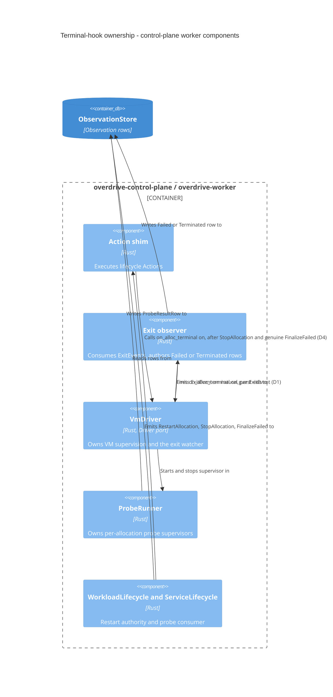

# Feature delta — `service-allocation-readiness-and-ending` (GH #318, GH #334)

> DESIGN wave, PROPOSE mode, authored by Morgan (nw-solution-architect), 2026-11-02.
> Source of truth for this feature's exact interface contract. D1 to D12 and **D17** are
> **Accepted** (§ Approval record). B1 (ADR-0265), B2 (ADR-0266) and B3 (ADR-0258) are
> accepted, B5 is rejected, B4 is D12 (ADR-0267; it amends the operative ADR-0096).
> **D13 to D16 (guest-reported listener readiness) are user-approved and the D13 contract
> shape is accepted; V41 (boot cost) and V42 (workload cgroup) are held.** Four items inside
> D13 and D14 are ruled (2026-11-04): **PR-1** the driver-to-probe-task seam (D13 item 10),
> **PR-3** the `Fail` cadence (D14 item 3) and **PR-4** one declared-listener field (D14
> item 2) are accepted; **PR-2** the scope of the listen hooks (D13 items 1 and 7) is
> accepted in contract shape (direction approved 2026-11-04 pending V42; V42 held
> 2026-11-04, `spike/findings-workload-cgroup.md`).
> Nothing here authorises DISTILL or DELIVER until the `quint-modeler` run and the
> independent DESIGN re-review (round 4) approve the revision
> (`.claude/rules/design.md` § "Surface material design decisions").
> The research that supports D7 to D10 is
> `docs/research/orchestration/probe-failure-restart-authority-and-give-up-reporting-research.md`
> (Kubernetes @7b4bd5d3, Nomad @64cdf9f9, source-cited); it is cited in each
> decision record.
> No DISCUSS wave exists. Inputs: `docs/analysis/root-cause-analysis-crash-restart-predecessor-probe-leak.md`
> (the RCA), the task text for #318 and #334 (neither issue has comments), and the
> source. **Every `path:line` citation in this document is pinned at commit
> `04052ad75`** (no file under `crates/` differs at the current branch head).

## Wave: DESIGN / [REF] Premise, grounded on the production path

**Problem.** `Driver::on_alloc_terminal` is the only thing that cancels an
allocation's probe supervisor (`VmDriver::on_alloc_terminal` →
`ProbeRunner::stop_alloc`, `crates/overdrive-worker/src/vm_driver.rs:2061-2063`,
`crates/overdrive-worker/src/probe_runner/mod.rs:374-379`). Its only production
callers are the action shim's `FinalizeFailed` genuine-terminal arm
(`crates/overdrive-control-plane/src/action_shim/mod.rs:2176`) and
`StopAllocation` arm (`mod.rs:3272`). A natural guest exit is ended by neither.

**Production path that produces the state (ground-the-premise check).**
`overdrive serve` composes one exit observer per registry driver
(`crates/overdrive-control-plane/src/lib.rs:4512-4526`). A guest exit travels
`run_exit_watcher` → `ExitEvent` on the driver's channel
(`vm_driver.rs:2315-2329`) → exit observer → `Failed` / `Terminated` row
(`exit_observer.rs:208-306`). Nothing on that path touches the probe runner. Then:

- **#334.** The supervisor of a crashed allocation keeps probing a dead guest for
  the whole restart backoff, or for the rest of the process if no restart comes.
- **#318.** `WorkloadLifecycle` restarts under a fresh allocation id
  (`crates/overdrive-reconcilers/src/workload_lifecycle.rs:1220-1222`, ADR-0105),
  so `cleanup_restart_predecessor` (`action_shim/mod.rs:1776-1805`) cleans the
  predecessor's lease, driver, mTLS and netns but never its supervisor. The
  successor's `on_alloc_running` registers a second supervisor.
- **Wider than "probe-bearing" allocations.** `ProbeRunner::start_alloc` calls
  `register_alloc`, which inserts a supervisor entry for every allocation, with
  or without descriptors (`probe_runner/mod.rs:256-259`, `:307-308`). So
  `active_alloc_count()` grows by one per VM crash-restart of any VM workload.

Both states occur under real `serve` + `deploy` with real adapters. No test
override is involved.

## Wave: DESIGN / [REF] Approval record

User rulings of 2026-11-02, recorded verbatim in outcome:

| ID | Ruling | Recorded in |
|---|---|---|
| D1 | Approved as written | ADR-0255 |
| D2 | Approved as written | ADR-0255 |
| D3 | Approved as written | ADR-0256 (split out of ADR-0255, one decision per ADR) |
| D4 | Approved as written | ADR-0255 |
| BC-1 | Behaviour change approved: a crashed service allocation no longer has its startup-probe failure streak grown by probing a dead guest; the crash row is the recorded cause and `WorkloadLifecycle` (the single restart authority) decides restart or give-up. User: "yes, new behavior is correct." | ADR-0255 Consequences; § Answers Q3; S-10 |
| D5 | Approved as proposed: `startup_probe_failed_action` skips any terminal row (`AllocState::is_terminal`: `Failed` and `Terminated`), so `ServiceLifecycle` cannot finalise a crashed allocation as a startup-probe failure. | ADR-0257 |
| D6 | Approved as proposed (user: "proceed with recommendations"), 2026-11-02. The early-exit verdict moves to `WorkloadLifecycle` at give-up. **K1 restatement, option (a), approved:** the `EarlyExit` honesty bound moves to "when the restart budget is spent" (§ Changed and unchanged assumptions). | ADR-0258 (Accepted) |
| P-3, P-4, P-5 | **Not in scope, by user ruling 2026-11-02.** The deploy stream staying silent between the first crash and the give-up is accepted. No per-attempt wire event (P-3), no attempt count on the early-exit reason (P-4), no classification of a pre-startup clean exit (P-5). | § Proposals not included |
| F-1, F-2 | Filed by the user's ruling as GH #335 (F-1) and GH #336 (F-2). | § Findings |
| D7 | **Approved as written, 2026-11-02** ("proceed with recommendations"), including the restated K1 for a Service that boots but never passes its startup probe (the `StartupProbeFailed` terminal arrives at give-up), the new public variant `StoppedBy::StartupProbe`, the changed value meaning of `StartupProbeFailed.attempts` (restart budget consumed, as for `LivenessProbeFailed`), and D5's changed user-visible sentence. | ADR-0259 (Accepted) |
| D8 | **Approved, 2026-11-02** (mirror of the liveness retry): a startup stop that does not land is retried once per new written startup probe row while the allocation is live. One additive CBOR `View` field with `#[serde(default)]`. | ADR-0260 (Accepted) |
| D8 item 3 | **Confirmed, 2026-11-02 ("yes to all", ruling 1):** a startup `Pass` after a stop that did not land ends the retry, removes the allocation from `terminal_announced` when `Stable` is announced (so liveness, which skips members, acts on it; the backend veto no longer exists, ruling R2-1). | ADR-0260 |
| D9 | **Approved, 2026-11-02**: liveness supervision begins at `Stable`, so liveness acts only once the startup probe has passed or no startup probe is declared. Owner: the probe runner, started from the existing `on_alloc_stable` hook. | ADR-0261 (Accepted) |
| D9 extension | **Confirmed, 2026-11-02 (ruling 2):** D7 item 5's stream projection returns `None` for `Stopped { by: StartupProbe }` and for `Stopped { by: LivenessProbe }`. | ADR-0259, ADR-0261 |
| D10 | **Approved in full, 2026-11-02 (ruling 3), every shape choice in § D10** (server-side stream handler owns it; `max(streaming_cap, startup_deadline + 30 s)`, derived, no spec key or flag; clock at stream open, not extended; optional `last_attempt: LastAttemptWire { alloc_id, reason, terminal, detail }` on `ServiceSubmitEvent::Failed`; `ServiceFailureReason` untouched; CLI request timeout = deadline + 30 s; the timeout wording; K1 as restated). | ADR-0262 (deadline) and ADR-0264 (`last_attempt` detail, split out of ADR-0262 on review; content unchanged) |
| F-4 | Included 2026-11-02: add the missing ADR-0087 golden fixture for `StoppedBy::LivenessProbe` beside D7's `StartupProbe` fixture. Test support in an existing format; a DISTILL obligation (S-25), not a design decision. | § Obligations |
| F-5 | **Verified real, 2026-11-02 (ruling 4: "check now and, if real, fold the fix into this design").** Code evidence in § Findings. The fix is D11. | § D11, ADR-0263 (Accepted) |
| D11 | **Approved in full, 2026-11-03 (ruling "proceed with recommendations")**, all seven shape choices in § D11 exactly as proposed: the stream subscribes then reads the recorded verdict; reuse of `current_alloc` and `service_event_from_terminal` with no new surface; only the current attempt's own terminal counts (restartable probe stops are not a verdict); relist on `Lagged`; a failed read ends the stream with an error; any recorded verdict is reported, including `Stopped { Operator }` (exit 0); no new timer or config. | ADR-0263 (Accepted) |
| F-6 | **Filed as GH #340 (type Bug), 2026-11-03**, on the user's ruling. Not changed by this feature. | § Findings |
| B1 | **Accepted as proposed, 2026-11-03 ("proceed with recommendations").** `Stable` is announced from the committed row (`ServiceAllocFact.stable_committed`); the `stable_announced` marker no longer decides emission. | ADR-0265 (Accepted) |
| B2 | **Accepted as proposed, 2026-11-03.** The `StopAllocation` arm fires `on_alloc_terminal` after the terminal row write succeeds; amends D4's and D7 item 4's "the shim is unchanged" for this one statement. | ADR-0266 (Accepted) |
| B3 | **Accepted as proposed, 2026-11-03.** D6's pre-startup-crash predicate accepts `WorkloadCrashedImmediately` and `VmOutOfMemory` (`exit_code` is `None` for the latter); fail-closed supersession reasons stay out. | ADR-0258 (text amended) |
| B4 | **Decided by the user, 2026-11-03: the orchestrator's recommendation, not parity.** Kubernetes semantics: any allocation whose Service declares a startup probe is not backend-eligible until its own startup has passed, first allocation or restart successor. Recorded as **D12**; amends the operative ADR-0096. | ADR-0267 (Accepted), ADR-0096 (amendment note) |
| B5 | **Rejected, 2026-11-03.** `PROGRESS_DEADLINE_MARGIN` stays the literal 30 s as written in D10; DL-6, E-4 and V30 stand. No derived margin. | § Rulings of 2026-11-03 |
| R2-1 | **Approved, 2026-11-03.** The redundant ADR-0096 per-allocation backend veto and the veto-before-stop ordering are removed. | ADR-0267, ADR-0096 (supersession note), § Rulings |
| R2-2 | **Approved, 2026-11-03 ("remove it if no reader remains").** No reader remains after B1, so the `stable_announced` view field is removed. | ADR-0265, § Rulings |
| D13, D14, D15 | **User-approved in direction, 2026-11-03 ("add it. and proceed with recommendations").** Gate on every declared listener, TCP and UDP; the opt-out `startup = []` is kept; no minimum-healthy window; ADR-0058 is superseded on acceptance of ADR-0270. | ADR-0268, 0269, 0270, 0272 |
| D16 | **Option R approved in direction, 2026-11-03** (remove `inferred` with the envelope procedure). | ADR-0271 |
| D17 | **Accepted, 2026-11-03** ("add it"; shape choices S1 to S6 accepted as proposed): S1 `Notify::notify_one`; S2 signal after the lock is released; S3 one submit path including the loop's own resync; S4 `BrokerDrain` without `submit`, `broker_mutex` removed; S5 `submit_evaluation` and `BrokerDrain` `pub`, `submitted` `pub(crate)`; S6 no Quint model. | ADR-0273 |
| D13 contract shape | **Accepted, 2026-11-03.** Sockops `TCP_LISTEN_CB` arm merged into the existing sockops program; `post_bind4` and `post_bind6` `CgroupSock` programs, both returning 1, both filtering protocol 17; loopback exclusion; one ordered beacon writer; drain `LISTEN` before `EXIT`; the host reader ends the guest-report wait only on `EXIT` or EOF. The merged-arm part is replaced by PR-2 (below): the TCP listen arm is a separate small sockops program in the same object. | ADR-0268, 0272 |
| V41 | **Held** (boot-cost spike, `spike/findings-boot-cost.md`): +0.36 ms at p50 on the pre-`READY` path (D13 item 6). | § Spike table |
| Dual-stack | **2026-11-03.** Overdrive does not support IPv6 yet. The rule "an `AF_INET6` wildcard report satisfies an IPv4-declared listener" and the `V6ONLY` exposure are recorded against GH #308 (comment: https://github.com/overdrive-sh/overdrive/issues/308#issuecomment-6614793072). | D13 item 8 |
| Dropped report | **2026-11-03.** No level map. The ring is sized generously by the crafter; the drop counter stays visible; a lost report is a stated, bounded exposure (the service is stopped at the startup deadline, not hung). Only TCP listen transitions and explicit UDP binds produce events. | D13 item 9 |
| PR-1 | **Accepted, 2026-11-04 ("proceed with recommendations").** The `GuestListenerReports` core read-only port (`reported` / `changed`), the `GuestListenerBoard` worker adapter (`open` / `record` / `close`), the extra mandatory parameters on `ProbeRunner::new` and `VmDriver::new`, and `SimGuestListenerReports`. The `Driver` trait, `Action` and the reconcilers are unchanged. | D13 item 10 |
| PR-2 | **Direction approved 2026-11-04 pending V42; V42 held 2026-11-04 (kernel `7.0.0-38-generic`, `spike/findings-workload-cgroup.md`, PROMOTE), so PR-2 is Accepted in contract shape.** Init creates a workload cgroup and attaches the three listen programs there, so init's own transport sockets are invisible by construction. The TCP listen arm is a separate small sockops program in the same object; this is the current D13 contract and replaces the merged-arm part of the 2026-11-03 shape. Pinned by V42: the programs ride in the object init already loads (never a second `Ebpf::load`), the root programs stay link attachments, the workload is created directly in the cgroup (D13 item 1). | D13 items 1 and 7 |
| PR-3 | **Accepted, 2026-11-04.** `Pass` is written on the event. The first `Fail` is written at the derived startup deadline with `attempt = max_attempts`; then one `Fail` per interval until the stop lands. No `Fail` is written before the deadline. `describe` loses the pre-deadline progress (accepted). | D14 item 3 |
| PR-4 | **Accepted, 2026-11-04.** `AllocationSpec.service_ports` is replaced by `declared_listeners`; `AllocationSpec::tcp_service_ports()` is the accessor the TPROXY consumers read. | D14 item 2 |
| `guest_report` model | **Accepted, 2026-11-04.** The `guest_report` Quint module gets host-half conformance (`quint-connect` driver on the host reader, board and probe task) and Tier-3 real-boot coverage for the guest half. There is no writer seam in `overdrive-init`. The gap: the guest-side writer ordering (one ordered writer, `LISTEN` drained before `EXIT`) is not replayed against the model; it is covered by the Tier-3 boot scenarios (V36, V38 shapes) and by the host reader's treatment of any line order. | M-6, § Formal protocol model |

## Wave: DESIGN / [REF] Decisions

D1 to D12 and D17 are accepted. D13 to D16 are user-approved; PR-1, PR-3 and PR-4 inside
them and PR-2 are accepted in contract shape (V42 held; § Decisions D13 to D16). B1 to B3 are accepted rulings recorded in the approval
record and as ADR-0265, ADR-0266 and ADR-0258.

### D1 — The exit observer fires `on_alloc_terminal` for every `ExitEvent` it consumes

The exit observer calls `Driver::on_alloc_terminal(&event.alloc)` on the driver it
was spawned for, once per consumed `ExitEvent`, **before** the awaited row write
and **regardless of the write outcome** (`Wrote`, `NoWrite`, `Failed`). The
`Weak<dyn Driver>` upgrade is transient and is not held across an `.await`. A
failed upgrade is a no-op. There is one observer per registry driver and it holds the
exact owning driver (`lib.rs:4512-4526`).

1. The trigger is the **`ExitEvent`**, not the successful row write: on `NoWrite`
   (`exit_observer.rs:469-476`) and `Failed` (`:244-287`) no row is written, yet the
   guest is dead.
2. The hook fires **first**, because it is infallible and in-memory, and the
   observer's retry loop can sleep up to 350 ms (`RETRY_BACKOFFS`, `:81-82`)
   while a dead guest keeps probing.

### D2 — The `on_alloc_terminal` contract is row-independent and idempotent

The trait docstring (`crates/overdrive-core/src/traits/driver.rs:739-751`) is
rewritten as specified in § Interface contract: the hook means "this
allocation's workload has ended or its terminal state is being claimed";
authors are plural; it is infallible, synchronous and non-blocking; repeated and
unknown ids are no-ops; it is not ordered relative to the terminal row write.
`VmDriver` is the only production override (`driver.rs:751` default,
`vm_driver.rs:2061` override).

### D3 — The shim registers probe supervision before it releases the exit-event gate

At both `Running` sites the action shim calls `driver.on_alloc_running(&spec)`
**before** `driver.release_for_exit_emission(handle)`: `StartAllocation`
(`mod.rs:2679` then `:2686`) and `RestartAllocation`'s successor (`mod.rs:3201`
then `:3202`).

`release_for_exit_emission` is what lets the watcher emit `ExitEvent`
(`vm_driver.rs:2295-2329`; the gate send is the method's last effect, `:2019-2024`).
In the reverse order D1's hook can run as a no-op on an unregistered id before
`on_alloc_running` registers the supervisor, orphaning it for the life of the
process. Record: [ADR-0256](../../product/architecture/adr-0256-the-shim-registers-probe-supervision-before-it-releases-the-exit-event-gate.md).

### D4 — The two existing shim hook calls stay; `cleanup_restart_predecessor` gains none

- `StopAllocation` keeps its hook (`mod.rs:3272`). `VmDriver::stop` moves the
  entry to `EndingInFlight`, so `try_begin_ending` returns `None` and **no
  `ExitEvent` is emitted** (`vm_driver.rs:1793`, `:2304-2308`). (**B2, accepted
  2026-11-03, ADR-0266**, amends D4 for this one statement: the hook is fired after
  the stop's terminal row write succeeds instead of before it.)
- `FinalizeFailed` keeps its hook (`mod.rs:2176`); it runs against a VM that may
  still be alive, so no `ExitEvent` exists to fire it.
- `cleanup_restart_predecessor` gets **no** call. `RestartAllocation` requires the
  predecessor row to be `Failed | Terminated` (`mod.rs:2708`), and every way a
  supervised predecessor reaches that row now fires the hook (§ Q1).

### D5 — `ServiceLifecycle` announces a startup-probe failure only for a non-terminal allocation

Record: [ADR-0257](../../product/architecture/adr-0257-service-lifecycle-announces-a-startup-failure-only-for-a-live-allocation.md).

**The edge.** `startup_probe_failed_action`
(`crates/overdrive-reconcilers/src/service_lifecycle.rs:1168-1217`) returns
`None` for `AllocState::Terminated` only (`:1192-1194`); otherwise it emits
`FinalizeFailed { ServiceFailed { StartupProbeFailed } }` when
`attempts >= max_attempts && elapsed >= deadline && no_pass` (`:1199-1213`),
`Failed` included. D1 freezes the streak at the crash, so a crashed allocation
whose streak was at the maximum is finalised as a startup-probe failure while
`WorkloadLifecycle` still treats the row as restartable (`is_restartable` ignores
`terminal`, `workload_lifecycle.rs:1656-1660`). D6 deletes the early-exit branch, so
the guard below is then the only thing that stops the verdict for a `Failed` row.

**Contract.** The `Terminated` exclusion (`:1192`) becomes the existing predicate
`AllocState::is_terminal` (`crates/overdrive-core/src/traits/observation_store.rs:230`,
`Terminated | Failed`), so the function returns `None` for a terminal row before
reading any gate. No signature, type, variant, error, wire or persisted shape
changes. The comment at `:1174-1191` is rewritten accordingly. `reconcile` is
unchanged: a `Failed` row yielding `None` records nothing new in `terminal_announced`.

**Other branches.** No other `ServiceLifecycle` branch acts on a terminal row:
Stable (`:516`, `:538`), liveness terminate (`:1011`) and the backend row
(`:1055`, `:1069`) are gated on `Running`; the early-exit branch (`:569-601`) is
deleted by D6.

**Single restart authority.** `.claude/rules/reconcilers.md` § "Single restart
authority" assigns restart, and give-up at exhaustion, to `WorkloadLifecycle`
(`workload_lifecycle.rs:1106-1108`, `:1132`, `:1177-1191`).

**Dedup and membership do not depend on the branch firing on `Failed`.**
`terminal_announced` (written at `:619`) is read by the dedup (`:488`), the
successor hold (`compute_backend_healthy`, `:1137`) and the deadline hook (`:698`);
membership considers only `Running` allocations (`:1055`, `:1069`). One behaviour
differs: a restart successor is no longer held out of backend eligibility by the
predecessor's announcement (`:1137-1144`). **D12 (ADR-0267, accepted 2026-11-03)**
deletes that hold and replaces it with a per-allocation rule (a startup-probed
allocation is a backend only after its own startup has passed).

**User-visible consequence.** A service allocation that crashes after its
startup-probe attempts were exhausted and the deadline passed is restarted under
`WorkloadLifecycle`'s budget; at exhaustion the operator sees the crash-loop
terminal (`EarlyExit` or `BackoffExhausted`, per D6) instead of `StartupProbeFailed`.
A guest that stays `Running` with exhausted probes past the deadline is stopped (D7).

DISTILL rewrites `crates/overdrive-sim/tests/acceptance/service_kind_vm_terminal_invariant.rs:263-274`,
which expects `StartupProbeFailed` from a `Failed` fact (S-21).

### D6 — `WorkloadLifecycle` alone authors a crashed Service allocation's ending and names a pre-startup crash loop at give-up

Record: [ADR-0258](../../product/architecture/adr-0258-the-restart-authority-names-a-pre-startup-crash-loop-at-give-up.md),
including the K1 restatement (§ Changed and unchanged assumptions, option (a)).

**The defect at HEAD.** `ServiceLifecycle::reconcile`'s early-exit branch
(`service_lifecycle.rs:560-601`) fires on a `Failed` fact with `started_at` set, a
non-`Pass` startup probe and elapsed time below the deadline, and emits
`FinalizeFailed { ServiceFailed { EarlyExit { exit_code } } }` (`:589-594`). The
shim treats it as a genuine terminal (`action_shim/mod.rs:2156-2194`) while
`WorkloadLifecycle` still restarts the row until the budget (`:1106-1252`): two
reconcilers author one allocation's ending, against ADR-0087 D1/D2. The K1 deploy
stream closes on the first terminal event (`streaming.rs:1025-1036`).

**Contract.**

1. **`ServiceLifecycle` loses the early-exit branch.** For a row in state `Failed`
   or `Terminated` it emits no `Action`. Deleted: the branch (`:560-601`) and
   `ServiceAllocFact.exit_code` (`:111`, hydrated `:891-894`, `:899`), whose only
   reader is the branch (`:592`). Retained: the bookkeeping that records a
   `Failed` row that never reached `Running` in `terminal_announced` so the
   runtime stops re-enqueueing it (`:570-581`). The early-exit insertion at `:598`
   is deleted; the insertions at `:619` and `:580` remain.
2. **`ServiceFailureReason::EarlyExit { exit_code: Option<i32> }` is kept
   unchanged in shape** (no rkyv, serde, `ToSchema` or API-spec change). Its
   author is now `WorkloadLifecycle`; the doc comment at
   `transition_reason.rs:694-697` is rewritten to say: the Service's final
   restart attempt crashed before any declared startup probe passed and the
   restart budget was then spent; no timing claim against `startup_deadline`.
3. **`WorkloadLifecycle` selects the give-up terminal from the observed row.** In
   the ceiling branch (`workload_lifecycle.rs:1132-1192`) the terminal selection
   at `:1177-1186` gains a case, evaluated after the liveness case and after D7's
   startup-kill case (D7 § item 3 fixes the order):
   `TerminalCondition::ServiceFailed { reason: ServiceFailureReason::EarlyExit {
   exit_code } }` when the failed row is a **pre-startup crash**, else the
   existing `BackoffExhausted { attempts }`. A pre-startup crash is a row for
   which all of the following hold:
   - the workload kind is `Service`;
   - `desired.probe_descriptors` contains at least one descriptor of role
     `Startup` (an explicit opt-out declares none, ADR-0058);
   - the row's state is `Failed` and its typed reason is
     `WorkloadCrashedImmediately`. **B3 (accepted 2026-11-03)** widens this to the
     two guest-crash reasons the exit observer writes, `WorkloadCrashedImmediately`
     and `VmOutOfMemory` (`exit_observer.rs:597-619 @ 04052ad75`); the fail-closed
     supersessions (`MtlsInterceptInstallFailed`, `WorkloadNetnsProvisionFailed`,
     `DriverInternalError`) stay out (ADR-0083 D6's hazard). `exit_code` is the
     crash's exit code, and `None` for `VmOutOfMemory` (an existing shape that
     S-19 renders);
   - the current attempt's latest startup probe result is not `Pass`
     (`actual.current_startup_probe`, below).
   The idempotency guard at `:1143-1151` matches `ServiceFailed { EarlyExit }` as
   well, so a row already carrying the give-up is not re-finalised. The
   classification is evaluated only in this branch: it never changes whether a
   restart is emitted, the backoff, the ceiling, the budget count, or the
   platform-reclamation and generation-replacement exemptions. Last cause wins at
   the ceiling (ADR-0087 D4): only the final attempt's row is classified. A
   platform-reclaimed row never reaches the ceiling branch (§ Pinned readings, R-1).
4. **One new hydrated input on `WorkloadLifecycleState`, shared with D7:**
   `current_startup_probe: Option<ProbeStatus>` (the type `ServiceAllocFact`'s
   `latest_startup_probe` uses, `service_lifecycle.rs:114`). Pinned meaning: the
   status of the latest result row for role `Startup`, probe index 0, of the
   workload's **current attempt only** (`current_alloc`, `workload_lifecycle.rs:1106-1108`,
   `:1422-1428`), read only when that row's state is `Failed` or `Terminated`;
   `None` when there is no such row or no result row (ADR-0054 § 5). D6 reads
   whether it is `Some(Pass)`; D7 reads the failure reason of `Some(Fail { .. })`.
   Populated only by `hydrate_actual`, through `HydrationContext`'s observation
   store (`list_probe_results_for_alloc`); `hydrate_desired` leaves it `None`. A
   read failure surfaces as `HydrateError::ObservationRead` (logged and skipped for
   the tick, ADR-0086); there is no default and no "failed read means no pass"
   rule. No port, trait method, adapter or `Sim*` surface changes; nothing is
   persisted.
5. **Restart budget on the API wire.** `restart_budget_from_rows`
   (`handlers.rs:1399-1407`) reports the budget as exhausted for a row whose
   terminal is `ServiceFailed { EarlyExit }` as well as `BackoffExhausted`, with
   `used` equal to `RESTART_BACKOFF_CEILING`. The same gap exists today for
   `LivenessProbeFailed` (F-2, GH #336); this decision does not change it.
6. **Stream and CLI.** `service_event_from_terminal` already maps
   `ServiceFailed { reason }` to `ServiceSubmitEvent::Failed { reason }`
   (`streaming.rs:840-844`); no change. The CLI's `elapsed:` line for `EarlyExit`
   is removed: `format_service_failed_block` loses its `early_exit_timing`
   parameter (`render.rs:1461-1476`, `:1540-1545`) and the stream-side elapsed
   measurement is deleted (`deploy.rs:689-770`). The exit-code line, the Service
   guidance sentence and the stderr tail stay.

**Behaviour change (approved).** After the first crash the `overdrive deploy`
Service stream no longer ends with `Failed { EarlyExit }`; it stays open through
the restarts (a successor that passes startup ends it with `Stable`) and ends at
give-up with `Failed { EarlyExit { exit_code } }` for a pre-startup crash loop, or
`BackoffExhausted` for any other cause. `workload describe` shows one row per
attempt (ADR-0105) and, at give-up, `terminal: ServiceFailed { EarlyExit }` with the
wire `restart_budget` exhausted. `Restarts` reads 0 on every row (F-1, GH #335).

**ADR-0083 D6 hazard.** The `Failed`-gated early-exit branch fabricating
`ServiceFailed { EarlyExit }` on a non-crash row is removed with the branch; the
new classification requires the typed crash reason and runs only at the ceiling,
after the platform-reclamation exemption (`workload_lifecycle.rs:1130-1132`).
ADR-0083 D6 itself is unchanged.

**Pre-existing gap surfaced, not changed (D6.b, optional).** The slice-08 scenario
says a Service that exits 0 inside the deadline is `EarlyExit { exit_code: 0 }`; in
production a clean exit lands as `Terminated` with `Stopped { by: Process }`
(`classify_natural_exit_terminal`, `workload_lifecycle.rs:1692-1695`), so it was never
produced. Under D6 a pre-startup clean exit gives up as `BackoffExhausted`.
Extending the predicate to that `Terminated` row with `exit_code: Some(0)` would
deliver the scenario; it is the user's to add.

Alternatives: ADR-0258. Giving up at the first pre-startup crash is a
restart-policy change and is not taken without the user.

**Tests that pin the old behaviour.** DISTILL rewrites them: the `early_exit_*`
cases in `crates/overdrive-core/tests/acceptance/service_lifecycle_reconcile_branches.rs`
(S-21, S-15); `service_lifecycle_stable.rs` `:229`, `:260`, `:282` (S-16; `:282`
deleted or the D6.b scenario); the `exit_code` assertions in
`service_lifecycle_hydrate.rs`; `service_early_exit_render.rs` and
`render_pure_fns.rs` (no `elapsed:`, new signature); and
`verification/expectations/E01-coinflip-service-honest-early-exit/` (the "within the
startup deadline" wording is restated with K1). `EarlyExit` wire and rkyv roundtrip
tests are unchanged.

**Not touched.** `RESTART_BACKOFF_CEILING`, the backoff, restart decision functions,
`is_restartable` and the reclamation/replacement exemptions; the exit observer,
shim, probe runner, ADR-0078/0105 and every persisted or wire format.

### D7 — a startup-probe failure stops the allocation; `WorkloadLifecycle` alone restarts it and names the failure at give-up

Decision record: [ADR-0259](../../product/architecture/adr-0259-a-startup-probe-failure-stops-the-allocation-and-the-restart-authority-decides.md)
(context, evidence from Kubernetes `kuberuntime_manager.go:1440-1470` and Nomad
`watcher.go:105-117`, restated K1 in § Changed and unchanged assumptions). Item 5 is
extended by D9; D8 replaces the stamp-at-emission dedup of item 2; D10 replaces the
90 s stream cap.

**The defect at HEAD.** `ServiceLifecycle` emits `FinalizeFailed { ServiceFailed {
StartupProbeFailed } }` on a live allocation (`startup_probe_failed_action`,
`crates/overdrive-reconcilers/src/service_lifecycle.rs:1168-1217`, called at
`:612-620`); the shim writes the row `Failed` without `driver.stop`
(`action_shim/mod.rs:2163-2194`), `WorkloadLifecycle` restarts it to the ceiling
(`workload_lifecycle.rs:1543-1558`), and the stream closes on the first terminal
(`streaming.rs:1029-1056`): two reconcilers author one ending.

**The shape D7 mirrors.** The liveness stop emits `StopAllocation { terminal:
Some(Stopped { by: LivenessProbe }) }` (`service_lifecycle.rs:1021-1024`); the shim
stops the driver, fires `on_alloc_terminal` and writes the row `Terminated`
(`action_shim/mod.rs:3234-3388`); the row is restartable by construction
(`transition_reason.rs:391-411`) and `WorkloadLifecycle` reads the cause at the
ceiling through `is_liveness_killed` (`:1575-1584`), never through a
cross-reconciler read (ADR-0087 D3). The hazard: the shim echoes the stop's terminal
onto the lifecycle event (`action_shim/mod.rs:508`), the Service stream returns on
every `Stopped` (`streaming.rs:845-847`, `:1047-1051`), and the CLI exits 0
(`deploy.rs:795-817`). A startup stop happens while the stream is open, so item 5
pins the handling.

**Proposed contract.**

1. **New public variant `StoppedBy::StartupProbe`** (`overdrive-core`,
   `transition_reason.rs`, `#[non_exhaustive]` enum). Fieldless, appended after
   `LivenessProbe` (rkyv discriminant 6; serde and OpenAPI name `startup_probe`).
   Doc comment: a startup-probe failure (detected by `ServiceLifecycle`) stopped
   this instance; the workload's intent still stands and `WorkloadLifecycle`
   restarts it under its single budget; restartable, not an intentional stop, not
   a platform reclaim. Reusing `LivenessProbe` would make the two causes
   indistinguishable at the ceiling (ADR-0259). No helper method is added. The two
   exhaustive `StoppedBy` match sites without a wildcard gain an arm:
   `TransitionReason::human_readable` (`transition_reason.rs:900-907`, text
   `stopped (startup probe)`) and `by_reclaims_platform` (`:1027-1038`, `false`).
2. **`ServiceLifecycle` stops instead of finalising.**
   `startup_probe_failed_action` keeps its guard (ADR-0257: `None` for a terminal
   row) and its three gates unchanged. When it fires it returns
   `Action::StopAllocation { alloc_id, terminal: Some(TerminalCondition::Stopped {
   by: StoppedBy::StartupProbe }) }` instead of the `FinalizeFailed`. No new
   `Action` variant. The bookkeeping is unchanged: the allocation is inserted into
   `terminal_announced` at emission (the dedup, the liveness skip and the runtime
   re-enqueue falseness read it). Nothing precedes the stop in the returned
   `Vec<Action>`: the per-allocation backend veto, `startup_failed_this_tick` and the
   backend-row splice ahead of the startup action (`:634-647`) are deleted, because
   an allocation without a committed `Stable` is already not `healthy` (D12). **D8
   changes one thing here: the dedup.** Membership of `terminal_announced` no longer
   suppresses a startup stop for an allocation that is still `Running`; the stop is
   re-emitted once per new written startup probe row until the row leaves `Running`
   (D8). The doc comments of `terminal_announced` and the branch are rewritten: the
   set records "this reconciler has acted on the allocation's startup window". The
   field name is a serde key of the CBOR `View` and is not renamed. D7 itself adds
   and removes no `View` field; D8 adds one. The `no_pass` gate reads the latest
   startup row, in D5, D7 and D8 alike (§ Pinned readings, R-2).
3. **`WorkloadLifecycle` restarts the stopped row and names the failure at the
   ceiling.**
   - `is_restartable` and `is_intentionally_stopped` are unchanged: a `Terminated`
     row carrying `Stopped { by: StartupProbe }` is restartable and **must not** be
     exempted by the intentional-stop test (the exemption stays exactly operator
     and system gc). It consumes restart budget as a crash does.
   - A private predicate on the observed row, true iff the row is `Terminated` and
     its `terminal` is `Stopped { by: StartupProbe }` (the crafter names it). It
     reads `terminal` only: the shim hardcodes the row's `reason` to `Reconciler`
     for every `StopAllocation`.
   - **Give-up priority order in the ceiling branch** (`:1177-1186`), first match
     wins: (a) liveness kill, `ServiceFailed { LivenessProbeFailed }` (unchanged);
     (b) startup kill, `ServiceFailed { StartupProbeFailed { probe_idx: 0,
     last_fail, attempts } }`; (c) pre-startup crash, `ServiceFailed { EarlyExit }`
     (D6); (d) otherwise `BackoffExhausted` (unchanged). The three specific cases
     are mutually exclusive by construction (a, b read a `Terminated` row's own stop
     disposition; c requires a `Failed` row with `WorkloadCrashedImmediately`), so
     the order never changes an outcome; a property test asserts exclusivity. Only
     the final attempt's row is classified; the last cause wins (ADR-0087 D4).
   - `attempts` in the give-up terminal is `restart_counts` for the final row (the
     restart budget consumed, equal to the ceiling), as for `LivenessProbeFailed`
     and `BackoffExhausted` (ADR-0087 D4), **not** the probe streak the detector
     read. The doc comment on `ServiceFailureReason::StartupProbeFailed`
     (`transition_reason.rs:689-693`) is rewritten to say so; this changes the
     meaning of an existing field's value, not its type or archived layout.
   - `last_fail` is the final attempt's last startup-probe failure reason, read from
     its startup probe row.
   - The idempotency guard (`:1143-1151`) also matches
     `ServiceFailed { StartupProbeFailed }`. The ceiling-branch `FinalizeFailed` is
     emitted only for a row that does not already carry one of the give-up
     terminals.
   - **Hydrated input: the same `current_startup_probe` field D6 item 4 pins**, no
     second field. `last_fail` is the failure reason of
     `current_startup_probe == Some(ProbeStatus::Fail { last_fail_reason, .. })` and
     the empty string for any other value, the same total mapping
     `startup_probe_failed_action` applies (`service_lifecycle.rs:1200-1203`). The
     mapping is total because a `Fail` row can be followed by a late `Pass` (the
     hook allows one bounded late probe row, D2, Q3; probe rows are never deleted,
     V9). A read failure is `HydrateError::ObservationRead` (D6 item 4).
4. **The shim is unchanged** (apart from B2, ADR-0266: the hook now follows the row
   write). The `StopAllocation` arm already stops the guest, cleans up, fires the
   terminal hook (D4) and writes the `Terminated` row, so the guest is stopped
   before its successor is placed.
5. **The Service stream does not end on a restartable probe stop.**
   `service_event_from_terminal` (`streaming.rs:825`, a `pub fn`) returns `None`
   for `TerminalCondition::Stopped { by: StoppedBy::StartupProbe }` **and for
   `TerminalCondition::Stopped { by: StoppedBy::LivenessProbe }`** (see D9 item 6).
   The existing `None` path continues the loop (`streaming.rs:1039-1046`). Every
   other `Stopped { by }` projects as today. The stream closes on a give-up
   terminal, on `Stable` for a successor that passes, on an operator stop, or on
   its progress deadline (D10).
6. **`restart_budget_from_rows`** (`handlers.rs:1399-1407`) treats
   `ServiceFailed { StartupProbeFailed }` as exhausted, with `used` equal to
   `RESTART_BACKOFF_CEILING`, consistent with D6 for `EarlyExit`. The same gap for
   `LivenessProbeFailed` stays GH #336.
7. **`workload describe`.** `render::workload_describe`'s Service arm
   (`overdrive-cli/src/render.rs:1135-1158`) prints one presence-guarded line,
   `    terminal: stopped (startup probe failed)`, for a row whose terminal is
   `Stopped { by: StartupProbe }`, beside the existing `terminal: Stable` line.

**Behaviour change.** For a Service with a declared startup probe whose instance
stays alive and never passes, the deploy stream no longer ends with
`Failed { StartupProbeFailed }` at the startup deadline `D`; the instance is stopped
and restarted, a successor that passes ends the stream with `Stable`, and the
give-up (`StartupProbeFailed` with `attempts` equal to the ceiling) arrives after
about `6 x D + 5 s`. With the default `D = 60 s` (`DEFAULT_STARTUP_DEADLINE`,
`service_lifecycle.rs:359`) the progress deadline (D10) is reached first, so the
deploy ends with a `Timeout` carrying the first attempt's startup stop as detail.
A crashing instance is unaffected (D6).

**Interaction with D5.** D5's guard stays and is still required; D7 changes only what
the live branch emits. After the stop lands the row is `Terminated`, so a
re-evaluation yields `None`. D5's sentence "a guest that stays `Running` with
exhausted probes is finalised as `StartupProbeFailed`" is replaced by the behaviour
above.

**Exposures (E-1 is closed by D8).**

- **E-2: a crash racing the stop.** If the guest crashes after `ServiceLifecycle`
  evaluated the `Running` row and before the shim writes the stop row, the shim's
  re-read-then-write loop (`action_shim/mod.rs:3286-3355`, no refusal to overwrite a
  terminal winner at `:3300`) overwrites the `Failed` crash row with `Terminated` /
  `Stopped { StartupProbe }`, so that attempt's crash cause is lost; restart, budget
  and termination are unchanged. It is a documented bounded exposure outside
  `PreStartupCrashStaysObservable`, not modelled (the liveness stop carries it,
  ADR-0087); S-28 pins the outcome. Closing it would change the shim's
  `StopAllocation` contract: P-9.
- **E-3: the progress deadline fires before the give-up** (above). Bound: the
  timeout carries the last attempt's cause as labelled detail (D10); the outcome is
  an honest failure, never a success.
- **E-4: the progress deadline fires before a slow-booting healthy instance reaches
  `Stable`** (D10, assumption DL-6). Bound: the timeout is honest and retracts nothing;
  only a boot near `VM_BOOT_DEADLINE` combined with a last-attempt startup pass
  reaches it.

**Persisted and wire format impact.** `StoppedBy` is rkyv-archived inside
`AllocStatusRow` and `AllocLifecycleOccurrenceRow`, serde-serialised on the API and
stream, and `ToSchema` in `api/openapi.yaml`. The new variant is **fieldless and
tail-appended**, like `LivenessProbe` (ADR-0087 § Compliance), so existing rows
decode unchanged: **no new envelope version**, `AllocStatusRowEnvelope` stays V1,
**no existing `FIXTURE_Vn` is touched**. Obligations: **add one golden-bytes
fixture** pinning `StartupProbe` to
`crates/overdrive-core/tests/schema_evolution/alloc_status_row.rs`, plus the missing
`LivenessProbe` fixture (ADR-0087 § Compliance; F-4; S-25); regenerate
`api/openapi.yaml` (`cargo openapi-gen`; `openapi-check` gates). No compatibility
mode. **No** other archived, wire or `ToSchema` change: `ServiceFailureReason` keeps
its shape, `WorkloadLifecycleView` changes nothing, `ServiceLifecycleView` gains one
field in D8, and `current_startup_probe` (D6 item 4) is an in-memory `State` field.

**Alternatives:** ADR-0259.

**Tests that pin the old behaviour.** DISTILL rewrites the `StartupProbeFailed`
finalisation, backend-veto and ordering tests in `service_lifecycle_reconcile_branches.rs`
(Category C), `service_lifecycle_stable.rs`, `service_kind_vm_workloads.rs`,
`service_backend_projection.rs` and `service_kind_vm_terminal_invariant.rs` to the
`StopAllocation { Stopped { StartupProbe } }` contract (S-21, S-22, S-46).
`single_restart_authority_liveness_trajectory.rs` is the model for S-22.

**Not touched.** `RESTART_BACKOFF_CEILING`, the backoff, `restart_decision`, the
restartable and intentional-stop predicates, the shim, the exit observer, D5's guard,
D6's contract and `ServiceFailureReason`'s shape.

### D8 — a startup stop that does not land is retried once per new written startup probe row

Decision record: [ADR-0260](../../product/architecture/adr-0260-a-failed-startup-stop-is-retried-once-per-new-startup-probe-row.md).
**Own ADR**, because it is independently reversible from D7: D7 is complete
without it (the E-1 exposure then stands), and D8 is reverted by restoring the
stamp-at-emission dedup and deleting one `View` field.

**The defect.** At emission D7's stop stamps the allocation into
`terminal_announced`, and the dedup (`service_lifecycle.rs:488-490`) skips it on
every later tick; if the shim's `StopAllocation` errors, the row stays `Running` and
no reconciler acts again. The liveness path re-acts on a newer crossed row keyed by
`run_seq` (`service_lifecycle.rs:996-1025`, view field `:338`), and the startup probe
task writes a row each interval until `Stable` or the terminal hook
(`probe_runner/mod.rs:763-799`).

**Contract.**

1. **New field `ServiceLifecycleView.startup_last_acted_run:
   BTreeMap<(AllocationId, ProbeIdx), ProbeRunSeq>`**, `#[serde(default)]`,
   documented as `liveness_last_acted_run` is: the `run_seq` of the startup probe
   row on which this reconciler last emitted a startup stop; an input, not a derived
   value; written only when a stop is emitted; absent means never acted. The key is
   `(alloc, ProbeIdx::new(0))`. CBOR evolution is additive with `#[serde(default)]`
   (ADR-0035 / ADR-0036); no versioned envelope, no migration.
2. **Emission rule.** The startup stop is emitted for an allocation iff the three
   gates and the ADR-0257 guard hold (D7 item 2) **and** the latest startup row's
   `run_seq` is greater than the recorded value for the key (or none is
   recorded). Emission records the row's `run_seq` and, as in D7, inserts the
   allocation into `terminal_announced`.
3. **The dedup no longer hides a live allocation.** `terminal_announced`
   membership of an allocation whose fact is `Running` means "a startup stop was
   emitted and has not landed"; for such an allocation the loop still evaluates
   the startup stop rule of item 2. For any non-`Running` fact the existing dedup
   applies unchanged. The liveness skip and the re-enqueue falseness keep reading
   `terminal_announced` (the lineage-wide successor hold is deleted by D12; the
   per-allocation backend veto no longer exists), with one exception: **a startup
   `Pass` recorded after a stop that did not land contradicts the decision the stop
   acted on.** The gate's `no_pass` is then false, so no further stop is emitted; a
   `Running` fact whose latest startup row is `Pass` is evaluated by the Stable
   branch despite its `terminal_announced` membership, and announcing `Stable` for
   it **removes it from `terminal_announced`** (the two sets stay disjoint, and
   liveness, which skips members, acts on it once `Stable`). Without this a late
   `Pass` would strand a serving instance, never `Stable`, never stopped, never
   liveness-supervised. A partial landing cannot produce a `Pass`: a stop whose
   `driver.stop` succeeded leaves a dead guest (Q3).
4. **Retry pace.** One re-emission per new written startup row, so at most one per
   `interval_seconds`, until the row leaves `Running` or the supervisor ends (the
   terminal hook, D1/D4). The shim's `StopAllocation` arm is idempotent for an
   allocation already stopped (`DriverError::NotFound` tolerated,
   `action_shim/mod.rs:3286-3355`), the property the liveness retry relies on
   (ADR-0191).
5. **Bound.** A stop that fails persistently is retried at probe-interval pace
   without limit while the allocation is `Running`; each failure is an
   Overdrive-own driver or cleanup error, and the retry ends when the cause clears,
   as for liveness.

**Owner.** `ServiceLifecycle` (detector); the shim executes. No new `Action`, port,
wire or archived shape; the only persisted change is the additive CBOR `View` field.

**Alternatives:** ADR-0260.

**Bound of the retry (fix: B2, ADR-0266).** The retry trigger is a new startup probe
row, which exists only while the probe supervisor is alive. It covers a stop that
fails *before* the shim fires `on_alloc_terminal` (`action_shim/mod.rs:3250-3271`). It
does **not** cover a failed terminal row write (`:3356`, `:3361-3366`), which comes
after the hook (`:3272`): the guest is dead, the supervisor is gone, `VmDriver::stop`
emits no `ExitEvent` (V1), the row stays `Running`, and nothing acts on it; the
liveness stop carries the same gap since ADR-0087. B2 moves the hook after the
successful row write, so the supervisor stays registered and the next probe row
re-emits the stop.

### D9 — liveness supervision begins at `Stable`; the probe runner owns the gate

Decision record: [ADR-0261](../../product/architecture/adr-0261-liveness-probing-begins-when-the-service-is-stable.md).
**Own ADR**: independently reversible (restoring the `on_alloc_running` spawn
reverts it without touching D7 or D8).

**The defect.** `ProbeRunner::start_alloc` spawns every role's tasks at
`on_alloc_running` (`probe_runner/mod.rs:328-361`); only `Stable` retires the startup
role (`stop_role`, `:393-398`, via `VmDriver::on_alloc_stable`, `vm_driver.rs:2065-2067`).
`liveness_terminate_action` gates on `Running`, a crossed streak and a newer row only
(`service_lifecycle.rs:1002-1013`), so a liveness kill can fire on an instance still
starting and, at the ceiling, name `LivenessProbeFailed` for a workload that never
became ready, although `ProbeRole` documents liveness as "continuous post-Stable"
(`observation/probe_result_row.rs:283-286`).

**Where the gate lives.** The streak is producer-recorded (`same_status_runs`,
`probe_runner/mod.rs:637-657`), so a `ServiceLifecycle` gate would leave a
startup-time streak in place and kill a healthy instance on the first post-`Stable`
tick. The gate sits where the streak starts: the runner starts no liveness task
before `Stable`, following `Driver::on_alloc_stable`, which the shim fires after the
`Stable` row commits (`action_shim/mod.rs:2144-2153`). `Stable` stays
`ServiceLifecycle`'s decision (`service_lifecycle.rs:516-558`).

**Contract.**

1. **`on_alloc_running` no longer starts liveness tasks.**
   `ProbeRunner::start_alloc` spawns the allocation's startup and readiness tasks
   as today and **retains** its liveness descriptors on its supervisor without
   spawning them. An allocation with no liveness descriptor is unchanged.
2. **New `ProbeRunner::start_liveness(&self, alloc_id: &AllocationId)`**
   (`overdrive-worker`, `pub`, beside `stop_role` and `is_role_live`): spawns the
   retained liveness tasks of a supervised, not-yet-started-liveness allocation.
   Postconditions: idempotent (a second call spawns nothing); a no-op for an
   unknown, ended or already-stopped allocation; the spawn and `stop_alloc` are
   serialised by the supervisor lock, so either the liveness tasks start and a
   later `stop_alloc` cancels them, or the allocation is already gone and
   nothing starts. Tick-then-sleep is unchanged: the first liveness row lands one
   interval after `Stable`, and its streak starts at 1 there.
3. **`VmDriver::on_alloc_stable` calls `start_liveness` after `stop_role(Startup)`.**
   `Driver::on_alloc_stable`'s docstring (`traits/driver.rs:753-770`) gains one
   sentence: the production driver also starts the allocation's liveness
   supervision. The trait signature does not change. An opt-out Service (no
   startup probe) reaches `Stable` at its first `Running` (ADR-0058), so its
   liveness starts then.
4. **Readiness is not gated.** Out of this decision.
5. **The `stable_this_tick` skip in `collect_liveness_actions`**
   (`service_lifecycle.rs:980-983`) becomes unreachable (no liveness row can
   exist at the `Stable` tick); the crafter removes it and the reviewer's
   subtractive pass checks it.
6. **A liveness stop and the open deploy stream.** After the gate a liveness stop
   cannot reach the stream of the deploy that is waiting for `Stable`. It **can
   still reach an open stream** through the interval between a stop's row write and
   the publication of its lifecycle event (`action_shim/mod.rs:2187-2193`): a stream
   opened in that interval, for example by `overdrive deploy` of an unchanged spec
   (`handlers.rs:518-546`), would receive the `Stopped` event and end with exit 0
   (`streaming.rs:845-847`, `deploy.rs:795-817`); a lagged subscriber
   (`streaming.rs:1058-1064`) is the second path. So D7 item 5 returns `None` for
   `Stopped { by: LivenessProbe }` as well. The liveness give-up
   `ServiceFailed { LivenessProbeFailed }` still ends the stream. (An `Unchanged`
   redeploy of an already-`Stable` Service no longer waits: D11 ends it at once with
   the recorded `Stable`.)

**Owner.** The probe runner owns when probing of each role starts; `ServiceLifecycle`
remains the liveness detector and `WorkloadLifecycle` the restart authority
(ADR-0087). The runner does not decide `Stable`; it follows the existing hook.

**Alternatives:** ADR-0261.

**Behaviour change.** A Service is no longer killed for failing liveness while still
starting: a slow-starting Service with an aggressive liveness probe that previously
restart-looped to `LivenessProbeFailed` now starts. After `Stable`, liveness behaves
as before. No persisted or wire change; one new `pub` method on `ProbeRunner`.

**Dependency on the committed `Stable` row (fix: B1, ADR-0265).** D9 starts liveness
from the `Stable` hook, which fires after the `Stable` row commits. At HEAD
`ServiceLifecycle` records `stable_announced` in the same pure `reconcile` that emits
the action (`service_lifecycle.rs:531`, `:555`), the runtime persists the `View`
before dispatch and does not roll it back (`reconciler_runtime.rs:1648-1652`), and
the shim's `Stable` arm returns on a write error before the hook
(`action_shim/mod.rs:2147-2150`). A failed write leaves the `View` "announced" and
the row without `Stable`: the startup role is never retired and under D9 **liveness
never starts**. B1 keys the announcement on the committed row, as ADR-0079 does for
the backend row.

**Control-plane restart.** Probe supervisors and the liveness gate are process-local.
Boot reclamation makes any unsupervised VM terminal (`action_shim/mod.rs:2161-2162`;
`action_shim/reclamation.rs:233-244`) and `WorkloadLifecycle` places a successor whose
own `Stable` starts its own liveness; `start_liveness` for an unregistered id is a
no-op (item 2). S-31 carries the replay case.

### D10 — `overdrive deploy` waits on a progress deadline distinct from the restart budget

Decision records: [ADR-0262](../../product/architecture/adr-0262-the-service-deploy-stream-is-bounded-by-a-progress-deadline-derived-from-the-startup-deadline.md)
(the derived deadline, its owner and the client envelope) and
[ADR-0264](../../product/architecture/adr-0264-the-progress-deadline-timeout-carries-the-latest-attempt-as-labelled-detail.md)
(the `last_attempt` detail, items 3 to 4). Each is independently reversible
(restoring the fixed cap reverts ADR-0262 without touching D6 to D9; deleting the
field reverts ADR-0264).

**The defect.** The Service deploy stream is bounded by one fixed timer, `AppState::streaming_cap` (`DEFAULT_STREAMING_CAP` = 90 s, `overdrive-control-plane/src/lib.rs:288`, `:786`), fired as `Failed { Timeout { after_seconds } }` (`streaming.rs:995`, `:1075-1083`; the Job stream shares it); the CLI envelope is a fixed 120 s (`overdrive-cli/src/http_client.rs:276-292`). A Service with startup deadline `D` (`interval_seconds x max_attempts`, default 60 s, `service_lifecycle.rs:758-770`) that becomes `Stable` between 90 s and `D` is reported `Failed { Timeout }` while healthy; and with D7 the give-up (about `6 x D + 5 s` = 365 s) is unreachable inside 90 s, so the timeout is the operator's only terminal and carries no cause.

**Where the deadline lives.** In the server-side Service stream handler, the existing owner of the timer; it already holds the workload's `LifecycleEvent`s (`alloc_id`, `to`, `reason`, `terminal`, `detail`, `action_shim/mod.rs:275-311`), so the last attempt's cause needs no new read. A CLI disconnect ends the stream; `overdrive deploy` again returns `Unchanged` and opens a new stream with a new clock. The durable record is the rows.

**Contract.**

1. **Derived, not configurable.** The Service stream's deadline is
   `progress_deadline(startup_probes) = max(streaming_cap, startup_deadline +
   PROGRESS_DEADLINE_MARGIN)` where `startup_deadline` is the existing derivation
   (`interval x max_attempts` of startup probe index 0; `DEFAULT_STARTUP_DEADLINE`
   when the list is empty or the product overflows) and
   `PROGRESS_DEADLINE_MARGIN` = 30 s. It exceeds the startup deadline by at least 30 s;
   no TOML key, flag or server setting is added. At the default spec the value is 90 s.
   `streaming_cap` stays the floor and the Job stream's bound, unchanged.
2. **Clock.** Armed at stream open (after `Accepted`) with the injected `Clock`. It is
   **not extended**: a `Stable` ends the Service stream, so progress cannot be observed
   mid-stream.
3. **Terminal.** At the deadline the stream emits the existing
   `ServiceSubmitEvent::Failed { alloc_id: None, reason: ServiceFailureReason::Timeout {
   after_seconds }, stderr_tail: None }` with `after_seconds` = the deadline, plus the
   new optional field of item 4. `ServiceFailureReason` is unchanged (it is rkyv
   archived; a field on `Timeout` would change its archived layout).
4. **New wire surface (named): `ServiceSubmitEvent::Failed` gains
   `last_attempt: Option<LastAttemptWire>`** (`#[serde(default,
   skip_serializing_if = "Option::is_none")]`, additive), and a new serde +
   `ToSchema` struct `LastAttemptWire { alloc_id: String, reason: TransitionReason,
   terminal: Option<TerminalCondition>, detail: Option<String> }`, composed of
   existing types. The stream keeps in memory the latest `LifecycleEvent` of this
   workload whose `to` is `Failed` or `Terminated` and projects it into the
   timeout; a stream that saw none emits `None`. It is populated **only** on the
   synthesised timeout; `service_event_from_terminal` and every other `Failed` set
   `None`. `api/openapi.yaml` is regenerated. The detail is labelled "last attempt"
   in the render and is never the verdict: the restart authority's give-up (D6, D7)
   stays the only authoritative `Failed { cause }`.
5. **Pure derivation fn (named, new public surface).**
   `overdrive_reconcilers::service_lifecycle::startup_deadline(&[ProbeDescriptor])
   -> Duration` (extracting the existing derivation behind `spec_facts_for_service`,
   which then calls it) and `overdrive_control_plane::streaming::progress_deadline(
   startup_probes: &[ProbeDescriptor], floor: Duration) -> Duration`, with
   `PROGRESS_DEADLINE_MARGIN`. One derivation, called by the submit handler
   (`handlers.rs:455-546`, both `Inserted` and `Unchanged`) and by the CLI on the
   `Service` that `Service::from_submit` validated client-side (`deploy.rs:654`).
   **Both sides use the same floor:** in production `streaming_cap` is always
   `DEFAULT_STREAMING_CAP` (`lib.rs:786`; the stale doc naming a `[server]
   streaming_submit_cap_seconds` key, `lib.rs:283-287`, is corrected with this feature),
   and `overdrive-cli` already depends on `overdrive-control-plane` (`Cargo.toml:77`), so
   the CLI imports the constant and its timeout `deadline + 30 s` cannot fall below the
   server deadline. If `streaming_cap` ever becomes operator-configurable, the server
   must report its deadline to the client; no such surface is added now.
6. **`build_service_stream` takes the deadline** as a new parameter
   (`streaming.rs:988`); the handler passes `progress_deadline(&service.startup_probes,
   state.streaming_cap)` (`handlers.rs:630`). No intent-store read in the stream.
7. **CLI.** `ApiClient::submit_workload_streaming` takes the server's deadline
   (`http_client.rs:270`) and sets its total request timeout to `deadline + 30 s`
   instead of the fixed 120 s (otherwise a deadline above 90 s is cut by the client and
   hides the typed terminal, `http_client.rs:275-287`); the Service lane passes
   `progress_deadline(&spec.startup_probes, DEFAULT_STREAMING_CAP)`, the Job lane
   `DEFAULT_STREAMING_CAP` (byte-identical). `format_service_failed_block` takes
   `last_attempt: Option<&LastAttemptWire>` in the place of D6's removed
   `early_exit_timing`. The `Timeout` text becomes "workload did not become Stable
   within {after_seconds}s; the platform may still be restarting it (see `overdrive
   workload describe`)", followed, when present, by a `last attempt (alloc <id>):`
   block carrying `reason.human_readable()` (or the `Stopped { by }` text) and the
   `detail` tail. Exit code 1.
8. **Job workloads are unchanged**: the Job stream keeps `streaming_cap`.
9. **D7 item 5 extends to `Stopped { by: LivenessProbe }`** (a one-arm extension: a
   stream can still be open when a liveness stop's event arrives, see D9 item 6 and D11).
10. **The last attempt** is the latest attempt-ending lifecycle event this stream
    observed; no probe-row read, no attempt number, nothing before the stream opened
    (a recorded verdict is reported at once by D11).

**Assumption DL-6 and exposure E-4 (the margin is exact, not slack).** The stream
clock starts at stream open; the startup deadline counts from `started_at`, set when
the `Running` row is written, after placement and VM boot. A healthy instance passing
on its last allowed attempt reaches `Stable` at about `open + boot + D + one
evaluation`, so the stream does not time out iff `boot + placement + one evaluation +
(the first probe interval, if the pass comes on the last attempt) <
PROGRESS_DEADLINE_MARGIN`. `VM_BOOT_DEADLINE` is 30 s (`vm_driver.rs:63`, used at
`:1598`, `:1675`), equal to the margin, so a guest booting at its deadline then passing
on its last attempt is `Stable` after the progress deadline. The invariant is stated
with its assumption: **DL-6, boot plus placement plus one evaluation is at most the
margin.** Where DL-6 fails, the stream ends `Failed { Timeout }` with `last_attempt:
None` for an instance that then reaches `Stable`: an honest timeout, never a false
success and never a retracted failure. That is exposure E-4, stated and bounded, pinned
by S-35 (f); the model's `HealthySlowStartNeverTimesOut` is scoped to DL-6 (modeler
list). The margin stays the literal 30 s (B5, 2026-11-03).

K1 as restated is in § Changed and unchanged assumptions.

Alternatives: ADR-0262, ADR-0264.

**Operator view.** A healthy start is `Stable` as soon as the startup probe passes, even after 90 s; a Service never ready ends at the deadline with `Failed` and the `last attempt` block (exit 1); a crash loop (D6) and a give-up inside the deadline (D7) end with their own terminals.

**Persisted and wire format impact.** No archived, CBOR or intent change. One
additive stream-wire field and one new wire struct (OpenAPI regenerated).

### D11 — the Service deploy stream first reports the verdict the workload's current attempt already carries, then waits

Decision record: [ADR-0263](../../product/architecture/adr-0263-a-service-deploy-stream-first-reports-the-verdict-the-workload-already-has.md).
Independently reversible (removing the snapshot step restores the wait-only stream
without touching D10's deadline or D6 to D9).

**The defect (F-5).** `overdrive deploy` of a byte-identical spec returns `Unchanged` and still opens the Service stream (`handlers.rs:518-546`, `:609-635`). After `Accepted` that stream only subscribes to the `LifecycleEvent` broadcast and waits (`streaming.rs:1010-1056`); it reads no observation row (`:1058-1064`), unlike the Job stream, which recovers the recorded terminal first (`workload_terminal_from_snapshot`, `streaming.rs:217-234`, `:580-625`, and on `Lagged`, `:283-300`). Nothing publishes a new terminal for an already-`Stable` allocation (events are published once per committed row write, `action_shim/mod.rs:2147-2152`, `:2187-2193`; `ServiceLifecycle` skips an allocation in `stable_announced`, `service_lifecycle.rs:473-479`), so the stream ends `Failed { Timeout }` for a healthy `Stable` Service. Two more paths share the root cause: the first-deploy race (`Stable` published before the stream subscribes, `streaming.rs:998-1010`) and a lagged subscriber (`:1058-1064`).

**Production path.** `overdrive serve`, then `overdrive deploy web.toml` until the
service is `Stable` (exit 0), then `overdrive deploy web.toml` again (same bytes).

**Contract.**

1. **Order, in `build_service_stream`:** emit `Accepted`; **subscribe** to the
   lifecycle bus; **read the recorded verdict** (below); arm the progress deadline
   (D10) only if no verdict was found; then wait as today. Subscribe-before-read is
   load-bearing (List-then-Watch): the shim commits the row before it publishes the
   event (`action_shim/mod.rs:2148 -> 2152`, `:2187 -> 2193`), so an earlier event's row
   is visible to the read and a later event is in the channel; a terminal visible to both
   ends the stream on the first.
2. **The recorded verdict** is read from the observation store: the workload's
   rows, the **current attempt** selected by the reconciler's own rule
   (`overdrive_reconcilers::current_alloc`, the numeric-maximum attempt suffix;
   existing `pub` function), and that row's `terminal` projected through
   `service_event_from_terminal`. If the projection is `Some`, the stream emits that
   line and ends. If the current attempt has no terminal, or its terminal projects to
   `None` (D7 item 5: `Stopped { StartupProbe }` and `Stopped { LivenessProbe }` are
   restartable and are not a verdict), the stream waits. A superseded attempt's
   terminal is never reported; the live path needs no such filter because it never
   receives a projecting event for a superseded attempt (§ Pinned readings, R-4).
3. **Same wire as the live path.** For a row `R` and the lifecycle event published
   for the write of `R`, the snapshot line is byte-identical to the event line (S-41).
   The projection is `service_event_from_terminal(alloc_id = the row's alloc id,
   terminal = the row's terminal, stderr_tail = the row's `detail`, last_exit_code =
   None)`; the live path passes the event's `detail` and `None` (`streaming.rs:1032-1038`),
   which is the write's occurrence `detail` (`lifecycle_event_from_occurrence`,
   `action_shim/mod.rs:505`). That it equals the committed row's `detail` is read from
   the write path, not proven here; S-41 discharges it, and a mismatch is a DESIGN
   deviation to surface. The row's `stderr_tail` field is not used.
4. **Relist on `Lagged`.** The stream repeats the read of item 2 (as the Job stream
   does; the level-triggered backstop of `.claude/rules/reconcilers.md` § "The wakeup
   model"), then continues to wait.
5. **A failed read is not absorbed.** If the observation read fails, at open or on
   a relist, the stream ends with a stream error (`Err`, the existing
   `workload_event_from_lifecycle_with_state` precedent, `streaming.rs:259-262`);
   it does not treat the failure as "no verdict" (`.claude/rules/rust.md` § "Distinct
   failure modes get distinct error variants"). The Job stream's `.ok()?` (`:585`) is
   not copied.
6. **Unchanged:** `ServiceLifecycle`'s once-per-allocation `Stable` announcement and
   its dedup (**B1** changes what the dedup keys on, not that there is one), the Job
   stream, the wire (`ServiceSubmitEvent`, `ServiceFailureReason`, ADR-0264's
   `last_attempt`), every row, `View` and intent, the CLI and the handler (it opens the
   same stream for `Inserted` and `Unchanged`).
7. **The verdict is a pure function of rows; the store read is at the edge.**
   `build_service_stream` reads the workload's allocation rows once per open and once
   per `Lagged` (`ObservationStore::alloc_status_rows`) and hands them to a
   **module-private** pure function (no clock, store handle or stream state; the
   crafter names it) that selects the current attempt, projects its terminal through
   `service_event_from_terminal` and returns the stream line or none. S-39 (cases a to
   f) and S-41 are unit tests of it over constructed rows; S-40 and S-42 drive the
   stream. A failed read is the edge's error (item 5) and never reaches the function.
8. **Reporting any stored verdict.** The stream reports `Stopped { Operator }` (exit 0)
   for a stopped workload and a stored give-up for a given-up one. It states what is
   recorded; it does not retry, restart or clear anything. No new timer, deadline,
   config, public surface or wire change; D10's deadline arms after the read.

**Owner.** The Service submit stream handler, which already owns "what does this
deploy report" (ADR-0056, ADR-0059 Q4), reading state through the existing
observation port.

**Operator view.** A redeploy of the same spec reports the recorded verdict at once (`Stable`, a stored give-up, or `Stopped` naming the operator; the `/stop` sentinel persists until `overdrive workload restart`, `handlers.rs:941-993`); a starting or restarting Service waits under D10's deadline.

**Persisted and wire format impact.** None.

Alternatives: ADR-0263. Alternatives to D1: ADR-0255.

**Formal protocol model.** D11 is an ordering-sensitive protocol (subscribe, read,
publish, commit); it is module `stream_snapshot` in
`specs/quint/service-allocation-readiness-and-ending/` (§ Formal protocol model). Its hazard is
`read_before_subscribe` (violates `NoMissedTerminal`). Conformance projection: the
first terminal line yielded by `build_service_stream` under `SimClock` with
`SimObservationStore` rows and bus events scripted around the subscribe point; no new
accessor.

Gate G-8: § Lifecycle Gate Ownership. Obligations S-39 to S-42: § Executable obligations.

### D12 — a startup-probed allocation is a backend only after its startup has passed

Decision record: [ADR-0267](../../product/architecture/adr-0267-a-startup-probed-allocation-is-a-backend-only-after-its-startup-has-passed.md).
It amends the operative
[ADR-0096](../../product/architecture/adr-0096-startup-failure-withdraws-backend-eligibility.md)
(dated amendment note recorded there, per `.claude/rules/design.md` § "Do not
manufacture amendment history before implementation": ADR-0096 is implemented, so the
change is stated, not rewritten).

**Grounding (production path).** Under `overdrive serve` + `overdrive deploy` of a Service with a startup probe and no readiness probe, the first allocation is `healthy` as soon as its row is `Running`: `compute_backend_healthy` returns true before any startup row exists (`service_lifecycle.rs:1145-1148 @ 04052ad75`); the only startup-related hold is `!fact.startup_probes_empty && !next_view.terminal_announced.is_empty() && latest startup != Pass` (`:1136-1144`), false for a first allocation. A crash successor was held only incidentally, by the early-exit announcement ADR-0258 deletes.

**1. The rule.** In the backend-eligibility predicate (`Backend.healthy`, authored by
`ServiceLifecycle`, ADR-0101), in this order:

1. **New.** If the Service declares a startup probe (`!startup_probes_empty`, the set
   `ServiceAllocFact` already reports) and the allocation's status row does **not**
   carry a committed `Stable` claim: `healthy = false`.
2. Otherwise the existing readiness rule, unchanged: no readiness probe means
   `healthy = true`; a declared readiness probe uses its latest row and
   consecutive-success threshold.

**Deleted (ruling R2-1, 2026-11-03): the ADR-0096 per-allocation terminal veto**
(`startup_failed_this_tick`, the allocation's own `terminal_announced` membership read as
a veto) **and the veto-before-stop ordering** (the backend-row splice ahead of the startup
action, ADR-0096 D2). They are unreachable: the startup stop is gated on the latest
startup row not being `Pass` and `Stable` on its being `Pass`, so a stop-eligible
allocation has no committed `Stable` and step 1 already withholds it, at the deciding
tick and after; an allocation with a committed `Stable` is skipped by the reconcile loop
before the stop gates (B1). The deleted conjunct of the old successor hold is the
`terminal_announced.is_empty()` test (`:1136-1144`). Step 1 subsumes every case the hold
and the veto covered. ADR-0096 carries a dated supersession note (D1 step 1, D2).

**2. The signal: the committed `Stable` claim, not the latest startup row.** The fact
is `ServiceAllocFact.stable_committed`, added by B1 / ADR-0265 and hydrated from the
allocation's own row (`terminal` is `Stable`). D12 adds **no field**. Why this signal:

- *Authoritative.* `Stable` is announced iff the allocation is `Running` and the latest
  startup row is `Pass` (R-2, `service_lifecycle.rs:538-558`), so a committed `Stable`
  implies the startup probe passed; D9 already treats it as "startup done".
- *No flap, no stranding.* A `Fail` row can land between the `Pass` and the startup
  role's retirement at `Stable` (D9 `on_alloc_stable`, R-2); keying on the latest startup
  row would turn a `Stable` allocation unhealthy with nothing to turn it back. The
  committed claim is monotone (no later writer drops it, V31) and re-read from the row
  every evaluation, so a restart does not change it. A `Pass, Fail, Fail` history before
  `Stable` is committed is ineligible and stop-eligible, consistently (R-2).
- *Not a view marker.* `stable_announced` recorded what was emitted, not what landed (R2-2 deletes it); eligibility keyed on it would route to an allocation whose `Stable` write was lost.
- *Cost.* Eligibility lags the startup `Pass` by the `Stable` write plus one evaluation; a lost write holds traffic until B1's re-announcement lands (the bound liveness has too). Intended.

**3. What changes, by case.**

- First allocation, startup probe declared (readiness probe or not): `healthy` only when its `Stable` is committed, then the readiness rule.
- Restart successor after a startup stop (D7, D8) or a crash (D6): held until its own `Stable` is committed, identical to a first allocation; no lineage state.
- Startup-probed allocation after `Stable`: unchanged, eligible per the readiness rule; later startup rows cannot change it.
- Opt-out Service (explicit empty startup list; `startup_probes_empty`): **unchanged**, `healthy` at `Running` (its first `Running` is its `Stable`, ADR-0058); step 1 does not apply.
- Allocation whose startup failure was decided (D7): `healthy: false` because its `Stable` is not committed; the veto is gone.
- Late startup `Pass` after a stop that did not land (D8 item 3): eligible once that `Stable` is committed.

**4. Interaction with the readiness gate.** Readiness is evaluated only after step 1
passes. The readiness probe task is not deferred (D9 gates liveness only), so a streak
already at threshold makes the allocation eligible at the `Stable` commit; readiness
withdraw-and-recover after `Stable` is unchanged.

**5. Deleted code and the tests that pin it.** Deleted: the `terminal_announced`
non-empty hold in `compute_backend_healthy` (`service_lifecycle.rs:1136-1144`), the
`latest_startup_probe` read in it, the per-allocation veto branch and its
`startup_failed_this_tick` set (R2-1); the predicate becomes the step-1 test on
`stable_committed`. Whether the private helper signature changes is the crafter's.
Single cut, no flag, no fallback. DISTILL rewrites the tests pinning the old behaviour
(confirming the set by running the suite):
`backend_policy_preserves_veto_threshold_and_unrelated_view_inputs`
(`service_lifecycle.rs:1265-1320`, becoming the two-step oracle over startup declared x
`stable_committed` x readiness, S-46) and the startup-probed `healthy` assertions in
`overdrive-sim/tests/integration/service_backend_projection.rs`,
`overdrive-sim/tests/acceptance/service_kind_vm_terminal_invariant.rs`,
`overdrive-reconcilers/tests/acceptance/service_kind_vm_workloads.rs` and
`overdrive-core/tests/acceptance/service_lifecycle_reconcile_branches.rs`. E09 and E13
(`verification/expectations/`) are point-in-time records, not rerun or edited.

**6. Operator-visible behaviour change (user-approved).** A Service that declares a
startup probe receives no traffic until its startup probe has passed (the existing fail-closed
outcome for a frontend with no healthy backend); a Service needing traffic from
`Running` declares the opt-out.

**7. Alternatives** are recorded in ADR-0267.

**8. Cost.** Pure code in `reconcile`'s backend projection; no extra read, field, action, port, wire or persisted shape.

## Wave: DESIGN / [REF] Pinned readings of the accepted decisions

Clarifications raised by the Quint model (2026-11-03). Each pins what an accepted decision and the
current code already imply; none changes a contract, a public surface or a persisted shape. R-3 is
recorded in place (§ D7, exposure E-2).

**R-1 — a platform-reclaimed final row is restarted, consumes no budget and is never the row a
give-up is decided on (D6, D7).** `restart_decision` is `attempts < CEILING || platform_reclaimed ||
generation_replacement`, true for a reclaimed row (`Terminated`,
`Stopped { PlatformReclaimed }`, no `terminal`) at any attempt count; the successor inherits the
predecessor's count and `last_failure_seen_at`; the ceiling branch is never
entered for it, so the four give-up terminals are selected only from a `Failed` or non-reclaimed
`Terminated` final row. `ServiceLifecycle` does not act on it (D5) and the stream does not project
it. S-15's grid row `Terminated` + `PlatformReclaimed` at the ceiling expects `RestartAllocation`
and no terminal.

**R-2 — the startup gate reads the latest startup row (D5, D7, D8).** `no_pass` is
`!matches!(fact.latest_startup_probe, Some(ProbeStatus::Pass))` over
the last-writer-wins projection of the startup row; the attempt count is that row's
producer-counted streak when it is `Fail`, 0 otherwise. `Stable` is announced iff the
allocation is `Running` and the latest row is `Pass`; the stop iff it is `Fail` with the gates
holding; the two partition a `Running` startup-probed allocation (an ever-passed reading would
strand `Pass, Fail, Fail`). A startup row can follow a `Pass` only before `Stable`: `on_alloc_stable`
retires the role after the `Stable` row commits, and a committed `Stable`
(B1) skips the allocation before any gate. `Pass, Fail, Fail` with the deadline passed stops the
instance (a restartable event).

**R-3 — a crash racing the stop (E-2).** See § D7, "Exposures".

**R-4 — the Service stream's live path needs no current-attempt filter (D11).** The only events
whose `terminal` projects to a stream line are published by the shim at the `Stable` commit, the genuine-terminal commit and the `StopAllocation` commit; every other publisher carries `terminal: None` or writes the non-terminal row of the
attempt being started. Those sites run inside one evaluation's dispatch of `workload/<id>`; the loop
admits one evaluation per target at a time and awaits the dispatch inside it; the successor row is written only by
a later `RestartAllocation` dispatch, and the predecessor cleanup writes no row and publishes no
event. So a projecting event is always published while its attempt
is current, and no live-path filter is added. Residual: an event published while attempt N was
current can be consumed after attempt N+1 exists (one broadcast hop); the stream reports the verdict
that was true at publication, as for an operator stop. Model: assumption SS-6 and the `Restart`
guard (S-40).

**R-5 — HO-5 and RA-2 are discharged by validation items V27 and V28.**

## Wave: DESIGN / [REF] Component decomposition and C4

No new component, crate, container or port. Container topology is unchanged, so
`c4-diagrams.md` is not touched. Component relationships touched by this feature:



**Architecture style.** Unchanged: ports-and-adapters (`Driver` is a port in `overdrive-core`; the
observer holds `Weak<dyn Driver>`). The `xtask dst-lint` `release-supervision-placement` clause over
`worker/exit_observer.rs` is unaffected (the hook call sits outside `match outcome`; DISTILL
confirms).

## Wave: DESIGN / [REF] Driving and driven ports

| Port | Kind | Role in this feature |
|---|---|---|
| `Receiver<ExitEvent>` from `Driver::take_exit_receiver` | driving port of the exit observer | Injects the guest-exit fact. Existing. |
| `Action::{StartAllocation, RestartAllocation, StopAllocation, FinalizeFailed}` through `dispatch` | driving port of the shim | Existing. |
| `Driver::on_alloc_terminal` / `on_alloc_running` / `release_for_exit_emission` | driven port (the `Driver` port) | `on_alloc_terminal` contract rewritten (D2); call order of the other two pinned (D3). |
| `ObservationStore::write_alloc_lifecycle` | driven port | Unchanged. |

`ProbeRunner::active_alloc_count()` and `is_role_live()` are read-only inspection surfaces
(`probe_runner/mod.rs:414`, `:407`); nothing adds a write method to them.

## Wave: DESIGN / [REF] Interface contract changes

D1-D5 change one interface text and no signature, type, variant, error, wire or persisted shape.
D6 changes the public surface below and adds no archived, wire or persisted shape. D7 adds one archived, wire and API-visible
enum variant. D8 adds one additive CBOR `View` field. D9 adds one `pub` method and one docstring
sentence. D10 adds two pure functions, one constant, one wire field with one wire struct, and two
changed public signatures. D11 adds no public surface.

### `Driver::on_alloc_terminal` — replacement docstring (D2)

> Lifecycle hook: this allocation's workload has ended, or its terminal state
> is being claimed. Release every per-allocation supervision resource the driver
> holds for `alloc_id`.
>
> Production drivers that hold the worker's `ProbeRunner` override this to call
> `probe_runner.stop_alloc(alloc_id)`, cooperatively cancelling every per-probe
> task and dropping the allocation's supervisor (ADR-0054 § 2).
>
> # Who calls it
>
> Whoever ends an allocation or observes its end, for the driver that owns it:
> the exit observer once per `ExitEvent` it consumes, before and independently of
> any row write; the action shim after `StopAllocation` and after a genuine-terminal
> `FinalizeFailed`. A caller never needs a terminal `AllocStatusRow` to exist
> first, and there is no ordering relative to the row write. A restart's
> predecessor needs no separate call: its end was already announced by one of the
> callers above.
>
> # Preconditions
>
> - `alloc_id` names one physical execution attempt that will not be started
>   again under the same id (allocation ids are not reused after a terminal,
>   ADR-0105). A fresh replacement has a different id.
> - Called from a synchronous context. The caller holds no lock the
>   implementation may need.
>
> # Postconditions
>
> - After return, the driver holds no probe supervisor for `alloc_id`: no
>   further probe task is started for it, and each task parked on its interval
>   exits at its next scheduling point. A probe attempt already past its
>   interval wait at the time of the call may complete and write one
>   `ProbeResultRow` for `alloc_id`. This is bounded by one attempt per task and
>   by the descriptor timeout, and no reader acts on it (see Q3).
> - Supervision of every other allocation, including the successor of a
>   restarted allocation, is unchanged.
>
> # Edge cases
>
> - **Unknown, never-registered, or already-stopped `alloc_id`: no-op.** This is
>   the normal case for a second author and for non-VM drivers.
> - **Repeated calls, from the same or different callers, in any order:
>   idempotent.** Concurrent calls are safe.
> - **A driver with no probe runner: default no-op.**
> - Infallible and non-blocking: it does no I/O and no `.await`, and writes no
>   observation row.
>
> # Observable invariants
>
> - For a driver with a `ProbeRunner`: the supervised-allocation count falls by
>   exactly one when `alloc_id` was supervised, and is unchanged otherwise.
> - A call never changes the `AllocStatusRow` of any allocation.
>
> Default no-op, symmetric with `on_alloc_running`.

### `Driver::on_alloc_running` — one added ordering sentence (D3)

Append to the existing docstring (`driver.rs:720-737`):

> The action shim calls this **before** it calls `release_for_exit_emission` for
> the same allocation, so any `ExitEvent` for the allocation is emitted only
> after its probe supervision is registered.

### Exit observer call-order contract (D1; internal behaviour, not a signature)

For each consumed `ExitEvent`: (1) transiently upgrade the `Weak<dyn Driver>`, call
`on_alloc_terminal(&event.alloc)`, drop the strong reference; (2) run the existing retry-bounded
row write; (3) the existing `release_supervision` at the abandonment boundary, unchanged. The strong
reference must not be live across (2) (`exit_observer.rs:177-197`). Module docs at
`exit_observer.rs:1-44` state that the observer also owns the hook for natural exits.

### D6 interface changes

| Surface | Change |
|---|---|
| `ServiceAllocFact.exit_code` (`service_lifecycle.rs:111`) | **Deleted**, with its hydration (`:891-894`, `:899`) |
| `ServiceLifecycleReconciler::reconcile` | Emits no `Action` for a row in state `Failed` or `Terminated`; branch `:560-601` deleted |
| `WorkloadLifecycleState.current_startup_probe: Option<ProbeStatus>` (`overdrive-reconcilers`) | **New field** (D6 item 4), populated by `hydrate_actual` only |
| `WorkloadLifecycle::reconcile`, ceiling branch | Terminal selection gains `ServiceFailed { EarlyExit { exit_code } }` between the liveness case and `BackoffExhausted` (D6 item 4); the idempotency guard also matches it |
| `ServiceFailureReason::EarlyExit { exit_code }` | Shape unchanged; doc rewritten |
| `format_service_failed_block` (`overdrive-cli`) | The `early_exit_timing: Option<(u64, u64)>` parameter and the `elapsed:` line are removed |
| `restart_budget_from_rows` (`handlers.rs:1399`) | Treats `ServiceFailed { EarlyExit }` as exhausted, `used = RESTART_BACKOFF_CEILING` |
| Archived, serde, `ToSchema`, OpenAPI, CBOR `View`, wire | **None** (views, `AllocStatusRow`, `TransitionReason`, `TerminalCondition`, `ServiceFailureReason` unchanged) |

### D7 interface changes

| Surface | Change |
|---|---|
| `StoppedBy` (`transition_reason.rs:349`) | **New variant `StartupProbe`**, fieldless, tail-appended after `LivenessProbe` (rkyv discriminant 6, serde and OpenAPI `startup_probe`). Arms added at `human_readable` (`:900-907`) and `by_reclaims_platform` (`:1027-1038`) |
| `startup_probe_failed_action` (`service_lifecycle.rs:1168`; private) | Returns `Action::StopAllocation { terminal: Some(Stopped { by: StartupProbe }) }` instead of `FinalizeFailed { StartupProbeFailed }`. Splice `:634-647` and `startup_failed_this_tick` **deleted** (R2-1). No new `Action` variant |
| `WorkloadLifecycleState.current_startup_probe` | **No second field.** `last_fail` is the total mapping in D7 item 3 over this field |
| `WorkloadLifecycle::reconcile`, ceiling branch | Terminal selection gains `ServiceFailed { StartupProbeFailed { 0, last_fail, restart_counts } }` between the liveness case and D6's `EarlyExit` case; the guard also matches it. `is_intentionally_stopped` is **not** extended |
| `service_event_from_terminal` (`streaming.rs:825`, `pub`) | Returns `None` for `Stopped { by: StartupProbe }` and, by D9, for `Stopped { by: LivenessProbe }`. Every other `Stopped { by }` projects unchanged |
| `restart_budget_from_rows` (`handlers.rs:1399`) | Also treats `ServiceFailed { StartupProbeFailed }` as exhausted, `used = RESTART_BACKOFF_CEILING` |
| `render::workload_describe` Service arm (`render.rs:1135-1158`) | One presence-guarded line `terminal: stopped (startup probe failed)` for a `Stopped { StartupProbe }` row |
| `ServiceFailureReason::StartupProbeFailed` (`transition_reason.rs:689`) | Doc rewritten; `attempts` is the restart budget consumed at give-up |
| `api/openapi.yaml` | `StoppedBy` enum gains `startup_probe` (regenerated) |
| rkyv | No envelope version. Two new golden fixtures in `crates/overdrive-core/tests/schema_evolution/alloc_status_row.rs` (`StartupProbe`, `LivenessProbe` per F-4, S-25) |
| CBOR `View`, `ServiceFailureReason` shape, `Action`, shim | **None** in D7 (D8 adds one `View` field) |

### D8 interface changes

| Surface | Change |
|---|---|
| `ServiceLifecycleView.startup_last_acted_run: BTreeMap<(AllocationId, ProbeIdx), ProbeRunSeq>` (`service_lifecycle.rs`, beside `:338`) | **New field**, `#[serde(default)]` (D8 item 1); no envelope |
| `ServiceLifecycleReconciler::reconcile`, startup stop emission and top-of-loop dedup (`:488-490`) | A startup stop is emitted once per new written startup row while the fact is `Running`; `terminal_announced` no longer skips a `Running` fact; `Pass` after a stop ends the retry; `Stable` removes the allocation from `terminal_announced` (D8 item 3). No new `Action` |

### D9 interface changes

| Surface | Change |
|---|---|
| `ProbeRunner::start_alloc` (`probe_runner/mod.rs:307`) | Spawns startup and readiness tasks; retains liveness descriptors on the supervisor unspawned |
| `ProbeRunner::start_liveness(&self, alloc_id: &AllocationId)` | **New `pub` method** (D9 item 2): idempotent, no-op for an unknown or ended allocation, serialised with `stop_alloc` by the supervisor lock |
| `VmDriver::on_alloc_stable` (`vm_driver.rs:2065`) | Calls `stop_role(Startup)` then `start_liveness` |
| `Driver::on_alloc_stable` docstring (`traits/driver.rs:753-770`) | One sentence added; no signature change |
| `collect_liveness_actions` `stable_this_tick` skip (`service_lifecycle.rs:980-983`) | Unreachable after D9; removed |
| Archived, wire, `View`, OpenAPI | **None** |

### D10 interface changes

| Surface | Change |
|---|---|
| `overdrive_reconcilers::service_lifecycle::startup_deadline(&[ProbeDescriptor]) -> Duration` | **New `pub` pure fn**: the existing derivation (`interval x max_attempts` of startup probe index 0; `DEFAULT_STARTUP_DEADLINE` for an empty list or on overflow), extracted from `spec_facts_for_service` |
| `overdrive_control_plane::streaming::PROGRESS_DEADLINE_MARGIN: Duration` (30 s) and `progress_deadline(startup_probes: &[ProbeDescriptor], floor: Duration) -> Duration` (`max(floor, startup_deadline + margin)`) | **New `pub` const and pure fn** |
| `build_service_stream` (`streaming.rs:988`) | **Signature gains `progress_deadline: Duration`**; the cap timer arms from it |
| `ServiceSubmitEvent::Failed` (`streaming.rs:776`) | **New optional field `last_attempt: Option<LastAttemptWire>`**, `#[serde(default, skip_serializing_if = "Option::is_none")]`; set only by the synthesised timeout |
| `LastAttemptWire { alloc_id: String, reason: TransitionReason, terminal: Option<TerminalCondition>, detail: Option<String> }` | **New wire struct**, serde + `ToSchema`, composed of existing types |
| `service_stream_synth_cap_timeout` (`streaming.rs:906`) | Takes the latest attempt-ending observation and fills `last_attempt` |
| `ApiClient::submit_workload_streaming` (`http_client.rs:270`) | **Signature gains the server deadline**; total request timeout = deadline + 30 s; the Job lane passes `DEFAULT_STREAMING_CAP` |
| `format_service_failed_block` (`render.rs`) | `early_exit_timing` replaced by `last_attempt: Option<&LastAttemptWire>`; renders the `Timeout` text and `last attempt` block |
| `ServiceFailureReason` (archived), `TerminalCondition`, `AllocStatusRow`, CBOR `View`, TOML spec, `AppState::streaming_cap` | **None** |
| `api/openapi.yaml` | `ServiceSubmitEvent::Failed` gains `last_attempt`; `LastAttemptWire` added (regenerated) |

### D11 interface changes

| Surface | Change |
|---|---|
| `build_service_stream` (`streaming.rs:988`) | **Behaviour contract only; signature unchanged.** Docstring gains: the current attempt's recorded verdict is reported first; `Lagged` relists; a failed read ends the stream with an error; subscribe precedes the read |
| `overdrive_reconcilers::current_alloc`, `service_event_from_terminal` | **Reused unchanged** |
| Wire, archived, CBOR `View`, OpenAPI, CLI, handler | **None** |

Conformance accessors for D7 to D11: § "Formal protocol model"; no API added.

### Interface changes of B1, B2, B3, D12 and D17

| Ruling | Surface | Change |
|---|---|---|
| B1 | `ServiceAllocFact.stable_committed: bool` (in-memory State) | **New field**, hydrated from `row.terminal` being `Stable`; `reconcile`'s `Stable` branches and top-of-loop skip key on it |
| R2-2 | `ServiceLifecycleView.stable_announced: BTreeSet<AllocationId>` (`service_lifecycle.rs:284`, CBOR `View`) | **Deleted.** The emission dedup (`:474-479`) is replaced by `fact.stable_committed`; `has_alloc_mid_startup_window` (`:345-349`) and `next_evaluation_at` (`:697`) read it instead. Old blobs carrying the key decode; no envelope; S-38 gains the removed-field case |
| R2-1 | `compute_backend_healthy`, `service_backend_row_actions`, `reconcile` (private) | **Deleted:** the backend veto parameter and branch of `compute_backend_healthy` (`terminal_startup_veto`), `startup_failed_this_tick`, and the backend-row splice ahead of the startup action. |
| B2 | Shim `StopAllocation` arm | **Order only**: `on_alloc_terminal` after the terminal row write succeeds; no signature, type or contract text changes |
| B3 | `WorkloadLifecycle` ceiling classification | The pre-startup-crash predicate accepts `WorkloadCrashedImmediately` and `VmOutOfMemory`; `exit_code` is `None` for the latter. No new variant |
| D12 (was B4) | `compute_backend_healthy` (private) | **Behaviour only**: reads `ServiceAllocFact.stable_committed`; the `terminal_announced` successor hold is deleted. No field, signature, wire or persisted change |
| B5 | None | **Rejected.** `PROGRESS_DEADLINE_MARGIN` stays the literal 30 s |
| D17 (Accepted 2026-11-03) | `ReconcilerRuntime` (`reconciler_runtime.rs`) | **New `pub`: `submit_evaluation(&self, eval: Evaluation, now: Instant, eligibility: EvaluationEligibility)`** (submit, release the lock, signal; the only production submit path), **`BrokerDrain<'_>`** (guard newtype: `drain_pending`, `next_eligible_at`, `counters`, no `submit`) and **`pub(crate) async submitted(&self)`** (consumes the stored or delivered permit; called only by the loop). **Changed:** `broker()` returns `BrokerDrain`; **`broker_mutex()` is removed**. Callers that took the mutex to submit take the runtime; `InterestRouterBroker::from_runtime` submits through `submit_evaluation`; `from_shared_broker` is unchanged and does not wake. `EvaluationBroker` unchanged. Detail: § D17, ADR-0273 |

Comments naming the early-exit branch's owner, and those D8 to D10 make false (the `streaming_cap` doc, the `build_service_stream` contract, the `Timeout` doc, the `submit_workload_streaming` comment, the `stable_this_tick` comments), are updated in the same change.

### Reuse Analysis (EXTEND vs CREATE NEW)

| Component | Decision | Contract shape | Universe and assertion mechanism |
|---|---|---|---|
| `Driver::on_alloc_terminal` (trait docstring only) | EXTEND (text) | bounded-change | Mutation set: the driver's supervisor entry for `alloc_id`. Universe: supervisor set of the runner. Assert `active_alloc_count()` delta and `is_role_live` per role, before/after. |
| `worker/exit_observer.rs` run loop | EXTEND | bounded-change | Mutation set: supervisor entry for `event.alloc` (new), plus the existing row, broadcast and `release_supervision`. Assert: no supervisor-set delta beyond that id; the row stream is identical to today's. |
| `action_shim` `StartAllocation` and `RestartAllocation` Running sites | EXTEND (statement order) | bounded-change | Only call order. Assert order via a recording driver trace; no `ExitEvent` observable before registration. |
| `cleanup_restart_predecessor`, `FinalizeFailed` arm, `StopAllocation` arm (D7), `VmDriver`, `ProbeRunner`, `ObservationStore` | REUSE unchanged | unchanged | Existing tests plus § DISTILL obligations (S-22) |
| `startup_probe_failed_action` guard (D5) | EXTEND (one predicate swap) | pure-function (return-only) | Universe: the `Option<Action>` it returns. Assert: `None` iff the state is terminal or a gate fails; proptest over `AllocState` x gates (S-21) |
| `ServiceLifecycleReconciler::reconcile`, early-exit branch (D6) | DELETE | pure-function (return-only) | Universe: returned `Vec<Action>` and next `View`. Assert: no action for any `Failed` or `Terminated` fact; `View` unchanged except the pre-`Running` `Failed` bookkeeping (S-21, S-16) |
| `WorkloadLifecycle::reconcile` ceiling-terminal selection (D6) | EXTEND | pure-function (return-only) | Universe: returned `Vec<Action>` and next `View`. Assert: the `FinalizeFailed` terminal per (kind, probe declaration, state, reason, pass) combination; `next_view` equals the input view; no restart past the ceiling (S-15) |
| `WorkloadLifecycle::hydrate_actual` startup-pass read (D6) | EXTEND (reuse `ObservationStore::list_probe_results_for_alloc`) | unbounded-preservation | Universe: the observation store. Assert: store unchanged; a read error yields `HydrateError`, not an empty set (S-17) |
| `restart_budget_from_rows` (D6) | EXTEND | pure-function (return-only) | Assert: exhausted for `BackoffExhausted` and `ServiceFailed { EarlyExit }` rows, not otherwise (S-27) |
| `format_service_failed_block` (D6) | EXTEND (remove a parameter) | pure-function (return-only) | Assert on the returned string (S-19) |
| `ServiceAllocFact.exit_code` (D6) | DELETE | n/a | Deleted with its only reader |
| `startup_probe_failed_action` (D7) and the backend-row splice, `startup_failed_this_tick` and veto branch (R2-1) | EXTEND (change the returned action) / DELETE (splice, set, veto) | pure-function (return-only) | Universe: returned `Vec<Action>` and next `View`. Assert: for the existing gate inputs, the action is `StopAllocation { Stopped { StartupProbe } }` and never a `FinalizeFailed`; no backend-row group is emitted ahead of it for this reason; `terminal_announced` handling is unchanged (S-21) |
| `WorkloadLifecycle::reconcile` ceiling-terminal selection (D7) | EXTEND (one more case, same function as D6) | pure-function (return-only) | Universe: returned `Vec<Action>` and next `View`. Assert: the terminal for each final-row class (liveness kill, startup kill, pre-startup crash, other) is the one in the pinned order and the four are pairwise exclusive; `next_view` equals the input view (S-23) |
| `WorkloadLifecycle::is_restartable` / `is_intentionally_stopped` (D7) | REUSE unchanged | pure-function | Assert a `Terminated` + `Stopped { StartupProbe }` row is restartable and not intentionally stopped; operator and system-gc exemption unchanged (S-23) |
| `WorkloadLifecycle::hydrate_actual` startup-fail read (D7) | The same read as D6: `current_startup_probe` | unbounded-preservation | As the D6 row (S-17) |
| `StoppedBy` (D7) | EXTEND (one variant) | pure-function | Assert match arms, serde and rkyv roundtrip incl. the golden fixture (S-25) |
| `service_event_from_terminal` (D7) | EXTEND (one arm) | pure-function (return-only) | Assert `None` for `Stopped { StartupProbe }`; every other `Stopped { by }` projects unchanged (S-26) |
| `restart_budget_from_rows`, `render::workload_describe` Service arm (D7) | EXTEND | pure-function (return-only) | Assert on the returned struct and string (S-27) |
| `ServiceLifecycleReconciler::reconcile` startup stop dedup (D8) | EXTEND | pure-function (return-only) | Universe: returned `Vec<Action>` and next `View`. Assert: a stop is emitted iff gates and guard hold and the latest startup `run_seq` exceeds the recorded value; the same row never emits twice; a `Running` fact in `terminal_announced` re-emits on a newer row; a `Pass` after an emitted stop emits nothing and the fact reaches `Stable`; `next_view` differs only in `startup_last_acted_run`, `terminal_announced`, `observed` (S-29) |
| `ServiceLifecycleView.startup_last_acted_run` (D8) | CREATE NEW (field, mirror of `liveness_last_acted_run`) | n/a | CBOR decode of an old blob yields an empty map (S-38) |
| `ProbeRunner::start_alloc` / `VmDriver::on_alloc_stable` (D9) | EXTEND | bounded-change | Mutation set: the allocation's liveness tasks (spawned) and its supervisor entry. Universe: the runner's supervisor set. Assert `is_role_live(alloc, Liveness)` is false after `on_alloc_running`, true after `on_alloc_stable`, false after `on_alloc_terminal`; `active_alloc_count()` unchanged by `start_liveness` (S-31) |
| `ProbeRunner::start_liveness` (D9) | CREATE NEW (one `pub` method) | bounded-change | Nothing existing starts retained descriptors |
| `service_lifecycle::startup_deadline` (D10) | EXTEND (extract the private derivation, make it `pub`) | pure-function (return-only) | Assert equality with the value hydration used before, proptest over descriptor lists incl. overflow (S-34) |
| `streaming::progress_deadline`, `PROGRESS_DEADLINE_MARGIN` (D10) | CREATE NEW | pure-function (return-only) | Justified: nothing combines the startup deadline with the stream floor. Assert `progress_deadline > startup_deadline` for every input and `>= floor` (S-34) |
| `build_service_stream` timer (D10) | EXTEND | bounded-change | Mutation set: the stream's yielded lines only (it writes no row). Assert the terminal at the deadline, with `last_attempt`, under `SimClock` (S-35) |
| `ServiceSubmitEvent::Failed.last_attempt`, `LastAttemptWire` (D10) | CREATE NEW | pure-function | Justified: archived `Timeout` cannot gain a field without an envelope version. Serde roundtrip, old-shape decode, OpenAPI (S-35, S-36) |
| `ApiClient::submit_workload_streaming`, `format_service_failed_block` (D10) | EXTEND | pure-function (render) / bounded-change (client timeout) | Assert the request timeout equals deadline + 30 s and the Job lane is unchanged; assert the rendered string (S-36) |
| `build_service_stream` recorded-verdict read (D11) | EXTEND (behaviour; reuse `current_alloc`, `service_event_from_terminal`, `ObservationStore::alloc_status_rows`) | unbounded-preservation + bounded-change (the stream's yielded lines only) | Universe: the observation store (unchanged by the read) and the lines the stream yields. Assert: store unchanged; first terminal line equals the live-path line for the same row (S-41); a `None` projection yields no line; a read fault yields a stream error, never `Timeout` (S-42) |
| `ServiceAllocFact.stable_committed` (B1) | CREATE NEW (one in-memory field) | n/a | Hydration reads the row already read for the fact (S-43) |
| `ServiceLifecycleReconciler::reconcile` `Stable` branches and `ServiceLifecycleView.stable_announced` (B1, R2-2) | EXTEND (key on the committed row) / DELETE (the view field and `has_alloc_mid_startup_window`) | pure-function (return-only) | Universe: returned `Vec<Action>` and next `View`. Assert: `Stable` emitted iff the startup condition holds and `!stable_committed`; a committed fact emits nothing; `next_view` differs from the input only in `observed`, `terminal_announced` and `startup_last_acted_run` (S-43) |
| Shim `StopAllocation` arm hook position (B2) | EXTEND (statement order) | bounded-change | Mutation set: the supervisor entry for the stopped id. Assert via a failing `Observation` write: supervisor still registered; after the retry lands: gone (S-30) |
| `ReconcilerRuntime::submit_evaluation`, `submitted`, `BrokerDrain` (D17, Accepted) | CREATE NEW (one `pub` method, one `pub(crate)` method, one `pub` guard type; `broker_mutex` removed, `broker()` narrowed) | bounded-change | Mutation set: the broker's pending map and one permit. Assert: a submit while the loop is parked is admitted without advancing `SimClock`; a burst yields one drain; with no submits the tick still drains (S-48) |
| `WorkloadLifecycle` pre-startup-crash predicate (B3) | EXTEND (one more accepted reason) | pure-function (return-only) | Assert the S-15 grid gains `Failed` + `VmOutOfMemory` (S-45) |
| `compute_backend_healthy` startup hold (D12) | EXTEND (replace the `terminal_announced` hold and the veto with the committed-`Stable` test) | pure-function (return-only) | Universe: the returned `bool`. Assert: the two-step predicate over (startup declared x `stable_committed` x readiness); an unrelated allocation in `terminal_announced` changes nothing (S-46) |
| `GuestListenerReports` port and `GuestListenerBoard` (D13 item 10, PR-1) | CREATE NEW (one read-only core port, one worker adapter, one `Sim*`). No existing alternative: the `Driver` trait is not consumed for this by the shim, and the observation-store alternative is rejected in ADR-0269; the pattern is `GuestStreamDial` (mandatory `ProbeRunner::new` parameter, `Sim*` for DST) | read-only port; board bounded-change | Universe: one allocation's reported set, a subset of its declared listeners. Assert through `GuestListenerReports::reported`: the set only grows; a duplicate, undeclared or unknown-allocation `record` changes nothing; `changed` completes on an insertion and at once when the set already differs from `seen`; a closed allocation reads empty (proptest over insertion sequences; seeded sim for the wake) |
| `ProbeRunner` guest-listener task (D14 item 3) | EXTEND (one task kind beside the dial task; writes only that allocation's startup `ProbeResultRow`s) | bounded-change | Mutation set: startup rows of the allocation. Assert: `Pass` on the insertion that completes the declared set, no row before the deadline, first `Fail` at the deadline with `attempt = max_attempts`, one `Fail` per interval after, nothing after `stop_alloc` (seeded sim with `SimGuestListenerReports` and `SimClock`) |
| Beacon line reading in `VmDriver` (D13 item 3) | EXTEND (behaviour: classify by kind, never block the stop or command path) | bounded-change | Mutation set: the board and the exit report of one allocation. Assert: `Listen` never occupies the exit report; garbage and post-`Exit` lines change nothing (scripted lines through the reader's existing beacon seam) |
| New components, ports, variants, errors | D7: one variant (`StoppedBy::StartupProbe`). D8: one `View` field. D9: one `pub` method. D10: one const, two pure functions, one wire field and one wire struct. D11: none. D17: one `pub` runtime method, one `pub(crate)` method, one `pub` guard type (one accessor removed). D13 to D16: see § Interface changes (D13 to D16) and the three rows above. D1 to D12 and D17 add no new component, crate, port, `Action` or error type | n/a | D6 adds one in-memory State field and no port; D7 adds one in-memory State field, one enum variant and no port. |

Effect isolation: the hook is a pure-intent call through `Weak<dyn Driver>`; no new adapter or external dependency, so no `probe()` is specified.

## Wave: DESIGN / [REF] Lifecycle Gate Ownership

### State-ownership matrix

| Signal or state | Owning component | Promise it makes | Inputs that may gate it | States it must not gate |
|---|---|---|---|---|
| `AllocStatusRow` `Failed` / `Terminated` from a natural exit | Exit observer | The guest process ended and how it was classified | `ExitEvent` | Probe supervision release (the hook does not wait for the row) |
| `AllocStatusRow` `Terminated` from stop; `FinalizeFailed` terminal rows | Action shim | The shim's cleanup protocol completed | The stop/finalize cleanup effects | Restart |
| Probe supervisor for an allocation id | `ProbeRunner`, via the `Driver` hooks | Probe tasks run iff the allocation is registered and not ended | `on_alloc_running` (startup, readiness), `on_alloc_terminal`, `on_alloc_stable` (retires startup, starts liveness: D9) | `Running`, `Stable`, readiness, backend membership, restart budget |
| Start of liveness probing (D9) | `ProbeRunner`, from `on_alloc_stable` | No liveness row exists before the allocation's `Stable` row is committed | The committed `Stable` row (the shim's hook call after the row write) | `Running`, `Stable`, readiness, startup supervision, the restart decision |
| `ExitEvent` emission | `VmDriver` exit watcher | The guest ended and the Running-confirmed gate released | The Running-confirmed gate; originating-session claim (ADR-0100) | Row content |
| Restart decision and budget | `WorkloadLifecycle` (single authority, ADR-0087) | One budget across crash and liveness | Observed rows | Probe supervision |
| Readiness, liveness detection | `ServiceLifecycle` | Backend `healthy`; liveness stop trigger | Probe rows of `Running` allocations only (`service_lifecycle.rs:1011`, `:1055`); liveness rows exist only after `Stable` (D9) | Restart |
| Backend eligibility (`Backend.healthy`) of a startup-probed Service allocation (D12; supersedes the ADR-0096 per-allocation veto) | `ServiceLifecycle` | The allocation's own startup has passed (its `Stable` is committed) and the readiness rule holds | The allocation's committed `Stable` claim (ADR-0265), the readiness rule | `Running`, `Stable`, the startup stop, the restart decision, liveness, the readiness probe schedule, an opt-out Service |
| Wake of the convergence loop (D17) | `ReconcilerRuntime` (wake), convergence loop (drain) | A submitted evaluation is considered at once; a cadence tick at least every period. Gates no state | Submits (stored permit), cadence timer, an evaluation's completion | Any lifecycle state, eligibility (`NotBefore` still decides admission), per-target serialization, drain order |
| Ending of a `Failed` allocation: restart or give-up, and the give-up terminal claim (D5, D6) | `WorkloadLifecycle` (`workload_lifecycle.rs:1106-1191`) | The crash was observed and either a replacement is placed or the budget is spent | The observed `Failed` / `Terminated` row, the restart budget | Probe-derived verdicts from `ServiceLifecycle` |
| Cause class of the give-up terminal (`LivenessProbeFailed` / `StartupProbeFailed` / `EarlyExit` / `BackoffExhausted`) (D6, D7) | `WorkloadLifecycle` | Which kind of attempt the budget was spent on, read from the final attempt's row | The final row's state and typed reason, the declared startup probes, the allocation's startup probe rows | Whether, when or how often a restart is placed; the budget count |
| Startup-probe failure stop (D5 guard, D7, D8) | `ServiceLifecycle` (detector only) | A live allocation's startup probes exhausted attempts and deadline with no pass; a stop with `Stopped { StartupProbe }` was ordered, re-ordered once per new startup row until it lands or a `Pass` contradicts it. No failure claim | Producer streak, deadline, no pass, state not terminal, a startup row newer than the last acted one | `Failed` and `Terminated` rows; the restart decision; the stream's termination |
| `ServiceFailed { StartupProbeFailed }` terminal (D7) | `WorkloadLifecycle` | The budget is spent and the final attempt was stopped for a startup-probe failure | The final row's `Stopped { StartupProbe }` disposition, the last startup failure reason | `ServiceLifecycle`; any live allocation; the restart decision |
| `ServiceFailed { EarlyExit }` terminal (D6) | `WorkloadLifecycle` | The final restart attempt crashed before any declared startup probe passed, and the budget is spent | As the cause-class row | `ServiceLifecycle`; any live or `Stable` allocation; the restart decision |
| Service deploy stream termination (D7, D9, D10) | Service submit stream handler (`streaming.rs`) | The deploy reached an end no later attempt can contradict (`Stable`, a give-up terminal, an operator stop); or the stream stops waiting at its progress deadline without claiming failure | The projected lifecycle terminal; the progress deadline (startup deadline plus margin, at least the floor) | `Stopped { StartupProbe }` and `Stopped { LivenessProbe }` (restartable stops); restarts in progress; the restart authority's verdict |
| Progress-deadline timeout (D10) | Service submit stream handler | "Not `Stable` within the deadline; the restart budget may not be spent". Not a workload verdict; written nowhere | Stream open time, the derived deadline | Any persisted state, the restart decision, `Stable`, the give-up terminal |
| Recorded verdict reported at stream open (D11) | Service submit stream handler (a reader) | The verdict the workload's current attempt already carries. Authors nothing | The current attempt's row terminal, projected by the live projection | The restart decision; `Stable` announcement and dedup; any superseded attempt's terminal; the deadline's meaning |

### Gate G-1 — an exit event ends the allocation's probe supervision

- **Existing evidence:** ADR-0054 § 2, ADR-0100; `vm_driver.rs:2237-2330` → `exit_observer.rs:199-306`.
- **Owner:** the exit observer, for the driver it was spawned for.
- **Promise:** after the observer consumed the `ExitEvent`, the driver holds no probe supervisor for that allocation id.
- **Affected state:** the probe supervisor entry for `event.alloc` only.
- **Failure projection:** weak upgrade `None` (driver dropped) -> no-op; duplicate `ExitEvent` -> idempotent; row-write failure or retry exhaustion -> hook still ran (it runs first); shutdown cancellation -> loop breaks, probe tasks are process-local.
- **Explicitly unaffected:** row content and LWW counter; `Running`, `Stable`, readiness and membership of other allocations; the restart budget; the Running-confirmed gate; `release_supervision`.
- **Ordering:** after `ExitEvent` consumption, before the awaited row write and its retry budget (consumes none); `release_supervision` stays after. No new deadline.
- **Counterexample:** gating the hook on a successful row write leaves `NoWrite` or retry-exhausted allocations probing forever.
- **Evidence lane:** pure/unit (observer with a recording driver); seeded `overdrive-sim` invariant across exit, write failure and restart.

### Gate G-2 — probe supervision is registered before exit events can be emitted

- **Existing evidence:** ADR-0083; `mod.rs:2605-2687`, `:3201-3202` → `vm_driver.rs:1965-2025`.
- **Owner:** the action shim (owns both calls and their order).
- **Promise:** when the Running-confirmed gate releases, the allocation's supervisor is registered.
- **Affected state:** only the relative order of two existing calls; `ExitEvent` emission now follows `on_alloc_running`.
- **Failure projection:** shim error before `on_alloc_running` (mTLS install, guest activation) -> neither call runs, nothing registered, nothing to stop.
- **Explicitly unaffected:** the `Running` row write, mTLS interception, Exec release, `Stable`, readiness.
- **Ordering:** after `obs.write(Running)` and mTLS/guest-activation success; before the gate. Probe tasks tick-then-sleep (`probe_runner/mod.rs:274-282`), so none dials early. No timeout consumed.
- **Counterexample:** the current order lets an exit consumed in the window run the hook against an unregistered id, then permits registration: a permanent orphan.
- **Evidence lane:** Quint model plus a seeded sim invariant.

### Gate G-3 — a startup-probe failure action needs a non-terminal allocation (D5; the action it gates is changed by D7)

- **Existing evidence:** ADR-0055, ADR-0087; `service_lifecycle.rs:603-620`, `:854-914`, `:1168`.
- **Owner:** `ServiceLifecycle`, for a live allocation.
- **Promise:** a live allocation's startup probes exhausted attempts and deadline without a pass.
- **Affected state:** the action `ServiceLifecycle` emits for that allocation only: a stop with `Stopped { StartupProbe }` under D7 (G-5).
- **Failure projection:** terminal row -> no action (typed absence); duplicate evaluation -> deduplicated; late probe rows for a dead allocation -> not read (D2, Q3).
- **Explicitly unaffected:** `Stable`; liveness termination; backend membership (G-9); the restart budget; the exit observer's row.
- **Ordering:** none new; a pure predicate on hydrated state, no timeout.
- **Counterexample:** gating on "a `Failed` row exists" suppresses the verdict for a `Running` allocation that is alive and failing its probes.
- **Evidence lane:** pure/unit on the reconciler; seeded `overdrive-sim` invariant for the `WorkloadLifecycle` interaction.

### Gate G-4 — a pre-startup crash loop is named by the restart authority at give-up (D6)

- **Existing evidence:** ADR-0087, ADR-0055, ADR-0105; `workload_lifecycle.rs:1106-1252`, `streaming.rs:840-844`.
- **Owner:** `WorkloadLifecycle`.
- **Promise:** when the budget is spent on a crash loop, the terminal names an early exit exactly when the final attempt reached `Running`, crashed, and never passed a declared startup probe.
- **Affected state:** which of `EarlyExit`, `LivenessProbeFailed`, `BackoffExhausted` the give-up terminal carries.
- **Failure projection:** unreadable startup rows -> `HydrateError::ObservationRead`, tick skipped, no terminal on a guess; other reason, `Terminated`, Job, opt-out, recorded `Pass` -> existing `BackoffExhausted` (or `LivenessProbeFailed`); duplicate -> idempotency guard (`:1143-1151`); cancelled/disconnected -> re-derived next tick.
- **Explicitly unaffected:** whether a restart is emitted, backoff, ceiling, budget count, reclamation and generation-replacement exemptions; `Stable`; readiness and membership; liveness termination; the live `StartupProbeFailed` verdict; the exit observer's row.
- **Ordering:** after the ceiling check, before `FinalizeFailed`; no timeout; one terminal write per allocation.
- **Counterexample:** classifying at the first crash makes the classification decide the restart (two-authors defect).
- **Evidence lane:** pure/unit and property tests on `reconcile`; seeded `overdrive-sim` crash loop through terminal and stream event.

### Gate G-5 — a startup-probe failure stops the allocation; the restart authority names it at give-up (D7, D8)

- **Existing evidence:** ADR-0087 D2 to D4, ADR-0257, ADR-0037 §4; `service_lifecycle.rs:612` → `action_shim/mod.rs:3234` → `workload_lifecycle.rs:1106`, `:1187`.
- **Owner:** `ServiceLifecycle` for the stop; `WorkloadLifecycle` for the give-up. The stop makes no failure claim; the claim is made once, at give-up.
- **Promise:** the stop: "this instance failed its startup probes and was stopped". The give-up: "the budget is spent and the final attempt failed its startup probes".
- **Affected state:** the live allocation's row (to `Terminated` with the disposition) and, at the ceiling, which give-up terminal the final row carries.
- **Failure projection:** stop dispatch error -> `ShimError`, row stays `Running`, D8 re-emits on the next newer startup row unless a `Pass` ends the retry; terminal row write error -> same case (ADR-0266 fires the hook after the write); unreadable startup rows at ceiling -> `HydrateError::ObservationRead`, no terminal; other disposition, `Failed`, Job -> that class's terminal; duplicate -> `startup_last_acted_run` / extended idempotency guard; crash racing the stop -> E-2.
- **Explicitly unaffected:** whether, when or how often a restart is placed; backoff, ceiling, budget count; reclamation, generation-replacement and intentional-stop exemptions; `Stable` and the opt-out path; readiness and membership; liveness detection, stop and give-up; the exit observer's rows; D5, D6.
- **Ordering:** after the three gates and the D5 guard; the stop precedes the restart; the give-up follows the ceiling check. The stop consumes the startup deadline once per attempt, so give-up arrives after about `(RESTART_BACKOFF_CEILING + 1)` deadlines (§ D7; deliberate).
- **Counterexample:** letting the stop's lifecycle event reach the stream as a terminal ends `overdrive deploy` "stopped", exit 0, at the first startup failure.
- **Evidence lane:** pure/unit and property tests on both `reconcile` bodies and the stream projection; seeded `overdrive-sim` never-ready guest through stop, restarts, give-up and stream event.

### Gate G-6 — liveness supervision begins at `Stable` (D9)

- **Existing evidence:** ADR-0054 § 2, ADR-0080 § D4, ADR-0058; `action_shim/mod.rs:2147-2150` → `vm_driver.rs:2065`.
- **Owner:** `ProbeRunner`, driven by `Driver::on_alloc_stable`.
- **Promise:** no liveness probe row exists for an allocation before its `Stable` row was committed; the first liveness row lands one liveness interval after, with its streak at 1.
- **Affected state:** the allocation's liveness tasks only.
- **Failure projection:** unknown, ended or already-started allocation -> no-op; failed `Stable` write -> no hook, ADR-0265 re-announces; control-plane restart -> supervisors lost, boot reclamation makes the VM terminal, successor starts liveness at its own `Stable`; ended between write and hook -> nothing starts.
- **Explicitly unaffected:** `Running`, `Stable`, the startup role's retirement, readiness probing, the restart decision and budget, the liveness stop rule and give-up, D1/D3/D4.
- **Ordering:** `Stable` row write, `stop_role(Startup)`, `start_liveness`; the latter two serialised by the supervisor lock. Probes tick-then-sleep. No timeout consumed.
- **Counterexample:** gating in `ServiceLifecycle` on a Stable marker leaves the streak accumulated during startup, so the first tick after `Stable` kills a healthy instance.
- **Evidence lane:** pure/unit on the runner with `SimClock`; seeded `overdrive-sim` slow-starting Service with an aggressive liveness probe reaches `Stable` and is not stopped.

### Gate G-7 — the Service deploy stream stops waiting at a derived progress deadline (D10)

- **Existing evidence:** ADR-0059 Q4, ADR-0259; `handlers.rs:609-635`, `streaming.rs:906`, `:988`, `:1013`.
- **Owner:** the Service submit stream handler.
- **Promise:** if no stream terminal arrives within `progress_deadline`, the stream ends `Failed { Timeout }`, exit 1, with the latest attempt-ending observation as labelled detail; it claims no workload failure and writes nothing.
- **Affected state:** the lines the stream yields. No row, `View` or intent.
- **Failure projection:** no attempt-ending event -> `last_attempt: None`; broadcast closed -> `StreamInterrupted`; lagged -> waits for next event or deadline; client disconnect -> dropped, nothing persists.
- **Explicitly unaffected:** `Stable`, the restart budget and give-up terminals, Job streams (keep `streaming_cap`), the stores, the rows `workload describe` reads.
- **Ordering:** armed after `Accepted` from the injected `Clock`, not extended. The deadline is a function of the startup probes and the floor and exceeds the startup window under DL-6; E-4 states where it does not.
- **Counterexample:** a fixed 90 s cap with a startup deadline above 60 s reports a healthy slow-starting Service `Timeout` before its startup window elapses.
- **Evidence lane:** pure/unit on `progress_deadline`; Tier 1 under `SimClock` (never-ready Service, short and default deadline, `Unchanged` redeploy); CLI render tests.

### Gate G-9 — a startup-probed allocation is a backend only after its `Stable` is committed (D12)

- **Existing evidence:** ADR-0096 (terminal veto superseded; amended by ADR-0267), ADR-0101, ADR-0265; `service_lifecycle.rs:1040-1155 @ 04052ad75` → `mtls_resolve_adapter.rs:491-539`.
- **Owner:** `ServiceLifecycle`.
- **Promise:** for a Service declaring a startup probe, a backend row never marks an allocation `healthy` unless its own status row carries a committed `Stable`; the readiness rule only narrows that.
- **Affected state:** the `healthy` bit of the allocation's entry in the complete `ServiceBackendRow`.
- **Failure projection:** `Stable` uncommitted or write failed -> `healthy: false` (B1 re-announces); row unreadable -> `HydrateError`, tick skipped; malformed/duplicate/cancelled/disconnected -> re-derived next evaluation, nothing stamped.
- **Explicitly unaffected:** `Running` and `Stable`, the startup stop and `Stable` decisions, the restart decision and budget, the liveness stop, the readiness probe schedule, an opt-out Service, the deploy stream. (No per-allocation terminal veto exists, R2-1: a startup-failed allocation never has a committed `Stable`.)
- **Ordering:** `Stable` row write -> hydration -> eligibility; `Stable` gates eligibility, never the reverse. No timeout consumed.
- **Counterexample:** keying on the latest startup row makes a `Stable` allocation unhealthy when a `Fail` lands between the `Pass` and the startup role's retirement; keying on a view marker routes to an allocation whose `Stable` write was lost (R2-2).
- **Evidence lane:** pure/unit and proptest on the predicate (S-46); seeded `overdrive-sim` through `ServiceLifecycle`, the shim and the resolver's `BackendIndex` (S-47).

### Gate G-8 — the Service deploy stream reports a recorded verdict before it waits (D11)

- **Existing evidence:** ADR-0056, ADR-0059 Q4, ADR-0037 §4; `handlers.rs:518-546`, `streaming.rs:988`, `:1010-1087`, `action_shim/mod.rs:2147-2152`.
- **Owner:** the Service submit stream handler.
- **Promise:** if, after subscribing, the current attempt carries a terminal the live path projects to a stream terminal, the stream ends with exactly that terminal; otherwise it waits, bounded by G-7.
- **Affected state:** the lines the stream yields. No row, `View`, intent or event.
- **Failure projection:** read error at open or relist -> typed stream error, never `Timeout`; no rows or no current attempt -> wait; terminal absent or projecting `None` (incl. restartable stops) -> wait; same terminal by read and channel -> first ends the stream; disconnect -> dropped; `Closed` bus -> `StreamInterrupted`; timeout -> G-7.
- **Explicitly unaffected:** `Stable` announcement and dedup; restart decision and budget; give-up terminals' authorship; the Job stream; readiness and liveness roles; D10's deadline value; the CLI; every persisted shape.
- **Ordering:** subscribe, read, (if no verdict) arm the deadline from the injected `Clock`, wait. The read consumes none of the deadline. A row committed before the subscription is visible to the read; one after has its event in the channel.
- **Counterexample:** reading before subscribing loses a terminal committed in between; reporting any row's terminal rather than the current attempt's reports a superseded give-up.
- **Evidence lane:** pure/unit on projection equality; Tier 1 under `SimClock` through the submit handler with real shim and reconcilers; seeded schedule variation on subscribe/read/commit/publish order; Quint model.

### Required boundary scenarios

1. **Gate available:** a guest exits; the supervisor is gone and the row is written (G-1). Normal start: supervisor registered before the gate (G-2).
2. **Unavailable / timed out:** the observation write fails and retries exhaust: supervisor still gone, degraded `LifecycleEvent` still sent. Weak upgrade fails: no-op.
3. **Unrelated state:** a sibling's supervisor, a successor's supervisor, and a `Running` allocation's readiness are unchanged.
4. **Late success:** (a) an in-flight probe completing after the hook writes at most one row for the dead id, which no reader acts on. (b) A late `on_alloc_running` after an exit is prevented by G-2.
5. **Disconnect / reconnect / replay:** the exit event is consumed once; shutdown drops unconsumed events; a control-plane restart loses probe tasks. Nothing is replayed.
6. **Feature disabled:** a driver with no `ProbeRunner` or a job with no descriptors takes the default no-op.

Items 7 to 12 apply the same six cases to each later gate:

7. **G-3 (D5):** S-10 (crash after streak exhausted: typed absence; late `Pass` changes nothing), S-21 (state x gates proptest), S-8 (`Stable`, liveness, membership as before).
8. **G-4 (D6):** S-15 (classification grid; `Pass` before ceiling selects `BackoffExhausted`; written terminal never flips; Job, opt-out, other reasons keep theirs), S-16 (composed crash loop; passing successor ends `Stable`; restart timing unchanged; restart before ceiling re-derives the same terminal), S-17 (unreadable rows: no terminal).
9. **G-5 (D7, D8):** S-21, S-22 (never-ready loop: stream open across every stop, successor `Stable` never after `Failed`, Job and opt-out never get the disposition), S-23 (ceiling grid; operator and system-gc exemptions), S-17, S-26 (stream projection), S-29 and S-30 (retry once per new startup row; late `Pass` ends it; restart re-reads `startup_last_acted_run`; B2 failed stop-row write retried), S-28 (E-2).
10. **G-6 (D9):** S-31 (runner contract incl. restart between `Stable` and first liveness row), S-32 (slow-starting Service with failing liveness not stopped after `Stable`; opt-out starts liveness at its `Stable`), S-43 (B1 lost `Stable` write).
11. **G-7 (D10):** S-34 (derivation), S-35 (composed stream: slow start inside 120 s ends `Stable`; never-ready ends `Timeout` with `last_attempt`; none gives `None`; in-deadline give-up unchanged; `biased` select takes event arriving with the deadline; Job byte-identical), S-36 (CLI envelope).
12. **G-8 (D11):** S-39 (redeploy cases a to f), S-40 (ordering, `Lagged`, superseded attempt), S-41 (snapshot equals live line), S-42 (failed read).
13. **G-9 (D12):** (1) committed `Stable` makes it eligible (S-46, S-47 a). (2) `Stable` uncommitted or write failed: `healthy: false` until B1 re-announces (S-43). (3) opt-out Service stays `healthy` at `Running`; `Stable`, startup stop, liveness, restart unchanged; unrelated `terminal_announced` changes nothing (S-46, S-47 e). (4) startup `Fail` after `Stable` does not unhealthy it (S-47 e); `Pass` after a stop that did not land makes it eligible only at its `Stable` commit (S-30). (5) restart re-derives eligibility from the row, no view marker (S-47 f). (6) opt-out path byte-identical (S-46).
14. **G-10 (D13 to D15):** see § Decisions D13 to D16, Gate G-10.
15. **D17:** no gate (the matrix says "gates no state"); the six cases do not apply. S-48 carries its ordering and fairness invariants.

## Wave: DESIGN / [REF] Formal protocol model

**Required: yes.** The probe supervisor set is shared state with three owners and an ordering
edge (register before gate); two reconcilers can author one allocation's ending; row writes are
crash-sensitive; a stream timer races the lifecycle terminals; the stream's subscribe, read, commit
and publish steps are order-sensitive. The specification is in
`specs/quint/service-allocation-readiness-and-ending/`, written and model-checked by the `quint-modeler` agent for
D1, D3 and D5 to D11 (D2 and D4 are contract and non-change decisions covered by named runs and
assumption HO-3). Its `README.md`, `checks.toml` and `evidence/summary.md` are the authoritative
record of modules, invariants, named runs, hazards, assumptions and results.

**D17 needs no Quint model (decision S6, § D17).** The one ordering hazard is a lost wake; the
primitive excludes it by documented semantics, a lost wake costs only the unchanged tick latency,
trace replay has nothing to project, and a hazard would model a rejected alternative. S-48 and
mutation carry it. If overruled: one module (pending count, permit bit, loop phase, cadence-due
bit), runs `submit_during_drain_is_not_lost`, `burst_coalesces_to_one_drain`,
`cadence_fires_without_submits`, hazard `wait_without_permit` (the user's call; not added,
`.claude/rules/design.md` § "No unrequested scope").

**R2-1 needs no model change.** **R2-2 changes the model by removal only** (the stamp variable and
its action go; the B1 hazard is rebuilt on the existing write-outcome variable).

**D12 needs no model change.** Backend eligibility is a pure predicate over one hydrated fact
(`stable_committed`) and the readiness rule, with no state, interleaving or second owner; S-46
enumerates its truth table. The one protocol-shaped premise, that a committed `Stable` claim is
never dropped while the allocation is `Running`, is B1's `committed` flag in `liveness_gate.qnt`,
discharged by V31 and S-43.

**Layout.** Five modules, one per protocol: `hook_ownership` (D1, D3; D2 and D4 by runs),
`restart_authority` (D5 to D8), `liveness_gate` (D9), `progress_deadline` (D10),
`stream_snapshot` (D11). Each declares `step` and named runs; each instance is `*_ok`
(checked), `*_conf` (conformance, named runs only) or a hazard under `hazard/`. One hazard per
decision.

**Scenario to named run.** `specs/quint/service-allocation-readiness-and-ending/README.md` § "Named runs" maps each
critical scenario to the run DISTILL's `#[quint_test]` pins; that table is the authority. The
scenarios, by decision: D1 (crash without restart, crash then fresh-id restart, write exhaustion),
D2 (double fire), D3 (a start registers probe supervision before it releases the gate, replayed by
every crash run), D4 (a stop emits no `ExitEvent`; finalize on a live VM), D5 (crash after the
streak is exhausted; a live exhausted allocation is stopped), D6 (pre-startup crash loop, successor
passes, post-pass crash loop, opt-out, non-crash failed row, liveness-kill precedence), D7
(never-passes loop, successor passes, last cause wins in both orders, the latest startup row gates
the stop), D8 (failed stop retried, late pass reaches Stable), D9 (liveness failing during startup,
starts at Stable, Stable after the end, opt-out), D10 (slow start, never ready, give-up inside the
deadline, redeploy opens a new clock), D11 (redeploy of a Stable service, commit between subscribe
and read, restartable stop, superseded attempt, lag then relist).

- **Pinned conformance projection** (for DISTILL; no new API):

  | Model variable | Owner accessor (existing) |
  |---|---|
  | supervised-allocation count | `ProbeRunner::active_alloc_count()` (`probe_runner/mod.rs:414`) |
  | per-role liveness of an allocation | `ProbeRunner::is_role_live(alloc, role)` (`:407`) |
  | terminal row state | `ObservationStore::alloc_status_row(alloc)` |
  | `ServiceLifecycle` startup stop (D5, D7) | `Action::StopAllocation { terminal: Some(Stopped { by: StartupProbe }) }` in the `Vec<Action>` returned by `ServiceLifecycleReconciler::reconcile` (pure driving port) |
  | restart or give-up decision (D5, D6, D7) | `Action::RestartAllocation` or `Action::FinalizeFailed { terminal: Some(BackoffExhausted \| ServiceFailed { EarlyExit } \| ServiceFailed { StartupProbeFailed } \| ServiceFailed { LivenessProbeFailed }) }` in the `Vec<Action>` returned by `WorkloadLifecycle::reconcile` |
  | deploy stream open or closed (D7) | `service_event_from_terminal` return for each row write's terminal (`Some` closes, `None` keeps open); the Service stream handler's first yielded terminal in the composed run |
  | no terminal action over a terminal row by `ServiceLifecycle` (D6) | no `Action::FinalizeFailed` in the `Vec<Action>` returned by `ServiceLifecycleReconciler::reconcile` for a `Failed` or `Terminated` fact |
  | predecessor attempt stays observable (D6) | `ObservationStore::alloc_status_row(predecessor)` after the successor row is `Running` |
  | row state, streak, deadline, pass (D5 inputs) | hydrated `ServiceAllocFact` / `AllocStatusRow` the driver supplies; inputs, not projected |
  | declared startup probe, startup probe row, final reason class (D6 inputs) | `WorkloadLifecycleState.probe_descriptors`, `.current_startup_probe` and the `AllocStatusRow` reason and terminal supplied through `WorkloadLifecycle::hydrate_actual` on `SimObservationStore`; inputs, not projected |
  | VM slot of a stopped id is not live (D7) | `Driver::stop` outcome through the shim `StopAllocation` driving port, observed as the recorded order of the `stop` call before the successor's `start` |
  | recorded acted run, stop emitted for a row (D8) | `ServiceLifecycleView.startup_last_acted_run` (pub) on the `View` returned by `ServiceLifecycleReconciler::reconcile`, and the startup `StopAllocation` in the returned `Vec<Action>` |
  | latest startup row, stop outcome (D8 inputs) | the `ProbeResultRow` and shim `StopAllocation` result supplied through `SimObservationStore` and a failing `SimDriver::stop`; inputs, not projected |
  | liveness role live (D9) | `ProbeRunner::is_role_live(alloc, ProbeRole::Liveness)` through `Driver::on_alloc_running`, `on_alloc_stable`, `on_alloc_terminal` |
  | liveness stop enabled (D9) | `Action::StopAllocation { terminal: Some(Stopped { by: LivenessProbe }) }` in the `Vec<Action>` returned by `ServiceLifecycleReconciler::reconcile` |
  | stream closed and kind, deadline (D10) | first terminal line yielded by `build_service_stream` under `SimClock` (`Failed { Timeout }`, `Stable`, a give-up `Failed`), and the value returned by `progress_deadline` |
  | last attempt observation (D10) | the `last_attempt` field of that `Failed` line |
  | recorded verdict read, subscribe/read/commit/publish order (D11) | first terminal line yielded by `build_service_stream` under `SimClock`, with `AllocStatusRow`s written through `SimObservationStore` and `LifecycleEvent`s sent on the bus at scripted points relative to the stream's first poll (the `Accepted` line marks the subscribe point); the current attempt is the one `current_alloc` selects. Commit-before-publish is the shim's own order, proven by S-41 |
  | per-id supervisor presence, gate, queued event (`hook_ownership`) | model-only ghosts. Supervisor presence is observed through `active_alloc_count()` and `is_role_live`; gate and queued event only as the recorded call order of `on_alloc_running` and `release_for_exit_emission` (S-4) |
  | `stable` and `ann` (`restart_authority`, D8) | `stable`: `Action::FinalizeFailed { terminal: Some(Stable { .. }) }` in the `Vec<Action>` returned by `ServiceLifecycleReconciler::reconcile`, and the committed claim on the row (`ServiceAllocFact.stable_committed`, an input written through `SimObservationStore`). `ann`: the pub `terminal_announced` set of the returned `ServiceLifecycleView` (`service_lifecycle.rs:330`) |
  | `committed` (`liveness_gate`, B1) | the committed `Stable` claim read through `ObservationStore::alloc_status_row(alloc)` (`terminal` is `Stable`); `swr` (the `Stable` write outcome) is an input scripted on `SimObservationStore` |
  | `used` (restart budget consumed) | pub `WorkloadLifecycleView.restart_counts` entry for the current attempt in the `View` returned by `WorkloadLifecycle::reconcile` (`workload_lifecycle.rs:2066`) |
  | `cur` (current attempt) | `overdrive_reconcilers::current_alloc` over the observation rows (`workload_lifecycle.rs:1422`, pub) |
  | `done` (give-up decided) | `Action::FinalizeFailed` carrying a give-up terminal in the `Vec<Action>` returned by `WorkloadLifecycle::reconcile` |
  | `claim` and `author` | `claim`: the `terminal` of the `FinalizeFailed` in a returned `Vec<Action>`. `author`: which reconciler's `reconcile` returned it (the driver calls the two separately), not a driver record |
  | `deployed`, ghost record `g`, `conf_step` (`restart_authority`) | model-only: `deployed` is "the intent exists" (an input written through the intent store), `g` states invariants only, `conf_step` is the conformance recorder; none is projected |
  | liveness role live, streak (`liveness_gate` `lv`) | role live: `ProbeRunner::is_role_live`. The retained-descriptors flag is model-only; the streak is an input (`same_status_runs` of the probe rows the recording prober writes), its effect read as the liveness `StopAllocation` |

  Actions map to: `Driver::on_alloc_running`, `Driver::on_alloc_terminal`,
  `Driver::release_for_exit_emission` through the shim `dispatch` driving port;
  `ExitEvent` injection through the receiver returned by `take_exit_receiver`
  into `exit_observer::spawn_with_runtime`. D6 actions map to
  `WorkloadLifecycle::hydrate_actual` followed by `WorkloadLifecycle::reconcile`
  and `ServiceLifecycleReconciler::reconcile` (the pure driving ports), with the
  shim `dispatch` of the returned `FinalizeFailed` for the terminal write. D7
  actions map to `ServiceLifecycleReconciler::reconcile` followed by the shim
  `dispatch` of the returned `StopAllocation`, then `WorkloadLifecycle::hydrate_actual`
  and `reconcile` for the restart and the give-up, and the stream projection
  through `service_event_from_terminal`. D8 actions map to
  `ServiceLifecycleReconciler::reconcile` fed successive hydrated facts, then the
  shim `dispatch` of the returned `StopAllocation` against a `SimDriver` whose
  `stop` is scripted to fail or succeed. D9 actions map to `Driver::on_alloc_running`,
  `on_alloc_stable` and `on_alloc_terminal` on a `VmDriver`-shaped driver holding a
  real `ProbeRunner` with a `SimClock` and recording probers. D10 actions map to
  `build_service_stream` driven by `LifecycleEvent`s on the bus and `SimClock`
  advance. A `Sim*` adapter is not an arbiter of any projected fact here.
- **Commands:** `cargo xtask metal run -- cargo xtask quint typecheck` and
  `cargo xtask metal run -- cargo xtask quint check --subsystem specs/quint/service-allocation-readiness-and-ending`
  (the modeler runs them; never Lima).

## Wave: DESIGN / [REF] Validation items

No item for D1 to D12 or D17 is contract-shaping and open; every row is discharged by source
reading (D17: the tokio semantics it rests on are cited in § D17). Numbers not listed are
unused. D13 to D16 carry their own contract-shaping items, V34 to V39, V41 and V42, in
§ Spike table (V42 held, 2026-11-04).

| # | Claim | Evidence | Status |
|---|---|---|---|
| V1 | `VmDriver::stop` leads to no `ExitEvent` (the shim stop hook is needed; no observer/shim double-fire for stops) | `vm_driver.rs:1793` (EndingInFlight), `:2304-2308` (`try_begin_ending` → `None` → return); `:2325` sets `intentional_stop: false` on the events it does emit | Settled |
| V2 | `stop_alloc` is idempotent and a no-op for unknown ids | `probe_runner/mod.rs:374-379` | Settled |
| V5 | `release_for_exit_emission` ends with the gate send, so the shim's next statement runs with no intervening await | `vm_driver.rs:2019-2024` | Settled |
| V6 | `on_alloc_running` has no dependency on the Exec release or the gate | `probe_runner/mod.rs:307-365` (spawns tick-then-sleep tasks; no dial in `start_alloc`) | Settled |
| V7 | (HO-4, for B2's order) Reclamation writes `Terminated` without hooks, which is correct; the one state B2 creates, a registered supervisor with no held VM slot, is inert for reclamation | After a failed row write the slot is vacant (`VmDriver::stop` moves the entry to `EndingInFlight`; the arm calls `release_supervision` on both paths, `action_shim/mod.rs:3363-3365`, `:3370-3372`), the supervisor is registered and the row is `Running`. `plan_reclamation` derives candidates only from host residue (`vm_reclamation.rs:155-196`), which `VmDriver::stop` removed, so no `ReclaimAllocation` or `DiscardStrandedArtifacts` is planned and nothing else writes the row | Settled by source; the failed-write state is retried by the next probe row (D8, S-30) |
| V9 | (D6) A crashed attempt's row and probe rows are not deleted or overwritten when its successor starts | `ObservationStore` has no delete or prune for `alloc_status` or `probe_result` rows (`observation_store.rs:1790-2314`); the successor is a different key (`mint_alloc_id`, `workload_lifecycle.rs:1220`), its row built with no prior (`action_shim/mod.rs:2982-2996`); `GET /v1/allocs` returns every row of the workload (`handlers.rs:1187-1193`) | Settled |
| V10 | (D6) The latest `Startup`/index-0 probe row says whether a startup probe passed for that allocation, readable by the ceiling decision after the crash | `Stable` is decided on the same row (`service_lifecycle.rs:538-558`); keyed `(alloc, role, idx)`, it survives allocation end (V9); `on_alloc_stable` retires the startup role after `Stable` (`action_shim/mod.rs:2150`). Bounded exposure: a `Pass`, a crash before `Stable`, then one in-flight `Fail` (Q3) leaves the row `Fail` and the give-up named `EarlyExit` instead of `BackoffExhausted`; this affects the terminal's name only, never the restart decision. S-15 pins the boundary | Settled, exposure stated |
| V12 | (D7) The shim echoes a stop's terminal onto the lifecycle event and the Service stream closes on any projected `Stopped`, so the new disposition must be dropped by the projection | `action_shim/mod.rs:508`; `streaming.rs:845-847`, `:1034-1051`; `overdrive-cli/src/commands/deploy.rs:795-817` (exit code 0) | Settled |
| V13 | (D7) A stopped startup-failed row is restartable and no exemption covers it | `is_intentionally_stopped` matches `Stopped { Operator \| SystemGc }` only (`workload_lifecycle.rs:1543-1558`); `is_restartable` (`:1656-1660`); `by_reclaims_platform` is exhaustive and gets `false` for the new arm (`transition_reason.rs:1027-1038`) | Settled |
| V14 | (D7) The give-up's `last_fail` is a total function of the current attempt's latest startup row | A late row (D2, Q3), possibly `Pass`, can follow the `Fail` that triggered the stop, and rows are never deleted (V9). The mapping is `startup_probe_failed_action`'s (`service_lifecycle.rs:1200-1203`): `Fail` gives its reason, any other value the empty string. No `unreachable!` | Settled by source |
| V15 | (D7, D10) Time to give-up versus the Service stream's progress deadline | `DEFAULT_STARTUP_DEADLINE` 60 s (`service_lifecycle.rs:359`); progress deadline `max(DEFAULT_STREAMING_CAP 90 s (lib.rs:558), startup deadline + 30 s)` = 90 s at the default; the first restart is immediate, later ones wait `backoff_for_attempt` (`workload_lifecycle.rs:1204-1210`); give-up about `(RESTART_BACKOFF_CEILING + 1) x deadline + backoffs`. Arithmetic on source constants | Settled |
| V16 | (D7) A fieldless tail variant on `StoppedBy` adds no archived layout size, so no envelope version is needed | ADR-0087 § Compliance reasoning (same shape as `LivenessProbe`); discharged by the new golden fixture (D7, format impact), whose RED would route back to DESIGN. Finding F-4: the `LivenessProbe` fixture ADR-0087 required is absent at HEAD (`crates/overdrive-core/tests/schema_evolution/alloc_status_row.rs` carries `FIXTURE_V1` only) | Settled by rkyv layout rules; discharged in DISTILL by the fixture |
| V17 | (D8) A new startup probe row arrives every interval after the deadline while the guest is alive, so a retry keyed by `run_seq` is paced and not starved | `supervised_probe_loop` is bounded only by cancellation (`probe_runner/mod.rs:763-799`); the startup role is cancelled only by `Stable` or the terminal hook; `ServiceLifecycle` is woken by accepted `ProbeResult` rows (`service_lifecycle.rs:451-453`); the liveness retry rests on the same facts | Settled by source |
| V18 | (D8) A `Pass` cannot follow a stop whose `driver.stop` succeeded | A stopped guest cannot answer a dial (a failed dial is `Fail` or no-sample, ADR-0187); Q3. A cleanup error after a successful `driver.stop` leaves a dead guest and no `Pass` | Settled |
| V19 | (D9) `Stable` is committed before `on_alloc_stable` fires, and the hook fires on every `Stable` path including opt-out | `action_shim/mod.rs:2144-2153` (row write, hook, event); the opt-out `Stable` uses the same `FinalizeFailed(Stable)` action (`service_lifecycle.rs:527-531`). Does not establish that a `Stable` whose write failed is announced again; B1 (ADR-0265) supplies that | Settled by source for hook ordering; re-announcement is B1 (S-43) |
| V20 | (D9) `start_liveness` is atomic with `stop_alloc` | Both take the `supervisors` lock (`probe_runner/mod.rs:257`, `:375`); the spawn happens while the entry is held, or the entry is absent. The crafter keeps the spawn under the same lock hold (`rust.md` check-and-act) | Settled by source |
| V21 | (D10) The Service stream receives every lifecycle event of its workload, so `last_attempt` needs no extra read | `streaming.rs:1017-1031` (receives each `LifecycleEvent`, drops non-terminal ones after the `terminal` test); `LifecycleEvent` carries `to`, `reason`, `terminal`, `detail` (`action_shim/mod.rs:275-311`); a lagged subscriber misses events (G-7) | Settled by source |
| V22 | (D10) The client total request timeout is the only client-side bound on the streaming lane; a value below the server deadline hides the typed terminal | `http_client.rs:275-292` (120 s, written for this reason) | Settled by source |
| V23 | (D11) The shim commits a row before it publishes the event for it, on every terminal path, so subscribe-then-read loses nothing | `action_shim/mod.rs:2147-2152` (`Stable`), `:2187-2193` (genuine terminal), `:3384-3385` (`StopAllocation`: `write_alloc_lifecycle` then `emit_lifecycle_occurrence`); the event is built from the write's occurrence (`:480-519`) | Settled by source; discharged by S-41 |
| V24 | (D11) `Stable` is recorded on the `Running` row and not carried onto the row a crash writes, so the recorded verdict cannot report `Stable` for a crashed current attempt | The exit observer writes `terminal: None` on every row it authors (`exit_observer.rs:432-438`, `:519-524`; ADR-0037 §4); the shim's stop and finalize arms write their own `terminal` | Settled by source |
| V25 | (D11) `current_alloc` selects the workload's current attempt: the numeric-maximum attempt suffix, and every restart mints a higher one | `workload_lifecycle.rs:1402-1428`; `next_allocation_attempt` mints above every accepted row and reserved key (`:1388-1400`); the reconciler uses the same function (`:1029`, `:1106`) | Settled by source |
| V27 | (D1, assumption HO-5) The exit observer's `Weak<dyn Driver>` upgrade succeeds while the process runs, so D1's hook call is never skipped while supervisors exist | The observer holds a `Weak` (`exit_observer.rs:177-198`); the strong `Arc` is held by `AppState.drivers` (`lib.rs:252`, cloned at `lib.rs:4512-4526`). The `None` arm (`exit_observer.rs:262-266`, `:304`) is reached only after `AppState` releases the registry, at shutdown, where in-process supervisors end with the runtime | Settled by source; falsified by S-1, S-3 failing |
| V28 | (D7, D8, assumption RA-2) The shim's `StopAllocation` dispatch is awaited inside the `ServiceLifecycle` evaluation, so a stop's landed or failed outcome is a fact of the row (`Terminated` or still `Running`) before the next evaluation of the workload | `spawn_convergence_loop` awaits `run_convergence_tick` per admitted evaluation (`lib.rs:4981-4993`), which awaits `action_shim::dispatch*` (`reconciler_runtime.rs:1679-1742`); the arm awaits `driver.stop`, cleanup and `write_alloc_lifecycle` (`action_shim/mod.rs:3248-3356`); the target is blocked from admission until then (`lib.rs:4961`, `:4968`, `:5031`; `eval_broker.rs:144-149`). A dispatch error returns after the self-re-enqueue (`reconciler_runtime.rs:1761-1765`); the reconciler reads the row, not the error. **RA-2 also includes idempotence of the stop arm's cleanup effects on retry** (B2's and D8's retries rerun the arm): `Driver::stop` on an absent entry is `Err(NotFound)` (`vm_driver.rs:1806-1808`), tolerated (`action_shim/mod.rs:3249-3253`); `retire_guest_network_lease` acts only when `guest_pool.retire` returns true (`:1732-1745`); `MtlsInterceptLifecycle::stop_alloc` treats an unknown allocation as `Ok(())` (`mtls_intercept_worker.rs:2793-2815`), removes a completed prior stop (`:2830-2831`, `:2887`) and joins an in-flight or incomplete one (`:2829`, `:2833`); `teardown_guest_network` returns `Ok(())` when the pool has no plan left (`action_shim/mod.rs:1605-1607`) and re-runs `GuestNetworkProvisioner::teardown` (converges on absence, `guest_network.rs:134-142`) when the first pass failed inside it. The failed-write error arm leaves the `alloc_drivers` entry (`:3363-3366` returns before `:3383`), so the retry resolves the driver. No non-idempotent effect found | Settled by source; S-30 scripts a failing `SimDriver::stop` and row write |
| V29 | (D11) A projecting terminal event is published only for the then-current attempt of its workload | The three projecting publish sites run inside one evaluation's dispatch of the workload's target (`action_shim/mod.rs:2152`, `:2193`, `:3385`); evaluations of a target are serialised and the successor row is written only by a later `RestartAllocation` dispatch; observer events carry `terminal: None` (`exit_observer.rs:432-438`, `:519-524`). Trace in § Pinned readings, R-4 | Settled by source; discharged by S-40's added clause |
| V30 | (D10, assumption DL-6) The stream clock starts at open and the startup deadline at the `Running` row, so boot and placement sit between them; the margin equals the boot deadline | `VM_BOOT_DEADLINE` 30 s (`vm_driver.rs:63`; `:1598`, `:1675`); `started_at` set when the `Running` row is written (`action_shim/mod.rs:2459`, `:2976`); the stream arms its clock at open (`streaming.rs:1013`); `PROGRESS_DEADLINE_MARGIN` 30 s (D10 item 1) | Settled by source; scoped to DL-6, E-4 states the exposure |
| V31 | (B1; D12 reads it) The committed `Stable` claim on a `Running` row is never dropped by a later writer | `FinalizeFailed(Stable)` forwards the prior row's fields and keeps `Running` (`action_shim/mod.rs:2063-2064`, `:2083-2118`); the exit observer authors only `Failed` and `Terminated` rows with `terminal: None` (`exit_observer.rs:432-438`, `:519-525`); start and restart arms write the row before `Stable` exists. No later writer of a `Running` row found | Settled by source; S-43 asserts it |
| V32 | (B2) At HEAD, after a failed terminal row write in `StopAllocation` nothing converges the allocation | Arm order and error arm (`action_shim/mod.rs:3250-3272`, `:3356-3366`); `VmDriver::stop` emits no `ExitEvent` (V1); both stop retries key on a new probe row (D8, ADR-0191); `is_restartable` excludes a `Running` row (`workload_lifecycle.rs:1656-1660`); `plan_reclamation` iterates only allocations with host residue (`vm_reclamation.rs:155-196`), removed by `VmDriver::stop` (V7) | Settled by source; B2 closes it |
| V33 | (B3) The `Failed` reasons that can carry `started_at` and mean a guest crash are exactly `WorkloadCrashedImmediately` and `VmOutOfMemory` | `exit_observer.rs:597-619` (both written for `ExitKind::Crashed` with `prior.started_at`, `:535`); other `Failed` reasons carrying `started_at` are shim fail-closed rows over an already-`Running` row (`action_shim/mod.rs:660-751`, `:753-833`) and a `FinalizeFailed` row forwarding the prior reason; `Vm*` start failures and the netns provisioning failure carry none (`:628`, `:2435`, `:2943`) | Settled by source |

## Wave: DESIGN / [REF] Answers to the design questions

**Q1 — every terminal writer and its hook coverage.**

| Terminal row author | Site | Supervisor possible? | Hook after this design |
|---|---|---|---|
| Exit observer, natural exit (`Failed`, `Terminated`) | `exit_observer.rs:507-553` | Yes | **D1** (new) |
| Exit observer after intentional `Driver::stop` | n/a: `VmDriver` emits no event after `stop` (V1). A driver that does (`SimDriver` with `intentional_stop`, `overdrive-sim/src/adapters/driver.rs:306-332`) is covered by D1 | Yes | Shim `StopAllocation` hook; D1 also fires if an event arrives; double-fire is harmless |
| Shim `StopAllocation` (`Terminated`) | `mod.rs:3331-3355` | Yes | Existing hook `:3272` |
| Shim `FinalizeFailed` genuine terminal (`Failed`, `Terminated` for `Completed`) | `mod.rs:2083-2194` | Yes | Existing hook `:2176` |
| Shim `FinalizeFailed(Stable)` | `mod.rs:2144-2153` | Yes, but non-terminal | `on_alloc_stable`, unchanged |
| Shim start-failure `Failed` rows (`StartAllocation` reject, mTLS install fail-closed, guest activation fail-closed, restart-successor equivalents) | `mod.rs:628`, `:730`, `:815`, `:2435`, `:2943`, `:3069` | No: all precede `on_alloc_running` (`:2622-2686`) | None needed (G-2 keeps this true) |
| `VmReclamation` `Terminated` | `reclamation.rs:229-244` | No: needs a vacant slot (V7) | None needed |

Double fire occurs for a natural exit followed by `FinalizeFailed` on the same id
(budget exhaustion) and for a `SimDriver`-style event after a shim stop. Both are
harmless by contract: D2 makes idempotence and the unknown-id no-op postconditions
(V2).

**Q2 — ordering and failure.** The hook fires before the row write and its retries
(D1), so `RetryOutcome::Failed` and `NoWrite` still fire it. A weak-upgrade failure at
shutdown is a no-op: the driver and its runner are gone (`exit_observer.rs:262-265`).

**Q3 — late success and lost signal.** `supervised_probe_loop` awaits `probe_tick`
outside the cancellation race (`probe_runner/mod.rs:777-796`), so an attempt already
running when the hook fires may write one `ProbeResultRow`. Liveness detection requires
`state == Running` (`service_lifecycle.rs:1011`); backend membership and readiness
consider only `Running` allocations (`:1055`, `:1069`); a dead guest cannot produce a
`Pass` (ADR-0187). The only reader of probe rows for a `Failed` allocation is the
startup-failure branch (`:1192-1199`). Stopping probes at crash removes no signal a
reconciler needs. It does remove one behaviour: a crashed Service allocation with no
`Pass`, past its startup deadline, no longer has its failure streak grown by dead-guest
probing until `ServiceFailed { StartupProbeFailed }` is finalised over the crash. The
crash row is the cause and `WorkloadLifecycle` restarts under its single budget
(ADR-0087). This behaviour change is approved (BC-1, 2026-11-02) and is obligation S-10.
A streak that reached its limit before the crash is the edge closed by D5.

**Q4 — shim call sites.** `cleanup_restart_predecessor` is unchanged. The
`FinalizeFailed` and `StopAllocation` hooks both remain necessary (D4, V1); nothing
becomes redundant, because the shim never fired the hook for a natural exit.

**Q5 — lifecycle gates.** G-1 (observer hook) and G-2 (registration before gate
release); see § Lifecycle Gate Ownership. No state meaning changes.

**Q6 — Quint.** Required and written; see § Formal protocol model.

**Q7 — contract-shaping validation items.** None open (§ Validation items).

## Wave: DESIGN / [REF] Executable obligations for DISTILL

Evidence tiers follow `.claude/rules/testing.md`. All run in the default or
`integration-tests` lane; none spawns the `overdrive` binary; none needs a test seam
beyond a test-local recording driver. Scenario numbers not listed are unused.

| ID | Scenario | Fault stimulus | Oracle | Tier |
|---|---|---|---|---|
| S-1 | **#334** crash without restart: `Running` VM allocation with a registered supervisor; `ExitEvent` `Crashed` arrives; restart budget not due | `ExitEvent` through the observer's receiver | `active_alloc_count()` falls by one and `is_role_live` is false for every role within the observer's handling, before the restart backoff elapses; row is `Failed` | Tier 1 composed (observer + real `ProbeRunner` + `SimObservationStore`), seeded |
| S-2 | **#318** shim restart path: `Failed` predecessor, fresh successor id, `RestartAllocation` dispatched through the shim with the real runner | crash `ExitEvent` for the predecessor, then `dispatch(RestartAllocation)` | `active_alloc_count() == 1` (successor only) and `is_role_live(predecessor, _)` false. A recording driver trace shows `on_alloc_terminal(predecessor)` came from the observer path and no call was made for the successor | Tier 1 composed |
| S-3 | **D1 outcome independence:** observation write fails with retries exhausted (`RetryOutcome::Failed`), and `NoWrite` (no prior row) | `SimObservationStore` write fault; missing prior row | Supervisor gone in both; degraded `LifecycleEvent` still sent in the first | Tier 1 |
| S-4 | **D3 ordering:** recording driver trace for `StartAllocation` and `RestartAllocation` successor: `on_alloc_running` precedes `release_for_exit_emission`; a seeded schedule where the exit is available the instant the gate releases still leaves no supervisor | schedule variation on gate release vs observer | `NoRegisterAfterEnd`: after the observer consumed the event, `active_alloc_count()` has no entry for the id, across seeds | Tier 1 seeded sim invariant |
| S-6 | **D4 retained hooks:** `StopAllocation` on a `Running` VM allocation stops probes exactly once (no `ExitEvent` follows `VmDriver::stop`); `FinalizeFailed(ServiceFailed)` on a live VM stops probes | stop; finalize | Supervisor gone; `AllocStatusRow` as today | Tier 1 composed |
| S-7 | **Idempotence (D2):** double fire (observer then `FinalizeFailed`), unknown id, repeated calls | repeated hook | Count unchanged by the second call; other allocations and the successor's supervisor untouched | Tier 1 |
| S-8 | **Unaffected states / disabled:** sibling allocation keeps probing and `healthy`; a job with no descriptors and a driver with no runner take the default path | crash of one of two allocations | Sibling's `is_role_live` and backend `healthy` unchanged | Tier 1 |
| S-9 | **Conformance:** `quint-connect` replay of `specs/quint/service-allocation-readiness-and-ending` via `#[quint_test]` for each named run plus `#[quint_run]` | per spec | Per the pinned projection above | Conformance, `integration-tests` lane, `cargo xtask metal run --` |
| S-10 | **D5 edge:** a `Service` allocation whose startup streak reached `max_attempts` before the crash, deadline not yet passed at the crash, the first `ServiceLifecycle` evaluation of the `Failed` row at or after the deadline; the variant where the crash lands after the deadline before the `Running` row was evaluated; and the **Q3 consequence (BC-1)**: a crashed Service allocation past its startup deadline with no `Pass` and a streak below `max_attempts` (post-crash probing no longer grows the streak; the crash-authored rows are unchanged; no `StartupProbeFailed` finalisation arises) | crash `ExitEvent` through the observer (the production author of the `Failed` row, not a seeded row), then advance `SimClock` past the deadline | `ServiceLifecycle::reconcile` returns no `StartupProbeFailed` `FinalizeFailed`; `WorkloadLifecycle::reconcile` returns `RestartAllocation` once the backoff elapses (at the ceiling, `ServiceFailed { EarlyExit }` when every attempt repeats the pre-startup crash, D6); the row's recorded cause is the crash; the probe supervisor is gone (D1) | Tier 1 composed (both reconcilers + observer + real `ProbeRunner` + `SimObservationStore`), seeded, seed printed |
| S-15 | **D6, the classification at the ceiling:** `WorkloadLifecycle::reconcile` at `attempts >= RESTART_BACKOFF_CEILING` over kind (Service, Job) x startup probe declared (yes, explicit opt-out) x final row (`Failed` + `WorkloadCrashedImmediately`, `Failed` + start rejection, `Failed` + mTLS fail-closed, `Terminated` + `Stopped { Process }`, `Terminated` + `Stopped { LivenessProbe }`, `Terminated` + `PlatformReclaimed`) x `current_startup_probe` (`None`, `Some(Pass)`, `Some(Fail)`) | pure input | Terminal is `ServiceFailed { EarlyExit { exit_code } }` iff Service, declared, `Failed` + crash reason, not passed; `LivenessProbeFailed` for the liveness row; otherwise `BackoffExhausted`, except `Terminated` + `PlatformReclaimed`, which at the ceiling emits `RestartAllocation` with the successor's count equal to the predecessor's and no terminal (R-1); the returned `next_view` equals the input view; an already-finalised row (`BackoffExhausted`, `LivenessProbeFailed` or `EarlyExit`) emits nothing; `attempts < ceiling` emits `RestartAllocation` identically with and without the classification inputs (property: the restart decision is a function of the same inputs as at HEAD) | Tier 1 pure proptest; mutation target |
| S-16 | **D6, composed crash loop and stream:** a Service with a declared startup probe whose guest exits 1 on every start, through the production observer, `WorkloadLifecycle`, the shim and the Service stream handler | guest exit through `SimDriver` / `ExitEvent`; `SimClock` advanced across the backoffs | The stream's first terminal is `Failed { reason: EarlyExit { exit_code: Some(1) } }` with the stderr tail, after `RESTART_BACKOFF_CEILING` restarts and no earlier than the last attempt's crash; no `Stable`; the row carries `terminal: ServiceFailed { EarlyExit }`; every predecessor row is still `Failed` with its crash reason; the same service with a successor that passes the startup probe ends the stream with `Stable` and writes no `EarlyExit`; the same loop with the guest crashing after a recorded `Pass` ends `BackoffExhausted`; the only terminal write on a crashed allocation's row is `WorkloadLifecycle`'s and `ServiceLifecycle` drives no teardown or `on_alloc_terminal` effect; a control-plane restart between the last crash and the ceiling decision re-derives the same terminal from the durable rows. Seed printed | Tier 1 composed, seeded |
| S-17 | **D6 and D7, hydration:** `WorkloadLifecycle::hydrate_actual` fills `current_startup_probe` from `list_probe_results_for_alloc` of the current attempt only, when its row is `Failed` or `Terminated`: a `Pass`, a `Fail { last_fail_reason }`, an absent row, a non-terminal current row (not read), a superseded attempt's rows (never read); a read error | `SimObservationStore` fixture with probe rows on two attempts; injected read fault | Field equals the current attempt's latest startup status; superseded rows do not affect it; the store is unchanged (a recording store counts one probe-row read per hydration); a read fault returns `HydrateError::ObservationRead`, never `None` | Tier 1 |
| S-19 | **D6, render:** `format_service_failed_block` for `EarlyExit { Some(1) }` and `{ None }` | pure input | Exit-code line, Service guidance and stderr tail present; no `elapsed:` line; never `(took live)`; existing non-`EarlyExit` blocks byte-identical | Tier 1 pure (the live path is the stream render in `crates/overdrive-cli`, per its CLAUDE.md rule 2) |

The existing tests the early rows named
(`service_lifecycle_reconcile_branches.rs:598-642`, `service_lifecycle_stable.rs:313-354`,
`service_kind_vm_terminal_invariant.rs:263-274`) keep their inputs and change only the
expected action: the stop for a live allocation, not the finalisation (D7).

| ID | Scenario | Fault stimulus | Oracle | Tier |
|---|---|---|---|---|
| S-21 | **D7, the stop:** `ServiceLifecycle::reconcile` over state (`Pending`, `Running`, `Failed`, `Terminated`, `Draining`) x streak (`< max`, `== max`) x elapsed (`< deadline`, `>= deadline`) x startup pass (yes, no; the latest-row history `Pass, Fail, Fail` yields the stop, R-2) x `started_at` (set, unset) x listener present (yes, no) | pure input | A `Failed` or `Terminated` fact yields no action (the D5 guard and D6's deleted branch); otherwise an action iff all three gates hold, and then exactly `StopAllocation { terminal: Some(Stopped { StartupProbe }) }`, never a `FinalizeFailed`; no backend-row write accompanies the stop (R2-1; with a listener the backend row is written only by the ordinary eligibility projection, which already marks the allocation not `healthy`); `terminal_announced` contains the allocation after; a second evaluation with the same startup row emits nothing; re-emission on a newer row is S-29 | Tier 1 pure proptest; mutation target |
| S-22 | **D7, composed never-ready loop:** a Service with a declared startup probe whose guest stays alive and never passes, through the production observer, both reconcilers, the shim and the Service stream handler (model on `single_restart_authority_liveness_trajectory.rs`) | `SimDriver` guest that never binds; `SimClock` advanced across deadlines and backoffs; once with a short startup deadline (give-up inside the progress deadline) and once with the default deadline (progress deadline first) | Each stopped attempt's row is `Terminated` with `terminal: Stopped { StartupProbe }`, its guest stopped before the successor's start (recording driver order), its probe supervisor gone; `restart_counts` increments as for a crash; the stream is open across every stop; short deadline: first terminal `Failed { StartupProbeFailed { 0, last_fail, 5 } }` with row terminal `ServiceFailed { StartupProbeFailed }`; default deadline: first terminal `Failed { Timeout { 90 } }` with `last_attempt` naming the first stopped attempt (`Stopped { StartupProbe }`), and the give-up arrives on the row later; a successor that binds ends the stream with `Stable` and no `StartupProbeFailed` is ever written; a Job and an opt-out Service never receive the disposition. Seed printed | Tier 1 composed, seeded |
| S-23 | **D7, the ceiling classification:** `WorkloadLifecycle::reconcile` at `attempts >= RESTART_BACKOFF_CEILING` over final row (`Terminated` + `Stopped { LivenessProbe }`, `{ StartupProbe }`, `{ Operator }`, `{ SystemGc }`, `Failed` + `WorkloadCrashedImmediately` with and without a recorded startup pass, `Failed` + start rejection, `Terminated` + `PlatformReclaimed`) x kind (Service, Job) x declared startup probe (yes, opt-out) | pure input | Terminal is `LivenessProbeFailed` for the liveness row, `StartupProbeFailed { 0, last_fail, restart_counts }` iff the row is the startup stop (`last_fail` from the total mapping over `current_startup_probe`, D7 item 3, including a `Some(Pass)` row after the stop, which yields the empty string), `EarlyExit` per D6 for the crash, otherwise `BackoffExhausted`; the four are pairwise exclusive (property); `Stopped { Operator \| SystemGc }` is not restarted and not finalised as before; below the ceiling a startup-stopped row yields `RestartAllocation` identically with and without the new input; an already-finalised row emits nothing; `next_view` equals the input view | Tier 1 pure proptest; mutation target |
| S-25 | **D7, format:** `StoppedBy` serde and rkyv roundtrip incl. the new variant; the new golden-bytes fixture in `schema_evolution/alloc_status_row.rs`; existing `FIXTURE_V1` untouched; `api/openapi.yaml` regenerated and `openapi-check` clean; exhaustive-match arms (`human_readable`, `by_reclaims_platform` is `false`) | none | Roundtrips equal; the fixture decodes through `AllocStatusRowEnvelope` and `into_latest()`; the spec lists `startup_probe`. **Also (F-4):** a second golden-bytes fixture pins an `AllocStatusRow` whose `terminal` is `Stopped { by: LivenessProbe }`, the fixture ADR-0087 § Compliance required and HEAD lacks; `FIXTURE_V1` untouched | Tier 1 default lane (schema-evolution, proptest, openapi gate) |
| S-26 | **D7 and D9, stream projection:** `service_event_from_terminal` for `Stopped { StartupProbe }`, `Stopped { LivenessProbe }` and every other `Stopped { by }` | pure input | `None` for `StartupProbe` and `LivenessProbe`; `Some(Stopped { .. })` for `Operator`, `Reconciler`, `Process`, `SystemGc`, unchanged | Tier 1 pure; mutation target (the CLI must never reach "stopped by an unrecognised initiator" with exit 0 for a startup failure) |
| S-27 | **D6 and D7, wire and render:** `restart_budget_from_rows` for `BackoffExhausted`, `ServiceFailed { EarlyExit }`, `{ LivenessProbeFailed }`, `{ StartupProbeFailed }` and no terminal (`EarlyExit` and `StartupProbeFailed` are exhausted with `used == RESTART_BACKOFF_CEILING`; `LivenessProbeFailed` unchanged, tracked as F-2, GH #336); `render::workload_describe` for a Service with a startup-stopped predecessor and a `Running` successor; `format_service_failed_block` for `StartupProbeFailed` | wire fixture | Budget exhausted with `used == RESTART_BACKOFF_CEILING`; the predecessor renders `terminal: stopped (startup probe failed)`, the `Terminated` state and its `Fail` probe line, the successor `Running`; the failed block is byte-identical to today | Tier 1 pure (`render::workload_describe`, per `overdrive-cli/CLAUDE.md`) |
| S-28 | **D7, race exposure pinned (E-2):** the guest crashes after the evaluation and before the stop row | `ExitEvent` injected between evaluation and dispatch through the production observer | The written row is `Terminated` / `Stopped { StartupProbe }` and the give-up names the startup failure (the failed-stop exposure E-1 is closed by D8, S-30) | Tier 1 composed, seeded |

D8, D9, D10 and F-4 obligations; each row records contract, owner path, fault
stimulus, oracle and tier (`.claude/rules/testing.md` § "DISTILL — prove composed
system behavior under deliberate failure"). The D11 rows (S-39 to S-42) follow.

| ID | Contract / invariant | Production owner path | Fault stimulus | Oracle | Tier |
|---|---|---|---|---|---|
| S-29 | **D8 emission rule.** `StartupStopAtMostOncePerRow`, `NoStableOverPendingStop`, `LatePassUnstrandsTheInstance` | `ServiceLifecycleReconciler::reconcile` over successive hydrated facts (state x gates x latest startup `run_seq` x recorded `startup_last_acted_run` x latest startup status) | pure input | Emit iff guard and gates hold and `run_seq` exceeds the recorded value; the same `run_seq` never emits twice; a `Running` fact already in `terminal_announced` re-emits on a newer row; a `Pass` row ends the re-emission and the fact reaches the Stable branch; a non-`Running` fact in `terminal_announced` is skipped; `next_view` differs from the input only in `startup_last_acted_run`, `terminal_announced` and `observed`; the backend row marks the allocation not `healthy` while the stop is pending (no committed `Stable`, D12) | Tier 1 pure proptest; mutation target |
| S-30 | **D8 composed retry; B2 stop row write.** `FailedStartupStopIsRetried`, `NoStrandedStop` | production observer, both reconcilers, shim `StopAllocation`, real `ProbeRunner`, Service stream | `SimDriver::stop` scripted to fail the first N calls, then succeed; `SimClock` advanced across probe intervals; a variant where the startup probe passes after the first failed stop; **a variant (B2) where `SimObservationStore::write_alloc_lifecycle` fails once for the stop's `Terminated` row (startup stop, then a liveness stop)** | Stop re-emitted exactly once per new startup row (recording shim trace); row becomes `Terminated` / `Stopped { StartupProbe }` after the first success; the successor starts only after the stop landed; in the `Pass` variant no further stop is emitted and the allocation reaches `Stable` and is eligible only at that `Stable` commit; in the row-write variant the supervisor is still registered after the failed write (`active_alloc_count()` unchanged), the next probe row re-emits the stop, the retry finds the guest stopped (not-found tolerated), writes the row, and only then does `active_alloc_count()` fall. Seed printed | Tier 1 composed, seeded |
| S-31 | **D9 runner contract.** `LivenessOnlyAfterStable`, `NoLivenessForEndedId` | `ProbeRunner::start_alloc`, `start_liveness`, `stop_alloc` through `VmDriver::on_alloc_running` / `on_alloc_stable` / `on_alloc_terminal` | `SimClock` and recording probers; `on_alloc_terminal` before `on_alloc_stable`; `on_alloc_stable` twice; concurrent `stop_alloc` and `start_liveness` over seeds | `is_role_live(alloc, Liveness)` false after `on_alloc_running`, true after `on_alloc_stable`, false after terminal; startup and readiness roles unchanged; a second `on_alloc_stable` spawns nothing; after terminal, `on_alloc_stable` leaves `active_alloc_count()` unchanged and spawns nothing; no liveness row exists before the `Stable` call under any seed; after a control-plane restart between `Stable` and the first liveness row, boot reclamation makes the unsupervised VM terminal (`PlatformReclaimed`), the successor's supervisor registers fresh, and `on_alloc_stable` for the old id is a no-op | Tier 1 composed (real runner), seeded |
| S-32 | **D9 composed.** `NoLivenessStopBeforeStable`, `LivenessStreakStartsAtStable` | production observer, both reconcilers, shim, real runner with a prober whose liveness fails for the whole startup | a Service whose liveness probe fails from t=10 s and whose startup probe passes at t=30 s; then a liveness probe that keeps failing after `Stable` | No `Stopped { LivenessProbe }` before `Stable` or on the first tick after; the first liveness row is one interval after `Stable` with streak 1; after `failure_threshold` post-`Stable` failures the instance is stopped and restarted under the shared budget, and the give-up is `LivenessProbeFailed`; an opt-out Service starts liveness at its first `Running`'s `Stable`. Seed printed | Tier 1 composed, seeded |
| S-34 | **D10 derivation.** The deadline exceeds the startup deadline by construction (tested on the real function) | `startup_deadline`, `progress_deadline` (pure) | proptest over descriptor lists (empty, one, many, overflowing `interval x max_attempts`) and floors | `progress_deadline > startup_deadline` and `>= floor` for every input; the default spec yields 90 s; `startup_deadline` equals the value `spec_facts_for_service` produced before the extraction (golden cases) | Tier 1 pure proptest; mutation target |
| S-35 | **D10 composed stream.** `HealthySlowStartNeverTimesOut` (under DL-6), the timeout carries no verdict (the stream writes no row), `StreamEndsOnceHonestly` | `build_service_stream` through the submit handler with real shim events, `SimClock`, both `Inserted` and `Unchanged` paths | (a) startup deadline 120 s, `Stable` at 100 s; (b) a never-ready Service with the default deadline; (c) a short startup deadline whose give-up lands first; (d) an `Unchanged` redeploy of a stuck Service with no recorded verdict (a settled one is S-39); (e) a Job; (f) exposure E-4: a guest that boots at `VM_BOOT_DEADLINE` (30 s) and passes its startup probe on the last attempt | (a) `Stable`, no `Timeout`; (b) `Failed { Timeout { 90 } }` with `last_attempt` = the latest `Failed` or `Terminated` event seen (the startup stop), `alloc_id: None`, no row written by the stream; (c) the give-up terminal, unchanged; (d) a new clock, `last_attempt` from events after open only; (e) the Job stream keeps `streaming_cap` and its output byte-identical; (f) `Failed { Timeout }` with `last_attempt: None` while the allocation then reaches `Stable`: an honest timeout, the stated exposure, never a success claim | Tier 1 composed, seeded |
| S-36 | **D10 CLI.** wire and render | `ApiClient::submit_workload_streaming`, `format_service_failed_block`, `consume_stream` | wire fixtures; a request timeout probe | Request timeout is `deadline + 30 s` for the Service lane and `DEFAULT_STREAMING_CAP + 30 s` (120 s) for the Job lane; the `Timeout` block shows the new wording and the labelled `last attempt (alloc ...)` block when present, nothing extra when absent; exit code 1; `ServiceSubmitEvent::Failed` without `last_attempt` still decodes (additive); OpenAPI regenerated and `openapi-check` clean | Tier 1 pure (render and wire per `overdrive-cli/CLAUDE.md`) |
| S-38 | **D8 CBOR evolution.** ADR-0035 additive field | `ServiceLifecycleView` decode through the `ViewStore` codec | a CBOR blob written without `startup_last_acted_run`; a blob that still carries the removed `stable_announced` key | Decodes with an empty map, other fields unchanged; the removed key is ignored; a blob with the field round-trips | Tier 1 default lane |

D11 obligations (accepted 2026-11-03). The recorded verdict is read through the
production handler, shim and reconcilers; no test installs a row the production owner
path does not write.

| ID | Contract / invariant | Production owner path | Fault stimulus | Oracle | Tier |
|---|---|---|---|---|---|
| S-39 | **F-5, redeploy ends at once.** `NoMissedTerminal`, `RecordedVerdictNeverStale` | submit handler (`Inserted` then `Unchanged`, NDJSON lane) -> `build_service_stream`, with the real shim, `ServiceLifecycle`, `WorkloadLifecycle` and `SimObservationStore` | the same spec submitted twice: (a) the first reached `Stable`; (b) the first was given up (each of the four give-up terminals); (c) the first is starting; (d) the first's current attempt was stopped for a probe (startup, liveness) and its successor is starting; (e) the first was operator-stopped; (f) `overdrive workload restart` after a give-up, redeploy while the successor starts | (a) second stream yields `Accepted { outcome: unchanged }` then `Stable` with the recorded `settled_in_ms` and witness, no clock advance; (b) the recorded `Failed`; (c), (d), (f) no terminal until the live event or D10's deadline, and (f) never reports the superseded give-up; (e) `Stopped` naming the operator. The redeploy writes no row, event or `View`. `Inserted`-path behaviour unchanged | Tier 1 composed, seeded |
| S-40 | **Ordering.** `NoMissedTerminal` | `build_service_stream` with rows written and events published at scripted points around the stream's subscription and read | seeded schedule: commit+publish before the stream's first poll; between `Accepted` and the read; after the read; `Lagged` with a missed commit then relist; a superseding fresh-id attempt | In every schedule exactly one terminal line, the same whichever path delivers it; none lost or duplicated; a `Lagged` stream recovers the terminal it missed; a line from a live event names an attempt that was current when the event was published (R-4); seed printed | Tier 1 seeded sim invariant |
| S-41 | **Snapshot equals live line.** ADR-0037 §4 | the shim `FinalizeFailed` (`Stable`, give-ups) and `StopAllocation` rows, written through the real shim, and the event published for each write | none | For each terminal class the line built from the committed row equals the line built from the published event (byte-equal); an event received implies its row is readable (commit precedes publish). A mismatch is a design deviation to surface | Tier 1 composed |
| S-42 | **Failed read.** `FailedReadNeverWaits` | `build_service_stream` with a `SimObservationStore` whose `alloc_status_rows` fails: at open, and on a relist after `Lagged` | injected read fault | The stream ends with a stream error; it does not yield `Timeout`, wait for the deadline, or treat the fault as "no verdict"; the store is unchanged | Tier 1 |

Obligations of the 2026-11-03 rulings (B1, B2, B3, D12, D17). B5 was rejected and has no
obligation; B2's obligation is the row-write variant of S-30.

| ID | Contract / invariant | Production owner path | Fault stimulus | Oracle | Tier |
|---|---|---|---|---|---|
| S-43 | **B1 and R2-2, a lost `Stable` is re-announced; no view marker.** `StableEventuallyCommitted`, `LivenessOnlyAfterStable` | `ServiceLifecycleReconciler::reconcile` over successive hydrated facts, then the shim `FinalizeFailed(Stable)` arm and `VmDriver::on_alloc_stable`, real `ProbeRunner` | `SimObservationStore::write_alloc_lifecycle` fails once for the `Stable` row (**including on the allocation's very first evaluation**); a variant with a control-plane restart (the `View` reloaded) between the `View` persist and the dispatch | The next evaluation emits `Stable` again (the fact has no committed `Stable`); after the write lands the row carries `Stable`, `on_alloc_stable` fires once, liveness is live and the allocation is eligible only from then; a fact with a committed `Stable` emits nothing and `next_evaluation_at` returns no boundary for it; no `Stable` is emitted twice for a committed row (V31); a `View` blob that still carries the removed `stable_announced` key decodes (S-38) | Tier 1 composed, seeded |
| S-45 | **B3, an out-of-memory crash loop gives up as `EarlyExit`.** | The S-16 composed loop with the guest killed by the cgroup OOM killer on every start | `SimDriver` exit with OOM facts | The give-up is `ServiceFailed { EarlyExit { exit_code: None } }`; the S-15 grid gains `Failed` + `VmOutOfMemory` (pre-startup: `EarlyExit`; startup passed: `BackoffExhausted`) | Tier 1 composed and pure |
| S-46 | **D12, the eligibility predicate.** `compute_backend_healthy` (through `ServiceLifecycleReconciler::reconcile`'s backend row) over startup probe declared (yes, opt-out) x `stable_committed` (yes, no) x own `terminal_announced` membership (yes, no) x readiness (none; declared with Pass at, below and above threshold; declared with Fail; no row) x an unrelated allocation in `terminal_announced` (yes, no) x latest startup row (`None`, `Pass`, `Fail`) | pure input | `healthy` iff (opt-out or `stable_committed`) and the readiness rule holds. No per-allocation backend veto exists: the latest startup row, the allocation's own and any unrelated `terminal_announced` membership never change the result, and a stop-eligible allocation has no committed `Stable`, so it is not `healthy`. Opt-out rows are byte-identical to the pre-feature predicate; `next_view` is unchanged by the call | Tier 1 pure proptest; mutation target |
| S-47 | **D12, composed.** `EligibleOnlyAfterOwnStable`, no flap after `Stable` (G-9) | production `WorkloadLifecycle`, `ServiceLifecycle`, shim, `SimObservationStore` and the resolver's `BackendIndex` read of the written `ServiceBackendRow`; real `ProbeRunner` with a recording prober; `SimClock` | (a) a Service with a startup probe and no readiness probe: first allocation `Running`, startup probe unbound then passing; (b) the same, first attempt startup-stopped (D7/D8), successor `Running`; (c), (d) are covered by S-30 (a late startup `Pass` after a stop that did not land) and S-43 (the `Stable` row write fails once); (e) after `Stable`, an extra startup `Fail` row lands (role not yet retired), no further startup rows; (f) a control-plane restart (`View` reloaded) between `Stable` and the next evaluation; (g) a crash successor (D6); (h) an opt-out Service; (i) a readiness-probed Service whose readiness streak met the threshold before `Stable` | (a) the backend row is `healthy: false` from `Running` until the `Stable` row is committed, then `true`; the resolver returns the existing fail-closed result before and the backend after; (b), (g) the successor is `false` until its own `Stable` is committed, then `true`; (c), (d) as in S-30 and S-43 (eligible exactly at the `Stable` commit, never `true` in between); (e) stays `true`; (f) unchanged; (h) `true` at `Running`, as today; (i) `true` at the `Stable` commit. A dropped row write is repaired by the next evaluation. Seed printed | Tier 1 composed, seeded |
| S-48 | **D17, the wake (ADR-0273, once confirmed).** `NoLostWake` (a submit is admitted without waiting for the cadence tick), `CadenceNeverStarved`, `DrainOrderDeterministicAcrossSeeds`. No Quint model: this scenario is the evidence (§ D17, S6) | `ReconcilerRuntime::submit_evaluation` (a producer, including the interest router's `from_runtime` handle and the submit handler) and the production `spawn_convergence_loop` with `SimClock` and a recording action shim; `EvaluationBroker::counters()` as the observation | seeded schedules: (a) a submit while the loop is parked, `SimClock` not advanced; (b) a submit made from a task the sim schedules while the loop is admitting or awaiting an in-flight evaluation (the drain-to-park window has no await point on a single-threaded sim, so it rests on tokio's documented permit, § D17; the mutation targets carry the signal position); (c) a burst of N submits for N distinct targets and for one target; (d) no submits, `SimClock` advanced one cadence period; (e) a submit for a target whose evaluation is in flight; (f) a deferred (`NotBefore`) evaluation | (a) admitted with no clock advance, once; (b) admitted without waiting for the tick; (c) one drain admits up to the capacity in FIFO order, a same-key burst collapses to one dispatch (`counters().dispatched` and `.cancelled`); (d) the cadence arm still drains and the due resync fires at most once per period; (e) admitted when that evaluation completes, never concurrently; (f) admitted at its eligibility, not earlier because of an unrelated wake; the admission order is identical across two runs of the same seed. Seed printed | Tier 1 seeded sim invariant |

Mutation targets by decision:

- **Hook ownership (D1 to D5).** The observer's new call (S-1); the order swap in both shim sites (S-4); `cleanup_restart_predecessor`'s non-change (S-2); D5's guard, replacing the terminal-state test with `== Terminated` or deleting it (S-10, S-21).
- **D6.** The terminal selection in the ceiling branch, each condition of the pre-startup-crash predicate removed or negated in turn, and always choosing `BackoffExhausted` (S-15, S-16); the idempotency guard extension, removing `EarlyExit` from it (S-15); the `current_startup_probe` population, always-`None` or always-`Some(Pass)` (S-15, S-17); the `restart_budget_from_rows` arm (S-27). The `workload_lifecycle.rs` and `service_lifecycle.rs` `reconcile` bodies are mandatory mutation targets (`.claude/rules/testing.md`).
- **D7.** The action swap in `startup_probe_failed_action`, restoring a `FinalizeFailed` (S-21, S-22); the stream projection arm (S-22, S-26); the exclusion of the new disposition from the intentional-stop test (S-23); each case and the order of the ceiling selection (S-23); the `current_startup_probe` population for the startup stop (S-23, S-17); the `restart_budget_from_rows` arm (S-27).
- **D8 to D10.** The `run_seq > recorded` comparison and the `Pass` exemption (S-29, S-30); the top-of-loop dedup change for `Running` facts (S-29); the removal of the liveness spawn from `start_alloc` and of the `start_liveness` call from `on_alloc_stable` (S-31, S-32); the lock hold in `start_liveness` (S-31); the `startup_deadline + margin` term and the `max` with the floor (S-34); the timer armed from the passed deadline and the `last_attempt` projection (S-35); the request-timeout derivation (S-36).
- **D11.** Moving the read before the subscription (S-40); selecting any row instead of `current_alloc` (S-39 f); dropping the `None` projection of the two restartable stops from the read (S-39 d); absorbing a read error (S-42); the relist on `Lagged` (S-40).
- **D12, R2-1, B1 to B3.** The `stable_committed` test in step 1: removing it, negating it, or reading the latest startup row instead (S-46, S-47 a, e); the opt-out exemption (S-46, S-47 h); the readiness rule after step 1 (S-47 i); reintroducing a backend-row write on account of the stop (S-21, S-46); the `!stable_committed` condition of the `Stable` branches and of the loop-top skip (S-43); the position of `on_alloc_terminal` relative to the row write (S-30); the `VmOutOfMemory` arm of the predicate (S-45).
- **D17.** The signal after the lock release, moving it before the insert or dropping it (S-48 a, b); a stored permit rather than a waiter-only wake (S-48 b); the `submitted` arm of the loop's `select!` (S-48 a); the cadence arm (S-48 d).

Test support: the existing `RecordingDriver` fixtures (`action_shim/replacement_acceptance.rs:178-232`, `mod.rs:4062-4110`) gain a recording `on_alloc_terminal`; the S-SVM-16 driver-level test (`service_kind_vm_workloads.rs:489-492`) hand-calls the hook with the same id for both registrations, so it is not evidence for this feature.

## Wave: DESIGN / [REF] Changed and unchanged assumptions

- **Changed:** the contract text "fired by the action shim … immediately after the
  action shim writes the terminal `AllocStatusRow`" (`driver.rs:739-742`) is replaced
  by D2. The shim is no longer the only caller; the hook no longer presupposes a row.
- **Changed (D5):** the comment at `service_lifecycle.rs:1174-1191` (startup-failure
  branch barred only for `Terminated`) becomes: barred for every terminal row. State
  meanings do not change.
- **Changed (D6, option (a)): the K1 honesty target, for `EarlyExit`.** The historical
  document under `docs/evolution/` is not edited. Original text, from
  `docs/evolution/2026-05-30-service-health-check-probes.md`:

  > K1 | North Star | Service-submit honesty rate: `Failed { StartupProbeFailed \| EarlyExit }` (never `Stable`, never bare `Running`) within `startup_deadline + 1 tick`, ≥99/100

  and the north-star contract:

  > a Service whose workload exits `1` within the startup deadline (the reshaped coinflip case) must emit `ServiceSubmitEvent::Failed { reason: EarlyExit { exit_code: 1 } }` on **≥99 of 100** deterministic trials, with **zero** `Stable` terminals and **zero** occurrences of the literal `(took live)` string in any rendered event.

  Under D6 the time bound no longer holds for `EarlyExit`: the terminal is written at
  the restart authority's give-up (about six seconds for the coinflip fixture),
  independent of `startup_deadline` (60 s default, ADR-0058). Restatement (the
  `StartupProbeFailed` clause is restated by D7):

  > K1 | North Star | Service-submit honesty rate: `Failed { StartupProbeFailed \| EarlyExit }` (never `Stable` for a workload that keeps exiting, never bare `Running`): `StartupProbeFailed` within `startup_deadline + 1 tick` for an instance that stays alive, `EarlyExit` when the restart budget is spent for an instance that keeps exiting before a startup probe passes (about `RESTART_BACKOFF_CEILING` x `RESTART_BACKOFF_DURATION` plus per-attempt start time and one tick), ≥99/100

  North-star contract restated: a Service whose workload keeps exiting `1` before any
  startup probe passes emits `Failed { reason: EarlyExit { exit_code: 1 } }` once the
  restart budget is spent, on ≥99 of 100 trials. The zero-`Stable` and
  zero-`(took live)` claims are unchanged.
- **Changed (D7): the K1 bound for a Service that boots but never passes its startup
  probe.** "Within `startup_deadline + 1 tick`" held at HEAD only because
  `ServiceLifecycle` finalised the first attempt while `WorkloadLifecycle` kept
  restarting. Under D7 the terminal arrives at give-up (about 365 s at the default).
  Restatement of the `StartupProbeFailed` clause:

  > `StartupProbeFailed` when the restart budget is spent for an instance that stays alive and never passes a startup probe (about `(RESTART_BACKOFF_CEILING + 1) x startup_deadline` plus `RESTART_BACKOFF_DURATION` per restart), on the allocation's row and in `workload describe`; on `overdrive deploy` when that is within the stream's progress deadline (D10), otherwise the stream ends `Failed { Timeout }` carrying the last attempt's cause as labelled detail

  The stream never reports success for a startup failure (D7 item 5, D9); a
  non-terminal event per failed attempt (P-3) stays out.
- **Changed (D10): K1 for the whole stream.** The Service deploy stream ends with
  exactly one terminal: `Stable` as soon as a startup probe passes; the restart
  authority's give-up (`EarlyExit`, `StartupProbeFailed`, `LivenessProbeFailed`,
  `BackoffExhausted`) when written inside the progress deadline (the larger of 90 s and
  startup deadline plus 30 s); else `Failed { Timeout }` with the latest
  attempt-ending observation as labelled `last_attempt` (detail, never the verdict).
  It never reports success for a non-`Stable` Service and never retracts a failure.
  Replaces the "within `startup_deadline + 1 tick`" wording for `StartupProbeFailed`
  and the "cap timer (90 s) is not reached" sentence.
- **Changed (D11): K1 mirror for a settled workload.** The stream never reports a
  failure for a Service already `Stable`: a redeploy of an unchanged spec ends with the
  verdict the current attempt already carries, not `Timeout`.
- **Changed (D7): `StartupProbeFailed.attempts`.** The doc at
  `transition_reason.rs:689-693` and ADR-0055 describe probe attempts; at give-up it is
  the restart budget consumed (ADR-0087 D4). The rendered sentence is unchanged.
- **Changed (D7): D5's user-visible sentence** "a guest that stays `Running` with
  exhausted probes past the deadline is finalised as `StartupProbeFailed`" becomes the
  D7 operator table. D5's guard is unchanged.
- **Changed (D9): when liveness probing starts.** Liveness tasks start at `Stable`, not
  `Running` (role contract `probe_result_row.rs:283-286`). ADR-0054 § 2's "spawns one
  task per descriptor at `on_alloc_running`" is restated for liveness.
- **Changed (D8): the startup stop's dedup.** D7's "inserted into `terminal_announced`
  at emission, dedups" becomes: inserted at emission, no longer suppresses a `Running`
  fact; one re-emission per new startup row; a `Pass` after a stop that did not land
  ends the re-emission and lets `Stable` run.
- **Changed (D6): ADR-0055's early-exit clause.** `decide_per_alloc` step 1
  (`adr-0055-service-lifecycle-reconciler.md:386-390`): "**Terminal check first.** If
  `alloc_row.state == Failed` AND `view.stable_announced.contains(alloc_id) == false`
  AND `tick.now_unix - alloc_row.started_at < startup_deadline`: emit
  `Action::SetTerminalCondition(Failed { reason: EarlyExit { ... } })` — closes US-08."
  becomes: `ServiceLifecycle` has no such step; `WorkloadLifecycle` selects `EarlyExit`
  at the restart ceiling. A dated note on ADR-0055 lands with the D6 DELIVER commit.
- **Changed (D6): `ServiceFailureReason::EarlyExit`.** The variant doc at
  `transition_reason.rs:694-697` ("Workload exited before any startup probe could pass
  AND within `startup_deadline` window") loses the deadline clause and gains the
  restart-budget clause.
- **Changed (D6): the CLI block.** The `elapsed: Xs (startup_deadline=Ys)` line
  (`render.rs:1540-1545`) is removed; it would include the restarts.
- **Changed (D12): ADR-0096's "a non-terminal no-readiness allocation stays healthy".**
  ADR-0096 D1: "Thus the no-readiness compatibility default remains true for a
  non-terminal Running allocation, including an ordinary startup-success/Stable
  allocation." It now holds only for a Service declaring no startup probe (the opt-out)
  and for an allocation whose own `Stable` is committed. For a startup-probed Service,
  an allocation without committed `Stable` is not `healthy`. Dated note on ADR-0096
  points at ADR-0267.
- **Changed (R2-1): ADR-0096 D1 step 1 and D2 are superseded.** D1: "an allocation for
  which the current `ServiceLifecycle` tick has reached the existing non-Stable startup
  terminal is `healthy = false`"; D2: "The existing `WriteServiceBackendRow` carrying
  `healthy: false` for the deciding allocation must precede the existing
  `FinalizeFailed` action in that reconcile batch." D12 already withholds that
  allocation and D7 replaced `FinalizeFailed` with a stop. ADR-0096 D3 (owners) and D4
  (scope, test obligations 1 and 2 replaced) stand.
- **Changed (R2-2):** the `stable_announced` field of `ServiceLifecycleView` is removed
  (no reader remains after B1); ADR-0055's `decide_per_alloc` text naming it is moot.
- **Changed (B1, B2):** D9's "the `Stable` hook fires after the `Stable` row commits"
  now holds across a write error and a restart (ADR-0265); D4's and D7 item 4's "the
  shim is unchanged" no longer holds for the `StopAllocation` hook position (ADR-0266).
- **Changed (B3):** D6's pre-startup-crash predicate reads `WorkloadCrashedImmediately`
  and `VmOutOfMemory` (ADR-0258).
- **Unchanged by D6:** ADR-0087; ADR-0078 and ADR-0105 (findings F-1, GH #335; F-2, GH
  #336); ADR-0083 D6 (reclaimed row stays `Terminated`); the ceiling exemption for
  platform reclamation and generation replacement.
- **Unchanged by D7:** the liveness path (detection, stop, give-up); ADR-0087's budget
  rule; the intentional-stop exemption; the shim; the exit observer; D5's guard; D6's
  classification; the shape of `ServiceFailureReason` and of every persisted row (apart
  from one fieldless `StoppedBy` variant).
- **Unchanged by D8 to D10:** ADR-0087's budget rule; the liveness stop and give-up
  once `Stable`; the intentional-stop exemption; the shim; the exit observer;
  `ServiceFailureReason` and every archived row; the Job stream; the readiness role; the
  TOML spec surface.
- **Unchanged by D17:** state meanings, per-target serialization, drain order, deferred
  eligibility, the ADR-0084 wakeup model and no-storm constraint; the cadence tick
  remains the level-triggered backstop.
- **Unchanged:** state meanings of `Running`, `Stable`, `Failed`, `Terminated`; the
  Running-confirmed gate; ADR-0087 single restart authority; ADR-0105 fresh ids;
  ADR-0100 watcher claim; `release_supervision` placement and its dst-lint clause; the
  `ProbeRunner` API apart from `start_liveness` (D9).

## Wave: DESIGN / [REF] Quality attributes

Reliability (no leaked supervisors or stale probes; supervisor count tracks live
allocations); maintainability (one author per kind of ending); testability (existing
inspection surfaces); performance (budgets below). OSS: no new dependency.

## Wave: DESIGN / [REF] Cost budgets

Growth beyond either budget needs the user's approval.

**Hot-path budget.**

| Decision | Added cost | Bound |
|---|---|---|
| D1 | One transient `Weak` upgrade and one `stop_alloc` (supervisors-map lock hold, no I/O, no `.await`) per consumed `ExitEvent` | Zero on the steady path; one call per guest exit, bounded by the restart budget |
| D3 | None | Zero |
| D5, D6, D7 | Pure code in `reconcile`; no extra read except the D6 hydration | See hydration |
| D6, D7 hydration | **One** `list_probe_results_for_alloc` read, current attempt only, only when that row is `Failed` or `Terminated` | Zero reads for a `Running` workload; never one per historic row |
| D8 | One stop re-emission per new written startup probe row while a stop has not landed; one `View` entry per `(allocation, probe)` stopped | At most one per `interval_seconds`; unbounded in time only while the stop keeps failing |
| D9 | One `start_liveness` per allocation at `Stable`, under the supervisors lock | O(liveness descriptors), once |
| D10 | Two pure arithmetic functions per stream open; the CLI computes the same | Zero I/O |
| D17 | One atomic per submit; one extra iteration (broker lock plus one `drain_pending`, O(P log P)) per wake | At most one iteration per submit, cadence tick and completion; a burst coalesces into one permit |
| D11 | **One `alloc_status_rows` scan per Service stream open and one per `Lagged`**; none per event | Per request; a `Lagged` storm is bounded by the broadcast capacity |
| D12 | None (fact already hydrated) | Zero |

**Validation budget.**

- Model checks: the recorded run (`specs/quint/service-allocation-readiness-and-ending/evidence/summary.md`)
  is the authority for counts and times. D12, D17, R2-1, R2-2 and B3 add none. The beacon
  report protocol (D13 items 1 and 3) adds one module: one `step` relation, five named runs,
  one hazard, a handful of invariants (§ Formal protocol model — D13 to D16); the model state
  is a few small sets and sequences, so it is an evaluator-scale check, not a TLC-scale one.
- Conformance: one `#[quint_test]` per kept named run and one `#[quint_run]` per
  module, in the owning crate's `integration-tests` lane on metal. No new lane, tool or
  xtask subcommand.
- DISTILL: the S-numbers in § Executable obligations are the scenario set; D13 to D16 add the
  obligations in G-10's boundary scenarios once accepted.

## Wave: DESIGN / [REF] Rulings of 2026-11-03

The ruling table is the § Approval record; the contracts are in the decisions, the interface
tables and the ADRs.

### R2-2 — `stable_announced` is removed

`ServiceLifecycleView.stable_announced` (`service_lifecycle.rs:284`) has no remaining reader
after B1: the top-of-loop dedup and `next_evaluation_at` key on `fact.stable_committed`, and
`has_alloc_mid_startup_window` is deleted. The CBOR `View` loses one key; an older blob decodes
(S-38).

### R2-1 — the per-allocation backend veto is removed

A stop-eligible allocation never has a committed `Stable` (B1), so D12 step 1 already marks it
not `healthy`; `startup_failed_this_tick`, the `terminal_startup_veto` computation, the veto
branch of `compute_backend_healthy` and the backend-row splice ahead of the startup action are
deleted. The `terminal_announced` bookkeeping stays.

## Wave: DESIGN / [REF] Modeler change list (consolidated)

The architect does not edit the `.qnt` files, `checks.toml`, `README.md` or `evidence/`. The
`quint-modeler` runs through `cargo xtask metal run --` (never Lima). Outstanding:

**M-3. D13 to D16 add no state to `restart_authority`.** The model's `StartupRow` requires a
declared, `running`, supervised, not-yet-`Stable` allocation, a free row slot and a live VM for
a `pass`; it requires no earlier row. It therefore admits (a) a startup `Pass` with no earlier
`Fail` and (b) a first `Fail` row with no earlier row, the two shapes the guest-listener
producer writes (D14 item 3). Confirm by run that one named run reaches (a)
(`startup_stop_then_successor_passes_is_stable` or `pre_startup_crash_then_successor_passes`)
and one reaches (b) (`startup_never_passes_loop_gives_up_startup_probe_failed`); if a named run
is missing for either, add the run and no hazard.

**M-6. New module for the beacon report protocol (D13 items 1 and 3, 10).** The module, its
variables, actions, invariants, named runs, hazard and pinned accessors are specified in
§ Formal protocol model — D13 to D16. The modeler writes and checks it, registers every run in
`checks.toml`, and records `evidence/` with `--record`.

## Wave: DESIGN / [REF] D17 — a broker submit wakes the convergence loop at once (Accepted 2026-11-03; shape choices S1 to S6 accepted as proposed)

Decision record: [ADR-0273](../../product/architecture/adr-0273-a-broker-submit-wakes-the-convergence-loop-at-once.md).
The user ruled "add it" (2026-11-03) before seeing a shape, then **accepted the shape choices
S1 to S6 as proposed on 2026-11-03** (approval record, ruling 4). Verified against source, the
grounding and primitive hold; this section adds the cancellation argument, names the drain-side
guard type, settles the loop's own submit, and decides the model question. D17 is independent
of D1 to D12; D15's cold-start claim leans on it.

**Is there already an early wake? No, for a submit.** `spawn_convergence_loop`
(`overdrive-control-plane/src/lib.rs:4915-5052 @ 04052ad75`), the only drainer, parks in a
`biased` `select!` over shutdown, `active.next()` (an evaluation completed) and
`clock.sleep(sleep_for)` (`:5022-5049`); `sleep_for` is the cadence (`tick_period_ms`, 100 ms)
or the earliest `NotBefore` eligibility (`:4996-5004`). No arm reacts to a submit and no
`Notify` exists in the loop or `ReconcilerRuntime`. A submit inside an in-flight evaluation
(`enqueue_evaluation.rs:59`; `reconciler_runtime.rs:1767-1773`) is picked up at its completion.
Any other submitter waits for the timer: the interest router (`lib.rs:5105-5113`), the submit
handler (`handlers.rs:75`), the reclamation executor (`reclamation.rs:253-276`); each such hop
costs up to one tick. D17 does not collapse to a clarification.

**Primitive: `tokio::sync::Notify`, `notify_one` (S1).** A call with no waiter stores one permit
that the next `notified().await` consumes at once; repeated calls store one
(tokio 1.52.1, the version `Cargo.lock` pins: `sync/notify.rs:32-49`, `:627-632`).
A submit between the loop's drain and its park is therefore not lost, and a burst coalesces.
`notify_waiters` stores no permit (`:714`) and is rejected. `select!` cancellation: if the
`notified()` future has been woken by `notify_one` and the `select!` completes on another arm,
the dropped future passes the notification to the next waiter or leaves the permit
(`drop_notified`, `:1365-1375`), so a biased `select!` that picks the completion arm does not
swallow a wake. Alternatives: ADR-0273.

**Contract (behaviour; the named surface is below and in the interface table).**

1. A submit takes the broker lock, inserts, releases it, then signals (S2).
2. The `select!` gains a wake arm, after the completion arm and before the timer arm, still
   `biased`. The wake and the timer are alternatives; the loop re-enters its top either way,
   where due resync evaluations are submitted and the broker is drained. The timer is re-created
   every iteration today (completions already reset it); a wake does the same, which cannot
   starve resync or deferred eligibility, since both are evaluated at the top of every iteration.
3. The cadence tick is unchanged and is the level-triggered backstop: a lost or absent wake
   costs exactly today's latency. The timer arm is `clock.sleep` on the injected `Clock`
   (`SimClock` advances it); the wake arm needs no clock and has no simulator-only counterpart.
4. One drainer, one admission order: FIFO by first-pending age over the broker's `BTreeMap`, one
   evaluation per target, the capacity cap, `NotBefore` and the per-key LWW collapse unchanged.
   A wake that finds nothing admissible parks again; the blocked target's completion wakes it.
5. Iterations are bounded by submits + cadence ticks + completions. The loop never submits in
   response to a wake, so no self-perpetuating cycle exists. ADR-0084's no-storm constraint holds:
   resync still routes through the broker and re-arms at most once per period.
6. `EvaluationBroker` (`overdrive-core`) is unchanged and free of `tokio` and clocks.

**Named surface:** the interface table row (all in `overdrive-control-plane`;
`BrokerDrain<'_>` is a new guard newtype over `parking_lot::MutexGuard<EvaluationBroker>`). The
submit handler, the self-re-enqueue, `execute_reclaim_allocation` and the `EnqueueEvaluation`
dispatch all submit through `submit_evaluation`, so a submit that forgets to wake is not
expressible. The loop's own resync submit (`:4953-4960`) goes through it too, before the loop takes
the drain guard (the lock is not re-entrant); the cost is one extra cheap iteration per due
resync (S3).

**Shape choices (all accepted as proposed by the user, 2026-11-03).** S1 `Notify::notify_one` (rejected: shorter cadence, producer-side
drain, capacity-1 `mpsc`, `watch` on queue size, `notify_waiters`). S2 signal after the lock, never
before the insert. S3 one submit path including the loop's own resync (rejected: a loop-private
submit that does not wake, which keeps two paths). S4 enforce the single path by type
(`BrokerDrain` without `submit`; rejected: convention, `broker().submit` stays reachable). S5
`submitted` is `pub(crate)`; `submit_evaluation` and `BrokerDrain` are `pub` because tests submit
through the runtime. S6 no Quint model (below).

**Lifecycle Gate Ownership: Not applicable.** D17 adds, removes and moves no gate; the wake only
starts an iteration earlier, and the iteration (resync, drain, admit) is the same function of the
broker as before. `NotBefore` still decides admission.

**Formal protocol model (decision S6): not required.** The handoff is the classic lost-wakeup
shape (submit between drain-empty and park). It is closed by the primitive's documented
semantics (stored permit, cancel-forwarding above), a model could only assume them, a lost wake
costs only the unchanged tick latency, and the park/drain interleaving is internal to one private
task with no owner accessor, so a conformance driver has nothing to project. A hazard
`wait_without_permit` would model the rejected `notify_waiters` alternative, which
`.claude/rules/design.md` forbids as a check. The evidence is S-48 (seeded production loop under
`SimClock`) and mutation of the signal's position and primitive. Nothing is added to the modeler
change list.

**Contract shapes.** `submit_evaluation`: bounded-change (the pending map and one permit; assert
via `counters()` and admission without a clock advance). `submitted`: consumes the permit only.
`BrokerDrain`: drain side unchanged. **Operator-visible effect:** latency only; no CLI, wire,
persisted or config change.

**DISTILL obligation.** S-48 and the D17 mutation targets (§ Executable obligations); DISTILL
reviews existing tests that assume nothing drains until `SimClock` advances
(`runtime_convergence_loop.rs`, `interest_router.rs`, `cadence_resync.rs`, and every test calling
`broker().submit`).

## Wave: DESIGN / [REF] Decisions D13 to D16 — guest-reported listener readiness

> Authored by Morgan (nw-solution-architect), 2026-11-03, PROPOSE mode, scope: all
> priorities. Origin: the user's ruling of 2026-11-03, "Drop inference and take readiness
> from the guest itself". **Status: user-approved in direction; D13 contract shape accepted;
> V41 and V42 held. PR-1, PR-3 and PR-4 (inside D13 and D14) are accepted (2026-11-04); PR-2
> is accepted in contract shape (direction approved 2026-11-04 pending V42; V42 held
> 2026-11-04).** None of D13 to D16 is yet
> **Accepted**, none authorises DISTILL or DELIVER, and ADR-0058 stays operative until
> ADR-0270 is accepted. Decision records:
> [ADR-0272](../../product/architecture/adr-0272-the-guest-observes-workload-listeners-with-kernel-hooks-not-a-poll.md) (D13, observation),
> [ADR-0268](../../product/architecture/adr-0268-the-guest-reports-each-workload-listener-it-opens-over-the-beacon-channel.md) (D13, report),
> [ADR-0269](../../product/architecture/adr-0269-a-service-with-no-declared-startup-probe-waits-on-a-guest-listener-startup-probe.md) (D14),
> [ADR-0270](../../product/architecture/adr-0270-a-probe-less-service-is-stable-when-the-guest-reports-every-declared-listener-open.md) (D15),
> [ADR-0271](../../product/architecture/adr-0271-the-probe-descriptor-no-longer-records-whether-it-was-inferred.md) (D16).
> Repo citations are as read on 2026-11-04 at the branch head. Kernel citations are
> `path:line @ v7.0`.

### Premise: what the guest is in production (ground-the-premise)

`overdrive serve` + `overdrive deploy` of a Service VM (the only Service driver:
`WorkloadDriverV1` has the single variant `Vm`, `aggregate/mod.rs:156-159`).

- **Guest kernel.** Linux; kernel and rootfs are the operator's (`[vm] kernel` / `rootfs`,
  `vm/config.rs:136-198`; ADR-0206 calls them an interim until #259). ADR-0068 pins the
  appliance guest kernel at 7.0 as a design target, but the repo has no guest `.config` or
  build recipe. The Tier-3 fixture boots the metal host's distro kernel
  (`overdrive-testing/src/vm_fixture.rs:85-115`). Kernel claims are pinned to 7.0 source and
  to the `uname -r` the spikes record.
- **Guest init.** `overdrive-init` is PID 1 (`src/main.rs`): mount procfs; load vsock
  modules; dial the host beacon; parse `overdrive.transport=`; configure the guest
  transport, load the guest eBPF and start the flow-owner thread, all **before** `READY`;
  send `READY`; receive one `EXEC`; exec the workload (`main.rs:738-740`, a process group,
  no cgroup of its own); on exit send `EXIT <status>`, honour one `SHUTDOWN`, power off.
  The guest eBPF (ADR-0150) is seven programs (`transport/mod.rs:419-436`): a sockops
  program (`tcp_correlation.rs:269-359`, no `TCP_LISTEN_CB` arm), an `fentry` program,
  `cgroup/sock_addr` connect4/sendmsg4/getpeername4/recvmsg4 and a `sock_release`
  `CgroupSock` program, attached `Single` at the cgroup2 root (`transport/kernel.rs:41-42,
  162-173, 300-346`). **Nothing in the guest observes `listen()` or `bind()` today.**
  Init itself opens inet sockets before `READY`: `configure_guest_transport` binds the TCP
  intake port (61000) and 1,024 UDP slot ports at `workload_addr`, a non-loopback address
  (`transport/mod.rs:227-231`, `transport/kernel.rs:271-290`). They are in the same cgroup
  (the root) as the workload, and the declared-listener validation rejects the reserved
  range (`aggregate/mod.rs:500-511`), so they can never satisfy a declared listener, but
  hooks that see them would emit about 1,025 reports before `EXEC` (D13 item 1, PR-2).
- **Channels (virtio-vsock, NIC-less guest).** Beacon, guest dials host, default 1234, text
  lines `READY`/`EXEC`/`EXIT`/`SHUTDOWN` (`vm/beacon.rs:185-224`;
  `overdrive-host/src/beacon_io.rs:104-125`). Flow stream 1240 and control 1243, guest
  dials host. Inbound 1242, host dials the guest (probes, leg-S relay). Ports are node
  config (ADR-0218); the guest learns them from the cmdline token (ADR-0217; seven fields,
  an eighth is rejected, `transport/mod.rs:96-140`).
- **How the host learns from the guest today.** `READY` (`vm_driver.rs:1540-1740`); `EXIT`
  (drained once after the VMM exits, `vm_driver.rs:2171`, `:2208-2222`); the console tail
  for diagnostics; and probes, which dial the guest over vsock 1242 (`probe_tick`,
  `probe_runner/mod.rs:513-640`). A dial to an undeclared or UDP port is `NotServing`
  because `listen_ports` is TCP-only (`aggregate/mod.rs:926-940`): **a UDP listener cannot
  be probed at all**. The beacon reader forwards every guest line into a bounded
  `mpsc::channel(1)` drained only after exit (`vm_driver.rs:755-835`, `:580`): a mid-life
  guest line would block the reader and be misread as the exit report. D13 pins the fix.
- **Call sites of the state under change.** Inference: `parse_startup_probes`
  (`workload_spec.rs:1157-1211`; `listeners[0]`, TCP, `0.0.0.0`, 5/2/30, `inferred: true`);
  API ingress `Service::from_submit` does not infer, so a raw submit with an empty list is
  the opt-out. Reconciler: opt-out branch (a') and `Stable` branch (a)
  (`service_lifecycle.rs:504-558`), deadline `interval x max_attempts` (`:758-770`,
  `DEFAULT_STARTUP_DEADLINE = 60 s`, `:359`). Shim order: `Running` row
  `action_shim/mod.rs:2535`, `release_for_exit_emission` `:2679`, `on_alloc_running` `:2686`
  (D3 swaps the last two).
- **#303 (in-guest kernel mTLS).** Open research; separate hooks, same init; no dependency
  either way.

### D13 — the guest observes each workload listener with kernel hooks and reports it over the beacon channel

Two independently reversible decisions: ADR-0272 (the observation) and ADR-0268 (the report).

**The hook (in-guest kernel mechanism, evaluated first per design.md).**

TCP: sockops `BPF_SOCK_OPS_TCP_LISTEN_CB`, once per entry to `TCP_LISTEN`. UDP: `CgroupSock`
post-bind4/6 on an explicit `bind()` (autobind skipped, correct for a server). The kernel
citations are in ADR-0272 § Context; the program shape is item 7.

Rejected alternatives (`fentry`, `sock_diag` polling, workload-signalled readiness): see ADR-0272.

**Contract.**

1. **Guest side (behaviour, not structure).** Before `READY`, init has attached the listen
   hooks (scope: **PR-2**, below). For every distinct `(protocol, port)` for which
   a socket **of the workload** enters `TCP_LISTEN` or completes an explicit UDP bind, init
   sends exactly one beacon line. Reports are not filtered by the declared set (the guest
   does not know it) and carry no process identity. A socket bound only to a loopback
   address is not a report (the workload is dialled at `workload_addr:port`, so a
   loopback-only bind does not serve the declared listener); both hooks read the local
   address (V34, V35). Items 8 and 9 pin the address and drop rules.

   **PR-2 (accepted in contract shape; direction approved 2026-11-04, V42 held 2026-11-04): the listen hooks attach to the
   workload's cgroup, not the cgroup2 root, so init's own sockets are structurally
   invisible.** Evidence: init's pre-`READY`
   transport binds 1 TCP intake and 1,024 UDP slots at `workload_addr` (premise above); with
   the hooks at the root, each is an event, so init would send about 1,025 `LISTEN` lines
   before `EXEC` and press the ring and the pre-`READY` reader for nothing the host uses.
   The workload and init share the root cgroup today (`main.rs:738-740`, a process group
   only). A socket belongs to the cgroup of the task that creates it (`cgroup_sk_alloc`,
   `kernel/cgroup/cgroup.c:7408-7429 @ v7.0`), the sockops and `CgroupSock` programs run in
   the socket's cgroup (`kernel/bpf/cgroup.c:1639-1646`, `:1721-1730 @ v7.0`), and a
   program attached to a child cgroup runs for its sockets only. Behaviour: init creates one
   workload cgroup before `READY`, attaches the three listen programs to it, and starts the
   workload (and so every descendant) inside it with no window in which the workload runs
   outside it. The existing seven programs stay at the root (`Single`, which aya links as
   `BPF_F_ALLOW_MULTI`, `kernel/bpf/cgroup.c:1506-1507 @ v7.0`), and the effective program
   array of the child includes the root's (`compute_effective_progs`, `kernel/bpf/cgroup.c:432-490
   @ v7.0`; a parent's programs are included when flagged `BPF_F_ALLOW_MULTI` or when the
   child has none of that attach type, `:443-447`, `:458-484`), so correlation and the
   connect/sendmsg hooks keep seeing the workload's sockets.
   Consequence for item 7: the TCP arm is not merged into the existing root-attached
   sockops program (it would fire for init's intake listen); it is a separate small sockops
   program, in the same object, attached to the workload cgroup. Alternatives: (a) filter the reserved port range
   in the programs (keeps the merged arm, two constants compared; init's sockets stay
   visible and correctness rests on the range constants, and a future init socket outside
   the range would report); (b) attach the hooks after `configure_guest_transport` returns
   and before `READY` (zero cost; invisible only by ordering, and any socket init binds
   later would report; hooks at the root attached after the binds were also silent, 50 of
   50, so the cgroup's value is order-independence); (c) filter by PID in-kernel (a
   heuristic, rejected).

   **V42 held (2026-11-04, guest kernel `7.0.0-38-generic`, real Cloud Hypervisor guests on
   metal; `spike/findings-workload-cgroup.md`, PROMOTE):** 1000 of 1000 boots reported the
   workload's listeners exactly (single, child-only and parent-and-child workloads) and 0
   reports came from init; with the hooks at the root the same init produced `61000` plus
   `61001-62024` from pid 1 in 50 of 50 boots, so the problem is real; the root correlation
   programs stayed effective in the child (host-observed flow stream header byte-identical
   to the root controls in 80 of 80 boots); a workload outside the cgroup produced 0 reports
   in 150 of 150 boots (fails closed). Cost: see item 6.

   **Contract pinned by V42 (binding on DELIVER):**
   - **P-a. One object.** The three listen programs live in the guest eBPF object
     `overdrive-init` already loads. A second `Ebpf::load` of a separate object is not
     permitted: it costs +20.4 ms p50 on the pre-`READY` path (item 6).
   - **P-b. Root programs remain link attachments.** The existing root programs stay
     `BPF_F_ALLOW_MULTI` link attachments (aya `bpf_link_create`, `kernel/bpf/cgroup.c:1506-1507
     @ v7.0`), so they stay effective in the workload cgroup. A legacy `BPF_PROG_ATTACH`
     `Single` without `BPF_F_ALLOW_MULTI` would drop the root sockops program for a child that
     has its own sockops program (`kernel/bpf/cgroup.c:459 @ v7.0`). Only sock_ops has this
     interaction (post-bind are different attach types).
   - **P-c. No placement window.** The workload is created directly in the workload cgroup
     (`CLONE_INTO_CGROUP`, `include/uapi/linux/sched.h:38`, `kernel/fork.c:2840-2842`,
     `kernel/cgroup/cgroup.c:6769-6838 @ v7.0`: the atomic form of writing the child pid to
     `cgroup.procs`; without the flag a forked child takes its parent's css_set, `:6791-6794`).
     No workload instruction runs outside the cgroup, and every descendant is inside it.
   - **P-d. Scope and fail-closed.** Reports cover only sockets created by tasks in the
     workload cgroup (`cgroup_sk_alloc`, `kernel/cgroup/cgroup.c:7408-7434 @ v7.0`; accepted
     children inherit, `net/core/sock.c:2538`). A workload that moves itself out of the cgroup
     is never reported, so its declared listeners are never satisfied and the service is
     never `Stable` (it is stopped at the startup deadline, D14).
   - **DELIVER note (crafter-level, not an interface contract).** `clone3` replaces
     `Command::spawn` for the workload. An exec failure then shows only as exit status 127
     where `InitError::Spawn` is returned today; a missing workload binary was not exercised
     by V42, so the crafter pins the exit-127 versus `InitError::Spawn` mapping.

   Two guest-side ordering rules are pinned by the `guest-signal` spike (V36, V38;
   `spike/findings-guest-signal.md`):
   - **One ordered beacon writer.** Every beacon write (`READY`, `LISTEN`, `EXIT`) goes
     through one owner: `overdrive-init::send`'s exclusive `&mut File` stays the only
     write path, and no forwarder thread is a second writer. Two unsynchronised writers
     corrupt the line stream (10 malformed lines and 6 lost `EXIT`s per 200 000 at
     saturation); one ordered writer, or one lock held across each whole-line write, had
     none.
   - **Drain before `EXIT`.** After `waitpid`, init drains the listen event ring and sends
     every pending `LISTEN` before it sends `EXIT`. A `LISTEN` therefore never follows
     `EXIT` (0 of 1000 boots; 185 of 300 without the drain).
2. **Wire (new public surface, named).** `overdrive_core::vm::beacon::BeaconMessage` gains
   a guest-to-host variant `Listen { protocol: Proto, port: NonZeroU16 }`; text form
   `LISTEN <tcp|udp> <port>\n`; `FromStr` requires exactly three fields, a non-zero port and
   a known protocol, and returns the existing typed parse error otherwise (no panic).
   `Proto` is the existing `dataplane::backend_key::Proto`. No change to `READY`, `EXEC`,
   `EXIT`, `SHUTDOWN` or the cmdline token.
3. **Host classification (behaviour pinned; structure is the crafter's).** The host reads
   the allocation's beacon lines as they arrive and routes each by kind: `Listen` to the
   allocation's reported set (item 10), `Exit` to the exit report. Only `Exit` or EOF ends
   the guest-report wait; the wait keeps reading past every other line. A mid-life line
   never blocks the reader, the stop path or the command path (today the capacity-1 line
   channel is drained only after exit, so a mid-life line would stall them and be taken as
   the exit report). A `Listen` line never occupies the exit report and cannot be read as
   it. An unparseable line, and a `Listen` line that arrives after the wait ended, is
   dropped with a structured warn event naming the allocation; neither fails the driver nor
   changes the exit report or the set. Reports for undeclared `(protocol, port)` are not
   stored (memory is O(declared)).
4. **Ordering.** The guest cannot report before the workload runs; the workload runs only
   after `EXEC`; `EXEC` is written by `release_for_exit_emission`, which D3 places after
   the `Running` row write and after `on_alloc_running` (supervisor registration). So a
   report never precedes the `Running` row or the supervisor. The reported set is created
   when the VM starts, before the beacon reader runs, so no report precedes it (item 10).
5. **Idempotence and lifetime.** Duplicate lines are no-ops. The set belongs to one VM
   incarnation. A guest reboot or crash ends the VMM (CLAUDE.md, "a guest reset ends the
   VMM"); init runs the workload once; a restart is a fresh allocation id and a fresh set
   (ADR-0105). There is no close report and no un-ready transition.
6. **Cold-start cost (V41, held).** On a real Cloud Hypervisor guest (`7.0.0-38-generic`,
   1 vCPU, 256 MiB, 40 interleaved boots per variant), attaching the listen programs before
   `READY` adds **+0.36 ms at p50** to init-start-to-`READY` against a same-toolchain
   baseline (paired p90 +1.29 ms, max +2.10 ms; the +20 ms falsification bar was missed by
   about 50 times). The platform already spends about 117 ms (p50 116.8) of BPF work before
   `READY`. The cost is spent on every first boot; the repository has no snapshot-resume
   path (GH #96, #97, #100, #43), so no resume latency is affected. It buys the ordering that
   no listener is missed: attaching after the workload ran reported 0 of 50, so the attach
   cannot move after `EXEC`. Findings: `spike/findings-boot-cost.md`, verdict PARTIAL on one
   point only (the guest PID 1 is an instrumented copy of the real init, equivalent to it by
   a host-side control, A minus R -1.1 ms). **PR-2 shape cost (V42, held, 2026-11-04,
   `findings-workload-cgroup.md`, 40 interleaved boots per variant, two runs within 0.2 ms):**
   the design (programs in the existing object, attached to the workload cgroup) adds
   **+0.88 ms at p50** over the same object without them (paired p90 +1.66 ms, max +2.49 ms).
   Carrying the programs and their two maps without attaching: -0.01 ms; the workload cgroup
   `mkdir` plus placement: +0.01 ms (0.07 ms absolute); attaching the three programs: 0.56 ms.
   **Hazard, and the reason for P-a (item 1):** a second `Ebpf::load` of a separate object costs
   **+20.4 ms at p50** (aya 0.13.1 `EbpfLoader::new()` parses kernel BTF eagerly,
   `aya-0.13.1/src/bpf.rs:169-171`; `.btf(None)` does not help), which meets the +20 ms
   falsification bar. The spike's same-object arms use a spike-built copy of the guest object
   (the xtask-built object loads about 2.8 ms slower in this guest; not investigated).
   **Not measured:** the ring was 1 MiB; the forwarder thread, the `LISTEN` write path and
   the drain were not timed; one guest kernel, a warm host. Budget for what D13 adds to the
   pre-`READY` path: about +0.9 ms p50 (+1.7 ms p90), against about 117 ms of existing BPF
   work.
7. **Program shape.** aya attaches through `bpf_link_create`, which always sets
   `BPF_F_ALLOW_MULTI` (`kernel/bpf/cgroup.c:1506-1507 @ v7.0`), so a second sockops attach
   does not replace the first: both coexist (V37, M1). **Shape (PR-2, item 1):** the TCP arm
   is a separate small sockops program in the same object, attached to the workload cgroup;
   the three listen programs ride in the object init already loads. UDP needs **two** `CgroupSock`
   programs, post-bind4 and post-bind6: `src_ip4` and `src_ip6` are readable per attach type
   only (`net/core/filter.c:8976-8989 @ v7.0`). Behaviour pinned: both return 1 (a 0 fails
   the workload's `bind()`, `af_inet.c:549-557 @ v7.0`); both ignore non-UDP binds (TCP
   `bind()` reaches them).
8. **What a report means: the address rule and IPv6.** `IPV6_V6ONLY` is not observable on
   either hook (`bpf_getsockopt(SOL_IPV6)` returns -EINVAL in sockops,
   `net/core/filter.c:5562-5573 @ v7.0`; V34, V35: `V6ONLY=1` and dual-stack wildcards
   produce identical reports). The guest does not hold `workload_addr`, so the only address
   exclusion is loopback: `127.0.0.0/8`, `::1` and the IPv4-mapped loopback
   `::ffff:127.0.0.0/104`; a bind to any other address is a report. The v4-mapped range is
   decidable from the same four words of the IPv6 local address both hooks already read
   (`src_ip6` for post-bind6, `local_ip6` for sockops): words 0 and 1 zero, word 2
   `0x0000ffff`, and the high byte of word 3 equal to 127. An `AF_INET6` socket bound to
   `::ffff:127.0.0.1` is reachable only on loopback, so reporting it would satisfy a declared
   listener the workload cannot serve. The spikes exercised `127.0.0.1` and `::1` only; the
   v4-mapped case is a Tier-3 scenario in G-10.
   **A report `LISTEN <proto> <port>` therefore means "a socket of that protocol is bound
   to that port on a non-loopback address"; it makes no claim about IPv4 reachability.**
   **Dual-stack, recorded against GH #308 (user ruling 2026-11-03: Overdrive does not support
   IPv6 yet; orchestrator comment
   https://github.com/overdrive-sh/overdrive/issues/308#issuecomment-6614793072).** Rule, for
   the declared listener (which has no address family): a report from an `AF_INET6` wildcard
   **does** satisfy it, so a listener declared for IPv4 is satisfied by a workload that binds
   `[::]` (a Go or Java `":8080"` listener, dual-stack by default). Refusing it would fail the
   common case, and a `V6ONLY=1` socket cannot be told apart. Exposure, stated: a workload that
   sets `IPV6_V6ONLY=1` (or listens only on a specific IPv6 address) reaches `Stable` while
   IPv4 peers are refused; it is bounded to that explicit choice, the retired probe would have
   caught it, and a declared startup or readiness probe still decides for a Service that
   declares one. The rule and the exposure are #308's to revisit when IPv6 is supported.
9. **A dropped report.** The event ring drops and counts when full; the workload is not
   slowed (`seen == delivered + drops` in all 12 flood runs, V37). A dropped `LISTEN` for a
   declared listener leaves the service never `Stable`, so it is stopped at the startup
   deadline (60 s) and restarted, ending in `StartupProbeFailed` naming a listener the
   workload did open. Decision (user ruling 2026-11-03, no level map): **accepted as a
   stated, bounded exposure, not a fallback.** Only TCP listen transitions and explicit UDP
   binds produce events (`accept()`, connect and autobind produce none: V34 T11, V35 U5,
   U6), and a workload opens a handful of listeners. Reaching the exposure takes more such
   events than the ring holds between two drains, with the declared listener's among the
   dropped. The crafter sizes the ring generously; the drop counter stays visible (a
   guest-readable map; no wire or host surface is added). A lost report stops the service at
   the startup deadline; it does not hang it. Under PR-2 init's own binds produce no events,
   so the ring carries only workload events.
10. **The reported set and its read seam (PR-1, accepted 2026-11-04).** The reported set is owned by a
    host-side board in `overdrive-worker`; the probe task reads it through a read-only port.
    The `Driver` trait is **unchanged**: the probe runner is owned by `VmDriver` (the shim
    holds `dyn Driver` and never reads the set), and both the beacon reader (the writer) and
    the probe runner (the reader) live in `overdrive-worker`.

    Port (new, `overdrive-core::traits`, read-only; contract in core, impl in the adapter
    crate, per `reconcilers.md` § "The hydration boundary"):

    ```
    trait GuestListenerReports: Send + Sync {
        fn reported(&self, alloc: &AllocationId) -> ReportedListeners;
        async fn changed(&self, alloc: &AllocationId, seen: &ReportedListeners)
            -> ReportedListeners;
    }
    ```

    `ReportedListeners` is a value type: an ordered set of `(Proto, NonZeroU16)` with
    `contains`, `len` and equality. Behaviour (the trait docstring carries it):
    - `reported` is a level read: it returns the allocation's current set, never blocks, and
      returns the empty set for an unknown or closed allocation. During one incarnation the
      set only grows, and holds only pairs the Service declares.
    - `changed` completes with the current set as soon as it is not equal to `seen`. If it
      already differs when called it completes at once, so no insertion between a `reported`
      and a `changed` is lost. Otherwise it waits for an insertion; completion is on the
      insertion itself, not on a timer, so a `Pass` is written one beacon delivery plus one
      task wake after the guest's `listen()`. A duplicate, an undeclared pair or a report for
      another allocation does not complete it. It is cancel-safe. For an unknown or closed
      allocation it does not complete (the caller's supervisor token cancels it).
    - An allocation that has ended: its supervisor is cancelled before the set is closed (see
      below), so no `changed` outlives it; reads after close behave as unknown.

    Writer (concrete, `overdrive-worker`, not on the port): `GuestListenerBoard` implements the
    port and exposes `open(alloc, declared: &[Listener])`, `record(alloc, Proto, NonZeroU16) ->
    Recorded` and `close(alloc)`. `open` is called by `VmDriver::start` before the beacon
    reader runs, with `AllocationSpec.declared_listeners` (D14 item 2); opening an id already
    open changes nothing. `record` is the check-and-act (`rust.md` § TOCTOU): it returns
    `Recorded::{Inserted, Duplicate, Undeclared, UnknownAlloc}` from the one locked operation,
    and wakes `changed` waiters only on `Inserted`. `close` is called by
    `VmDriver::on_alloc_terminal` after `ProbeRunner::stop_alloc`, and on any failure of
    `start`, so the set freezes (does not shrink) at beacon EOF or exit until the supervisor
    is gone, and closing can never produce a `Pass`.

    Composition: `ProbeRunner::new` gains a sixth mandatory parameter `Arc<dyn
    GuestListenerReports>`; `VmDriver::new` gains the `Arc<GuestListenerBoard>`; the worker
    composition root builds one board and passes it to both (a missing wiring does not
    compile, `development.md` § "Port-trait dependencies"). The simulation adapter
    `SimGuestListenerReports` (`overdrive-sim`) implements the port with scripted insertions
    (its scripting API is DISTILL's); `SimDriver` is unchanged, because DST drives
    `ProbeRunner` directly as it does with `SimGuestStreamDial`.

    Alternatives: (a) a `Driver` trait method returning the set: the shim does not consume
    it and the probe runner is inside `VmDriver`, so it would widen a trait for no caller;
    (b) an argument on `ProbeRunner::start_alloc`: works, but optional by construction, so a
    wiring that forgets it compiles and the sim seam differs from `GuestStreamDial`;
    (c) an observation row per reported listener (ADR-0269): a new family, envelope and wake
    for the same fact. Consequence: one new core trait, one `ProbeRunner::new` parameter,
    one `VmDriver::new` parameter, no `Driver`, `Action` or reconciler change. The model
    accessor for the reported set is `GuestListenerReports::reported` (§ Formal protocol model
    — D13 to D16).

**DELIVER notes (not contract).** `local_ip6` is copied element by element (the verifier
rejects an array copy through a modified ctx pointer). The ring size is the crafter's; the
spikes saw no drops at 4 MiB under a 20,000-socket flood and drops, counted, at 4,096 bytes;
V41 used 1 MiB.


### D14 — the reports feed the startup probe row; the startup gates carry over unchanged

Decision record: ADR-0269.

1. **New probe mechanic (new public surface, named).** `ProbeMechanic` gains a fieldless
   tail variant `GuestListeners` (the D7 `StoppedBy::StartupProbe` precedent). It is valid
   only as the sole startup descriptor of a Service (`from_submit` and the parser reject it
   elsewhere), cannot be written in TOML (only D15's default rule produces it), and carries
   no listener data (that would persist derived state).
2. **Declared listeners reach the probe runner (PR-4, accepted 2026-11-04: one field, not two).**
   `AllocationSpec` gains `declared_listeners: Vec<Listener>` (the existing
   `workload_spec::Listener { port: NonZeroU16, protocol: Proto }`), the full declared set in
   declaration order, projected in `hydrate_desired` from the same live intent. In-memory
   only, no serde or rkyv. Today `AllocationSpec.service_ports: Vec<NonZeroU16>` (also
   `WorkloadLifecycleState.service_ports`) is a TCP-only projection of the same declaration
   (`project_service_listen_ports` -> `Service::listen_ports()`), consumed by the inbound
   TPROXY rule (`mtls_intercept_worker.rs:2723, 2747`) and the inbound-rule helper
   (`action_shim/mod.rs:1522-1525`). **Decision: `declared_listeners` replaces
   `service_ports`**, and `AllocationSpec` gets `AllocationSpec` one read accessor for the TCP view
   (`tcp_service_ports()`), which those two consumers call, so the TCP set is a filter of the
   full set by construction and the two cannot drift. Alternative: keep both fields, each
   projected separately in three `WorkloadLifecycle` construction sites; rejected because
   nothing then ties them together, and a Service edit that changes one projection and not
   the other breaks TPROXY or the gate silently. Cost: a mechanical change at about 25
   struct literals (almost all tests set `service_ports: Vec::new()`), two production
   consumers, one accessor; an unfiltered future consumer would install a TPROXY rule for a
   UDP port, which the accessor makes the only TPROXY-facing read.
3. **Producer (PR-3, accepted 2026-11-04: no `Fail` row before the deadline).** For a `GuestListeners`
   descriptor the allocation's probe-runner task (registered by `start_alloc`, cancelled by
   `stop_alloc`, ADR-0054/0256) does not dial. It waits on the reported-set port (item 10 of
   D13) and writes:
   - **one `Pass` row at once** when the reported set contains every declared
     `(protocol, port)` (event-driven; `attempt` is 0); a failed `Pass` write is retried
     until it lands;
   - **the first `Fail` row at the derived startup deadline** (the parser fills the
     explicit-probe defaults, `interval_seconds` 2 and `max_attempts` 30,
     `workload_spec.rs:1139-1141`, so `interval x max_attempts`, `service_lifecycle.rs:758-770`,
     and D10's `startup_deadline` are unchanged code and give 60 s), carrying `attempt =
     max_attempts` and the reason `guest listeners not open after <n>s: <missing, e.g.
     tcp:8080 udp:5353>`; then **one further `Fail` row per `interval_seconds`** (the
     `attempt` rising by one each) while the allocation is supervised and no `Pass` has been
     written. Every `Fail` is a new row, which is what D8 needs to retry a stop that did not
     land. No `Fail` is written before the deadline.
   The first `Fail` satisfies `attempts >= max_attempts && elapsed >= deadline && no Pass`
   (`service_lifecycle.rs:1199`); the supervisor is registered after the `Running` row's
   `started_at`, so the deadline measured from the task's start is at least 60 s after it.
   **Consequence, stated:** for the first 60 s of an attempt that has not yet opened every
   declared listener there is no startup probe row, so `describe` shows no startup result
   until `Pass` or the deadline, and the operator does not see progress such as "missing
   tcp:8080" before 60 s. The first `Fail`'s `attempt` is synthetic (`max_attempts` by
   definition, not a count of failed attempts). The alternative of writing a `Fail` every
   interval from the start (30 rows) gives that progress but costs about 29 extra
   observation writes, router wakes and `ServiceLifecycle` evaluations per never-ready
   attempt, and it is the only reader of those rows; surfacing progress some other way
   would need the reported set on the wire (a new surface nobody has asked for), so it is
   not part of the design. **Persisted-default trade-off:** like ADR-0058, the parser materialises
   the default into the stored spec, so a later change of the default does not reach stored
   Services. It is kept because the opt-out must stay distinguishable from "omitted" (F-7).
4. **Rest of the system.** The rows are ordinary startup `ProbeResultRow`s, so `Stable`
   (branch (a), B1), D7, D8, D9, D12, D6 (its precondition "a Startup descriptor exists"
   holds), D10 and D11 are **unchanged code**. `mechanic_summary` is `guest listeners
   tcp:8080 udp:5353` (declared order).
5. Alternatives: see ADR-0269.

### D15 — the default startup gate is the guest's report of every declared listener

Decision record: ADR-0270 (supersedes ADR-0058 on acceptance).

1. **Rule.** Absent `[[health_check.startup]]` (Service): the parser materialises the
   single `GuestListeners` descriptor. The Service is `Stable` when `Running` and the
   descriptor's latest row is `Pass`. A declared `[[health_check.startup]]` is unchanged.
   **`[[health_check.startup]] = []` remains the opt-out** (`Stable` at the first
   `Running`, branch (a')), for a workload that opens a declared listener lazily or has
   nothing to report at start. Raw-API submits with an empty list keep meaning opt-out (F-7).
2. **All declared listeners**, not `listeners[0]` (reverses ADR-0058 Alternative C). A
   declared listener is a promise the frontend routes to; D12 makes the allocation a
   backend for all of them.
3. **TCP and UDP**, as D13. A Service has at least one listener, so the gate always has a
   target.
4. **Deadline.** 60 s, as before; `progress_deadline` = `max(90 s, 60 s + 30 s)` = 90 s,
   unchanged (D10, ADR-0262). ADR-0095's 60 s deadline is unchanged.

**RCA-A closure argument.** RCA-A: kernel-accepted exec is not liveness; a Service that
exits 1 right after start must not be reported successful.

| Workload behaviour | New outcome |
|---|---|
| Exits 1 (or 0) without opening a declared listener (the coinflip) | No `Pass` row; `Stable` never announced; exit consumed (D1), row `Failed`/`Terminated`; `WorkloadLifecycle` restarts to the ceiling, gives up `EarlyExit` (D6). **Closed.** |
| Runs but never opens a declared listener (or only an undeclared one), or opens only some | `Fail` rows from 60 s; D7 stops it, D8 retries the stop, give-up `StartupProbeFailed` with the missing listeners as `last_fail`. **Closed.** |
| Opens every declared listener, then exits non-zero **before the terminal row is written** | Can be reported `Stable` if the `Pass` row and `Stable` commit land first. **Residual window**, below. |
| Opens every declared listener, runs long, crashes later | Ordinary post-`Stable` crash: restart authority, `restart_count`, `LastTerminated` (ADR-0078). |

**Residual window.** The platform-controlled part is the time from the guest's
`listen()`/`bind()` to the exit observer writing the terminal row: vsock delivery, the
probe task's `Pass` write, one reconcile wake (immediate with D17; up to `tick_period_ms`,
default 100 ms, without it) and the `Stable` commit. No `Pass` is written after the exit
event is consumed (D1), and no `Stable` is announced for a row no longer `Running`. The
rest is outside the platform's control: **`Stable` means "every declared listener has been
opened", with no minimum healthy time.** That is weaker than ADR-0058 for a workload that
opens its listener and crashes within about 2 s, the same promise as Kubernetes
(`startupProbe`, `minReadySeconds` 0) and weaker than Nomad (`min_healthy_time` 10 s). The
user ruled on 2026-11-03 that no minimum-healthy window is added. Sustained health is the
readiness probe's job, which D12 gates traffic on.

### D16 — remove `ProbeDescriptor.inferred` and its carriers, single cut

Decision record: ADR-0271 (option R). With D14 the platform-supplied descriptor is identified
by its mechanic, so the flag is derived state (`inferred == (mechanic == GuestListeners)`).
Option K (keep the field; no version bumps) is the recorded alternative. The archived and
wire carriers (the crafter confirms exact envelope names and versions):

| Carrier | Where | Versioning |
|---|---|---|
| Service intent probes | `ProbeDescriptor` in `ServiceV1` inside `WorkloadIntentEnvelope` (`aggregate/mod.rs:317-367`) | new envelope version (`ServiceV2`); carries both the `inferred` removal and the new `ProbeMechanic::GuestListeners` variant |
| Service spec probes | `ServiceSpecV1` in `ServiceSpecEnvelope` (`service_spec.rs:37-63`) | new envelope version (`ServiceSpecV2`); carries both the `inferred` removal and the new variant |
| Probe result row | `ProbeResultRowV1` and `V2` `inferred` (`probe_result_row.rs:398,431`) | `ProbeResultRowV3` without the field; V1/V2 fixtures untouched |
| `Stable` witness | `ProbeWitness.inferred` in `TerminalCondition::Stable` (`transition_reason.rs:804-806`), in the alloc-status row's envelope | new version of that envelope |
| Wire | `ProbeDescriptor`, per-alloc probe row (`api.rs:1020-1056`), `ServiceSubmitEvent::Stable` witness, describe | additive removal; `api/openapi.yaml` regenerated (`inferred` is `required` at `:1403`) |

The intent and spec envelopes each ship one new version that carries **both** changes (the
`inferred` removal and the tail variant `ProbeMechanic::GuestListeners`; a fieldless tail
variant on an archived enum is itself a layout-visible change), with its own `FIXTURE_V2`
named for the new version. The existing intent and spec fixtures carry empty probe lists
(`schema_evolution/workload_intent.rs:49`, `service_spec.rs:34`), so they pin neither
change; each of those two envelopes also gains a historical V1 fixture holding one probe
descriptor with `inferred` set, and the V2 fixture holds a `GuestListeners` descriptor.
Existing fixtures are never touched. One commit per envelope bump.

**Deletion list (single cut, no stub), by behaviour.** The default-startup-probe
synthesis in the TOML parser (the `STARTUP_*_DEFAULT` constants stay for explicit probes and
for the materialised `GuestListeners` descriptor); `inferred` as a field of the Service alloc
fact, its hydration, the `Stable` witness and the opt-out witness; `inferred` on the probe
descriptor, the probe-result row and the witness, and on the wire and OpenAPI; the CLI
`(inferred)` suffix and witness text. The tests, fixtures and goldens that pin `inferred`
(the parse tests of the synthesised probe, the probe-count validation test, the
`service_lifecycle` tests, render and describe tests, the `inferred` proptests, the
hydration golden) are rewritten or deleted with the code; DISTILL confirms the set by
running the suite. **Probe cap:** the `GuestListeners` descriptor holds no dial, so it does
not count toward `GUEST_PROBE_SLOTS` (`guest_transport/mod.rs:554-560`: the cap bounds the
node flow slots a workload's probe tasks hold outside its quota, one dial per task); the
count is over the dial-bearing descriptors and the `ProbeCountExceeded` message no longer
mentions an inferred probe. `verification/expectations/E13-vm-service-inferred-tcp-startup/`
is a point-in-time record, not edited. Operator docs
`website/content/docs/how-to/deploy-a-workload.mdx:108-111` are rewritten at the finalize
gate.

### Interface changes (D13 to D16)

| Surface | Change | Crate |
|---|---|---|
| `BeaconMessage` | New guest-to-host variant `Listen { protocol: Proto, port: NonZeroU16 }`, text form `LISTEN <tcp\|udp> <port>`, strict three-field parse | `overdrive-core` |
| `ProbeMechanic` | New fieldless tail variant `GuestListeners` (Service, Startup, sole descriptor only) | `overdrive-core` |
| `AllocationSpec` | New `declared_listeners: Vec<Listener>` (in-memory); **PR-4 (accepted):** replaces `service_ports`, and `AllocationSpec::tcp_service_ports()` is the TCP view the TPROXY consumers read | `overdrive-core` |
| `GuestListenerReports` (**PR-1**) | New read-only driven port: `reported(&AllocationId) -> ReportedListeners`, `async changed(&AllocationId, &ReportedListeners) -> ReportedListeners`; behaviour contract in D13 item 10. New value type `ReportedListeners` | `overdrive-core` |
| `GuestListenerBoard`, `Recorded` (**PR-1**) | New concrete writer implementing the port: `open`, `record -> Recorded::{Inserted, Duplicate, Undeclared, UnknownAlloc}`, `close` | `overdrive-worker` |
| `ProbeRunner::new`, `VmDriver::new` (**PR-1**) | Gain a mandatory `Arc<dyn GuestListenerReports>` and `Arc<GuestListenerBoard>` parameter respectively | `overdrive-worker` |
| `SimGuestListenerReports` (**PR-1**) | New `Sim*` implementation of the port (scripting API is DISTILL's) | `overdrive-sim` |
| `ProbeDescriptor.inferred`, `ProbeResultRow.inferred`, `ProbeWitness.inferred` | Removed (D16 option R); versions per the D16 table | `overdrive-core` |
| Wire / OpenAPI / CLI | `inferred` removed; describe/render print the mechanic summary; new mechanic value in the probe schema | `overdrive-core`, `overdrive-control-plane`, `overdrive-cli` |
| Probe runner | A task kind that waits on the reported-set port and writes `Pass`/`Fail` rows (D14 item 3) | `overdrive-worker` |
| Guest | Listen programs: a separate small sockops `TCP_LISTEN_CB` program in the existing object and two `CgroupSock` programs (post-bind4, post-bind6), all three attached to a workload cgroup that init creates and starts the workload in (**PR-2**, V42 held; objects and attachments pinned in D13 item 1, P-a to P-d); forwarding of events as `Listen` lines (structure is the crafter's) | `overdrive-bpf`, `overdrive-init` |
| `Driver` trait, `Action`, reconciler traits, other read-ports, cmdline token | Unchanged | |

Contract shapes (design.md rule 12): the parse of `Listen` is **pure-function**;
`GuestListenerReports` is a **read-only** port (no write method on it); the board is
**bounded-change** (insert-only; universe = the declared listeners of one allocation;
assertion: through `reported`, the set only grows and stays a subset of the declared set);
the probe task is **bounded-change** (writes only startup `ProbeResultRow`s for its own
allocation); no component here is unbounded-preservation. The board is an in-process
adapter over memory, with no external dependency, so it carries no `probe()`; the guest
hooks' real-environment proof is V34 to V39 and V42.

### Lifecycle Gate Ownership — Gate G-10, the guest-listener startup gate (D13 to D15)

- **Existing evidence:** ADR-0054, ADR-0055, ADR-0259, ADR-0265, ADR-0267; path: guest
  `listen()`/`bind()` → [new] in-guest BPF → [new] `LISTEN` beacon line → [new] host board
  (`GuestListenerBoard`, read through `GuestListenerReports`) →
  probe task → startup `ProbeResultRow` → `ServiceLifecycle::reconcile` branch (a)
  (`service_lifecycle.rs:535-558`) → `FinalizeFailed { Stable }`
  (`action_shim/mod.rs:2028-2040`) → `streaming.rs:835`.
- **Owner:** the probe runner for the fact (the only startup-row writer); `ServiceLifecycle`
  for `Stable`, unchanged.
- **Promise:** every declared listener has been bound or listened on, on a non-loopback
  address, at least once by this incarnation's workload; no claim about staying up or about
  IPv4 reachability (D13 item 8).
- **Affected state:** the allocation's startup probe row, and through existing gates `Stable`.
- **Failure projection:** no report by the deadline → a `Fail` row at the deadline listing the
  missing listeners, then one per interval → D7 stop → give-up `StartupProbeFailed`;
  unparseable line → dropped and logged; undeclared report → not stored; duplicate → no-op;
  beacon disconnected → the set freezes and the VMM exit is handled by the exit watcher;
  late report after the terminal row → no row; cancelled consumer → level-triggered from
  rows; a dropped report (full ring) → the same as no report.
- **Explicitly unaffected:** `Running`; the driver `start`/`READY` outcome (init-ready, not
  workload-ready); restart budget, backoff and ceiling; liveness (D9); readiness probes;
  the opt-out path; Job and Schedule.
- **Ordering:** after the `Running` row and supervisor registration (D3), before `Stable`;
  consumes the one 60 s startup deadline.
- **Counterexample:** gating `Running` or driver `start` on the report deadlocks: the
  workload does not run until `EXEC`, which is released after `Running`.
- **Evidence lane:** pure/proptest (wire parse; set-versus-declared predicate); seeded
  `overdrive-sim` with `SimGuestListenerReports` (happy path, deadline `Fail` cadence,
  retry, exit-before-pass, ordering); quint-connect conformance of the beacon report module;
  real kernel (V34 to V39, V42) on native metal.

**Required boundary scenarios (DISTILL obligations once accepted).** (1) all declared
listeners reported → `Pass` → `Stable`; (2) one never reported → no row before the deadline,
the first `Fail` at the deadline, stop, one `Fail` per interval while the stop has not landed,
retry, give-up; (3) `Running` row and an opt-out Service unchanged; an undeclared port
changes nothing; (4) late `Pass` after the terminal row or `stop_alloc` writes nothing; (5)
beacon closed with the set partial → no `Pass`, deadline stop; guest reboot is a new
allocation with an empty set; (6) opt-out and explicit-probe Services are behaviourally
unchanged; (7) **host reader** (Tier 1, scripted beacon lines): a garbage line after `READY`
is dropped with a warn event and the following `Listen` and `Exit` still take effect; a
`Listen` line after `Exit` changes neither the set nor the exit report; (8) **ring drop**
(seeded sim): the declared listener's report never reaches the board while the workload is
running → no `Pass`, `Fail` at the startup deadline, stop, restart, give-up
`StartupProbeFailed` naming the missing listener (the stated bounded exposure, D13 item 9);
(9) **the guest's own binds** (Tier 3, real guest): init's transport binds (TCP intake,
1,024 UDP slots) produce zero `LISTEN` lines before `EXEC` (structural under PR-2; a
regression if init's sockets ever become visible), and the workload's own listener, started
after `EXEC`, produces exactly one; (10) **loopback** (Tier 3): binds to `127.0.0.1`, `::1`
and `::ffff:127.0.0.1` produce no line, and `::ffff:<non-loopback>` produces one. Seeded
invariants: `GuestListenerPassImpliesAllDeclared`, `NoPassAfterEnding`,
`StableNeverForNonRunning`, `NoFailBeforeDeadline`.

### Interaction with the accepted decisions

D12 unchanged (keyed on the committed `Stable`). D10: `progress_deadline` is 90 s. D7/D8: a
never-listening guest is stopped at the first `Fail` (60 s) and re-stopped per new `Fail`.
D6: the pre-startup crash precondition holds for the default; the opt-out has none and
gives up `BackoffExhausted`. D11 and ADR-0095 unchanged. ADR-0080: one more task kind.

### Formal protocol model — D13 to D16

**D14 and D15 add no state to the existing modules** (a producer for the existing startup
rows; the confirmation is M-3). **The beacon report channel (D13 items 1, 3 and 10) is an
ordered, single-writer, crash-sensitive protocol and carries its own module**, `guest_report`,
in `specs/quint/service-allocation-readiness-and-ending/` (specified here; the modeler writes
and checks it, M-6). The guest-signal spike measured the hazard: 185 of 300 boots delivered a
`LISTEN` after `EXIT` without the drain.

- **Variables.** `wl` (workload: not started, running, exited); `ring` (the kernel's listen
  events not yet taken by the writer, a sequence over a small alphabet such as `tcp80`,
  `udp53`, `other`); `wire` (what init has written to the beacon, in order: `ready`,
  `listen(p)`, `exit`); `rd` (how much of `wire` the host reader has consumed); `set` (the
  board's reported set); `wait` (the host's guest-report wait: waiting, ended); `exitrep`
  (the exit report: unset, set); model-only ghosts `produced` (events the hook enqueued,
  with a `dropped` marker for a full-ring event) and `eof` (the beacon closed).
- **Actions.** `WorkloadListen(p)` (only while `wl` is running; enqueues to `ring` or marks
  the event dropped); `WorkloadExit`; `WriterForward` (moves the head of `ring` to `wire`);
  `WriterDrain` (forwards everything left in `ring`, enabled only after `WorkloadExit`);
  `WriterExit` (appends `exit`; guard: `wl` exited and `ring` empty); `BeaconClose` (EOF:
  guest or VMM gone); `HostRead` (consumes one `wire` entry: `listen(p)` inserts into `set`
  only while `wait` is waiting and `p` is declared; `exit` sets `exitrep` and ends the wait;
  EOF ends the wait); `HostGarbage` (an unparseable line: no effect on `set`, `wait` or
  `exitrep`). There is one writer: every `wire` append is a writer action, never two.
- **Invariants.** `OneWriter` (by construction of the action set; kept as a check on the
  ghost); `ListenBeforeExit` (in `wire`, every `listen` precedes `exit`); `DeliveredBeforeExit`
  (when `exit` is on `wire`, every produced, non-dropped event is on `wire` before it);
  `NoLateAccept` (`set` does not change after `wait` is ended); `ExitNotMasked` (`exitrep` is
  set iff an `exit` entry was read); `SetWithinProduced` (every pair in `set` was produced by
  the workload). Progress: `ExitEventuallyReported` (a workload that exits with the beacon
  open ends the wait).
- **Named runs** (one per critical scenario; each listed in `checks.toml` with `backend =
  "evaluator"`): `listen_then_exit_drains_first` (happy path and the 185-of-300 race: a
  `LISTEN` produced just before exit is on `wire` before `exit`); `all_declared_reported`
  (the `set` reaches the declared pair, the input to `Pass`); `garbage_line_is_dropped`
  (`HostGarbage` mid-stream; later `listen` and `exit` still take effect); `ring_drop_leaves_set_partial`
  (a dropped declared event: `set` stays partial, the wait still ends on `exit`);
  `beacon_closes_with_partial_set` (EOF with `set` partial: the wait ends, `set` frozen).
- **One hazard:** `hz_no_drain_before_exit` — `WriterExit` is enabled without the ring being
  empty (the drain removed). The checker must find a violation of `DeliveredBeforeExit` and
  `ListenBeforeExit`. No other hazard: the writer-ordering rule is the one decision, and
  "two writers" is covered by the single-writer structure of the action set, not by a
  second hazard (`.claude/rules/design.md`: one hazard per decision).
- **Assumptions, each with a discharging item.** The kernel enqueues a listen event for every
  `listen()` of the workload before the workload can observe the socket serving (V34, V35,
  V36); the ring drops and counts on full (V37); vsock preserves the order of one stream (V38).
- **Pinned accessors for the conformance driver.** `set` ↔ `GuestListenerReports::reported(alloc)`
  (D13 item 10); `exitrep` ↔ the `ExitEvent` the driver's exit watcher emits on the
  receiver returned by `take_exit_receiver`; `wait` ↔ the observable "the guest-report wait
  has ended" is the exit report being available or the driver's reader task having returned,
  the crafter exposes nothing new for it, so `wait` is checked through `set` not changing and
  `exitrep` as above; the driving port for `HostRead` and `HostGarbage` is the scripted beacon
  line source the driver's reader consumes (the same seam as `quint_flows_beacon.rs`).
  `ring`, `wire`, `produced`, `dropped` and `eof` are **model-only** on the host side. **Design
  gap, surfaced:** `overdrive-init`'s writer (`send(conn: &mut File, ..)`) has no seam that
  records the lines it writes, so the guest half (`ListenBeforeExit`, `DeliveredBeforeExit`)
  has no owner accessor in Tier 1. **User ruling 2026-11-04: accepted.** Conformance covers
  the host half only (`HostRead`, `HostGarbage`, `set`, `exitrep`); the guest half
  (`ListenBeforeExit`, `DeliveredBeforeExit`, the drain rule) is covered by Tier-3 real-boot
  coverage: the V36 real-guest boots (1,000 boots, 0 `LISTEN` after `EXIT`) and DISTILL's
  Tier-3 scenario G-10 (9). There is no writer seam in `overdrive-init`. The recorded gap:
  the guest writer's ordering is not replayed against the model step by step.

### Spike table — contract-shaping validation items V34 to V39, V41 and V42

Per `.claude/rules/design.md` § "Run contract-shaping validation before the design is
accepted", a falsified item is a design defect, remediated with user approval. The spikes ran
as `listen-hooks` (V34, V35, V37, V39), `guest-signal` (V36, V38) and `boot-cost` (V41). Spike
code is throwaway under `spike-scratch/`, aya-rs Rust only, run in a real guest VM on the
native metal host with `cargo xtask metal run --`, recording the **guest** `uname -r`
(`.claude/rules/spike.md`). The findings files carry earlier numbers for some items; the
mapping is in `spike/wave-decisions.md`.

| ID | Shapes | Claim | Status |
|---|---|---|---|
| V34 | D13 (ADR-0272) | A sockops `TCP_LISTEN_CB` arm at the cgroup2 root fires once per listen transition for an unmodified workload, port and address readable | **Discharged (held)**, 13 of 13 cases, `findings-listen-hooks.md`, `7.0.0-38-generic`. Precision limit: `V6ONLY` unreadable (D13 item 8). A backlog-only re-`listen()` emits none; `shutdown(SHUT_RD)` then `listen()` emits a second event on the same port (duplicates occur, D13 item 5) |
| V35 | D13 (ADR-0272) | `CgroupSock` post-bind4/6 reports an explicit UDP bind and not autobind; aya can attach the types; loopback is distinguishable | **Discharged (held)**, 13 of 13, same findings and kernel. Two programs are required, both return 1, both filter protocol 17 (D13 item 7); `IP_BIND_ADDRESS_NO_PORT` and `sendto` autobind are never reported |
| V36 | D13 (ADR-0268), D3 | A hook attached before `READY` misses no listener | **Discharged (held)**: 1000 of 1000 real guest boots reported the TCP listen and the UDP bind, none before `EXEC`; negative control (hooks attached after the workload) 0 of 50; `findings-guest-signal.md`, guest kernel `7.0.0-38-generic`. Pins the drain-before-`EXIT` rule |
| V37 | D13 (ADR-0272, ADR-0268) | The listen op can be an arm in the existing sockops program within the verifier budget, correlation unchanged; ring overflow is fail-closed | **Discharged (held)**: merged arm 750 of 1,000,000 verified instructions (+112), correlation scenario identical against both objects, `seen == delivered + drops` in 12 of 12 flood runs, overflow costs the workload nothing. A second sockops attach does not replace the first (aya links imply `BPF_F_ALLOW_MULTI`). Ring size not established (D13 item 9) |
| V38 | D13 (ADR-0268) | `LISTEN` delivery over the beacon vsock is fast and lines stay intact beside a concurrent `EXIT` | **Discharged (held)**: round-trip p99 138.8 us over 100 000 iterations, 0 malformed with one ordered writer, corruption with two unsynchronised writers (single-writer rule), reader fix (D13 item 3); `findings-guest-signal.md` |
| V39 | D13 premise | The guest kernel has the config the hooks need | **Partial**: held on the metal fixture kernel `7.0.0-38-generic` (`/boot/config-…`; the fixture guest kernel is byte-identical to it; all program types load and attach). **Residual:** the operator-example guest kernel config was not located and no `IKCONFIG` is embedded; the requirement list (`CONFIG_BPF_SYSCALL`, `CONFIG_CGROUP_BPF`, `CONFIG_INET`, `CONFIG_IPV6`, `CONFIG_DEBUG_INFO_BTF`) goes to the appliance image config assertion (ADR-0068 §7). Not contract-shaping |

| ID | Shapes | Claim | Status |
|---|---|---|---|
| V41 | D13 (ADR-0268, ADR-0272); the cold-start budget | The listen programs add an acceptable cost to the pre-`READY` path of a first boot | **Discharged (held)**, `findings-boot-cost.md`, guest `7.0.0-38-generic`, 40 interleaved boots per variant: **+0.36 ms at p50** (paired p90 +1.29 ms, max +2.10 ms) against a same-toolchain baseline; the +20 ms bar was missed by about 50 times; today's pre-`READY` BPF work is 116.8 ms p50. PROMOTE. PARTIAL on one point: the guest PID 1 is an instrumented copy of the real init (equivalent by control, A minus R -1.1 ms; the copy was deleted). Unmeasured: the production merge and the PR-2 shape, the forwarder, drain and write path, a 4 MiB ring (the spike used 1 MiB) |
| V42 | D13 PR-2 (ADR-0272); **contract-shaping; held, gates PR-2 (now Accepted in contract shape)** | With the listen programs attached to a workload cgroup that init creates and starts the workload in, on the real init: init's transport binds produce no report; the workload's listeners (and its forked children's) are all reported; there is no window in which the workload runs outside the cgroup; the existing correlation and connect programs still see the workload's sockets; the boot cost stays in the V41 range | **Discharged (held), 2026-11-04, PROMOTE PR-2**, `spike/findings-workload-cgroup.md`, guest kernel `7.0.0-38-generic`, Cloud Hypervisor v53.0.0 on native metal (`systemd-detect-virt: none`). Observed: 1000 of 1000 exact workload reports (400 single, 300 child-only, 300 parent-and-child), 0 from init, counters match events, 0 drops; negative controls hold (workload outside the cgroup 0 of 150; hooks at the root: 50 of 50 report init's `61000` and `61001-62024`); root programs effective in the child (flow stream header byte-identical, 80 of 80; absent 20 of 20 without the root sockops program); cost **+0.88 ms p50** (p90 +1.66, max +2.49) with the programs in the existing object, **+20.4 ms** for a second `Ebpf::load`. Pins P-a to P-d in D13 item 1. Not shown: the production reader and beacon `LISTEN` path (Tier-3 boot scenarios), the missing-workload-binary exit-127 mapping (DELIVER note). Probe as planned: a spike-local copy of `overdrive-init` under `spike-scratch/` (the V41 copy was deleted) with the cgroup, the separate sockops program and the two `CgroupSock` programs; 1,000 real guest boots on metal for the report counts (init binds: expect 0; workload TCP listen and UDP bind: expect 1 each; a forking workload; a negative control spawning outside the cgroup, which must report from the root), 40 interleaved boots for the cost against V41's variants; the correlation scenario of V37 against the new object; guest `uname -r` recorded. Prediction: 0 init reports, 1000 of 1000 workload reports, cost within about 1 ms of V41's B. Falsification: any init report, any missed workload report, or a cost above V41's B by more than a few ms returns D13 to the user with the port-range filter or ordering alternatives (D13 item 1) |

### Findings surfaced, not changed

- **F-7.** The default startup probe is materialised only by the TOML parser; the API
  ingress treats an omitted list as the opt-out. Pre-existing; unchanged by D15.
- **F-8.** ADR-0058's inferred probe targets `listeners[0]` over TCP whatever the protocol,
  and a UDP listener cannot be probed (TCP-only `listen_ports`); a UDP-first Service never
  passes today. D15 removes the case.

### What remains before D13 to D16 are Accepted

The user's rulings (PR-1 to PR-4 and the `guest_report` coverage split, 2026-11-04) are in
§ Approval record. V42 is read into the design (PR-2 Accepted in contract shape). Remaining:
the `quint-modeler` run on the `guest_report` module (M-6, and M-3); the independent
re-review (round 4). Each of ADR-0268 to ADR-0272 then moves to Accepted (ADR-0058
stays operative until ADR-0270 is accepted).

## Wave: DESIGN / [REF] Proposals not included in the design (the user decides)

Per `.claude/rules/design.md` § "No unrequested scope", these are **not** part of
D1-D12. P-3, P-4 and P-5 are **not in scope by the user's ruling of 2026-11-02**. P-1 and
P-2 remain proposals for the user. Also not included: gating the readiness role on `Stable`
(D9 gates liveness only), an operator-configurable progress deadline, a persisted
deployment condition, an attempt number on `last_attempt`, and making `overdrive deploy` of
an unchanged spec resume an operator-stopped workload (D11 reports the stopped state;
`overdrive workload restart` resumes).

- **P-1:** a `dst-lint` clause pinning the hook call's placement in `exit_observer.rs`.
  Cost: one xtask scan plus tests; S-1 and S-3 already fail on that refactor. Not recommended.
- **P-2:** correct the S-SVM-16 docstring (RCA § 6). Documentation only.
- **P-3 (not in scope, user ruling 2026-11-02):** a non-terminal Service stream event per
  failed attempt; silence between the first crash and the give-up is accepted.
- **P-4 (not in scope, user ruling 2026-11-02):** the attempt count on the early-exit reason.
- **P-5 (not in scope, user ruling 2026-11-02):** classifying a pre-startup clean exit as
  `EarlyExit { exit_code: Some(0) }`; it gives up as `BackoffExhausted`, as today.
- **P-9:** make the shim's `StopAllocation` write refuse to overwrite a terminal `Failed`
  crash row the exit observer authored (closes E-2). Prevents losing one attempt's crash
  cause when a crash lands between a probe stop's evaluation and its dispatch. Cost: it
  changes the stop arm's accepted rule that its row wins the re-read
  (`action_shim/mod.rs:3287-3355`), which also governs operator and liveness stops, so it
  needs a per-disposition rule and seeded scenarios. Cheaper alternative: the stated
  exposure (one attempt's label, never a restart decision). Not recommended.
- **P-12:** an exec-to-`Stable` latency benchmark (guest-listener gate versus the inferred
  poll, with and without the D17 wake; per-hop queue time; the listen ring's drop counter on
  a healthy start). It is a benchmark, not a gate or an expectation, and
  `.claude/rules/testing.md` requires an approved methodology and baseline policy first.
  Cost: 30 runs per arm, three arms, so about 90 real microVM boots on the metal host plus
  the harness and a methodology note; no CI lane. No decision depends on it. Cheaper
  alternative: none needed for correctness; the claim "no 2 s floor" follows from the
  mechanism (the `Pass` is written on the insertion, D13 item 10).

## Wave: DESIGN / [REF] Open questions

No contract-shaping item is open. The last one, **V42** (the PR-2 hook scope), is held
(2026-11-04). User decisions awaiting: none.
Process items:

1. **ADR map.** D3 is ADR-0256, D5 is ADR-0257, D6 is ADR-0258, D7 is ADR-0259, D8 is
   ADR-0260, D9 is ADR-0261, D10 is ADR-0262 (deadline) and ADR-0264 (`last_attempt`
   detail), D11 is ADR-0263; ADR-0255 keeps D1, D2 and D4 as one decision. B1 is ADR-0265,
   B2 is ADR-0266, D12 is ADR-0267 (amends the operative ADR-0096 with a dated note), D17 is
   ADR-0273; B3 is text in ADR-0258. D13 to D16 are ADR-0268 to ADR-0272.
2. **Next gates:** the `quint-modeler` run on the § Modeler change list (the `guest_report`
   module, M-6, and M-3), then the independent DESIGN re-review of this revision (round 4).
   V42 is held and read in.
3. At landing, `.claude/rules/development.md` § "Reconciler I/O" ("Steady-state tick") and
   the `spawn_convergence_loop` doc comment gain the D17 wake; the user's rules docs are not
   edited by the architect.

### Findings outside this feature's scope (surfaced, not changed)

F-1 is GH #335 and F-2 is GH #336. F-3 was brought in as D7. F-4 was included by ruling
(S-37). F-5 is real and fixed by D11. F-6 is GH #340 (type Bug), not changed here.

- **F-1 (GH #335): `last_terminated` and `restart_count` (ADR-0078) are never populated on
  the production restart path.** ADR-0105 gives each restart a fresh allocation id and the
  shim builds the successor row with no prior (`action_shim/mod.rs:2982-2996`), so the
  `Restarts` column and `last terminated:` block of `workload describe` (`render.rs:1142`,
  `:1157`) read 0 and absent. The predecessor rows preserve each crash (V9).
- **F-2 (GH #336): the wire `restart_budget` does not report a liveness give-up as
  exhausted** (`handlers.rs:1399-1407` matches `BackoffExhausted` only). D6 and D7 avoid
  adding instances for `EarlyExit` and `StartupProbeFailed`.
- **F-4 (included by ruling, 2026-11-02): the golden fixture ADR-0087 § Compliance required
  for `StoppedBy::LivenessProbe` was absent.** `schema_evolution/alloc_status_row.rs` had
  only `FIXTURE_V1`; it is added with D7's `StartupProbe` fixture as DISTILL obligation S-37.
- **F-5 (verified by code reading, 2026-11-02; fixed by D11): an `Unchanged` redeploy of an
  already-`Stable` Service waits for a terminal event that never comes and ends
  `Failed { Timeout }`.** The Service stream (`streaming.rs:1010-1087`) subscribes to the
  lifecycle bus and reads no observation row; `Stable` was published once and is not
  re-announced (`service_lifecycle.rs:473-479`); the stream hits its cap timer
  (`:1075-1083`). The Job stream recovers a recorded terminal (`:217-234`). A `Stable`
  committed between enqueue and subscription, and a lagged subscriber, share the root
  cause; D11 closes all three.
- **F-6 (GH #340, type Bug; not changed here): the Job stream's snapshot recovery absorbs an
  observation read failure** (`workload_terminal_from_snapshot`, `streaming.rs:585`,
  `.ok()?`) and orders rows of different allocations by the per-key `updated_at.counter`
  (`:586-589`). D11 copies neither and does not change the Job stream.
